# BỘ HỒ SƠ SƠ ĐỒ HOẠT ĐỘNG (ACTIVITY DIAGRAMS) TOÀN DIỆN HỆ THỐNG HRM
## ĐẶC TẢ CHI TIẾT 107 QUY TRÌNH HOẠT ĐỘNG TƯƠNG ỨNG 1:1 VỚI TỪNG USE CASE CON CẤP 3

> **Dự án ĐATN:** Hệ Thống Quản Trị Nguồn Nhân Lực Doanh Nghiệp (Enterprise HRM SaaS)  
> **Sinh viên thực hiện:** Lê Hoàng Trúc | **Lớp:** 66PM1 | **Khoa:** CNTT - ĐHXDHN  
> **Quy chuẩn thiết kế biểu đồ hoạt động:**  
> 1. **Nguyên tắc bóc tách 1:1:** Mỗi Use Case con chi tiết Cấp 3 được mô hình hóa bằng **đúng 1 Sơ đồ Hoạt động tương ứng**, tạo nên tính nhất quán tuyệt đối giữa Use Case, Sequence và Activity.  
> 2. **Mô hình phân làn trách nhiệm (Swimlanes):** Tách bạch rõ ràng giữa hành động của **Người dùng (Actor)** và phản ứng/xử lý tự động của **Hệ thống phần mềm (System)**.  
> 3. **Ký hiệu chuẩn mực UML 2.5:**  
>    - `Điểm bắt đầu ((● Bắt đầu))`: Nút tròn đen đặc khởi nguồn tiến trình.  
>    - `Hành động [Nhiệm vụ]`: Hộp bo góc thể hiện từng bước tác vụ.  
>    - `Điểm rẽ nhánh {Quyết định?}`: Hình thoi kiểm tra điều kiện logic, sinh các nhánh [Đúng] và [Sai].  
>    - `Điểm kết thúc (((◎ Kết thúc)))`: Vòng tròn đồng tâm biểu thị trạng thái kết thúc luồng.  
> 4. **Ngôn ngữ thuần nghiệp vụ:** 100% ngôn ngữ nghiệp vụ phân tích (BA), không đưa mã lỗi kỹ thuật (HTTP code, SQL, URL, API method) vào tài liệu phân tích.

---


## PHẦN 1: SƠ ĐỒ HOẠT ĐỘNG PHÂN HỆ ORG-01
---

### 1. Sơ đồ Hoạt động cho UC-ORG-01-01: Xem danh sách phòng ban
> **Mục tiêu quy trình:** Theo dõi toàn bộ cơ cấu các phòng ban hiện hữu, người đứng đầu phụ trách và tỷ lệ lấp đầy định biên nhân sự.  
> **Tác nhân tham gia:** Quản trị viên (Admin), Chuyên viên Nhân sự. | **Sự kiện kích hoạt:** Chọn chức năng "Phòng ban" trong menu Cơ cấu Tổ chức.

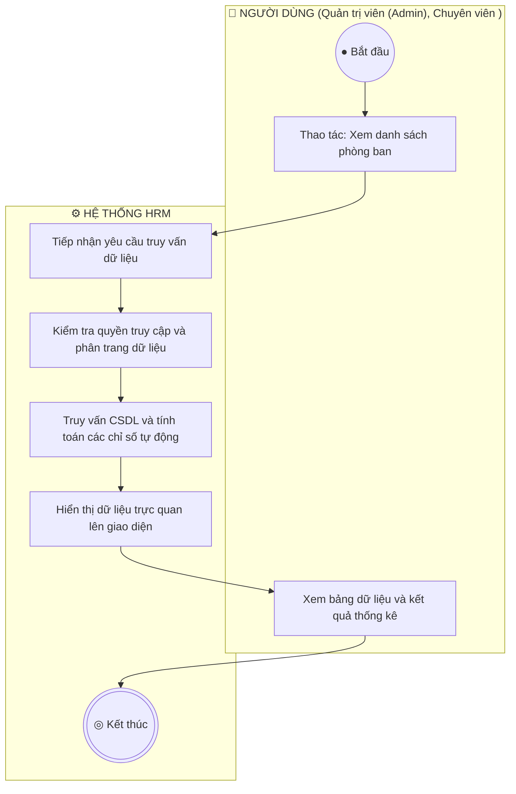

**Mô tả các bước luồng hoạt động:**
- **Điểm bắt đầu:** Chọn chức năng "Phòng ban" trong menu Cơ cấu Tổ chức.
- **Xử lý nghiệp vụ:** Làn Hệ thống tiếp nhận, thẩm định các quy tắc nghiệp vụ tại điểm rẽ nhánh hình thoi.
- **Xử lý rẽ nhánh:** Nếu thỏa mãn điều kiện, hệ thống lưu trữ và hoàn tất; nếu vi phạm, hệ thống hiển thị cảnh báo hướng dẫn người dùng sửa đổi khép kín.
- **Điểm kết thúc:** Quy trình hoàn tất và cập nhật trạng thái mới nhất lên toàn hệ thống.

---

### 2. Sơ đồ Hoạt động cho UC-ORG-01-02: Tìm kiếm và Lọc phòng ban
> **Mục tiêu quy trình:** Tra cứu nhanh chóng phòng ban theo tên gọi, mã viết tắt hoặc trạng thái mà không phải tìm qua nhiều trang.  
> **Tác nhân tham gia:** Quản trị viên, Chuyên viên Nhân sự. | **Sự kiện kích hoạt:** Người dùng nhập từ khóa vào ô tìm kiếm hoặc chọn lọc trạng thái.

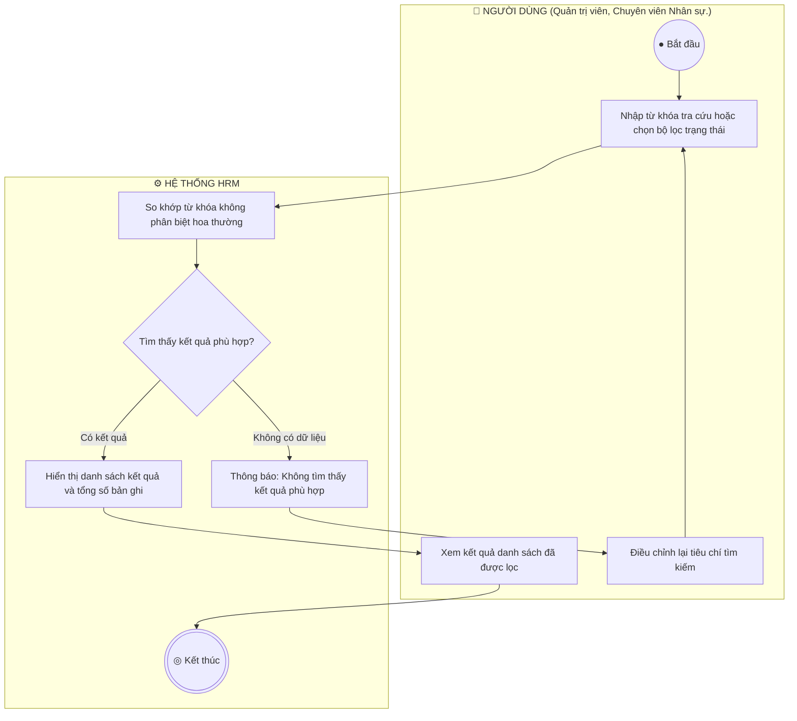

**Mô tả các bước luồng hoạt động:**
- **Điểm bắt đầu:** Người dùng nhập từ khóa vào ô tìm kiếm hoặc chọn lọc trạng thái.
- **Xử lý nghiệp vụ:** Làn Hệ thống tiếp nhận, thẩm định các quy tắc nghiệp vụ tại điểm rẽ nhánh hình thoi.
- **Xử lý rẽ nhánh:** Nếu thỏa mãn điều kiện, hệ thống lưu trữ và hoàn tất; nếu vi phạm, hệ thống hiển thị cảnh báo hướng dẫn người dùng sửa đổi khép kín.
- **Điểm kết thúc:** Quy trình hoàn tất và cập nhật trạng thái mới nhất lên toàn hệ thống.

---

### 3. Sơ đồ Hoạt động cho UC-ORG-01-03: Thêm mới phòng ban và Gán định biên
> **Mục tiêu quy trình:** Khởi tạo đơn vị mới vào sơ đồ cây tổ chức và ấn định chỉ tiêu định biên nhân sự tối đa (quota).  
> **Tác nhân tham gia:** Quản trị viên, Giám đốc Nhân sự. | **Sự kiện kích hoạt:** Người dùng nhấn nút "+ Thêm phòng ban".

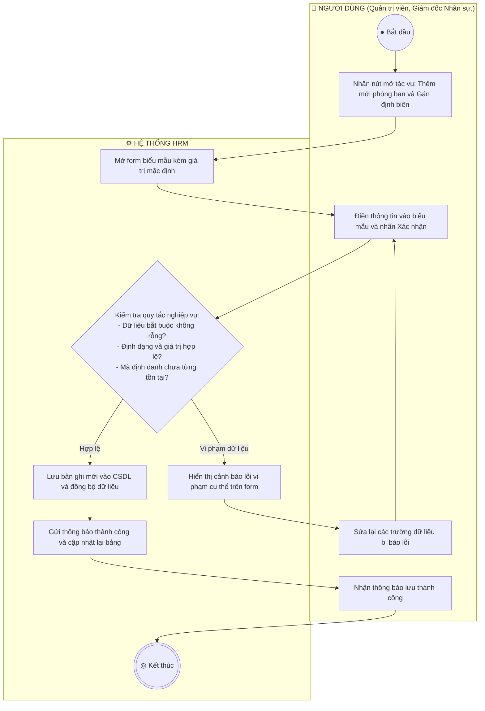

**Mô tả các bước luồng hoạt động:**
- **Điểm bắt đầu:** Người dùng nhấn nút "+ Thêm phòng ban".
- **Xử lý nghiệp vụ:** Làn Hệ thống tiếp nhận, thẩm định các quy tắc nghiệp vụ tại điểm rẽ nhánh hình thoi.
- **Xử lý rẽ nhánh:** Nếu thỏa mãn điều kiện, hệ thống lưu trữ và hoàn tất; nếu vi phạm, hệ thống hiển thị cảnh báo hướng dẫn người dùng sửa đổi khép kín.
- **Điểm kết thúc:** Quy trình hoàn tất và cập nhật trạng thái mới nhất lên toàn hệ thống.

---

### 4. Sơ đồ Hoạt động cho UC-ORG-01-04: Cập nhật thông tin phòng ban
> **Mục tiêu quy trình:** Điều chỉnh tên đơn vị, Trưởng phòng, nâng/hạ định biên hoặc luân chuyển đơn vị cấp trên trực tiếp.  
> **Tác nhân tham gia:** Quản trị viên, Giám đốc Nhân sự. | **Sự kiện kích hoạt:** Người dùng nhấn biểu tượng "Chỉnh sửa" tại dòng phòng ban.

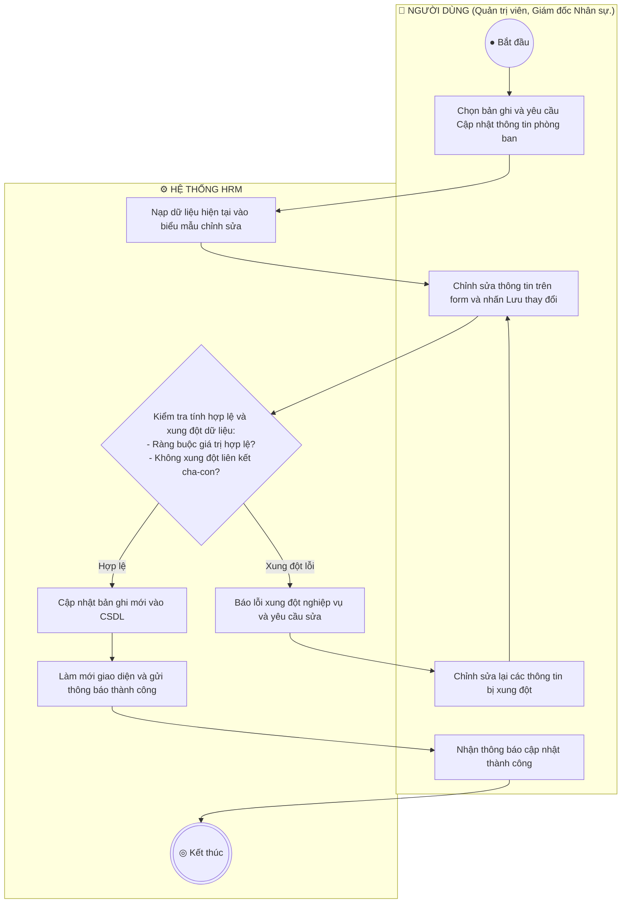

**Mô tả các bước luồng hoạt động:**
- **Điểm bắt đầu:** Người dùng nhấn biểu tượng "Chỉnh sửa" tại dòng phòng ban.
- **Xử lý nghiệp vụ:** Làn Hệ thống tiếp nhận, thẩm định các quy tắc nghiệp vụ tại điểm rẽ nhánh hình thoi.
- **Xử lý rẽ nhánh:** Nếu thỏa mãn điều kiện, hệ thống lưu trữ và hoàn tất; nếu vi phạm, hệ thống hiển thị cảnh báo hướng dẫn người dùng sửa đổi khép kín.
- **Điểm kết thúc:** Quy trình hoàn tất và cập nhật trạng thái mới nhất lên toàn hệ thống.

---

### 5. Sơ đồ Hoạt động cho UC-ORG-01-05: Khóa / Đóng băng phòng ban (Block / Inactive)
> **Mục tiêu quy trình:** Tạm dừng hoạt động hoặc giải thể mềm phòng ban mà không xóa dữ liệu, bảo toàn 100% lịch sử nhân sự cũ.  
> **Tác nhân tham gia:** Quản trị viên, Giám đốc Nhân sự. | **Sự kiện kích hoạt:** Người dùng nhấn biểu tượng Ổ khóa tại cột thao tác.

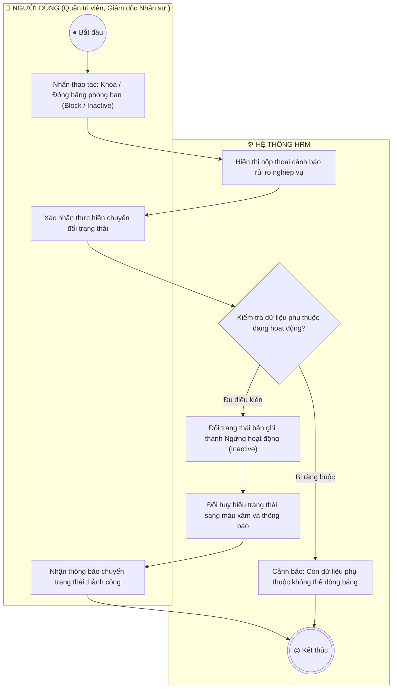

**Mô tả các bước luồng hoạt động:**
- **Điểm bắt đầu:** Người dùng nhấn biểu tượng Ổ khóa tại cột thao tác.
- **Xử lý nghiệp vụ:** Làn Hệ thống tiếp nhận, thẩm định các quy tắc nghiệp vụ tại điểm rẽ nhánh hình thoi.
- **Xử lý rẽ nhánh:** Nếu thỏa mãn điều kiện, hệ thống lưu trữ và hoàn tất; nếu vi phạm, hệ thống hiển thị cảnh báo hướng dẫn người dùng sửa đổi khép kín.
- **Điểm kết thúc:** Quy trình hoàn tất và cập nhật trạng thái mới nhất lên toàn hệ thống.

---

### 6. Sơ đồ Hoạt động cho UC-ORG-01-06: Xóa phòng ban (Hard Delete)
> **Mục tiêu quy trình:** Xóa vĩnh viễn các phòng ban tạo nhầm hoặc phòng ban trống không còn nhu cầu sử dụng.  
> **Tác nhân tham gia:** Quản trị viên cấp cao (Admin). | **Sự kiện kích hoạt:** Người dùng nhấn biểu tượng Thùng rác đỏ.


**Mô tả các bước luồng hoạt động:**
- **Điểm bắt đầu:** Người dùng nhấn biểu tượng Thùng rác đỏ.
- **Xử lý nghiệp vụ:** Làn Hệ thống tiếp nhận, thẩm định các quy tắc nghiệp vụ tại điểm rẽ nhánh hình thoi.
- **Xử lý rẽ nhánh:** Nếu thỏa mãn điều kiện, hệ thống lưu trữ và hoàn tất; nếu vi phạm, hệ thống hiển thị cảnh báo hướng dẫn người dùng sửa đổi khép kín.
- **Điểm kết thúc:** Quy trình hoàn tất và cập nhật trạng thái mới nhất lên toàn hệ thống.

---


## PHẦN 2: SƠ ĐỒ HOẠT ĐỘNG PHÂN HỆ ORG-02
---

### 7. Sơ đồ Hoạt động cho UC-ORG-02-01: Xem danh mục vị trí chức danh
> **Mục tiêu quy trình:** Theo dõi danh mục các vị trí công tác, cấp bậc chuyên môn và khung dải lương quy định.  
> **Tác nhân tham gia:** Quản trị viên, Chuyên viên Nhân sự. | **Sự kiện kích hoạt:** 


**Mô tả các bước luồng hoạt động:**
- **Điểm bắt đầu:** Người dùng khởi động tác vụ trên giao diện.
- **Xử lý nghiệp vụ:** Làn Hệ thống tiếp nhận, thẩm định các quy tắc nghiệp vụ tại điểm rẽ nhánh hình thoi.
- **Xử lý rẽ nhánh:** Nếu thỏa mãn điều kiện, hệ thống lưu trữ và hoàn tất; nếu vi phạm, hệ thống hiển thị cảnh báo hướng dẫn người dùng sửa đổi khép kín.
- **Điểm kết thúc:** Quy trình hoàn tất và cập nhật trạng thái mới nhất lên toàn hệ thống.

---

### 8. Sơ đồ Hoạt động cho UC-ORG-02-02: Thêm mới vị trí và Khung dải lương
> **Mục tiêu quy trình:** Thiết lập chức danh mới, cấp bậc và ấn định khung dải lương tuyển dụng (minSalary - maxSalary).  
> **Tác nhân tham gia:** Quản trị viên, Giám đốc Nhân sự, Chuyên viên CvàB. | **Sự kiện kích hoạt:** 


**Mô tả các bước luồng hoạt động:**
- **Điểm bắt đầu:** Người dùng khởi động tác vụ trên giao diện.
- **Xử lý nghiệp vụ:** Làn Hệ thống tiếp nhận, thẩm định các quy tắc nghiệp vụ tại điểm rẽ nhánh hình thoi.
- **Xử lý rẽ nhánh:** Nếu thỏa mãn điều kiện, hệ thống lưu trữ và hoàn tất; nếu vi phạm, hệ thống hiển thị cảnh báo hướng dẫn người dùng sửa đổi khép kín.
- **Điểm kết thúc:** Quy trình hoàn tất và cập nhật trạng thái mới nhất lên toàn hệ thống.

---

### 9. Sơ đồ Hoạt động cho UC-ORG-02-03: Cập nhật vị trí chức danh
> **Mục tiêu quy trình:** Điều chỉnh tên chức danh, sửa dải lương hoặc thay đổi cấp bậc chuyên môn.  
> **Tác nhân tham gia:** Quản trị viên, HR Manager. | **Sự kiện kích hoạt:** 

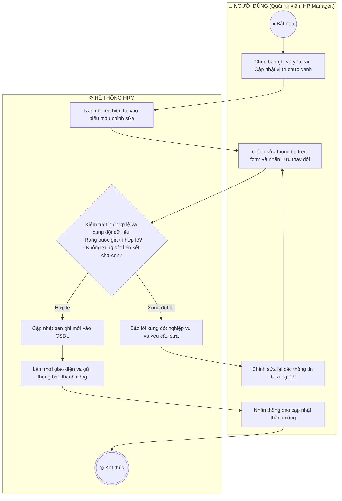

**Mô tả các bước luồng hoạt động:**
- **Điểm bắt đầu:** Người dùng khởi động tác vụ trên giao diện.
- **Xử lý nghiệp vụ:** Làn Hệ thống tiếp nhận, thẩm định các quy tắc nghiệp vụ tại điểm rẽ nhánh hình thoi.
- **Xử lý rẽ nhánh:** Nếu thỏa mãn điều kiện, hệ thống lưu trữ và hoàn tất; nếu vi phạm, hệ thống hiển thị cảnh báo hướng dẫn người dùng sửa đổi khép kín.
- **Điểm kết thúc:** Quy trình hoàn tất và cập nhật trạng thái mới nhất lên toàn hệ thống.

---

### 10. Sơ đồ Hoạt động cho UC-ORG-02-04: Khóa / Đóng băng vị trí chức danh
> **Mục tiêu quy trình:** Ngừng mở tuyển dụng hoặc ngừng bổ nhiệm vào vị trí chức danh cũ mà vẫn giữ nguyên hợp đồng của nhân sự đang nắm giữ vị trí này.  
> **Tác nhân tham gia:** Quản trị viên, HR Manager. | **Sự kiện kích hoạt:** 


**Mô tả các bước luồng hoạt động:**
- **Điểm bắt đầu:** Người dùng khởi động tác vụ trên giao diện.
- **Xử lý nghiệp vụ:** Làn Hệ thống tiếp nhận, thẩm định các quy tắc nghiệp vụ tại điểm rẽ nhánh hình thoi.
- **Xử lý rẽ nhánh:** Nếu thỏa mãn điều kiện, hệ thống lưu trữ và hoàn tất; nếu vi phạm, hệ thống hiển thị cảnh báo hướng dẫn người dùng sửa đổi khép kín.
- **Điểm kết thúc:** Quy trình hoàn tất và cập nhật trạng thái mới nhất lên toàn hệ thống.

---

### 11. Sơ đồ Hoạt động cho UC-ORG-02-05: Xóa vị trí chức danh
> **Mục tiêu quy trình:** Xóa vị trí chức danh không còn tồn tại trong doanh nghiệp.  
> **Tác nhân tham gia:** Quản trị viên. | **Sự kiện kích hoạt:** 

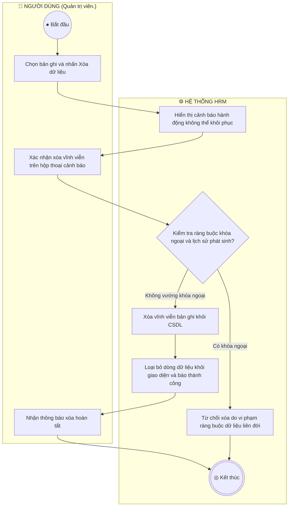

**Mô tả các bước luồng hoạt động:**
- **Điểm bắt đầu:** Người dùng khởi động tác vụ trên giao diện.
- **Xử lý nghiệp vụ:** Làn Hệ thống tiếp nhận, thẩm định các quy tắc nghiệp vụ tại điểm rẽ nhánh hình thoi.
- **Xử lý rẽ nhánh:** Nếu thỏa mãn điều kiện, hệ thống lưu trữ và hoàn tất; nếu vi phạm, hệ thống hiển thị cảnh báo hướng dẫn người dùng sửa đổi khép kín.
- **Điểm kết thúc:** Quy trình hoàn tất và cập nhật trạng thái mới nhất lên toàn hệ thống.

---


## PHẦN 3: SƠ ĐỒ HOẠT ĐỘNG PHÂN HỆ ORG-03
---

### 12. Sơ đồ Hoạt động cho UC-ORG-03-01: Xem biểu đồ phân cấp tổ chức hình cây
> **Mục tiêu quy trình:** Trực quan hóa toàn bộ mô hình phân cấp tổ chức doanh nghiệp (Ban Giám Đốc  ->  Khối  ->  Phòng ban  ->  Bộ phận con).  
> **Tác nhân tham gia:** Quản trị viên,  Toàn thể nhân viên. | **Sự kiện kích hoạt:** 

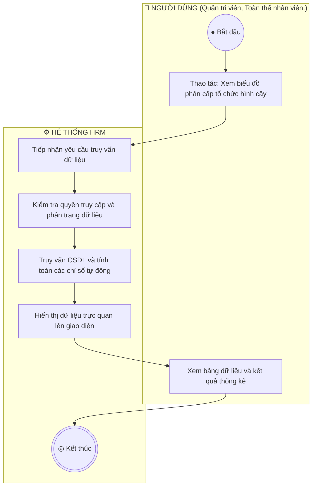

**Mô tả các bước luồng hoạt động:**
- **Điểm bắt đầu:** Người dùng khởi động tác vụ trên giao diện.
- **Xử lý nghiệp vụ:** Làn Hệ thống tiếp nhận, thẩm định các quy tắc nghiệp vụ tại điểm rẽ nhánh hình thoi.
- **Xử lý rẽ nhánh:** Nếu thỏa mãn điều kiện, hệ thống lưu trữ và hoàn tất; nếu vi phạm, hệ thống hiển thị cảnh báo hướng dẫn người dùng sửa đổi khép kín.
- **Điểm kết thúc:** Quy trình hoàn tất và cập nhật trạng thái mới nhất lên toàn hệ thống.

---

### 13. Sơ đồ Hoạt động cho UC-ORG-03-02: Thu gọn / Mở rộng nhánh cây tổ chức
> **Mục tiêu quy trình:** Cho phép người dùng tùy biến tầm nhìn sơ đồ cây bằng cách thu gọn các phòng ban cấp dưới hoặc mở rộng toàn bộ cấu trúc.  
> **Tác nhân tham gia:** Quản trị viên,  Nhân viên. | **Sự kiện kích hoạt:** 

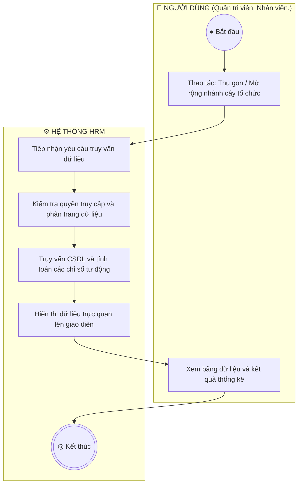

**Mô tả các bước luồng hoạt động:**
- **Điểm bắt đầu:** Người dùng khởi động tác vụ trên giao diện.
- **Xử lý nghiệp vụ:** Làn Hệ thống tiếp nhận, thẩm định các quy tắc nghiệp vụ tại điểm rẽ nhánh hình thoi.
- **Xử lý rẽ nhánh:** Nếu thỏa mãn điều kiện, hệ thống lưu trữ và hoàn tất; nếu vi phạm, hệ thống hiển thị cảnh báo hướng dẫn người dùng sửa đổi khép kín.
- **Điểm kết thúc:** Quy trình hoàn tất và cập nhật trạng thái mới nhất lên toàn hệ thống.

---

### 14. Sơ đồ Hoạt động cho UC-ORG-03-03: Xem tỷ lệ lấp đầy định biên trên sơ đồ
> **Mục tiêu quy trình:** Giúp lãnh đạo nhận diện nhanh các phòng ban đang thừa hoặc thiếu nhân sự so với chỉ tiêu được duyệt.  
> **Tác nhân tham gia:** Ban Giám đốc, HR Manager. | **Sự kiện kích hoạt:** 

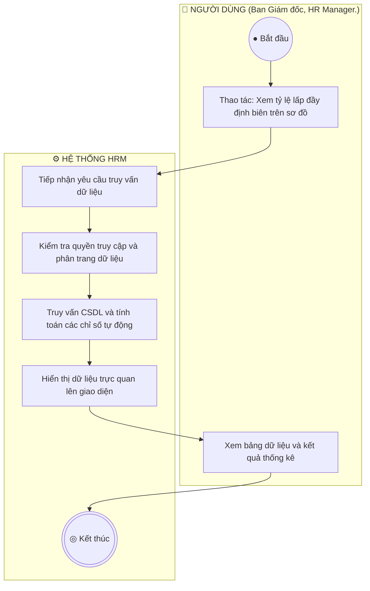

**Mô tả các bước luồng hoạt động:**
- **Điểm bắt đầu:** Người dùng khởi động tác vụ trên giao diện.
- **Xử lý nghiệp vụ:** Làn Hệ thống tiếp nhận, thẩm định các quy tắc nghiệp vụ tại điểm rẽ nhánh hình thoi.
- **Xử lý rẽ nhánh:** Nếu thỏa mãn điều kiện, hệ thống lưu trữ và hoàn tất; nếu vi phạm, hệ thống hiển thị cảnh báo hướng dẫn người dùng sửa đổi khép kín.
- **Điểm kết thúc:** Quy trình hoàn tất và cập nhật trạng thái mới nhất lên toàn hệ thống.

---

### 15. Sơ đồ Hoạt động cho UC-ORG-03-04: Xem danh sách nhân sự trực thuộc phòng ban
> **Mục tiêu quy trình:** Bấm vào một khối phòng ban để tra cứu nhanh danh sách các nhân viên đang làm việc tại đơn vị đó.  
> **Tác nhân tham gia:** Quản trị viên, HR. | **Sự kiện kích hoạt:** 

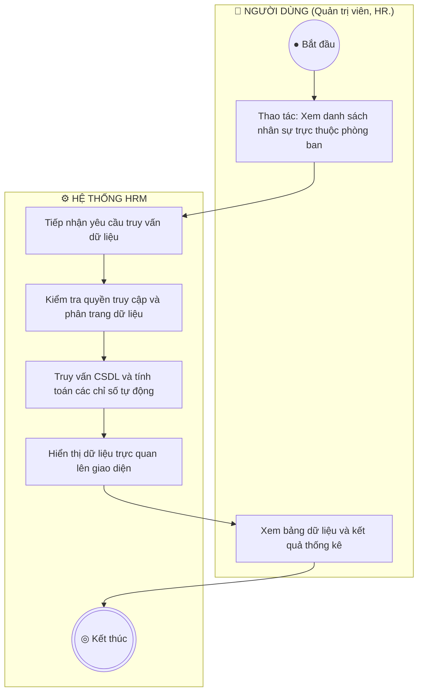

**Mô tả các bước luồng hoạt động:**
- **Điểm bắt đầu:** Người dùng khởi động tác vụ trên giao diện.
- **Xử lý nghiệp vụ:** Làn Hệ thống tiếp nhận, thẩm định các quy tắc nghiệp vụ tại điểm rẽ nhánh hình thoi.
- **Xử lý rẽ nhánh:** Nếu thỏa mãn điều kiện, hệ thống lưu trữ và hoàn tất; nếu vi phạm, hệ thống hiển thị cảnh báo hướng dẫn người dùng sửa đổi khép kín.
- **Điểm kết thúc:** Quy trình hoàn tất và cập nhật trạng thái mới nhất lên toàn hệ thống.

---


## PHẦN 4: SƠ ĐỒ HOẠT ĐỘNG PHÂN HỆ REC-01
---

### 16. Sơ đồ Hoạt động cho UC-REC-01-01: Xem danh sách yêu cầu tuyển dụng
> **Mục tiêu quy trình:** Theo dõi tình trạng các vị trí đang cần tuyển dụng, số lượng chỉ tiêu và tiến độ tuyển thực tế.  
> **Tác nhân tham gia:** Chuyên viên Tuyển dụng, Trưởng bộ phận. | **Sự kiện kích hoạt:** 

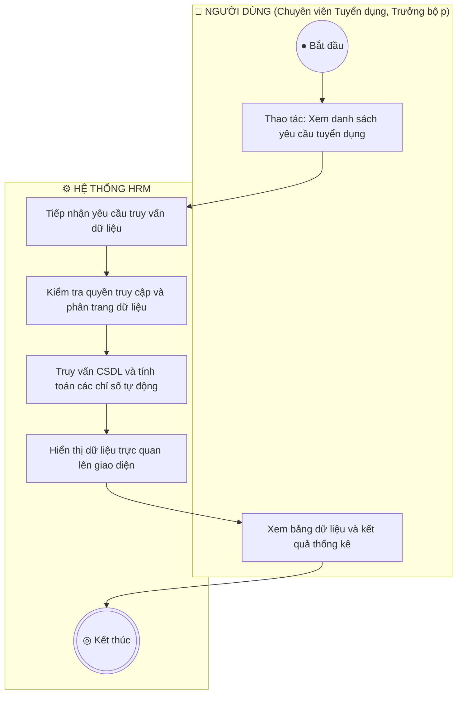

**Mô tả các bước luồng hoạt động:**
- **Điểm bắt đầu:** Người dùng khởi động tác vụ trên giao diện.
- **Xử lý nghiệp vụ:** Làn Hệ thống tiếp nhận, thẩm định các quy tắc nghiệp vụ tại điểm rẽ nhánh hình thoi.
- **Xử lý rẽ nhánh:** Nếu thỏa mãn điều kiện, hệ thống lưu trữ và hoàn tất; nếu vi phạm, hệ thống hiển thị cảnh báo hướng dẫn người dùng sửa đổi khép kín.
- **Điểm kết thúc:** Quy trình hoàn tất và cập nhật trạng thái mới nhất lên toàn hệ thống.

---

### 17. Sơ đồ Hoạt động cho UC-REC-01-02: Lập yêu cầu tuyển dụng và Kiểm tra định biên
> **Mục tiêu quy trình:** Tạo phiếu đề xuất bổ sung nhân sự, hệ thống tự động kiểm tra trần định biên để tránh tuyển vượt chỉ tiêu.  
> **Tác nhân tham gia:** Trưởng bộ phận, Chuyên viên Tuyển dụng. | **Sự kiện kích hoạt:** 

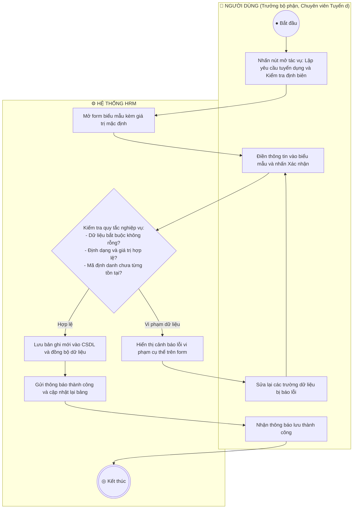

**Mô tả các bước luồng hoạt động:**
- **Điểm bắt đầu:** Người dùng khởi động tác vụ trên giao diện.
- **Xử lý nghiệp vụ:** Làn Hệ thống tiếp nhận, thẩm định các quy tắc nghiệp vụ tại điểm rẽ nhánh hình thoi.
- **Xử lý rẽ nhánh:** Nếu thỏa mãn điều kiện, hệ thống lưu trữ và hoàn tất; nếu vi phạm, hệ thống hiển thị cảnh báo hướng dẫn người dùng sửa đổi khép kín.
- **Điểm kết thúc:** Quy trình hoàn tất và cập nhật trạng thái mới nhất lên toàn hệ thống.

---

### 18. Sơ đồ Hoạt động cho UC-REC-01-03: Chỉnh sửa yêu cầu tuyển dụng
> **Mục tiêu quy trình:** Cập nhật lại yêu cầu kinh nghiệm, điều chỉnh dải lương hoặc gia hạn thời gian nộp hồ sơ.  
> **Tác nhân tham gia:** Chuyên viên Tuyển dụng. | **Sự kiện kích hoạt:** 

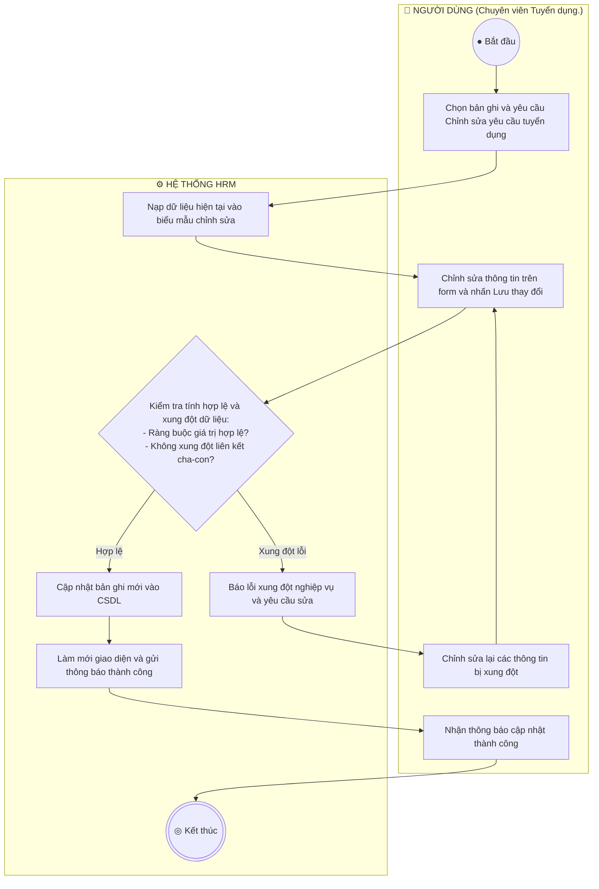

**Mô tả các bước luồng hoạt động:**
- **Điểm bắt đầu:** Người dùng khởi động tác vụ trên giao diện.
- **Xử lý nghiệp vụ:** Làn Hệ thống tiếp nhận, thẩm định các quy tắc nghiệp vụ tại điểm rẽ nhánh hình thoi.
- **Xử lý rẽ nhánh:** Nếu thỏa mãn điều kiện, hệ thống lưu trữ và hoàn tất; nếu vi phạm, hệ thống hiển thị cảnh báo hướng dẫn người dùng sửa đổi khép kín.
- **Điểm kết thúc:** Quy trình hoàn tất và cập nhật trạng thái mới nhất lên toàn hệ thống.

---

### 19. Sơ đồ Hoạt động cho UC-REC-01-04: Xuất bản tin ra Cổng Tuyển dụng Công khai
> **Mục tiêu quy trình:** Đưa tin tuyển dụng lên trang chủ việc làm để ứng viên bên ngoài tiếp cận và nộp hồ sơ.  
> **Tác nhân tham gia:** Chuyên viên Tuyển dụng. | **Sự kiện kích hoạt:** 

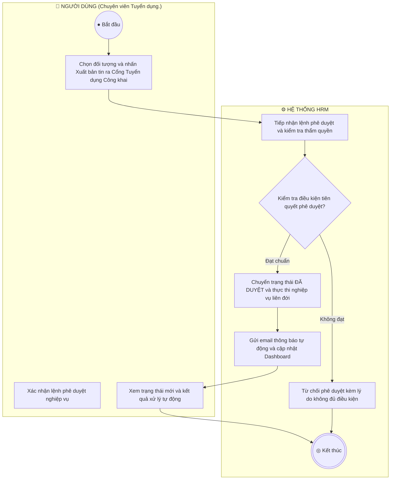

**Mô tả các bước luồng hoạt động:**
- **Điểm bắt đầu:** Người dùng khởi động tác vụ trên giao diện.
- **Xử lý nghiệp vụ:** Làn Hệ thống tiếp nhận, thẩm định các quy tắc nghiệp vụ tại điểm rẽ nhánh hình thoi.
- **Xử lý rẽ nhánh:** Nếu thỏa mãn điều kiện, hệ thống lưu trữ và hoàn tất; nếu vi phạm, hệ thống hiển thị cảnh báo hướng dẫn người dùng sửa đổi khép kín.
- **Điểm kết thúc:** Quy trình hoàn tất và cập nhật trạng thái mới nhất lên toàn hệ thống.

---

### 20. Sơ đồ Hoạt động cho UC-REC-01-05: Đóng nhận hồ sơ tuyển dụng
> **Mục tiêu quy trình:** Dừng nhận hồ sơ khi đã tuyển đủ chỉ tiêu hoặc hết thời hạn tuyển dụng.  
> **Tác nhân tham gia:** Chuyên viên Tuyển dụng. | **Sự kiện kích hoạt:** 


**Mô tả các bước luồng hoạt động:**
- **Điểm bắt đầu:** Người dùng khởi động tác vụ trên giao diện.
- **Xử lý nghiệp vụ:** Làn Hệ thống tiếp nhận, thẩm định các quy tắc nghiệp vụ tại điểm rẽ nhánh hình thoi.
- **Xử lý rẽ nhánh:** Nếu thỏa mãn điều kiện, hệ thống lưu trữ và hoàn tất; nếu vi phạm, hệ thống hiển thị cảnh báo hướng dẫn người dùng sửa đổi khép kín.
- **Điểm kết thúc:** Quy trình hoàn tất và cập nhật trạng thái mới nhất lên toàn hệ thống.

---


## PHẦN 5: SƠ ĐỒ HOẠT ĐỘNG PHÂN HỆ REC-02
---

### 21. Sơ đồ Hoạt động cho UC-REC-02-01: Xem bảng Kanban phân loại 7 bước
> **Mục tiêu quy trình:** Theo dõi toàn bộ ứng viên theo 7 bước phễu: Tiếp cận  ->  Ứng tuyển  ->  Sơ loại  ->  Phỏng vấn  ->  Đề nghị việc  ->  Tiếp nhận / Từ chối.  
> **Tác nhân tham gia:** Chuyên viên Tuyển dụng. | **Sự kiện kích hoạt:** 

```mermaid
flowchart TD
    subgraph USER ["👤 NGƯỜI DÙNG (Chuyên viên Tuyển dụng.)"]
        START((● Bắt đầu))
        U1["Thao tác: Xem bảng Kanban phân loại 7 bước"]
        U2["Xem bảng dữ liệu và kết quả thống kê"]
    end
    subgraph SYS ["⚙️ HỆ THỐNG HRM"]
        S1["Tiếp nhận yêu cầu truy vấn dữ liệu"]
        S2["Kiểm tra quyền truy cập và phân trang dữ liệu"]
        S3["Truy vấn CSDL và tính toán các chỉ số tự động"]
        S4["Hiển thị dữ liệu trực quan lên giao diện"]
        END_NODE(((◎ Kết thúc)))
    end
    START --> U1
    U1 --> S1
    S1 --> S2
    S2 --> S3
    S3 --> S4
    S4 --> U2
    U2 --> END_NODE
```

**Mô tả các bước luồng hoạt động:**
- **Điểm bắt đầu:** Người dùng khởi động tác vụ trên giao diện.
- **Xử lý nghiệp vụ:** Làn Hệ thống tiếp nhận, thẩm định các quy tắc nghiệp vụ tại điểm rẽ nhánh hình thoi.
- **Xử lý rẽ nhánh:** Nếu thỏa mãn điều kiện, hệ thống lưu trữ và hoàn tất; nếu vi phạm, hệ thống hiển thị cảnh báo hướng dẫn người dùng sửa đổi khép kín.
- **Điểm kết thúc:** Quy trình hoàn tất và cập nhật trạng thái mới nhất lên toàn hệ thống.

---

### 22. Sơ đồ Hoạt động cho UC-REC-02-02: Kéo thả chuyển trạng thái ứng viên
> **Mục tiêu quy trình:** Cập nhật tiến độ tuyển dụng nhanh chóng bằng thao tác kéo thả trực quan.  
> **Tác nhân tham gia:** Chuyên viên Tuyển dụng. | **Sự kiện kích hoạt:** 

```mermaid
flowchart TD
    subgraph USER ["👤 NGƯỜI DÙNG (Chuyên viên Tuyển dụng.)"]
        START((● Bắt đầu))
        U1["Chọn bản ghi và yêu cầu Kéo thả chuyển trạng thái ứng viên"]
        U2["Chỉnh sửa thông tin trên form và nhấn Lưu thay đổi"]
        U3["Nhận thông báo cập nhật thành công"]
        U4["Chỉnh sửa lại các thông tin bị xung đột"]
    end
    subgraph SYS ["⚙️ HỆ THỐNG HRM"]
        S1["Nạp dữ liệu hiện tại vào biểu mẫu chỉnh sửa"]
        S2{"Kiểm tra tính hợp lệ và xung đột dữ liệu:
- Ràng buộc giá trị hợp lệ?
- Không xung đột liên kết cha-con?"}
        S3["Cập nhật bản ghi mới vào CSDL"]
        S4["Làm mới giao diện và gửi thông báo thành công"]
        S5["Báo lỗi xung đột nghiệp vụ và yêu cầu sửa"]
        END_NODE(((◎ Kết thúc)))
    end
    START --> U1
    U1 --> S1
    S1 --> U2
    U2 --> S2
    S2 -- "Hợp lệ" --> S3
    S3 --> S4
    S4 --> U3
    U3 --> END_NODE
    S2 -- "Xung đột lỗi" --> S5
    S5 --> U4
    U4 --> U2
```

**Mô tả các bước luồng hoạt động:**
- **Điểm bắt đầu:** Người dùng khởi động tác vụ trên giao diện.
- **Xử lý nghiệp vụ:** Làn Hệ thống tiếp nhận, thẩm định các quy tắc nghiệp vụ tại điểm rẽ nhánh hình thoi.
- **Xử lý rẽ nhánh:** Nếu thỏa mãn điều kiện, hệ thống lưu trữ và hoàn tất; nếu vi phạm, hệ thống hiển thị cảnh báo hướng dẫn người dùng sửa đổi khép kín.
- **Điểm kết thúc:** Quy trình hoàn tất và cập nhật trạng thái mới nhất lên toàn hệ thống.

---

### 23. Sơ đồ Hoạt động cho UC-REC-02-03: Xem chi tiết CV và Đánh giá
> **Mục tiêu quy trình:** Xem trực tiếp file hồ sơ CV của ứng viên và ghi chú nhận xét ban đầu.  
> **Tác nhân tham gia:** Chuyên viên Tuyển dụng. | **Sự kiện kích hoạt:** 

```mermaid
flowchart TD
    subgraph USER ["👤 NGƯỜI DÙNG (Chuyên viên Tuyển dụng.)"]
        START((● Bắt đầu))
        U1["Thao tác: Xem chi tiết CV và Đánh giá"]
        U2["Xem bảng dữ liệu và kết quả thống kê"]
    end
    subgraph SYS ["⚙️ HỆ THỐNG HRM"]
        S1["Tiếp nhận yêu cầu truy vấn dữ liệu"]
        S2["Kiểm tra quyền truy cập và phân trang dữ liệu"]
        S3["Truy vấn CSDL và tính toán các chỉ số tự động"]
        S4["Hiển thị dữ liệu trực quan lên giao diện"]
        END_NODE(((◎ Kết thúc)))
    end
    START --> U1
    U1 --> S1
    S1 --> S2
    S2 --> S3
    S3 --> S4
    S4 --> U2
    U2 --> END_NODE
```

**Mô tả các bước luồng hoạt động:**
- **Điểm bắt đầu:** Người dùng khởi động tác vụ trên giao diện.
- **Xử lý nghiệp vụ:** Làn Hệ thống tiếp nhận, thẩm định các quy tắc nghiệp vụ tại điểm rẽ nhánh hình thoi.
- **Xử lý rẽ nhánh:** Nếu thỏa mãn điều kiện, hệ thống lưu trữ và hoàn tất; nếu vi phạm, hệ thống hiển thị cảnh báo hướng dẫn người dùng sửa đổi khép kín.
- **Điểm kết thúc:** Quy trình hoàn tất và cập nhật trạng thái mới nhất lên toàn hệ thống.

---

### 24. Sơ đồ Hoạt động cho UC-REC-02-04: Loại bỏ / Từ chối hồ sơ (Reject)
> **Mục tiêu quy trình:** Đánh dấu không phù hợp đối với các ứng viên không đạt yêu cầu.  
> **Tác nhân tham gia:** Chuyên viên Tuyển dụng. | **Sự kiện kích hoạt:** 

```mermaid
flowchart TD
    subgraph USER ["👤 NGƯỜI DÙNG (Chuyên viên Tuyển dụng.)"]
        START((● Bắt đầu))
        U1["Nhấn thao tác: Loại bỏ / Từ chối hồ sơ (Reject)"]
        U2["Xác nhận thực hiện chuyển đổi trạng thái"]
        U3["Nhận thông báo chuyển trạng thái thành công"]
    end
    subgraph SYS ["⚙️ HỆ THỐNG HRM"]
        S1["Hiển thị hộp thoại cảnh báo rủi ro nghiệp vụ"]
        S2{"Kiểm tra dữ liệu phụ thuộc đang hoạt động?"}
        S3["Đổi trạng thái bản ghi thành Ngừng hoạt động (Inactive)"]
        S4["Đổi huy hiệu trạng thái sang màu xám và thông báo"]
        S5["Cảnh báo: Còn dữ liệu phụ thuộc không thể đóng băng"]
        END_NODE(((◎ Kết thúc)))
    end
    START --> U1
    U1 --> S1
    S1 --> U2
    U2 --> S2
    S2 -- "Đủ điều kiện" --> S3
    S3 --> S4
    S4 --> U3
    U3 --> END_NODE
    S2 -- "Bị ràng buộc" --> S5
    S5 --> END_NODE
```

**Mô tả các bước luồng hoạt động:**
- **Điểm bắt đầu:** Người dùng khởi động tác vụ trên giao diện.
- **Xử lý nghiệp vụ:** Làn Hệ thống tiếp nhận, thẩm định các quy tắc nghiệp vụ tại điểm rẽ nhánh hình thoi.
- **Xử lý rẽ nhánh:** Nếu thỏa mãn điều kiện, hệ thống lưu trữ và hoàn tất; nếu vi phạm, hệ thống hiển thị cảnh báo hướng dẫn người dùng sửa đổi khép kín.
- **Điểm kết thúc:** Quy trình hoàn tất và cập nhật trạng thái mới nhất lên toàn hệ thống.

---


## PHẦN 6: SƠ ĐỒ HOẠT ĐỘNG PHÂN HỆ REC-03
---

### 25. Sơ đồ Hoạt động cho UC-REC-03-01: Xem lịch phỏng vấn
> **Mục tiêu quy trình:** Theo dõi danh sách các buổi phỏng vấn sắp diễn ra theo tuần hoặc tháng.  
> **Tác nhân tham gia:** Hội đồng phỏng vấn, Chuyên viên Tuyển dụng. | **Sự kiện kích hoạt:** 

```mermaid
flowchart TD
    subgraph USER ["👤 NGƯỜI DÙNG (Hội đồng phỏng vấn, Chuyên viên Tuy)"]
        START((● Bắt đầu))
        U1["Thao tác: Xem lịch phỏng vấn"]
        U2["Xem bảng dữ liệu và kết quả thống kê"]
    end
    subgraph SYS ["⚙️ HỆ THỐNG HRM"]
        S1["Tiếp nhận yêu cầu truy vấn dữ liệu"]
        S2["Kiểm tra quyền truy cập và phân trang dữ liệu"]
        S3["Truy vấn CSDL và tính toán các chỉ số tự động"]
        S4["Hiển thị dữ liệu trực quan lên giao diện"]
        END_NODE(((◎ Kết thúc)))
    end
    START --> U1
    U1 --> S1
    S1 --> S2
    S2 --> S3
    S3 --> S4
    S4 --> U2
    U2 --> END_NODE
```

**Mô tả các bước luồng hoạt động:**
- **Điểm bắt đầu:** Người dùng khởi động tác vụ trên giao diện.
- **Xử lý nghiệp vụ:** Làn Hệ thống tiếp nhận, thẩm định các quy tắc nghiệp vụ tại điểm rẽ nhánh hình thoi.
- **Xử lý rẽ nhánh:** Nếu thỏa mãn điều kiện, hệ thống lưu trữ và hoàn tất; nếu vi phạm, hệ thống hiển thị cảnh báo hướng dẫn người dùng sửa đổi khép kín.
- **Điểm kết thúc:** Quy trình hoàn tất và cập nhật trạng thái mới nhất lên toàn hệ thống.

---

### 26. Sơ đồ Hoạt động cho UC-REC-03-02: Tạo lịch và Gán người phỏng vấn
> **Mục tiêu quy trình:** Xếp lịch phỏng vấn và phân công người chấm thi phù hợp.  
> **Tác nhân tham gia:** Chuyên viên Tuyển dụng. | **Sự kiện kích hoạt:** 

```mermaid
flowchart TD
    subgraph USER ["👤 NGƯỜI DÙNG (Chuyên viên Tuyển dụng.)"]
        START((● Bắt đầu))
        U1["Nhấn nút mở tác vụ: Tạo lịch và Gán người phỏng vấn"]
        U2["Điền thông tin vào biểu mẫu và nhấn Xác nhận"]
        U3["Nhận thông báo lưu thành công"]
        U4["Sửa lại các trường dữ liệu bị báo lỗi"]
    end
    subgraph SYS ["⚙️ HỆ THỐNG HRM"]
        S1["Mở form biểu mẫu kèm giá trị mặc định"]
        S2{"Kiểm tra quy tắc nghiệp vụ:
- Dữ liệu bắt buộc không rỗng?
- Định dạng và giá trị hợp lệ?
- Mã định danh chưa từng tồn tại?"}
        S3["Lưu bản ghi mới vào CSDL và đồng bộ dữ liệu"]
        S4["Gửi thông báo thành công và cập nhật lại bảng"]
        S5["Hiển thị cảnh báo lỗi vi phạm cụ thể trên form"]
        END_NODE(((◎ Kết thúc)))
    end
    START --> U1
    U1 --> S1
    S1 --> U2
    U2 --> S2
    S2 -- "Hợp lệ" --> S3
    S3 --> S4
    S4 --> U3
    U3 --> END_NODE
    S2 -- "Vi phạm dữ liệu" --> S5
    S5 --> U4
    U4 --> U2
```

**Mô tả các bước luồng hoạt động:**
- **Điểm bắt đầu:** Người dùng khởi động tác vụ trên giao diện.
- **Xử lý nghiệp vụ:** Làn Hệ thống tiếp nhận, thẩm định các quy tắc nghiệp vụ tại điểm rẽ nhánh hình thoi.
- **Xử lý rẽ nhánh:** Nếu thỏa mãn điều kiện, hệ thống lưu trữ và hoàn tất; nếu vi phạm, hệ thống hiển thị cảnh báo hướng dẫn người dùng sửa đổi khép kín.
- **Điểm kết thúc:** Quy trình hoàn tất và cập nhật trạng thái mới nhất lên toàn hệ thống.

---

### 27. Sơ đồ Hoạt động cho UC-REC-03-03: Gửi email mời phỏng vấn tự động
> **Mục tiêu quy trình:** Tự động gửi thư mời phỏng vấn chuyên nghiệp đến hòm thư ứng viên kèm đường link xác nhận.  
> **Tác nhân tham gia:** Hệ thống tự động /  HR. | **Sự kiện kích hoạt:** 

```mermaid
flowchart TD
    subgraph USER ["👤 NGƯỜI DÙNG (Hệ thống tự động /  HR.)"]
        START((● Bắt đầu))
        U1["Chọn đối tượng và nhấn Gửi email mời phỏng vấn tự động"]
        U2["Xác nhận lệnh phê duyệt nghiệp vụ"]
        U3["Xem trạng thái mới và kết quả xử lý tự động"]
    end
    subgraph SYS ["⚙️ HỆ THỐNG HRM"]
        S1["Tiếp nhận lệnh phê duyệt và kiểm tra thẩm quyền"]
        S2{"Kiểm tra điều kiện tiên quyết phê duyệt?"}
        S3["Chuyển trạng thái ĐÃ DUYỆT và thực thi nghiệp vụ liên đới"]
        S4["Gửi email thông báo tự động và cập nhật Dashboard"]
        S5["Từ chối phê duyệt kèm lý do không đủ điều kiện"]
        END_NODE(((◎ Kết thúc)))
    end
    START --> U1
    U1 --> S1
    S1 --> S2
    S2 -- "Đạt chuẩn" --> S3
    S3 --> S4
    S4 --> U3
    U3 --> END_NODE
    S2 -- "Không đạt" --> S5
    S5 --> END_NODE
```

**Mô tả các bước luồng hoạt động:**
- **Điểm bắt đầu:** Người dùng khởi động tác vụ trên giao diện.
- **Xử lý nghiệp vụ:** Làn Hệ thống tiếp nhận, thẩm định các quy tắc nghiệp vụ tại điểm rẽ nhánh hình thoi.
- **Xử lý rẽ nhánh:** Nếu thỏa mãn điều kiện, hệ thống lưu trữ và hoàn tất; nếu vi phạm, hệ thống hiển thị cảnh báo hướng dẫn người dùng sửa đổi khép kín.
- **Điểm kết thúc:** Quy trình hoàn tất và cập nhật trạng thái mới nhất lên toàn hệ thống.

---

### 28. Sơ đồ Hoạt động cho UC-REC-03-04: Nhập điểm và Nhận xét đánh giá
> **Mục tiêu quy trình:** Cán bộ phỏng vấn ghi nhận kết quả đánh giá năng lực ứng viên làm căn cứ đề xuất phát hành Thư mời nhận việc.  
> **Tác nhân tham gia:** Cán bộ phỏng vấn. | **Sự kiện kích hoạt:** 

```mermaid
flowchart TD
    subgraph USER ["👤 NGƯỜI DÙNG (Cán bộ phỏng vấn.)"]
        START((● Bắt đầu))
        U1["Chọn bản ghi và yêu cầu Nhập điểm và Nhận xét đánh giá"]
        U2["Chỉnh sửa thông tin trên form và nhấn Lưu thay đổi"]
        U3["Nhận thông báo cập nhật thành công"]
        U4["Chỉnh sửa lại các thông tin bị xung đột"]
    end
    subgraph SYS ["⚙️ HỆ THỐNG HRM"]
        S1["Nạp dữ liệu hiện tại vào biểu mẫu chỉnh sửa"]
        S2{"Kiểm tra tính hợp lệ và xung đột dữ liệu:
- Ràng buộc giá trị hợp lệ?
- Không xung đột liên kết cha-con?"}
        S3["Cập nhật bản ghi mới vào CSDL"]
        S4["Làm mới giao diện và gửi thông báo thành công"]
        S5["Báo lỗi xung đột nghiệp vụ và yêu cầu sửa"]
        END_NODE(((◎ Kết thúc)))
    end
    START --> U1
    U1 --> S1
    S1 --> U2
    U2 --> S2
    S2 -- "Hợp lệ" --> S3
    S3 --> S4
    S4 --> U3
    U3 --> END_NODE
    S2 -- "Xung đột lỗi" --> S5
    S5 --> U4
    U4 --> U2
```

**Mô tả các bước luồng hoạt động:**
- **Điểm bắt đầu:** Người dùng khởi động tác vụ trên giao diện.
- **Xử lý nghiệp vụ:** Làn Hệ thống tiếp nhận, thẩm định các quy tắc nghiệp vụ tại điểm rẽ nhánh hình thoi.
- **Xử lý rẽ nhánh:** Nếu thỏa mãn điều kiện, hệ thống lưu trữ và hoàn tất; nếu vi phạm, hệ thống hiển thị cảnh báo hướng dẫn người dùng sửa đổi khép kín.
- **Điểm kết thúc:** Quy trình hoàn tất và cập nhật trạng thái mới nhất lên toàn hệ thống.

---

### 29. Sơ đồ Hoạt động cho UC-REC-03-05: Hủy / Đổi thời gian phỏng vấn
> **Mục tiêu quy trình:** Điều chỉnh thời gian khi có phát sinh từ phía ứng viên hoặc hội đồng phỏng vấn.  
> **Tác nhân tham gia:** Chuyên viên Tuyển dụng. | **Sự kiện kích hoạt:** 

```mermaid
flowchart TD
    subgraph USER ["👤 NGƯỜI DÙNG (Chuyên viên Tuyển dụng.)"]
        START((● Bắt đầu))
        U1["Chọn bản ghi và nhấn Xóa dữ liệu"]
        U2["Xác nhận xóa vĩnh viễn trên hộp thoại cảnh báo"]
        U3["Nhận thông báo xóa hoàn tất"]
    end
    subgraph SYS ["⚙️ HỆ THỐNG HRM"]
        S1["Hiển thị cảnh báo hành động không thể khôi phục"]
        S2{"Kiểm tra ràng buộc khóa ngoại và lịch sử phát sinh?"}
        S3["Xóa vĩnh viễn bản ghi khỏi CSDL"]
        S4["Loại bỏ dòng dữ liệu khỏi giao diện và báo thành công"]
        S5["Từ chối xóa do vi phạm ràng buộc dữ liệu liên đới"]
        END_NODE(((◎ Kết thúc)))
    end
    START --> U1
    U1 --> S1
    S1 --> U2
    U2 --> S2
    S2 -- "Không vướng khóa ngoại" --> S3
    S3 --> S4
    S4 --> U3
    U3 --> END_NODE
    S2 -- "Có khóa ngoại" --> S5
    S5 --> END_NODE
```

**Mô tả các bước luồng hoạt động:**
- **Điểm bắt đầu:** Người dùng khởi động tác vụ trên giao diện.
- **Xử lý nghiệp vụ:** Làn Hệ thống tiếp nhận, thẩm định các quy tắc nghiệp vụ tại điểm rẽ nhánh hình thoi.
- **Xử lý rẽ nhánh:** Nếu thỏa mãn điều kiện, hệ thống lưu trữ và hoàn tất; nếu vi phạm, hệ thống hiển thị cảnh báo hướng dẫn người dùng sửa đổi khép kín.
- **Điểm kết thúc:** Quy trình hoàn tất và cập nhật trạng thái mới nhất lên toàn hệ thống.

---


## PHẦN 7: SƠ ĐỒ HOẠT ĐỘNG PHÂN HỆ REC-04
---

### 30. Sơ đồ Hoạt động cho UC-REC-04-01: Xem danh sách Thư mời nhận việc
> **Mục tiêu quy trình:** Theo dõi tình trạng các thư mời nhận việc đã phát hành và hạn phản hồi của ứng viên.  
> **Tác nhân tham gia:** HR Manager, Chuyên viên CvàB. | **Sự kiện kích hoạt:** 

```mermaid
flowchart TD
    subgraph USER ["👤 NGƯỜI DÙNG (HR Manager, Chuyên viên CvàB.)"]
        START((● Bắt đầu))
        U1["Thao tác: Xem danh sách Thư mời nhận việc"]
        U2["Xem bảng dữ liệu và kết quả thống kê"]
    end
    subgraph SYS ["⚙️ HỆ THỐNG HRM"]
        S1["Tiếp nhận yêu cầu truy vấn dữ liệu"]
        S2["Kiểm tra quyền truy cập và phân trang dữ liệu"]
        S3["Truy vấn CSDL và tính toán các chỉ số tự động"]
        S4["Hiển thị dữ liệu trực quan lên giao diện"]
        END_NODE(((◎ Kết thúc)))
    end
    START --> U1
    U1 --> S1
    S1 --> S2
    S2 --> S3
    S3 --> S4
    S4 --> U2
    U2 --> END_NODE
```

**Mô tả các bước luồng hoạt động:**
- **Điểm bắt đầu:** Người dùng khởi động tác vụ trên giao diện.
- **Xử lý nghiệp vụ:** Làn Hệ thống tiếp nhận, thẩm định các quy tắc nghiệp vụ tại điểm rẽ nhánh hình thoi.
- **Xử lý rẽ nhánh:** Nếu thỏa mãn điều kiện, hệ thống lưu trữ và hoàn tất; nếu vi phạm, hệ thống hiển thị cảnh báo hướng dẫn người dùng sửa đổi khép kín.
- **Điểm kết thúc:** Quy trình hoàn tất và cập nhật trạng thái mới nhất lên toàn hệ thống.

---

### 31. Sơ đồ Hoạt động cho UC-REC-04-02: Soạn thảo Thư mời Offer theo luật lao động
> **Mục tiêu quy trình:** Soạn thảo thư mời nhận việc chính thức với tỷ lệ lương thử việc chuẩn 85% theo Bộ luật Lao động.  
> **Tác nhân tham gia:** HR Manager, Chuyên viên CvàB. | **Sự kiện kích hoạt:** 

```mermaid
flowchart TD
    subgraph USER ["👤 NGƯỜI DÙNG (HR Manager, Chuyên viên CvàB.)"]
        START((● Bắt đầu))
        U1["Nhấn nút mở tác vụ: Soạn thảo Thư mời Offer theo luật lao động"]
        U2["Điền thông tin vào biểu mẫu và nhấn Xác nhận"]
        U3["Nhận thông báo lưu thành công"]
        U4["Sửa lại các trường dữ liệu bị báo lỗi"]
    end
    subgraph SYS ["⚙️ HỆ THỐNG HRM"]
        S1["Mở form biểu mẫu kèm giá trị mặc định"]
        S2{"Kiểm tra quy tắc nghiệp vụ:
- Dữ liệu bắt buộc không rỗng?
- Định dạng và giá trị hợp lệ?
- Mã định danh chưa từng tồn tại?"}
        S3["Lưu bản ghi mới vào CSDL và đồng bộ dữ liệu"]
        S4["Gửi thông báo thành công và cập nhật lại bảng"]
        S5["Hiển thị cảnh báo lỗi vi phạm cụ thể trên form"]
        END_NODE(((◎ Kết thúc)))
    end
    START --> U1
    U1 --> S1
    S1 --> U2
    U2 --> S2
    S2 -- "Hợp lệ" --> S3
    S3 --> S4
    S4 --> U3
    U3 --> END_NODE
    S2 -- "Vi phạm dữ liệu" --> S5
    S5 --> U4
    U4 --> U2
```

**Mô tả các bước luồng hoạt động:**
- **Điểm bắt đầu:** Người dùng khởi động tác vụ trên giao diện.
- **Xử lý nghiệp vụ:** Làn Hệ thống tiếp nhận, thẩm định các quy tắc nghiệp vụ tại điểm rẽ nhánh hình thoi.
- **Xử lý rẽ nhánh:** Nếu thỏa mãn điều kiện, hệ thống lưu trữ và hoàn tất; nếu vi phạm, hệ thống hiển thị cảnh báo hướng dẫn người dùng sửa đổi khép kín.
- **Điểm kết thúc:** Quy trình hoàn tất và cập nhật trạng thái mới nhất lên toàn hệ thống.

---

### 32. Sơ đồ Hoạt động cho UC-REC-04-03: Gửi email Offer điện tử cho ứng viên
> **Mục tiêu quy trình:** Phát hành thư mời làm việc chính thức qua hòm thư điện tử của ứng viên.  
> **Tác nhân tham gia:** HR Manager. | **Sự kiện kích hoạt:** 

```mermaid
flowchart TD
    subgraph USER ["👤 NGƯỜI DÙNG (HR Manager.)"]
        START((● Bắt đầu))
        U1["Chọn đối tượng và nhấn Gửi email Offer điện tử cho ứng viên"]
        U2["Xác nhận lệnh phê duyệt nghiệp vụ"]
        U3["Xem trạng thái mới và kết quả xử lý tự động"]
    end
    subgraph SYS ["⚙️ HỆ THỐNG HRM"]
        S1["Tiếp nhận lệnh phê duyệt và kiểm tra thẩm quyền"]
        S2{"Kiểm tra điều kiện tiên quyết phê duyệt?"}
        S3["Chuyển trạng thái ĐÃ DUYỆT và thực thi nghiệp vụ liên đới"]
        S4["Gửi email thông báo tự động và cập nhật Dashboard"]
        S5["Từ chối phê duyệt kèm lý do không đủ điều kiện"]
        END_NODE(((◎ Kết thúc)))
    end
    START --> U1
    U1 --> S1
    S1 --> S2
    S2 -- "Đạt chuẩn" --> S3
    S3 --> S4
    S4 --> U3
    U3 --> END_NODE
    S2 -- "Không đạt" --> S5
    S5 --> END_NODE
```

**Mô tả các bước luồng hoạt động:**
- **Điểm bắt đầu:** Người dùng khởi động tác vụ trên giao diện.
- **Xử lý nghiệp vụ:** Làn Hệ thống tiếp nhận, thẩm định các quy tắc nghiệp vụ tại điểm rẽ nhánh hình thoi.
- **Xử lý rẽ nhánh:** Nếu thỏa mãn điều kiện, hệ thống lưu trữ và hoàn tất; nếu vi phạm, hệ thống hiển thị cảnh báo hướng dẫn người dùng sửa đổi khép kín.
- **Điểm kết thúc:** Quy trình hoàn tất và cập nhật trạng thái mới nhất lên toàn hệ thống.

---

### 33. Sơ đồ Hoạt động cho UC-REC-04-04: Theo dõi phản hồi Offer trong 24h
> **Mục tiêu quy trình:** Giám sát thời gian phản hồi của ứng viên; tự động đánh dấu quá hạn nếu sau 24h không nhận được câu trả lời.  
> **Tác nhân tham gia:** Hệ thống tự động /  HR. | **Sự kiện kích hoạt:** 

```mermaid
flowchart TD
    subgraph USER ["👤 NGƯỜI DÙNG (Hệ thống tự động /  HR.)"]
        START((● Bắt đầu))
        U1["Thao tác: Theo dõi phản hồi Offer trong 24h"]
        U2["Xem bảng dữ liệu và kết quả thống kê"]
    end
    subgraph SYS ["⚙️ HỆ THỐNG HRM"]
        S1["Tiếp nhận yêu cầu truy vấn dữ liệu"]
        S2["Kiểm tra quyền truy cập và phân trang dữ liệu"]
        S3["Truy vấn CSDL và tính toán các chỉ số tự động"]
        S4["Hiển thị dữ liệu trực quan lên giao diện"]
        END_NODE(((◎ Kết thúc)))
    end
    START --> U1
    U1 --> S1
    S1 --> S2
    S2 --> S3
    S3 --> S4
    S4 --> U2
    U2 --> END_NODE
```

**Mô tả các bước luồng hoạt động:**
- **Điểm bắt đầu:** Người dùng khởi động tác vụ trên giao diện.
- **Xử lý nghiệp vụ:** Làn Hệ thống tiếp nhận, thẩm định các quy tắc nghiệp vụ tại điểm rẽ nhánh hình thoi.
- **Xử lý rẽ nhánh:** Nếu thỏa mãn điều kiện, hệ thống lưu trữ và hoàn tất; nếu vi phạm, hệ thống hiển thị cảnh báo hướng dẫn người dùng sửa đổi khép kín.
- **Điểm kết thúc:** Quy trình hoàn tất và cập nhật trạng thái mới nhất lên toàn hệ thống.

---

### 34. Sơ đồ Hoạt động cho UC-REC-04-05: Kích hoạt Cổng Khai báo Pre-Onboarding
> **Mục tiêu quy trình:** Mở quyền để ứng viên trúng tuyển tự kê khai thông tin cá nhân trước ngày đi làm.  
> **Tác nhân tham gia:** Hệ thống tự động. | **Sự kiện kích hoạt:** 

```mermaid
flowchart TD
    subgraph USER ["👤 NGƯỜI DÙNG (Hệ thống tự động.)"]
        START((● Bắt đầu))
        U1["Chọn đối tượng và nhấn Kích hoạt Cổng Khai báo Pre-Onboarding"]
        U2["Xác nhận lệnh phê duyệt nghiệp vụ"]
        U3["Xem trạng thái mới và kết quả xử lý tự động"]
    end
    subgraph SYS ["⚙️ HỆ THỐNG HRM"]
        S1["Tiếp nhận lệnh phê duyệt và kiểm tra thẩm quyền"]
        S2{"Kiểm tra điều kiện tiên quyết phê duyệt?"}
        S3["Chuyển trạng thái ĐÃ DUYỆT và thực thi nghiệp vụ liên đới"]
        S4["Gửi email thông báo tự động và cập nhật Dashboard"]
        S5["Từ chối phê duyệt kèm lý do không đủ điều kiện"]
        END_NODE(((◎ Kết thúc)))
    end
    START --> U1
    U1 --> S1
    S1 --> S2
    S2 -- "Đạt chuẩn" --> S3
    S3 --> S4
    S4 --> U3
    U3 --> END_NODE
    S2 -- "Không đạt" --> S5
    S5 --> END_NODE
```

**Mô tả các bước luồng hoạt động:**
- **Điểm bắt đầu:** Người dùng khởi động tác vụ trên giao diện.
- **Xử lý nghiệp vụ:** Làn Hệ thống tiếp nhận, thẩm định các quy tắc nghiệp vụ tại điểm rẽ nhánh hình thoi.
- **Xử lý rẽ nhánh:** Nếu thỏa mãn điều kiện, hệ thống lưu trữ và hoàn tất; nếu vi phạm, hệ thống hiển thị cảnh báo hướng dẫn người dùng sửa đổi khép kín.
- **Điểm kết thúc:** Quy trình hoàn tất và cập nhật trạng thái mới nhất lên toàn hệ thống.

---


## PHẦN 8: SƠ ĐỒ HOẠT ĐỘNG PHÂN HỆ ONB-01
---

### 35. Sơ đồ Hoạt động cho UC-ONB-01-01: Xem hồ sơ ứng viên tự kê khai
> **Mục tiêu quy trình:** Kiểm tra các thông tin cá nhân, CCCD, số tài khoản ngân hàng và người thân do ứng viên trúng tuyển tự khai trực tuyến trước ngày đi làm.  
> **Tác nhân tham gia:** Chuyên viên Nhân sự. | **Sự kiện kích hoạt:** 

```mermaid
flowchart TD
    subgraph USER ["👤 NGƯỜI DÙNG (Chuyên viên Nhân sự.)"]
        START((● Bắt đầu))
        U1["Thao tác: Xem hồ sơ ứng viên tự kê khai"]
        U2["Xem bảng dữ liệu và kết quả thống kê"]
    end
    subgraph SYS ["⚙️ HỆ THỐNG HRM"]
        S1["Tiếp nhận yêu cầu truy vấn dữ liệu"]
        S2["Kiểm tra quyền truy cập và phân trang dữ liệu"]
        S3["Truy vấn CSDL và tính toán các chỉ số tự động"]
        S4["Hiển thị dữ liệu trực quan lên giao diện"]
        END_NODE(((◎ Kết thúc)))
    end
    START --> U1
    U1 --> S1
    S1 --> S2
    S2 --> S3
    S3 --> S4
    S4 --> U2
    U2 --> END_NODE
```

**Mô tả các bước luồng hoạt động:**
- **Điểm bắt đầu:** Người dùng khởi động tác vụ trên giao diện.
- **Xử lý nghiệp vụ:** Làn Hệ thống tiếp nhận, thẩm định các quy tắc nghiệp vụ tại điểm rẽ nhánh hình thoi.
- **Xử lý rẽ nhánh:** Nếu thỏa mãn điều kiện, hệ thống lưu trữ và hoàn tất; nếu vi phạm, hệ thống hiển thị cảnh báo hướng dẫn người dùng sửa đổi khép kín.
- **Điểm kết thúc:** Quy trình hoàn tất và cập nhật trạng thái mới nhất lên toàn hệ thống.

---

### 36. Sơ đồ Hoạt động cho UC-ONB-01-02: Đối soát thông tin CCCD và Tài khoản Ngân hàng
> **Mục tiêu quy trình:** Đảm bảo thông tin số định danh cá nhân và số tài khoản ngân hàng chi trả lương là chính xác và khớp với chứng từ.  
> **Tác nhân tham gia:** Chuyên viên Nhân sự. | **Sự kiện kích hoạt:** 

```mermaid
flowchart TD
    subgraph USER ["👤 NGƯỜI DÙNG (Chuyên viên Nhân sự.)"]
        START((● Bắt đầu))
        U1["Chọn đối tượng và nhấn Đối soát thông tin CCCD và Tài khoản Ngân hàng"]
        U2["Xác nhận lệnh phê duyệt nghiệp vụ"]
        U3["Xem trạng thái mới và kết quả xử lý tự động"]
    end
    subgraph SYS ["⚙️ HỆ THỐNG HRM"]
        S1["Tiếp nhận lệnh phê duyệt và kiểm tra thẩm quyền"]
        S2{"Kiểm tra điều kiện tiên quyết phê duyệt?"}
        S3["Chuyển trạng thái ĐÃ DUYỆT và thực thi nghiệp vụ liên đới"]
        S4["Gửi email thông báo tự động và cập nhật Dashboard"]
        S5["Từ chối phê duyệt kèm lý do không đủ điều kiện"]
        END_NODE(((◎ Kết thúc)))
    end
    START --> U1
    U1 --> S1
    S1 --> S2
    S2 -- "Đạt chuẩn" --> S3
    S3 --> S4
    S4 --> U3
    U3 --> END_NODE
    S2 -- "Không đạt" --> S5
    S5 --> END_NODE
```

**Mô tả các bước luồng hoạt động:**
- **Điểm bắt đầu:** Người dùng khởi động tác vụ trên giao diện.
- **Xử lý nghiệp vụ:** Làn Hệ thống tiếp nhận, thẩm định các quy tắc nghiệp vụ tại điểm rẽ nhánh hình thoi.
- **Xử lý rẽ nhánh:** Nếu thỏa mãn điều kiện, hệ thống lưu trữ và hoàn tất; nếu vi phạm, hệ thống hiển thị cảnh báo hướng dẫn người dùng sửa đổi khép kín.
- **Điểm kết thúc:** Quy trình hoàn tất và cập nhật trạng thái mới nhất lên toàn hệ thống.

---

### 37. Sơ đồ Hoạt động cho UC-ONB-01-03: Phê duyệt 1-chạm: Tự động tạo Nhân viên, Cấp tài khoản và Hợp đồng
> **Mục tiêu quy trình:** Chuyển đổi ứng viên thành nhân viên chính thức chỉ bằng 1 thao tác phê duyệt, xóa bỏ hoàn toàn việc nhập tay trùng lặp.  
> **Tác nhân tham gia:** Giám đốc Nhân sự / Admin. | **Sự kiện kích hoạt:** 

```mermaid
flowchart TD
    subgraph USER ["👤 NGƯỜI DÙNG (Giám đốc Nhân sự / Admin.)"]
        START((● Bắt đầu))
        U1["Nhấn nút mở tác vụ: Phê duyệt 1-chạm: Tự động tạo Nhân viên, Cấp tài khoản và Hợp đồng"]
        U2["Điền thông tin vào biểu mẫu và nhấn Xác nhận"]
        U3["Nhận thông báo lưu thành công"]
        U4["Sửa lại các trường dữ liệu bị báo lỗi"]
    end
    subgraph SYS ["⚙️ HỆ THỐNG HRM"]
        S1["Mở form biểu mẫu kèm giá trị mặc định"]
        S2{"Kiểm tra quy tắc nghiệp vụ:
- Dữ liệu bắt buộc không rỗng?
- Định dạng và giá trị hợp lệ?
- Mã định danh chưa từng tồn tại?"}
        S3["Lưu bản ghi mới vào CSDL và đồng bộ dữ liệu"]
        S4["Gửi thông báo thành công và cập nhật lại bảng"]
        S5["Hiển thị cảnh báo lỗi vi phạm cụ thể trên form"]
        END_NODE(((◎ Kết thúc)))
    end
    START --> U1
    U1 --> S1
    S1 --> U2
    U2 --> S2
    S2 -- "Hợp lệ" --> S3
    S3 --> S4
    S4 --> U3
    U3 --> END_NODE
    S2 -- "Vi phạm dữ liệu" --> S5
    S5 --> U4
    U4 --> U2
```

**Mô tả các bước luồng hoạt động:**
- **Điểm bắt đầu:** Người dùng khởi động tác vụ trên giao diện.
- **Xử lý nghiệp vụ:** Làn Hệ thống tiếp nhận, thẩm định các quy tắc nghiệp vụ tại điểm rẽ nhánh hình thoi.
- **Xử lý rẽ nhánh:** Nếu thỏa mãn điều kiện, hệ thống lưu trữ và hoàn tất; nếu vi phạm, hệ thống hiển thị cảnh báo hướng dẫn người dùng sửa đổi khép kín.
- **Điểm kết thúc:** Quy trình hoàn tất và cập nhật trạng thái mới nhất lên toàn hệ thống.

---

### 38. Sơ đồ Hoạt động cho UC-ONB-01-04: Yêu cầu bổ sung / chỉnh sửa thông tin
> **Mục tiêu quy trình:** Trả lại hồ sơ yêu cầu ứng viên kê khai lại khi phát hiện sai sót (ví dụ mờ ảnh CCCD hoặc sai số tài khoản).  
> **Tác nhân tham gia:** Chuyên viên Nhân sự. | **Sự kiện kích hoạt:** 

```mermaid
flowchart TD
    subgraph USER ["👤 NGƯỜI DÙNG (Chuyên viên Nhân sự.)"]
        START((● Bắt đầu))
        U1["Chọn bản ghi và yêu cầu Yêu cầu bổ sung / chỉnh sửa thông tin"]
        U2["Chỉnh sửa thông tin trên form và nhấn Lưu thay đổi"]
        U3["Nhận thông báo cập nhật thành công"]
        U4["Chỉnh sửa lại các thông tin bị xung đột"]
    end
    subgraph SYS ["⚙️ HỆ THỐNG HRM"]
        S1["Nạp dữ liệu hiện tại vào biểu mẫu chỉnh sửa"]
        S2{"Kiểm tra tính hợp lệ và xung đột dữ liệu:
- Ràng buộc giá trị hợp lệ?
- Không xung đột liên kết cha-con?"}
        S3["Cập nhật bản ghi mới vào CSDL"]
        S4["Làm mới giao diện và gửi thông báo thành công"]
        S5["Báo lỗi xung đột nghiệp vụ và yêu cầu sửa"]
        END_NODE(((◎ Kết thúc)))
    end
    START --> U1
    U1 --> S1
    S1 --> U2
    U2 --> S2
    S2 -- "Hợp lệ" --> S3
    S3 --> S4
    S4 --> U3
    U3 --> END_NODE
    S2 -- "Xung đột lỗi" --> S5
    S5 --> U4
    U4 --> U2
```

**Mô tả các bước luồng hoạt động:**
- **Điểm bắt đầu:** Người dùng khởi động tác vụ trên giao diện.
- **Xử lý nghiệp vụ:** Làn Hệ thống tiếp nhận, thẩm định các quy tắc nghiệp vụ tại điểm rẽ nhánh hình thoi.
- **Xử lý rẽ nhánh:** Nếu thỏa mãn điều kiện, hệ thống lưu trữ và hoàn tất; nếu vi phạm, hệ thống hiển thị cảnh báo hướng dẫn người dùng sửa đổi khép kín.
- **Điểm kết thúc:** Quy trình hoàn tất và cập nhật trạng thái mới nhất lên toàn hệ thống.

---


## PHẦN 9: SƠ ĐỒ HOẠT ĐỘNG PHÂN HỆ ONB-02
---

### 39. Sơ đồ Hoạt động cho UC-ONB-02-01: Giám sát tiến độ hội nhập qua 4 mốc thời gian
> **Mục tiêu quy trình:** Đảm bảo nhân sự mới hòa nhập văn hóa doanh nghiệp đúng tiến độ qua 4 mốc: Ngày đầu tiên, Tuần đầu tiên, Tháng đầu tiên, và Đánh giá hết thử việc.  
> **Tác nhân tham gia:** HR Onboarding, Trưởng phòng ban. | **Sự kiện kích hoạt:** 

```mermaid
flowchart TD
    subgraph USER ["👤 NGƯỜI DÙNG (HR Onboarding, Trưởng phòng ban.)"]
        START((● Bắt đầu))
        U1["Thao tác: Giám sát tiến độ hội nhập qua 4 mốc thời gian"]
        U2["Xem bảng dữ liệu và kết quả thống kê"]
    end
    subgraph SYS ["⚙️ HỆ THỐNG HRM"]
        S1["Tiếp nhận yêu cầu truy vấn dữ liệu"]
        S2["Kiểm tra quyền truy cập và phân trang dữ liệu"]
        S3["Truy vấn CSDL và tính toán các chỉ số tự động"]
        S4["Hiển thị dữ liệu trực quan lên giao diện"]
        END_NODE(((◎ Kết thúc)))
    end
    START --> U1
    U1 --> S1
    S1 --> S2
    S2 --> S3
    S3 --> S4
    S4 --> U2
    U2 --> END_NODE
```

**Mô tả các bước luồng hoạt động:**
- **Điểm bắt đầu:** Người dùng khởi động tác vụ trên giao diện.
- **Xử lý nghiệp vụ:** Làn Hệ thống tiếp nhận, thẩm định các quy tắc nghiệp vụ tại điểm rẽ nhánh hình thoi.
- **Xử lý rẽ nhánh:** Nếu thỏa mãn điều kiện, hệ thống lưu trữ và hoàn tất; nếu vi phạm, hệ thống hiển thị cảnh báo hướng dẫn người dùng sửa đổi khép kín.
- **Điểm kết thúc:** Quy trình hoàn tất và cập nhật trạng thái mới nhất lên toàn hệ thống.

---

### 40. Sơ đồ Hoạt động cho UC-ONB-02-02: Đánh dấu hoàn thành các hạng mục nhận việc
> **Mục tiêu quy trình:** Ghi nhận hoàn tất từng đầu việc hành chính và chuyên môn (Cấp máy tính, Cấp email, Đào tạo nội quy, Giới thiệu dự án).  
> **Tác nhân tham gia:** HR Onboarding, Nhân sự mới. | **Sự kiện kích hoạt:** 

```mermaid
flowchart TD
    subgraph USER ["👤 NGƯỜI DÙNG (HR Onboarding, Nhân sự mới.)"]
        START((● Bắt đầu))
        U1["Chọn đối tượng và nhấn Đánh dấu hoàn thành các hạng mục nhận việc"]
        U2["Xác nhận lệnh phê duyệt nghiệp vụ"]
        U3["Xem trạng thái mới và kết quả xử lý tự động"]
    end
    subgraph SYS ["⚙️ HỆ THỐNG HRM"]
        S1["Tiếp nhận lệnh phê duyệt và kiểm tra thẩm quyền"]
        S2{"Kiểm tra điều kiện tiên quyết phê duyệt?"}
        S3["Chuyển trạng thái ĐÃ DUYỆT và thực thi nghiệp vụ liên đới"]
        S4["Gửi email thông báo tự động và cập nhật Dashboard"]
        S5["Từ chối phê duyệt kèm lý do không đủ điều kiện"]
        END_NODE(((◎ Kết thúc)))
    end
    START --> U1
    U1 --> S1
    S1 --> S2
    S2 -- "Đạt chuẩn" --> S3
    S3 --> S4
    S4 --> U3
    U3 --> END_NODE
    S2 -- "Không đạt" --> S5
    S5 --> END_NODE
```

**Mô tả các bước luồng hoạt động:**
- **Điểm bắt đầu:** Người dùng khởi động tác vụ trên giao diện.
- **Xử lý nghiệp vụ:** Làn Hệ thống tiếp nhận, thẩm định các quy tắc nghiệp vụ tại điểm rẽ nhánh hình thoi.
- **Xử lý rẽ nhánh:** Nếu thỏa mãn điều kiện, hệ thống lưu trữ và hoàn tất; nếu vi phạm, hệ thống hiển thị cảnh báo hướng dẫn người dùng sửa đổi khép kín.
- **Điểm kết thúc:** Quy trình hoàn tất và cập nhật trạng thái mới nhất lên toàn hệ thống.

---

### 41. Sơ đồ Hoạt động cho UC-ONB-02-03: Gán Người hướng dẫn (Mentor) cho nhân sự mới
> **Mục tiêu quy trình:** Phân công một nhân sự có kinh nghiệm kèm cặp, hướng dẫn nghiệp vụ cho nhân viên mới trong giai đoạn thử việc.  
> **Tác nhân tham gia:** Trưởng bộ phận. | **Sự kiện kích hoạt:** 

```mermaid
flowchart TD
    subgraph USER ["👤 NGƯỜI DÙNG (Trưởng bộ phận.)"]
        START((● Bắt đầu))
        U1["Chọn bản ghi và yêu cầu Gán Người hướng dẫn (Mentor) cho nhân sự mới"]
        U2["Chỉnh sửa thông tin trên form và nhấn Lưu thay đổi"]
        U3["Nhận thông báo cập nhật thành công"]
        U4["Chỉnh sửa lại các thông tin bị xung đột"]
    end
    subgraph SYS ["⚙️ HỆ THỐNG HRM"]
        S1["Nạp dữ liệu hiện tại vào biểu mẫu chỉnh sửa"]
        S2{"Kiểm tra tính hợp lệ và xung đột dữ liệu:
- Ràng buộc giá trị hợp lệ?
- Không xung đột liên kết cha-con?"}
        S3["Cập nhật bản ghi mới vào CSDL"]
        S4["Làm mới giao diện và gửi thông báo thành công"]
        S5["Báo lỗi xung đột nghiệp vụ và yêu cầu sửa"]
        END_NODE(((◎ Kết thúc)))
    end
    START --> U1
    U1 --> S1
    S1 --> U2
    U2 --> S2
    S2 -- "Hợp lệ" --> S3
    S3 --> S4
    S4 --> U3
    U3 --> END_NODE
    S2 -- "Xung đột lỗi" --> S5
    S5 --> U4
    U4 --> U2
```

**Mô tả các bước luồng hoạt động:**
- **Điểm bắt đầu:** Người dùng khởi động tác vụ trên giao diện.
- **Xử lý nghiệp vụ:** Làn Hệ thống tiếp nhận, thẩm định các quy tắc nghiệp vụ tại điểm rẽ nhánh hình thoi.
- **Xử lý rẽ nhánh:** Nếu thỏa mãn điều kiện, hệ thống lưu trữ và hoàn tất; nếu vi phạm, hệ thống hiển thị cảnh báo hướng dẫn người dùng sửa đổi khép kín.
- **Điểm kết thúc:** Quy trình hoàn tất và cập nhật trạng thái mới nhất lên toàn hệ thống.

---


## PHẦN 10: SƠ ĐỒ HOẠT ĐỘNG PHÂN HỆ CORE-01
---

### 42. Sơ đồ Hoạt động cho UC-CORE-01-01: Xem danh sách và Lọc nhân sự đa tiêu chí
> **Mục tiêu quy trình:** Quản lý toàn bộ danh sách nhân viên trong công ty, lọc theo phòng ban, trạng thái (Chính thức, Thử việc, Đã thôi việc).  
> **Tác nhân tham gia:** Quản trị viên, HR. | **Sự kiện kích hoạt:** 

```mermaid
flowchart TD
    subgraph USER ["👤 NGƯỜI DÙNG (Quản trị viên, HR.)"]
        START((● Bắt đầu))
        U1["Nhập từ khóa tra cứu hoặc chọn bộ lọc trạng thái"]
        U2["Xem kết quả danh sách đã được lọc"]
        U3["Điều chỉnh lại tiêu chí tìm kiếm"]
    end
    subgraph SYS ["⚙️ HỆ THỐNG HRM"]
        S1["So khớp từ khóa không phân biệt hoa thường"]
        S2{"Tìm thấy kết quả phù hợp?"}
        S3["Hiển thị danh sách kết quả và tổng số bản ghi"]
        S4["Thông báo: Không tìm thấy kết quả phù hợp"]
        END_NODE(((◎ Kết thúc)))
    end
    START --> U1
    U1 --> S1
    S1 --> S2
    S2 -- "Có kết quả" --> S3
    S3 --> U2
    U2 --> END_NODE
    S2 -- "Không có dữ liệu" --> S4
    S4 --> U3
    U3 --> U1
```

**Mô tả các bước luồng hoạt động:**
- **Điểm bắt đầu:** Người dùng khởi động tác vụ trên giao diện.
- **Xử lý nghiệp vụ:** Làn Hệ thống tiếp nhận, thẩm định các quy tắc nghiệp vụ tại điểm rẽ nhánh hình thoi.
- **Xử lý rẽ nhánh:** Nếu thỏa mãn điều kiện, hệ thống lưu trữ và hoàn tất; nếu vi phạm, hệ thống hiển thị cảnh báo hướng dẫn người dùng sửa đổi khép kín.
- **Điểm kết thúc:** Quy trình hoàn tất và cập nhật trạng thái mới nhất lên toàn hệ thống.

---

### 43. Sơ đồ Hoạt động cho UC-CORE-01-02: Xem chi tiết hồ sơ 14 Tab chuyên sâu
> **Mục tiêu quy trình:** Nắm bắt trọn vẹn lý lịch 360° của người lao động qua 14 tab thông tin.  
> **Tác nhân tham gia:** Quản trị viên, HR. | **Sự kiện kích hoạt:** 

```mermaid
flowchart TD
    subgraph USER ["👤 NGƯỜI DÙNG (Quản trị viên, HR.)"]
        START((● Bắt đầu))
        U1["Thao tác: Xem chi tiết hồ sơ 14 Tab chuyên sâu"]
        U2["Xem bảng dữ liệu và kết quả thống kê"]
    end
    subgraph SYS ["⚙️ HỆ THỐNG HRM"]
        S1["Tiếp nhận yêu cầu truy vấn dữ liệu"]
        S2["Kiểm tra quyền truy cập và phân trang dữ liệu"]
        S3["Truy vấn CSDL và tính toán các chỉ số tự động"]
        S4["Hiển thị dữ liệu trực quan lên giao diện"]
        END_NODE(((◎ Kết thúc)))
    end
    START --> U1
    U1 --> S1
    S1 --> S2
    S2 --> S3
    S3 --> S4
    S4 --> U2
    U2 --> END_NODE
```

**Mô tả các bước luồng hoạt động:**
- **Điểm bắt đầu:** Người dùng khởi động tác vụ trên giao diện.
- **Xử lý nghiệp vụ:** Làn Hệ thống tiếp nhận, thẩm định các quy tắc nghiệp vụ tại điểm rẽ nhánh hình thoi.
- **Xử lý rẽ nhánh:** Nếu thỏa mãn điều kiện, hệ thống lưu trữ và hoàn tất; nếu vi phạm, hệ thống hiển thị cảnh báo hướng dẫn người dùng sửa đổi khép kín.
- **Điểm kết thúc:** Quy trình hoàn tất và cập nhật trạng thái mới nhất lên toàn hệ thống.

---

### 44. Sơ đồ Hoạt động cho UC-CORE-01-03: Cập nhật thông tin định danh cá nhân
> **Mục tiêu quy trình:** Điều chỉnh số CCCD, địa chỉ thường trú, tạm trú, số tài khoản ngân hàng chi trả lương khi có biến động.  
> **Tác nhân tham gia:** HR. | **Sự kiện kích hoạt:** 

```mermaid
flowchart TD
    subgraph USER ["👤 NGƯỜI DÙNG (HR.)"]
        START((● Bắt đầu))
        U1["Chọn bản ghi và yêu cầu Cập nhật thông tin định danh cá nhân"]
        U2["Chỉnh sửa thông tin trên form và nhấn Lưu thay đổi"]
        U3["Nhận thông báo cập nhật thành công"]
        U4["Chỉnh sửa lại các thông tin bị xung đột"]
    end
    subgraph SYS ["⚙️ HỆ THỐNG HRM"]
        S1["Nạp dữ liệu hiện tại vào biểu mẫu chỉnh sửa"]
        S2{"Kiểm tra tính hợp lệ và xung đột dữ liệu:
- Ràng buộc giá trị hợp lệ?
- Không xung đột liên kết cha-con?"}
        S3["Cập nhật bản ghi mới vào CSDL"]
        S4["Làm mới giao diện và gửi thông báo thành công"]
        S5["Báo lỗi xung đột nghiệp vụ và yêu cầu sửa"]
        END_NODE(((◎ Kết thúc)))
    end
    START --> U1
    U1 --> S1
    S1 --> U2
    U2 --> S2
    S2 -- "Hợp lệ" --> S3
    S3 --> S4
    S4 --> U3
    U3 --> END_NODE
    S2 -- "Xung đột lỗi" --> S5
    S5 --> U4
    U4 --> U2
```

**Mô tả các bước luồng hoạt động:**
- **Điểm bắt đầu:** Người dùng khởi động tác vụ trên giao diện.
- **Xử lý nghiệp vụ:** Làn Hệ thống tiếp nhận, thẩm định các quy tắc nghiệp vụ tại điểm rẽ nhánh hình thoi.
- **Xử lý rẽ nhánh:** Nếu thỏa mãn điều kiện, hệ thống lưu trữ và hoàn tất; nếu vi phạm, hệ thống hiển thị cảnh báo hướng dẫn người dùng sửa đổi khép kín.
- **Điểm kết thúc:** Quy trình hoàn tất và cập nhật trạng thái mới nhất lên toàn hệ thống.

---

### 45. Sơ đồ Hoạt động cho UC-CORE-01-04: Đăng ký Người thân và Giảm trừ gia cảnh thuế TNCN
> **Mục tiêu quy trình:** Ghi nhận thông tin thân nhân (Bố, Mẹ, Vợ, Con) và đăng ký người phụ thuộc để giảm trừ 4.400.000 VNĐ/tháng khi tính thuế TNCN.  
> **Tác nhân tham gia:** Chuyên viên CvàB, HR. | **Sự kiện kích hoạt:** 

```mermaid
flowchart TD
    subgraph USER ["👤 NGƯỜI DÙNG (Chuyên viên CvàB, HR.)"]
        START((● Bắt đầu))
        U1["Nhấn nút mở tác vụ: Đăng ký Người thân và Giảm trừ gia cảnh thuế TNCN"]
        U2["Điền thông tin vào biểu mẫu và nhấn Xác nhận"]
        U3["Nhận thông báo lưu thành công"]
        U4["Sửa lại các trường dữ liệu bị báo lỗi"]
    end
    subgraph SYS ["⚙️ HỆ THỐNG HRM"]
        S1["Mở form biểu mẫu kèm giá trị mặc định"]
        S2{"Kiểm tra quy tắc nghiệp vụ:
- Dữ liệu bắt buộc không rỗng?
- Định dạng và giá trị hợp lệ?
- Mã định danh chưa từng tồn tại?"}
        S3["Lưu bản ghi mới vào CSDL và đồng bộ dữ liệu"]
        S4["Gửi thông báo thành công và cập nhật lại bảng"]
        S5["Hiển thị cảnh báo lỗi vi phạm cụ thể trên form"]
        END_NODE(((◎ Kết thúc)))
    end
    START --> U1
    U1 --> S1
    S1 --> U2
    U2 --> S2
    S2 -- "Hợp lệ" --> S3
    S3 --> S4
    S4 --> U3
    U3 --> END_NODE
    S2 -- "Vi phạm dữ liệu" --> S5
    S5 --> U4
    U4 --> U2
```

**Mô tả các bước luồng hoạt động:**
- **Điểm bắt đầu:** Người dùng khởi động tác vụ trên giao diện.
- **Xử lý nghiệp vụ:** Làn Hệ thống tiếp nhận, thẩm định các quy tắc nghiệp vụ tại điểm rẽ nhánh hình thoi.
- **Xử lý rẽ nhánh:** Nếu thỏa mãn điều kiện, hệ thống lưu trữ và hoàn tất; nếu vi phạm, hệ thống hiển thị cảnh báo hướng dẫn người dùng sửa đổi khép kín.
- **Điểm kết thúc:** Quy trình hoàn tất và cập nhật trạng thái mới nhất lên toàn hệ thống.

---

### 46. Sơ đồ Hoạt động cho UC-CORE-01-05: Quản lý Bằng cấp và Chứng chỉ chuyên môn
> **Mục tiêu quy trình:** Lưu trữ trình độ học vấn (Đại học, Thạc sĩ) và các chứng chỉ nghề nghiệp quốc tế (AWS, PMP, CPA) phục vụ nâng lương và bổ nhiệm.  
> **Tác nhân tham gia:** HR. | **Sự kiện kích hoạt:** 

```mermaid
flowchart TD
    subgraph USER ["👤 NGƯỜI DÙNG (HR.)"]
        START((● Bắt đầu))
        U1["Chọn đối tượng và nhấn Quản lý Bằng cấp và Chứng chỉ chuyên môn"]
        U2["Xác nhận lệnh phê duyệt nghiệp vụ"]
        U3["Xem trạng thái mới và kết quả xử lý tự động"]
    end
    subgraph SYS ["⚙️ HỆ THỐNG HRM"]
        S1["Tiếp nhận lệnh phê duyệt và kiểm tra thẩm quyền"]
        S2{"Kiểm tra điều kiện tiên quyết phê duyệt?"}
        S3["Chuyển trạng thái ĐÃ DUYỆT và thực thi nghiệp vụ liên đới"]
        S4["Gửi email thông báo tự động và cập nhật Dashboard"]
        S5["Từ chối phê duyệt kèm lý do không đủ điều kiện"]
        END_NODE(((◎ Kết thúc)))
    end
    START --> U1
    U1 --> S1
    S1 --> S2
    S2 -- "Đạt chuẩn" --> S3
    S3 --> S4
    S4 --> U3
    U3 --> END_NODE
    S2 -- "Không đạt" --> S5
    S5 --> END_NODE
```

**Mô tả các bước luồng hoạt động:**
- **Điểm bắt đầu:** Người dùng khởi động tác vụ trên giao diện.
- **Xử lý nghiệp vụ:** Làn Hệ thống tiếp nhận, thẩm định các quy tắc nghiệp vụ tại điểm rẽ nhánh hình thoi.
- **Xử lý rẽ nhánh:** Nếu thỏa mãn điều kiện, hệ thống lưu trữ và hoàn tất; nếu vi phạm, hệ thống hiển thị cảnh báo hướng dẫn người dùng sửa đổi khép kín.
- **Điểm kết thúc:** Quy trình hoàn tất và cập nhật trạng thái mới nhất lên toàn hệ thống.

---

### 47. Sơ đồ Hoạt động cho UC-CORE-01-06: Đóng băng hồ sơ nhân sự (Inactive)
> **Mục tiêu quy trình:** Tạm hoãn hợp đồng lao động hoặc chuyển nhân viên sang diện nghỉ không lương mà không xóa dữ liệu.  
> **Tác nhân tham gia:** Giám đốc Nhân sự. | **Sự kiện kích hoạt:** 

```mermaid
flowchart TD
    subgraph USER ["👤 NGƯỜI DÙNG (Giám đốc Nhân sự.)"]
        START((● Bắt đầu))
        U1["Nhấn thao tác: Đóng băng hồ sơ nhân sự (Inactive)"]
        U2["Xác nhận thực hiện chuyển đổi trạng thái"]
        U3["Nhận thông báo chuyển trạng thái thành công"]
    end
    subgraph SYS ["⚙️ HỆ THỐNG HRM"]
        S1["Hiển thị hộp thoại cảnh báo rủi ro nghiệp vụ"]
        S2{"Kiểm tra dữ liệu phụ thuộc đang hoạt động?"}
        S3["Đổi trạng thái bản ghi thành Ngừng hoạt động (Inactive)"]
        S4["Đổi huy hiệu trạng thái sang màu xám và thông báo"]
        S5["Cảnh báo: Còn dữ liệu phụ thuộc không thể đóng băng"]
        END_NODE(((◎ Kết thúc)))
    end
    START --> U1
    U1 --> S1
    S1 --> U2
    U2 --> S2
    S2 -- "Đủ điều kiện" --> S3
    S3 --> S4
    S4 --> U3
    U3 --> END_NODE
    S2 -- "Bị ràng buộc" --> S5
    S5 --> END_NODE
```

**Mô tả các bước luồng hoạt động:**
- **Điểm bắt đầu:** Người dùng khởi động tác vụ trên giao diện.
- **Xử lý nghiệp vụ:** Làn Hệ thống tiếp nhận, thẩm định các quy tắc nghiệp vụ tại điểm rẽ nhánh hình thoi.
- **Xử lý rẽ nhánh:** Nếu thỏa mãn điều kiện, hệ thống lưu trữ và hoàn tất; nếu vi phạm, hệ thống hiển thị cảnh báo hướng dẫn người dùng sửa đổi khép kín.
- **Điểm kết thúc:** Quy trình hoàn tất và cập nhật trạng thái mới nhất lên toàn hệ thống.

---


## PHẦN 11: SƠ ĐỒ HOẠT ĐỘNG PHÂN HỆ CORE-02
---

### 48. Sơ đồ Hoạt động cho UC-CORE-02-01: Xem danh mục văn bản quyết định
> **Mục tiêu quy trình:** Tra cứu toàn bộ các văn bản quyết định nhân sự đã ban hành trong doanh nghiệp.  
> **Tác nhân tham gia:** Ban Giám đốc, HR Manager. | **Sự kiện kích hoạt:** 

```mermaid
flowchart TD
    subgraph USER ["👤 NGƯỜI DÙNG (Ban Giám đốc, HR Manager.)"]
        START((● Bắt đầu))
        U1["Thao tác: Xem danh mục văn bản quyết định"]
        U2["Xem bảng dữ liệu và kết quả thống kê"]
    end
    subgraph SYS ["⚙️ HỆ THỐNG HRM"]
        S1["Tiếp nhận yêu cầu truy vấn dữ liệu"]
        S2["Kiểm tra quyền truy cập và phân trang dữ liệu"]
        S3["Truy vấn CSDL và tính toán các chỉ số tự động"]
        S4["Hiển thị dữ liệu trực quan lên giao diện"]
        END_NODE(((◎ Kết thúc)))
    end
    START --> U1
    U1 --> S1
    S1 --> S2
    S2 --> S3
    S3 --> S4
    S4 --> U2
    U2 --> END_NODE
```

**Mô tả các bước luồng hoạt động:**
- **Điểm bắt đầu:** Người dùng khởi động tác vụ trên giao diện.
- **Xử lý nghiệp vụ:** Làn Hệ thống tiếp nhận, thẩm định các quy tắc nghiệp vụ tại điểm rẽ nhánh hình thoi.
- **Xử lý rẽ nhánh:** Nếu thỏa mãn điều kiện, hệ thống lưu trữ và hoàn tất; nếu vi phạm, hệ thống hiển thị cảnh báo hướng dẫn người dùng sửa đổi khép kín.
- **Điểm kết thúc:** Quy trình hoàn tất và cập nhật trạng thái mới nhất lên toàn hệ thống.

---

### 49. Sơ đồ Hoạt động cho UC-CORE-02-02: Khởi tạo dự thảo Quyết định (11 Loại chuẩn hóa)
> **Mục tiêu quy trình:** Tuyệt đối không cho phép sửa trực tiếp lương và chức danh trên hồ sơ. Mọi thay đổi bắt buộc qua dự thảo Quyết định.  
> **Tác nhân tham gia:** HR Manager. | **Sự kiện kích hoạt:** 

```mermaid
flowchart TD
    subgraph USER ["👤 NGƯỜI DÙNG (HR Manager.)"]
        START((● Bắt đầu))
        U1["Nhấn nút mở tác vụ: Khởi tạo dự thảo Quyết định (11 Loại chuẩn hóa)"]
        U2["Điền thông tin vào biểu mẫu và nhấn Xác nhận"]
        U3["Nhận thông báo lưu thành công"]
        U4["Sửa lại các trường dữ liệu bị báo lỗi"]
    end
    subgraph SYS ["⚙️ HỆ THỐNG HRM"]
        S1["Mở form biểu mẫu kèm giá trị mặc định"]
        S2{"Kiểm tra quy tắc nghiệp vụ:
- Dữ liệu bắt buộc không rỗng?
- Định dạng và giá trị hợp lệ?
- Mã định danh chưa từng tồn tại?"}
        S3["Lưu bản ghi mới vào CSDL và đồng bộ dữ liệu"]
        S4["Gửi thông báo thành công và cập nhật lại bảng"]
        S5["Hiển thị cảnh báo lỗi vi phạm cụ thể trên form"]
        END_NODE(((◎ Kết thúc)))
    end
    START --> U1
    U1 --> S1
    S1 --> U2
    U2 --> S2
    S2 -- "Hợp lệ" --> S3
    S3 --> S4
    S4 --> U3
    U3 --> END_NODE
    S2 -- "Vi phạm dữ liệu" --> S5
    S5 --> U4
    U4 --> U2
```

**Mô tả các bước luồng hoạt động:**
- **Điểm bắt đầu:** Người dùng khởi động tác vụ trên giao diện.
- **Xử lý nghiệp vụ:** Làn Hệ thống tiếp nhận, thẩm định các quy tắc nghiệp vụ tại điểm rẽ nhánh hình thoi.
- **Xử lý rẽ nhánh:** Nếu thỏa mãn điều kiện, hệ thống lưu trữ và hoàn tất; nếu vi phạm, hệ thống hiển thị cảnh báo hướng dẫn người dùng sửa đổi khép kín.
- **Điểm kết thúc:** Quy trình hoàn tất và cập nhật trạng thái mới nhất lên toàn hệ thống.

---

### 50. Sơ đồ Hoạt động cho UC-CORE-02-03: Phê duyệt quyết định và Sinh số hiệu văn bản
> **Mục tiêu quy trình:** Ban Giám đốc ký duyệt văn bản chính thức.  
> **Tác nhân tham gia:** Ban Giám đốc (CEO / BOD). | **Sự kiện kích hoạt:** 

```mermaid
flowchart TD
    subgraph USER ["👤 NGƯỜI DÙNG (Ban Giám đốc (CEO / BOD).)"]
        START((● Bắt đầu))
        U1["Chọn đối tượng và nhấn Phê duyệt quyết định và Sinh số hiệu văn bản"]
        U2["Xác nhận lệnh phê duyệt nghiệp vụ"]
        U3["Xem trạng thái mới và kết quả xử lý tự động"]
    end
    subgraph SYS ["⚙️ HỆ THỐNG HRM"]
        S1["Tiếp nhận lệnh phê duyệt và kiểm tra thẩm quyền"]
        S2{"Kiểm tra điều kiện tiên quyết phê duyệt?"}
        S3["Chuyển trạng thái ĐÃ DUYỆT và thực thi nghiệp vụ liên đới"]
        S4["Gửi email thông báo tự động và cập nhật Dashboard"]
        S5["Từ chối phê duyệt kèm lý do không đủ điều kiện"]
        END_NODE(((◎ Kết thúc)))
    end
    START --> U1
    U1 --> S1
    S1 --> S2
    S2 -- "Đạt chuẩn" --> S3
    S3 --> S4
    S4 --> U3
    U3 --> END_NODE
    S2 -- "Không đạt" --> S5
    S5 --> END_NODE
```

**Mô tả các bước luồng hoạt động:**
- **Điểm bắt đầu:** Người dùng khởi động tác vụ trên giao diện.
- **Xử lý nghiệp vụ:** Làn Hệ thống tiếp nhận, thẩm định các quy tắc nghiệp vụ tại điểm rẽ nhánh hình thoi.
- **Xử lý rẽ nhánh:** Nếu thỏa mãn điều kiện, hệ thống lưu trữ và hoàn tất; nếu vi phạm, hệ thống hiển thị cảnh báo hướng dẫn người dùng sửa đổi khép kín.
- **Điểm kết thúc:** Quy trình hoàn tất và cập nhật trạng thái mới nhất lên toàn hệ thống.

---

### 51. Sơ đồ Hoạt động cho UC-CORE-02-04: Tự động cập nhật Lương và Hồ sơ công tác
> **Mục tiêu quy trình:** Tự động đồng bộ các thông số mới vào hồ sơ nhân viên ngay khi quyết định có hiệu lực.  
> **Tác nhân tham gia:** Hệ thống tự động. | **Sự kiện kích hoạt:** 

```mermaid
flowchart TD
    subgraph USER ["👤 NGƯỜI DÙNG (Hệ thống tự động.)"]
        START((● Bắt đầu))
        U1["Chọn bản ghi và yêu cầu Tự động cập nhật Lương và Hồ sơ công tác"]
        U2["Chỉnh sửa thông tin trên form và nhấn Lưu thay đổi"]
        U3["Nhận thông báo cập nhật thành công"]
        U4["Chỉnh sửa lại các thông tin bị xung đột"]
    end
    subgraph SYS ["⚙️ HỆ THỐNG HRM"]
        S1["Nạp dữ liệu hiện tại vào biểu mẫu chỉnh sửa"]
        S2{"Kiểm tra tính hợp lệ và xung đột dữ liệu:
- Ràng buộc giá trị hợp lệ?
- Không xung đột liên kết cha-con?"}
        S3["Cập nhật bản ghi mới vào CSDL"]
        S4["Làm mới giao diện và gửi thông báo thành công"]
        S5["Báo lỗi xung đột nghiệp vụ và yêu cầu sửa"]
        END_NODE(((◎ Kết thúc)))
    end
    START --> U1
    U1 --> S1
    S1 --> U2
    U2 --> S2
    S2 -- "Hợp lệ" --> S3
    S3 --> S4
    S4 --> U3
    U3 --> END_NODE
    S2 -- "Xung đột lỗi" --> S5
    S5 --> U4
    U4 --> U2
```

**Mô tả các bước luồng hoạt động:**
- **Điểm bắt đầu:** Người dùng khởi động tác vụ trên giao diện.
- **Xử lý nghiệp vụ:** Làn Hệ thống tiếp nhận, thẩm định các quy tắc nghiệp vụ tại điểm rẽ nhánh hình thoi.
- **Xử lý rẽ nhánh:** Nếu thỏa mãn điều kiện, hệ thống lưu trữ và hoàn tất; nếu vi phạm, hệ thống hiển thị cảnh báo hướng dẫn người dùng sửa đổi khép kín.
- **Điểm kết thúc:** Quy trình hoàn tất và cập nhật trạng thái mới nhất lên toàn hệ thống.

---

### 52. Sơ đồ Hoạt động cho UC-CORE-02-05: Tự động sinh Phụ lục Hợp đồng lao động
> **Mục tiêu quy trình:** Tự động tạo văn bản Phụ lục HĐLĐ hợp pháp khi có quyết định nâng lương hoặc đổi chức danh mà không cần soạn thảo thủ công.  
> **Tác nhân tham gia:** Hệ thống tự động. | **Sự kiện kích hoạt:** 

```mermaid
flowchart TD
    subgraph USER ["👤 NGƯỜI DÙNG (Hệ thống tự động.)"]
        START((● Bắt đầu))
        U1["Chọn đối tượng và nhấn Tự động sinh Phụ lục Hợp đồng lao động"]
        U2["Xác nhận lệnh phê duyệt nghiệp vụ"]
        U3["Xem trạng thái mới và kết quả xử lý tự động"]
    end
    subgraph SYS ["⚙️ HỆ THỐNG HRM"]
        S1["Tiếp nhận lệnh phê duyệt và kiểm tra thẩm quyền"]
        S2{"Kiểm tra điều kiện tiên quyết phê duyệt?"}
        S3["Chuyển trạng thái ĐÃ DUYỆT và thực thi nghiệp vụ liên đới"]
        S4["Gửi email thông báo tự động và cập nhật Dashboard"]
        S5["Từ chối phê duyệt kèm lý do không đủ điều kiện"]
        END_NODE(((◎ Kết thúc)))
    end
    START --> U1
    U1 --> S1
    S1 --> S2
    S2 -- "Đạt chuẩn" --> S3
    S3 --> S4
    S4 --> U3
    U3 --> END_NODE
    S2 -- "Không đạt" --> S5
    S5 --> END_NODE
```

**Mô tả các bước luồng hoạt động:**
- **Điểm bắt đầu:** Người dùng khởi động tác vụ trên giao diện.
- **Xử lý nghiệp vụ:** Làn Hệ thống tiếp nhận, thẩm định các quy tắc nghiệp vụ tại điểm rẽ nhánh hình thoi.
- **Xử lý rẽ nhánh:** Nếu thỏa mãn điều kiện, hệ thống lưu trữ và hoàn tất; nếu vi phạm, hệ thống hiển thị cảnh báo hướng dẫn người dùng sửa đổi khép kín.
- **Điểm kết thúc:** Quy trình hoàn tất và cập nhật trạng thái mới nhất lên toàn hệ thống.

---


## PHẦN 12: SƠ ĐỒ HOẠT ĐỘNG PHÂN HỆ CORE-03
---

### 53. Sơ đồ Hoạt động cho UC-CORE-03-01: Xem danh sách hợp đồng
> **Mục tiêu quy trình:** Theo dõi tình trạng các hợp đồng lao động của toàn bộ nhân sự trong công ty.  
> **Tác nhân tham gia:** Chuyên viên CvàB. | **Sự kiện kích hoạt:** 

```mermaid
flowchart TD
    subgraph USER ["👤 NGƯỜI DÙNG (Chuyên viên CvàB.)"]
        START((● Bắt đầu))
        U1["Thao tác: Xem danh sách hợp đồng"]
        U2["Xem bảng dữ liệu và kết quả thống kê"]
    end
    subgraph SYS ["⚙️ HỆ THỐNG HRM"]
        S1["Tiếp nhận yêu cầu truy vấn dữ liệu"]
        S2["Kiểm tra quyền truy cập và phân trang dữ liệu"]
        S3["Truy vấn CSDL và tính toán các chỉ số tự động"]
        S4["Hiển thị dữ liệu trực quan lên giao diện"]
        END_NODE(((◎ Kết thúc)))
    end
    START --> U1
    U1 --> S1
    S1 --> S2
    S2 --> S3
    S3 --> S4
    S4 --> U2
    U2 --> END_NODE
```

**Mô tả các bước luồng hoạt động:**
- **Điểm bắt đầu:** Người dùng khởi động tác vụ trên giao diện.
- **Xử lý nghiệp vụ:** Làn Hệ thống tiếp nhận, thẩm định các quy tắc nghiệp vụ tại điểm rẽ nhánh hình thoi.
- **Xử lý rẽ nhánh:** Nếu thỏa mãn điều kiện, hệ thống lưu trữ và hoàn tất; nếu vi phạm, hệ thống hiển thị cảnh báo hướng dẫn người dùng sửa đổi khép kín.
- **Điểm kết thúc:** Quy trình hoàn tất và cập nhật trạng thái mới nhất lên toàn hệ thống.

---

### 54. Sơ đồ Hoạt động cho UC-CORE-03-02: Ký mới Hợp đồng lao động
> **Mục tiêu quy trình:** Thiết lập hợp đồng lao động chính thức cho nhân sự mới hoặc chuyển đổi sau thử việc.  
> **Tác nhân tham gia:** Chuyên viên CvàB. | **Sự kiện kích hoạt:** 

```mermaid
flowchart TD
    subgraph USER ["👤 NGƯỜI DÙNG (Chuyên viên CvàB.)"]
        START((● Bắt đầu))
        U1["Chọn đối tượng và nhấn Ký mới Hợp đồng lao động"]
        U2["Xác nhận lệnh phê duyệt nghiệp vụ"]
        U3["Xem trạng thái mới và kết quả xử lý tự động"]
    end
    subgraph SYS ["⚙️ HỆ THỐNG HRM"]
        S1["Tiếp nhận lệnh phê duyệt và kiểm tra thẩm quyền"]
        S2{"Kiểm tra điều kiện tiên quyết phê duyệt?"}
        S3["Chuyển trạng thái ĐÃ DUYỆT và thực thi nghiệp vụ liên đới"]
        S4["Gửi email thông báo tự động và cập nhật Dashboard"]
        S5["Từ chối phê duyệt kèm lý do không đủ điều kiện"]
        END_NODE(((◎ Kết thúc)))
    end
    START --> U1
    U1 --> S1
    S1 --> S2
    S2 -- "Đạt chuẩn" --> S3
    S3 --> S4
    S4 --> U3
    U3 --> END_NODE
    S2 -- "Không đạt" --> S5
    S5 --> END_NODE
```

**Mô tả các bước luồng hoạt động:**
- **Điểm bắt đầu:** Người dùng khởi động tác vụ trên giao diện.
- **Xử lý nghiệp vụ:** Làn Hệ thống tiếp nhận, thẩm định các quy tắc nghiệp vụ tại điểm rẽ nhánh hình thoi.
- **Xử lý rẽ nhánh:** Nếu thỏa mãn điều kiện, hệ thống lưu trữ và hoàn tất; nếu vi phạm, hệ thống hiển thị cảnh báo hướng dẫn người dùng sửa đổi khép kín.
- **Điểm kết thúc:** Quy trình hoàn tất và cập nhật trạng thái mới nhất lên toàn hệ thống.

---

### 55. Sơ đồ Hoạt động cho UC-CORE-03-03: Quản lý Phụ lục Hợp đồng lao động
> **Mục tiêu quy trình:** Theo dõi danh sách các phụ lục điều chỉnh lương và điều khoản gắn liền với từng hợp đồng gốc.  
> **Tác nhân tham gia:** Chuyên viên CvàB. | **Sự kiện kích hoạt:** 

```mermaid
flowchart TD
    subgraph USER ["👤 NGƯỜI DÙNG (Chuyên viên CvàB.)"]
        START((● Bắt đầu))
        U1["Chọn đối tượng và nhấn Quản lý Phụ lục Hợp đồng lao động"]
        U2["Xác nhận lệnh phê duyệt nghiệp vụ"]
        U3["Xem trạng thái mới và kết quả xử lý tự động"]
    end
    subgraph SYS ["⚙️ HỆ THỐNG HRM"]
        S1["Tiếp nhận lệnh phê duyệt và kiểm tra thẩm quyền"]
        S2{"Kiểm tra điều kiện tiên quyết phê duyệt?"}
        S3["Chuyển trạng thái ĐÃ DUYỆT và thực thi nghiệp vụ liên đới"]
        S4["Gửi email thông báo tự động và cập nhật Dashboard"]
        S5["Từ chối phê duyệt kèm lý do không đủ điều kiện"]
        END_NODE(((◎ Kết thúc)))
    end
    START --> U1
    U1 --> S1
    S1 --> S2
    S2 -- "Đạt chuẩn" --> S3
    S3 --> S4
    S4 --> U3
    U3 --> END_NODE
    S2 -- "Không đạt" --> S5
    S5 --> END_NODE
```

**Mô tả các bước luồng hoạt động:**
- **Điểm bắt đầu:** Người dùng khởi động tác vụ trên giao diện.
- **Xử lý nghiệp vụ:** Làn Hệ thống tiếp nhận, thẩm định các quy tắc nghiệp vụ tại điểm rẽ nhánh hình thoi.
- **Xử lý rẽ nhánh:** Nếu thỏa mãn điều kiện, hệ thống lưu trữ và hoàn tất; nếu vi phạm, hệ thống hiển thị cảnh báo hướng dẫn người dùng sửa đổi khép kín.
- **Điểm kết thúc:** Quy trình hoàn tất và cập nhật trạng thái mới nhất lên toàn hệ thống.

---

### 56. Sơ đồ Hoạt động cho UC-CORE-03-04: Cảnh báo tự động Hợp đồng hết hạn trước 30 ngày
> **Mục tiêu quy trình:** Giúp nhân sự chủ động thời gian làm thủ tục tái ký hoặc thanh lý theo luật lao động.  
> **Tác nhân tham gia:** Hệ thống tự động. | **Sự kiện kích hoạt:** 

```mermaid
flowchart TD
    subgraph USER ["👤 NGƯỜI DÙNG (Hệ thống tự động.)"]
        START((● Bắt đầu))
        U1["Chọn đối tượng và nhấn Cảnh báo tự động Hợp đồng hết hạn trước 30 ngày"]
        U2["Xác nhận lệnh phê duyệt nghiệp vụ"]
        U3["Xem trạng thái mới và kết quả xử lý tự động"]
    end
    subgraph SYS ["⚙️ HỆ THỐNG HRM"]
        S1["Tiếp nhận lệnh phê duyệt và kiểm tra thẩm quyền"]
        S2{"Kiểm tra điều kiện tiên quyết phê duyệt?"}
        S3["Chuyển trạng thái ĐÃ DUYỆT và thực thi nghiệp vụ liên đới"]
        S4["Gửi email thông báo tự động và cập nhật Dashboard"]
        S5["Từ chối phê duyệt kèm lý do không đủ điều kiện"]
        END_NODE(((◎ Kết thúc)))
    end
    START --> U1
    U1 --> S1
    S1 --> S2
    S2 -- "Đạt chuẩn" --> S3
    S3 --> S4
    S4 --> U3
    U3 --> END_NODE
    S2 -- "Không đạt" --> S5
    S5 --> END_NODE
```

**Mô tả các bước luồng hoạt động:**
- **Điểm bắt đầu:** Người dùng khởi động tác vụ trên giao diện.
- **Xử lý nghiệp vụ:** Làn Hệ thống tiếp nhận, thẩm định các quy tắc nghiệp vụ tại điểm rẽ nhánh hình thoi.
- **Xử lý rẽ nhánh:** Nếu thỏa mãn điều kiện, hệ thống lưu trữ và hoàn tất; nếu vi phạm, hệ thống hiển thị cảnh báo hướng dẫn người dùng sửa đổi khép kín.
- **Điểm kết thúc:** Quy trình hoàn tất và cập nhật trạng thái mới nhất lên toàn hệ thống.

---

### 57. Sơ đồ Hoạt động cho UC-CORE-03-05: Thanh lý / Chấm dứt hợp đồng lao động
> **Mục tiêu quy trình:** Chuyển trạng thái hợp đồng sang Đã chấm dứt khi nhân viên thôi việc hoặc không tái ký.  
> **Tác nhân tham gia:** HR Manager. | **Sự kiện kích hoạt:** 

```mermaid
flowchart TD
    subgraph USER ["👤 NGƯỜI DÙNG (HR Manager.)"]
        START((● Bắt đầu))
        U1["Chọn bản ghi và nhấn Xóa dữ liệu"]
        U2["Xác nhận xóa vĩnh viễn trên hộp thoại cảnh báo"]
        U3["Nhận thông báo xóa hoàn tất"]
    end
    subgraph SYS ["⚙️ HỆ THỐNG HRM"]
        S1["Hiển thị cảnh báo hành động không thể khôi phục"]
        S2{"Kiểm tra ràng buộc khóa ngoại và lịch sử phát sinh?"}
        S3["Xóa vĩnh viễn bản ghi khỏi CSDL"]
        S4["Loại bỏ dòng dữ liệu khỏi giao diện và báo thành công"]
        S5["Từ chối xóa do vi phạm ràng buộc dữ liệu liên đới"]
        END_NODE(((◎ Kết thúc)))
    end
    START --> U1
    U1 --> S1
    S1 --> U2
    U2 --> S2
    S2 -- "Không vướng khóa ngoại" --> S3
    S3 --> S4
    S4 --> U3
    U3 --> END_NODE
    S2 -- "Có khóa ngoại" --> S5
    S5 --> END_NODE
```

**Mô tả các bước luồng hoạt động:**
- **Điểm bắt đầu:** Người dùng khởi động tác vụ trên giao diện.
- **Xử lý nghiệp vụ:** Làn Hệ thống tiếp nhận, thẩm định các quy tắc nghiệp vụ tại điểm rẽ nhánh hình thoi.
- **Xử lý rẽ nhánh:** Nếu thỏa mãn điều kiện, hệ thống lưu trữ và hoàn tất; nếu vi phạm, hệ thống hiển thị cảnh báo hướng dẫn người dùng sửa đổi khép kín.
- **Điểm kết thúc:** Quy trình hoàn tất và cập nhật trạng thái mới nhất lên toàn hệ thống.

---


## PHẦN 13: SƠ ĐỒ HOẠT ĐỘNG PHÂN HỆ ATT-01
---

### 58. Sơ đồ Hoạt động cho UC-ATT-01-01: Xem bảng công toàn công ty theo tháng
> **Mục tiêu quy trình:** Theo dõi tình hình đi làm thực tế của toàn bộ nhân viên trong tháng được chọn.  
> **Tác nhân tham gia:** Chuyên viên CvàB, Trưởng bộ phận. | **Sự kiện kích hoạt:** 

```mermaid
flowchart TD
    subgraph USER ["👤 NGƯỜI DÙNG (Chuyên viên CvàB, Trưởng bộ phận.)"]
        START((● Bắt đầu))
        U1["Thao tác: Xem bảng công toàn công ty theo tháng"]
        U2["Xem bảng dữ liệu và kết quả thống kê"]
    end
    subgraph SYS ["⚙️ HỆ THỐNG HRM"]
        S1["Tiếp nhận yêu cầu truy vấn dữ liệu"]
        S2["Kiểm tra quyền truy cập và phân trang dữ liệu"]
        S3["Truy vấn CSDL và tính toán các chỉ số tự động"]
        S4["Hiển thị dữ liệu trực quan lên giao diện"]
        END_NODE(((◎ Kết thúc)))
    end
    START --> U1
    U1 --> S1
    S1 --> S2
    S2 --> S3
    S3 --> S4
    S4 --> U2
    U2 --> END_NODE
```

**Mô tả các bước luồng hoạt động:**
- **Điểm bắt đầu:** Người dùng khởi động tác vụ trên giao diện.
- **Xử lý nghiệp vụ:** Làn Hệ thống tiếp nhận, thẩm định các quy tắc nghiệp vụ tại điểm rẽ nhánh hình thoi.
- **Xử lý rẽ nhánh:** Nếu thỏa mãn điều kiện, hệ thống lưu trữ và hoàn tất; nếu vi phạm, hệ thống hiển thị cảnh báo hướng dẫn người dùng sửa đổi khép kín.
- **Điểm kết thúc:** Quy trình hoàn tất và cập nhật trạng thái mới nhất lên toàn hệ thống.

---

### 59. Sơ đồ Hoạt động cho UC-ATT-01-02: Lọc bảng công theo phòng ban và Trạng thái
> **Mục tiêu quy trình:** Giúp quản lý chỉ theo dõi bảng công thuộc phòng ban mình phụ trách hoặc lọc các nhân sự đi trễ/vắng mặt.  
> **Tác nhân tham gia:** Trưởng bộ phận. | **Sự kiện kích hoạt:** 

```mermaid
flowchart TD
    subgraph USER ["👤 NGƯỜI DÙNG (Trưởng bộ phận.)"]
        START((● Bắt đầu))
        U1["Nhập từ khóa tra cứu hoặc chọn bộ lọc trạng thái"]
        U2["Xem kết quả danh sách đã được lọc"]
        U3["Điều chỉnh lại tiêu chí tìm kiếm"]
    end
    subgraph SYS ["⚙️ HỆ THỐNG HRM"]
        S1["So khớp từ khóa không phân biệt hoa thường"]
        S2{"Tìm thấy kết quả phù hợp?"}
        S3["Hiển thị danh sách kết quả và tổng số bản ghi"]
        S4["Thông báo: Không tìm thấy kết quả phù hợp"]
        END_NODE(((◎ Kết thúc)))
    end
    START --> U1
    U1 --> S1
    S1 --> S2
    S2 -- "Có kết quả" --> S3
    S3 --> U2
    U2 --> END_NODE
    S2 -- "Không có dữ liệu" --> S4
    S4 --> U3
    U3 --> U1
```

**Mô tả các bước luồng hoạt động:**
- **Điểm bắt đầu:** Người dùng khởi động tác vụ trên giao diện.
- **Xử lý nghiệp vụ:** Làn Hệ thống tiếp nhận, thẩm định các quy tắc nghiệp vụ tại điểm rẽ nhánh hình thoi.
- **Xử lý rẽ nhánh:** Nếu thỏa mãn điều kiện, hệ thống lưu trữ và hoàn tất; nếu vi phạm, hệ thống hiển thị cảnh báo hướng dẫn người dùng sửa đổi khép kín.
- **Điểm kết thúc:** Quy trình hoàn tất và cập nhật trạng thái mới nhất lên toàn hệ thống.

---

### 60. Sơ đồ Hoạt động cho UC-ATT-01-03: Quét chốt công và Tự động tính ngày công chuẩn
> **Mục tiêu quy trình:** Tự động so khớp thời gian check-in/out thực tế với ca làm việc để quy đổi thành số ngày công (1.0 công, 0.5 công).  
> **Tác nhân tham gia:** Hệ thống tự động /  CvàB. | **Sự kiện kích hoạt:** 

```mermaid
flowchart TD
    subgraph USER ["👤 NGƯỜI DÙNG (Hệ thống tự động /  CvàB.)"]
        START((● Bắt đầu))
        U1["Chọn đối tượng và nhấn Quét chốt công và Tự động tính ngày công chuẩn"]
        U2["Xác nhận lệnh phê duyệt nghiệp vụ"]
        U3["Xem trạng thái mới và kết quả xử lý tự động"]
    end
    subgraph SYS ["⚙️ HỆ THỐNG HRM"]
        S1["Tiếp nhận lệnh phê duyệt và kiểm tra thẩm quyền"]
        S2{"Kiểm tra điều kiện tiên quyết phê duyệt?"}
        S3["Chuyển trạng thái ĐÃ DUYỆT và thực thi nghiệp vụ liên đới"]
        S4["Gửi email thông báo tự động và cập nhật Dashboard"]
        S5["Từ chối phê duyệt kèm lý do không đủ điều kiện"]
        END_NODE(((◎ Kết thúc)))
    end
    START --> U1
    U1 --> S1
    S1 --> S2
    S2 -- "Đạt chuẩn" --> S3
    S3 --> S4
    S4 --> U3
    U3 --> END_NODE
    S2 -- "Không đạt" --> S5
    S5 --> END_NODE
```

**Mô tả các bước luồng hoạt động:**
- **Điểm bắt đầu:** Người dùng khởi động tác vụ trên giao diện.
- **Xử lý nghiệp vụ:** Làn Hệ thống tiếp nhận, thẩm định các quy tắc nghiệp vụ tại điểm rẽ nhánh hình thoi.
- **Xử lý rẽ nhánh:** Nếu thỏa mãn điều kiện, hệ thống lưu trữ và hoàn tất; nếu vi phạm, hệ thống hiển thị cảnh báo hướng dẫn người dùng sửa đổi khép kín.
- **Điểm kết thúc:** Quy trình hoàn tất và cập nhật trạng thái mới nhất lên toàn hệ thống.

---

### 61. Sơ đồ Hoạt động cho UC-ATT-01-04: Tự động ghi nhận công Nghỉ Lễ theo Điều 112 BLLĐ
> **Mục tiêu quy trình:** Đảm bảo quyền lợi hưởng nguyên lương ngày lễ tết theo đúng Bộ luật Lao động Việt Nam.  
> **Tác nhân tham gia:** Hệ thống tự động. | **Sự kiện kích hoạt:** 

```mermaid
flowchart TD
    subgraph USER ["👤 NGƯỜI DÙNG (Hệ thống tự động.)"]
        START((● Bắt đầu))
        U1["Chọn đối tượng và nhấn Tự động ghi nhận công Nghỉ Lễ theo Điều 112 BLLĐ"]
        U2["Xác nhận lệnh phê duyệt nghiệp vụ"]
        U3["Xem trạng thái mới và kết quả xử lý tự động"]
    end
    subgraph SYS ["⚙️ HỆ THỐNG HRM"]
        S1["Tiếp nhận lệnh phê duyệt và kiểm tra thẩm quyền"]
        S2{"Kiểm tra điều kiện tiên quyết phê duyệt?"}
        S3["Chuyển trạng thái ĐÃ DUYỆT và thực thi nghiệp vụ liên đới"]
        S4["Gửi email thông báo tự động và cập nhật Dashboard"]
        S5["Từ chối phê duyệt kèm lý do không đủ điều kiện"]
        END_NODE(((◎ Kết thúc)))
    end
    START --> U1
    U1 --> S1
    S1 --> S2
    S2 -- "Đạt chuẩn" --> S3
    S3 --> S4
    S4 --> U3
    U3 --> END_NODE
    S2 -- "Không đạt" --> S5
    S5 --> END_NODE
```

**Mô tả các bước luồng hoạt động:**
- **Điểm bắt đầu:** Người dùng khởi động tác vụ trên giao diện.
- **Xử lý nghiệp vụ:** Làn Hệ thống tiếp nhận, thẩm định các quy tắc nghiệp vụ tại điểm rẽ nhánh hình thoi.
- **Xử lý rẽ nhánh:** Nếu thỏa mãn điều kiện, hệ thống lưu trữ và hoàn tất; nếu vi phạm, hệ thống hiển thị cảnh báo hướng dẫn người dùng sửa đổi khép kín.
- **Điểm kết thúc:** Quy trình hoàn tất và cập nhật trạng thái mới nhất lên toàn hệ thống.

---

### 62. Sơ đồ Hoạt động cho UC-ATT-01-05: Xuất bảng chấm công sang file Excel
> **Mục tiêu quy trình:** Xuất bảng công dạng bảng tính để đối soát hoặc lưu trữ hồ sơ thanh tra lao động.  
> **Tác nhân tham gia:** Chuyên viên CvàB. | **Sự kiện kích hoạt:** 

```mermaid
flowchart TD
    subgraph USER ["👤 NGƯỜI DÙNG (Chuyên viên CvàB.)"]
        START((● Bắt đầu))
        U1["Chọn đối tượng và nhấn Xuất bảng chấm công sang file Excel"]
        U2["Xác nhận lệnh phê duyệt nghiệp vụ"]
        U3["Xem trạng thái mới và kết quả xử lý tự động"]
    end
    subgraph SYS ["⚙️ HỆ THỐNG HRM"]
        S1["Tiếp nhận lệnh phê duyệt và kiểm tra thẩm quyền"]
        S2{"Kiểm tra điều kiện tiên quyết phê duyệt?"}
        S3["Chuyển trạng thái ĐÃ DUYỆT và thực thi nghiệp vụ liên đới"]
        S4["Gửi email thông báo tự động và cập nhật Dashboard"]
        S5["Từ chối phê duyệt kèm lý do không đủ điều kiện"]
        END_NODE(((◎ Kết thúc)))
    end
    START --> U1
    U1 --> S1
    S1 --> S2
    S2 -- "Đạt chuẩn" --> S3
    S3 --> S4
    S4 --> U3
    U3 --> END_NODE
    S2 -- "Không đạt" --> S5
    S5 --> END_NODE
```

**Mô tả các bước luồng hoạt động:**
- **Điểm bắt đầu:** Người dùng khởi động tác vụ trên giao diện.
- **Xử lý nghiệp vụ:** Làn Hệ thống tiếp nhận, thẩm định các quy tắc nghiệp vụ tại điểm rẽ nhánh hình thoi.
- **Xử lý rẽ nhánh:** Nếu thỏa mãn điều kiện, hệ thống lưu trữ và hoàn tất; nếu vi phạm, hệ thống hiển thị cảnh báo hướng dẫn người dùng sửa đổi khép kín.
- **Điểm kết thúc:** Quy trình hoàn tất và cập nhật trạng thái mới nhất lên toàn hệ thống.

---


## PHẦN 14: SƠ ĐỒ HOẠT ĐỘNG PHÂN HỆ ATT-02
---

### 63. Sơ đồ Hoạt động cho UC-ATT-02-01: Xem danh sách đơn giải trình chấm công
> **Mục tiêu quy trình:** Cấp quản lý xem các đề xuất bù giờ vào/ra do nhân viên quên chấm công hoặc lỗi máy quét.  
> **Tác nhân tham gia:** Quản lý trực tiếp, HR. | **Sự kiện kích hoạt:** 

```mermaid
flowchart TD
    subgraph USER ["👤 NGƯỜI DÙNG (Quản lý trực tiếp, HR.)"]
        START((● Bắt đầu))
        U1["Thao tác: Xem danh sách đơn giải trình chấm công"]
        U2["Xem bảng dữ liệu và kết quả thống kê"]
    end
    subgraph SYS ["⚙️ HỆ THỐNG HRM"]
        S1["Tiếp nhận yêu cầu truy vấn dữ liệu"]
        S2["Kiểm tra quyền truy cập và phân trang dữ liệu"]
        S3["Truy vấn CSDL và tính toán các chỉ số tự động"]
        S4["Hiển thị dữ liệu trực quan lên giao diện"]
        END_NODE(((◎ Kết thúc)))
    end
    START --> U1
    U1 --> S1
    S1 --> S2
    S2 --> S3
    S3 --> S4
    S4 --> U2
    U2 --> END_NODE
```

**Mô tả các bước luồng hoạt động:**
- **Điểm bắt đầu:** Người dùng khởi động tác vụ trên giao diện.
- **Xử lý nghiệp vụ:** Làn Hệ thống tiếp nhận, thẩm định các quy tắc nghiệp vụ tại điểm rẽ nhánh hình thoi.
- **Xử lý rẽ nhánh:** Nếu thỏa mãn điều kiện, hệ thống lưu trữ và hoàn tất; nếu vi phạm, hệ thống hiển thị cảnh báo hướng dẫn người dùng sửa đổi khép kín.
- **Điểm kết thúc:** Quy trình hoàn tất và cập nhật trạng thái mới nhất lên toàn hệ thống.

---

### 64. Sơ đồ Hoạt động cho UC-ATT-02-02: Phê duyệt đơn và Tự động bù ngày công
> **Mục tiêu quy trình:** Chấp thuận lý do giải trình hợp lệ và tự động cập nhật lại ngày công trên bảng chấm công.  
> **Tác nhân tham gia:** Quản lý trực tiếp. | **Sự kiện kích hoạt:** 

```mermaid
flowchart TD
    subgraph USER ["👤 NGƯỜI DÙNG (Quản lý trực tiếp.)"]
        START((● Bắt đầu))
        U1["Chọn đối tượng và nhấn Phê duyệt đơn và Tự động bù ngày công"]
        U2["Xác nhận lệnh phê duyệt nghiệp vụ"]
        U3["Xem trạng thái mới và kết quả xử lý tự động"]
    end
    subgraph SYS ["⚙️ HỆ THỐNG HRM"]
        S1["Tiếp nhận lệnh phê duyệt và kiểm tra thẩm quyền"]
        S2{"Kiểm tra điều kiện tiên quyết phê duyệt?"}
        S3["Chuyển trạng thái ĐÃ DUYỆT và thực thi nghiệp vụ liên đới"]
        S4["Gửi email thông báo tự động và cập nhật Dashboard"]
        S5["Từ chối phê duyệt kèm lý do không đủ điều kiện"]
        END_NODE(((◎ Kết thúc)))
    end
    START --> U1
    U1 --> S1
    S1 --> S2
    S2 -- "Đạt chuẩn" --> S3
    S3 --> S4
    S4 --> U3
    U3 --> END_NODE
    S2 -- "Không đạt" --> S5
    S5 --> END_NODE
```

**Mô tả các bước luồng hoạt động:**
- **Điểm bắt đầu:** Người dùng khởi động tác vụ trên giao diện.
- **Xử lý nghiệp vụ:** Làn Hệ thống tiếp nhận, thẩm định các quy tắc nghiệp vụ tại điểm rẽ nhánh hình thoi.
- **Xử lý rẽ nhánh:** Nếu thỏa mãn điều kiện, hệ thống lưu trữ và hoàn tất; nếu vi phạm, hệ thống hiển thị cảnh báo hướng dẫn người dùng sửa đổi khép kín.
- **Điểm kết thúc:** Quy trình hoàn tất và cập nhật trạng thái mới nhất lên toàn hệ thống.

---

### 65. Sơ đồ Hoạt động cho UC-ATT-02-03: Từ chối đơn giải trình kèm lý do
> **Mục tiêu quy trình:** Không chấp thuận các giải trình không có căn cứ hoặc vi phạm nội quy.  
> **Tác nhân tham gia:** Quản lý trực tiếp. | **Sự kiện kích hoạt:** 

```mermaid
flowchart TD
    subgraph USER ["👤 NGƯỜI DÙNG (Quản lý trực tiếp.)"]
        START((● Bắt đầu))
        U1["Nhấn thao tác: Từ chối đơn giải trình kèm lý do"]
        U2["Xác nhận thực hiện chuyển đổi trạng thái"]
        U3["Nhận thông báo chuyển trạng thái thành công"]
    end
    subgraph SYS ["⚙️ HỆ THỐNG HRM"]
        S1["Hiển thị hộp thoại cảnh báo rủi ro nghiệp vụ"]
        S2{"Kiểm tra dữ liệu phụ thuộc đang hoạt động?"}
        S3["Đổi trạng thái bản ghi thành Ngừng hoạt động (Inactive)"]
        S4["Đổi huy hiệu trạng thái sang màu xám và thông báo"]
        S5["Cảnh báo: Còn dữ liệu phụ thuộc không thể đóng băng"]
        END_NODE(((◎ Kết thúc)))
    end
    START --> U1
    U1 --> S1
    S1 --> U2
    U2 --> S2
    S2 -- "Đủ điều kiện" --> S3
    S3 --> S4
    S4 --> U3
    U3 --> END_NODE
    S2 -- "Bị ràng buộc" --> S5
    S5 --> END_NODE
```

**Mô tả các bước luồng hoạt động:**
- **Điểm bắt đầu:** Người dùng khởi động tác vụ trên giao diện.
- **Xử lý nghiệp vụ:** Làn Hệ thống tiếp nhận, thẩm định các quy tắc nghiệp vụ tại điểm rẽ nhánh hình thoi.
- **Xử lý rẽ nhánh:** Nếu thỏa mãn điều kiện, hệ thống lưu trữ và hoàn tất; nếu vi phạm, hệ thống hiển thị cảnh báo hướng dẫn người dùng sửa đổi khép kín.
- **Điểm kết thúc:** Quy trình hoàn tất và cập nhật trạng thái mới nhất lên toàn hệ thống.

---


## PHẦN 15: SƠ ĐỒ HOẠT ĐỘNG PHÂN HỆ LEA-01
---

### 66. Sơ đồ Hoạt động cho UC-LEA-01-01: Xem danh sách đơn xin nghỉ phép
> **Mục tiêu quy trình:** Quản lý tập trung toàn bộ các đơn xin nghỉ phép của nhân viên trong công ty.  
> **Tác nhân tham gia:** Quản lý trực tiếp, HR. | **Sự kiện kích hoạt:** 

```mermaid
flowchart TD
    subgraph USER ["👤 NGƯỜI DÙNG (Quản lý trực tiếp, HR.)"]
        START((● Bắt đầu))
        U1["Thao tác: Xem danh sách đơn xin nghỉ phép"]
        U2["Xem bảng dữ liệu và kết quả thống kê"]
    end
    subgraph SYS ["⚙️ HỆ THỐNG HRM"]
        S1["Tiếp nhận yêu cầu truy vấn dữ liệu"]
        S2["Kiểm tra quyền truy cập và phân trang dữ liệu"]
        S3["Truy vấn CSDL và tính toán các chỉ số tự động"]
        S4["Hiển thị dữ liệu trực quan lên giao diện"]
        END_NODE(((◎ Kết thúc)))
    end
    START --> U1
    U1 --> S1
    S1 --> S2
    S2 --> S3
    S3 --> S4
    S4 --> U2
    U2 --> END_NODE
```

**Mô tả các bước luồng hoạt động:**
- **Điểm bắt đầu:** Người dùng khởi động tác vụ trên giao diện.
- **Xử lý nghiệp vụ:** Làn Hệ thống tiếp nhận, thẩm định các quy tắc nghiệp vụ tại điểm rẽ nhánh hình thoi.
- **Xử lý rẽ nhánh:** Nếu thỏa mãn điều kiện, hệ thống lưu trữ và hoàn tất; nếu vi phạm, hệ thống hiển thị cảnh báo hướng dẫn người dùng sửa đổi khép kín.
- **Điểm kết thúc:** Quy trình hoàn tất và cập nhật trạng thái mới nhất lên toàn hệ thống.

---

### 67. Sơ đồ Hoạt động cho UC-LEA-01-02: Kiểm tra số dư quỹ phép năm của nhân viên
> **Mục tiêu quy trình:** Giúp người duyệt đối soát số ngày phép năm còn lại trước khi ra quyết định duyệt.  
> **Tác nhân tham gia:** Quản lý trực tiếp. | **Sự kiện kích hoạt:** 

```mermaid
flowchart TD
    subgraph USER ["👤 NGƯỜI DÙNG (Quản lý trực tiếp.)"]
        START((● Bắt đầu))
        U1["Chọn đối tượng và nhấn Kiểm tra số dư quỹ phép năm của nhân viên"]
        U2["Xác nhận lệnh phê duyệt nghiệp vụ"]
        U3["Xem trạng thái mới và kết quả xử lý tự động"]
    end
    subgraph SYS ["⚙️ HỆ THỐNG HRM"]
        S1["Tiếp nhận lệnh phê duyệt và kiểm tra thẩm quyền"]
        S2{"Kiểm tra điều kiện tiên quyết phê duyệt?"}
        S3["Chuyển trạng thái ĐÃ DUYỆT và thực thi nghiệp vụ liên đới"]
        S4["Gửi email thông báo tự động và cập nhật Dashboard"]
        S5["Từ chối phê duyệt kèm lý do không đủ điều kiện"]
        END_NODE(((◎ Kết thúc)))
    end
    START --> U1
    U1 --> S1
    S1 --> S2
    S2 -- "Đạt chuẩn" --> S3
    S3 --> S4
    S4 --> U3
    U3 --> END_NODE
    S2 -- "Không đạt" --> S5
    S5 --> END_NODE
```

**Mô tả các bước luồng hoạt động:**
- **Điểm bắt đầu:** Người dùng khởi động tác vụ trên giao diện.
- **Xử lý nghiệp vụ:** Làn Hệ thống tiếp nhận, thẩm định các quy tắc nghiệp vụ tại điểm rẽ nhánh hình thoi.
- **Xử lý rẽ nhánh:** Nếu thỏa mãn điều kiện, hệ thống lưu trữ và hoàn tất; nếu vi phạm, hệ thống hiển thị cảnh báo hướng dẫn người dùng sửa đổi khép kín.
- **Điểm kết thúc:** Quy trình hoàn tất và cập nhật trạng thái mới nhất lên toàn hệ thống.

---

### 68. Sơ đồ Hoạt động cho UC-LEA-01-03: Phê duyệt đơn và Tự động trừ quỹ phép năm
> **Mục tiêu quy trình:** Chấp thuận cho nhân viên nghỉ phép và tự động khấu trừ số dư phép năm.  
> **Tác nhân tham gia:** Quản lý trực tiếp. | **Sự kiện kích hoạt:** 

```mermaid
flowchart TD
    subgraph USER ["👤 NGƯỜI DÙNG (Quản lý trực tiếp.)"]
        START((● Bắt đầu))
        U1["Chọn đối tượng và nhấn Phê duyệt đơn và Tự động trừ quỹ phép năm"]
        U2["Xác nhận lệnh phê duyệt nghiệp vụ"]
        U3["Xem trạng thái mới và kết quả xử lý tự động"]
    end
    subgraph SYS ["⚙️ HỆ THỐNG HRM"]
        S1["Tiếp nhận lệnh phê duyệt và kiểm tra thẩm quyền"]
        S2{"Kiểm tra điều kiện tiên quyết phê duyệt?"}
        S3["Chuyển trạng thái ĐÃ DUYỆT và thực thi nghiệp vụ liên đới"]
        S4["Gửi email thông báo tự động và cập nhật Dashboard"]
        S5["Từ chối phê duyệt kèm lý do không đủ điều kiện"]
        END_NODE(((◎ Kết thúc)))
    end
    START --> U1
    U1 --> S1
    S1 --> S2
    S2 -- "Đạt chuẩn" --> S3
    S3 --> S4
    S4 --> U3
    U3 --> END_NODE
    S2 -- "Không đạt" --> S5
    S5 --> END_NODE
```

**Mô tả các bước luồng hoạt động:**
- **Điểm bắt đầu:** Người dùng khởi động tác vụ trên giao diện.
- **Xử lý nghiệp vụ:** Làn Hệ thống tiếp nhận, thẩm định các quy tắc nghiệp vụ tại điểm rẽ nhánh hình thoi.
- **Xử lý rẽ nhánh:** Nếu thỏa mãn điều kiện, hệ thống lưu trữ và hoàn tất; nếu vi phạm, hệ thống hiển thị cảnh báo hướng dẫn người dùng sửa đổi khép kín.
- **Điểm kết thúc:** Quy trình hoàn tất và cập nhật trạng thái mới nhất lên toàn hệ thống.

---

### 69. Sơ đồ Hoạt động cho UC-LEA-01-04: Từ chối đơn xin nghỉ phép
> **Mục tiêu quy trình:** Từ chối đơn xin nghỉ do công việc đột xuất hoặc trùng lịch trực.  
> **Tác nhân tham gia:** Quản lý trực tiếp. | **Sự kiện kích hoạt:** 

```mermaid
flowchart TD
    subgraph USER ["👤 NGƯỜI DÙNG (Quản lý trực tiếp.)"]
        START((● Bắt đầu))
        U1["Nhấn thao tác: Từ chối đơn xin nghỉ phép"]
        U2["Xác nhận thực hiện chuyển đổi trạng thái"]
        U3["Nhận thông báo chuyển trạng thái thành công"]
    end
    subgraph SYS ["⚙️ HỆ THỐNG HRM"]
        S1["Hiển thị hộp thoại cảnh báo rủi ro nghiệp vụ"]
        S2{"Kiểm tra dữ liệu phụ thuộc đang hoạt động?"}
        S3["Đổi trạng thái bản ghi thành Ngừng hoạt động (Inactive)"]
        S4["Đổi huy hiệu trạng thái sang màu xám và thông báo"]
        S5["Cảnh báo: Còn dữ liệu phụ thuộc không thể đóng băng"]
        END_NODE(((◎ Kết thúc)))
    end
    START --> U1
    U1 --> S1
    S1 --> U2
    U2 --> S2
    S2 -- "Đủ điều kiện" --> S3
    S3 --> S4
    S4 --> U3
    U3 --> END_NODE
    S2 -- "Bị ràng buộc" --> S5
    S5 --> END_NODE
```

**Mô tả các bước luồng hoạt động:**
- **Điểm bắt đầu:** Người dùng khởi động tác vụ trên giao diện.
- **Xử lý nghiệp vụ:** Làn Hệ thống tiếp nhận, thẩm định các quy tắc nghiệp vụ tại điểm rẽ nhánh hình thoi.
- **Xử lý rẽ nhánh:** Nếu thỏa mãn điều kiện, hệ thống lưu trữ và hoàn tất; nếu vi phạm, hệ thống hiển thị cảnh báo hướng dẫn người dùng sửa đổi khép kín.
- **Điểm kết thúc:** Quy trình hoàn tất và cập nhật trạng thái mới nhất lên toàn hệ thống.

---

### 70. Sơ đồ Hoạt động cho UC-LEA-01-05: Theo dõi lịch nghỉ của toàn bộ phòng ban
> **Mục tiêu quy trình:** Nhìn tổng thể lịch vắng mặt của các nhân sự trong phòng ban để sắp xếp công việc và phân công người trực hợp lý.  
> **Tác nhân tham gia:** Trưởng bộ phận. | **Sự kiện kích hoạt:** 

```mermaid
flowchart TD
    subgraph USER ["👤 NGƯỜI DÙNG (Trưởng bộ phận.)"]
        START((● Bắt đầu))
        U1["Thao tác: Theo dõi lịch nghỉ của toàn bộ phòng ban"]
        U2["Xem bảng dữ liệu và kết quả thống kê"]
    end
    subgraph SYS ["⚙️ HỆ THỐNG HRM"]
        S1["Tiếp nhận yêu cầu truy vấn dữ liệu"]
        S2["Kiểm tra quyền truy cập và phân trang dữ liệu"]
        S3["Truy vấn CSDL và tính toán các chỉ số tự động"]
        S4["Hiển thị dữ liệu trực quan lên giao diện"]
        END_NODE(((◎ Kết thúc)))
    end
    START --> U1
    U1 --> S1
    S1 --> S2
    S2 --> S3
    S3 --> S4
    S4 --> U2
    U2 --> END_NODE
```

**Mô tả các bước luồng hoạt động:**
- **Điểm bắt đầu:** Người dùng khởi động tác vụ trên giao diện.
- **Xử lý nghiệp vụ:** Làn Hệ thống tiếp nhận, thẩm định các quy tắc nghiệp vụ tại điểm rẽ nhánh hình thoi.
- **Xử lý rẽ nhánh:** Nếu thỏa mãn điều kiện, hệ thống lưu trữ và hoàn tất; nếu vi phạm, hệ thống hiển thị cảnh báo hướng dẫn người dùng sửa đổi khép kín.
- **Điểm kết thúc:** Quy trình hoàn tất và cập nhật trạng thái mới nhất lên toàn hệ thống.

---


## PHẦN 16: SƠ ĐỒ HOẠT ĐỘNG PHÂN HỆ LEA-02
---

### 71. Sơ đồ Hoạt động cho UC-LEA-02-01: Xem danh sách đăng ký làm thêm giờ
> **Mục tiêu quy trình:** Quản lý các đề xuất làm thêm giờ của nhân viên theo dự án hoặc khối lượng công việc.  
> **Tác nhân tham gia:** Quản lý dự án, Trưởng phòng. | **Sự kiện kích hoạt:** 

```mermaid
flowchart TD
    subgraph USER ["👤 NGƯỜI DÙNG (Quản lý dự án, Trưởng phòng.)"]
        START((● Bắt đầu))
        U1["Thao tác: Xem danh sách đăng ký làm thêm giờ"]
        U2["Xem bảng dữ liệu và kết quả thống kê"]
    end
    subgraph SYS ["⚙️ HỆ THỐNG HRM"]
        S1["Tiếp nhận yêu cầu truy vấn dữ liệu"]
        S2["Kiểm tra quyền truy cập và phân trang dữ liệu"]
        S3["Truy vấn CSDL và tính toán các chỉ số tự động"]
        S4["Hiển thị dữ liệu trực quan lên giao diện"]
        END_NODE(((◎ Kết thúc)))
    end
    START --> U1
    U1 --> S1
    S1 --> S2
    S2 --> S3
    S3 --> S4
    S4 --> U2
    U2 --> END_NODE
```

**Mô tả các bước luồng hoạt động:**
- **Điểm bắt đầu:** Người dùng khởi động tác vụ trên giao diện.
- **Xử lý nghiệp vụ:** Làn Hệ thống tiếp nhận, thẩm định các quy tắc nghiệp vụ tại điểm rẽ nhánh hình thoi.
- **Xử lý rẽ nhánh:** Nếu thỏa mãn điều kiện, hệ thống lưu trữ và hoàn tất; nếu vi phạm, hệ thống hiển thị cảnh báo hướng dẫn người dùng sửa đổi khép kín.
- **Điểm kết thúc:** Quy trình hoàn tất và cập nhật trạng thái mới nhất lên toàn hệ thống.

---

### 72. Sơ đồ Hoạt động cho UC-LEA-02-02: Phê duyệt OT theo hệ số quy định của Điều 98 BLLĐ
> **Mục tiêu quy trình:** Duyệt số giờ làm thêm thực tế và tự động phân loại hệ số nhân lương theo đúng luật lao động.  
> **Tác nhân tham gia:** Quản lý trực tiếp. | **Sự kiện kích hoạt:** 

```mermaid
flowchart TD
    subgraph USER ["👤 NGƯỜI DÙNG (Quản lý trực tiếp.)"]
        START((● Bắt đầu))
        U1["Chọn đối tượng và nhấn Phê duyệt OT theo hệ số quy định của Điều 98 BLLĐ"]
        U2["Xác nhận lệnh phê duyệt nghiệp vụ"]
        U3["Xem trạng thái mới và kết quả xử lý tự động"]
    end
    subgraph SYS ["⚙️ HỆ THỐNG HRM"]
        S1["Tiếp nhận lệnh phê duyệt và kiểm tra thẩm quyền"]
        S2{"Kiểm tra điều kiện tiên quyết phê duyệt?"}
        S3["Chuyển trạng thái ĐÃ DUYỆT và thực thi nghiệp vụ liên đới"]
        S4["Gửi email thông báo tự động và cập nhật Dashboard"]
        S5["Từ chối phê duyệt kèm lý do không đủ điều kiện"]
        END_NODE(((◎ Kết thúc)))
    end
    START --> U1
    U1 --> S1
    S1 --> S2
    S2 -- "Đạt chuẩn" --> S3
    S3 --> S4
    S4 --> U3
    U3 --> END_NODE
    S2 -- "Không đạt" --> S5
    S5 --> END_NODE
```

**Mô tả các bước luồng hoạt động:**
- **Điểm bắt đầu:** Người dùng khởi động tác vụ trên giao diện.
- **Xử lý nghiệp vụ:** Làn Hệ thống tiếp nhận, thẩm định các quy tắc nghiệp vụ tại điểm rẽ nhánh hình thoi.
- **Xử lý rẽ nhánh:** Nếu thỏa mãn điều kiện, hệ thống lưu trữ và hoàn tất; nếu vi phạm, hệ thống hiển thị cảnh báo hướng dẫn người dùng sửa đổi khép kín.
- **Điểm kết thúc:** Quy trình hoàn tất và cập nhật trạng thái mới nhất lên toàn hệ thống.

---

### 73. Sơ đồ Hoạt động cho UC-LEA-02-03: Từ chối đăng ký làm thêm giờ
> **Mục tiêu quy trình:** Không duyệt OT khi công việc không cấp thiết hoặc vượt trần ngân sách làm thêm.  
> **Tác nhân tham gia:** Quản lý. | **Sự kiện kích hoạt:** 

```mermaid
flowchart TD
    subgraph USER ["👤 NGƯỜI DÙNG (Quản lý.)"]
        START((● Bắt đầu))
        U1["Nhấn nút mở tác vụ: Từ chối đăng ký làm thêm giờ"]
        U2["Điền thông tin vào biểu mẫu và nhấn Xác nhận"]
        U3["Nhận thông báo lưu thành công"]
        U4["Sửa lại các trường dữ liệu bị báo lỗi"]
    end
    subgraph SYS ["⚙️ HỆ THỐNG HRM"]
        S1["Mở form biểu mẫu kèm giá trị mặc định"]
        S2{"Kiểm tra quy tắc nghiệp vụ:
- Dữ liệu bắt buộc không rỗng?
- Định dạng và giá trị hợp lệ?
- Mã định danh chưa từng tồn tại?"}
        S3["Lưu bản ghi mới vào CSDL và đồng bộ dữ liệu"]
        S4["Gửi thông báo thành công và cập nhật lại bảng"]
        S5["Hiển thị cảnh báo lỗi vi phạm cụ thể trên form"]
        END_NODE(((◎ Kết thúc)))
    end
    START --> U1
    U1 --> S1
    S1 --> U2
    U2 --> S2
    S2 -- "Hợp lệ" --> S3
    S3 --> S4
    S4 --> U3
    U3 --> END_NODE
    S2 -- "Vi phạm dữ liệu" --> S5
    S5 --> U4
    U4 --> U2
```

**Mô tả các bước luồng hoạt động:**
- **Điểm bắt đầu:** Người dùng khởi động tác vụ trên giao diện.
- **Xử lý nghiệp vụ:** Làn Hệ thống tiếp nhận, thẩm định các quy tắc nghiệp vụ tại điểm rẽ nhánh hình thoi.
- **Xử lý rẽ nhánh:** Nếu thỏa mãn điều kiện, hệ thống lưu trữ và hoàn tất; nếu vi phạm, hệ thống hiển thị cảnh báo hướng dẫn người dùng sửa đổi khép kín.
- **Điểm kết thúc:** Quy trình hoàn tất và cập nhật trạng thái mới nhất lên toàn hệ thống.

---


## PHẦN 17: SƠ ĐỒ HOẠT ĐỘNG PHÂN HỆ KPI-01
---

### 74. Sơ đồ Hoạt động cho UC-KPI-01-01: Xem danh sách đánh giá theo chu kỳ
> **Mục tiêu quy trình:** Theo dõi tiến độ chấm điểm hiệu suất của toàn thể nhân sự theo từng chu kỳ (Quý 1, Quý 2, Cả năm).  
> **Tác nhân tham gia:** HR Manager, Trưởng bộ phận. | **Sự kiện kích hoạt:** 

```mermaid
flowchart TD
    subgraph USER ["👤 NGƯỜI DÙNG (HR Manager, Trưởng bộ phận.)"]
        START((● Bắt đầu))
        U1["Thao tác: Xem danh sách đánh giá theo chu kỳ"]
        U2["Xem bảng dữ liệu và kết quả thống kê"]
    end
    subgraph SYS ["⚙️ HỆ THỐNG HRM"]
        S1["Tiếp nhận yêu cầu truy vấn dữ liệu"]
        S2["Kiểm tra quyền truy cập và phân trang dữ liệu"]
        S3["Truy vấn CSDL và tính toán các chỉ số tự động"]
        S4["Hiển thị dữ liệu trực quan lên giao diện"]
        END_NODE(((◎ Kết thúc)))
    end
    START --> U1
    U1 --> S1
    S1 --> S2
    S2 --> S3
    S3 --> S4
    S4 --> U2
    U2 --> END_NODE
```

**Mô tả các bước luồng hoạt động:**
- **Điểm bắt đầu:** Người dùng khởi động tác vụ trên giao diện.
- **Xử lý nghiệp vụ:** Làn Hệ thống tiếp nhận, thẩm định các quy tắc nghiệp vụ tại điểm rẽ nhánh hình thoi.
- **Xử lý rẽ nhánh:** Nếu thỏa mãn điều kiện, hệ thống lưu trữ và hoàn tất; nếu vi phạm, hệ thống hiển thị cảnh báo hướng dẫn người dùng sửa đổi khép kín.
- **Điểm kết thúc:** Quy trình hoàn tất và cập nhật trạng thái mới nhất lên toàn hệ thống.

---

### 75. Sơ đồ Hoạt động cho UC-KPI-01-02: Xem điểm tự đánh giá của nhân viên
> **Mục tiêu quy trình:** Tham khảo kết quả tự nhận xét và tự chấm điểm của cấp dưới đối với các mục tiêu công việc được giao.  
> **Tác nhân tham gia:** Quản lý trực tiếp. | **Sự kiện kích hoạt:** 

```mermaid
flowchart TD
    subgraph USER ["👤 NGƯỜI DÙNG (Quản lý trực tiếp.)"]
        START((● Bắt đầu))
        U1["Thao tác: Xem điểm tự đánh giá của nhân viên"]
        U2["Xem bảng dữ liệu và kết quả thống kê"]
    end
    subgraph SYS ["⚙️ HỆ THỐNG HRM"]
        S1["Tiếp nhận yêu cầu truy vấn dữ liệu"]
        S2["Kiểm tra quyền truy cập và phân trang dữ liệu"]
        S3["Truy vấn CSDL và tính toán các chỉ số tự động"]
        S4["Hiển thị dữ liệu trực quan lên giao diện"]
        END_NODE(((◎ Kết thúc)))
    end
    START --> U1
    U1 --> S1
    S1 --> S2
    S2 --> S3
    S3 --> S4
    S4 --> U2
    U2 --> END_NODE
```

**Mô tả các bước luồng hoạt động:**
- **Điểm bắt đầu:** Người dùng khởi động tác vụ trên giao diện.
- **Xử lý nghiệp vụ:** Làn Hệ thống tiếp nhận, thẩm định các quy tắc nghiệp vụ tại điểm rẽ nhánh hình thoi.
- **Xử lý rẽ nhánh:** Nếu thỏa mãn điều kiện, hệ thống lưu trữ và hoàn tất; nếu vi phạm, hệ thống hiển thị cảnh báo hướng dẫn người dùng sửa đổi khép kín.
- **Điểm kết thúc:** Quy trình hoàn tất và cập nhật trạng thái mới nhất lên toàn hệ thống.

---

### 76. Sơ đồ Hoạt động cho UC-KPI-01-03: Quản lý chấm điểm và Nhận xét hiệu suất
> **Mục tiêu quy trình:** Cấp quản lý trực tiếp đưa ra điểm đánh giá chính thức và phản hồi định hướng phát triển cho nhân viên.  
> **Tác nhân tham gia:** Quản lý trực tiếp. | **Sự kiện kích hoạt:** 

```mermaid
flowchart TD
    subgraph USER ["👤 NGƯỜI DÙNG (Quản lý trực tiếp.)"]
        START((● Bắt đầu))
        U1["Chọn đối tượng và nhấn Quản lý chấm điểm và Nhận xét hiệu suất"]
        U2["Xác nhận lệnh phê duyệt nghiệp vụ"]
        U3["Xem trạng thái mới và kết quả xử lý tự động"]
    end
    subgraph SYS ["⚙️ HỆ THỐNG HRM"]
        S1["Tiếp nhận lệnh phê duyệt và kiểm tra thẩm quyền"]
        S2{"Kiểm tra điều kiện tiên quyết phê duyệt?"}
        S3["Chuyển trạng thái ĐÃ DUYỆT và thực thi nghiệp vụ liên đới"]
        S4["Gửi email thông báo tự động và cập nhật Dashboard"]
        S5["Từ chối phê duyệt kèm lý do không đủ điều kiện"]
        END_NODE(((◎ Kết thúc)))
    end
    START --> U1
    U1 --> S1
    S1 --> S2
    S2 -- "Đạt chuẩn" --> S3
    S3 --> S4
    S4 --> U3
    U3 --> END_NODE
    S2 -- "Không đạt" --> S5
    S5 --> END_NODE
```

**Mô tả các bước luồng hoạt động:**
- **Điểm bắt đầu:** Người dùng khởi động tác vụ trên giao diện.
- **Xử lý nghiệp vụ:** Làn Hệ thống tiếp nhận, thẩm định các quy tắc nghiệp vụ tại điểm rẽ nhánh hình thoi.
- **Xử lý rẽ nhánh:** Nếu thỏa mãn điều kiện, hệ thống lưu trữ và hoàn tất; nếu vi phạm, hệ thống hiển thị cảnh báo hướng dẫn người dùng sửa đổi khép kín.
- **Điểm kết thúc:** Quy trình hoàn tất và cập nhật trạng thái mới nhất lên toàn hệ thống.

---

### 77. Sơ đồ Hoạt động cho UC-KPI-01-04: Tự động phân bổ xếp loại Force Ranking (20% - 60% - 20%)
> **Mục tiêu quy trình:** Tránh tình trạng cào bằng điểm số hoặc chấm điểm theo cảm tính, chuẩn hóa theo mô hình phân loại hiệu suất doanh nghiệp.  
> **Tác nhân tham gia:** Hệ thống tự động /  Ban Giám đốc. | **Sự kiện kích hoạt:** 

```mermaid
flowchart TD
    subgraph USER ["👤 NGƯỜI DÙNG (Hệ thống tự động /  Ban Giám đốc.)"]
        START((● Bắt đầu))
        U1["Nhấn thao tác: Tự động phân bổ xếp loại Force Ranking (20% - 60% - 20%)"]
        U2["Xác nhận thực hiện chuyển đổi trạng thái"]
        U3["Nhận thông báo chuyển trạng thái thành công"]
    end
    subgraph SYS ["⚙️ HỆ THỐNG HRM"]
        S1["Hiển thị hộp thoại cảnh báo rủi ro nghiệp vụ"]
        S2{"Kiểm tra dữ liệu phụ thuộc đang hoạt động?"}
        S3["Đổi trạng thái bản ghi thành Ngừng hoạt động (Inactive)"]
        S4["Đổi huy hiệu trạng thái sang màu xám và thông báo"]
        S5["Cảnh báo: Còn dữ liệu phụ thuộc không thể đóng băng"]
        END_NODE(((◎ Kết thúc)))
    end
    START --> U1
    U1 --> S1
    S1 --> U2
    U2 --> S2
    S2 -- "Đủ điều kiện" --> S3
    S3 --> S4
    S4 --> U3
    U3 --> END_NODE
    S2 -- "Bị ràng buộc" --> S5
    S5 --> END_NODE
```

**Mô tả các bước luồng hoạt động:**
- **Điểm bắt đầu:** Người dùng khởi động tác vụ trên giao diện.
- **Xử lý nghiệp vụ:** Làn Hệ thống tiếp nhận, thẩm định các quy tắc nghiệp vụ tại điểm rẽ nhánh hình thoi.
- **Xử lý rẽ nhánh:** Nếu thỏa mãn điều kiện, hệ thống lưu trữ và hoàn tất; nếu vi phạm, hệ thống hiển thị cảnh báo hướng dẫn người dùng sửa đổi khép kín.
- **Điểm kết thúc:** Quy trình hoàn tất và cập nhật trạng thái mới nhất lên toàn hệ thống.

---

### 78. Sơ đồ Hoạt động cho UC-KPI-01-05: Chốt duyệt kỳ đánh giá hiệu suất
> **Mục tiêu quy trình:** Ban Giám đốc phê duyệt kết quả cuối cùng làm căn cứ xét thưởng Tết và xét tăng lương định kỳ.  
> **Tác nhân tham gia:** Ban Giám đốc. | **Sự kiện kích hoạt:** 

```mermaid
flowchart TD
    subgraph USER ["👤 NGƯỜI DÙNG (Ban Giám đốc.)"]
        START((● Bắt đầu))
        U1["Chọn đối tượng và nhấn Chốt duyệt kỳ đánh giá hiệu suất"]
        U2["Xác nhận lệnh phê duyệt nghiệp vụ"]
        U3["Xem trạng thái mới và kết quả xử lý tự động"]
    end
    subgraph SYS ["⚙️ HỆ THỐNG HRM"]
        S1["Tiếp nhận lệnh phê duyệt và kiểm tra thẩm quyền"]
        S2{"Kiểm tra điều kiện tiên quyết phê duyệt?"}
        S3["Chuyển trạng thái ĐÃ DUYỆT và thực thi nghiệp vụ liên đới"]
        S4["Gửi email thông báo tự động và cập nhật Dashboard"]
        S5["Từ chối phê duyệt kèm lý do không đủ điều kiện"]
        END_NODE(((◎ Kết thúc)))
    end
    START --> U1
    U1 --> S1
    S1 --> S2
    S2 -- "Đạt chuẩn" --> S3
    S3 --> S4
    S4 --> U3
    U3 --> END_NODE
    S2 -- "Không đạt" --> S5
    S5 --> END_NODE
```

**Mô tả các bước luồng hoạt động:**
- **Điểm bắt đầu:** Người dùng khởi động tác vụ trên giao diện.
- **Xử lý nghiệp vụ:** Làn Hệ thống tiếp nhận, thẩm định các quy tắc nghiệp vụ tại điểm rẽ nhánh hình thoi.
- **Xử lý rẽ nhánh:** Nếu thỏa mãn điều kiện, hệ thống lưu trữ và hoàn tất; nếu vi phạm, hệ thống hiển thị cảnh báo hướng dẫn người dùng sửa đổi khép kín.
- **Điểm kết thúc:** Quy trình hoàn tất và cập nhật trạng thái mới nhất lên toàn hệ thống.

---


## PHẦN 18: SƠ ĐỒ HOẠT ĐỘNG PHÂN HỆ PAY-01
---

### 79. Sơ đồ Hoạt động cho UC-PAY-01-01: Xem bảng lương tổng hợp nhân viên
> **Mục tiêu quy trình:** Theo dõi chi tiết thu nhập, các khoản khấu trừ và số tiền thực lĩnh của toàn công ty theo từng kỳ lương.  
> **Tác nhân tham gia:** Kế toán trưởng, Giám đốc Nhân sự. | **Sự kiện kích hoạt:** 

```mermaid
flowchart TD
    subgraph USER ["👤 NGƯỜI DÙNG (Kế toán trưởng, Giám đốc Nhân sự.)"]
        START((● Bắt đầu))
        U1["Thao tác: Xem bảng lương tổng hợp nhân viên"]
        U2["Xem bảng dữ liệu và kết quả thống kê"]
    end
    subgraph SYS ["⚙️ HỆ THỐNG HRM"]
        S1["Tiếp nhận yêu cầu truy vấn dữ liệu"]
        S2["Kiểm tra quyền truy cập và phân trang dữ liệu"]
        S3["Truy vấn CSDL và tính toán các chỉ số tự động"]
        S4["Hiển thị dữ liệu trực quan lên giao diện"]
        END_NODE(((◎ Kết thúc)))
    end
    START --> U1
    U1 --> S1
    S1 --> S2
    S2 --> S3
    S3 --> S4
    S4 --> U2
    U2 --> END_NODE
```

**Mô tả các bước luồng hoạt động:**
- **Điểm bắt đầu:** Người dùng khởi động tác vụ trên giao diện.
- **Xử lý nghiệp vụ:** Làn Hệ thống tiếp nhận, thẩm định các quy tắc nghiệp vụ tại điểm rẽ nhánh hình thoi.
- **Xử lý rẽ nhánh:** Nếu thỏa mãn điều kiện, hệ thống lưu trữ và hoàn tất; nếu vi phạm, hệ thống hiển thị cảnh báo hướng dẫn người dùng sửa đổi khép kín.
- **Điểm kết thúc:** Quy trình hoàn tất và cập nhật trạng thái mới nhất lên toàn hệ thống.

---

### 80. Sơ đồ Hoạt động cho UC-PAY-01-02: Chạy tính toán lương tự động Gross-to-Net
> **Mục tiêu quy trình:** Tự động tính toán lương Net bằng cách tích hợp ngày công thực tế, tiền làm thêm giờ (OT), trích bảo hiểm bắt buộc 10.5%, giảm trừ gia cảnh và tính thuế TNCN 7 bậc.  
> **Tác nhân tham gia:** Kế toán Lương, Chuyên viên CvàB. | **Sự kiện kích hoạt:** 

```mermaid
flowchart TD
    subgraph USER ["👤 NGƯỜI DÙNG (Kế toán Lương, Chuyên viên CvàB.)"]
        START((● Bắt đầu))
        U1["Chọn đối tượng và nhấn Chạy tính toán lương tự động Gross-to-Net"]
        U2["Xác nhận lệnh phê duyệt nghiệp vụ"]
        U3["Xem trạng thái mới và kết quả xử lý tự động"]
    end
    subgraph SYS ["⚙️ HỆ THỐNG HRM"]
        S1["Tiếp nhận lệnh phê duyệt và kiểm tra thẩm quyền"]
        S2{"Kiểm tra điều kiện tiên quyết phê duyệt?"}
        S3["Chuyển trạng thái ĐÃ DUYỆT và thực thi nghiệp vụ liên đới"]
        S4["Gửi email thông báo tự động và cập nhật Dashboard"]
        S5["Từ chối phê duyệt kèm lý do không đủ điều kiện"]
        END_NODE(((◎ Kết thúc)))
    end
    START --> U1
    U1 --> S1
    S1 --> S2
    S2 -- "Đạt chuẩn" --> S3
    S3 --> S4
    S4 --> U3
    U3 --> END_NODE
    S2 -- "Không đạt" --> S5
    S5 --> END_NODE
```

**Mô tả các bước luồng hoạt động:**
- **Điểm bắt đầu:** Người dùng khởi động tác vụ trên giao diện.
- **Xử lý nghiệp vụ:** Làn Hệ thống tiếp nhận, thẩm định các quy tắc nghiệp vụ tại điểm rẽ nhánh hình thoi.
- **Xử lý rẽ nhánh:** Nếu thỏa mãn điều kiện, hệ thống lưu trữ và hoàn tất; nếu vi phạm, hệ thống hiển thị cảnh báo hướng dẫn người dùng sửa đổi khép kín.
- **Điểm kết thúc:** Quy trình hoàn tất và cập nhật trạng thái mới nhất lên toàn hệ thống.

---

### 81. Sơ đồ Hoạt động cho UC-PAY-01-03: Khóa / Mở khóa sổ kỳ lương (Strict Lockout Rule)
> **Mục tiêu quy trình:** Đóng băng bảng lương sang trạng thái Chỉ đọc (Read-Only) sau khi Ban Giám đốc duyệt, ngăn chặn tuyệt đối mọi hành vi sửa đổi dữ liệu hồi tố.  
> **Tác nhân tham gia:** Kế toán trưởng, Ban Giám đốc. | **Sự kiện kích hoạt:** 

```mermaid
flowchart TD
    subgraph USER ["👤 NGƯỜI DÙNG (Kế toán trưởng, Ban Giám đốc.)"]
        START((● Bắt đầu))
        U1["Nhấn thao tác: Khóa / Mở khóa sổ kỳ lương (Strict Lockout Rule)"]
        U2["Xác nhận thực hiện chuyển đổi trạng thái"]
        U3["Nhận thông báo chuyển trạng thái thành công"]
    end
    subgraph SYS ["⚙️ HỆ THỐNG HRM"]
        S1["Hiển thị hộp thoại cảnh báo rủi ro nghiệp vụ"]
        S2{"Kiểm tra dữ liệu phụ thuộc đang hoạt động?"}
        S3["Đổi trạng thái bản ghi thành Ngừng hoạt động (Inactive)"]
        S4["Đổi huy hiệu trạng thái sang màu xám và thông báo"]
        S5["Cảnh báo: Còn dữ liệu phụ thuộc không thể đóng băng"]
        END_NODE(((◎ Kết thúc)))
    end
    START --> U1
    U1 --> S1
    S1 --> U2
    U2 --> S2
    S2 -- "Đủ điều kiện" --> S3
    S3 --> S4
    S4 --> U3
    U3 --> END_NODE
    S2 -- "Bị ràng buộc" --> S5
    S5 --> END_NODE
```

**Mô tả các bước luồng hoạt động:**
- **Điểm bắt đầu:** Người dùng khởi động tác vụ trên giao diện.
- **Xử lý nghiệp vụ:** Làn Hệ thống tiếp nhận, thẩm định các quy tắc nghiệp vụ tại điểm rẽ nhánh hình thoi.
- **Xử lý rẽ nhánh:** Nếu thỏa mãn điều kiện, hệ thống lưu trữ và hoàn tất; nếu vi phạm, hệ thống hiển thị cảnh báo hướng dẫn người dùng sửa đổi khép kín.
- **Điểm kết thúc:** Quy trình hoàn tất và cập nhật trạng thái mới nhất lên toàn hệ thống.

---

### 82. Sơ đồ Hoạt động cho UC-PAY-01-04: Tạm khóa chi trả lương do chậm nộp hồ sơ cứng
> **Mục tiêu quy trình:** Chế tài hành chính tự động giữ lệnh chi trả lương tháng đầu tiên đối với nhân viên mới quá 7 ngày làm việc chưa nộp đủ hồ sơ gốc bản cứng (CCCD sao y, Giấy khám sức khỏe, Bằng cấp công chứng).  
> **Tác nhân tham gia:** Hệ thống tự động /  HR (mở khóa khi đã nộp đủ). | **Sự kiện kích hoạt:** 

```mermaid
flowchart TD
    subgraph USER ["👤 NGƯỜI DÙNG (Hệ thống tự động /  HR (mở khóa khi)"]
        START((● Bắt đầu))
        U1["Nhấn nút mở tác vụ: Tạm khóa chi trả lương do chậm nộp hồ sơ cứng"]
        U2["Điền thông tin vào biểu mẫu và nhấn Xác nhận"]
        U3["Nhận thông báo lưu thành công"]
        U4["Sửa lại các trường dữ liệu bị báo lỗi"]
    end
    subgraph SYS ["⚙️ HỆ THỐNG HRM"]
        S1["Mở form biểu mẫu kèm giá trị mặc định"]
        S2{"Kiểm tra quy tắc nghiệp vụ:
- Dữ liệu bắt buộc không rỗng?
- Định dạng và giá trị hợp lệ?
- Mã định danh chưa từng tồn tại?"}
        S3["Lưu bản ghi mới vào CSDL và đồng bộ dữ liệu"]
        S4["Gửi thông báo thành công và cập nhật lại bảng"]
        S5["Hiển thị cảnh báo lỗi vi phạm cụ thể trên form"]
        END_NODE(((◎ Kết thúc)))
    end
    START --> U1
    U1 --> S1
    S1 --> U2
    U2 --> S2
    S2 -- "Hợp lệ" --> S3
    S3 --> S4
    S4 --> U3
    U3 --> END_NODE
    S2 -- "Vi phạm dữ liệu" --> S5
    S5 --> U4
    U4 --> U2
```

**Mô tả các bước luồng hoạt động:**
- **Điểm bắt đầu:** Người dùng khởi động tác vụ trên giao diện.
- **Xử lý nghiệp vụ:** Làn Hệ thống tiếp nhận, thẩm định các quy tắc nghiệp vụ tại điểm rẽ nhánh hình thoi.
- **Xử lý rẽ nhánh:** Nếu thỏa mãn điều kiện, hệ thống lưu trữ và hoàn tất; nếu vi phạm, hệ thống hiển thị cảnh báo hướng dẫn người dùng sửa đổi khép kín.
- **Điểm kết thúc:** Quy trình hoàn tất và cập nhật trạng thái mới nhất lên toàn hệ thống.

---

### 83. Sơ đồ Hoạt động cho UC-PAY-01-05: Xem chi tiết phiếu lương điện tử
> **Mục tiêu quy trình:** Mở phiếu lương dạng phiếu chi tiết của từng nhân viên để đối soát hoặc in ấn.  
> **Tác nhân tham gia:** Kế toán, HR. | **Sự kiện kích hoạt:** 

```mermaid
flowchart TD
    subgraph USER ["👤 NGƯỜI DÙNG (Kế toán, HR.)"]
        START((● Bắt đầu))
        U1["Thao tác: Xem chi tiết phiếu lương điện tử"]
        U2["Xem bảng dữ liệu và kết quả thống kê"]
    end
    subgraph SYS ["⚙️ HỆ THỐNG HRM"]
        S1["Tiếp nhận yêu cầu truy vấn dữ liệu"]
        S2["Kiểm tra quyền truy cập và phân trang dữ liệu"]
        S3["Truy vấn CSDL và tính toán các chỉ số tự động"]
        S4["Hiển thị dữ liệu trực quan lên giao diện"]
        END_NODE(((◎ Kết thúc)))
    end
    START --> U1
    U1 --> S1
    S1 --> S2
    S2 --> S3
    S3 --> S4
    S4 --> U2
    U2 --> END_NODE
```

**Mô tả các bước luồng hoạt động:**
- **Điểm bắt đầu:** Người dùng khởi động tác vụ trên giao diện.
- **Xử lý nghiệp vụ:** Làn Hệ thống tiếp nhận, thẩm định các quy tắc nghiệp vụ tại điểm rẽ nhánh hình thoi.
- **Xử lý rẽ nhánh:** Nếu thỏa mãn điều kiện, hệ thống lưu trữ và hoàn tất; nếu vi phạm, hệ thống hiển thị cảnh báo hướng dẫn người dùng sửa đổi khép kín.
- **Điểm kết thúc:** Quy trình hoàn tất và cập nhật trạng thái mới nhất lên toàn hệ thống.

---

### 84. Sơ đồ Hoạt động cho UC-PAY-01-06: Xuất file chi trả ngân hàng (CSV / Excel)
> **Mục tiêu quy trình:** Xuất danh sách chi trả gồm Số tài khoản, Tên chủ tài khoản, Ngân hàng và Số tiền Net để chuyển sang hệ thống Ngân hàng điện tử.  
> **Tác nhân tham gia:** Kế toán thanh toán. | **Sự kiện kích hoạt:** 

```mermaid
flowchart TD
    subgraph USER ["👤 NGƯỜI DÙNG (Kế toán thanh toán.)"]
        START((● Bắt đầu))
        U1["Chọn đối tượng và nhấn Xuất file chi trả ngân hàng (CSV / Excel)"]
        U2["Xác nhận lệnh phê duyệt nghiệp vụ"]
        U3["Xem trạng thái mới và kết quả xử lý tự động"]
    end
    subgraph SYS ["⚙️ HỆ THỐNG HRM"]
        S1["Tiếp nhận lệnh phê duyệt và kiểm tra thẩm quyền"]
        S2{"Kiểm tra điều kiện tiên quyết phê duyệt?"}
        S3["Chuyển trạng thái ĐÃ DUYỆT và thực thi nghiệp vụ liên đới"]
        S4["Gửi email thông báo tự động và cập nhật Dashboard"]
        S5["Từ chối phê duyệt kèm lý do không đủ điều kiện"]
        END_NODE(((◎ Kết thúc)))
    end
    START --> U1
    U1 --> S1
    S1 --> S2
    S2 -- "Đạt chuẩn" --> S3
    S3 --> S4
    S4 --> U3
    U3 --> END_NODE
    S2 -- "Không đạt" --> S5
    S5 --> END_NODE
```

**Mô tả các bước luồng hoạt động:**
- **Điểm bắt đầu:** Người dùng khởi động tác vụ trên giao diện.
- **Xử lý nghiệp vụ:** Làn Hệ thống tiếp nhận, thẩm định các quy tắc nghiệp vụ tại điểm rẽ nhánh hình thoi.
- **Xử lý rẽ nhánh:** Nếu thỏa mãn điều kiện, hệ thống lưu trữ và hoàn tất; nếu vi phạm, hệ thống hiển thị cảnh báo hướng dẫn người dùng sửa đổi khép kín.
- **Điểm kết thúc:** Quy trình hoàn tất và cập nhật trạng thái mới nhất lên toàn hệ thống.

---


## PHẦN 19: SƠ ĐỒ HOẠT ĐỘNG PHÂN HỆ AST-01
---

### 85. Sơ đồ Hoạt động cho UC-AST-01-01: Xem lịch sử cấp phát tài sản theo nhân viên
> **Mục tiêu quy trình:** Theo dõi các thiết bị mà mỗi nhân viên đang trực tiếp quản lý và sử dụng.  
> **Tác nhân tham gia:** Cán bộ IT, Quản trị viên. | **Sự kiện kích hoạt:** 

```mermaid
flowchart TD
    subgraph USER ["👤 NGƯỜI DÙNG (Cán bộ IT, Quản trị viên.)"]
        START((● Bắt đầu))
        U1["Thao tác: Xem lịch sử cấp phát tài sản theo nhân viên"]
        U2["Xem bảng dữ liệu và kết quả thống kê"]
    end
    subgraph SYS ["⚙️ HỆ THỐNG HRM"]
        S1["Tiếp nhận yêu cầu truy vấn dữ liệu"]
        S2["Kiểm tra quyền truy cập và phân trang dữ liệu"]
        S3["Truy vấn CSDL và tính toán các chỉ số tự động"]
        S4["Hiển thị dữ liệu trực quan lên giao diện"]
        END_NODE(((◎ Kết thúc)))
    end
    START --> U1
    U1 --> S1
    S1 --> S2
    S2 --> S3
    S3 --> S4
    S4 --> U2
    U2 --> END_NODE
```

**Mô tả các bước luồng hoạt động:**
- **Điểm bắt đầu:** Người dùng khởi động tác vụ trên giao diện.
- **Xử lý nghiệp vụ:** Làn Hệ thống tiếp nhận, thẩm định các quy tắc nghiệp vụ tại điểm rẽ nhánh hình thoi.
- **Xử lý rẽ nhánh:** Nếu thỏa mãn điều kiện, hệ thống lưu trữ và hoàn tất; nếu vi phạm, hệ thống hiển thị cảnh báo hướng dẫn người dùng sửa đổi khép kín.
- **Điểm kết thúc:** Quy trình hoàn tất và cập nhật trạng thái mới nhất lên toàn hệ thống.

---

### 86. Sơ đồ Hoạt động cho UC-AST-01-02: Lập Biên bản Bàn giao Onboarding (Biểu mẫu BM-01)
> **Mục tiêu quy trình:** Cấp phát trọn bộ thiết bị làm việc cho nhân viên mới và xuất biên bản bàn giao pháp lý mẫu BM-01 (BBBG-LLA).  
> **Tác nhân tham gia:** Cán bộ Hành chính - IT, Nhân viên mới. | **Sự kiện kích hoạt:** 

```mermaid
flowchart TD
    subgraph USER ["👤 NGƯỜI DÙNG (Cán bộ Hành chính - IT, Nhân viên m)"]
        START((● Bắt đầu))
        U1["Nhấn nút mở tác vụ: Lập Biên bản Bàn giao Onboarding (Biểu mẫu BM-01)"]
        U2["Điền thông tin vào biểu mẫu và nhấn Xác nhận"]
        U3["Nhận thông báo lưu thành công"]
        U4["Sửa lại các trường dữ liệu bị báo lỗi"]
    end
    subgraph SYS ["⚙️ HỆ THỐNG HRM"]
        S1["Mở form biểu mẫu kèm giá trị mặc định"]
        S2{"Kiểm tra quy tắc nghiệp vụ:
- Dữ liệu bắt buộc không rỗng?
- Định dạng và giá trị hợp lệ?
- Mã định danh chưa từng tồn tại?"}
        S3["Lưu bản ghi mới vào CSDL và đồng bộ dữ liệu"]
        S4["Gửi thông báo thành công và cập nhật lại bảng"]
        S5["Hiển thị cảnh báo lỗi vi phạm cụ thể trên form"]
        END_NODE(((◎ Kết thúc)))
    end
    START --> U1
    U1 --> S1
    S1 --> U2
    U2 --> S2
    S2 -- "Hợp lệ" --> S3
    S3 --> S4
    S4 --> U3
    U3 --> END_NODE
    S2 -- "Vi phạm dữ liệu" --> S5
    S5 --> U4
    U4 --> U2
```

**Mô tả các bước luồng hoạt động:**
- **Điểm bắt đầu:** Người dùng khởi động tác vụ trên giao diện.
- **Xử lý nghiệp vụ:** Làn Hệ thống tiếp nhận, thẩm định các quy tắc nghiệp vụ tại điểm rẽ nhánh hình thoi.
- **Xử lý rẽ nhánh:** Nếu thỏa mãn điều kiện, hệ thống lưu trữ và hoàn tất; nếu vi phạm, hệ thống hiển thị cảnh báo hướng dẫn người dùng sửa đổi khép kín.
- **Điểm kết thúc:** Quy trình hoàn tất và cập nhật trạng thái mới nhất lên toàn hệ thống.

---

### 87. Sơ đồ Hoạt động cho UC-AST-01-03: Thu hồi Thiết bị khi Thôi việc (Biểu mẫu BM-02)
> **Mục tiêu quy trình:** Thu hồi lại toàn bộ trang thiết bị khi nhân sự rời công ty để nhập lại kho.  
> **Tác nhân tham gia:** Cán bộ IT, Nhân sự thôi việc. | **Sự kiện kích hoạt:** 

```mermaid
flowchart TD
    subgraph USER ["👤 NGƯỜI DÙNG (Cán bộ IT, Nhân sự thôi việc.)"]
        START((● Bắt đầu))
        U1["Chọn đối tượng và nhấn Thu hồi Thiết bị khi Thôi việc (Biểu mẫu BM-02)"]
        U2["Xác nhận lệnh phê duyệt nghiệp vụ"]
        U3["Xem trạng thái mới và kết quả xử lý tự động"]
    end
    subgraph SYS ["⚙️ HỆ THỐNG HRM"]
        S1["Tiếp nhận lệnh phê duyệt và kiểm tra thẩm quyền"]
        S2{"Kiểm tra điều kiện tiên quyết phê duyệt?"}
        S3["Chuyển trạng thái ĐÃ DUYỆT và thực thi nghiệp vụ liên đới"]
        S4["Gửi email thông báo tự động và cập nhật Dashboard"]
        S5["Từ chối phê duyệt kèm lý do không đủ điều kiện"]
        END_NODE(((◎ Kết thúc)))
    end
    START --> U1
    U1 --> S1
    S1 --> S2
    S2 -- "Đạt chuẩn" --> S3
    S3 --> S4
    S4 --> U3
    U3 --> END_NODE
    S2 -- "Không đạt" --> S5
    S5 --> END_NODE
```

**Mô tả các bước luồng hoạt động:**
- **Điểm bắt đầu:** Người dùng khởi động tác vụ trên giao diện.
- **Xử lý nghiệp vụ:** Làn Hệ thống tiếp nhận, thẩm định các quy tắc nghiệp vụ tại điểm rẽ nhánh hình thoi.
- **Xử lý rẽ nhánh:** Nếu thỏa mãn điều kiện, hệ thống lưu trữ và hoàn tất; nếu vi phạm, hệ thống hiển thị cảnh báo hướng dẫn người dùng sửa đổi khép kín.
- **Điểm kết thúc:** Quy trình hoàn tất và cập nhật trạng thái mới nhất lên toàn hệ thống.

---

### 88. Sơ đồ Hoạt động cho UC-AST-01-04: Xử lý Bồi thường thiệt hại tài sản (Điều 129 BLLĐ)
> **Mục tiêu quy trình:** Ghi nhận trách nhiệm vật chất đối với các thiết bị bị làm mất mát hoặc hư hỏng do lỗi chủ quan.  
> **Tác nhân tham gia:** Cán bộ IT, Kế toán. | **Sự kiện kích hoạt:** 

```mermaid
flowchart TD
    subgraph USER ["👤 NGƯỜI DÙNG (Cán bộ IT, Kế toán.)"]
        START((● Bắt đầu))
        U1["Chọn đối tượng và nhấn Xử lý Bồi thường thiệt hại tài sản (Điều 129 BLLĐ)"]
        U2["Xác nhận lệnh phê duyệt nghiệp vụ"]
        U3["Xem trạng thái mới và kết quả xử lý tự động"]
    end
    subgraph SYS ["⚙️ HỆ THỐNG HRM"]
        S1["Tiếp nhận lệnh phê duyệt và kiểm tra thẩm quyền"]
        S2{"Kiểm tra điều kiện tiên quyết phê duyệt?"}
        S3["Chuyển trạng thái ĐÃ DUYỆT và thực thi nghiệp vụ liên đới"]
        S4["Gửi email thông báo tự động và cập nhật Dashboard"]
        S5["Từ chối phê duyệt kèm lý do không đủ điều kiện"]
        END_NODE(((◎ Kết thúc)))
    end
    START --> U1
    U1 --> S1
    S1 --> S2
    S2 -- "Đạt chuẩn" --> S3
    S3 --> S4
    S4 --> U3
    U3 --> END_NODE
    S2 -- "Không đạt" --> S5
    S5 --> END_NODE
```

**Mô tả các bước luồng hoạt động:**
- **Điểm bắt đầu:** Người dùng khởi động tác vụ trên giao diện.
- **Xử lý nghiệp vụ:** Làn Hệ thống tiếp nhận, thẩm định các quy tắc nghiệp vụ tại điểm rẽ nhánh hình thoi.
- **Xử lý rẽ nhánh:** Nếu thỏa mãn điều kiện, hệ thống lưu trữ và hoàn tất; nếu vi phạm, hệ thống hiển thị cảnh báo hướng dẫn người dùng sửa đổi khép kín.
- **Điểm kết thúc:** Quy trình hoàn tất và cập nhật trạng thái mới nhất lên toàn hệ thống.

---

### 89. Sơ đồ Hoạt động cho UC-AST-01-05: Xác nhận Xóa an toàn dữ liệu công vụ (Security Wipe)
> **Mục tiêu quy trình:** Tuân thủ an toàn thông tin và bảo vệ dữ liệu cá nhân theo Nghị định 13/2023/NĐ-CP trước khi bàn giao máy cho người khác.  
> **Tác nhân tham gia:** Cán bộ Kỹ thuật IT. | **Sự kiện kích hoạt:** 

```mermaid
flowchart TD
    subgraph USER ["👤 NGƯỜI DÙNG (Cán bộ Kỹ thuật IT.)"]
        START((● Bắt đầu))
        U1["Chọn bản ghi và nhấn Xóa dữ liệu"]
        U2["Xác nhận xóa vĩnh viễn trên hộp thoại cảnh báo"]
        U3["Nhận thông báo xóa hoàn tất"]
    end
    subgraph SYS ["⚙️ HỆ THỐNG HRM"]
        S1["Hiển thị cảnh báo hành động không thể khôi phục"]
        S2{"Kiểm tra ràng buộc khóa ngoại và lịch sử phát sinh?"}
        S3["Xóa vĩnh viễn bản ghi khỏi CSDL"]
        S4["Loại bỏ dòng dữ liệu khỏi giao diện và báo thành công"]
        S5["Từ chối xóa do vi phạm ràng buộc dữ liệu liên đới"]
        END_NODE(((◎ Kết thúc)))
    end
    START --> U1
    U1 --> S1
    S1 --> U2
    U2 --> S2
    S2 -- "Không vướng khóa ngoại" --> S3
    S3 --> S4
    S4 --> U3
    U3 --> END_NODE
    S2 -- "Có khóa ngoại" --> S5
    S5 --> END_NODE
```

**Mô tả các bước luồng hoạt động:**
- **Điểm bắt đầu:** Người dùng khởi động tác vụ trên giao diện.
- **Xử lý nghiệp vụ:** Làn Hệ thống tiếp nhận, thẩm định các quy tắc nghiệp vụ tại điểm rẽ nhánh hình thoi.
- **Xử lý rẽ nhánh:** Nếu thỏa mãn điều kiện, hệ thống lưu trữ và hoàn tất; nếu vi phạm, hệ thống hiển thị cảnh báo hướng dẫn người dùng sửa đổi khép kín.
- **Điểm kết thúc:** Quy trình hoàn tất và cập nhật trạng thái mới nhất lên toàn hệ thống.

---


## PHẦN 20: SƠ ĐỒ HOẠT ĐỘNG PHÂN HỆ OFFB-01
---

### 90. Sơ đồ Hoạt động cho UC-OFFB-01-01: Khởi tạo hồ sơ thôi việc
> **Mục tiêu quy trình:** Tiếp nhận đơn xin nghỉ việc hoặc ban hành quyết định chấm dứt hợp đồng, ấn định ngày làm việc cuối cùng.  
> **Tác nhân tham gia:** Trưởng bộ phận, Giám đốc Nhân sự. | **Sự kiện kích hoạt:** 

```mermaid
flowchart TD
    subgraph USER ["👤 NGƯỜI DÙNG (Trưởng bộ phận, Giám đốc Nhân sự.)"]
        START((● Bắt đầu))
        U1["Nhấn nút mở tác vụ: Khởi tạo hồ sơ thôi việc"]
        U2["Điền thông tin vào biểu mẫu và nhấn Xác nhận"]
        U3["Nhận thông báo lưu thành công"]
        U4["Sửa lại các trường dữ liệu bị báo lỗi"]
    end
    subgraph SYS ["⚙️ HỆ THỐNG HRM"]
        S1["Mở form biểu mẫu kèm giá trị mặc định"]
        S2{"Kiểm tra quy tắc nghiệp vụ:
- Dữ liệu bắt buộc không rỗng?
- Định dạng và giá trị hợp lệ?
- Mã định danh chưa từng tồn tại?"}
        S3["Lưu bản ghi mới vào CSDL và đồng bộ dữ liệu"]
        S4["Gửi thông báo thành công và cập nhật lại bảng"]
        S5["Hiển thị cảnh báo lỗi vi phạm cụ thể trên form"]
        END_NODE(((◎ Kết thúc)))
    end
    START --> U1
    U1 --> S1
    S1 --> U2
    U2 --> S2
    S2 -- "Hợp lệ" --> S3
    S3 --> S4
    S4 --> U3
    U3 --> END_NODE
    S2 -- "Vi phạm dữ liệu" --> S5
    S5 --> U4
    U4 --> U2
```

**Mô tả các bước luồng hoạt động:**
- **Điểm bắt đầu:** Người dùng khởi động tác vụ trên giao diện.
- **Xử lý nghiệp vụ:** Làn Hệ thống tiếp nhận, thẩm định các quy tắc nghiệp vụ tại điểm rẽ nhánh hình thoi.
- **Xử lý rẽ nhánh:** Nếu thỏa mãn điều kiện, hệ thống lưu trữ và hoàn tất; nếu vi phạm, hệ thống hiển thị cảnh báo hướng dẫn người dùng sửa đổi khép kín.
- **Điểm kết thúc:** Quy trình hoàn tất và cập nhật trạng thái mới nhất lên toàn hệ thống.

---

### 91. Sơ đồ Hoạt động cho UC-OFFB-01-02: Chốt chặn 2 Chiều Bàn giao Công việc và Tài sản
> **Mục tiêu quy trình:** Ngăn chặn thất thoát thiết bị hoặc bỏ dở công việc dự án trước khi thanh toán tiền lương thôi việc.  
> **Tác nhân tham gia:** Trưởng phòng, Cán bộ IT, Kế toán. | **Sự kiện kích hoạt:** 

```mermaid
flowchart TD
    subgraph USER ["👤 NGƯỜI DÙNG (Trưởng phòng, Cán bộ IT, Kế toán.)"]
        START((● Bắt đầu))
        U1["Chọn đối tượng và nhấn Chốt chặn 2 Chiều Bàn giao Công việc và Tài sản"]
        U2["Xác nhận lệnh phê duyệt nghiệp vụ"]
        U3["Xem trạng thái mới và kết quả xử lý tự động"]
    end
    subgraph SYS ["⚙️ HỆ THỐNG HRM"]
        S1["Tiếp nhận lệnh phê duyệt và kiểm tra thẩm quyền"]
        S2{"Kiểm tra điều kiện tiên quyết phê duyệt?"}
        S3["Chuyển trạng thái ĐÃ DUYỆT và thực thi nghiệp vụ liên đới"]
        S4["Gửi email thông báo tự động và cập nhật Dashboard"]
        S5["Từ chối phê duyệt kèm lý do không đủ điều kiện"]
        END_NODE(((◎ Kết thúc)))
    end
    START --> U1
    U1 --> S1
    S1 --> S2
    S2 -- "Đạt chuẩn" --> S3
    S3 --> S4
    S4 --> U3
    U3 --> END_NODE
    S2 -- "Không đạt" --> S5
    S5 --> END_NODE
```

**Mô tả các bước luồng hoạt động:**
- **Điểm bắt đầu:** Người dùng khởi động tác vụ trên giao diện.
- **Xử lý nghiệp vụ:** Làn Hệ thống tiếp nhận, thẩm định các quy tắc nghiệp vụ tại điểm rẽ nhánh hình thoi.
- **Xử lý rẽ nhánh:** Nếu thỏa mãn điều kiện, hệ thống lưu trữ và hoàn tất; nếu vi phạm, hệ thống hiển thị cảnh báo hướng dẫn người dùng sửa đổi khép kín.
- **Điểm kết thúc:** Quy trình hoàn tất và cập nhật trạng thái mới nhất lên toàn hệ thống.

---

### 92. Sơ đồ Hoạt động cho UC-OFFB-01-03: Kích hoạt Khóa An ninh Tự động lúc 18:00
> **Mục tiêu quy trình:** Tự động thu hồi toàn bộ quyền truy cập hệ thống đúng thời điểm kết thúc ngày làm việc cuối cùng.  
> **Tác nhân tham gia:** Hệ thống tự động. | **Sự kiện kích hoạt:** 

```mermaid
flowchart TD
    subgraph USER ["👤 NGƯỜI DÙNG (Hệ thống tự động.)"]
        START((● Bắt đầu))
        U1["Nhấn thao tác: Kích hoạt Khóa An ninh Tự động lúc 18:00"]
        U2["Xác nhận thực hiện chuyển đổi trạng thái"]
        U3["Nhận thông báo chuyển trạng thái thành công"]
    end
    subgraph SYS ["⚙️ HỆ THỐNG HRM"]
        S1["Hiển thị hộp thoại cảnh báo rủi ro nghiệp vụ"]
        S2{"Kiểm tra dữ liệu phụ thuộc đang hoạt động?"}
        S3["Đổi trạng thái bản ghi thành Ngừng hoạt động (Inactive)"]
        S4["Đổi huy hiệu trạng thái sang màu xám và thông báo"]
        S5["Cảnh báo: Còn dữ liệu phụ thuộc không thể đóng băng"]
        END_NODE(((◎ Kết thúc)))
    end
    START --> U1
    U1 --> S1
    S1 --> U2
    U2 --> S2
    S2 -- "Đủ điều kiện" --> S3
    S3 --> S4
    S4 --> U3
    U3 --> END_NODE
    S2 -- "Bị ràng buộc" --> S5
    S5 --> END_NODE
```

**Mô tả các bước luồng hoạt động:**
- **Điểm bắt đầu:** Người dùng khởi động tác vụ trên giao diện.
- **Xử lý nghiệp vụ:** Làn Hệ thống tiếp nhận, thẩm định các quy tắc nghiệp vụ tại điểm rẽ nhánh hình thoi.
- **Xử lý rẽ nhánh:** Nếu thỏa mãn điều kiện, hệ thống lưu trữ và hoàn tất; nếu vi phạm, hệ thống hiển thị cảnh báo hướng dẫn người dùng sửa đổi khép kín.
- **Điểm kết thúc:** Quy trình hoàn tất và cập nhật trạng thái mới nhất lên toàn hệ thống.

---

### 93. Sơ đồ Hoạt động cho UC-OFFB-01-04: Quyết toán Thôi việc theo Điều 48 BLLĐ trong 14 ngày
> **Mục tiêu quy trình:** Chốt ngày công tháng cuối, thanh toán tiền phép năm chưa nghỉ hết, cấn trừ bồi thường tài sản và hoàn tất chi trả trong vòng 14 ngày làm việc theo luật lao động.  
> **Tác nhân tham gia:** Kế toán trưởng, Giám đốc Nhân sự. | **Sự kiện kích hoạt:** 

```mermaid
flowchart TD
    subgraph USER ["👤 NGƯỜI DÙNG (Kế toán trưởng, Giám đốc Nhân sự.)"]
        START((● Bắt đầu))
        U1["Chọn đối tượng và nhấn Quyết toán Thôi việc theo Điều 48 BLLĐ trong 14 ngày"]
        U2["Xác nhận lệnh phê duyệt nghiệp vụ"]
        U3["Xem trạng thái mới và kết quả xử lý tự động"]
    end
    subgraph SYS ["⚙️ HỆ THỐNG HRM"]
        S1["Tiếp nhận lệnh phê duyệt và kiểm tra thẩm quyền"]
        S2{"Kiểm tra điều kiện tiên quyết phê duyệt?"}
        S3["Chuyển trạng thái ĐÃ DUYỆT và thực thi nghiệp vụ liên đới"]
        S4["Gửi email thông báo tự động và cập nhật Dashboard"]
        S5["Từ chối phê duyệt kèm lý do không đủ điều kiện"]
        END_NODE(((◎ Kết thúc)))
    end
    START --> U1
    U1 --> S1
    S1 --> S2
    S2 -- "Đạt chuẩn" --> S3
    S3 --> S4
    S4 --> U3
    U3 --> END_NODE
    S2 -- "Không đạt" --> S5
    S5 --> END_NODE
```

**Mô tả các bước luồng hoạt động:**
- **Điểm bắt đầu:** Người dùng khởi động tác vụ trên giao diện.
- **Xử lý nghiệp vụ:** Làn Hệ thống tiếp nhận, thẩm định các quy tắc nghiệp vụ tại điểm rẽ nhánh hình thoi.
- **Xử lý rẽ nhánh:** Nếu thỏa mãn điều kiện, hệ thống lưu trữ và hoàn tất; nếu vi phạm, hệ thống hiển thị cảnh báo hướng dẫn người dùng sửa đổi khép kín.
- **Điểm kết thúc:** Quy trình hoàn tất và cập nhật trạng thái mới nhất lên toàn hệ thống.

---


## PHẦN 21: SƠ ĐỒ HOẠT ĐỘNG PHÂN HỆ SYS-01
---

### 94. Sơ đồ Hoạt động cho UC-SYS-01-01: Xem Dashboard Phân tích Nhân sự (HR Analytics)
> **Mục tiêu quy trình:** Cung cấp các biểu đồ thống kê trực quan về tổng quân số, tỷ lệ biến động nhân sự, cơ cấu theo phòng ban, độ tuổi, giới tính và thâm niên.  
> **Tác nhân tham gia:** Ban Giám đốc, Giám đốc Nhân sự. | **Sự kiện kích hoạt:** 

```mermaid
flowchart TD
    subgraph USER ["👤 NGƯỜI DÙNG (Ban Giám đốc, Giám đốc Nhân sự.)"]
        START((● Bắt đầu))
        U1["Thao tác: Xem Dashboard Phân tích Nhân sự (HR Analytics)"]
        U2["Xem bảng dữ liệu và kết quả thống kê"]
    end
    subgraph SYS ["⚙️ HỆ THỐNG HRM"]
        S1["Tiếp nhận yêu cầu truy vấn dữ liệu"]
        S2["Kiểm tra quyền truy cập và phân trang dữ liệu"]
        S3["Truy vấn CSDL và tính toán các chỉ số tự động"]
        S4["Hiển thị dữ liệu trực quan lên giao diện"]
        END_NODE(((◎ Kết thúc)))
    end
    START --> U1
    U1 --> S1
    S1 --> S2
    S2 --> S3
    S3 --> S4
    S4 --> U2
    U2 --> END_NODE
```

**Mô tả các bước luồng hoạt động:**
- **Điểm bắt đầu:** Người dùng khởi động tác vụ trên giao diện.
- **Xử lý nghiệp vụ:** Làn Hệ thống tiếp nhận, thẩm định các quy tắc nghiệp vụ tại điểm rẽ nhánh hình thoi.
- **Xử lý rẽ nhánh:** Nếu thỏa mãn điều kiện, hệ thống lưu trữ và hoàn tất; nếu vi phạm, hệ thống hiển thị cảnh báo hướng dẫn người dùng sửa đổi khép kín.
- **Điểm kết thúc:** Quy trình hoàn tất và cập nhật trạng thái mới nhất lên toàn hệ thống.

---

### 95. Sơ đồ Hoạt động cho UC-SYS-01-02: Điều chỉnh Tham số Nghiệp vụ Động (SystemSetting)
> **Mục tiêu quy trình:** Cho phép quản trị viên điều chỉnh các tỷ lệ luật định (Tỷ lệ BHXH, Mức giảm trừ gia cảnh, Số công chuẩn) trực tiếp từ giao diện mà không phải sửa mã nguồn khi chính sách thay đổi.  
> **Tác nhân tham gia:** Quản trị viên cấp cao. | **Sự kiện kích hoạt:** 

```mermaid
flowchart TD
    subgraph USER ["👤 NGƯỜI DÙNG (Quản trị viên cấp cao.)"]
        START((● Bắt đầu))
        U1["Chọn bản ghi và yêu cầu Điều chỉnh Tham số Nghiệp vụ Động (SystemSetting)"]
        U2["Chỉnh sửa thông tin trên form và nhấn Lưu thay đổi"]
        U3["Nhận thông báo cập nhật thành công"]
        U4["Chỉnh sửa lại các thông tin bị xung đột"]
    end
    subgraph SYS ["⚙️ HỆ THỐNG HRM"]
        S1["Nạp dữ liệu hiện tại vào biểu mẫu chỉnh sửa"]
        S2{"Kiểm tra tính hợp lệ và xung đột dữ liệu:
- Ràng buộc giá trị hợp lệ?
- Không xung đột liên kết cha-con?"}
        S3["Cập nhật bản ghi mới vào CSDL"]
        S4["Làm mới giao diện và gửi thông báo thành công"]
        S5["Báo lỗi xung đột nghiệp vụ và yêu cầu sửa"]
        END_NODE(((◎ Kết thúc)))
    end
    START --> U1
    U1 --> S1
    S1 --> U2
    U2 --> S2
    S2 -- "Hợp lệ" --> S3
    S3 --> S4
    S4 --> U3
    U3 --> END_NODE
    S2 -- "Xung đột lỗi" --> S5
    S5 --> U4
    U4 --> U2
```

**Mô tả các bước luồng hoạt động:**
- **Điểm bắt đầu:** Người dùng khởi động tác vụ trên giao diện.
- **Xử lý nghiệp vụ:** Làn Hệ thống tiếp nhận, thẩm định các quy tắc nghiệp vụ tại điểm rẽ nhánh hình thoi.
- **Xử lý rẽ nhánh:** Nếu thỏa mãn điều kiện, hệ thống lưu trữ và hoàn tất; nếu vi phạm, hệ thống hiển thị cảnh báo hướng dẫn người dùng sửa đổi khép kín.
- **Điểm kết thúc:** Quy trình hoàn tất và cập nhật trạng thái mới nhất lên toàn hệ thống.

---

### 96. Sơ đồ Hoạt động cho UC-SYS-01-03: Tra cứu Nhật ký Kiểm toán Hệ thống (Audit Logs)
> **Mục tiêu quy trình:** Giám sát và truy cứu trách nhiệm mọi hành vi nhạy cảm trên hệ thống (Thêm nhân viên, Sửa lương, Phê duyệt đơn, Xóa phòng ban, Khóa kỳ lương).  
> **Tác nhân tham gia:** Quản trị viên An ninh hệ thống, Ban Kiểm soát. | **Sự kiện kích hoạt:** 

```mermaid
flowchart TD
    subgraph USER ["👤 NGƯỜI DÙNG (Quản trị viên An ninh hệ thống, Ban)"]
        START((● Bắt đầu))
        U1["Thao tác: Tra cứu Nhật ký Kiểm toán Hệ thống (Audit Logs)"]
        U2["Xem bảng dữ liệu và kết quả thống kê"]
    end
    subgraph SYS ["⚙️ HỆ THỐNG HRM"]
        S1["Tiếp nhận yêu cầu truy vấn dữ liệu"]
        S2["Kiểm tra quyền truy cập và phân trang dữ liệu"]
        S3["Truy vấn CSDL và tính toán các chỉ số tự động"]
        S4["Hiển thị dữ liệu trực quan lên giao diện"]
        END_NODE(((◎ Kết thúc)))
    end
    START --> U1
    U1 --> S1
    S1 --> S2
    S2 --> S3
    S3 --> S4
    S4 --> U2
    U2 --> END_NODE
```

**Mô tả các bước luồng hoạt động:**
- **Điểm bắt đầu:** Người dùng khởi động tác vụ trên giao diện.
- **Xử lý nghiệp vụ:** Làn Hệ thống tiếp nhận, thẩm định các quy tắc nghiệp vụ tại điểm rẽ nhánh hình thoi.
- **Xử lý rẽ nhánh:** Nếu thỏa mãn điều kiện, hệ thống lưu trữ và hoàn tất; nếu vi phạm, hệ thống hiển thị cảnh báo hướng dẫn người dùng sửa đổi khép kín.
- **Điểm kết thúc:** Quy trình hoàn tất và cập nhật trạng thái mới nhất lên toàn hệ thống.

---


## PHẦN 22: SƠ ĐỒ HOẠT ĐỘNG PHÂN HỆ ESS-03
---

### 97. Sơ đồ Hoạt động cho UC-ESS-03-01: Xem danh sách phiếu lương các tháng
> **Mục tiêu quy trình:** Người lao động theo dõi lịch sử thu nhập hàng tháng của bản thân.  
> **Tác nhân tham gia:** Nhân viên. | **Sự kiện kích hoạt:** 

```mermaid
flowchart TD
    subgraph USER ["👤 NGƯỜI DÙNG (Nhân viên.)"]
        START((● Bắt đầu))
        U1["Thao tác: Xem danh sách phiếu lương các tháng"]
        U2["Xem bảng dữ liệu và kết quả thống kê"]
    end
    subgraph SYS ["⚙️ HỆ THỐNG HRM"]
        S1["Tiếp nhận yêu cầu truy vấn dữ liệu"]
        S2["Kiểm tra quyền truy cập và phân trang dữ liệu"]
        S3["Truy vấn CSDL và tính toán các chỉ số tự động"]
        S4["Hiển thị dữ liệu trực quan lên giao diện"]
        END_NODE(((◎ Kết thúc)))
    end
    START --> U1
    U1 --> S1
    S1 --> S2
    S2 --> S3
    S3 --> S4
    S4 --> U2
    U2 --> END_NODE
```

**Mô tả các bước luồng hoạt động:**
- **Điểm bắt đầu:** Người dùng khởi động tác vụ trên giao diện.
- **Xử lý nghiệp vụ:** Làn Hệ thống tiếp nhận, thẩm định các quy tắc nghiệp vụ tại điểm rẽ nhánh hình thoi.
- **Xử lý rẽ nhánh:** Nếu thỏa mãn điều kiện, hệ thống lưu trữ và hoàn tất; nếu vi phạm, hệ thống hiển thị cảnh báo hướng dẫn người dùng sửa đổi khép kín.
- **Điểm kết thúc:** Quy trình hoàn tất và cập nhật trạng thái mới nhất lên toàn hệ thống.

---

### 98. Sơ đồ Hoạt động cho UC-ESS-03-02: Xác thực quyền riêng tư (Chống xem trộm dữ liệu)
> **Mục tiêu quy trình:** Bảo vệ tính bí mật tiền lương trong doanh nghiệp, đảm bảo mỗi nhân viên chỉ nhìn thấy duy nhất phiếu lương của chính mình, tuyệt đối không thể xem trộm phiếu lương của người khác.  
> **Tác nhân tham gia:** Nhân viên. | **Sự kiện kích hoạt:** 

```mermaid
flowchart TD
    subgraph USER ["👤 NGƯỜI DÙNG (Nhân viên.)"]
        START((● Bắt đầu))
        U1["Thao tác: Xác thực quyền riêng tư (Chống xem trộm dữ liệu)"]
        U2["Xem bảng dữ liệu và kết quả thống kê"]
    end
    subgraph SYS ["⚙️ HỆ THỐNG HRM"]
        S1["Tiếp nhận yêu cầu truy vấn dữ liệu"]
        S2["Kiểm tra quyền truy cập và phân trang dữ liệu"]
        S3["Truy vấn CSDL và tính toán các chỉ số tự động"]
        S4["Hiển thị dữ liệu trực quan lên giao diện"]
        END_NODE(((◎ Kết thúc)))
    end
    START --> U1
    U1 --> S1
    S1 --> S2
    S2 --> S3
    S3 --> S4
    S4 --> U2
    U2 --> END_NODE
```

**Mô tả các bước luồng hoạt động:**
- **Điểm bắt đầu:** Người dùng khởi động tác vụ trên giao diện.
- **Xử lý nghiệp vụ:** Làn Hệ thống tiếp nhận, thẩm định các quy tắc nghiệp vụ tại điểm rẽ nhánh hình thoi.
- **Xử lý rẽ nhánh:** Nếu thỏa mãn điều kiện, hệ thống lưu trữ và hoàn tất; nếu vi phạm, hệ thống hiển thị cảnh báo hướng dẫn người dùng sửa đổi khép kín.
- **Điểm kết thúc:** Quy trình hoàn tất và cập nhật trạng thái mới nhất lên toàn hệ thống.

---

### 99. Sơ đồ Hoạt động cho UC-ESS-03-03: Xem chi tiết thu nhập và Ngày công thực tế
> **Mục tiêu quy trình:** Minh bạch số ngày công thực tế và các khoản tiền làm thêm giờ.  
> **Tác nhân tham gia:** Nhân viên. | **Sự kiện kích hoạt:** 

```mermaid
flowchart TD
    subgraph USER ["👤 NGƯỜI DÙNG (Nhân viên.)"]
        START((● Bắt đầu))
        U1["Thao tác: Xem chi tiết thu nhập và Ngày công thực tế"]
        U2["Xem bảng dữ liệu và kết quả thống kê"]
    end
    subgraph SYS ["⚙️ HỆ THỐNG HRM"]
        S1["Tiếp nhận yêu cầu truy vấn dữ liệu"]
        S2["Kiểm tra quyền truy cập và phân trang dữ liệu"]
        S3["Truy vấn CSDL và tính toán các chỉ số tự động"]
        S4["Hiển thị dữ liệu trực quan lên giao diện"]
        END_NODE(((◎ Kết thúc)))
    end
    START --> U1
    U1 --> S1
    S1 --> S2
    S2 --> S3
    S3 --> S4
    S4 --> U2
    U2 --> END_NODE
```

**Mô tả các bước luồng hoạt động:**
- **Điểm bắt đầu:** Người dùng khởi động tác vụ trên giao diện.
- **Xử lý nghiệp vụ:** Làn Hệ thống tiếp nhận, thẩm định các quy tắc nghiệp vụ tại điểm rẽ nhánh hình thoi.
- **Xử lý rẽ nhánh:** Nếu thỏa mãn điều kiện, hệ thống lưu trữ và hoàn tất; nếu vi phạm, hệ thống hiển thị cảnh báo hướng dẫn người dùng sửa đổi khép kín.
- **Điểm kết thúc:** Quy trình hoàn tất và cập nhật trạng thái mới nhất lên toàn hệ thống.

---

### 100. Sơ đồ Hoạt động cho UC-ESS-03-04: Xem chi tiết trích đóng Bảo hiểm 10.5%
> **Mục tiêu quy trình:** Người lao động nắm rõ các khoản bảo hiểm bắt buộc trích nộp theo luật.  
> **Tác nhân tham gia:** Nhân viên. | **Sự kiện kích hoạt:** 

```mermaid
flowchart TD
    subgraph USER ["👤 NGƯỜI DÙNG (Nhân viên.)"]
        START((● Bắt đầu))
        U1["Thao tác: Xem chi tiết trích đóng Bảo hiểm 10.5%"]
        U2["Xem bảng dữ liệu và kết quả thống kê"]
    end
    subgraph SYS ["⚙️ HỆ THỐNG HRM"]
        S1["Tiếp nhận yêu cầu truy vấn dữ liệu"]
        S2["Kiểm tra quyền truy cập và phân trang dữ liệu"]
        S3["Truy vấn CSDL và tính toán các chỉ số tự động"]
        S4["Hiển thị dữ liệu trực quan lên giao diện"]
        END_NODE(((◎ Kết thúc)))
    end
    START --> U1
    U1 --> S1
    S1 --> S2
    S2 --> S3
    S3 --> S4
    S4 --> U2
    U2 --> END_NODE
```

**Mô tả các bước luồng hoạt động:**
- **Điểm bắt đầu:** Người dùng khởi động tác vụ trên giao diện.
- **Xử lý nghiệp vụ:** Làn Hệ thống tiếp nhận, thẩm định các quy tắc nghiệp vụ tại điểm rẽ nhánh hình thoi.
- **Xử lý rẽ nhánh:** Nếu thỏa mãn điều kiện, hệ thống lưu trữ và hoàn tất; nếu vi phạm, hệ thống hiển thị cảnh báo hướng dẫn người dùng sửa đổi khép kín.
- **Điểm kết thúc:** Quy trình hoàn tất và cập nhật trạng thái mới nhất lên toàn hệ thống.

---

### 101. Sơ đồ Hoạt động cho UC-ESS-03-05: Xem chi tiết thuế TNCN đã khấu trừ
> **Mục tiêu quy trình:** Hiểu rõ cách tính thuế thu nhập cá nhân của bản thân.  
> **Tác nhân tham gia:** Nhân viên. | **Sự kiện kích hoạt:** 

```mermaid
flowchart TD
    subgraph USER ["👤 NGƯỜI DÙNG (Nhân viên.)"]
        START((● Bắt đầu))
        U1["Thao tác: Xem chi tiết thuế TNCN đã khấu trừ"]
        U2["Xem bảng dữ liệu và kết quả thống kê"]
    end
    subgraph SYS ["⚙️ HỆ THỐNG HRM"]
        S1["Tiếp nhận yêu cầu truy vấn dữ liệu"]
        S2["Kiểm tra quyền truy cập và phân trang dữ liệu"]
        S3["Truy vấn CSDL và tính toán các chỉ số tự động"]
        S4["Hiển thị dữ liệu trực quan lên giao diện"]
        END_NODE(((◎ Kết thúc)))
    end
    START --> U1
    U1 --> S1
    S1 --> S2
    S2 --> S3
    S3 --> S4
    S4 --> U2
    U2 --> END_NODE
```

**Mô tả các bước luồng hoạt động:**
- **Điểm bắt đầu:** Người dùng khởi động tác vụ trên giao diện.
- **Xử lý nghiệp vụ:** Làn Hệ thống tiếp nhận, thẩm định các quy tắc nghiệp vụ tại điểm rẽ nhánh hình thoi.
- **Xử lý rẽ nhánh:** Nếu thỏa mãn điều kiện, hệ thống lưu trữ và hoàn tất; nếu vi phạm, hệ thống hiển thị cảnh báo hướng dẫn người dùng sửa đổi khép kín.
- **Điểm kết thúc:** Quy trình hoàn tất và cập nhật trạng thái mới nhất lên toàn hệ thống.

---

### 102. Sơ đồ Hoạt động cho UC-ESS-03-06: Xem số tiền thực nhận (Net Salary)
> **Mục tiêu quy trình:** Xác nhận số tiền thực nhận chuyển về tài khoản ngân hàng.  
> **Tác nhân tham gia:** Nhân viên. | **Sự kiện kích hoạt:** 

```mermaid
flowchart TD
    subgraph USER ["👤 NGƯỜI DÙNG (Nhân viên.)"]
        START((● Bắt đầu))
        U1["Thao tác: Xem số tiền thực nhận (Net Salary)"]
        U2["Xem bảng dữ liệu và kết quả thống kê"]
    end
    subgraph SYS ["⚙️ HỆ THỐNG HRM"]
        S1["Tiếp nhận yêu cầu truy vấn dữ liệu"]
        S2["Kiểm tra quyền truy cập và phân trang dữ liệu"]
        S3["Truy vấn CSDL và tính toán các chỉ số tự động"]
        S4["Hiển thị dữ liệu trực quan lên giao diện"]
        END_NODE(((◎ Kết thúc)))
    end
    START --> U1
    U1 --> S1
    S1 --> S2
    S2 --> S3
    S3 --> S4
    S4 --> U2
    U2 --> END_NODE
```

**Mô tả các bước luồng hoạt động:**
- **Điểm bắt đầu:** Người dùng khởi động tác vụ trên giao diện.
- **Xử lý nghiệp vụ:** Làn Hệ thống tiếp nhận, thẩm định các quy tắc nghiệp vụ tại điểm rẽ nhánh hình thoi.
- **Xử lý rẽ nhánh:** Nếu thỏa mãn điều kiện, hệ thống lưu trữ và hoàn tất; nếu vi phạm, hệ thống hiển thị cảnh báo hướng dẫn người dùng sửa đổi khép kín.
- **Điểm kết thúc:** Quy trình hoàn tất và cập nhật trạng thái mới nhất lên toàn hệ thống.

---


## PHẦN 23: SƠ ĐỒ HOẠT ĐỘNG PHÂN HỆ CAN-01
---

### 103. Sơ đồ Hoạt động cho UC-CAN-01-01: Xem việc làm và Nộp CV trực tuyến
> **Mục tiêu quy trình:** Ứng viên tìm kiếm việc làm và nộp hồ sơ trực tuyến thuận tiện mà không cần tạo tài khoản rườm rà.  
> **Tác nhân tham gia:** Ứng viên. | **Sự kiện kích hoạt:** 

```mermaid
flowchart TD
    subgraph USER ["👤 NGƯỜI DÙNG (Ứng viên.)"]
        START((● Bắt đầu))
        U1["Thao tác: Xem việc làm và Nộp CV trực tuyến"]
        U2["Xem bảng dữ liệu và kết quả thống kê"]
    end
    subgraph SYS ["⚙️ HỆ THỐNG HRM"]
        S1["Tiếp nhận yêu cầu truy vấn dữ liệu"]
        S2["Kiểm tra quyền truy cập và phân trang dữ liệu"]
        S3["Truy vấn CSDL và tính toán các chỉ số tự động"]
        S4["Hiển thị dữ liệu trực quan lên giao diện"]
        END_NODE(((◎ Kết thúc)))
    end
    START --> U1
    U1 --> S1
    S1 --> S2
    S2 --> S3
    S3 --> S4
    S4 --> U2
    U2 --> END_NODE
```

**Mô tả các bước luồng hoạt động:**
- **Điểm bắt đầu:** Người dùng khởi động tác vụ trên giao diện.
- **Xử lý nghiệp vụ:** Làn Hệ thống tiếp nhận, thẩm định các quy tắc nghiệp vụ tại điểm rẽ nhánh hình thoi.
- **Xử lý rẽ nhánh:** Nếu thỏa mãn điều kiện, hệ thống lưu trữ và hoàn tất; nếu vi phạm, hệ thống hiển thị cảnh báo hướng dẫn người dùng sửa đổi khép kín.
- **Điểm kết thúc:** Quy trình hoàn tất và cập nhật trạng thái mới nhất lên toàn hệ thống.

---

### 104. Sơ đồ Hoạt động cho UC-CAN-01-02: Nhận mã xác thực OTP qua Email
> **Mục tiêu quy trình:** Xác minh email chính chủ của ứng viên, ngăn chặn hồ sơ rác hoặc nộp hộ.  
> **Tác nhân tham gia:** Ứng viên. | **Sự kiện kích hoạt:** 

```mermaid
flowchart TD
    subgraph USER ["👤 NGƯỜI DÙNG (Ứng viên.)"]
        START((● Bắt đầu))
        U1["Chọn đối tượng và nhấn Nhận mã xác thực OTP qua Email"]
        U2["Xác nhận lệnh phê duyệt nghiệp vụ"]
        U3["Xem trạng thái mới và kết quả xử lý tự động"]
    end
    subgraph SYS ["⚙️ HỆ THỐNG HRM"]
        S1["Tiếp nhận lệnh phê duyệt và kiểm tra thẩm quyền"]
        S2{"Kiểm tra điều kiện tiên quyết phê duyệt?"}
        S3["Chuyển trạng thái ĐÃ DUYỆT và thực thi nghiệp vụ liên đới"]
        S4["Gửi email thông báo tự động và cập nhật Dashboard"]
        S5["Từ chối phê duyệt kèm lý do không đủ điều kiện"]
        END_NODE(((◎ Kết thúc)))
    end
    START --> U1
    U1 --> S1
    S1 --> S2
    S2 -- "Đạt chuẩn" --> S3
    S3 --> S4
    S4 --> U3
    U3 --> END_NODE
    S2 -- "Không đạt" --> S5
    S5 --> END_NODE
```

**Mô tả các bước luồng hoạt động:**
- **Điểm bắt đầu:** Người dùng khởi động tác vụ trên giao diện.
- **Xử lý nghiệp vụ:** Làn Hệ thống tiếp nhận, thẩm định các quy tắc nghiệp vụ tại điểm rẽ nhánh hình thoi.
- **Xử lý rẽ nhánh:** Nếu thỏa mãn điều kiện, hệ thống lưu trữ và hoàn tất; nếu vi phạm, hệ thống hiển thị cảnh báo hướng dẫn người dùng sửa đổi khép kín.
- **Điểm kết thúc:** Quy trình hoàn tất và cập nhật trạng thái mới nhất lên toàn hệ thống.

---

### 105. Sơ đồ Hoạt động cho UC-CAN-01-03: Tra cứu tiến độ hồ sơ 2 lớp bảo mật
> **Mục tiêu quy trình:** Ứng viên tự tra cứu kết quả duyệt hồ sơ và lịch phỏng vấn một cách chủ động.  
> **Tác nhân tham gia:** Ứng viên. | **Sự kiện kích hoạt:** 

```mermaid
flowchart TD
    subgraph USER ["👤 NGƯỜI DÙNG (Ứng viên.)"]
        START((● Bắt đầu))
        U1["Thao tác: Tra cứu tiến độ hồ sơ 2 lớp bảo mật"]
        U2["Xem bảng dữ liệu và kết quả thống kê"]
    end
    subgraph SYS ["⚙️ HỆ THỐNG HRM"]
        S1["Tiếp nhận yêu cầu truy vấn dữ liệu"]
        S2["Kiểm tra quyền truy cập và phân trang dữ liệu"]
        S3["Truy vấn CSDL và tính toán các chỉ số tự động"]
        S4["Hiển thị dữ liệu trực quan lên giao diện"]
        END_NODE(((◎ Kết thúc)))
    end
    START --> U1
    U1 --> S1
    S1 --> S2
    S2 --> S3
    S3 --> S4
    S4 --> U2
    U2 --> END_NODE
```

**Mô tả các bước luồng hoạt động:**
- **Điểm bắt đầu:** Người dùng khởi động tác vụ trên giao diện.
- **Xử lý nghiệp vụ:** Làn Hệ thống tiếp nhận, thẩm định các quy tắc nghiệp vụ tại điểm rẽ nhánh hình thoi.
- **Xử lý rẽ nhánh:** Nếu thỏa mãn điều kiện, hệ thống lưu trữ và hoàn tất; nếu vi phạm, hệ thống hiển thị cảnh báo hướng dẫn người dùng sửa đổi khép kín.
- **Điểm kết thúc:** Quy trình hoàn tất và cập nhật trạng thái mới nhất lên toàn hệ thống.

---

### 106. Sơ đồ Hoạt động cho UC-CAN-01-04: Phản hồi Thư mời nhận việc (Đồng ý / Từ chối)
> **Mục tiêu quy trình:** Ứng viên xác nhận đồng ý gia nhập công ty hoặc từ chối thư mời nhận việc.  
> **Tác nhân tham gia:** Ứng viên. | **Sự kiện kích hoạt:** 

```mermaid
flowchart TD
    subgraph USER ["👤 NGƯỜI DÙNG (Ứng viên.)"]
        START((● Bắt đầu))
        U1["Nhấn thao tác: Phản hồi Thư mời nhận việc (Đồng ý / Từ chối)"]
        U2["Xác nhận thực hiện chuyển đổi trạng thái"]
        U3["Nhận thông báo chuyển trạng thái thành công"]
    end
    subgraph SYS ["⚙️ HỆ THỐNG HRM"]
        S1["Hiển thị hộp thoại cảnh báo rủi ro nghiệp vụ"]
        S2{"Kiểm tra dữ liệu phụ thuộc đang hoạt động?"}
        S3["Đổi trạng thái bản ghi thành Ngừng hoạt động (Inactive)"]
        S4["Đổi huy hiệu trạng thái sang màu xám và thông báo"]
        S5["Cảnh báo: Còn dữ liệu phụ thuộc không thể đóng băng"]
        END_NODE(((◎ Kết thúc)))
    end
    START --> U1
    U1 --> S1
    S1 --> U2
    U2 --> S2
    S2 -- "Đủ điều kiện" --> S3
    S3 --> S4
    S4 --> U3
    U3 --> END_NODE
    S2 -- "Bị ràng buộc" --> S5
    S5 --> END_NODE
```

**Mô tả các bước luồng hoạt động:**
- **Điểm bắt đầu:** Người dùng khởi động tác vụ trên giao diện.
- **Xử lý nghiệp vụ:** Làn Hệ thống tiếp nhận, thẩm định các quy tắc nghiệp vụ tại điểm rẽ nhánh hình thoi.
- **Xử lý rẽ nhánh:** Nếu thỏa mãn điều kiện, hệ thống lưu trữ và hoàn tất; nếu vi phạm, hệ thống hiển thị cảnh báo hướng dẫn người dùng sửa đổi khép kín.
- **Điểm kết thúc:** Quy trình hoàn tất và cập nhật trạng thái mới nhất lên toàn hệ thống.

---

### 107. Sơ đồ Hoạt động cho UC-CAN-01-05: Khai báo Pre-Onboarding trước ngày nhận việc
> **Mục tiêu quy trình:** Ứng viên tự kê khai thông tin cá nhân và tài khoản ngân hàng trước ngày đầu tiên đến công ty làm việc.  
> **Tác nhân tham gia:** Ứng viên trúng tuyển. | **Sự kiện kích hoạt:** 

```mermaid
flowchart TD
    subgraph USER ["👤 NGƯỜI DÙNG (Ứng viên trúng tuyển.)"]
        START((● Bắt đầu))
        U1["Chọn đối tượng và nhấn Khai báo Pre-Onboarding trước ngày nhận việc"]
        U2["Xác nhận lệnh phê duyệt nghiệp vụ"]
        U3["Xem trạng thái mới và kết quả xử lý tự động"]
    end
    subgraph SYS ["⚙️ HỆ THỐNG HRM"]
        S1["Tiếp nhận lệnh phê duyệt và kiểm tra thẩm quyền"]
        S2{"Kiểm tra điều kiện tiên quyết phê duyệt?"}
        S3["Chuyển trạng thái ĐÃ DUYỆT và thực thi nghiệp vụ liên đới"]
        S4["Gửi email thông báo tự động và cập nhật Dashboard"]
        S5["Từ chối phê duyệt kèm lý do không đủ điều kiện"]
        END_NODE(((◎ Kết thúc)))
    end
    START --> U1
    U1 --> S1
    S1 --> S2
    S2 -- "Đạt chuẩn" --> S3
    S3 --> S4
    S4 --> U3
    U3 --> END_NODE
    S2 -- "Không đạt" --> S5
    S5 --> END_NODE
```

**Mô tả các bước luồng hoạt động:**
- **Điểm bắt đầu:** Người dùng khởi động tác vụ trên giao diện.
- **Xử lý nghiệp vụ:** Làn Hệ thống tiếp nhận, thẩm định các quy tắc nghiệp vụ tại điểm rẽ nhánh hình thoi.
- **Xử lý rẽ nhánh:** Nếu thỏa mãn điều kiện, hệ thống lưu trữ và hoàn tất; nếu vi phạm, hệ thống hiển thị cảnh báo hướng dẫn người dùng sửa đổi khép kín.
- **Điểm kết thúc:** Quy trình hoàn tất và cập nhật trạng thái mới nhất lên toàn hệ thống.

---
