# BỘ HỒ SƠ SƠ ĐỒ HOẠT ĐỘNG (ACTIVITY DIAGRAMS) TOÀN DIỆN HỆ THỐNG HRM
## ĐẶC TẢ CHI TIẾT 146 QUY TRÌNH HOẠT ĐỘNG (ĐÁNH SỐ 1 -> 33, 1.1 -> 33.6)

> **Dự án ĐATN:** Hệ Thống Quản Trị Nguồn Nhân Lực Doanh Nghiệp (Enterprise HRM SaaS)  
> **Sinh viên thực hiện:** Lê Hoàng Trúc | **Lớp:** 66PM1 | **Khoa:** CNTT - ĐHXDHN  
> **Quy chuẩn thiết kế biểu đồ hoạt động:**  
> 1. **Nguyên tắc bóc tách 1:1:** Mỗi Use Case con chi tiết Cấp 3 được mô hình hóa bằng **đúng 1 Sơ đồ Hoạt động tương ứng**, tạo nên tính nhất quán tuyệt đối giữa Use Case, Sequence và Activity.  
> 2. **Mô hình phân làn trách nhiệm (Swimlanes):** Tách bạch rõ ràng giữa hành động của **Người dùng (Actor)** và phản ứng/xử lý tự động của **Hệ thống phần mềm (System)**.  
> 3. **Ký hiệu chuẩn mực UML 2.5:**  
>    - `Điểm bắt đầu ((● Bắt đầu))`: Nút tròn đen đặc khởi nguồn tiến trình.  
>    - `Hành động [Nhiệm vụ]`: Hộp bo góc thể hiện từng bước tác vụ.  
>    - `Điểm rẽ nhánh {Quyết định?}`: Hình thoi kiểm tra điều kiện logic, sinh các nhánh [Đúng] và [Sai].  
>    - `Điểm kết thúc (((◎ Kết thúc)))`: Vòng tròn đồng tâm biểu thị trạng thái kết thúc luồng.  
> 4. **Ngôn ngữ thuần nghiệp vụ:** 100% ngôn ngữ nghiệp vụ phân tích (BA), không đưa mã lỗi kỹ thuật (HTTP code, SQL, URL, API method) vào tài liệu phân tích.

---


## 1. SƠ ĐỒ HOẠT ĐỘNG PHÂN HỆ ORG-01
---

### 1.1. Sơ đồ Hoạt động cho UC-ORG-01-01: Xem danh sách phòng ban
> **Mục tiêu quy trình:** Theo dõi toàn bộ cơ cấu các phòng ban hiện hữu, người đứng đầu phụ trách và tỷ lệ lấp đầy định biên nhân sự.  
> **Tác nhân tham gia:** Quản trị viên (Admin) | **Sự kiện kích hoạt:** Chọn chức năng "Phòng ban" trong menu Cơ cấu Tổ chức.

```mermaid
flowchart TD
    subgraph USER ["👤 QUẢN TRỊ VIÊN (ADMIN)"]
        START((" "))
        U1(["1. Mở màn hình Phòng ban"])
        U2(["6. Xem bảng danh sách & tỷ lệ định biên"])
    end
    subgraph SYS ["⚙️ HỆ THỐNG HRM"]
        S1(["2. Tiếp nhận yêu cầu truy vấn"])
        S2(["3. Kiểm tra quyền truy cập & phân trang"])
        S3(["4. Truy vấn CSDL & tính tỷ lệ lấp đầy"])
        S4(["5. Hiển thị dữ liệu lên giao diện"])
        END_NODE(((" ")))
    end
    START --> U1
    U1 --> S1
    S1 --> S2
    S2 --> S3
    S3 --> S4
    S4 --> U2
    U2 --> END_NODE

    style START fill:#000,stroke:#fff,stroke-width:2px
    style END_NODE fill:#000,stroke:#fff,stroke-width:3px
```

**Mô tả các bước luồng hoạt động:**
- **Điểm bắt đầu:** Chọn chức năng "Phòng ban" trong menu Cơ cấu Tổ chức.
- **Xử lý nghiệp vụ:** Làn Hệ thống tiếp nhận, thẩm định các quy tắc nghiệp vụ tại điểm rẽ nhánh hình thoi.
- **Xử lý rẽ nhánh:** Nếu thỏa mãn điều kiện, hệ thống lưu trữ và hoàn tất; nếu vi phạm, hệ thống hiển thị cảnh báo hướng dẫn người dùng sửa đổi khép kín.
- **Điểm kết thúc:** Quy trình hoàn tất và cập nhật trạng thái mới nhất lên toàn hệ thống.

---

### 1.2. Sơ đồ Hoạt động cho UC-ORG-01-02: Tìm kiếm và Lọc phòng ban
> **Mục tiêu quy trình:** Tra cứu nhanh chóng phòng ban theo tên gọi, mã viết tắt hoặc trạng thái mà không phải tìm qua nhiều trang.  
> **Tác nhân tham gia:** Quản trị viên (Admin) | **Sự kiện kích hoạt:** Người dùng nhập từ khóa vào ô tìm kiếm hoặc chọn lọc trạng thái.

```mermaid
flowchart TD
    subgraph USER ["👤 QUẢN TRỊ VIÊN (ADMIN)"]
        START((" "))
        U1(["1. Nhập từ khóa tra cứu hoặc chọn bộ lọc trạng thái"])
        U2(["3.2. Xem kết quả danh sách đã được lọc"])
        U3(["3.4. Điều chỉnh lại tiêu chí tìm kiếm"])
    end
    subgraph SYS ["⚙️ HỆ THỐNG HRM"]
        S1(["2. So khớp từ khóa không phân biệt hoa thường"])
        S2(["3. Tìm thấy kết quả phù hợp?"])
        D1{" "}
        S3(["3.1. Hiển thị danh sách kết quả và tổng số bản ghi"])
        S4(["3.3. Thông báo: Không tìm thấy kết quả phù hợp"])
        END_NODE(((" ")))
    end
    START --> U1
    U1 --> S1
    S1 --> S2
    D1 -- "[Có kết quả]" --> S3
    S3 --> U2
    U2 --> END_NODE
    D1 -- "[Không có dữ liệu]" --> S4
    S4 --> U3
    U3 --> U1
    S2 --> D1

    style START fill:#000,stroke:#fff,stroke-width:2px
    style END_NODE fill:#000,stroke:#fff,stroke-width:3px
```

**Mô tả các bước luồng hoạt động:**
- **Điểm bắt đầu:** Người dùng nhập từ khóa vào ô tìm kiếm hoặc chọn lọc trạng thái.
- **Xử lý nghiệp vụ:** Làn Hệ thống tiếp nhận, thẩm định các quy tắc nghiệp vụ tại điểm rẽ nhánh hình thoi.
- **Xử lý rẽ nhánh:** Nếu thỏa mãn điều kiện, hệ thống lưu trữ và hoàn tất; nếu vi phạm, hệ thống hiển thị cảnh báo hướng dẫn người dùng sửa đổi khép kín.
- **Điểm kết thúc:** Quy trình hoàn tất và cập nhật trạng thái mới nhất lên toàn hệ thống.

---

### 1.3. Sơ đồ Hoạt động cho UC-ORG-01-03: Thêm mới phòng ban và Gán định biên
> **Mục tiêu quy trình:** Khởi tạo đơn vị mới vào sơ đồ cây tổ chức và ấn định chỉ tiêu định biên nhân sự tối đa (quota).  
> **Tác nhân tham gia:** Quản trị viên (Admin) | **Sự kiện kích hoạt:** Người dùng nhấn nút "+ Thêm phòng ban".

```mermaid
flowchart TD
    subgraph USER ["👤 QUẢN TRỊ VIÊN (ADMIN)"]
        START((" "))
        U1(["1. Nhấn nút '+ Thêm phòng ban'"])
        M_FORM{" "}
        U2(["3. Nhập Tên, Mã, Định biên & nhấn Lưu"])
        U3(["7. Nhận thông báo thêm mới thành công"])
        U4(["5.2. Sửa lại thông tin bị báo lỗi"])
    end
    subgraph SYS ["⚙️ HỆ THỐNG HRM"]
        S1(["2. Mở biểu mẫu với giá trị mặc định"])
        S2(["4. Kiểm tra dữ liệu bắt buộc, trùng mã & định biên"])
        D1{" "}
        F1[" "]
        S3(["5.1a. Lưu phòng ban mới vào CSDL"])
        S4(["5.1b. Ghi Audit Log hệ thống"])
        J1[" "]
        S5(["6. Cập nhật bảng & gửi thông báo"])
        S6(["5.1c. Hiển thị cảnh báo lỗi cụ thể"])
        END_NODE(((" ")))
    end
    START --> U1
    U1 --> S1
    S1 --> M_FORM
    M_FORM --> U2
    U2 --> S2
    S2 --> D1
    D1 -- "[Hợp lệ]" --> F1
    F1 --> S3
    F1 --> S4
    S3 --> J1
    S4 --> J1
    J1 --> S5
    S5 --> U3
    U3 --> END_NODE
    D1 -- "[Vi phạm dữ liệu]" --> S6
    S6 --> U4
    U4 --> M_FORM

    style START fill:#000,stroke:#fff,stroke-width:2px
    style END_NODE fill:#000,stroke:#fff,stroke-width:3px
    style F1 fill:#000,stroke:#fff,stroke-width:2px
    style J1 fill:#000,stroke:#fff,stroke-width:2px
```

**Mô tả các bước luồng hoạt động:**
- **Điểm bắt đầu:** Người dùng nhấn nút "+ Thêm phòng ban".
- **Xử lý nghiệp vụ:** Làn Hệ thống tiếp nhận, thẩm định các quy tắc nghiệp vụ tại điểm rẽ nhánh hình thoi.
- **Xử lý rẽ nhánh:** Nếu thỏa mãn điều kiện, hệ thống lưu trữ và hoàn tất; nếu vi phạm, hệ thống hiển thị cảnh báo hướng dẫn người dùng sửa đổi khép kín.
- **Điểm kết thúc:** Quy trình hoàn tất và cập nhật trạng thái mới nhất lên toàn hệ thống.

---

### 1.4. Sơ đồ Hoạt động cho UC-ORG-01-04: Cập nhật thông tin phòng ban
> **Mục tiêu quy trình:** Điều chỉnh tên đơn vị, Trưởng phòng, nâng/hạ định biên hoặc luân chuyển đơn vị cấp trên trực tiếp.  
> **Tác nhân tham gia:** Quản trị viên (Admin) | **Sự kiện kích hoạt:** Người dùng nhấn biểu tượng "Chỉnh sửa" tại dòng phòng ban.


**Mô tả các bước luồng hoạt động:**
- **Điểm bắt đầu:** Người dùng nhấn biểu tượng "Chỉnh sửa" tại dòng phòng ban.
- **Xử lý nghiệp vụ:** Làn Hệ thống tiếp nhận, thẩm định các quy tắc nghiệp vụ tại điểm rẽ nhánh hình thoi.
- **Xử lý rẽ nhánh:** Nếu thỏa mãn điều kiện, hệ thống lưu trữ và hoàn tất; nếu vi phạm, hệ thống hiển thị cảnh báo hướng dẫn người dùng sửa đổi khép kín.
- **Điểm kết thúc:** Quy trình hoàn tất và cập nhật trạng thái mới nhất lên toàn hệ thống.

---

### 1.5. Sơ đồ Hoạt động cho UC-ORG-01-05: Khóa / Mở khóa phòng ban (ACTIVE <-> INACTIVE)
> **Mục tiêu quy trình:** Tạm dừng hoạt động hoặc kích hoạt lại phòng ban mà không xóa dữ liệu, bảo toàn 100% lịch sử nhân sự cũ.  
> **Tác nhân tham gia:** Quản trị viên (Admin) | **Sự kiện kích hoạt:** Người dùng nhấn biểu tượng Ổ khóa tại cột thao tác.

```mermaid
flowchart TD
    subgraph USER ["👤 QUẢN TRỊ VIÊN (ADMIN)"]
        START((" "))
        U1(["1. Nhấn thao tác: Khóa / Mở khóa phòng ban (ACTIVE <-> INACTIVE)"])
        U2(["2. Xác nhận thực hiện chuyển đổi trạng thái"])
        U3(["4.3. Nhận thông báo chuyển trạng thái thành công"])
    end
    subgraph SYS ["⚙️ HỆ THỐNG HRM"]
        S1(["3. Kiểm tra quyền hạn (ADMIN / HR_MANAGER) và sự tồn tại phòng ban"])
        S2(["4. Phòng ban tồn tại?"])
        D1{" "}
        S3(["4.1. Chuyển đổi trực tiếp trạng thái ACTIVE <-> INACTIVE trong CSDL"])
        S4(["4.2. Ghi nhận Audit Log và cập nhật huy hiệu trạng thái trên bảng"])
        S5(["4.4. Báo lỗi không tìm thấy phòng ban"])
        END_NODE(((" ")))
    end
    START --> U1
    U1 --> U2
    U2 --> S1
    S1 --> S2
    D1 -- "[Tồn tại]" --> S3
    S3 --> S4
    S4 --> U3
    U3 --> END_NODE
    D1 -- "[Không tồn tại]" --> S5
    S5 --> END_NODE
    S2 --> D1

    style START fill:#000,stroke:#fff,stroke-width:2px
    style END_NODE fill:#000,stroke:#fff,stroke-width:3px
```

**Mô tả các bước luồng hoạt động:**
- **Điểm bắt đầu:** Người dùng nhấn thao tác đổi trạng thái phòng ban.
- **Xử lý nghiệp vụ:** Hệ thống cho phép chuyển đổi trực tiếp giữa `ACTIVE` và `INACTIVE` để tạm ngừng sử dụng phòng ban mà vẫn bảo toàn dữ liệu lịch sử (chỉ thao tác Xóa vĩnh viễn ở UC-ORG-01-06 mới chặn theo khóa ngoại).
- **Xử lý rẽ nhánh:** Nếu phòng ban hợp lệ, cập nhật trạng thái và ghi nhận Audit Log.
- **Điểm kết thúc:** Trạng thái phòng ban được cập nhật tức thì trên giao diện.

---

### 1.6. Sơ đồ Hoạt động cho UC-ORG-01-06: Xóa phòng ban (Hard Delete)
> **Mục tiêu quy trình:** Xóa vĩnh viễn các phòng ban tạo nhầm hoặc phòng ban trống không còn nhu cầu sử dụng.  
> **Tác nhân tham gia:** Quản trị viên (Admin) | **Sự kiện kích hoạt:** Người dùng nhấn biểu tượng Thùng rác đỏ.

```mermaid
flowchart TD
    subgraph USER ["👤 QUẢN TRỊ VIÊN (ADMIN)"]
        START((" "))
        U1(["1. Chọn bản ghi và nhấn Xóa dữ liệu"])
        U2(["3. Xác nhận xóa vĩnh viễn trên hộp thoại cảnh báo"])
        U3(["4.3. Nhận thông báo xóa hoàn tất"])
    end
    subgraph SYS ["⚙️ HỆ THỐNG HRM"]
        S1(["2. Hiển thị cảnh báo hành động không thể khôi phục"])
        S2(["4. Kiểm tra ràng buộc khóa ngoại và lịch sử phát sinh?"])
        D1{" "}
        S3(["4.1. Xóa vĩnh viễn bản ghi khỏi CSDL"])
        S4(["4.2. Loại bỏ dòng dữ liệu khỏi giao diện và báo thành công"])
        S5(["4.4. Từ chối xóa do vi phạm ràng buộc dữ liệu liên đới"])
        END_NODE(((" ")))
    end
    START --> U1
    U1 --> S1
    S1 --> U2
    U2 --> S2
    D1 -- "[Không vướng khóa ngoại]" --> S3
    S3 --> S4
    S4 --> U3
    U3 --> END_NODE
    D1 -- "[Có khóa ngoại]" --> S5
    S5 --> END_NODE
    S2 --> D1

    style START fill:#000,stroke:#fff,stroke-width:2px
    style END_NODE fill:#000,stroke:#fff,stroke-width:3px
```

**Mô tả các bước luồng hoạt động:**
- **Điểm bắt đầu:** Người dùng nhấn biểu tượng Thùng rác đỏ.
- **Xử lý nghiệp vụ:** Làn Hệ thống tiếp nhận, thẩm định các quy tắc nghiệp vụ tại điểm rẽ nhánh hình thoi.
- **Xử lý rẽ nhánh:** Nếu thỏa mãn điều kiện, hệ thống lưu trữ và hoàn tất; nếu vi phạm, hệ thống hiển thị cảnh báo hướng dẫn người dùng sửa đổi khép kín.
- **Điểm kết thúc:** Quy trình hoàn tất và cập nhật trạng thái mới nhất lên toàn hệ thống.

---


## 2. SƠ ĐỒ HOẠT ĐỘNG PHÂN HỆ ORG-02
---

### 2.1. Sơ đồ Hoạt động cho UC-ORG-02-01: Xem danh mục vị trí chức danh
> **Mục tiêu quy trình:** Theo dõi danh mục các vị trí công tác, cấp bậc chuyên môn và khung dải lương quy định.  
> **Tác nhân tham gia:** Quản trị viên (Admin) | **Sự kiện kích hoạt:** 

```mermaid
flowchart TD
    subgraph USER ["👤 QUẢN TRỊ VIÊN (ADMIN)"]
        START((" "))
        U1(["1. Thao tác: Xem danh mục vị trí chức danh"])
        U2(["6. Xem bảng dữ liệu và kết quả thống kê"])
    end
    subgraph SYS ["⚙️ HỆ THỐNG HRM"]
        S1(["2. Tiếp nhận yêu cầu truy vấn dữ liệu"])
        S2(["3. Kiểm tra quyền truy cập và phân trang dữ liệu"])
        S3(["4. Truy vấn CSDL và tính toán các chỉ số tự động"])
        S4(["5. Hiển thị dữ liệu trực quan lên giao diện"])
        END_NODE(((" ")))
    end
    START --> U1
    U1 --> S1
    S1 --> S2
    S2 --> S3
    S3 --> S4
    S4 --> U2
    U2 --> END_NODE

    style START fill:#000,stroke:#fff,stroke-width:2px
    style END_NODE fill:#000,stroke:#fff,stroke-width:3px
```

**Mô tả các bước luồng hoạt động:**
- **Điểm bắt đầu:** Người dùng khởi động tác vụ trên giao diện.
- **Xử lý nghiệp vụ:** Làn Hệ thống tiếp nhận, thẩm định các quy tắc nghiệp vụ tại điểm rẽ nhánh hình thoi.
- **Xử lý rẽ nhánh:** Nếu thỏa mãn điều kiện, hệ thống lưu trữ và hoàn tất; nếu vi phạm, hệ thống hiển thị cảnh báo hướng dẫn người dùng sửa đổi khép kín.
- **Điểm kết thúc:** Quy trình hoàn tất và cập nhật trạng thái mới nhất lên toàn hệ thống.

---

### 2.2. Sơ đồ Hoạt động cho UC-ORG-02-02: Thêm mới vị trí và Khung dải lương
> **Mục tiêu quy trình:** Thiết lập chức danh mới, cấp bậc và ấn định khung dải lương tuyển dụng (minSalary - maxSalary).  
> **Tác nhân tham gia:** Quản trị viên (Admin) | **Sự kiện kích hoạt:** 

```mermaid
flowchart TD
    subgraph USER ["👤 QUẢN TRỊ VIÊN (ADMIN)"]
        START((" "))
        U1(["1. Nhấn nút mở tác vụ: Thêm mới vị trí và Khung dải lương"])
        U2(["3. Điền thông tin vào biểu mẫu và nhấn Xác nhận"])
        U3(["4.3. Nhận thông báo lưu thành công"])
        U4(["4.5. Sửa lại các trường dữ liệu bị báo lỗi"])
    end
    subgraph SYS ["⚙️ HỆ THỐNG HRM"]
        S1(["2. Mở form biểu mẫu kèm giá trị mặc định"])
        S2(["4. Kiểm tra quy tắc nghiệp vụ:<br/>• Dữ liệu bắt buộc không rỗng?<br/>• Định dạng và giá trị hợp lệ?<br/>• Mã định danh chưa từng tồn tại?"])
        D1{" "}
        S3(["4.1. Lưu bản ghi mới vào CSDL và đồng bộ dữ liệu"])
        S4(["4.2. Gửi thông báo thành công và cập nhật lại bảng"])
        S5(["4.4. Hiển thị cảnh báo lỗi vi phạm cụ thể trên form"])
        END_NODE(((" ")))
    end
    START --> U1
    U1 --> S1
    S1 --> U2
    U2 --> S2
    D1 -- "[Hợp lệ]" --> S3
    S3 --> S4
    S4 --> U3
    U3 --> END_NODE
    D1 -- "[Vi phạm dữ liệu]" --> S5
    S5 --> U4
    U4 --> U2
    S2 --> D1

    style START fill:#000,stroke:#fff,stroke-width:2px
    style END_NODE fill:#000,stroke:#fff,stroke-width:3px
```

**Mô tả các bước luồng hoạt động:**
- **Điểm bắt đầu:** Người dùng khởi động tác vụ trên giao diện.
- **Xử lý nghiệp vụ:** Làn Hệ thống tiếp nhận, thẩm định các quy tắc nghiệp vụ tại điểm rẽ nhánh hình thoi.
- **Xử lý rẽ nhánh:** Nếu thỏa mãn điều kiện, hệ thống lưu trữ và hoàn tất; nếu vi phạm, hệ thống hiển thị cảnh báo hướng dẫn người dùng sửa đổi khép kín.
- **Điểm kết thúc:** Quy trình hoàn tất và cập nhật trạng thái mới nhất lên toàn hệ thống.

---

### 2.3. Sơ đồ Hoạt động cho UC-ORG-02-03: Cập nhật vị trí chức danh
> **Mục tiêu quy trình:** Điều chỉnh tên chức danh, sửa dải lương hoặc thay đổi cấp bậc chuyên môn.  
> **Tác nhân tham gia:** Quản trị viên (Admin) | **Sự kiện kích hoạt:** 

```mermaid
flowchart TD
    subgraph USER ["👤 QUẢN TRỊ VIÊN (ADMIN)"]
        START((" "))
        U1(["1. Chọn bản ghi và yêu cầu Cập nhật vị trí chức danh"])
        U2(["3. Chỉnh sửa thông tin trên form và nhấn Lưu thay đổi"])
        U3(["4.3. Nhận thông báo cập nhật thành công"])
        U4(["4.5. Chỉnh sửa lại các thông tin bị xung đột"])
    end
    subgraph SYS ["⚙️ HỆ THỐNG HRM"]
        S1(["2. Nạp dữ liệu hiện tại vào biểu mẫu chỉnh sửa"])
        S2(["4. Kiểm tra tính hợp lệ và xung đột dữ liệu:<br/>• Ràng buộc giá trị hợp lệ?<br/>• Không xung đột liên kết cha-con?"])
        D1{" "}
        S3(["4.1. Cập nhật bản ghi mới vào CSDL"])
        S4(["4.2. Làm mới giao diện và gửi thông báo thành công"])
        S5(["4.4. Báo lỗi xung đột nghiệp vụ và yêu cầu sửa"])
        END_NODE(((" ")))
    end
    START --> U1
    U1 --> S1
    S1 --> U2
    U2 --> S2
    D1 -- "[Hợp lệ]" --> S3
    S3 --> S4
    S4 --> U3
    U3 --> END_NODE
    D1 -- "[Xung đột lỗi]" --> S5
    S5 --> U4
    U4 --> U2
    S2 --> D1

    style START fill:#000,stroke:#fff,stroke-width:2px
    style END_NODE fill:#000,stroke:#fff,stroke-width:3px
```

**Mô tả các bước luồng hoạt động:**
- **Điểm bắt đầu:** Người dùng khởi động tác vụ trên giao diện.
- **Xử lý nghiệp vụ:** Làn Hệ thống tiếp nhận, thẩm định các quy tắc nghiệp vụ tại điểm rẽ nhánh hình thoi.
- **Xử lý rẽ nhánh:** Nếu thỏa mãn điều kiện, hệ thống lưu trữ và hoàn tất; nếu vi phạm, hệ thống hiển thị cảnh báo hướng dẫn người dùng sửa đổi khép kín.
- **Điểm kết thúc:** Quy trình hoàn tất và cập nhật trạng thái mới nhất lên toàn hệ thống.

---

### 2.4. Sơ đồ Hoạt động cho UC-ORG-02-04: Khóa / Đóng băng vị trí chức danh
> **Mục tiêu quy trình:** Ngừng mở tuyển dụng hoặc ngừng bổ nhiệm vào vị trí chức danh cũ mà vẫn giữ nguyên hợp đồng của nhân sự đang nắm giữ vị trí này.  
> **Tác nhân tham gia:** Quản trị viên (Admin) | **Sự kiện kích hoạt:** 


**Mô tả các bước luồng hoạt động:**
- **Điểm bắt đầu:** Người dùng khởi động tác vụ trên giao diện.
- **Xử lý nghiệp vụ:** Làn Hệ thống tiếp nhận, thẩm định các quy tắc nghiệp vụ tại điểm rẽ nhánh hình thoi.
- **Xử lý rẽ nhánh:** Nếu thỏa mãn điều kiện, hệ thống lưu trữ và hoàn tất; nếu vi phạm, hệ thống hiển thị cảnh báo hướng dẫn người dùng sửa đổi khép kín.
- **Điểm kết thúc:** Quy trình hoàn tất và cập nhật trạng thái mới nhất lên toàn hệ thống.

---

### 2.5. Sơ đồ Hoạt động cho UC-ORG-02-05: Xóa vị trí chức danh
> **Mục tiêu quy trình:** Xóa vị trí chức danh không còn tồn tại trong doanh nghiệp.  
> **Tác nhân tham gia:** Quản trị viên (Admin) | **Sự kiện kích hoạt:** 


**Mô tả các bước luồng hoạt động:**
- **Điểm bắt đầu:** Người dùng khởi động tác vụ trên giao diện.
- **Xử lý nghiệp vụ:** Làn Hệ thống tiếp nhận, thẩm định các quy tắc nghiệp vụ tại điểm rẽ nhánh hình thoi.
- **Xử lý rẽ nhánh:** Nếu thỏa mãn điều kiện, hệ thống lưu trữ và hoàn tất; nếu vi phạm, hệ thống hiển thị cảnh báo hướng dẫn người dùng sửa đổi khép kín.
- **Điểm kết thúc:** Quy trình hoàn tất và cập nhật trạng thái mới nhất lên toàn hệ thống.

---


## 3. SƠ ĐỒ HOẠT ĐỘNG PHÂN HỆ ORG-03
---

### 3.1. Sơ đồ Hoạt động cho UC-ORG-03-01: Xem biểu đồ phân cấp tổ chức hình cây
> **Mục tiêu quy trình:** Trực quan hóa toàn bộ mô hình phân cấp tổ chức doanh nghiệp (Ban Giám Đốc  ->  Khối  ->  Phòng ban  ->  Bộ phận con).  
> **Tác nhân tham gia:** Quản trị viên (Admin) | **Sự kiện kích hoạt:** 

```mermaid
flowchart TD
    subgraph USER ["👤 QUẢN TRỊ VIÊN (ADMIN)"]
        START((" "))
        U1(["1. Thao tác: Xem biểu đồ phân cấp tổ chức hình cây"])
        U2(["6. Xem bảng dữ liệu và kết quả thống kê"])
    end
    subgraph SYS ["⚙️ HỆ THỐNG HRM"]
        S1(["2. Tiếp nhận yêu cầu truy vấn dữ liệu"])
        S2(["3. Kiểm tra quyền truy cập và phân trang dữ liệu"])
        S3(["4. Truy vấn CSDL và tính toán các chỉ số tự động"])
        S4(["5. Hiển thị dữ liệu trực quan lên giao diện"])
        END_NODE(((" ")))
    end
    START --> U1
    U1 --> S1
    S1 --> S2
    S2 --> S3
    S3 --> S4
    S4 --> U2
    U2 --> END_NODE

    style START fill:#000,stroke:#fff,stroke-width:2px
    style END_NODE fill:#000,stroke:#fff,stroke-width:3px
```

**Mô tả các bước luồng hoạt động:**
- **Điểm bắt đầu:** Người dùng khởi động tác vụ trên giao diện.
- **Xử lý nghiệp vụ:** Làn Hệ thống tiếp nhận, thẩm định các quy tắc nghiệp vụ tại điểm rẽ nhánh hình thoi.
- **Xử lý rẽ nhánh:** Nếu thỏa mãn điều kiện, hệ thống lưu trữ và hoàn tất; nếu vi phạm, hệ thống hiển thị cảnh báo hướng dẫn người dùng sửa đổi khép kín.
- **Điểm kết thúc:** Quy trình hoàn tất và cập nhật trạng thái mới nhất lên toàn hệ thống.

---

### 3.2. Sơ đồ Hoạt động cho UC-ORG-03-02: Thu gọn / Mở rộng nhánh cây tổ chức
> **Mục tiêu quy trình:** Cho phép người dùng tùy biến tầm nhìn sơ đồ cây bằng cách thu gọn các phòng ban cấp dưới hoặc mở rộng toàn bộ cấu trúc.  
> **Tác nhân tham gia:** Quản trị viên (Admin) | **Sự kiện kích hoạt:** 

```mermaid
flowchart TD
    subgraph USER ["👤 QUẢN TRỊ VIÊN (ADMIN)"]
        START((" "))
        U1(["1. Thao tác: Thu gọn / Mở rộng nhánh cây tổ chức"])
        U2(["6. Xem bảng dữ liệu và kết quả thống kê"])
    end
    subgraph SYS ["⚙️ HỆ THỐNG HRM"]
        S1(["2. Tiếp nhận yêu cầu truy vấn dữ liệu"])
        S2(["3. Kiểm tra quyền truy cập và phân trang dữ liệu"])
        S3(["4. Truy vấn CSDL và tính toán các chỉ số tự động"])
        S4(["5. Hiển thị dữ liệu trực quan lên giao diện"])
        END_NODE(((" ")))
    end
    START --> U1
    U1 --> S1
    S1 --> S2
    S2 --> S3
    S3 --> S4
    S4 --> U2
    U2 --> END_NODE

    style START fill:#000,stroke:#fff,stroke-width:2px
    style END_NODE fill:#000,stroke:#fff,stroke-width:3px
```

**Mô tả các bước luồng hoạt động:**
- **Điểm bắt đầu:** Người dùng khởi động tác vụ trên giao diện.
- **Xử lý nghiệp vụ:** Làn Hệ thống tiếp nhận, thẩm định các quy tắc nghiệp vụ tại điểm rẽ nhánh hình thoi.
- **Xử lý rẽ nhánh:** Nếu thỏa mãn điều kiện, hệ thống lưu trữ và hoàn tất; nếu vi phạm, hệ thống hiển thị cảnh báo hướng dẫn người dùng sửa đổi khép kín.
- **Điểm kết thúc:** Quy trình hoàn tất và cập nhật trạng thái mới nhất lên toàn hệ thống.

---

### 3.3. Sơ đồ Hoạt động cho UC-ORG-03-03: Xem tỷ lệ lấp đầy định biên trên sơ đồ
> **Mục tiêu quy trình:** Giúp lãnh đạo nhận diện nhanh các phòng ban đang thừa hoặc thiếu nhân sự so với chỉ tiêu được duyệt.  
> **Tác nhân tham gia:** Quản trị viên (Admin) | **Sự kiện kích hoạt:** 


**Mô tả các bước luồng hoạt động:**
- **Điểm bắt đầu:** Người dùng khởi động tác vụ trên giao diện.
- **Xử lý nghiệp vụ:** Làn Hệ thống tiếp nhận, thẩm định các quy tắc nghiệp vụ tại điểm rẽ nhánh hình thoi.
- **Xử lý rẽ nhánh:** Nếu thỏa mãn điều kiện, hệ thống lưu trữ và hoàn tất; nếu vi phạm, hệ thống hiển thị cảnh báo hướng dẫn người dùng sửa đổi khép kín.
- **Điểm kết thúc:** Quy trình hoàn tất và cập nhật trạng thái mới nhất lên toàn hệ thống.

---

### 3.4. Sơ đồ Hoạt động cho UC-ORG-03-04: Xem danh sách nhân sự trực thuộc phòng ban
> **Mục tiêu quy trình:** Bấm vào một khối phòng ban để tra cứu nhanh danh sách các nhân viên đang làm việc tại đơn vị đó.  
> **Tác nhân tham gia:** Quản trị viên (Admin) | **Sự kiện kích hoạt:** 

```mermaid
flowchart TD
    subgraph USER ["👤 QUẢN TRỊ VIÊN (ADMIN)"]
        START((" "))
        U1(["1. Thao tác: Xem danh sách nhân sự trực thuộc phòng ban"])
        U2(["6. Xem bảng dữ liệu và kết quả thống kê"])
    end
    subgraph SYS ["⚙️ HỆ THỐNG HRM"]
        S1(["2. Tiếp nhận yêu cầu truy vấn dữ liệu"])
        S2(["3. Kiểm tra quyền truy cập và phân trang dữ liệu"])
        S3(["4. Truy vấn CSDL và tính toán các chỉ số tự động"])
        S4(["5. Hiển thị dữ liệu trực quan lên giao diện"])
        END_NODE(((" ")))
    end
    START --> U1
    U1 --> S1
    S1 --> S2
    S2 --> S3
    S3 --> S4
    S4 --> U2
    U2 --> END_NODE

    style START fill:#000,stroke:#fff,stroke-width:2px
    style END_NODE fill:#000,stroke:#fff,stroke-width:3px
```

**Mô tả các bước luồng hoạt động:**
- **Điểm bắt đầu:** Người dùng khởi động tác vụ trên giao diện.
- **Xử lý nghiệp vụ:** Làn Hệ thống tiếp nhận, thẩm định các quy tắc nghiệp vụ tại điểm rẽ nhánh hình thoi.
- **Xử lý rẽ nhánh:** Nếu thỏa mãn điều kiện, hệ thống lưu trữ và hoàn tất; nếu vi phạm, hệ thống hiển thị cảnh báo hướng dẫn người dùng sửa đổi khép kín.
- **Điểm kết thúc:** Quy trình hoàn tất và cập nhật trạng thái mới nhất lên toàn hệ thống.

---


## 4. SƠ ĐỒ HOẠT ĐỘNG PHÂN HỆ REC-01
---

### 4.1. Sơ đồ Hoạt động cho UC-REC-01-01: Xem danh sách yêu cầu tuyển dụng
> **Mục tiêu quy trình:** Theo dõi tình trạng các vị trí đang cần tuyển dụng, số lượng chỉ tiêu và tiến độ tuyển thực tế.  
> **Tác nhân tham gia:** Quản trị viên (Admin) | **Sự kiện kích hoạt:** 


**Mô tả các bước luồng hoạt động:**
- **Điểm bắt đầu:** Người dùng khởi động tác vụ trên giao diện.
- **Xử lý nghiệp vụ:** Làn Hệ thống tiếp nhận, thẩm định các quy tắc nghiệp vụ tại điểm rẽ nhánh hình thoi.
- **Xử lý rẽ nhánh:** Nếu thỏa mãn điều kiện, hệ thống lưu trữ và hoàn tất; nếu vi phạm, hệ thống hiển thị cảnh báo hướng dẫn người dùng sửa đổi khép kín.
- **Điểm kết thúc:** Quy trình hoàn tất và cập nhật trạng thái mới nhất lên toàn hệ thống.

---

### 4.2. Sơ đồ Hoạt động cho UC-REC-01-02: Lập yêu cầu tuyển dụng và Kiểm tra định biên
> **Mục tiêu quy trình:** Tạo tin tuyển dụng mới và kiểm tra trần định biên nhân sự của phòng ban để tránh tuyển vượt chỉ tiêu.  
> **Tác nhân tham gia:** Quản trị viên (Admin) | **Sự kiện kích hoạt:** Nhấn nút "+ Tạo tin tuyển dụng".

```mermaid
flowchart TD
    subgraph USER ["👤 QUẢN TRỊ VIÊN (ADMIN)"]
        START((" "))
        U1(["1. Nhấn nút '+ Tạo tin tuyển dụng'"])
        U2(["3. Chọn Phòng ban, Vị trí, nhập Số lượng cần tuyển, Dải lương, Hạn nộp, Mô tả"])
        U3(["4.3. Nhận thông báo tạo tin thành công"])
        U4(["4.5. Điều chỉnh lại số lượng hoặc thông tin bị lỗi"])
    end
    subgraph SYS ["⚙️ HỆ THỐNG HRM"]
        S1(["2. Hiển thị biểu mẫu tạo tin (mặc định trạng thái Nháp / Đang tuyển)"])
        S2(["4. Kiểm tra quy tắc nghiệp vụ:<br/>• Dữ liệu bắt buộc đầy đủ?<br/>• Nhân sự hiện tại + Số lượng tuyển <= Định biên phòng ban?"])
        D1{" "}
        S3(["4.1. Lưu tin tuyển dụng vào CSDL"])
        S4(["4.2. Cập nhật danh sách và thông báo thành công"])
        S5(["4.4. Cảnh báo vượt trần định biên hoặc thiếu thông tin"])
        END_NODE(((" ")))
    end
    START --> U1
    U1 --> S1
    S1 --> U2
    U2 --> S2
    D1 -- "[Hợp lệ]" --> S3
    S3 --> S4
    S4 --> U3
    U3 --> END_NODE
    D1 -- "[Vi phạm]" --> S5
    S5 --> U4
    U4 --> U2
    S2 --> D1

    style START fill:#000,stroke:#fff,stroke-width:2px
    style END_NODE fill:#000,stroke:#fff,stroke-width:3px
```

**Mô tả các bước luồng hoạt động:**
- **Điểm bắt đầu:** Người dùng mở biểu mẫu tạo tin tuyển dụng.
- **Xử lý nghiệp vụ:** Hệ thống cộng dồn số nhân sự đang hoạt động của phòng ban với số lượng yêu cầu tuyển mới để đối chiếu trần định biên (`quota`).
- **Xử lý rẽ nhánh:** Nếu vượt định biên hoặc thiếu trường bắt buộc, hệ thống chặn lưu và hướng dẫn điều chỉnh; nếu hợp lệ, lưu tin tuyển dụng thành công.
- **Điểm kết thúc:** Tin tuyển dụng mới xuất hiện trong danh sách quản lý.

---

### 4.3. Sơ đồ Hoạt động cho UC-REC-01-03: Chỉnh sửa yêu cầu tuyển dụng
> **Mục tiêu quy trình:** Điều chỉnh số lượng, hạn nộp hoặc nội dung tin tuyển dụng theo đúng quy tắc khóa trường khi tin đã xuất bản.  
> **Tác nhân tham gia:** Quản trị viên (Admin) | **Sự kiện kích hoạt:** Chọn "Chỉnh sửa" trên một tin tuyển dụng.

```mermaid
flowchart TD
    subgraph USER ["👤 QUẢN TRỊ VIÊN (ADMIN)"]
        START((" "))
        U1(["1. Chọn tin tuyển dụng cần chỉnh sửa"])
        U2(["4. Cập nhật thông tin được phép và nhấn Lưu thay đổi"])
        U3(["5.2. Nhận thông báo cập nhật thành công"])
        U4(["5.4. Điều chỉnh lại thông tin theo cảnh báo"])
    end
    subgraph SYS ["⚙️ HỆ THỐNG HRM"]
        S1(["2. Kiểm tra trạng thái tin và số lượng ứng viên đã nộp"])
        S2(["3. Nạp biểu mẫu:<br/>- Nếu Đang tuyển (PUBLISHED): Khóa trường cốt lõi, chỉ cho sửa Trạng thái, Số lượng, Hạn nộp<br/>- Nếu đã có ứng viên: Khóa Phòng ban, Vị trí và cấm chuyển về Nháp (DRAFT)"])
        S3(["5. Kiểm tra định biên mới và tính hợp lệ dữ liệu?"])
        D1{" "}
        S4(["5.1. Lưu thay đổi vào CSDL"])
        S5(["5.3. Báo lỗi vi phạm quy tắc chỉnh sửa hoặc vượt định biên"])
        END_NODE(((" ")))
    end
    START --> U1
    U1 --> S1
    S1 --> S2
    S2 --> U2
    U2 --> S3
    D1 -- "[Hợp lệ]" --> S4
    S4 --> U3
    U3 --> END_NODE
    D1 -- "[Vi phạm]" --> S5
    S5 --> U4
    U4 --> U2
    S3 --> D1

    style START fill:#000,stroke:#fff,stroke-width:2px
    style END_NODE fill:#000,stroke:#fff,stroke-width:3px
```

**Mô tả các bước luồng hoạt động:**
- **Điểm bắt đầu:** Người dùng chọn chỉnh sửa một tin tuyển dụng.
- **Xử lý nghiệp vụ:** Hệ thống tự động áp dụng cơ chế khóa các trường cốt lõi nếu tin đã xuất bản (`PUBLISHED`) hoặc đã phát sinh hồ sơ ứng viên.
- **Xử lý rẽ nhánh:** Nếu vượt định biên phòng ban hoặc cố gắng đưa tin có ứng viên về Nháp (`DRAFT`), hệ thống từ chối lưu và thông báo lý do.
- **Điểm kết thúc:** Thông tin tin tuyển dụng được cập nhật an toàn.

---

### 4.4. Sơ đồ Hoạt động cho UC-REC-01-04: Xuất bản tin ra Cổng Tuyển dụng Công khai
> **Mục tiêu quy trình:** Chuyển tin tuyển dụng từ Nháp (`DRAFT`) sang Đang tuyển (`PUBLISHED`) để hiển thị công khai cho ứng viên nộp CV.  
> **Tác nhân tham gia:** Quản trị viên (Admin) | **Sự kiện kích hoạt:** Nhấn thao tác "Xuất bản" trên tin tuyển dụng Nháp.

```mermaid
flowchart TD
    subgraph USER ["👤 QUẢN TRỊ VIÊN (ADMIN)"]
        START((" "))
        U1(["1. Chọn tin tuyển dụng Nháp và nhấn 'Xuất bản'"])
        U2(["3.3. Xem tin tuyển dụng hiển thị trên Cổng Tuyển dụng Công khai"])
    end
    subgraph SYS ["⚙️ HỆ THỐNG HRM"]
        S1(["2. Kiểm tra quyền hạn và điều kiện xuất bản:<br/>- Hạn nộp còn hiệu lực?<br/>- Định biên phòng ban vẫn còn chỗ?"])
        S2(["3. Đủ điều kiện xuất bản?"])
        D1{" "}
        S3(["3.1. Cập nhật trạng thái tin thành Đang tuyển (PUBLISHED)"])
        S4(["3.2. Đồng bộ hiển thị tin lên Trang Tuyển dụng công khai"])
        S5(["3.4. Từ chối xuất bản và báo lỗi (hết hạn hoặc hết định biên)"])
        END_NODE(((" ")))
    end
    START --> U1
    U1 --> S1
    S1 --> S2
    D1 -- "[Đủ điều kiện]" --> S3
    S3 --> S4
    S4 --> U2
    U2 --> END_NODE
    D1 -- "[Không đủ điều kiện]" --> S5
    S5 --> END_NODE
    S2 --> D1

    style START fill:#000,stroke:#fff,stroke-width:2px
    style END_NODE fill:#000,stroke:#fff,stroke-width:3px
```

**Mô tả các bước luồng hoạt động:**
- **Điểm bắt đầu:** Người dùng chọn xuất bản tin tuyển dụng.
- **Xử lý nghiệp vụ:** Hệ thống kiểm tra hạn nộp và định biên phòng ban trước khi công khai.
- **Xử lý rẽ nhánh:** Đạt điều kiện sẽ chuyển sang `PUBLISHED` và hiển thị công khai; ngược lại báo lỗi cụ thể.
- **Điểm kết thúc:** Tin tuyển dụng sẵn sàng tiếp nhận hồ sơ từ ứng viên.

---

### 4.5. Sơ đồ Hoạt động cho UC-REC-01-05: Đóng nhận hồ sơ tuyển dụng (Thủ công & Tự động)
> **Mục tiêu quy trình:** Ngừng nhận hồ sơ khi đóng tin thủ công hoặc khi hệ thống tự động đóng tin lúc tuyển đủ số lượng chỉ tiêu (`HIRED`).  
> **Tác nhân tham gia:** Quản trị viên (Admin) | **Sự kiện kích hoạt:** Nhấn "Đóng tin" hoặc có ứng viên thứ N chuyển sang `HIRED`.

```mermaid
flowchart TD
    subgraph USER ["👤 QUẢN TRỊ VIÊN (ADMIN)"]
        START((" "))
        U1(["1. Nhấn 'Đóng tin tuyển dụng' (hoặc sự kiện Tiếp nhận đủ chỉ tiêu)"])
        U2(["2.1. Xác nhận đóng tin"])
        U3(["5. Xem trạng thái tin chuyển sang Đã đóng (CLOSED)"])
    end
    subgraph SYS ["⚙️ HỆ THỐNG HRM"]
        S1(["2. Nguồn kích hoạt đóng tin?"])
        D1{" "}
        S2(["2.2. Kiểm tra số lượng đã tuyển (HIRED) >= Chỉ tiêu tin (Amount)?"])
        S3(["3. Chuyển trạng thái tin sang Đã đóng (CLOSED)"])
        S4(["4. Ẩn tin khỏi danh sách đang mở trên Cổng Tuyển dụng Công khai"])
        S5(["2.3. Giữ nguyên trạng thái Đang tuyển (PUBLISHED)"])
        END_NODE(((" ")))
    end
    START --> U1
    U1 --> S1
    D1 -- "[Đóng thủ công]" --> U2
    U2 --> S3
    D1 -- "[Tự động khi có người nhận việc]" --> S2
    S2 -- "[Đã đủ chỉ tiêu]" --> S3
    S2 -- "[Chưa đủ chỉ tiêu]" --> S5
    S5 --> END_NODE
    S3 --> S4
    S4 --> U3
    U3 --> END_NODE
    S1 --> D1

    style START fill:#000,stroke:#fff,stroke-width:2px
    style END_NODE fill:#000,stroke:#fff,stroke-width:3px
```

**Mô tả các bước luồng hoạt động:**
- **Điểm bắt đầu:** Người dùng đóng tin thủ công hoặc có ứng viên được nhận việc (`HIRED`).
- **Xử lý nghiệp vụ:** Nếu đóng tự động, hệ thống đếm số ứng viên đã `HIRED` so với chỉ tiêu của tin.
- **Xử lý rẽ nhánh:** Đủ chỉ tiêu hoặc có lệnh đóng thủ công thì chuyển tin sang `CLOSED` và gỡ khỏi cổng công khai.
- **Điểm kết thúc:** Tin tuyển dụng ngừng tiếp nhận hồ sơ mới.

---


## 5. SƠ ĐỒ HOẠT ĐỘNG PHÂN HỆ REC-02
---

### 5.1. Sơ đồ Hoạt động cho UC-REC-02-01: Xem bảng Kanban ATS 6 cột
> **Mục tiêu quy trình:** Theo dõi toàn bộ phễu ứng viên qua 6 cột trạng thái: Tiếp nhận (Sourced/Applied) -> Sơ loại (Screening) -> Phỏng vấn (Interview) -> Đề nghị việc (Offer) -> Tiếp nhận (Hired) -> Từ chối (Rejected).  
> **Tác nhân tham gia:** Quản trị viên (Admin) | **Sự kiện kích hoạt:** Truy cập màn hình Quản lý Ứng viên (ATS Kanban).

```mermaid
flowchart TD
    subgraph USER ["👤 QUẢN TRỊ VIÊN (ADMIN)"]
        START((" "))
        U1(["1. Truy cập màn hình ATS Kanban (hoặc lọc theo Tin tuyển dụng)"])
        U2(["6. Xem phân bổ thẻ ứng viên trên 6 cột quy trình"])
    end
    subgraph SYS ["⚙️ HỆ THỐNG HRM"]
        S1(["2. Tiếp nhận yêu cầu truy vấn danh sách ứng viên"])
        S2(["3. Truy vấn hồ sơ ứng viên, lịch phỏng vấn và Offer đính kèm"])
        S3(["4. Gom nhóm trạng thái (gộp SOURCED & APPLIED vào cột đầu) thành 6 cột Kanban"])
        S4(["5. Hiển thị bảng Kanban và bộ đếm số lượng từng giai đoạn"])
        END_NODE(((" ")))
    end
    START --> U1
    U1 --> S1
    S1 --> S2
    S2 --> S3
    S3 --> S4
    S4 --> U2
    U2 --> END_NODE

    style START fill:#000,stroke:#fff,stroke-width:2px
    style END_NODE fill:#000,stroke:#fff,stroke-width:3px
```

**Mô tả các bước luồng hoạt động:**
- **Điểm bắt đầu:** Người dùng mở màn hình ATS Kanban.
- **Xử lý nghiệp vụ:** Hệ thống truy vấn ứng viên và gom nhóm theo 6 cột trạng thái quy trình chuẩn.
- **Xử lý rẽ nhánh:** Nếu lọc theo tin tuyển dụng cụ thể, dữ liệu cập nhật ngay theo tin đó.
- **Điểm kết thúc:** Bảng Kanban hiển thị đầy đủ thẻ ứng viên và chỉ số từng bước.

---

### 5.2. Sơ đồ Hoạt động cho UC-REC-02-02: Kéo thả chuyển trạng thái ứng viên (Theo ma trận hợp lệ)
> **Mục tiêu quy trình:** Di chuyển thẻ ứng viên giữa các giai đoạn theo đúng ma trận chuyển đổi hợp lệ và tự động khởi tạo hồ sơ nhân sự khi chuyển sang `HIRED`.  
> **Tác nhân tham gia:** Quản trị viên (Admin) | **Sự kiện kích hoạt:** Kéo thả hoặc chọn đổi trạng thái ứng viên trên Kanban.

```mermaid
flowchart TD
    subgraph USER ["👤 QUẢN TRỊ VIÊN (ADMIN)"]
        START((" "))
        U1(["1. Kéo thả thẻ ứng viên sang cột trạng thái mới"])
        U2(["3.6. Xem thẻ ứng viên ở cột mới và thông báo kết quả"])
        U3(["3.2. Nhận cảnh báo bước chuyển không hợp lệ"])
    end
    subgraph SYS ["⚙️ HỆ THỐNG HRM"]
        S1(["2. Kiểm tra ma trận chuyển trạng thái hợp lệ (validTransitions):<br/>- Đã HIRED -> Khóa cứng, không thể kéo lùi<br/>- Đã REJECTED -> Chỉ cho khôi phục về Tiếp nhận/Sơ loại"])
        S2(["3. Bước chuyển hợp lệ?"])
        D1{" "}
        S3(["3.3. Trạng thái đích là Đã nhận việc (HIRED)?"])
        D2{" "}
        S4(["3.4. Cập nhật trạng thái mới cho Ứng viên"])
        S5(["3.5. Thực thi giao dịch tiếp nhận tự động:<br/>- Tạo Hồ sơ Nhân viên (trạng thái ONBOARDING)<br/>- Tạo Hợp đồng & Lịch sử công tác ban đầu<br/>- Kiểm tra đóng tin tuyển dụng nếu đủ chỉ tiêu"])
        S6(["3.1. Từ chối thay đổi và giữ thẻ ở cột cũ"])
        END_NODE(((" ")))
    end
    START --> U1
    U1 --> S1
    S1 --> S2
    D1 -- "[Không hợp lệ]" --> S6
    S6 --> U3
    U3 --> END_NODE
    D1 -- "[Hợp lệ]" --> S3
    D2 -- "[Không (bước trung gian)]" --> S4
    S4 --> U2
    D2 -- "[Đúng (HIRED)]" --> S5
    S5 --> U2
    U2 --> END_NODE
    S2 --> D1
    S3 --> D2

    style START fill:#000,stroke:#fff,stroke-width:2px
    style END_NODE fill:#000,stroke:#fff,stroke-width:3px
```

**Mô tả các bước luồng hoạt động:**
- **Điểm bắt đầu:** Người dùng kéo thả ứng viên sang cột mới trên bảng ATS.
- **Xử lý nghiệp vụ:** Hệ thống đối chiếu ma trận `validTransitions` để ngăn kéo lùi ứng viên đã `HIRED` hoặc nhảy cóc sai quy trình.
- **Xử lý rẽ nhánh:** Khi chuyển sang `HIRED`, hệ thống tự động tạo Hồ sơ Nhân viên (`ONBOARDING`), Hợp đồng, Lịch sử công tác và kiểm tra tự động đóng tin tuyển dụng.
- **Điểm kết thúc:** Trạng thái ứng viên được cập nhật đồng bộ.

---

### 5.3. Sơ đồ Hoạt động cho UC-REC-02-03: Xem chi tiết CV và Đánh giá
> **Mục tiêu quy trình:** Xem trực tiếp hồ sơ CV của ứng viên, lịch sử phỏng vấn, điểm số và ghi chú đánh giá.  
> **Tác nhân tham gia:** Quản trị viên (Admin) | **Sự kiện kích hoạt:** Nhấp vào thẻ ứng viên trên Kanban.

```mermaid
flowchart TD
    subgraph USER ["👤 QUẢN TRỊ VIÊN (ADMIN)"]
        START((" "))
        U1(["1. Nhấp chọn thẻ ứng viên trên bảng ATS"])
        U2(["5. Xem thông tin hồ sơ, file CV, lịch sử vòng PV và Offer"])
    end
    subgraph SYS ["⚙️ HỆ THỐNG HRM"]
        S1(["2. Tiếp nhận yêu cầu xem chi tiết hồ sơ ứng viên"])
        S2(["3. Truy vấn đầy đủ dữ liệu: CV, các vòng Phỏng vấn, Nhận xét, Offer & Pre-Onboarding"])
        S3(["4. Hiển thị hộp thoại/trang chi tiết ứng viên"])
        END_NODE(((" ")))
    end
    START --> U1
    U1 --> S1
    S1 --> S2
    S2 --> S3
    S3 --> U2
    U2 --> END_NODE

    style START fill:#000,stroke:#fff,stroke-width:2px
    style END_NODE fill:#000,stroke:#fff,stroke-width:3px
```

**Mô tả các bước luồng hoạt động:**
- **Điểm bắt đầu:** Người dùng nhấp vào một ứng viên trên Kanban.
- **Xử lý nghiệp vụ:** Hệ thống tổng hợp thông tin cá nhân, CV đính kèm, điểm phỏng vấn các vòng và thông tin Offer.
- **Xử lý rẽ nhánh:** Không có rẽ nhánh phức tạp; hiển thị toàn bộ thông tin liên quan.
- **Điểm kết thúc:** Người dùng nắm bắt trọn vẹn hồ sơ ứng viên.

---

### 5.4. Sơ đồ Hoạt động cho UC-REC-02-04: Loại bỏ / Từ chối hồ sơ (Reject)
> **Mục tiêu quy trình:** Chuyển ứng viên không đạt yêu cầu sang cột Từ chối (`REJECTED`), đồng thời cho phép khôi phục lại nếu cần.  
> **Tác nhân tham gia:** Quản trị viên (Admin) | **Sự kiện kích hoạt:** Kéo ứng viên sang cột Từ chối hoặc nhấn nút Từ chối.

```mermaid
flowchart TD
    subgraph USER ["👤 QUẢN TRỊ VIÊN (ADMIN)"]
        START((" "))
        U1(["1. Chọn ứng viên và thực hiện chuyển sang Từ chối (REJECTED)"])
        U2(["2.4. Xem ứng viên được đưa vào cột Từ chối"])
    end
    subgraph SYS ["⚙️ HỆ THỐNG HRM"]
        S1(["2. Ứng viên hiện tại đã ở trạng thái HIRED?"])
        D1{" "}
        S2(["2.1. Chặn từ chối: Nhân sự đã tiếp nhận không thể loại bỏ qua ATS"])
        S3(["2.2. Cập nhật trạng thái ứng viên thành REJECTED"])
        S4(["2.3. Cập nhật lại số lượng trên bảng Kanban"])
        END_NODE(((" ")))
    end
    START --> U1
    U1 --> S1
    D1 -- "[Đã HIRED]" --> S2
    S2 --> END_NODE
    D1 -- "[Chưa HIRED]" --> S3
    S3 --> S4
    S4 --> U2
    U2 --> END_NODE
    S1 --> D1

    style START fill:#000,stroke:#fff,stroke-width:2px
    style END_NODE fill:#000,stroke:#fff,stroke-width:3px
```

**Mô tả các bước luồng hoạt động:**
- **Điểm bắt đầu:** Người dùng thực hiện loại bỏ ứng viên không đạt.
- **Xử lý nghiệp vụ:** Hệ thống kiểm tra ứng viên chưa ở trạng thái `HIRED` thì cho phép chuyển sang `REJECTED`.
- **Xử lý rẽ nhánh:** Nếu đã `HIRED` thì chặn thao tác (phải xử lý ở luồng Nghỉ việc/Thôi việc).
- **Điểm kết thúc:** Hồ sơ được phân loại vào cột Từ chối.

---


## 6. SƠ ĐỒ HOẠT ĐỘNG PHÂN HỆ REC-03
---

### 6.1. Sơ đồ Hoạt động cho UC-REC-03-01: Xem lịch phỏng vấn
> **Mục tiêu quy trình:** Theo dõi danh sách các buổi phỏng vấn sắp diễn ra, trạng thái xác nhận của ứng viên và kết quả đánh giá.  
> **Tác nhân tham gia:** Quản trị viên (Admin) | **Sự kiện kích hoạt:** Truy cập mục Phỏng vấn.

```mermaid
flowchart TD
    subgraph USER ["👤 QUẢN TRỊ VIÊN (ADMIN)"]
        START((" "))
        U1(["1. Truy cập màn hình Quản lý Lịch phỏng vấn"])
        U2(["5. Xem danh sách vòng phỏng vấn, thời gian, địa điểm và phản hồi Magic Link"])
    end
    subgraph SYS ["⚙️ HỆ THỐNG HRM"]
        S1(["2. Tiếp nhận yêu cầu truy vấn lịch phỏng vấn"])
        S2(["3. Truy vấn CSDL gồm thông tin Ứng viên, Vòng PV, Nhận xét và trạng thái xác nhận"])
        S3(["4. Hiển thị danh sách lịch phỏng vấn lên giao diện"])
        END_NODE(((" ")))
    end
    START --> U1
    U1 --> S1
    S1 --> S2
    S2 --> S3
    S3 --> U2
    U2 --> END_NODE

    style START fill:#000,stroke:#fff,stroke-width:2px
    style END_NODE fill:#000,stroke:#fff,stroke-width:3px
```

**Mô tả các bước luồng hoạt động:**
- **Điểm bắt đầu:** Người dùng mở màn hình Phỏng vấn.
- **Xử lý nghiệp vụ:** Hệ thống lấy toàn bộ danh sách các vòng phỏng vấn kèm trạng thái phản hồi của ứng viên.
- **Xử lý rẽ nhánh:** Cho phép lọc theo trạng thái lịch hoặc ứng viên.
- **Điểm kết thúc:** Lịch phỏng vấn hiển thị đầy đủ trên giao diện.

---

### 6.2. Sơ đồ Hoạt động cho UC-REC-03-02: Tạo lịch phỏng vấn & Gửi Magic Link xác nhận tự động
> **Mục tiêu quy trình:** Xếp lịch phỏng vấn cho ứng viên, tự động sinh token Magic Link hạn 24 giờ và gửi email mời ngay lập tức.  
> **Tác nhân tham gia:** Quản trị viên (Admin) | **Sự kiện kích hoạt:** Nhấn "+ Lên lịch phỏng vấn".

```mermaid
flowchart TD
    subgraph USER ["👤 QUẢN TRỊ VIÊN (ADMIN)"]
        START((" "))
        U1(["1. Nhấn '+ Lên lịch phỏng vấn'"])
        U2(["2. Chọn Ứng viên, Tên vòng, Thời gian, Địa điểm/Link họp, Người phỏng vấn"])
        U3(["4.6. Nhận thông báo xếp lịch và gửi email thành công"])
        U4(["4.2. Điều chỉnh lại thời gian hoặc thông tin bị thiếu"])
    end
    subgraph SYS ["⚙️ HỆ THỐNG HRM"]
        S1(["3. Kiểm tra thông tin bắt buộc và thời gian hợp lệ"])
        S2(["4. Dữ liệu hợp lệ?"])
        D1{" "}
        S3(["4.3. Lưu vòng phỏng vấn (InterviewRound) và tự động đặt hạn phản hồi +24 giờ"])
        S4(["4.4. Nếu ứng viên đang ở bước trước, tự động nâng trạng thái lên INTERVIEW"])
        S5(["4.5. Sinh JWT Magic Link và gửi email mời phỏng vấn đến ứng viên"])
        S6(["4.1. Báo lỗi thiếu thông tin bắt buộc"])
        END_NODE(((" ")))
    end
    START --> U1
    U1 --> U2
    U2 --> S1
    S1 --> S2
    D1 -- "[Không hợp lệ]" --> S6
    S6 --> U4
    U4 --> U2
    D1 -- "[Hợp lệ]" --> S3
    S3 --> S4
    S4 --> S5
    S5 --> U3
    U3 --> END_NODE
    S2 --> D1

    style START fill:#000,stroke:#fff,stroke-width:2px
    style END_NODE fill:#000,stroke:#fff,stroke-width:3px
```

**Mô tả các bước luồng hoạt động:**
- **Điểm bắt đầu:** Chuyên viên Tuyển dụng tạo lịch phỏng vấn mới.
- **Xử lý nghiệp vụ:** Hệ thống lưu vòng phỏng vấn với thời hạn phản hồi mặc định 24 giờ, đồng bộ trạng thái ứng viên lên `INTERVIEW` và tự động gửi email đính kèm Magic Link 1-chạm.
- **Xử lý rẽ nhánh:** Nếu thiếu thông tin bắt buộc, hiển thị thông báo sửa lại.
- **Điểm kết thúc:** Lịch phỏng vấn được tạo và thư mời đã gửi tới ứng viên.

---

### 6.3. Sơ đồ Hoạt động cho UC-REC-03-03: Đánh dấu Ứng viên Vắng mặt không lý do (No-show)
> **Mục tiêu quy trình:** Ghi nhận ứng viên không tham gia phỏng vấn đúng lịch để lưu vết đánh giá và chuyển trạng thái từ chối nếu cần.  
> **Tác nhân tham gia:** Quản trị viên (Admin) | **Sự kiện kích hoạt:** Nhấn nút "Báo Vắng mặt (No-show)" trên lịch phỏng vấn.

```mermaid
flowchart TD
    subgraph USER ["👤 QUẢN TRỊ VIÊN (ADMIN)"]
        START((" "))
        U1(["1. Chọn lịch phỏng vấn và nhấn 'Đánh dấu No-show'"])
        U2(["2. Xác nhận ứng viên vắng mặt (có thể chọn từ chối luôn hồ sơ)"])
        U3(["6. Xem trạng thái lịch phỏng vấn chuyển thành NO_SHOW"])
    end
    subgraph SYS ["⚙️ HỆ THỐNG HRM"]
        S1(["3. Cập nhật trạng thái vòng phỏng vấn thành NO_SHOW"])
        S2(["4. Có chọn tự động loại hồ sơ?"])
        D1{" "}
        S3(["4.1. Cập nhật trạng thái Ứng viên thành REJECTED"])
        S4(["5. Ghi nhận Audit Log sự kiện No-show"])
        END_NODE(((" ")))
    end
    START --> U1
    U1 --> U2
    U2 --> S1
    S1 --> S2
    D1 -- "[Có]" --> S3
    S3 --> S4
    D1 -- "[Không]" --> S4
    S4 --> U3
    U3 --> END_NODE
    S2 --> D1

    style START fill:#000,stroke:#fff,stroke-width:2px
    style END_NODE fill:#000,stroke:#fff,stroke-width:3px
```

**Mô tả các bước luồng hoạt động:**
- **Điểm bắt đầu:** Người dùng báo ứng viên vắng mặt trong buổi phỏng vấn.
- **Xử lý nghiệp vụ:** Hệ thống cập nhật kết quả vòng phỏng vấn sang `NO_SHOW` và ghi nhận nhật ký hệ thống.
- **Xử lý rẽ nhánh:** Tùy chọn đồng thời chuyển ứng viên sang `REJECTED` nếu không sắp xếp phỏng vấn lại.
- **Điểm kết thúc:** Lịch sử vắng mặt được lưu vết minh bạch.

---

### 6.4. Sơ đồ Hoạt động cho UC-REC-03-04: Nhập điểm và Nhận xét đánh giá (Thang 1–10)
> **Mục tiêu quy trình:** Cán bộ phỏng vấn chấm điểm chuyên môn theo thang điểm 1–10 và ghi nhận xét làm căn cứ ra Offer.  
> **Tác nhân tham gia:** Quản trị viên (Admin) | **Sự kiện kích hoạt:** Mở form đánh giá trên vòng phỏng vấn.

```mermaid
flowchart TD
    subgraph USER ["👤 QUẢN TRỊ VIÊN (ADMIN)"]
        START((" "))
        U1(["1. Chọn vòng phỏng vấn và nhấn 'Chấm điểm / Đánh giá'"])
        U2(["2. Nhập Điểm (số nguyên từ 1 đến 10) và Nhận xét chuyên môn"])
        U3(["3.3. Nhận thông báo lưu đánh giá thành công"])
        U4(["3.5. Điều chỉnh lại điểm số nằm ngoài khoảng 1–10"])
    end
    subgraph SYS ["⚙️ HỆ THỐNG HRM"]
        S1(["3. Kiểm tra dữ liệu đánh giá:<br/>• Điểm là số nguyên từ 1 đến 10?<br/>• Nội dung nhận xét không rỗng?"])
        D1{" "}
        S2(["3.1. Lưu bản ghi CandidateFeedback vào CSDL"])
        S3(["3.2. Cập nhật điểm đánh giá hiển thị trên hồ sơ ứng viên"])
        S4(["3.4. Cảnh báo điểm bắt buộc từ 1 đến 10"])
        END_NODE(((" ")))
    end
    START --> U1
    U1 --> U2
    U2 --> S1
    D1 -- "[Hợp lệ]" --> S2
    S2 --> S3
    S3 --> U3
    U3 --> END_NODE
    D1 -- "[Không hợp lệ]" --> S4
    S4 --> U4
    U4 --> U2
    S1 --> D1

    style START fill:#000,stroke:#fff,stroke-width:2px
    style END_NODE fill:#000,stroke:#fff,stroke-width:3px
```

**Mô tả các bước luồng hoạt động:**
- **Điểm bắt đầu:** Cán bộ phỏng vấn mở biểu mẫu chấm điểm.
- **Xử lý nghiệp vụ:** Hệ thống kiểm tra thang điểm nguyên hợp lệ từ 1 đến 10 và nội dung nhận xét.
- **Xử lý rẽ nhánh:** Nếu điểm nằm ngoài thang 1–10, hệ thống báo lỗi yêu cầu nhập lại.
- **Điểm kết thúc:** Kết quả đánh giá được lưu trữ phục vụ quyết định tuyển dụng.

---

### 6.5. Sơ đồ Hoạt động cho UC-REC-03-05: Hủy hoặc Đổi thời gian phỏng vấn
> **Mục tiêu quy trình:** Cập nhật lại thời gian/địa điểm phỏng vấn (tự động gia hạn Magic Link +24h và gửi lại email) hoặc hủy bỏ buổi phỏng vấn.  
> **Tác nhân tham gia:** Quản trị viên (Admin) | **Sự kiện kích hoạt:** Chọn "Đổi lịch" hoặc "Hủy lịch" trên vòng phỏng vấn.

```mermaid
flowchart TD
    subgraph USER ["👤 QUẢN TRỊ VIÊN (ADMIN)"]
        START((" "))
        U1(["1. Chọn vòng phỏng vấn cần xử lý"])
        U2(["2. Chọn thao tác?"])
        D1{" "}
        U3(["2.1. Nhập Thời gian / Địa điểm mới và nhấn Lưu"])
        U4(["2.4. Xác nhận Hủy bỏ vòng phỏng vấn"])
        U5(["4. Nhận thông báo hoàn tất"])
    end
    subgraph SYS ["⚙️ HỆ THỐNG HRM"]
        S1(["2.2. Cập nhật thông tin lịch mới, reset hạn phản hồi +24h và trạng thái chờ xác nhận"])
        S2(["2.3. Sinh lại Magic Link và gửi email thông báo dời lịch cho ứng viên"])
        S3(["2.5. Xóa các đánh giá đính kèm và xóa vòng phỏng vấn trong Transaction"])
        S4(["3. Ghi Audit Log thao tác"])
        END_NODE(((" ")))
    end
    START --> U1
    U1 --> U2
    D1 -- "[Đổi lịch]" --> U3
    U3 --> S1
    S1 --> S2
    S2 --> S4
    D1 -- "[Hủy lịch]" --> U4
    U4 --> S3
    S3 --> S4
    S4 --> U5
    U5 --> END_NODE
    U2 --> D1

    style START fill:#000,stroke:#fff,stroke-width:2px
    style END_NODE fill:#000,stroke:#fff,stroke-width:3px
```

**Mô tả các bước luồng hoạt động:**
- **Điểm bắt đầu:** Chuyên viên Tuyển dụng chọn Đổi lịch hoặc Hủy lịch phỏng vấn.
- **Xử lý nghiệp vụ:** Nếu đổi lịch, hệ thống tự động gia hạn thêm 24 giờ và gửi lại email Magic Link; nếu hủy lịch, hệ thống dọn dẹp dữ liệu vòng phỏng vấn trong Transaction an toàn.
- **Xử lý rẽ nhánh:** Tách biệt rõ 2 nhánh Đổi lịch (Cập nhật + Gửi email) và Hủy lịch (Xóa vòng PV).
- **Điểm kết thúc:** Trạng thái lịch phỏng vấn được cập nhật đồng bộ.

---


## 7. SƠ ĐỒ HOẠT ĐỘNG PHÂN HỆ REC-04
---

### 7.1. Sơ đồ Hoạt động cho UC-REC-04-01: Xem danh sách Thư mời nhận việc
> **Mục tiêu quy trình:** Theo dõi tình trạng các thư mời nhận việc đã phát hành, hạn phản hồi và hồ sơ Pre-Onboarding của ứng viên.  
> **Tác nhân tham gia:** Quản trị viên (Admin) | **Sự kiện kích hoạt:** Truy cập mục Thư mời nhận việc (Offer).

```mermaid
flowchart TD
    subgraph USER ["👤 QUẢN TRỊ VIÊN (ADMIN)"]
        START((" "))
        U1(["1. Truy cập màn hình Quản lý Offer"])
        U2(["5. Xem danh sách Offer và trạng thái phản hồi (PENDING, ACCEPTED, REJECTED, EXPIRED)"])
    end
    subgraph SYS ["⚙️ HỆ THỐNG HRM"]
        S1(["2. Tiếp nhận yêu cầu truy vấn danh sách Offer"])
        S2(["3. Kiểm tra tự động các Offer quá hạn phản hồi so với thời điểm hiện tại"])
        S3(["4. Truy vấn CSDL và hiển thị bảng danh sách Offer"])
        END_NODE(((" ")))
    end
    START --> U1
    U1 --> S1
    S1 --> S2
    S2 --> S3
    S3 --> U2
    U2 --> END_NODE

    style START fill:#000,stroke:#fff,stroke-width:2px
    style END_NODE fill:#000,stroke:#fff,stroke-width:3px
```

**Mô tả các bước luồng hoạt động:**
- **Điểm bắt đầu:** HR Manager hoặc C&B mở danh sách Offer.
- **Xử lý nghiệp vụ:** Hệ thống lấy danh sách thư mời kèm kiểm tra trạng thái quá hạn.
- **Xử lý rẽ nhánh:** Phân loại theo từng trạng thái phản hồi của ứng viên.
- **Điểm kết thúc:** Danh sách Offer hiển thị đầy đủ trên giao diện.

---

### 7.2. Sơ đồ Hoạt động cho UC-REC-04-02: Soạn thảo và Gửi Thư mời Offer (Tuân thủ BLLĐ)
> **Mục tiêu quy trình:** Tạo Offer với mức lương thử việc tối thiểu 85% lương chính thức (Điều 26 BLLĐ), hạn phản hồi theo tham số `OFFER_EXPIRY_DAYS` (mặc định 3 ngày) và tự động gửi email kèm Magic Link.  
> **Tác nhân tham gia:** Quản trị viên (Admin) | **Sự kiện kích hoạt:** Nhấn "+ Tạo Thư mời Offer".

```mermaid
flowchart TD
    subgraph USER ["👤 QUẢN TRỊ VIÊN (ADMIN)"]
        START((" "))
        U1(["1. Nhấn '+ Tạo Thư mời Offer'"])
        U2(["2. Chọn Ứng viên, Loại HĐ, Lương cơ bản, Tỷ lệ thử việc (>= 85%), Ngày nhận việc"])
        U3(["3.6. Nhận thông báo phát hành và gửi email Offer thành công"])
        U4(["3.2. Điều chỉnh lại tỷ lệ lương thử việc hoặc thông tin sai"])
    end
    subgraph SYS ["⚙️ HỆ THỐNG HRM"]
        S1(["3. Kiểm tra quy tắc pháp lý & dữ liệu:<br/>• Lương cơ bản > 0?<br/>• Tỷ lệ thử việc >= PROBATION_SALARY_PERCENT (85%) theo Điều 26 BLLĐ?"])
        D1{" "}
        S2(["3.3. Đọc tham số OFFER_EXPIRY_DAYS (mặc định 3 ngày) để tính hạn phản hồi (expiresAt)"])
        S3(["3.4. Lưu JobOffer (PENDING), nâng trạng thái Ứng viên lên OFFER"])
        S4(["3.5. Sinh JWT Magic Link và gửi email Offer đến ứng viên"])
        S5(["3.1. Báo lỗi vi phạm tỷ lệ lương thử việc tối thiểu 85%"])
        END_NODE(((" ")))
    end
    START --> U1
    U1 --> U2
    U2 --> S1
    D1 -- "[Vi phạm]" --> S5
    S5 --> U4
    U4 --> U2
    D1 -- "[Hợp lệ]" --> S2
    S2 --> S3
    S3 --> S4
    S4 --> U3
    U3 --> END_NODE
    S1 --> D1

    style START fill:#000,stroke:#fff,stroke-width:2px
    style END_NODE fill:#000,stroke:#fff,stroke-width:3px
```

**Mô tả các bước luồng hoạt động:**
- **Điểm bắt đầu:** HR soạn thảo thư mời nhận việc cho ứng viên.
- **Xử lý nghiệp vụ:** Hệ thống kiểm soát chặt chẽ mức lương thử việc tối thiểu 85% theo Điều 26 Bộ luật Lao động và tính hạn phản hồi theo tham số `OFFER_EXPIRY_DAYS` (mặc định 3 ngày).
- **Xử lý rẽ nhánh:** Nếu nhập dưới 85%, hệ thống chặn phát hành và yêu cầu sửa lại.
- **Điểm kết thúc:** Offer được lưu và email kèm Magic Link được gửi tới ứng viên.

---

### 7.3. Sơ đồ Hoạt động cho UC-REC-04-03: Theo dõi & Xử lý Offer Quá hạn
> **Mục tiêu quy trình:** Giám sát thời hạn phản hồi của ứng viên theo cấu hình `OFFER_EXPIRY_DAYS` (mặc định 3 ngày) và đánh dấu quá hạn nếu không phản hồi.  
> **Tác nhân tham gia:** Quản trị viên (Admin) | **Sự kiện kích hoạt:** Kiểm tra danh sách Offer hoặc ứng viên truy cập link đã hết hạn.

```mermaid
flowchart TD
    subgraph USER ["👤 QUẢN TRỊ VIÊN (ADMIN)"]
        START((" "))
        U1(["1. Truy vấn trạng thái Offer hoặc ứng viên mở Magic Link"])
        U2(["3.2. Xem trạng thái Offer được đánh dấu Quá hạn (EXPIRED)"])
    end
    subgraph SYS ["⚙️ HỆ THỐNG HRM"]
        S1(["2. So sánh thời gian hiện tại với expiresAt (tính theo OFFER_EXPIRY_DAYS)"])
        S2(["3. Đã quá hạn và Offer vẫn đang PENDING?"])
        D1{" "}
        S3(["3.1. Đánh dấu Offer quá hạn (EXPIRED / chặn phản hồi)"])
        S4(["3.3. Giữ nguyên trạng thái PENDING để ứng viên tiếp tục phản hồi"])
        END_NODE(((" ")))
    end
    START --> U1
    U1 --> S1
    S1 --> S2
    D1 -- "[Quá hạn]" --> S3
    S3 --> U2
    U2 --> END_NODE
    D1 -- "[Còn hạn]" --> S4
    S4 --> END_NODE
    S2 --> D1

    style START fill:#000,stroke:#fff,stroke-width:2px
    style END_NODE fill:#000,stroke:#fff,stroke-width:3px
```

**Mô tả các bước luồng hoạt động:**
- **Điểm bắt đầu:** Hệ thống hoặc HR kiểm tra thời hạn hiệu lực của Offer.
- **Xử lý nghiệp vụ:** Đối chiếu thời gian hiện tại với mốc `expiresAt` (mặc định 3 ngày kể từ lúc gửi).
- **Xử lý rẽ nhánh:** Nếu quá hạn mà vẫn chưa phản hồi, hệ thống chặn thao tác nhận việc và đánh dấu quá hạn.
- **Điểm kết thúc:** Trạng thái hiệu lực của Offer luôn chính xác.

---

### 7.4. Sơ đồ Hoạt động cho UC-REC-04-04: Duyệt tiếp nhận Pre-Onboarding & Chuyển đổi thành Nhân viên
> **Mục tiêu quy trình:** HR kiểm tra hồ sơ Pre-Onboarding ứng viên đã khai báo sau khi nhận Offer và bấm duyệt tiếp nhận để tự động sinh Hồ sơ Nhân viên, Hợp đồng và Tài khoản nội bộ.  
> **Tác nhân tham gia:** Quản trị viên (Admin) | **Sự kiện kích hoạt:** Nhấn "Duyệt tiếp nhận" tại màn hình Pre-Onboarding Hub.

```mermaid
flowchart TD
    subgraph USER ["👤 QUẢN TRỊ VIÊN (ADMIN)"]
        START((" "))
        U1(["1. Mở Pre-Onboarding Hub, kiểm tra thông tin CCCD, ngân hàng ứng viên đã khai"])
        U2(["2. Nhấn 'Xác nhận Tiếp nhận Nhân sự (Accept & Onboard)'"])
        U3(["3.5. Nhận thông báo đã tạo Nhân viên, Hợp đồng và gửi email tài khoản"])
    end
    subgraph SYS ["⚙️ HỆ THỐNG HRM"]
        S1(["3. Kiểm tra Offer đã ACCEPTED và đã có hồ sơ PreOnboardingProfile?"])
        D1{" "}
        S2(["3.2. Thực thi Transaction tạo dữ liệu nhân sự:<br/>- Tạo Employee (trạng thái ONBOARDING)<br/>- Tạo Contract & EmploymentHistory ban đầu<br/>- Tạo Account (role EMPLOYEE) với mật khẩu ngẫu nhiên<br/>- Tạo Checklist Onboarding mặc định"])
        S3(["3.3. Cập nhật Candidate -> HIRED và kiểm tra tự động đóng Tin tuyển dụng"])
        S4(["3.4. Gửi email chào mừng kèm thông tin đăng nhập nội bộ"])
        S5(["3.1. Báo lỗi chưa đủ điều kiện hoặc thiếu thông tin Pre-Onboarding"])
        END_NODE(((" ")))
    end
    START --> U1
    U1 --> U2
    U2 --> S1
    D1 -- "[Không đủ]" --> S5
    S5 --> END_NODE
    D1 -- "[Đủ điều kiện]" --> S2
    S2 --> S3
    S3 --> S4
    S4 --> U3
    U3 --> END_NODE
    S1 --> D1

    style START fill:#000,stroke:#fff,stroke-width:2px
    style END_NODE fill:#000,stroke:#fff,stroke-width:3px
```

**Mô tả các bước luồng hoạt động:**
- **Điểm bắt đầu:** HR kiểm tra hồ sơ Pre-Onboarding do ứng viên đã khai báo khi đồng ý Offer.
- **Xử lý nghiệp vụ:** Khi HR duyệt tiếp nhận, hệ thống tự động tạo đồng bộ Nhân viên (`ONBOARDING`), Hợp đồng, Tài khoản `EMPLOYEE`, Checklist hội nhập và chuyển ứng viên sang `HIRED`.
- **Xử lý rẽ nhánh:** Nếu ứng viên chưa hoàn tất kê khai Pre-Onboarding, hệ thống báo lỗi không thể tiếp nhận.
- **Điểm kết thúc:** Ứng viên chính thức trở thành nhân sự mới và nhận được email chào mừng kèm tài khoản đăng nhập.

---


## 8. SƠ ĐỒ HOẠT ĐỘNG PHÂN HỆ ONB-01
---

### 8.1. Sơ đồ Hoạt động cho UC-ONB-01-01: Xem hồ sơ ứng viên tự kê khai
> **Mục tiêu quy trình:** Kiểm tra các thông tin cá nhân, CCCD, số tài khoản ngân hàng và người thân do ứng viên trúng tuyển tự khai trực tuyến trước ngày đi làm.  
> **Tác nhân tham gia:** Quản trị viên (Admin) | **Sự kiện kích hoạt:** 

```mermaid
flowchart TD
    subgraph USER ["👤 QUẢN TRỊ VIÊN (ADMIN)"]
        START((" "))
        U1(["1. Thao tác: Xem hồ sơ ứng viên tự kê khai"])
        U2(["6. Xem bảng dữ liệu và kết quả thống kê"])
    end
    subgraph SYS ["⚙️ HỆ THỐNG HRM"]
        S1(["2. Tiếp nhận yêu cầu truy vấn dữ liệu"])
        S2(["3. Kiểm tra quyền truy cập và phân trang dữ liệu"])
        S3(["4. Truy vấn CSDL và tính toán các chỉ số tự động"])
        S4(["5. Hiển thị dữ liệu trực quan lên giao diện"])
        END_NODE(((" ")))
    end
    START --> U1
    U1 --> S1
    S1 --> S2
    S2 --> S3
    S3 --> S4
    S4 --> U2
    U2 --> END_NODE

    style START fill:#000,stroke:#fff,stroke-width:2px
    style END_NODE fill:#000,stroke:#fff,stroke-width:3px
```

**Mô tả các bước luồng hoạt động:**
- **Điểm bắt đầu:** Người dùng khởi động tác vụ trên giao diện.
- **Xử lý nghiệp vụ:** Làn Hệ thống tiếp nhận, thẩm định các quy tắc nghiệp vụ tại điểm rẽ nhánh hình thoi.
- **Xử lý rẽ nhánh:** Nếu thỏa mãn điều kiện, hệ thống lưu trữ và hoàn tất; nếu vi phạm, hệ thống hiển thị cảnh báo hướng dẫn người dùng sửa đổi khép kín.
- **Điểm kết thúc:** Quy trình hoàn tất và cập nhật trạng thái mới nhất lên toàn hệ thống.

---

### 8.2. Sơ đồ Hoạt động cho UC-ONB-01-02: Đối soát thông tin CCCD và Tài khoản Ngân hàng
> **Mục tiêu quy trình:** Đảm bảo thông tin số định danh cá nhân và số tài khoản ngân hàng chi trả lương là chính xác và khớp với chứng từ.  
> **Tác nhân tham gia:** Quản trị viên (Admin) | **Sự kiện kích hoạt:** 

```mermaid
flowchart TD
    subgraph USER ["👤 QUẢN TRỊ VIÊN (ADMIN)"]
        START((" "))
        U1(["1. Chọn đối tượng và nhấn Đối soát thông tin CCCD và Tài khoản Ngân hàng"])
        U2(["4. Xác nhận lệnh phê duyệt nghiệp vụ"])
        U3(["3.3. Xem trạng thái mới và kết quả xử lý tự động"])
    end
    subgraph SYS ["⚙️ HỆ THỐNG HRM"]
        S1(["2. Tiếp nhận lệnh phê duyệt và kiểm tra thẩm quyền"])
        S2(["3. Kiểm tra điều kiện tiên quyết phê duyệt?"])
        D1{" "}
        S3(["3.1. Chuyển trạng thái ĐÃ DUYỆT và thực thi nghiệp vụ liên đới"])
        S4(["3.2. Gửi email thông báo tự động và cập nhật Dashboard"])
        S5(["3.4. Từ chối phê duyệt kèm lý do không đủ điều kiện"])
        END_NODE(((" ")))
    end
    START --> U1
    U1 --> S1
    S1 --> S2
    D1 -- "[Đạt chuẩn]" --> S3
    S3 --> S4
    S4 --> U3
    U3 --> END_NODE
    D1 -- "[Không đạt]" --> S5
    S5 --> END_NODE
    S2 --> D1

    style START fill:#000,stroke:#fff,stroke-width:2px
    style END_NODE fill:#000,stroke:#fff,stroke-width:3px
```

**Mô tả các bước luồng hoạt động:**
- **Điểm bắt đầu:** Người dùng khởi động tác vụ trên giao diện.
- **Xử lý nghiệp vụ:** Làn Hệ thống tiếp nhận, thẩm định các quy tắc nghiệp vụ tại điểm rẽ nhánh hình thoi.
- **Xử lý rẽ nhánh:** Nếu thỏa mãn điều kiện, hệ thống lưu trữ và hoàn tất; nếu vi phạm, hệ thống hiển thị cảnh báo hướng dẫn người dùng sửa đổi khép kín.
- **Điểm kết thúc:** Quy trình hoàn tất và cập nhật trạng thái mới nhất lên toàn hệ thống.

---

### 8.3. Sơ đồ Hoạt động cho UC-ONB-01-03: Phê duyệt 1-chạm: Tự động tạo Nhân viên, Cấp tài khoản và Hợp đồng
> **Mục tiêu quy trình:** Chuyển đổi ứng viên thành nhân viên chính thức chỉ bằng 1 thao tác phê duyệt, xóa bỏ hoàn toàn việc nhập tay trùng lặp.  
> **Tác nhân tham gia:** Quản trị viên (Admin) | **Sự kiện kích hoạt:** 

```mermaid
flowchart TD
    subgraph USER ["👤 QUẢN TRỊ VIÊN (ADMIN)"]
        START((" "))
        U1(["1. Nhấn nút mở tác vụ: Phê duyệt 1-chạm: Tự động tạo Nhân viên, Cấp tài khoản và Hợp đồng"])
        U2(["3. Điền thông tin vào biểu mẫu và nhấn Xác nhận"])
        U3(["4.3. Nhận thông báo lưu thành công"])
        U4(["4.5. Sửa lại các trường dữ liệu bị báo lỗi"])
    end
    subgraph SYS ["⚙️ HỆ THỐNG HRM"]
        S1(["2. Mở form biểu mẫu kèm giá trị mặc định"])
        S2(["4. Kiểm tra quy tắc nghiệp vụ:<br/>• Dữ liệu bắt buộc không rỗng?<br/>• Định dạng và giá trị hợp lệ?<br/>• Mã định danh chưa từng tồn tại?"])
        D1{" "}
        S3(["4.1. Lưu bản ghi mới vào CSDL và đồng bộ dữ liệu"])
        S4(["4.2. Gửi thông báo thành công và cập nhật lại bảng"])
        S5(["4.4. Hiển thị cảnh báo lỗi vi phạm cụ thể trên form"])
        END_NODE(((" ")))
    end
    START --> U1
    U1 --> S1
    S1 --> U2
    U2 --> S2
    D1 -- "[Hợp lệ]" --> S3
    S3 --> S4
    S4 --> U3
    U3 --> END_NODE
    D1 -- "[Vi phạm dữ liệu]" --> S5
    S5 --> U4
    U4 --> U2
    S2 --> D1

    style START fill:#000,stroke:#fff,stroke-width:2px
    style END_NODE fill:#000,stroke:#fff,stroke-width:3px
```

**Mô tả các bước luồng hoạt động:**
- **Điểm bắt đầu:** Người dùng khởi động tác vụ trên giao diện.
- **Xử lý nghiệp vụ:** Làn Hệ thống tiếp nhận, thẩm định các quy tắc nghiệp vụ tại điểm rẽ nhánh hình thoi.
- **Xử lý rẽ nhánh:** Nếu thỏa mãn điều kiện, hệ thống lưu trữ và hoàn tất; nếu vi phạm, hệ thống hiển thị cảnh báo hướng dẫn người dùng sửa đổi khép kín.
- **Điểm kết thúc:** Quy trình hoàn tất và cập nhật trạng thái mới nhất lên toàn hệ thống.

---

### 8.4. Sơ đồ Hoạt động cho UC-ONB-01-04: Yêu cầu bổ sung / chỉnh sửa thông tin
> **Mục tiêu quy trình:** Trả lại hồ sơ yêu cầu ứng viên kê khai lại khi phát hiện sai sót (ví dụ mờ ảnh CCCD hoặc sai số tài khoản).  
> **Tác nhân tham gia:** Quản trị viên (Admin) | **Sự kiện kích hoạt:** 

```mermaid
flowchart TD
    subgraph USER ["👤 QUẢN TRỊ VIÊN (ADMIN)"]
        START((" "))
        U1(["1. Chọn bản ghi và yêu cầu Yêu cầu bổ sung / chỉnh sửa thông tin"])
        U2(["3. Chỉnh sửa thông tin trên form và nhấn Lưu thay đổi"])
        U3(["4.3. Nhận thông báo cập nhật thành công"])
        U4(["4.5. Chỉnh sửa lại các thông tin bị xung đột"])
    end
    subgraph SYS ["⚙️ HỆ THỐNG HRM"]
        S1(["2. Nạp dữ liệu hiện tại vào biểu mẫu chỉnh sửa"])
        S2(["4. Kiểm tra tính hợp lệ và xung đột dữ liệu:<br/>• Ràng buộc giá trị hợp lệ?<br/>• Không xung đột liên kết cha-con?"])
        D1{" "}
        S3(["4.1. Cập nhật bản ghi mới vào CSDL"])
        S4(["4.2. Làm mới giao diện và gửi thông báo thành công"])
        S5(["4.4. Báo lỗi xung đột nghiệp vụ và yêu cầu sửa"])
        END_NODE(((" ")))
    end
    START --> U1
    U1 --> S1
    S1 --> U2
    U2 --> S2
    D1 -- "[Hợp lệ]" --> S3
    S3 --> S4
    S4 --> U3
    U3 --> END_NODE
    D1 -- "[Xung đột lỗi]" --> S5
    S5 --> U4
    U4 --> U2
    S2 --> D1

    style START fill:#000,stroke:#fff,stroke-width:2px
    style END_NODE fill:#000,stroke:#fff,stroke-width:3px
```

**Mô tả các bước luồng hoạt động:**
- **Điểm bắt đầu:** Người dùng khởi động tác vụ trên giao diện.
- **Xử lý nghiệp vụ:** Làn Hệ thống tiếp nhận, thẩm định các quy tắc nghiệp vụ tại điểm rẽ nhánh hình thoi.
- **Xử lý rẽ nhánh:** Nếu thỏa mãn điều kiện, hệ thống lưu trữ và hoàn tất; nếu vi phạm, hệ thống hiển thị cảnh báo hướng dẫn người dùng sửa đổi khép kín.
- **Điểm kết thúc:** Quy trình hoàn tất và cập nhật trạng thái mới nhất lên toàn hệ thống.

---


## 9. SƠ ĐỒ HOẠT ĐỘNG PHÂN HỆ ONB-02
---

### 9.1. Sơ đồ Hoạt động cho UC-ONB-02-01: Giám sát tiến độ hội nhập qua 4 giai đoạn liên phòng ban
> **Mục tiêu quy trình:** Theo dõi tiến độ chuẩn bị và tiếp nhận nhân sự mới qua 4 giai đoạn liên phòng ban: IT Support (Trước 17:00 N-1) -> Hành chính Admin (Ngày N-1) -> Nhân sự HR (Ngày N) -> Quản lý chuyên môn (Ngày N+1, bao gồm chỉ định Mentor/Buddy).  
> **Tác nhân tham gia:** Quản trị viên (Admin) | **Sự kiện kích hoạt:** Mở màn hình Quản lý Onboarding.

```mermaid
flowchart TD
    subgraph USER ["👤 QUẢN TRỊ VIÊN (ADMIN)"]
        START((" "))
        U1(["1. Truy cập màn hình Tiến độ Hội nhập (Onboarding Checklist)"])
        U2(["6. Xem danh sách nhân sự mới, % hoàn thành và tình trạng hồ sơ/tài sản"])
    end
    subgraph SYS ["⚙️ HỆ THỐNG HRM"]
        S1(["2. Tiếp nhận yêu cầu truy vấn danh sách nhân sự ONBOARDING"])
        S2(["3. Tổng hợp các hạng mục theo 4 nhóm: IT_SUPPORT, ADMIN, HR, MANAGER"])
        S3(["4. Kiểm tra cảnh báo trễ hạn hồ sơ (> 7 ngày làm việc) để tạm giữ lương nếu cần"])
        S4(["5. Hiển thị thanh tiến độ % và danh sách đầu việc từng phòng ban"])
        END_NODE(((" ")))
    end
    START --> U1
    U1 --> S1
    S1 --> S2
    S2 --> S3
    S3 --> S4
    S4 --> U2
    U2 --> END_NODE

    style START fill:#000,stroke:#fff,stroke-width:2px
    style END_NODE fill:#000,stroke:#fff,stroke-width:3px
```

**Mô tả các bước luồng hoạt động:**
- **Điểm bắt đầu:** Bộ phận liên quan mở màn hình Quản lý Onboarding.
- **Xử lý nghiệp vụ:** Hệ thống phân nhóm các công việc hội nhập theo 4 bộ phận `IT_SUPPORT`, `ADMIN`, `HR`, `MANAGER` (trong đó việc phân công Mentor/Buddy là một đầu việc thuộc nhóm `MANAGER`).
- **Xử lý rẽ nhánh:** Đồng thời tính toán số ngày trễ hạn hồ sơ để phục vụ quy tắc kiểm soát chi trả lương.
- **Điểm kết thúc:** Tiến độ hội nhập của toàn bộ nhân sự mới hiển thị trực quan.

---

### 9.2. Sơ đồ Hoạt động cho UC-ONB-02-02: Đánh dấu hoàn thành các hạng mục nhận việc & BOD Override
> **Mục tiêu quy trình:** Ghi nhận hoàn tất từng đầu việc hành chính/IT/HR/Manager; khi hoàn tất 100% có thể kích hoạt nhân sự chính thức, hoặc sử dụng quyền BOD Override để mở khóa giữ lương do thiếu hồ sơ.  
> **Tác nhân tham gia:** Quản trị viên (Admin) | **Sự kiện kích hoạt:** Tích chọn hoàn thành công việc hoặc nhấn "BOD Override".

```mermaid
flowchart TD
    subgraph USER ["👤 QUẢN TRỊ VIÊN (ADMIN)"]
        START((" "))
        U1(["1. Chọn nhân sự mới và đánh dấu hoàn thành hạng mục (hoặc nhấn BOD Override)"])
        U2(["4. Xem tiến độ % mới và trạng thái nhân sự"])
    end
    subgraph SYS ["⚙️ HỆ THỐNG HRM"]
        S1(["2. Loại thao tác?"])
        D1{" "}
        S2(["2.1. Kiểm tra quyền (ADMIN / HR / IT_SUPPORT) và cập nhật trạng thái hạng mục"])
        S3(["2.2. Đã hoàn thành 100% tất cả hạng mục?"])
        D2{" "}
        S4(["2.3. Cho phép hoàn tất Onboarding, chuyển trạng thái nhân sự phù hợp"])
        S5(["2.4. Kiểm tra quyền BOD / ADMIN và bật cờ miễn trừ giữ lương Onboarding (BOD Override)"])
        S6(["3. Ghi Audit Log và cập nhật lại giao diện"])
        END_NODE(((" ")))
    end
    START --> U1
    U1 --> S1
    D1 -- "[Đánh dấu hạng mục]" --> S2
    S2 --> S3
    D2 -- "[Chưa đủ 100%]" --> S6
    D2 -- "[Đạt 100%]" --> S4
    S4 --> S6
    D1 -- "[Mở khóa giữ lương (BOD Override)]" --> S5
    S5 --> S6
    S6 --> U2
    U2 --> END_NODE
    S1 --> D1
    S3 --> D2

    style START fill:#000,stroke:#fff,stroke-width:2px
    style END_NODE fill:#000,stroke:#fff,stroke-width:3px
```

**Mô tả các bước luồng hoạt động:**
- **Điểm bắt đầu:** HR/IT/Admin đánh dấu hoàn thành các hạng mục hoặc Ban Giám đốc thực hiện mở khóa đặc cách.
- **Xử lý nghiệp vụ:** Chỉ các vai trò quản trị được phép (`ADMIN`, `HR_MANAGER`, `HR_STAFF`, `IT_SUPPORT`) mới thao tác được trên checklist hội nhập.
- **Xử lý rẽ nhánh:** Hỗ trợ luồng BOD Override để mở khóa chi trả lương cho nhân sự chưa đủ hồ sơ khi có chỉ đạo của Ban Giám đốc.
- **Điểm kết thúc:** Trạng thái hội nhập được cập nhật tức thì.

---

### 9.3. Sơ đồ Hoạt động cho UC-ONB-02-03: Đánh giá kết thúc Thử việc / Thực tập (Đạt hoặc Không đạt)
> **Mục tiêu quy trình:** Ghi nhận kết quả đánh giá thử việc/thực tập khi ký hoặc gia hạn hợp đồng: nếu Đạt (`PASSED`) sẽ chuyển chính thức; nếu Không đạt (`FAILED`) sẽ tự động chấm dứt hợp đồng, chuyển nhân sự sang Nghỉ việc và khóa tài khoản.  
> **Tác nhân tham gia:** Quản trị viên (Admin) | **Sự kiện kích hoạt:** Chọn kết quả đánh giá `PASSED` hoặc `FAILED` khi xử lý hợp đồng.

```mermaid
flowchart TD
    subgraph USER ["👤 QUẢN TRỊ VIÊN (ADMIN)"]
        START((" "))
        U1(["1. Mở hồ sơ nhân sự sắp hết hạn thử việc / thực tập"])
        U2(["2. Chọn kết quả đánh giá?"])
        D1{" "}
        U3(["2.3. Xác nhận Đạt (PASSED) và lập Hợp đồng chính thức"])
        U4(["2.1. Xác nhận Không đạt (FAILED) và nhập lý do"])
        U5(["4. Nhận thông báo kết quả xử lý hoàn tất"])
    end
    subgraph SYS ["⚙️ HỆ THỐNG HRM"]
        S1(["2.2. Thực thi Transaction:<br/>- Chuyển HĐ đang hiệu lực -> TERMINATED<br/>- Cập nhật Employee.status -> RESIGNED<br/>- Tự động khóa tài khoản (Account.isActive = false)"])
        S2(["2.4. Tạo Hợp đồng mới (OFFICIAL_1Y / INDEFINITE) và cập nhật ngày chính thức (officialJoinDate)"])
        S3(["3. Ghi Audit Log và cập nhật trạng thái nhân sự"])
        END_NODE(((" ")))
    end
    START --> U1
    U1 --> U2
    D1 -- "[Không đạt (FAILED)]" --> U4
    U4 --> S1
    S1 --> S3
    D1 -- "[Đạt (PASSED)]" --> U3
    U3 --> S2
    S2 --> S3
    S3 --> U5
    U5 --> END_NODE
    U2 --> D1

    style START fill:#000,stroke:#fff,stroke-width:2px
    style END_NODE fill:#000,stroke:#fff,stroke-width:3px
```

**Mô tả các bước luồng hoạt động:**
- **Điểm bắt đầu:** HR Manager đánh giá kết quả thử việc hoặc thực tập của nhân sự.
- **Xử lý nghiệp vụ:** Nếu kết quả là `FAILED`, hệ thống tự động đóng toàn bộ hợp đồng đang chạy (`TERMINATED`), chuyển nhân viên thành `RESIGNED` và khóa tài khoản đăng nhập để đảm bảo an ninh.
- **Xử lý rẽ nhánh:** Nếu `PASSED`, tạo hợp đồng chính thức và ghi nhận `officialJoinDate`.
- **Điểm kết thúc:** Trạng thái nhân sự và tài khoản được đồng bộ an toàn.

---


## 10. SƠ ĐỒ HOẠT ĐỘNG PHÂN HỆ CORE-01
---

### 10.1. Sơ đồ Hoạt động cho UC-CORE-01-01: Xem danh sách và Lọc nhân sự đa tiêu chí
> **Mục tiêu quy trình:** Quản lý toàn bộ danh sách nhân viên trong công ty, lọc theo phòng ban, trạng thái (Chính thức, Thử việc, Đã thôi việc).  
> **Tác nhân tham gia:** Quản trị viên (Admin) | **Sự kiện kích hoạt:** 

```mermaid
flowchart TD
    subgraph USER ["👤 QUẢN TRỊ VIÊN (ADMIN)"]
        START((" "))
        U1(["1. Nhập từ khóa tra cứu hoặc chọn bộ lọc trạng thái"])
        U2(["3.2. Xem kết quả danh sách đã được lọc"])
        U3(["3.4. Điều chỉnh lại tiêu chí tìm kiếm"])
    end
    subgraph SYS ["⚙️ HỆ THỐNG HRM"]
        S1(["2. So khớp từ khóa không phân biệt hoa thường"])
        S2(["3. Tìm thấy kết quả phù hợp?"])
        D1{" "}
        S3(["3.1. Hiển thị danh sách kết quả và tổng số bản ghi"])
        S4(["3.3. Thông báo: Không tìm thấy kết quả phù hợp"])
        END_NODE(((" ")))
    end
    START --> U1
    U1 --> S1
    S1 --> S2
    D1 -- "[Có kết quả]" --> S3
    S3 --> U2
    U2 --> END_NODE
    D1 -- "[Không có dữ liệu]" --> S4
    S4 --> U3
    U3 --> U1
    S2 --> D1

    style START fill:#000,stroke:#fff,stroke-width:2px
    style END_NODE fill:#000,stroke:#fff,stroke-width:3px
```

**Mô tả các bước luồng hoạt động:**
- **Điểm bắt đầu:** Người dùng khởi động tác vụ trên giao diện.
- **Xử lý nghiệp vụ:** Làn Hệ thống tiếp nhận, thẩm định các quy tắc nghiệp vụ tại điểm rẽ nhánh hình thoi.
- **Xử lý rẽ nhánh:** Nếu thỏa mãn điều kiện, hệ thống lưu trữ và hoàn tất; nếu vi phạm, hệ thống hiển thị cảnh báo hướng dẫn người dùng sửa đổi khép kín.
- **Điểm kết thúc:** Quy trình hoàn tất và cập nhật trạng thái mới nhất lên toàn hệ thống.

---

### 10.2. Sơ đồ Hoạt động cho UC-CORE-01-02: Xem chi tiết hồ sơ 14 Tab chuyên sâu
> **Mục tiêu quy trình:** Nắm bắt trọn vẹn lý lịch 360° của người lao động qua 14 tab thông tin.  
> **Tác nhân tham gia:** Quản trị viên (Admin) | **Sự kiện kích hoạt:** 

```mermaid
flowchart TD
    subgraph USER ["👤 QUẢN TRỊ VIÊN (ADMIN)"]
        START((" "))
        U1(["1. Thao tác: Xem chi tiết hồ sơ 14 Tab chuyên sâu"])
        U2(["6. Xem bảng dữ liệu và kết quả thống kê"])
    end
    subgraph SYS ["⚙️ HỆ THỐNG HRM"]
        S1(["2. Tiếp nhận yêu cầu truy vấn dữ liệu"])
        S2(["3. Kiểm tra quyền truy cập và phân trang dữ liệu"])
        S3(["4. Truy vấn CSDL và tính toán các chỉ số tự động"])
        S4(["5. Hiển thị dữ liệu trực quan lên giao diện"])
        END_NODE(((" ")))
    end
    START --> U1
    U1 --> S1
    S1 --> S2
    S2 --> S3
    S3 --> S4
    S4 --> U2
    U2 --> END_NODE

    style START fill:#000,stroke:#fff,stroke-width:2px
    style END_NODE fill:#000,stroke:#fff,stroke-width:3px
```

**Mô tả các bước luồng hoạt động:**
- **Điểm bắt đầu:** Người dùng khởi động tác vụ trên giao diện.
- **Xử lý nghiệp vụ:** Làn Hệ thống tiếp nhận, thẩm định các quy tắc nghiệp vụ tại điểm rẽ nhánh hình thoi.
- **Xử lý rẽ nhánh:** Nếu thỏa mãn điều kiện, hệ thống lưu trữ và hoàn tất; nếu vi phạm, hệ thống hiển thị cảnh báo hướng dẫn người dùng sửa đổi khép kín.
- **Điểm kết thúc:** Quy trình hoàn tất và cập nhật trạng thái mới nhất lên toàn hệ thống.

---

### 10.3. Sơ đồ Hoạt động cho UC-CORE-01-03: Cập nhật thông tin định danh cá nhân
> **Mục tiêu quy trình:** Điều chỉnh số CCCD, địa chỉ thường trú, tạm trú, số tài khoản ngân hàng chi trả lương khi có biến động.  
> **Tác nhân tham gia:** Quản trị viên (Admin) | **Sự kiện kích hoạt:** 

```mermaid
flowchart TD
    subgraph USER ["👤 QUẢN TRỊ VIÊN (ADMIN)"]
        START((" "))
        U1(["1. Chọn bản ghi và yêu cầu Cập nhật thông tin định danh cá nhân"])
        U2(["3. Chỉnh sửa thông tin trên form và nhấn Lưu thay đổi"])
        U3(["4.3. Nhận thông báo cập nhật thành công"])
        U4(["4.5. Chỉnh sửa lại các thông tin bị xung đột"])
    end
    subgraph SYS ["⚙️ HỆ THỐNG HRM"]
        S1(["2. Nạp dữ liệu hiện tại vào biểu mẫu chỉnh sửa"])
        S2(["4. Kiểm tra tính hợp lệ và xung đột dữ liệu:<br/>• Ràng buộc giá trị hợp lệ?<br/>• Không xung đột liên kết cha-con?"])
        D1{" "}
        S3(["4.1. Cập nhật bản ghi mới vào CSDL"])
        S4(["4.2. Làm mới giao diện và gửi thông báo thành công"])
        S5(["4.4. Báo lỗi xung đột nghiệp vụ và yêu cầu sửa"])
        END_NODE(((" ")))
    end
    START --> U1
    U1 --> S1
    S1 --> U2
    U2 --> S2
    D1 -- "[Hợp lệ]" --> S3
    S3 --> S4
    S4 --> U3
    U3 --> END_NODE
    D1 -- "[Xung đột lỗi]" --> S5
    S5 --> U4
    U4 --> U2
    S2 --> D1

    style START fill:#000,stroke:#fff,stroke-width:2px
    style END_NODE fill:#000,stroke:#fff,stroke-width:3px
```

**Mô tả các bước luồng hoạt động:**
- **Điểm bắt đầu:** Người dùng khởi động tác vụ trên giao diện.
- **Xử lý nghiệp vụ:** Làn Hệ thống tiếp nhận, thẩm định các quy tắc nghiệp vụ tại điểm rẽ nhánh hình thoi.
- **Xử lý rẽ nhánh:** Nếu thỏa mãn điều kiện, hệ thống lưu trữ và hoàn tất; nếu vi phạm, hệ thống hiển thị cảnh báo hướng dẫn người dùng sửa đổi khép kín.
- **Điểm kết thúc:** Quy trình hoàn tất và cập nhật trạng thái mới nhất lên toàn hệ thống.

---

### 10.4. Sơ đồ Hoạt động cho UC-CORE-01-04: Đăng ký Người thân và Giảm trừ gia cảnh thuế TNCN
> **Mục tiêu quy trình:** Ghi nhận thông tin thân nhân (Bố, Mẹ, Vợ, Con) và đăng ký người phụ thuộc để giảm trừ 4.400.000 VNĐ/tháng khi tính thuế TNCN.  
> **Tác nhân tham gia:** Quản trị viên (Admin) | **Sự kiện kích hoạt:** 

```mermaid
flowchart TD
    subgraph USER ["👤 QUẢN TRỊ VIÊN (ADMIN)"]
        START((" "))
        U1(["1. Nhấn nút mở tác vụ: Đăng ký Người thân và Giảm trừ gia cảnh thuế TNCN"])
        U2(["3. Điền thông tin vào biểu mẫu và nhấn Xác nhận"])
        U3(["4.3. Nhận thông báo lưu thành công"])
        U4(["4.5. Sửa lại các trường dữ liệu bị báo lỗi"])
    end
    subgraph SYS ["⚙️ HỆ THỐNG HRM"]
        S1(["2. Mở form biểu mẫu kèm giá trị mặc định"])
        S2(["4. Kiểm tra quy tắc nghiệp vụ:<br/>• Dữ liệu bắt buộc không rỗng?<br/>• Định dạng và giá trị hợp lệ?<br/>• Mã định danh chưa từng tồn tại?"])
        D1{" "}
        S3(["4.1. Lưu bản ghi mới vào CSDL và đồng bộ dữ liệu"])
        S4(["4.2. Gửi thông báo thành công và cập nhật lại bảng"])
        S5(["4.4. Hiển thị cảnh báo lỗi vi phạm cụ thể trên form"])
        END_NODE(((" ")))
    end
    START --> U1
    U1 --> S1
    S1 --> U2
    U2 --> S2
    D1 -- "[Hợp lệ]" --> S3
    S3 --> S4
    S4 --> U3
    U3 --> END_NODE
    D1 -- "[Vi phạm dữ liệu]" --> S5
    S5 --> U4
    U4 --> U2
    S2 --> D1

    style START fill:#000,stroke:#fff,stroke-width:2px
    style END_NODE fill:#000,stroke:#fff,stroke-width:3px
```

**Mô tả các bước luồng hoạt động:**
- **Điểm bắt đầu:** Người dùng khởi động tác vụ trên giao diện.
- **Xử lý nghiệp vụ:** Làn Hệ thống tiếp nhận, thẩm định các quy tắc nghiệp vụ tại điểm rẽ nhánh hình thoi.
- **Xử lý rẽ nhánh:** Nếu thỏa mãn điều kiện, hệ thống lưu trữ và hoàn tất; nếu vi phạm, hệ thống hiển thị cảnh báo hướng dẫn người dùng sửa đổi khép kín.
- **Điểm kết thúc:** Quy trình hoàn tất và cập nhật trạng thái mới nhất lên toàn hệ thống.

---

### 10.5. Sơ đồ Hoạt động cho UC-CORE-01-05: Quản lý Bằng cấp và Chứng chỉ chuyên môn
> **Mục tiêu quy trình:** Lưu trữ trình độ học vấn (Đại học, Thạc sĩ) và các chứng chỉ nghề nghiệp quốc tế (AWS, PMP, CPA) phục vụ nâng lương và bổ nhiệm.  
> **Tác nhân tham gia:** Quản trị viên (Admin) | **Sự kiện kích hoạt:** 

```mermaid
flowchart TD
    subgraph USER ["👤 QUẢN TRỊ VIÊN (ADMIN)"]
        START((" "))
        U1(["1. Chọn đối tượng và nhấn Quản lý Bằng cấp và Chứng chỉ chuyên môn"])
        U2(["4. Xác nhận lệnh phê duyệt nghiệp vụ"])
        U3(["3.3. Xem trạng thái mới và kết quả xử lý tự động"])
    end
    subgraph SYS ["⚙️ HỆ THỐNG HRM"]
        S1(["2. Tiếp nhận lệnh phê duyệt và kiểm tra thẩm quyền"])
        S2(["3. Kiểm tra điều kiện tiên quyết phê duyệt?"])
        D1{" "}
        S3(["3.1. Chuyển trạng thái ĐÃ DUYỆT và thực thi nghiệp vụ liên đới"])
        S4(["3.2. Gửi email thông báo tự động và cập nhật Dashboard"])
        S5(["3.4. Từ chối phê duyệt kèm lý do không đủ điều kiện"])
        END_NODE(((" ")))
    end
    START --> U1
    U1 --> S1
    S1 --> S2
    D1 -- "[Đạt chuẩn]" --> S3
    S3 --> S4
    S4 --> U3
    U3 --> END_NODE
    D1 -- "[Không đạt]" --> S5
    S5 --> END_NODE
    S2 --> D1

    style START fill:#000,stroke:#fff,stroke-width:2px
    style END_NODE fill:#000,stroke:#fff,stroke-width:3px
```

**Mô tả các bước luồng hoạt động:**
- **Điểm bắt đầu:** Người dùng khởi động tác vụ trên giao diện.
- **Xử lý nghiệp vụ:** Làn Hệ thống tiếp nhận, thẩm định các quy tắc nghiệp vụ tại điểm rẽ nhánh hình thoi.
- **Xử lý rẽ nhánh:** Nếu thỏa mãn điều kiện, hệ thống lưu trữ và hoàn tất; nếu vi phạm, hệ thống hiển thị cảnh báo hướng dẫn người dùng sửa đổi khép kín.
- **Điểm kết thúc:** Quy trình hoàn tất và cập nhật trạng thái mới nhất lên toàn hệ thống.

---

### 10.6. Sơ đồ Hoạt động cho UC-CORE-01-06: Đóng băng hồ sơ nhân sự (Inactive)
> **Mục tiêu quy trình:** Tạm hoãn hợp đồng lao động hoặc chuyển nhân viên sang diện nghỉ không lương mà không xóa dữ liệu.  
> **Tác nhân tham gia:** Quản trị viên (Admin) | **Sự kiện kích hoạt:** 

```mermaid
flowchart TD
    subgraph USER ["👤 QUẢN TRỊ VIÊN (ADMIN)"]
        START((" "))
        U1(["1. Nhấn thao tác: Đóng băng hồ sơ nhân sự (Inactive)"])
        U2(["3. Xác nhận thực hiện chuyển đổi trạng thái"])
        U3(["4.3. Nhận thông báo chuyển trạng thái thành công"])
    end
    subgraph SYS ["⚙️ HỆ THỐNG HRM"]
        S1(["2. Hiển thị hộp thoại cảnh báo rủi ro nghiệp vụ"])
        S2(["4. Kiểm tra dữ liệu phụ thuộc đang hoạt động?"])
        D1{" "}
        S3(["4.1. Đổi trạng thái bản ghi thành Ngừng hoạt động (Inactive)"])
        S4(["4.2. Đổi huy hiệu trạng thái sang màu xám và thông báo"])
        S5(["4.4. Cảnh báo: Còn dữ liệu phụ thuộc không thể đóng băng"])
        END_NODE(((" ")))
    end
    START --> U1
    U1 --> S1
    S1 --> U2
    U2 --> S2
    D1 -- "[Đủ điều kiện]" --> S3
    S3 --> S4
    S4 --> U3
    U3 --> END_NODE
    D1 -- "[Bị ràng buộc]" --> S5
    S5 --> END_NODE
    S2 --> D1

    style START fill:#000,stroke:#fff,stroke-width:2px
    style END_NODE fill:#000,stroke:#fff,stroke-width:3px
```

**Mô tả các bước luồng hoạt động:**
- **Điểm bắt đầu:** Người dùng khởi động tác vụ trên giao diện.
- **Xử lý nghiệp vụ:** Làn Hệ thống tiếp nhận, thẩm định các quy tắc nghiệp vụ tại điểm rẽ nhánh hình thoi.
- **Xử lý rẽ nhánh:** Nếu thỏa mãn điều kiện, hệ thống lưu trữ và hoàn tất; nếu vi phạm, hệ thống hiển thị cảnh báo hướng dẫn người dùng sửa đổi khép kín.
- **Điểm kết thúc:** Quy trình hoàn tất và cập nhật trạng thái mới nhất lên toàn hệ thống.

---


## 11. SƠ ĐỒ HOẠT ĐỘNG PHÂN HỆ CORE-02
---

### 11.1. Sơ đồ Hoạt động cho UC-CORE-02-01: Xem danh mục văn bản quyết định
> **Mục tiêu quy trình:** Tra cứu toàn bộ các văn bản quyết định nhân sự đã ban hành trong doanh nghiệp.  
> **Tác nhân tham gia:** Quản trị viên (Admin) | **Sự kiện kích hoạt:** 

```mermaid
flowchart TD
    subgraph USER ["👤 QUẢN TRỊ VIÊN (ADMIN)"]
        START((" "))
        U1(["1. Thao tác: Xem danh mục văn bản quyết định"])
        U2(["6. Xem bảng dữ liệu và kết quả thống kê"])
    end
    subgraph SYS ["⚙️ HỆ THỐNG HRM"]
        S1(["2. Tiếp nhận yêu cầu truy vấn dữ liệu"])
        S2(["3. Kiểm tra quyền truy cập và phân trang dữ liệu"])
        S3(["4. Truy vấn CSDL và tính toán các chỉ số tự động"])
        S4(["5. Hiển thị dữ liệu trực quan lên giao diện"])
        END_NODE(((" ")))
    end
    START --> U1
    U1 --> S1
    S1 --> S2
    S2 --> S3
    S3 --> S4
    S4 --> U2
    U2 --> END_NODE

    style START fill:#000,stroke:#fff,stroke-width:2px
    style END_NODE fill:#000,stroke:#fff,stroke-width:3px
```

**Mô tả các bước luồng hoạt động:**
- **Điểm bắt đầu:** Người dùng khởi động tác vụ trên giao diện.
- **Xử lý nghiệp vụ:** Làn Hệ thống tiếp nhận, thẩm định các quy tắc nghiệp vụ tại điểm rẽ nhánh hình thoi.
- **Xử lý rẽ nhánh:** Nếu thỏa mãn điều kiện, hệ thống lưu trữ và hoàn tất; nếu vi phạm, hệ thống hiển thị cảnh báo hướng dẫn người dùng sửa đổi khép kín.
- **Điểm kết thúc:** Quy trình hoàn tất và cập nhật trạng thái mới nhất lên toàn hệ thống.

---

### 11.2. Sơ đồ Hoạt động cho UC-CORE-02-02: Khởi tạo dự thảo Quyết định (Bao gồm Điều chuyển & 7 loại trên giao diện)
> **Mục tiêu quy trình:** Tuyệt đối không cho phép sửa trực tiếp lương và chức danh trên hồ sơ. Mọi thay đổi (Bổ nhiệm, Miễn nhiệm, Điều chuyển công tác, Chấm dứt, Điều chỉnh lương, Khen thưởng, Kỷ luật) bắt buộc lập dự thảo Quyết định.  
> **Tác nhân tham gia:** Quản trị viên (Admin) | **Sự kiện kích hoạt:** Nhấn "+ Tạo Quyết định mới" (hoặc lập tại màn hình Điều chuyển).

```mermaid
flowchart TD
    subgraph USER ["👤 QUẢN TRỊ VIÊN (ADMIN)"]
        START((" "))
        U1(["1. Nhấn '+ Tạo Quyết định mới' (chọn 1 trong 7 loại: Bổ nhiệm, Miễn nhiệm, Điều chuyển, Chấm dứt, Lương, Khen thưởng, Kỷ luật)"])
        U2(["2. Chọn Nhân sự, nhập thông tin biến động (Phòng ban/Vị trí mới, Mức lương/Thưởng, Ngày hiệu lực, Lý do)"])
        U3(["4.3. Nhận thông báo lưu dự thảo thành công (PENDING)"])
        U4(["4.5. Điều chỉnh lại thông tin hoặc định biên phòng ban đích"])
    end
    subgraph SYS ["⚙️ HỆ THỐNG HRM"]
        S1(["3. Kiểm tra thẩm quyền (ADMIN / HR_MANAGER)"])
        S2(["4. Kiểm tra quy tắc nghiệp vụ:<br/>• Nhân sự đang tồn tại & dữ liệu bắt buộc đầy đủ?<br/>• Nếu là Điều chuyển (TRANSFER): Phòng ban đích còn chỉ tiêu định biên (quota)?"])
        D1{" "}
        S3(["4.1. Lưu dự thảo Quyết định (trạng thái PENDING)"])
        S4(["4.2. Cập nhật danh sách chờ duyệt và ghi Audit Log"])
        S5(["4.4. Cảnh báo vượt định biên phòng ban đích hoặc thiếu thông tin"])
        END_NODE(((" ")))
    end
    START --> U1
    U1 --> U2
    U2 --> S1
    S1 --> S2
    D1 -- "[Hợp lệ]" --> S3
    S3 --> S4
    S4 --> U3
    U3 --> END_NODE
    D1 -- "[Vi phạm]" --> S5
    S5 --> U4
    U4 --> U2
    S2 --> D1

    style START fill:#000,stroke:#fff,stroke-width:2px
    style END_NODE fill:#000,stroke:#fff,stroke-width:3px
```

**Mô tả các bước luồng hoạt động:**
- **Điểm bắt đầu:** HR Manager lập dự thảo quyết định nhân sự (gồm cả Điều chuyển công tác đã được hợp nhất vào đây).
- **Xử lý nghiệp vụ:** Nếu là Quyết định Điều chuyển (`TRANSFER`), hệ thống kiểm tra định biên phòng ban tiếp nhận trước khi cho lưu dự thảo `PENDING`.
- **Xử lý rẽ nhánh:** Đạt điều kiện sẽ lưu dự thảo chờ duyệt; vi phạm sẽ cảnh báo sửa lại.
- **Điểm kết thúc:** Dự thảo quyết định được đưa vào danh sách chờ phê duyệt.

---

### 11.3. Sơ đồ Hoạt động cho UC-CORE-02-03 & 02-04 & 02-05: Phê duyệt / Thu hồi Quyết định & Đồng bộ Hồ sơ - Phụ lục HĐ
> **Mục tiêu quy trình:** Khi duyệt Quyết định (`APPROVED`), hệ thống tự động sinh số hiệu, cập nhật Lương/Phòng ban/Chức danh, ghi Lịch sử công tác và tự động sinh Phụ lục HĐLĐ; đồng thời hỗ trợ Thu hồi (`REVOKE`) hoàn tác dữ liệu nếu duyệt nhầm.  
> **Tác nhân tham gia:** Quản trị viên (Admin) | **Sự kiện kích hoạt:** Nhấn "Phê duyệt" hoặc "Thu hồi" trên Quyết định.

```mermaid
flowchart TD
    subgraph USER ["👤 QUẢN TRỊ VIÊN (ADMIN)"]
        START((" "))
        U1(["1. Mở Quyết định cần xử lý"])
        U2(["2. Chọn hành động?"])
        D1{" "}
        U3(["2.1. Nhấn 'Phê duyệt'"])
        U4(["2.3. Nhấn 'Thu hồi (Revoke)' và nhập lý do"])
        U5(["4. Xem kết quả cập nhật đồng bộ toàn hệ thống"])
    end
    subgraph SYS ["⚙️ HỆ THỐNG HRM"]
        S1(["2.2. Thực thi Transaction Phê duyệt:<br/>- Đổi trạng thái -> APPROVED & sinh số hiệu văn bản<br/>- Cập nhật Phòng ban/Vị trí/Trạng thái Employee<br/>- Ghi Lịch sử công tác (EmploymentHistory)<br/>- Cập nhật Lương HĐ & sinh Phụ lục Hợp đồng (ContractAppendix) nếu đổi lương/chức danh"])
        S2(["2.4. Thực thi Transaction Thu hồi (Revoke):<br/>- Đổi trạng thái -> REVOKED<br/>- Hoàn tác Phòng ban/Vị trí/Lương về trạng thái cũ và xóa/hủy Phụ lục phát sinh"])
        S3(["3. Ghi Audit Log và thông báo hoàn tất"])
        END_NODE(((" ")))
    end
    START --> U1
    U1 --> U2
    D1 -- "[Phê duyệt (PENDING -> APPROVED)]" --> U3
    U3 --> S1
    S1 --> S3
    D1 -- "[Thu hồi (APPROVED -> REVOKED)]" --> U4
    U4 --> S2
    S2 --> S3
    S3 --> U5
    U5 --> END_NODE
    U2 --> D1

    style START fill:#000,stroke:#fff,stroke-width:2px
    style END_NODE fill:#000,stroke:#fff,stroke-width:3px
```

**Mô tả các bước luồng hoạt động:**
- **Điểm bắt đầu:** Người có thẩm quyền mở hồ sơ Quyết định.
- **Xử lý nghiệp vụ:** Khi Phê duyệt, hệ thống chạy giao dịch nguyên tử cập nhật đồng thời Nhân viên, Lịch sử công tác, Hợp đồng và Phụ lục hợp đồng; khi Thu hồi (`Revoke`), hệ thống hoàn tác nguyên trạng dữ liệu trước đó.
- **Xử lý rẽ nhánh:** Tách biệt luồng Phê duyệt và luồng Thu hồi hoàn tác.
- **Điểm kết thúc:** Hồ sơ nhân sự, hợp đồng và lịch sử công tác luôn nhất quán tuyệt đối.

---


## 12. SƠ ĐỒ HOẠT ĐỘNG PHÂN HỆ CORE-03
---

### 12.1. Sơ đồ Hoạt động cho UC-CORE-03-01: Xem danh sách hợp đồng (Có kiểm soát Anti-IDOR)
> **Mục tiêu quy trình:** Theo dõi tình trạng hợp đồng lao động; HR/Admin xem toàn công ty, Nhân viên chỉ xem được hợp đồng của chính mình.  
> **Tác nhân tham gia:** Quản trị viên (Admin) | **Sự kiện kích hoạt:** Mở danh mục Hợp đồng lao động.

```mermaid
flowchart TD
    subgraph USER ["👤 QUẢN TRỊ VIÊN (ADMIN)"]
        START((" "))
        U1(["1. Truy cập màn hình Hợp đồng lao động"])
        U2(["5. Xem danh sách hợp đồng được phép truy cập"])
    end
    subgraph SYS ["⚙️ HỆ THỐNG HRM"]
        S1(["2. Kiểm tra vai trò (Role) từ Token đăng nhập"])
        S2(["3. Vai trò là EMPLOYEE?"])
        D1{" "}
        S3(["3.1. Giới hạn truy vấn chỉ lấy hợp đồng của chính nhân viên đó (Anti-IDOR)"])
        S4(["3.2. Truy vấn toàn bộ danh sách hợp đồng công ty kèm bộ lọc"])
        S5(["4. Hiển thị danh sách hợp đồng và tình trạng hiệu lực"])
        END_NODE(((" ")))
    end
    START --> U1
    U1 --> S1
    S1 --> S2
    D1 -- "[Đúng (EMPLOYEE)]" --> S3
    S3 --> S5
    D1 -- "[Không (ADMIN / HR)]" --> S4
    S4 --> S5
    S5 --> U2
    U2 --> END_NODE
    S2 --> D1

    style START fill:#000,stroke:#fff,stroke-width:2px
    style END_NODE fill:#000,stroke:#fff,stroke-width:3px
```

**Mô tả các bước luồng hoạt động:**
- **Điểm bắt đầu:** Người dùng truy cập danh mục Hợp đồng.
- **Xử lý nghiệp vụ:** Hệ thống kiểm tra vai trò để áp dụng lọc dữ liệu Anti-IDOR, đảm bảo nhân viên không thể xem hợp đồng của đồng nghiệp.
- **Xử lý rẽ nhánh:** Nhân viên chỉ thấy hợp đồng cá nhân; HR/Admin thấy toàn công ty.
- **Điểm kết thúc:** Bảng hợp đồng hiển thị đúng phạm vi phân quyền.

---

### 12.2. Sơ đồ Hoạt động cho UC-CORE-03-02: Ký mới / Gia hạn Hợp đồng lao động (Tuân thủ BLLĐ 2019)
> **Mục tiêu quy trình:** Ký mới hoặc tái ký hợp đồng tuân thủ quy định: Thực tập tối đa 93 ngày (`MAX_INTERNSHIP_DAYS`), tối đa 2 lần HĐ xác định thời hạn liên tiếp (Điều 20 BLLĐ), và không cho ký trùng lặp hợp đồng đang hiệu lực.  
> **Tác nhân tham gia:** Quản trị viên (Admin) | **Sự kiện kích hoạt:** Nhấn "+ Tạo Hợp đồng mới".

```mermaid
flowchart TD
    subgraph USER ["👤 QUẢN TRỊ VIÊN (ADMIN)"]
        START((" "))
        U1(["1. Nhấn '+ Tạo Hợp đồng mới'"])
        U2(["2. Chọn Nhân viên, Loại HĐ, Ngày bắt đầu/kết thúc, Lương cơ bản, Lương đóng BHXH, Phụ cấp"])
        U3(["3.5. Nhận thông báo ký hợp đồng thành công"])
        U4(["3.2. Điều chỉnh lại loại hợp đồng hoặc thời hạn bị vi phạm"])
    end
    subgraph SYS ["⚙️ HỆ THỐNG HRM"]
        S1(["3. Kiểm tra quy tắc pháp lý BLLĐ 2019:<br/>• Nếu Thực tập (INTERNSHIP): Thời hạn <= 93 ngày?<br/>• Nếu HĐ Xác định thời hạn: Đã ký quá 2 lần liên tiếp chưa (Điều 20 BLLĐ)?<br/>• Lương cơ bản hợp lệ?"])
        D1{" "}
        S2(["3.3. Tự động đóng hợp đồng cũ nếu nâng bậc và lưu Hợp đồng mới (ACTIVE)"])
        S3(["3.4. Cập nhật trạng thái nhân sự (PROBATION / OFFICIAL) và ghi Audit Log"])
        S4(["3.1. Báo lỗi vi phạm luật (quá 93 ngày thực tập hoặc phải ký HĐ Không xác định thời hạn)"])
        END_NODE(((" ")))
    end
    START --> U1
    U1 --> U2
    U2 --> S1
    D1 -- "[Vi phạm]" --> S4
    S4 --> U4
    U4 --> U2
    D1 -- "[Hợp lệ]" --> S2
    S2 --> S3
    S3 --> U3
    U3 --> END_NODE
    S1 --> D1

    style START fill:#000,stroke:#fff,stroke-width:2px
    style END_NODE fill:#000,stroke:#fff,stroke-width:3px
```

**Mô tả các bước luồng hoạt động:**
- **Điểm bắt đầu:** HR tạo mới hoặc tái ký hợp đồng cho nhân viên.
- **Xử lý nghiệp vụ:** Hệ thống kiểm soát tự động thời hạn thực tập tối đa 93 ngày và quy định Điều 20 BLLĐ (nếu đã ký 2 lần HĐ xác định thời hạn thì lần thứ 3 bắt buộc ký HĐ Không xác định thời hạn `INDEFINITE`).
- **Xử lý rẽ nhánh:** Vi phạm quy tắc luật định sẽ bị chặn lại kèm thông báo chi tiết.
- **Điểm kết thúc:** Hợp đồng mới có hiệu lực và đồng bộ trạng thái nhân viên.

---

### 12.3. Sơ đồ Hoạt động cho UC-CORE-03-03 & 03-04: Quản lý Phụ lục & Cảnh báo Hợp đồng sắp hết hạn (30 ngày)
> **Mục tiêu quy trình:** Theo dõi các phụ lục thay đổi lương/vị trí gắn với hợp đồng gốc và tự động cảnh báo các hợp đồng sắp hết hạn trong vòng 30 ngày.  
> **Tác nhân tham gia:** Quản trị viên (Admin) | **Sự kiện kích hoạt:** Xem chi tiết Hợp đồng hoặc Bảng cảnh báo hết hạn.

```mermaid
flowchart TD
    subgraph USER ["👤 QUẢN TRỊ VIÊN (ADMIN)"]
        START((" "))
        U1(["1. Mở danh sách Hợp đồng / Chi tiết Hợp đồng"])
        U2(["5. Xem danh sách Phụ lục đính kèm và cảnh báo hợp đồng sắp hết hạn (<= 30 ngày)"])
    end
    subgraph SYS ["⚙️ HỆ THỐNG HRM"]
        S1(["2. Truy vấn Hợp đồng kèm danh sách Phụ lục (ContractAppendix)"])
        S2(["3. Tính số ngày còn lại đến endDate của các HĐ đang ACTIVE"])
        S3(["4. Còn lại <= 30 ngày?"])
        D1{" "}
        S4(["4.1. Gắn nhãn cảnh báo 'Sắp hết hạn' lên Dashboard và danh sách Hợp đồng"])
        S5(["4.2. Hiển thị trạng thái bình thường"])
        END_NODE(((" ")))
    end
    START --> U1
    U1 --> S1
    S1 --> S2
    S2 --> S3
    D1 -- "[Có]" --> S4
    S4 --> U2
    D1 -- "[Không]" --> S5
    S5 --> U2
    U2 --> END_NODE
    S3 --> D1

    style START fill:#000,stroke:#fff,stroke-width:2px
    style END_NODE fill:#000,stroke:#fff,stroke-width:3px
```

**Mô tả các bước luồng hoạt động:**
- **Điểm bắt đầu:** HR kiểm tra hợp đồng và cảnh báo trên hệ thống.
- **Xử lý nghiệp vụ:** Hệ thống đối chiếu ngày hết hạn của các hợp đồng `ACTIVE` với ngưỡng 30 ngày để đưa ra cảnh báo tái ký kịp thời.
- **Xử lý rẽ nhánh:** Các hợp đồng sắp hết hạn được gắn huy hiệu cảnh báo nổi bật.
- **Điểm kết thúc:** HR chủ động lên kế hoạch đánh giá tái ký hoặc thanh lý.

---

### 12.4. Sơ đồ Hoạt động cho UC-CORE-03-05: Thanh lý / Chấm dứt hợp đồng lao động (Chuyển trạng thái, Không xóa cứng)
> **Mục tiêu quy trình:** Chấm dứt hiệu lực hợp đồng bằng cách chuyển trạng thái sang `TERMINATED` (hoặc `EXPIRED`) khi nhân viên thôi việc hoặc không tái ký, bảo toàn 100% lịch sử bảng lương cũ.  
> **Tác nhân tham gia:** Quản trị viên (Admin) | **Sự kiện kích hoạt:** Chọn "Chấm dứt / Thanh lý hợp đồng" (hoặc tự động khi Offboarding / Rớt thử việc).

```mermaid
flowchart TD
    subgraph USER ["👤 QUẢN TRỊ VIÊN (ADMIN)"]
        START((" "))
        U1(["1. Chọn hợp đồng đang ACTIVE và nhấn 'Chấm dứt hợp đồng'"])
        U2(["2. Xác nhận chấm dứt hiệu lực hợp đồng"])
        U3(["4.3. Xem trạng thái hợp đồng chuyển sang Đã chấm dứt (TERMINATED)"])
    end
    subgraph SYS ["⚙️ HỆ THỐNG HRM"]
        S1(["3. Kiểm tra thẩm quyền và trạng thái hợp đồng"])
        S2(["4. Hợp đồng đang ACTIVE?"])
        D1{" "}
        S3(["4.1. Cập nhật trạng thái hợp đồng thành TERMINATED (không xóa bản ghi khỏi CSDL)"])
        S4(["4.2. Ghi nhận Audit Log thanh lý hợp đồng để bảo toàn đối soát bảng lương"])
        S5(["4.4. Báo lỗi hợp đồng đã chấm dứt từ trước"])
        END_NODE(((" ")))
    end
    START --> U1
    U1 --> U2
    U2 --> S1
    S1 --> S2
    D1 -- "[Đang ACTIVE]" --> S3
    S3 --> S4
    S4 --> U3
    U3 --> END_NODE
    D1 -- "[Không phải ACTIVE]" --> S5
    S5 --> END_NODE
    S2 --> D1

    style START fill:#000,stroke:#fff,stroke-width:2px
    style END_NODE fill:#000,stroke:#fff,stroke-width:3px
```

**Mô tả các bước luồng hoạt động:**
- **Điểm bắt đầu:** HR Manager thực hiện thanh lý hoặc chấm dứt hợp đồng lao động.
- **Xử lý nghiệp vụ:** Hệ thống **không xóa cứng bản ghi** mà chuyển trạng thái sang `TERMINATED` để giữ nguyên dữ liệu tham chiếu cho phiếu lương và lịch sử công tác.
- **Xử lý rẽ nhánh:** Chặn thao tác nếu hợp đồng đã chấm dứt trước đó.
- **Điểm kết thúc:** Hợp đồng hết hiệu lực và được lưu trữ lịch sử an toàn.

---


> *Ghi chú đồng bộ hệ thống:* Nghiệp vụ Điều chuyển công tác (`TRANSFER`) đã được hợp nhất vào phân hệ Quyết định Nhân sự (**PHẦN 11: CORE-02**). Đường dẫn cũ tự động chuyển hướng về Quyết định Điều chuyển.

---


## 13. SƠ ĐỒ HOẠT ĐỘNG PHÂN HỆ ATT-01
---

### 13.1. Sơ đồ Hoạt động cho UC-ATT-01-01: Xem bảng công toàn công ty theo tháng
> **Mục tiêu quy trình:** Theo dõi tình hình đi làm thực tế của toàn bộ nhân viên trong tháng được chọn.  
> **Tác nhân tham gia:** Quản trị viên (Admin) | **Sự kiện kích hoạt:** 

```mermaid
flowchart TD
    subgraph USER ["👤 QUẢN TRỊ VIÊN (ADMIN)"]
        START((" "))
        U1(["1. Thao tác: Xem bảng công toàn công ty theo tháng"])
        U2(["6. Xem bảng dữ liệu và kết quả thống kê"])
    end
    subgraph SYS ["⚙️ HỆ THỐNG HRM"]
        S1(["2. Tiếp nhận yêu cầu truy vấn dữ liệu"])
        S2(["3. Kiểm tra quyền truy cập và phân trang dữ liệu"])
        S3(["4. Truy vấn CSDL và tính toán các chỉ số tự động"])
        S4(["5. Hiển thị dữ liệu trực quan lên giao diện"])
        END_NODE(((" ")))
    end
    START --> U1
    U1 --> S1
    S1 --> S2
    S2 --> S3
    S3 --> S4
    S4 --> U2
    U2 --> END_NODE

    style START fill:#000,stroke:#fff,stroke-width:2px
    style END_NODE fill:#000,stroke:#fff,stroke-width:3px
```

**Mô tả các bước luồng hoạt động:**
- **Điểm bắt đầu:** Người dùng khởi động tác vụ trên giao diện.
- **Xử lý nghiệp vụ:** Làn Hệ thống tiếp nhận, thẩm định các quy tắc nghiệp vụ tại điểm rẽ nhánh hình thoi.
- **Xử lý rẽ nhánh:** Nếu thỏa mãn điều kiện, hệ thống lưu trữ và hoàn tất; nếu vi phạm, hệ thống hiển thị cảnh báo hướng dẫn người dùng sửa đổi khép kín.
- **Điểm kết thúc:** Quy trình hoàn tất và cập nhật trạng thái mới nhất lên toàn hệ thống.

---

### 13.2. Sơ đồ Hoạt động cho UC-ATT-01-02: Lọc bảng công theo phòng ban và Trạng thái
> **Mục tiêu quy trình:** Giúp quản lý chỉ theo dõi bảng công thuộc phòng ban mình phụ trách hoặc lọc các nhân sự đi trễ/vắng mặt.  
> **Tác nhân tham gia:** Quản trị viên (Admin) | **Sự kiện kích hoạt:** 

```mermaid
flowchart TD
    subgraph USER ["👤 QUẢN TRỊ VIÊN (ADMIN)"]
        START((" "))
        U1(["1. Nhập từ khóa tra cứu hoặc chọn bộ lọc trạng thái"])
        U2(["3.2. Xem kết quả danh sách đã được lọc"])
        U3(["3.4. Điều chỉnh lại tiêu chí tìm kiếm"])
    end
    subgraph SYS ["⚙️ HỆ THỐNG HRM"]
        S1(["2. So khớp từ khóa không phân biệt hoa thường"])
        S2(["3. Tìm thấy kết quả phù hợp?"])
        D1{" "}
        S3(["3.1. Hiển thị danh sách kết quả và tổng số bản ghi"])
        S4(["3.3. Thông báo: Không tìm thấy kết quả phù hợp"])
        END_NODE(((" ")))
    end
    START --> U1
    U1 --> S1
    S1 --> S2
    D1 -- "[Có kết quả]" --> S3
    S3 --> U2
    U2 --> END_NODE
    D1 -- "[Không có dữ liệu]" --> S4
    S4 --> U3
    U3 --> U1
    S2 --> D1

    style START fill:#000,stroke:#fff,stroke-width:2px
    style END_NODE fill:#000,stroke:#fff,stroke-width:3px
```

**Mô tả các bước luồng hoạt động:**
- **Điểm bắt đầu:** Người dùng khởi động tác vụ trên giao diện.
- **Xử lý nghiệp vụ:** Làn Hệ thống tiếp nhận, thẩm định các quy tắc nghiệp vụ tại điểm rẽ nhánh hình thoi.
- **Xử lý rẽ nhánh:** Nếu thỏa mãn điều kiện, hệ thống lưu trữ và hoàn tất; nếu vi phạm, hệ thống hiển thị cảnh báo hướng dẫn người dùng sửa đổi khép kín.
- **Điểm kết thúc:** Quy trình hoàn tất và cập nhật trạng thái mới nhất lên toàn hệ thống.

---

### 13.3. Sơ đồ Hoạt động cho UC-ATT-01-03: Quét chốt công và Tự động tính ngày công chuẩn
> **Mục tiêu quy trình:** Tự động so khớp thời gian check-in/out thực tế với ca làm việc để quy đổi thành số ngày công (1.0 công, 0.5 công).  
> **Tác nhân tham gia:** Quản trị viên (Admin) | **Sự kiện kích hoạt:** 

```mermaid
flowchart TD
    subgraph USER ["👤 QUẢN TRỊ VIÊN (ADMIN)"]
        START((" "))
        U1(["1. Chọn đối tượng và nhấn Quét chốt công và Tự động tính ngày công chuẩn"])
        U2(["4. Xác nhận lệnh phê duyệt nghiệp vụ"])
        U3(["3.3. Xem trạng thái mới và kết quả xử lý tự động"])
    end
    subgraph SYS ["⚙️ HỆ THỐNG HRM"]
        S1(["2. Tiếp nhận lệnh phê duyệt và kiểm tra thẩm quyền"])
        S2(["3. Kiểm tra điều kiện tiên quyết phê duyệt?"])
        D1{" "}
        S3(["3.1. Chuyển trạng thái ĐÃ DUYỆT và thực thi nghiệp vụ liên đới"])
        S4(["3.2. Gửi email thông báo tự động và cập nhật Dashboard"])
        S5(["3.4. Từ chối phê duyệt kèm lý do không đủ điều kiện"])
        END_NODE(((" ")))
    end
    START --> U1
    U1 --> S1
    S1 --> S2
    D1 -- "[Đạt chuẩn]" --> S3
    S3 --> S4
    S4 --> U3
    U3 --> END_NODE
    D1 -- "[Không đạt]" --> S5
    S5 --> END_NODE
    S2 --> D1

    style START fill:#000,stroke:#fff,stroke-width:2px
    style END_NODE fill:#000,stroke:#fff,stroke-width:3px
```

**Mô tả các bước luồng hoạt động:**
- **Điểm bắt đầu:** Người dùng khởi động tác vụ trên giao diện.
- **Xử lý nghiệp vụ:** Làn Hệ thống tiếp nhận, thẩm định các quy tắc nghiệp vụ tại điểm rẽ nhánh hình thoi.
- **Xử lý rẽ nhánh:** Nếu thỏa mãn điều kiện, hệ thống lưu trữ và hoàn tất; nếu vi phạm, hệ thống hiển thị cảnh báo hướng dẫn người dùng sửa đổi khép kín.
- **Điểm kết thúc:** Quy trình hoàn tất và cập nhật trạng thái mới nhất lên toàn hệ thống.

---

### 13.4. Sơ đồ Hoạt động cho UC-ATT-01-04: Tự động ghi nhận công Nghỉ Lễ theo Điều 112 BLLĐ
> **Mục tiêu quy trình:** Đảm bảo quyền lợi hưởng nguyên lương ngày lễ tết theo đúng Bộ luật Lao động Việt Nam.  
> **Tác nhân tham gia:** Quản trị viên (Admin) | **Sự kiện kích hoạt:** 

```mermaid
flowchart TD
    subgraph USER ["👤 QUẢN TRỊ VIÊN (ADMIN)"]
        START((" "))
        U1(["1. Chọn đối tượng và nhấn Tự động ghi nhận công Nghỉ Lễ theo Điều 112 BLLĐ"])
        U2(["4. Xác nhận lệnh phê duyệt nghiệp vụ"])
        U3(["3.3. Xem trạng thái mới và kết quả xử lý tự động"])
    end
    subgraph SYS ["⚙️ HỆ THỐNG HRM"]
        S1(["2. Tiếp nhận lệnh phê duyệt và kiểm tra thẩm quyền"])
        S2(["3. Kiểm tra điều kiện tiên quyết phê duyệt?"])
        D1{" "}
        S3(["3.1. Chuyển trạng thái ĐÃ DUYỆT và thực thi nghiệp vụ liên đới"])
        S4(["3.2. Gửi email thông báo tự động và cập nhật Dashboard"])
        S5(["3.4. Từ chối phê duyệt kèm lý do không đủ điều kiện"])
        END_NODE(((" ")))
    end
    START --> U1
    U1 --> S1
    S1 --> S2
    D1 -- "[Đạt chuẩn]" --> S3
    S3 --> S4
    S4 --> U3
    U3 --> END_NODE
    D1 -- "[Không đạt]" --> S5
    S5 --> END_NODE
    S2 --> D1

    style START fill:#000,stroke:#fff,stroke-width:2px
    style END_NODE fill:#000,stroke:#fff,stroke-width:3px
```

**Mô tả các bước luồng hoạt động:**
- **Điểm bắt đầu:** Người dùng khởi động tác vụ trên giao diện.
- **Xử lý nghiệp vụ:** Làn Hệ thống tiếp nhận, thẩm định các quy tắc nghiệp vụ tại điểm rẽ nhánh hình thoi.
- **Xử lý rẽ nhánh:** Nếu thỏa mãn điều kiện, hệ thống lưu trữ và hoàn tất; nếu vi phạm, hệ thống hiển thị cảnh báo hướng dẫn người dùng sửa đổi khép kín.
- **Điểm kết thúc:** Quy trình hoàn tất và cập nhật trạng thái mới nhất lên toàn hệ thống.

---

### 13.5. Sơ đồ Hoạt động cho UC-ATT-01-05: Xuất bảng chấm công sang file Excel
> **Mục tiêu quy trình:** Xuất bảng công dạng bảng tính để đối soát hoặc lưu trữ hồ sơ thanh tra lao động.  
> **Tác nhân tham gia:** Quản trị viên (Admin) | **Sự kiện kích hoạt:** 

```mermaid
flowchart TD
    subgraph USER ["👤 QUẢN TRỊ VIÊN (ADMIN)"]
        START((" "))
        U1(["1. Chọn đối tượng và nhấn Xuất bảng chấm công sang file Excel"])
        U2(["4. Xác nhận lệnh phê duyệt nghiệp vụ"])
        U3(["3.3. Xem trạng thái mới và kết quả xử lý tự động"])
    end
    subgraph SYS ["⚙️ HỆ THỐNG HRM"]
        S1(["2. Tiếp nhận lệnh phê duyệt và kiểm tra thẩm quyền"])
        S2(["3. Kiểm tra điều kiện tiên quyết phê duyệt?"])
        D1{" "}
        S3(["3.1. Chuyển trạng thái ĐÃ DUYỆT và thực thi nghiệp vụ liên đới"])
        S4(["3.2. Gửi email thông báo tự động và cập nhật Dashboard"])
        S5(["3.4. Từ chối phê duyệt kèm lý do không đủ điều kiện"])
        END_NODE(((" ")))
    end
    START --> U1
    U1 --> S1
    S1 --> S2
    D1 -- "[Đạt chuẩn]" --> S3
    S3 --> S4
    S4 --> U3
    U3 --> END_NODE
    D1 -- "[Không đạt]" --> S5
    S5 --> END_NODE
    S2 --> D1

    style START fill:#000,stroke:#fff,stroke-width:2px
    style END_NODE fill:#000,stroke:#fff,stroke-width:3px
```

**Mô tả các bước luồng hoạt động:**
- **Điểm bắt đầu:** Người dùng khởi động tác vụ trên giao diện.
- **Xử lý nghiệp vụ:** Làn Hệ thống tiếp nhận, thẩm định các quy tắc nghiệp vụ tại điểm rẽ nhánh hình thoi.
- **Xử lý rẽ nhánh:** Nếu thỏa mãn điều kiện, hệ thống lưu trữ và hoàn tất; nếu vi phạm, hệ thống hiển thị cảnh báo hướng dẫn người dùng sửa đổi khép kín.
- **Điểm kết thúc:** Quy trình hoàn tất và cập nhật trạng thái mới nhất lên toàn hệ thống.

---


## 14. SƠ ĐỒ HOẠT ĐỘNG PHÂN HỆ ATT-02
---

### 14.1. Sơ đồ Hoạt động cho UC-ATT-02-01: Xem danh sách đơn giải trình chấm công
> **Mục tiêu quy trình:** Cấp quản lý xem các đề xuất bù giờ vào/ra do nhân viên quên chấm công hoặc lỗi máy quét.  
> **Tác nhân tham gia:** Quản trị viên (Admin) | **Sự kiện kích hoạt:** 

```mermaid
flowchart TD
    subgraph USER ["👤 QUẢN TRỊ VIÊN (ADMIN)"]
        START((" "))
        U1(["1. Thao tác: Xem danh sách đơn giải trình chấm công"])
        U2(["6. Xem bảng dữ liệu và kết quả thống kê"])
    end
    subgraph SYS ["⚙️ HỆ THỐNG HRM"]
        S1(["2. Tiếp nhận yêu cầu truy vấn dữ liệu"])
        S2(["3. Kiểm tra quyền truy cập và phân trang dữ liệu"])
        S3(["4. Truy vấn CSDL và tính toán các chỉ số tự động"])
        S4(["5. Hiển thị dữ liệu trực quan lên giao diện"])
        END_NODE(((" ")))
    end
    START --> U1
    U1 --> S1
    S1 --> S2
    S2 --> S3
    S3 --> S4
    S4 --> U2
    U2 --> END_NODE

    style START fill:#000,stroke:#fff,stroke-width:2px
    style END_NODE fill:#000,stroke:#fff,stroke-width:3px
```

**Mô tả các bước luồng hoạt động:**
- **Điểm bắt đầu:** Người dùng khởi động tác vụ trên giao diện.
- **Xử lý nghiệp vụ:** Làn Hệ thống tiếp nhận, thẩm định các quy tắc nghiệp vụ tại điểm rẽ nhánh hình thoi.
- **Xử lý rẽ nhánh:** Nếu thỏa mãn điều kiện, hệ thống lưu trữ và hoàn tất; nếu vi phạm, hệ thống hiển thị cảnh báo hướng dẫn người dùng sửa đổi khép kín.
- **Điểm kết thúc:** Quy trình hoàn tất và cập nhật trạng thái mới nhất lên toàn hệ thống.

---

### 14.2. Sơ đồ Hoạt động cho UC-ATT-02-02: Phê duyệt đơn và Tự động bù ngày công
> **Mục tiêu quy trình:** Chấp thuận lý do giải trình hợp lệ và tự động cập nhật lại ngày công trên bảng chấm công.  
> **Tác nhân tham gia:** Quản trị viên (Admin) | **Sự kiện kích hoạt:** 

```mermaid
flowchart TD
    subgraph USER ["👤 QUẢN TRỊ VIÊN (ADMIN)"]
        START((" "))
        U1(["1. Chọn đối tượng và nhấn Phê duyệt đơn và Tự động bù ngày công"])
        U2(["4. Xác nhận lệnh phê duyệt nghiệp vụ"])
        U3(["3.3. Xem trạng thái mới và kết quả xử lý tự động"])
    end
    subgraph SYS ["⚙️ HỆ THỐNG HRM"]
        S1(["2. Tiếp nhận lệnh phê duyệt và kiểm tra thẩm quyền"])
        S2(["3. Kiểm tra điều kiện tiên quyết phê duyệt?"])
        D1{" "}
        S3(["3.1. Chuyển trạng thái ĐÃ DUYỆT và thực thi nghiệp vụ liên đới"])
        S4(["3.2. Gửi email thông báo tự động và cập nhật Dashboard"])
        S5(["3.4. Từ chối phê duyệt kèm lý do không đủ điều kiện"])
        END_NODE(((" ")))
    end
    START --> U1
    U1 --> S1
    S1 --> S2
    D1 -- "[Đạt chuẩn]" --> S3
    S3 --> S4
    S4 --> U3
    U3 --> END_NODE
    D1 -- "[Không đạt]" --> S5
    S5 --> END_NODE
    S2 --> D1

    style START fill:#000,stroke:#fff,stroke-width:2px
    style END_NODE fill:#000,stroke:#fff,stroke-width:3px
```

**Mô tả các bước luồng hoạt động:**
- **Điểm bắt đầu:** Người dùng khởi động tác vụ trên giao diện.
- **Xử lý nghiệp vụ:** Làn Hệ thống tiếp nhận, thẩm định các quy tắc nghiệp vụ tại điểm rẽ nhánh hình thoi.
- **Xử lý rẽ nhánh:** Nếu thỏa mãn điều kiện, hệ thống lưu trữ và hoàn tất; nếu vi phạm, hệ thống hiển thị cảnh báo hướng dẫn người dùng sửa đổi khép kín.
- **Điểm kết thúc:** Quy trình hoàn tất và cập nhật trạng thái mới nhất lên toàn hệ thống.

---

### 14.3. Sơ đồ Hoạt động cho UC-ATT-02-03: Từ chối đơn giải trình kèm lý do
> **Mục tiêu quy trình:** Không chấp thuận các giải trình không có căn cứ hoặc vi phạm nội quy.  
> **Tác nhân tham gia:** Quản trị viên (Admin) | **Sự kiện kích hoạt:** 

```mermaid
flowchart TD
    subgraph USER ["👤 QUẢN TRỊ VIÊN (ADMIN)"]
        START((" "))
        U1(["1. Nhấn thao tác: Từ chối đơn giải trình kèm lý do"])
        U2(["3. Xác nhận thực hiện chuyển đổi trạng thái"])
        U3(["4.3. Nhận thông báo chuyển trạng thái thành công"])
    end
    subgraph SYS ["⚙️ HỆ THỐNG HRM"]
        S1(["2. Hiển thị hộp thoại cảnh báo rủi ro nghiệp vụ"])
        S2(["4. Kiểm tra dữ liệu phụ thuộc đang hoạt động?"])
        D1{" "}
        S3(["4.1. Đổi trạng thái bản ghi thành Ngừng hoạt động (Inactive)"])
        S4(["4.2. Đổi huy hiệu trạng thái sang màu xám và thông báo"])
        S5(["4.4. Cảnh báo: Còn dữ liệu phụ thuộc không thể đóng băng"])
        END_NODE(((" ")))
    end
    START --> U1
    U1 --> S1
    S1 --> U2
    U2 --> S2
    D1 -- "[Đủ điều kiện]" --> S3
    S3 --> S4
    S4 --> U3
    U3 --> END_NODE
    D1 -- "[Bị ràng buộc]" --> S5
    S5 --> END_NODE
    S2 --> D1

    style START fill:#000,stroke:#fff,stroke-width:2px
    style END_NODE fill:#000,stroke:#fff,stroke-width:3px
```

**Mô tả các bước luồng hoạt động:**
- **Điểm bắt đầu:** Người dùng khởi động tác vụ trên giao diện.
- **Xử lý nghiệp vụ:** Làn Hệ thống tiếp nhận, thẩm định các quy tắc nghiệp vụ tại điểm rẽ nhánh hình thoi.
- **Xử lý rẽ nhánh:** Nếu thỏa mãn điều kiện, hệ thống lưu trữ và hoàn tất; nếu vi phạm, hệ thống hiển thị cảnh báo hướng dẫn người dùng sửa đổi khép kín.
- **Điểm kết thúc:** Quy trình hoàn tất và cập nhật trạng thái mới nhất lên toàn hệ thống.

---


## 15. SƠ ĐỒ HOẠT ĐỘNG PHÂN HỆ ATT-03 (CA LÀM VIỆC - Shifts.jsx)
---

### 15.1. Sơ đồ Hoạt động cho UC-ATT-03-01: Xem danh mục ca làm việc
> **Mục tiêu quy trình:** Quản trị các ca làm việc đang áp dụng trong doanh nghiệp (Ca hành chính 08:00 - 17:30, Ca sáng, Ca chiều).  
> **Tác nhân tham gia:** Quản trị viên (Admin) | **Sự kiện kích hoạt:** Truy cập chức năng "Ca làm việc" trong menu Chấm công.

```mermaid
flowchart TD
    subgraph USER ["👤 QUẢN TRỊ VIÊN (ADMIN)"]
        START((" "))
        U1(["1. Truy cập màn hình Quản lý Ca làm việc"])
        U2(["6. Xem bảng danh mục ca và các thông số cài đặt"])
    end
    subgraph SYS ["⚙️ HỆ THỐNG HRM"]
        S1(["2. Tiếp nhận yêu cầu truy vấn danh mục ca"])
        S2(["3. Kiểm tra quyền truy cập và tải dữ liệu ca"])
        S3(["4. Truy vấn CSDL bảng Shift (Mã ca, Tên ca, Giờ bắt đầu, Giờ kết thúc, Thời gian nghỉ, Hệ số công, Trạng thái)"])
        S4(["5. Hiển thị danh sách ca làm việc kèm các nút thao tác chỉnh sửa / bật tắt"])
        END_NODE(((" ")))
    end
    START --> U1
    U1 --> S1
    S1 --> S2
    S2 --> S3
    S3 --> S4
    S4 --> U2
    U2 --> END_NODE

    style START fill:#000,stroke:#fff,stroke-width:2px
    style END_NODE fill:#000,stroke:#fff,stroke-width:3px
```

**Mô tả các bước luồng hoạt động:**
- **Điểm bắt đầu:** Người dùng chọn màn hình Ca làm việc.
- **Xử lý nghiệp vụ:** Làn Hệ thống truy xuất danh sách các ca từ CSDL và định dạng hiển thị khung giờ.
- **Xử lý rẽ nhánh:** Nếu chưa có ca làm việc nào, hiển thị bảng trống kèm nút hướng dẫn tạo ca.
- **Điểm kết thúc:** Toàn bộ thông số ca làm việc được thể hiện trực quan.

---

### 15.2. Sơ đồ Hoạt động cho UC-ATT-03-02: Thiết lập khung giờ ca & Nghỉ giữa ca
> **Mục tiêu quy trình:** Thêm mới hoặc điều chỉnh khung giờ làm việc theo quy chế công ty LLA.  
> **Tác nhân tham gia:** Quản trị viên (Admin) | **Sự kiện kích hoạt:** Nhấn nút "+ Thêm ca làm việc" hoặc biểu tượng Sửa.

```mermaid
flowchart TD
    subgraph USER ["👤 QUẢN TRỊ VIÊN (ADMIN)"]
        START((" "))
        U1(["1. Nhấn '+ Thêm ca làm việc' (hoặc 'Sửa ca')"])
        U2(["3. Nhập Tên ca, Mã ca, Giờ vào, Giờ ra, Giờ nghỉ trưa và Hệ số công"])
        U3(["4.3. Nhận thông báo lưu ca làm việc thành công"])
        U4(["4.5. Điều chỉnh lại các trường giờ bị báo lỗi"])
    end
    subgraph SYS ["⚙️ HỆ THỐNG HRM"]
        S1(["2. Hiển thị biểu mẫu cài đặt ca làm việc"])
        S2(["4. Kiểm tra tính logic thời gian:<br/>• Giờ ra > Giờ vào?<br/>• Khung nghỉ trưa nằm trong khung giờ làm việc?<br/>• Mã ca chưa từng tồn tại?"])
        D1{" "}
        S3(["4.1. Lưu bản ghi ca làm việc mới / cập nhật vào CSDL"])
        S4(["4.2. Gửi thông báo thành công và làm mới bảng danh sách"])
        S5(["4.4. Hiển thị thông báo lỗi logic thời gian hoặc trùng mã ca"])
        END_NODE(((" ")))
    end
    START --> U1
    U1 --> S1
    S1 --> U2
    U2 --> S2
    D1 -- "[Hợp lệ]" --> S3
    S3 --> S4
    S4 --> U3
    U3 --> END_NODE
    D1 -- "[Lỗi thời gian / Trùng mã]" --> S5
    S5 --> U4
    U4 --> U2
    S2 --> D1

    style START fill:#000,stroke:#fff,stroke-width:2px
    style END_NODE fill:#000,stroke:#fff,stroke-width:3px
```

**Mô tả các bước luồng hoạt động:**
- **Điểm bắt đầu:** Người dùng nhập các mốc thời gian của ca làm việc.
- **Xử lý nghiệp vụ:** Hệ thống kiểm tra tính chặt chẽ của khung thời gian (giờ kết thúc phải sau giờ bắt đầu, thời lượng nghỉ trưa phải nằm trong khoảng ca).
- **Xử lý rẽ nhánh:** Nếu giờ kết thúc trước giờ bắt đầu hoặc trùng mã, hệ thống từ chối lưu và chỉ rõ lỗi.
- **Điểm kết thúc:** Ca làm việc được lưu trữ và áp dụng vào thuật toán chấm công.

---

### 15.3. Sơ đồ Hoạt động cho UC-ATT-03-03: Cấu hình thời gian ân hạn đi muộn toàn cục (Grace Period)
> **Mục tiêu quy trình:** Thiết lập số phút châm chước đi muộn đầu ca làm việc (lưu tại tham số toàn cục `LATE_GRACE_PERIOD_MINUTES`, mặc định 15 phút).  
> **Tác nhân tham gia:** Quản trị viên (Admin) | **Sự kiện kích hoạt:** Cập nhật tham số ân hạn đi muộn trên màn hình Ca làm việc / Tham số hệ thống.

```mermaid
flowchart TD
    subgraph USER ["👤 QUẢN TRỊ VIÊN (ADMIN)"]
        START((" "))
        U1(["1. Mở cấu hình Ca làm việc và nhập Số phút ân hạn đi muộn"])
        U2(["2. Nhấn Lưu cấu hình ân hạn"])
        U3(["3.3. Nhận thông báo cập nhật thành công"])
        U4(["3.5. Nhập lại số phút hợp lệ (>= 0)"])
    end
    subgraph SYS ["⚙️ HỆ THỐNG HRM"]
        S1(["3. Kiểm tra giá trị số phút ân hạn hợp lệ?"])
        D1{" "}
        S2(["3.1. Cập nhật tham số toàn cục LATE_GRACE_PERIOD_MINUTES trong SystemSetting"])
        S3(["3.2. Áp dụng tự động cho thuật toán kiểm tra đi muộn khi đồng bộ chấm công"])
        S4(["3.4. Cảnh báo giá trị số phút không hợp lệ"])
        END_NODE(((" ")))
    end
    START --> U1
    U1 --> U2
    U2 --> S1
    D1 -- "[Hợp lệ]" --> S2
    S2 --> S3
    S3 --> U3
    U3 --> END_NODE
    D1 -- "[Không hợp lệ]" --> S4
    S4 --> U4
    U4 --> U1
    S1 --> D1

    style START fill:#000,stroke:#fff,stroke-width:2px
    style END_NODE fill:#000,stroke:#fff,stroke-width:3px
```

**Mô tả các bước luồng hoạt động:**
- **Điểm bắt đầu:** HR Manager thiết lập số phút miễn phạt đi muộn.
- **Xử lý nghiệp vụ:** Hệ thống lưu giá trị vào tham số toàn cục `LATE_GRACE_PERIOD_MINUTES` trong `SystemSetting` (áp dụng chung cho các ca).
- **Xử lý rẽ nhánh:** Nếu nhập giá trị âm hoặc sai định dạng, hệ thống từ chối và yêu cầu nhập lại.
- **Điểm kết thúc:** Tham số ân hạn mới có hiệu lực ngay với các lần chấm công tiếp theo.

---

### 15.4. Sơ đồ Hoạt động cho UC-ATT-03-04: Kích hoạt / Tạm dừng ca làm việc
> **Mục tiêu quy trình:** Đóng mở ca làm việc theo mùa hoặc dự án mà không làm mất lịch sử chấm công cũ.  
> **Tác nhân tham gia:** Quản trị viên (Admin) | **Sự kiện kích hoạt:** Gạt công tắc chuyển đổi trạng thái Active/Inactive của ca.

```mermaid
flowchart TD
    subgraph USER ["👤 QUẢN TRỊ VIÊN (ADMIN)"]
        START((" "))
        U1(["1. Gạt công tắc chuyển trạng thái của ca làm việc"])
        U2(["3. Xác nhận thay đổi trạng thái trong hộp thoại xác thực"])
        U3(["4.3. Nhận thông báo cập nhật trạng thái thành công"])
    end
    subgraph SYS ["⚙️ HỆ THỐNG HRM"]
        S1(["2. Hiển thị cảnh báo ảnh hưởng đến lịch làm việc hiện tại"])
        S2(["4. Kiểm tra ràng buộc:<br/>• Ca có đang được gán cho nhân viên trong chu kỳ này?"])
        D1{" "}
        S3(["4.1. Cập nhật trạng thái Active/Inactive vào CSDL"])
        S4(["4.2. Đổi màu sắc hiển thị của ca và làm mới giao diện"])
        S5(["4.4. Cảnh báo ca đang áp dụng thực tế, yêu cầu điều chuyển trước khi tạm dừng"])
        END_NODE(((" ")))
    end
    START --> U1
    U1 --> S1
    S1 --> U2
    U2 --> S2
    D1 -- "[Không xung đột]" --> S3
    S3 --> S4
    S4 --> U3
    U3 --> END_NODE
    D1 -- "[Có xung đột dữ liệu]" --> S5
    S5 --> END_NODE
    S2 --> D1

    style START fill:#000,stroke:#fff,stroke-width:2px
    style END_NODE fill:#000,stroke:#fff,stroke-width:3px
```

**Mô tả các bước luồng hoạt động:**
- **Điểm bắt đầu:** Người dùng chuyển đổi trạng thái hoạt động của ca.
- **Xử lý nghiệp vụ:** Hệ thống kiểm tra xem ca có đang được phân bổ trong lịch làm việc hiện hành của nhân viên hay không.
- **Xử lý rẽ nhánh:** Nếu đang được áp dụng trực tiếp, hệ thống cảnh báo để tránh gián đoạn dữ liệu chấm công.
- **Điểm kết thúc:** Trạng thái ca được cập nhật an toàn trong CSDL.

---


## 16. SƠ ĐỒ HOẠT ĐỘNG PHÂN HỆ LEA-01
---

### 16.1. Sơ đồ Hoạt động cho UC-LEA-01-01: Xem danh sách đơn xin nghỉ phép
> **Mục tiêu quy trình:** Quản lý tập trung toàn bộ các đơn xin nghỉ phép của nhân viên trong công ty.  
> **Tác nhân tham gia:** Quản trị viên (Admin) | **Sự kiện kích hoạt:** 

```mermaid
flowchart TD
    subgraph USER ["👤 QUẢN TRỊ VIÊN (ADMIN)"]
        START((" "))
        U1(["1. Thao tác: Xem danh sách đơn xin nghỉ phép"])
        U2(["6. Xem bảng dữ liệu và kết quả thống kê"])
    end
    subgraph SYS ["⚙️ HỆ THỐNG HRM"]
        S1(["2. Tiếp nhận yêu cầu truy vấn dữ liệu"])
        S2(["3. Kiểm tra quyền truy cập và phân trang dữ liệu"])
        S3(["4. Truy vấn CSDL và tính toán các chỉ số tự động"])
        S4(["5. Hiển thị dữ liệu trực quan lên giao diện"])
        END_NODE(((" ")))
    end
    START --> U1
    U1 --> S1
    S1 --> S2
    S2 --> S3
    S3 --> S4
    S4 --> U2
    U2 --> END_NODE

    style START fill:#000,stroke:#fff,stroke-width:2px
    style END_NODE fill:#000,stroke:#fff,stroke-width:3px
```

**Mô tả các bước luồng hoạt động:**
- **Điểm bắt đầu:** Người dùng khởi động tác vụ trên giao diện.
- **Xử lý nghiệp vụ:** Làn Hệ thống tiếp nhận, thẩm định các quy tắc nghiệp vụ tại điểm rẽ nhánh hình thoi.
- **Xử lý rẽ nhánh:** Nếu thỏa mãn điều kiện, hệ thống lưu trữ và hoàn tất; nếu vi phạm, hệ thống hiển thị cảnh báo hướng dẫn người dùng sửa đổi khép kín.
- **Điểm kết thúc:** Quy trình hoàn tất và cập nhật trạng thái mới nhất lên toàn hệ thống.

---

### 16.2. Sơ đồ Hoạt động cho UC-LEA-01-02: Quản lý Danh mục Loại nghỉ phép (Tự sinh mã) & Lịch nghỉ lễ
> **Mục tiêu quy trình:** HR/Admin cấu hình danh mục Loại nghỉ phép (hệ thống tự động sinh mã `LP01, LP02...`, cho phép sửa/xóa, thiết lập trừ phép năm & nguồn chi trả) và khai báo Lịch nghỉ Lễ, Tết hưởng nguyên lương (Điều 112 BLLĐ).  
> **Tác nhân tham gia:** Quản trị viên (Admin) | **Sự kiện kích hoạt:** Mở màn hình "Loại nghỉ" hoặc "Lịch nghỉ lễ".

```mermaid
flowchart TD
    subgraph USER ["👤 QUẢN TRỊ VIÊN (ADMIN)"]
        START((" "))
        U1(["1. Chọn chức năng cấu hình?"])
        D1{" "}
        U2(["1.1. Tạo/Sửa Loại nghỉ phép (Tên, Số ngày mặc định, Nguồn trả: Công ty/BHXH/Không lương, Trừ phép năm)"])
        U3(["1.4. Khai báo/Xóa Ngày nghỉ Lễ, Tết (Tên kỳ nghỉ, Ngày áp dụng)"])
        U4(["2. Nhận thông báo lưu cấu hình thành công"])
    end
    subgraph SYS ["⚙️ HỆ THỐNG HRM"]
        S1(["1.2. Nếu Tạo mới Loại phép: Hệ thống tự động sinh mã duy nhất (LP01, LP02...)"])
        S2(["1.3. Lưu/Cập nhật Loại nghỉ phép (LeaveTypeConfig) và ghi Audit Log"])
        S3(["1.5. Kiểm tra ngày Lễ chưa bị trùng lặp?"])
        D2{" "}
        S4(["1.7. Lưu ngày Lễ vào CSDL (Holiday) để tự động loại trừ khi tính phép & nhân x300% OT"])
        S5(["1.6. Báo lỗi trùng ngày Lễ"])
        END_NODE(((" ")))
    end
    START --> U1
    D1 -- "[Loại nghỉ phép]" --> U2
    U2 --> S1
    S1 --> S2
    S2 --> U4
    D1 -- "[Lịch nghỉ lễ]" --> U3
    U3 --> S3
    D2 -- "[Trùng ngày]" --> S5
    S5 --> END_NODE
    D2 -- "[Hợp lệ]" --> S4
    S4 --> U4
    U4 --> END_NODE
    U1 --> D1
    S3 --> D2

    style START fill:#000,stroke:#fff,stroke-width:2px
    style END_NODE fill:#000,stroke:#fff,stroke-width:3px
```

**Mô tả các bước luồng hoạt động:**
- **Điểm bắt đầu:** HR cấu hình danh mục Loại nghỉ phép hoặc Lịch nghỉ lễ.
- **Xử lý nghiệp vụ:** Khi tạo loại phép mới, hệ thống tự động cấp mã `LP01, LP02...` tránh trùng lặp và hỗ trợ chỉnh sửa linh hoạt (các tham số thâm niên/báo trước được quy hoạch tập trung tại Tham số nghiệp vụ).
- **Xử lý rẽ nhánh:** Lịch nghỉ lễ được đồng bộ tự động vào công thức trừ phép năm và tính lương OT 300%.
- **Điểm kết thúc:** Danh mục dùng chung được cập nhật cho toàn bộ nhân viên.

---

### 16.3. Sơ đồ Hoạt động cho UC-LEA-01-03: Phê duyệt đơn nghỉ phép & Đồng bộ Bảng công
> **Mục tiêu quy trình:** Quản lý hoặc HR duyệt đơn xin nghỉ phép (kiểm tra khóa kỳ lương, chặn tự duyệt), đồng bộ trạng thái `ON_LEAVE` sang Bảng công và trừ quỹ phép năm nếu loại phép có cấu hình trừ phép.  
> **Tác nhân tham gia:** Quản trị viên (Admin) | **Sự kiện kích hoạt:** Nhấn "Duyệt" trên đơn xin nghỉ phép `PENDING`.

```mermaid
flowchart TD
    subgraph USER ["👤 QUẢN TRỊ VIÊN (ADMIN)"]
        START((" "))
        U1(["1. Chọn đơn nghỉ phép PENDING và nhấn 'Phê duyệt'"])
        U2(["2.4. Xem trạng thái đơn chuyển sang APPROVED và cập nhật quỹ phép"])
    end
    subgraph SYS ["⚙️ HỆ THỐNG HRM"]
        S1(["2. Kiểm tra điều kiện phê duyệt:<br/>• Không tự duyệt đơn của chính mình?<br/>• Kỳ lương của khoảng ngày nghỉ chưa bị KHÓA (LOCKED)?"])
        D1{" "}
        S2(["2.1. Từ chối thao tác và hiển thị cảnh báo vi phạm"])
        S3(["2.2. Thực thi Transaction:<br/>- Cập nhật LeaveRequest -> APPROVED<br/>- Nếu loại phép trừ phép năm: Cộng dồn LeaveBalance.usedDays<br/>- Đồng bộ Bảng công (Attendance -> ON_LEAVE, tính công 1.0 nếu Công ty trả lương)"])
        S4(["2.3. Ghi nhận Audit Log và thông báo hoàn tất"])
        END_NODE(((" ")))
    end
    START --> U1
    U1 --> S1
    D1 -- "[Vi phạm]" --> S2
    S2 --> END_NODE
    D1 -- "[Hợp lệ]" --> S3
    S3 --> S4
    S4 --> U2
    U2 --> END_NODE
    S1 --> D1

    style START fill:#000,stroke:#fff,stroke-width:2px
    style END_NODE fill:#000,stroke:#fff,stroke-width:3px
```

**Mô tả các bước luồng hoạt động:**
- **Điểm bắt đầu:** Cấp quản lý thực hiện duyệt đơn xin nghỉ phép đang chờ.
- **Xử lý nghiệp vụ:** Hệ thống chặn tự duyệt đơn của chính mình và chặn duyệt nếu tháng đó đã khóa kỳ lương (`LOCKED`). Khi duyệt, hệ thống tự động ghi nhận `ON_LEAVE` vào bảng chấm công.
- **Xử lý rẽ nhánh:** Nếu loại phép thuộc diện hưởng lương Công ty, bảng công tự động ghi nhận công hưởng lương; nếu BHXH/Không lương ghi 0 công.
- **Điểm kết thúc:** Đơn nghỉ phép và bảng công được đồng bộ tức thì.

---

### 16.4. Sơ đồ Hoạt động cho UC-LEA-01-04: Từ chối hoặc Thu hồi đơn nghỉ phép (Hoàn phép & Rollback công)
> **Mục tiêu quy trình:** Từ chối đơn đang chờ duyệt hoặc Thu hồi đơn đã duyệt (`APPROVED -> REJECTED`) khi có thay đổi đột xuất, tự động hoàn trả ngày phép và khôi phục bảng công.  
> **Tác nhân tham gia:** Quản trị viên (Admin) | **Sự kiện kích hoạt:** Nhấn "Từ chối" (trên đơn `PENDING`) hoặc "Thu hồi đơn" (trên đơn `APPROVED`).

```mermaid
flowchart TD
    subgraph USER ["👤 QUẢN TRỊ VIÊN (ADMIN)"]
        START((" "))
        U1(["1. Chọn đơn PENDING hoặc APPROVED và nhấn 'Từ chối / Thu hồi'"])
        U2(["2. Nhập lý do và xác nhận"])
        U3(["3.5. Xem trạng thái đơn chuyển sang REJECTED"])
    end
    subgraph SYS ["⚙️ HỆ THỐNG HRM"]
        S1(["3. Kỳ lương của khoảng ngày nghỉ đã KHÓA (LOCKED)?"])
        D1{" "}
        S2(["3.1. Chặn thao tác: Kỳ lương đã khóa sổ không thể thay đổi"])
        S3(["3.2. Đơn đang ở trạng thái APPROVED?"])
        D2{" "}
        S4(["3.3. Hoàn trả ngày phép đã trừ vào LeaveBalance và gỡ/khôi phục các dòng ON_LEAVE trong Attendance"])
        S5(["3.4. Cập nhật LeaveRequest -> REJECTED và ghi Audit Log"])
        END_NODE(((" ")))
    end
    START --> U1
    U1 --> U2
    U2 --> S1
    D1 -- "[Đã khóa]" --> S2
    S2 --> END_NODE
    D1 -- "[Chưa khóa]" --> S3
    D2 -- "[Đang APPROVED (Thu hồi)]" --> S4
    S4 --> S5
    D2 -- "[Đang PENDING (Từ chối)]" --> S5
    S5 --> U3
    U3 --> END_NODE
    S1 --> D1
    S3 --> D2

    style START fill:#000,stroke:#fff,stroke-width:2px
    style END_NODE fill:#000,stroke:#fff,stroke-width:3px
```

**Mô tả các bước luồng hoạt động:**
- **Điểm bắt đầu:** Quản lý/HR bấm Từ chối hoặc Thu hồi đơn nghỉ phép.
- **Xử lý nghiệp vụ:** Hệ thống kiểm tra kỳ lương chưa bị khóa; nếu là thu hồi đơn đã duyệt (`APPROVED`), hệ thống tự động hoàn lại số ngày phép vào quỹ và gỡ bỏ dữ liệu `ON_LEAVE` trên bảng công.
- **Xử lý rẽ nhánh:** Chặn tuyệt đối nếu kỳ lương tháng đó đã `LOCKED`.
- **Điểm kết thúc:** Đơn chuyển sang `REJECTED` và số dư phép được hoàn trả chính xác.

---

### 16.5. Sơ đồ Hoạt động cho UC-LEA-01-05: Theo dõi lịch nghỉ của toàn bộ phòng ban
> **Mục tiêu quy trình:** Nhìn tổng thể lịch vắng mặt của các nhân sự trong phòng ban để sắp xếp công việc và phân công người trực hợp lý.  
> **Tác nhân tham gia:** Quản trị viên (Admin) | **Sự kiện kích hoạt:** 

```mermaid
flowchart TD
    subgraph USER ["👤 QUẢN TRỊ VIÊN (ADMIN)"]
        START((" "))
        U1(["1. Thao tác: Theo dõi lịch nghỉ của toàn bộ phòng ban"])
        U2(["6. Xem bảng dữ liệu và kết quả thống kê"])
    end
    subgraph SYS ["⚙️ HỆ THỐNG HRM"]
        S1(["2. Tiếp nhận yêu cầu truy vấn dữ liệu"])
        S2(["3. Kiểm tra quyền truy cập và phân trang dữ liệu"])
        S3(["4. Truy vấn CSDL và tính toán các chỉ số tự động"])
        S4(["5. Hiển thị dữ liệu trực quan lên giao diện"])
        END_NODE(((" ")))
    end
    START --> U1
    U1 --> S1
    S1 --> S2
    S2 --> S3
    S3 --> S4
    S4 --> U2
    U2 --> END_NODE

    style START fill:#000,stroke:#fff,stroke-width:2px
    style END_NODE fill:#000,stroke:#fff,stroke-width:3px
```

**Mô tả các bước luồng hoạt động:**
- **Điểm bắt đầu:** Người dùng khởi động tác vụ trên giao diện.
- **Xử lý nghiệp vụ:** Làn Hệ thống tiếp nhận, thẩm định các quy tắc nghiệp vụ tại điểm rẽ nhánh hình thoi.
- **Xử lý rẽ nhánh:** Nếu thỏa mãn điều kiện, hệ thống lưu trữ và hoàn tất; nếu vi phạm, hệ thống hiển thị cảnh báo hướng dẫn người dùng sửa đổi khép kín.
- **Điểm kết thúc:** Quy trình hoàn tất và cập nhật trạng thái mới nhất lên toàn hệ thống.

---


## 17. SƠ ĐỒ HOẠT ĐỘNG PHÂN HỆ LEA-02
---

### 17.1. Sơ đồ Hoạt động cho UC-LEA-02-01: Xem danh sách đăng ký làm thêm giờ
> **Mục tiêu quy trình:** Quản lý các đề xuất làm thêm giờ của nhân viên theo dự án hoặc khối lượng công việc.  
> **Tác nhân tham gia:** Quản trị viên (Admin) | **Sự kiện kích hoạt:** 

```mermaid
flowchart TD
    subgraph USER ["👤 QUẢN TRỊ VIÊN (ADMIN)"]
        START((" "))
        U1(["1. Thao tác: Xem danh sách đăng ký làm thêm giờ"])
        U2(["6. Xem bảng dữ liệu và kết quả thống kê"])
    end
    subgraph SYS ["⚙️ HỆ THỐNG HRM"]
        S1(["2. Tiếp nhận yêu cầu truy vấn dữ liệu"])
        S2(["3. Kiểm tra quyền truy cập và phân trang dữ liệu"])
        S3(["4. Truy vấn CSDL và tính toán các chỉ số tự động"])
        S4(["5. Hiển thị dữ liệu trực quan lên giao diện"])
        END_NODE(((" ")))
    end
    START --> U1
    U1 --> S1
    S1 --> S2
    S2 --> S3
    S3 --> S4
    S4 --> U2
    U2 --> END_NODE

    style START fill:#000,stroke:#fff,stroke-width:2px
    style END_NODE fill:#000,stroke:#fff,stroke-width:3px
```

**Mô tả các bước luồng hoạt động:**
- **Điểm bắt đầu:** Người dùng khởi động tác vụ trên giao diện.
- **Xử lý nghiệp vụ:** Làn Hệ thống tiếp nhận, thẩm định các quy tắc nghiệp vụ tại điểm rẽ nhánh hình thoi.
- **Xử lý rẽ nhánh:** Nếu thỏa mãn điều kiện, hệ thống lưu trữ và hoàn tất; nếu vi phạm, hệ thống hiển thị cảnh báo hướng dẫn người dùng sửa đổi khép kín.
- **Điểm kết thúc:** Quy trình hoàn tất và cập nhật trạng thái mới nhất lên toàn hệ thống.

---

### 17.2. Sơ đồ Hoạt động cho UC-LEA-02-02: Đối soát Log chấm công & Phê duyệt OT theo Điều 98 BLLĐ
> **Mục tiêu quy trình:** Hệ thống tự động đối chiếu đơn đăng ký OT với giờ quẹt thẻ ra thực tế (`QUALIFIED`, `UNDER_HOURS`, `ZERO_OT`, `NO_CHECKOUT`) để quản lý duyệt số giờ hợp lệ (chặn tự duyệt và chặn kỳ lương đã khóa).  
> **Tác nhân tham gia:** Quản trị viên (Admin) | **Sự kiện kích hoạt:** Xem danh sách OT và nhấn "Phê duyệt".

```mermaid
flowchart TD
    subgraph USER ["👤 QUẢN TRỊ VIÊN (ADMIN)"]
        START((" "))
        U1(["1. Mở đơn OT, xem trạng thái đối soát giờ ra thực tế và nhập giờ duyệt (actualHours)"])
        U2(["3. Nhấn 'Phê duyệt OT'"])
        U3(["4.3. Xem trạng thái đơn OT chuyển sang APPROVED"])
    end
    subgraph SYS ["⚙️ HỆ THỐNG HRM"]
        S1(["2. Đối soát chéo đơn OT với log Check-out thực tế:<br/>- Gắn nhãn QUALIFIED / UNDER_HOURS / ZERO_OT / NO_CHECKOUT"])
        S2(["4. Kiểm tra điều kiện phê duyệt:<br/>• Không tự duyệt đơn của chính mình?<br/>• Kỳ lương của ngày OT chưa bị KHÓA (LOCKED)?"])
        D1{" "}
        S3(["4.1. Chặn duyệt và báo lỗi vi phạm"])
        S4(["4.2. Lưu actualHours, chuyển trạng thái OTRequest -> APPROVED và ghi Audit Log"])
        END_NODE(((" ")))
    end
    START --> U1
    U1 --> S1
    S1 --> U2
    U2 --> S2
    D1 -- "[Vi phạm]" --> S3
    S3 --> END_NODE
    D1 -- "[Hợp lệ]" --> S4
    S4 --> U3
    U3 --> END_NODE
    S2 --> D1

    style START fill:#000,stroke:#fff,stroke-width:2px
    style END_NODE fill:#000,stroke:#fff,stroke-width:3px
```

**Mô tả các bước luồng hoạt động:**
- **Điểm bắt đầu:** Quản lý xem xét đơn OT đã được hệ thống đối soát với giờ quẹt thẻ ra.
- **Xử lý nghiệp vụ:** Hệ thống phân loại mức độ khớp giờ thực tế (`QUALIFIED`, `UNDER_HOURS`, `ZERO_OT`, `NO_CHECKOUT`), chặn tự duyệt và chặn nếu kỳ lương đã `LOCKED`.
- **Xử lý rẽ nhánh:** Hợp lệ sẽ lưu số giờ thực tế được duyệt để chuyển sang Bảng lương tính theo hệ số 150%/200%/300%.
- **Điểm kết thúc:** Đơn OT được duyệt và sẵn sàng cho kỳ tính lương.

---

### 17.3. Sơ đồ Hoạt động cho UC-LEA-02-03: Từ chối đơn làm thêm giờ OT
> **Mục tiêu quy trình:** Không duyệt OT khi không khớp log chấm công, công việc không cấp thiết hoặc kỳ lương chưa khóa cần điều chỉnh.  
> **Tác nhân tham gia:** Quản trị viên (Admin) | **Sự kiện kích hoạt:** Nhấn "Từ chối" trên đơn OT.

```mermaid
flowchart TD
    subgraph USER ["👤 QUẢN TRỊ VIÊN (ADMIN)"]
        START((" "))
        U1(["1. Chọn đơn OT và nhấn 'Từ chối'"])
        U2(["2. Nhập lý do từ chối và xác nhận"])
        U3(["3.4. Xem trạng thái đơn OT chuyển sang REJECTED"])
    end
    subgraph SYS ["⚙️ HỆ THỐNG HRM"]
        S1(["3. Kỳ lương của ngày OT đã bị KHÓA (LOCKED)?"])
        D1{" "}
        S2(["3.1. Báo lỗi không thể chỉnh sửa đơn trong kỳ lương đã khóa"])
        S3(["3.2. Cập nhật trạng thái OTRequest -> REJECTED kèm lý do từ chối"])
        S4(["3.3. Ghi Audit Log và thông báo cho nhân viên"])
        END_NODE(((" ")))
    end
    START --> U1
    U1 --> U2
    U2 --> S1
    D1 -- "[Đã khóa]" --> S2
    S2 --> END_NODE
    D1 -- "[Chưa khóa]" --> S3
    S3 --> S4
    S4 --> U3
    U3 --> END_NODE
    S1 --> D1

    style START fill:#000,stroke:#fff,stroke-width:2px
    style END_NODE fill:#000,stroke:#fff,stroke-width:3px
```

**Mô tả các bước luồng hoạt động:**
- **Điểm bắt đầu:** Quản lý bấm Từ chối đơn đăng ký OT.
- **Xử lý nghiệp vụ:** Hệ thống kiểm tra kỳ lương chưa khóa thì cập nhật trạng thái đơn sang `REJECTED` kèm lý do.
- **Xử lý rẽ nhánh:** Nếu kỳ lương đã `LOCKED`, chặn thay đổi.
- **Điểm kết thúc:** Đơn OT bị từ chối và không được tính vào bảng lương.

---


## 18. SƠ ĐỒ HOẠT ĐỘNG PHÂN HỆ KPI-01
---

### 18.1. Sơ đồ Hoạt động cho UC-KPI-01-01: Xem danh sách đánh giá theo chu kỳ
> **Mục tiêu quy trình:** Theo dõi tiến độ chấm điểm hiệu suất của toàn thể nhân sự theo từng chu kỳ (Quý 1, Quý 2, Cả năm).  
> **Tác nhân tham gia:** Quản trị viên (Admin) | **Sự kiện kích hoạt:** 

```mermaid
flowchart TD
    subgraph USER ["👤 QUẢN TRỊ VIÊN (ADMIN)"]
        START((" "))
        U1(["1. Thao tác: Xem danh sách đánh giá theo chu kỳ"])
        U2(["6. Xem bảng dữ liệu và kết quả thống kê"])
    end
    subgraph SYS ["⚙️ HỆ THỐNG HRM"]
        S1(["2. Tiếp nhận yêu cầu truy vấn dữ liệu"])
        S2(["3. Kiểm tra quyền truy cập và phân trang dữ liệu"])
        S3(["4. Truy vấn CSDL và tính toán các chỉ số tự động"])
        S4(["5. Hiển thị dữ liệu trực quan lên giao diện"])
        END_NODE(((" ")))
    end
    START --> U1
    U1 --> S1
    S1 --> S2
    S2 --> S3
    S3 --> S4
    S4 --> U2
    U2 --> END_NODE

    style START fill:#000,stroke:#fff,stroke-width:2px
    style END_NODE fill:#000,stroke:#fff,stroke-width:3px
```

**Mô tả các bước luồng hoạt động:**
- **Điểm bắt đầu:** Người dùng khởi động tác vụ trên giao diện.
- **Xử lý nghiệp vụ:** Làn Hệ thống tiếp nhận, thẩm định các quy tắc nghiệp vụ tại điểm rẽ nhánh hình thoi.
- **Xử lý rẽ nhánh:** Nếu thỏa mãn điều kiện, hệ thống lưu trữ và hoàn tất; nếu vi phạm, hệ thống hiển thị cảnh báo hướng dẫn người dùng sửa đổi khép kín.
- **Điểm kết thúc:** Quy trình hoàn tất và cập nhật trạng thái mới nhất lên toàn hệ thống.

---

### 18.2. Sơ đồ Hoạt động cho UC-KPI-01-02: Xem điểm tự đánh giá của nhân viên
> **Mục tiêu quy trình:** Tham khảo kết quả tự nhận xét và tự chấm điểm của cấp dưới đối với các mục tiêu công việc được giao.  
> **Tác nhân tham gia:** Quản trị viên (Admin) | **Sự kiện kích hoạt:** 

```mermaid
flowchart TD
    subgraph USER ["👤 QUẢN TRỊ VIÊN (ADMIN)"]
        START((" "))
        U1(["1. Thao tác: Xem điểm tự đánh giá của nhân viên"])
        U2(["6. Xem bảng dữ liệu và kết quả thống kê"])
    end
    subgraph SYS ["⚙️ HỆ THỐNG HRM"]
        S1(["2. Tiếp nhận yêu cầu truy vấn dữ liệu"])
        S2(["3. Kiểm tra quyền truy cập và phân trang dữ liệu"])
        S3(["4. Truy vấn CSDL và tính toán các chỉ số tự động"])
        S4(["5. Hiển thị dữ liệu trực quan lên giao diện"])
        END_NODE(((" ")))
    end
    START --> U1
    U1 --> S1
    S1 --> S2
    S2 --> S3
    S3 --> S4
    S4 --> U2
    U2 --> END_NODE

    style START fill:#000,stroke:#fff,stroke-width:2px
    style END_NODE fill:#000,stroke:#fff,stroke-width:3px
```

**Mô tả các bước luồng hoạt động:**
- **Điểm bắt đầu:** Người dùng khởi động tác vụ trên giao diện.
- **Xử lý nghiệp vụ:** Làn Hệ thống tiếp nhận, thẩm định các quy tắc nghiệp vụ tại điểm rẽ nhánh hình thoi.
- **Xử lý rẽ nhánh:** Nếu thỏa mãn điều kiện, hệ thống lưu trữ và hoàn tất; nếu vi phạm, hệ thống hiển thị cảnh báo hướng dẫn người dùng sửa đổi khép kín.
- **Điểm kết thúc:** Quy trình hoàn tất và cập nhật trạng thái mới nhất lên toàn hệ thống.

---

### 18.3. Sơ đồ Hoạt động cho UC-KPI-01-03: Quản lý chấm điểm và Nhận xét hiệu suất
> **Mục tiêu quy trình:** Cấp quản lý trực tiếp đưa ra điểm đánh giá chính thức và phản hồi định hướng phát triển cho nhân viên.  
> **Tác nhân tham gia:** Quản trị viên (Admin) | **Sự kiện kích hoạt:** 

```mermaid
flowchart TD
    subgraph USER ["👤 QUẢN TRỊ VIÊN (ADMIN)"]
        START((" "))
        U1(["1. Chọn đối tượng và nhấn Quản lý chấm điểm và Nhận xét hiệu suất"])
        U2(["4. Xác nhận lệnh phê duyệt nghiệp vụ"])
        U3(["3.3. Xem trạng thái mới và kết quả xử lý tự động"])
    end
    subgraph SYS ["⚙️ HỆ THỐNG HRM"]
        S1(["2. Tiếp nhận lệnh phê duyệt và kiểm tra thẩm quyền"])
        S2(["3. Kiểm tra điều kiện tiên quyết phê duyệt?"])
        D1{" "}
        S3(["3.1. Chuyển trạng thái ĐÃ DUYỆT và thực thi nghiệp vụ liên đới"])
        S4(["3.2. Gửi email thông báo tự động và cập nhật Dashboard"])
        S5(["3.4. Từ chối phê duyệt kèm lý do không đủ điều kiện"])
        END_NODE(((" ")))
    end
    START --> U1
    U1 --> S1
    S1 --> S2
    D1 -- "[Đạt chuẩn]" --> S3
    S3 --> S4
    S4 --> U3
    U3 --> END_NODE
    D1 -- "[Không đạt]" --> S5
    S5 --> END_NODE
    S2 --> D1

    style START fill:#000,stroke:#fff,stroke-width:2px
    style END_NODE fill:#000,stroke:#fff,stroke-width:3px
```

**Mô tả các bước luồng hoạt động:**
- **Điểm bắt đầu:** Người dùng khởi động tác vụ trên giao diện.
- **Xử lý nghiệp vụ:** Làn Hệ thống tiếp nhận, thẩm định các quy tắc nghiệp vụ tại điểm rẽ nhánh hình thoi.
- **Xử lý rẽ nhánh:** Nếu thỏa mãn điều kiện, hệ thống lưu trữ và hoàn tất; nếu vi phạm, hệ thống hiển thị cảnh báo hướng dẫn người dùng sửa đổi khép kín.
- **Điểm kết thúc:** Quy trình hoàn tất và cập nhật trạng thái mới nhất lên toàn hệ thống.

---

### 18.4. Sơ đồ Hoạt động cho UC-KPI-01-04: Xếp loại hiệu suất A/B/C/D theo ngưỡng điểm
> **Mục tiêu quy trình:** Tự động xếp hạng hiệu suất nhân viên theo thang điểm chuẩn (`>= 90` Loại A, `>= 75` Loại B, `>= 60` Loại C, `< 60` Loại D) và hiển thị nhãn phân bổ tham khảo (20% - 60% - 20%) trên giao diện.  
> **Tác nhân tham gia:** Quản trị viên (Admin) | **Sự kiện kích hoạt:** Hoàn tất chấm điểm đánh giá KPI.

```mermaid
flowchart TD
    subgraph USER ["👤 QUẢN TRỊ VIÊN (ADMIN)"]
        START((" "))
        U1(["1. Hoàn tất chấm điểm đánh giá hiệu suất cho nhân viên"])
        U2(["6. Xem xếp loại A/B/C/D và nhãn phân bổ tham khảo trên bảng đánh giá"])
    end
    subgraph SYS ["⚙️ HỆ THỐNG HRM"]
        S1(["2. Tổng hợp điểm cuối kỳ (kết hợp điểm KPI và điểm năng lực)"])
        S2(["3. Đối chiếu thang ngưỡng điểm chuẩn:<br/>• >= 90: Loại A (Xuất sắc)<br/>• >= 75: Loại B (Khá)<br/>• >= 60: Loại C (Đạt)<br/>• < 60: Loại D (Cần cải thiện)"])
        D1{" "}
        S3(["4. Lưu xếp loại chính thức (finalGrade) và đồng bộ mức Thưởng KPI sang Bảng lương"])
        S4(["5. Hiển thị huy hiệu xếp hạng kèm nhãn tỷ lệ tham khảo trên giao diện"])
        END_NODE(((" ")))
    end
    START --> U1
    U1 --> S1
    S1 --> S2
    D1 --> S3
    S3 --> S4
    S4 --> U2
    U2 --> END_NODE
    S2 --> D1

    style START fill:#000,stroke:#fff,stroke-width:2px
    style END_NODE fill:#000,stroke:#fff,stroke-width:3px
```

**Mô tả các bước luồng hoạt động:**
- **Điểm bắt đầu:** Quản lý hoàn tất chấm điểm kỳ đánh giá hiệu suất.
- **Xử lý nghiệp vụ:** Hệ thống phân loại tự động theo 4 ngưỡng điểm A/B/C/D làm căn cứ tính thưởng KPI trên Bảng lương (giao diện hiển thị thêm nhãn tỷ lệ phân bổ tham khảo).
- **Xử lý rẽ nhánh:** Từng mức điểm tương ứng với 1 xếp loại A, B, C hoặc D.
- **Điểm kết thúc:** Xếp loại được lưu và đồng bộ vào kỳ tính lương tương ứng.

---

### 18.5. Sơ đồ Hoạt động cho UC-KPI-01-05: Chốt duyệt kỳ đánh giá hiệu suất
> **Mục tiêu quy trình:** Ban Giám đốc phê duyệt kết quả cuối cùng làm căn cứ xét thưởng Tết và xét tăng lương định kỳ.  
> **Tác nhân tham gia:** Quản trị viên (Admin) | **Sự kiện kích hoạt:** 

```mermaid
flowchart TD
    subgraph USER ["👤 QUẢN TRỊ VIÊN (ADMIN)"]
        START((" "))
        U1(["1. Chọn đối tượng và nhấn Chốt duyệt kỳ đánh giá hiệu suất"])
        U2(["4. Xác nhận lệnh phê duyệt nghiệp vụ"])
        U3(["3.3. Xem trạng thái mới và kết quả xử lý tự động"])
    end
    subgraph SYS ["⚙️ HỆ THỐNG HRM"]
        S1(["2. Tiếp nhận lệnh phê duyệt và kiểm tra thẩm quyền"])
        S2(["3. Kiểm tra điều kiện tiên quyết phê duyệt?"])
        D1{" "}
        S3(["3.1. Chuyển trạng thái ĐÃ DUYỆT và thực thi nghiệp vụ liên đới"])
        S4(["3.2. Gửi email thông báo tự động và cập nhật Dashboard"])
        S5(["3.4. Từ chối phê duyệt kèm lý do không đủ điều kiện"])
        END_NODE(((" ")))
    end
    START --> U1
    U1 --> S1
    S1 --> S2
    D1 -- "[Đạt chuẩn]" --> S3
    S3 --> S4
    S4 --> U3
    U3 --> END_NODE
    D1 -- "[Không đạt]" --> S5
    S5 --> END_NODE
    S2 --> D1

    style START fill:#000,stroke:#fff,stroke-width:2px
    style END_NODE fill:#000,stroke:#fff,stroke-width:3px
```

**Mô tả các bước luồng hoạt động:**
- **Điểm bắt đầu:** Người dùng khởi động tác vụ trên giao diện.
- **Xử lý nghiệp vụ:** Làn Hệ thống tiếp nhận, thẩm định các quy tắc nghiệp vụ tại điểm rẽ nhánh hình thoi.
- **Xử lý rẽ nhánh:** Nếu thỏa mãn điều kiện, hệ thống lưu trữ và hoàn tất; nếu vi phạm, hệ thống hiển thị cảnh báo hướng dẫn người dùng sửa đổi khép kín.
- **Điểm kết thúc:** Quy trình hoàn tất và cập nhật trạng thái mới nhất lên toàn hệ thống.

---


## 19. SƠ ĐỒ HOẠT ĐỘNG PHÂN HỆ KPI-02 (MẪU TIÊU CHÍ KPI - KPITemplates.jsx)
---

### 19.1. Sơ đồ Hoạt động cho UC-KPI-02-01: Xem thư viện mẫu tiêu chí theo phòng ban
> **Mục tiêu quy trình:** Quản lý kho biểu mẫu KPI được thiết lập sẵn cho từng bộ phận (Kỹ thuật, Kinh doanh, Nhân sự, Vận hành).  
> **Tác nhân tham gia:** Quản trị viên (Admin) | **Sự kiện kích hoạt:** Truy cập phân hệ Mẫu KPI.

```mermaid
flowchart TD
    subgraph USER ["👤 QUẢN TRỊ VIÊN (ADMIN)"]
        START((" "))
        U1(["1. Truy cập thư viện Mẫu KPI"])
        U2(["6. Chọn lọc theo phòng ban và duyệt danh sách các mẫu"])
    end
    subgraph SYS ["⚙️ HỆ THỐNG HRM"]
        S1(["2. Tiếp nhận truy vấn danh mục mẫu KPI"])
        S2(["3. Kiểm tra quyền truy cập và phân trang (10 mẫu/trang)"])
        S3(["4. Truy vấn CSDL bảng KPITemplate kèm danh sách tiêu chí con"])
        S4(["5. Hiển thị danh sách mẫu dưới dạng thẻ/bảng kèm cơ cấu trọng số"])
        END_NODE(((" ")))
    end
    START --> U1
    U1 --> S1
    S1 --> S2
    S2 --> S3
    S3 --> S4
    S4 --> U2
    U2 --> END_NODE

    style START fill:#000,stroke:#fff,stroke-width:2px
    style END_NODE fill:#000,stroke:#fff,stroke-width:3px
```

**Mô tả các bước luồng hoạt động:**
- **Điểm bắt đầu:** Người dùng mở màn hình Thư viện Mẫu KPI.
- **Xử lý nghiệp vụ:** Làn Hệ thống truy vấn các mẫu tiêu chí đã lưu theo phòng ban.
- **Xử lý rẽ nhánh:** Nếu phòng ban chưa có mẫu, hiển thị giao diện trống gợi ý tạo mới.
- **Điểm kết thúc:** Danh sách bộ mẫu tiêu chí hiển thị trực quan.

---

### 19.2. Sơ đồ Hoạt động cho UC-KPI-02-02: Tạo bộ mẫu tiêu chí & Ràng buộc tổng trọng số 100%
> **Mục tiêu quy trình:** Thiết lập bộ khung KPI chuẩn cho một vị trí/phòng ban với yêu cầu nghiệp vụ bắt buộc tổng trọng số các tiêu chí phải đạt đúng 100%.  
> **Tác nhân tham gia:** Quản trị viên (Admin) | **Sự kiện kích hoạt:** Nhấn "+ Tạo mẫu mới" và điền các tiêu chí.

```mermaid
flowchart TD
    subgraph USER ["👤 QUẢN TRỊ VIÊN (ADMIN)"]
        START((" "))
        U1(["1. Nhấn '+ Tạo mẫu mới'"])
        U2(["3. Nhập Tên mẫu, Chọn phòng ban, Thêm các tiêu chí và nhập tỷ lệ % Trọng số"])
        U3(["4.3. Nhận thông báo lưu mẫu KPI thành công"])
        U4(["4.5. Cân đối lại trọng số giữa các tiêu chí cho đủ 100%"])
    end
    subgraph SYS ["⚙️ HỆ THỐNG HRM"]
        S1(["2. Mở biểu mẫu cấu hình bộ tiêu chí KPI"])
        S2(["4. Kiểm tra quy tắc nghiệp vụ:<br/>• Tổng trọng số SUM(Weight) = 100%?<br/>• Tên mẫu không trùng trong phòng ban?<br/>• Mỗi tiêu chí đều có đơn vị đo?"])
        D1{" "}
        S3(["4.1. Lưu bản ghi KPITemplate và các tiêu chí chi tiết vào CSDL"])
        S4(["4.2. Gửi thông báo thành công và làm mới thư viện mẫu"])
        S5(["4.4. Báo lỗi tổng trọng số khác 100% (hiển thị độ chênh lệch)"])
        END_NODE(((" ")))
    end
    START --> U1
    U1 --> S1
    S1 --> U2
    U2 --> S2
    D1 -- "[Đạt chuẩn 100%]" --> S3
    S3 --> S4
    S4 --> U3
    U3 --> END_NODE
    D1 -- "[Chưa đủ hoặc vượt 100%]" --> S5
    S5 --> U4
    U4 --> U2
    S2 --> D1

    style START fill:#000,stroke:#fff,stroke-width:2px
    style END_NODE fill:#000,stroke:#fff,stroke-width:3px
```

**Mô tả các bước luồng hoạt động:**
- **Điểm bắt đầu:** Người dùng tạo mới bộ mẫu tiêu chí KPI.
- **Xử lý nghiệp vụ:** Hệ thống tự động tính tổng trọng số của các tiêu chí thành phần.
- **Xử lý rẽ nhánh:** Bắt buộc tổng tỷ lệ trọng số phải bằng chính xác 100%; nếu khác 100%, hệ thống từ chối lưu và hướng dẫn cân đối lại.
- **Điểm kết thúc:** Bộ mẫu tiêu chuẩn được lưu trữ để sẵn sàng giao việc.

---

### 19.3. Sơ đồ Hoạt động cho UC-KPI-02-03: Chỉnh sửa cơ cấu trọng số & tiêu chí
> **Mục tiêu quy trình:** Cập nhật lại chỉ tiêu hoặc điều chỉnh tỷ trọng giữa các đầu việc cho phù hợp với định hướng mới của doanh nghiệp.  
> **Tác nhân tham gia:** Quản trị viên (Admin) | **Sự kiện kích hoạt:** Nhấn biểu tượng "Sửa" trên thẻ mẫu KPI.

```mermaid
flowchart TD
    subgraph USER ["👤 QUẢN TRỊ VIÊN (ADMIN)"]
        START((" "))
        U1(["1. Nhấn biểu tượng Sửa trên bộ mẫu KPI"])
        U2(["3. Điều chỉnh nội dung tiêu chí hoặc phân bổ lại % trọng số"])
        U3(["4.3. Nhận thông báo cập nhật mẫu thành công"])
        U4(["4.5. Chỉnh lại số liệu trọng số cho cân bằng"])
    end
    subgraph SYS ["⚙️ HỆ THỐNG HRM"]
        S1(["2. Tải dữ liệu mẫu vào form chỉnh sửa"])
        S2(["4. Kiểm tra tổng trọng số sau sửa đổi:<br/>• Tổng SUM(Weight) = 100%?"])
        D1{" "}
        S3(["4.1. Cập nhật bản ghi mẫu và danh sách tiêu chí con trong CSDL"])
        S4(["4.2. Gửi thông báo thành công và cập nhật lại giao diện"])
        S5(["4.4. Cảnh báo tổng trọng số chưa đạt 100%"])
        END_NODE(((" ")))
    end
    START --> U1
    U1 --> S1
    S1 --> U2
    U2 --> S2
    D1 -- "[Hợp lệ]" --> S3
    S3 --> S4
    S4 --> U3
    U3 --> END_NODE
    D1 -- "[Không hợp lệ]" --> S5
    S5 --> U4
    U4 --> U2
    S2 --> D1

    style START fill:#000,stroke:#fff,stroke-width:2px
    style END_NODE fill:#000,stroke:#fff,stroke-width:3px
```

**Mô tả các bước luồng hoạt động:**
- **Điểm bắt đầu:** Người dùng mở chế độ chỉnh sửa bộ mẫu KPI.
- **Xử lý nghiệp vụ:** Hệ thống kiểm tra điều kiện cân bằng 100% sau khi sửa đổi.
- **Xử lý rẽ nhánh:** Nếu vi phạm quy tắc 100%, hệ thống chặn cập nhật.
- **Điểm kết thúc:** Dữ liệu mới của bộ mẫu được lưu an toàn vào CSDL.

---

### 19.4. Sơ đồ Hoạt động cho UC-KPI-02-04: Xóa mẫu tiêu chí & Phân trang danh sách (10 mẫu/trang)
> **Mục tiêu quy trình:** Loại bỏ mẫu không còn sử dụng và chuyển trang linh hoạt trong thư viện mẫu.  
> **Tác nhân tham gia:** Quản trị viên (Admin) | **Sự kiện kích hoạt:** Nhấn icon Thùng rác để Xóa hoặc chọn trang mới.

```mermaid
flowchart TD
    subgraph USER ["👤 QUẢN TRỊ VIÊN (ADMIN)"]
        START((" "))
        U1(["1. Thao tác: Nhấn Xóa mẫu (hoặc Chuyển trang phân trang)"])
        U2(["2.2. Xác nhận thao tác xóa trong hộp thoại"])
        U3(["4. Nhận kết quả phản hồi từ hệ thống"])
    end
    subgraph SYS ["⚙️ HỆ THỐNG HRM"]
        S1(["2. Phân loại tác vụ?"])
        D1{" "}
        S2(["2.1. Tải dữ liệu trang N (10 mẫu/trang) từ CSDL"])
        S3(["2.3. Kiểm tra liên kết dữ liệu:<br/>• Mẫu đã được gán cho nhân sự nào chưa?"])
        D2{" "}
        S4(["2.4. Xóa bản ghi mẫu KPI khỏi CSDL và tính lại phân trang"])
        S5(["2.5. Từ chối xóa do mẫu đang được áp dụng trong chu kỳ đánh giá"])
        S6(["3. Làm mới giao diện hiển thị"])
        END_NODE(((" ")))
    end
    START --> U1
    U1 --> S1
    D1 -- "[Chuyển trang]" --> S2
    S2 --> S6
    D1 -- "[Xóa mẫu]" --> U2
    U2 --> S3
    D2 -- "[Chưa gán ai]" --> S4
    S4 --> S6
    D2 -- "[Đang được dùng]" --> S5
    S5 --> U3
    S6 --> U3
    U3 --> END_NODE
    S1 --> D1
    S3 --> D2

    style START fill:#000,stroke:#fff,stroke-width:2px
    style END_NODE fill:#000,stroke:#fff,stroke-width:3px
```

**Mô tả các bước luồng hoạt động:**
- **Điểm bắt đầu:** Người dùng thực hiện xóa mẫu hoặc chuyển trang danh mục.
- **Xử lý nghiệp vụ:** Hệ thống phân trang (8 mẫu/trang) hoặc kiểm tra toàn vẹn dữ liệu trước khi xóa.
- **Xử lý rẽ nhánh:** Không cho phép xóa mẫu nếu đang được gán cho nhân sự trong kỳ đánh giá.
- **Điểm kết thúc:** Giao diện được làm mới và dữ liệu được bảo toàn.

---


## 20. SƠ ĐỒ HOẠT ĐỘNG PHÂN HỆ KPI-03 (GIAO MỤC TIÊU KPI - KPIAssignments.jsx)
---

### 20.1. Sơ đồ Hoạt động cho UC-KPI-03-01: Xem danh sách KPI đã giao theo chu kỳ
> **Mục tiêu quy trình:** Theo dõi tình hình giao chỉ tiêu công việc cho từng cán bộ nhân viên trong từng chu kỳ đánh giá (Tháng, Quý, Năm).  
> **Tác nhân tham gia:** Quản trị viên (Admin) | **Sự kiện kích hoạt:** Truy cập màn hình Giao KPI.

```mermaid
flowchart TD
    subgraph USER ["👤 QUẢN TRỊ VIÊN (ADMIN)"]
        START((" "))
        U1(["1. Truy cập màn hình Giao KPI"])
        U2(["6. Chọn chu kỳ đánh giá và xem bảng phân bổ mục tiêu"])
    end
    subgraph SYS ["⚙️ HỆ THỐNG HRM"]
        S1(["2. Tiếp nhận yêu cầu truy vấn bảng giao KPI"])
        S2(["3. Kiểm tra quyền quản lý và nạp dữ liệu chu kỳ"])
        S3(["4. Truy vấn CSDL danh sách KPI (Mã NV, Tên, Tiêu chí, Target, Achieved, Weight, Trạng thái)"])
        S4(["5. Hiển thị bảng dữ liệu tổng hợp và thanh phân trang (8 dòng/trang)"])
        END_NODE(((" ")))
    end
    START --> U1
    U1 --> S1
    S1 --> S2
    S2 --> S3
    S3 --> S4
    S4 --> U2
    U2 --> END_NODE

    style START fill:#000,stroke:#fff,stroke-width:2px
    style END_NODE fill:#000,stroke:#fff,stroke-width:3px
```

**Mô tả các bước luồng hoạt động:**
- **Điểm bắt đầu:** Quản lý truy cập phân hệ Giao KPI và chọn kỳ làm việc.
- **Xử lý nghiệp vụ:** Làn Hệ thống truy xuất danh mục chỉ tiêu đã giao của các nhân sự trong quyền quản lý.
- **Xử lý rẽ nhánh:** Nếu chu kỳ mới chưa giao, hiển thị thông báo chưa có dữ liệu và kích hoạt nút giao nhanh.
- **Điểm kết thúc:** Bảng phân bổ KPI hiển thị đầy đủ thông tin chi tiết.

---

### 20.2. Sơ đồ Hoạt động cho UC-KPI-03-02: Giao mục tiêu theo mẫu chuẩn phòng ban 1-chạm
> **Mục tiêu quy trình:** Giao trọn bộ 4-5 tiêu chí KPI cho nhân viên mới vào đơn vị chỉ bằng một thao tác chọn mẫu chuẩn.  
> **Tác nhân tham gia:** Quản trị viên (Admin) | **Sự kiện kích hoạt:** Nhấn "+ Giao KPI mới" và chọn Mẫu KPI phòng ban.

```mermaid
flowchart TD
    subgraph USER ["👤 QUẢN TRỊ VIÊN (ADMIN)"]
        START((" "))
        U1(["1. Nhấn '+ Giao KPI mới'"])
        U2(["3. Chọn Nhân viên, Chọn Mẫu KPI phòng ban và Chọn Chu kỳ"])
        U3(["4.4. Nhận thông báo giao KPI thành công"])
        U4(["4.6. Chọn thao tác chỉnh sửa thay vì tạo mới"])
    end
    subgraph SYS ["⚙️ HỆ THỐNG HRM"]
        S1(["2. Hiển thị danh sách mẫu KPI tương ứng với phòng ban của nhân sự"])
        S2(["4. Kiểm tra nhân viên đã có KPI trong chu kỳ chưa?"])
        D1{" "}
        S3(["4.1. Nhân bản toàn bộ các tiêu chí từ mẫu vào hồ sơ KPI của nhân viên"])
        S4(["4.2. Lưu các bản ghi KPI chi tiết vào CSDL ở trạng thái Đang thực hiện"])
        S5(["4.3. Gửi thông báo thành công và cập nhật bảng danh sách"])
        S6(["4.5. Cảnh báo nhân sự đã được giao KPI trong chu kỳ này"])
        END_NODE(((" ")))
    end
    START --> U1
    U1 --> S1
    S1 --> U2
    U2 --> S2
    D1 -- "[Chưa có KPI]" --> S3
    S3 --> S4
    S4 --> S5
    S5 --> U3
    U3 --> END_NODE
    D1 -- "[Đã có KPI chu kỳ này]" --> S6
    S6 --> U4
    U4 --> END_NODE
    S2 --> D1

    style START fill:#000,stroke:#fff,stroke-width:2px
    style END_NODE fill:#000,stroke:#fff,stroke-width:3px
```

**Mô tả các bước luồng hoạt động:**
- **Điểm bắt đầu:** Quản lý chọn nhân viên cần giao mục tiêu.
- **Xử lý nghiệp vụ:** Hệ thống sao chép trọn gói tiêu chí từ mẫu chuẩn sang hồ sơ KPI của nhân viên chỉ bằng một thao tác.
- **Xử lý rẽ nhánh:** Nếu nhân viên đã có mục tiêu trong chu kỳ, hệ thống chặn tạo trùng và đề xuất chỉnh sửa trực tiếp.
- **Điểm kết thúc:** Toàn bộ mục tiêu được giao đồng bộ chỉ trong 1 chạm.

---

### 20.3. Sơ đồ Hoạt động cho UC-KPI-03-03: Thiết lập Target & Khóa cứng Weight bảo vệ dữ liệu
> **Mục tiêu quy trình:** Tùy biến chỉ tiêu phù hợp năng lực nhân sự nhưng khóa cứng trọng số để đảm bảo tính công bằng toàn công ty.  
> **Tác nhân tham gia:** Quản trị viên (Admin) | **Sự kiện kích hoạt:** Nhập chỉ tiêu Target và kích hoạt Khóa trọng số.

```mermaid
flowchart TD
    subgraph USER ["👤 QUẢN TRỊ VIÊN (ADMIN)"]
        START((" "))
        U1(["1. Mở chi tiết KPI của nhân viên"])
        U2(["3.8. Nhập số lượng chỉ tiêu cần đạt (Target) và kích hoạt chế độ Khóa trọng số"])
        U3(["3.5. Nhận thông báo thiết lập chỉ tiêu thành công"])
        U4(["3.7. Nhập lại giá trị Target hợp lệ"])
    end
    subgraph SYS ["⚙️ HỆ THỐNG HRM"]
        S1(["2. Kiểm tra giá trị chỉ tiêu Target:<br/>- Target > 0?"])
        S2(["3. Target hợp lệ?"])
        D1{" "}
        S3(["3.1. Lưu giá trị Target vào CSDL"])
        S4(["3.2. Thiết lập cờ IsWeightLocked = TRUE cho bản ghi KPI"])
        S5(["3.3. Khóa quyền chỉnh sửa cột Trọng số đối với tài khoản nhân viên"])
        S6(["3.4. Gửi thông báo thành công và cập nhật trạng thái ổ khóa trên giao diện"])
        S7(["3.6. Báo lỗi giá trị chỉ tiêu Target phải lớn hơn 0"])
        END_NODE(((" ")))
    end
    START --> U1
    U1 --> S1
    S1 --> S2
    D1 -- "[Hợp lệ]" --> S3
    S3 --> S4
    S4 --> S5
    S5 --> S6
    S6 --> U3
    U3 --> END_NODE
    D1 -- "[Không hợp lệ]" --> S7
    S7 --> U4
    U4 --> U2
    S2 --> D1

    style START fill:#000,stroke:#fff,stroke-width:2px
    style END_NODE fill:#000,stroke:#fff,stroke-width:3px
```

**Mô tả các bước luồng hoạt động:**
- **Điểm bắt đầu:** Quản lý nhập số lượng chỉ tiêu công việc cần hoàn thành.
- **Xử lý nghiệp vụ:** Hệ thống lưu Target và kích hoạt cơ chế khóa cứng trọng số (Weight) chống gian lận.
- **Xử lý rẽ nhánh:** Nếu Target để trống hoặc bằng 0, hệ thống yêu cầu nhập lại.
- **Điểm kết thúc:** Chỉ tiêu được xác lập và trường trọng số được bảo vệ tuyệt đối.

---

### 20.4. Sơ đồ Hoạt động cho UC-KPI-03-04: Lọc & Phân trang bảng giao KPI
> **Mục tiêu quy trình:** Tìm kiếm nhanh nhân sự theo tên/mã, lọc theo phòng ban và duyệt danh sách theo từng trang (8 bản ghi/trang).  
> **Tác nhân tham gia:** Quản trị viên (Admin) | **Sự kiện kích hoạt:** Nhập từ khóa tìm kiếm hoặc bấm chọn trang phân trang.

```mermaid
flowchart TD
    subgraph USER ["👤 QUẢN TRỊ VIÊN (ADMIN)"]
        START((" "))
        U1(["1. Nhập từ khóa tìm kiếm (Tên/Mã NV) hoặc chọn Bộ lọc phòng ban, số trang"])
        U2(["6. Xem bảng kết quả lọc và thanh điều hướng phân trang"])
    end
    subgraph SYS ["⚙️ HỆ THỐNG HRM"]
        S1(["2. Tiếp nhận tiêu chí tìm kiếm và số trang yêu cầu (Page, PageSize = 8)"])
        S2(["3. Thực thi truy vấn lọc trên CSDL kèm mệnh đề giới hạn phân trang (LIMIT 8 OFFSET N)"])
        S3(["4. Có bản ghi phù hợp?"])
        D1{" "}
        S4(["4.1. Kết xuất 8 bản ghi của trang hiện tại và tính toán tổng số trang"])
        S5(["4.2. Hiển thị thông báo không tìm thấy kết quả phù hợp"])
        S6(["5. Cập nhật bảng dữ liệu và thanh phân trang trực quan"])
        END_NODE(((" ")))
    end
    START --> U1
    U1 --> S1
    S1 --> S2
    S2 --> S3
    D1 -- "[Tìm thấy kết quả]" --> S4
    S4 --> S6
    D1 -- "[Không khớp]" --> S5
    S5 --> S6
    S6 --> U2
    U2 --> END_NODE
    S3 --> D1

    style START fill:#000,stroke:#fff,stroke-width:2px
    style END_NODE fill:#000,stroke:#fff,stroke-width:3px
```

**Mô tả các bước luồng hoạt động:**
- **Điểm bắt đầu:** Người dùng nhập điều kiện tìm kiếm hoặc chọn phòng ban và chọn trang dữ liệu.
- **Xử lý nghiệp vụ:** Làn Hệ thống lọc dữ liệu và phân chia chính xác 8 bản ghi mỗi trang.
- **Xử lý rẽ nhánh:** Nếu không có dữ liệu khớp, thông báo rõ ràng cho người dùng.
- **Điểm kết thúc:** Bảng phân bổ hiển thị kết quả chính xác theo trang.

---


## 21. SƠ ĐỒ HOẠT ĐỘNG PHÂN HỆ PAY-01
---

### 21.1. Sơ đồ Hoạt động cho UC-PAY-01-01: Xem bảng lương tổng hợp nhân viên
> **Mục tiêu quy trình:** Theo dõi chi tiết thu nhập, các khoản khấu trừ và số tiền thực lĩnh của toàn công ty theo từng kỳ lương.  
> **Tác nhân tham gia:** Quản trị viên (Admin) | **Sự kiện kích hoạt:** 

```mermaid
flowchart TD
    subgraph USER ["👤 QUẢN TRỊ VIÊN (ADMIN)"]
        START((" "))
        U1(["1. Thao tác: Xem bảng lương tổng hợp nhân viên"])
        U2(["6. Xem bảng dữ liệu và kết quả thống kê"])
    end
    subgraph SYS ["⚙️ HỆ THỐNG HRM"]
        S1(["2. Tiếp nhận yêu cầu truy vấn dữ liệu"])
        S2(["3. Kiểm tra quyền truy cập và phân trang dữ liệu"])
        S3(["4. Truy vấn CSDL và tính toán các chỉ số tự động"])
        S4(["5. Hiển thị dữ liệu trực quan lên giao diện"])
        END_NODE(((" ")))
    end
    START --> U1
    U1 --> S1
    S1 --> S2
    S2 --> S3
    S3 --> S4
    S4 --> U2
    U2 --> END_NODE

    style START fill:#000,stroke:#fff,stroke-width:2px
    style END_NODE fill:#000,stroke:#fff,stroke-width:3px
```

**Mô tả các bước luồng hoạt động:**
- **Điểm bắt đầu:** Người dùng khởi động tác vụ trên giao diện.
- **Xử lý nghiệp vụ:** Làn Hệ thống tiếp nhận, thẩm định các quy tắc nghiệp vụ tại điểm rẽ nhánh hình thoi.
- **Xử lý rẽ nhánh:** Nếu thỏa mãn điều kiện, hệ thống lưu trữ và hoàn tất; nếu vi phạm, hệ thống hiển thị cảnh báo hướng dẫn người dùng sửa đổi khép kín.
- **Điểm kết thúc:** Quy trình hoàn tất và cập nhật trạng thái mới nhất lên toàn hệ thống.

---

### 21.2. Sơ đồ Hoạt động cho UC-PAY-01-02: Chạy tính toán lương tự động Gross-to-Net (Chuẩn 16 cột & Tách chặng)
> **Mục tiêu quy trình:** Tự động tính lương Net cho toàn bộ nhân sự đang có hợp đồng hiệu lực (trừ nhân sự đã nghỉ việc), hỗ trợ tách chặng hợp đồng giữa tháng, quy tắc BHXH ngày 15 & nghỉ >= 14 ngày, miễn phụ cấp khi 0 công và thuế TNCN 7 bậc miễn ăn trưa 730k.  
> **Tác nhân tham gia:** Quản trị viên (Admin) | **Sự kiện kích hoạt:** Nhấn "Tính lương tháng" trên Kỳ lương đang ở trạng thái Nháp (`DRAFT`).

```mermaid
flowchart TD
    subgraph USER ["👤 QUẢN TRỊ VIÊN (ADMIN)"]
        START((" "))
        U1(["1. Chọn Kỳ lương và nhấn 'Tính toán / Tạo bảng lương'"])
        U2(["2.10. Xem bảng lương tổng hợp 16 cột và các huy hiệu Tách chặng / Tạm giữ lương"])
    end
    subgraph SYS ["⚙️ HỆ THỐNG HRM"]
        S1(["2. Kỳ lương có đang bị KHÓA (LOCKED)?"])
        D1{" "}
        S2(["2.1. Chặn tính lại: Kỳ lương đã khóa sổ"])
        S3(["2.2. Tính Công chuẩn động theo lịch tháng (T2–T6 + Thứ 7 cách tuần x2)"])
        S4(["2.3. Tách chặng lương giữa tháng theo ngày công thực tế:<br/>- Thực tập T1 (800k) -> T2-3 (1.5M) -> Thử việc (85%) -> Chính thức (100%)<br/>- Tổng công = 0 -> Phụ cấp cố định = 0"])
        S5(["2.4. Tính Thưởng KPI (A/B/C/D), Quyết định thưởng, Phạt đi muộn (>3 lần) và OT (150%/200%/300%)"])
        S6(["2.5. HĐ chính thức có hiệu lực <= ngày 15 & Nghỉ không lương < 14 ngày?"])
        D2{" "}
        S7(["2.6. Trích đóng BHXH 10.5% (tối đa trần 46.8tr)"])
        S8(["2.7. Miễn trích BHXH tháng đó (0đ)"])
        S9(["2.8. Tính Thuế TNCN 7 bậc (miễn thuế ăn trưa tối đa 730k & phần chênh OT) -> Ra Thực lĩnh Net"])
        S10(["2.9. Lưu Phiếu lương (giữ nguyên cờ điều chỉnh tay/tạm giữ chi trả nếu có)"])
        END_NODE(((" ")))
    end
    START --> U1
    U1 --> S1
    D1 -- "[Đã LOCKED]" --> S2
    S2 --> END_NODE
    D1 -- "[Đang DRAFT]" --> S3
    S3 --> S4
    S4 --> S5
    S5 --> S6
    D2 -- "[Đủ điều kiện]" --> S7
    S7 --> S9
    D2 -- "[Không đủ]" --> S8
    S8 --> S9
    S9 --> S10
    S10 --> U2
    U2 --> END_NODE
    S1 --> D1
    S6 --> D2

    style START fill:#000,stroke:#fff,stroke-width:2px
    style END_NODE fill:#000,stroke:#fff,stroke-width:3px
```

**Mô tả các bước luồng hoạt động:**
- **Điểm bắt đầu:** HR/Kế toán kích hoạt tính lương cho một kỳ lương chưa khóa.
- **Xử lý nghiệp vụ:** Hệ thống chạy động cơ tách chặng (`computeMonthlySplitCompensation`), áp dụng đầy đủ quy định pháp luật: 0 công không hưởng phụ cấp, nghỉ $\ge 14$ ngày miễn BHXH, mốc ngày 15 đóng BHXH, miễn thuế ăn trưa 730.000đ và chênh lệch OT.
- **Xử lý rẽ nhánh:** Kỳ lương đã `LOCKED` sẽ bị chặn tuyệt đối.
- **Điểm kết thúc:** Phiếu lương 16 cột được lưu trữ kèm chi tiết phân rã chặng.

---

### 21.3. Sơ đồ Hoạt động cho UC-PAY-01-03: Khóa / Mở khóa sổ kỳ lương (Strict Lockout Rule)
> **Mục tiêu quy trình:** Đóng băng bảng lương (`DRAFT <-> LOCKED`) bởi cấp quản lý có thẩm quyền (`ADMIN / HR_MANAGER`), chặn tuyệt đối mọi thao tác tính lại lương, sửa tay, giữ lương cũng như nộp/duyệt đơn Nghỉ phép và OT trong tháng đó.  
> **Tác nhân tham gia:** Quản trị viên (Admin) | **Sự kiện kích hoạt:** Nhấn "Khóa sổ kỳ lương" hoặc "Mở khóa kỳ lương".

```mermaid
flowchart TD
    subgraph USER ["👤 QUẢN TRỊ VIÊN (ADMIN)"]
        START((" "))
        U1(["1. Nhấn 'Khóa kỳ lương' (hoặc 'Mở khóa kỳ lương')"])
        U2(["2. Xác nhận chuyển trạng thái kỳ lương"])
        U3(["3.5. Xem trạng thái kỳ lương mới (LOCKED / DRAFT)"])
    end
    subgraph SYS ["⚙️ HỆ THỐNG HRM"]
        S1(["3. Kiểm tra thẩm quyền (chỉ ADMIN / HR_MANAGER)?"])
        D1{" "}
        S2(["3.1. Từ chối thao tác: Không đủ quyền hạn"])
        S3(["3.2. Chuyển đổi trạng thái PayrollPeriod (DRAFT <-> LOCKED) trong CSDL"])
        S4(["3.3. Nếu LOCKED: Kích hoạt khóa liên đới sang Chấm công, Nghỉ phép, OT và Chỉnh sửa lương"])
        S5(["3.4. Ghi Audit Log và thông báo thành công"])
        END_NODE(((" ")))
    end
    START --> U1
    U1 --> U2
    U2 --> S1
    D1 -- "[Không đủ quyền]" --> S2
    S2 --> END_NODE
    D1 -- "[Hợp lệ]" --> S3
    S3 --> S4
    S4 --> S5
    S5 --> U3
    U3 --> END_NODE
    S1 --> D1

    style START fill:#000,stroke:#fff,stroke-width:2px
    style END_NODE fill:#000,stroke:#fff,stroke-width:3px
```

**Mô tả các bước luồng hoạt động:**
- **Điểm bắt đầu:** HR Manager hoặc Admin thực hiện khóa/mở khóa kỳ lương.
- **Xử lý nghiệp vụ:** Chỉ `ADMIN / SUPER_ADMIN / HR_MANAGER` được phép thực hiện; khi chuyển sang `LOCKED`, toàn bộ nghiệp vụ liên đới (tính lại lương, chỉnh tay, nghỉ phép, OT thuộc tháng đó) đều bị khóa chặt.
- **Xử lý rẽ nhánh:** Chặn nếu người dùng không thuộc nhóm quyền quản lý.
- **Điểm kết thúc:** Trạng thái sổ kỳ lương được cập nhật toàn hệ thống.

---

### 21.4. Sơ đồ Hoạt động cho UC-PAY-01-04: Tạm giữ / Mở khóa chi trả lương (Chậm hồ sơ > 7 ngày)
> **Mục tiêu quy trình:** Tự động gắn cảnh báo tạm giữ chi trả lương đối với nhân sự mới quá 7 ngày làm việc chưa hoàn tất hồ sơ Onboarding, và cho phép HR/Kế toán mở khóa khi đã bổ sung đủ (hoặc BOD Override) khi kỳ lương chưa `LOCKED`.  
> **Tác nhân tham gia:** Quản trị viên (Admin) | **Sự kiện kích hoạt:** Xem bảng lương hoặc nhấn nút "Giữ lương / Mở khóa chi trả".

```mermaid
flowchart TD
    subgraph USER ["👤 QUẢN TRỊ VIÊN (ADMIN)"]
        START((" "))
        U1(["1. Mở bảng lương (hoặc nhấn nút 'Giữ lương / Mở khóa chi trả' trên 1 phiếu lương)"])
        U2(["2.2. Nhập lý do giữ/mở khóa và xác nhận"])
        U3(["3. Xem trạng thái chi trả cập nhật trên bảng lương"])
    end
    subgraph SYS ["⚙️ HỆ THỐNG HRM"]
        S1(["2. Thao tác tự động hay thủ công?"])
        D1{" "}
        S2(["2.1. Kiểm tra nhân sự mới > 7 ngày làm việc còn thiếu hồ sơ & chưa có BOD Override -> Gắn cờ Tạm giữ chi trả"])
        S3(["2.3. Kỳ lương đã bị KHÓA (LOCKED)?"])
        D2{" "}
        S4(["2.4. Chặn thao tác: Kỳ lương đã khóa không thể thay đổi trạng thái giữ lương"])
        S5(["2.5. Cập nhật cờ PAYMENT_HOLD / PAYMENT_UNLOCKED vào chi tiết phiếu lương và ghi Audit Log"])
        END_NODE(((" ")))
    end
    START --> U1
    U1 --> S1
    D1 -- "[Hiển thị tự động]" --> S2
    S2 --> U3
    D1 -- "[Bấm Giữ/Mở khóa thủ công]" --> U2
    U2 --> S3
    D2 -- "[Đã LOCKED]" --> S4
    S4 --> END_NODE
    D2 -- "[Chưa LOCKED]" --> S5
    S5 --> U3
    U3 --> END_NODE
    S1 --> D1
    S3 --> D2

    style START fill:#000,stroke:#fff,stroke-width:2px
    style END_NODE fill:#000,stroke:#fff,stroke-width:3px
```

**Mô tả các bước luồng hoạt động:**
- **Điểm bắt đầu:** Hệ thống đánh giá điều kiện hồ sơ Onboarding khi tải bảng lương hoặc HR chủ động giữ/mở khóa chi trả.
- **Xử lý nghiệp vụ:** Nếu nhân sự mới quá 7 ngày làm việc chưa nộp đủ hồ sơ bản cứng, hệ thống tự động đánh dấu tạm giữ chi trả; khi nộp đủ hoặc có BOD Override có thể mở khóa (nếu kỳ lương chưa `LOCKED`).
- **Xử lý rẽ nhánh:** Chặn thay đổi thủ công nếu kỳ lương đã khóa sổ.
- **Điểm kết thúc:** Trạng thái giải ngân của từng nhân sự được kiểm soát chặt chẽ.

---

### 21.5. Sơ đồ Hoạt động cho UC-PAY-01-05: Xem chi tiết phiếu lương điện tử
> **Mục tiêu quy trình:** Mở phiếu lương chi tiết 16 cột (kèm phân rã từng chặng hợp đồng nếu tách chặng giữa tháng) để đối soát hoặc in ấn.  
> **Tác nhân tham gia:** Quản trị viên (Admin) | **Sự kiện kích hoạt:** Nhấp vào dòng nhân viên trên bảng lương.

```mermaid
flowchart TD
    subgraph USER ["👤 QUẢN TRỊ VIÊN (ADMIN)"]
        START((" "))
        U1(["1. Nhấp chọn phiếu lương của nhân viên"])
        U2(["5. Xem chi tiết thu nhập, phân rã chặng lương, BHXH, Thuế TNCN và Thực lĩnh"])
    end
    subgraph SYS ["⚙️ HỆ THỐNG HRM"]
        S1(["2. Tiếp nhận yêu cầu xem chi tiết phiếu lương"])
        S2(["3. Truy vấn Payslip và giải mã cấu trúc LLA_META (gồm splitSegments nếu có)"])
        S3(["4. Hiển thị giao diện Phiếu lương chi tiết hỗ trợ in ấn"])
        END_NODE(((" ")))
    end
    START --> U1
    U1 --> S1
    S1 --> S2
    S2 --> S3
    S3 --> U2
    U2 --> END_NODE

    style START fill:#000,stroke:#fff,stroke-width:2px
    style END_NODE fill:#000,stroke:#fff,stroke-width:3px
```

**Mô tả các bước luồng hoạt động:**
- **Điểm bắt đầu:** Kế toán hoặc HR mở chi tiết một phiếu lương.
- **Xử lý nghiệp vụ:** Hệ thống truy xuất đầy đủ 16 cột dữ liệu và phân rã từng chặng công nếu có chuyển đổi hợp đồng giữa tháng.
- **Xử lý rẽ nhánh:** Hỗ trợ điều chỉnh tay các cột phụ cấp/ứng lương/phạt nếu kỳ lương còn `DRAFT`.
- **Điểm kết thúc:** Phiếu lương chi tiết hiển thị minh bạch.

---

### 21.6. Sơ đồ Hoạt động cho UC-PAY-01-06: Xuất file chi trả ngân hàng (CSV / Excel)
> **Mục tiêu quy trình:** Kết xuất dữ liệu bảng lương gồm Số tài khoản, Tên chủ tài khoản, Ngân hàng và Số tiền Thực lĩnh để chuyển sang hệ thống Ngân hàng điện tử.  
> **Tác nhân tham gia:** Quản trị viên (Admin) | **Sự kiện kích hoạt:** Nhấn "Xuất Excel / File chi trả".

```mermaid
flowchart TD
    subgraph USER ["👤 QUẢN TRỊ VIÊN (ADMIN)"]
        START((" "))
        U1(["1. Chọn kỳ lương và nhấn 'Xuất bảng lương / File ngân hàng'"])
        U2(["5. Tải tệp dữ liệu chi trả về máy tính"])
    end
    subgraph SYS ["⚙️ HỆ THỐNG HRM"]
        S1(["2. Truy vấn danh sách Phiếu lương hợp lệ trong kỳ (loại trừ/đánh dấu các phiếu đang Tạm giữ chi trả)"])
        S2(["3. Tổng hợp thông tin Tài khoản ngân hàng, Họ tên, Thực lĩnh Net"])
        S3(["4. Kết xuất tệp bảng tính định dạng chuẩn và trả về cho trình duyệt tải xuống"])
        END_NODE(((" ")))
    end
    START --> U1
    U1 --> S1
    S1 --> S2
    S2 --> S3
    S3 --> U2
    U2 --> END_NODE

    style START fill:#000,stroke:#fff,stroke-width:2px
    style END_NODE fill:#000,stroke:#fff,stroke-width:3px
```

**Mô tả các bước luồng hoạt động:**
- **Điểm bắt đầu:** Kế toán thực hiện xuất file chi trả lương.
- **Xử lý nghiệp vụ:** Hệ thống trích xuất thông tin ngân hàng và số tiền Net của từng nhân sự trong kỳ lương (lưu ý trạng thái giữ lương).
- **Xử lý rẽ nhánh:** Trả file về trình duyệt để phục vụ chuyển khoản hàng loạt.
- **Điểm kết thúc:** Tệp chi trả ngân hàng được tải xuống hoàn tất.

---


## 22. SƠ ĐỒ HOẠT ĐỘNG PHÂN HỆ AST-01
---

### 22.1. Sơ đồ Hoạt động cho UC-AST-01-01: Xem lịch sử cấp phát tài sản theo nhân viên
> **Mục tiêu quy trình:** Theo dõi các thiết bị mà mỗi nhân viên đang trực tiếp quản lý và sử dụng.  
> **Tác nhân tham gia:** Quản trị viên (Admin) | **Sự kiện kích hoạt:** 

```mermaid
flowchart TD
    subgraph USER ["👤 QUẢN TRỊ VIÊN (ADMIN)"]
        START((" "))
        U1(["1. Thao tác: Xem lịch sử cấp phát tài sản theo nhân viên"])
        U2(["6. Xem bảng dữ liệu và kết quả thống kê"])
    end
    subgraph SYS ["⚙️ HỆ THỐNG HRM"]
        S1(["2. Tiếp nhận yêu cầu truy vấn dữ liệu"])
        S2(["3. Kiểm tra quyền truy cập và phân trang dữ liệu"])
        S3(["4. Truy vấn CSDL và tính toán các chỉ số tự động"])
        S4(["5. Hiển thị dữ liệu trực quan lên giao diện"])
        END_NODE(((" ")))
    end
    START --> U1
    U1 --> S1
    S1 --> S2
    S2 --> S3
    S3 --> S4
    S4 --> U2
    U2 --> END_NODE

    style START fill:#000,stroke:#fff,stroke-width:2px
    style END_NODE fill:#000,stroke:#fff,stroke-width:3px
```

**Mô tả các bước luồng hoạt động:**
- **Điểm bắt đầu:** Người dùng khởi động tác vụ trên giao diện.
- **Xử lý nghiệp vụ:** Làn Hệ thống tiếp nhận, thẩm định các quy tắc nghiệp vụ tại điểm rẽ nhánh hình thoi.
- **Xử lý rẽ nhánh:** Nếu thỏa mãn điều kiện, hệ thống lưu trữ và hoàn tất; nếu vi phạm, hệ thống hiển thị cảnh báo hướng dẫn người dùng sửa đổi khép kín.
- **Điểm kết thúc:** Quy trình hoàn tất và cập nhật trạng thái mới nhất lên toàn hệ thống.

---

### 22.2. Sơ đồ Hoạt động cho UC-AST-01-02: Lập Biên bản Bàn giao Onboarding (Biểu mẫu BM-01)
> **Mục tiêu quy trình:** Cấp phát trọn bộ thiết bị làm việc cho nhân viên mới và xuất biên bản bàn giao pháp lý mẫu BM-01 (BBBG-LLA).  
> **Tác nhân tham gia:** Quản trị viên (Admin) | **Sự kiện kích hoạt:** 

```mermaid
flowchart TD
    subgraph USER ["👤 QUẢN TRỊ VIÊN (ADMIN)"]
        START((" "))
        U1(["1. Nhấn nút mở tác vụ: Lập Biên bản Bàn giao Onboarding (Biểu mẫu BM-01)"])
        U2(["3. Điền thông tin vào biểu mẫu và nhấn Xác nhận"])
        U3(["4.3. Nhận thông báo lưu thành công"])
        U4(["4.5. Sửa lại các trường dữ liệu bị báo lỗi"])
    end
    subgraph SYS ["⚙️ HỆ THỐNG HRM"]
        S1(["2. Mở form biểu mẫu kèm giá trị mặc định"])
        S2(["4. Kiểm tra quy tắc nghiệp vụ:<br/>• Dữ liệu bắt buộc không rỗng?<br/>• Định dạng và giá trị hợp lệ?<br/>• Mã định danh chưa từng tồn tại?"])
        D1{" "}
        S3(["4.1. Lưu bản ghi mới vào CSDL và đồng bộ dữ liệu"])
        S4(["4.2. Gửi thông báo thành công và cập nhật lại bảng"])
        S5(["4.4. Hiển thị cảnh báo lỗi vi phạm cụ thể trên form"])
        END_NODE(((" ")))
    end
    START --> U1
    U1 --> S1
    S1 --> U2
    U2 --> S2
    D1 -- "[Hợp lệ]" --> S3
    S3 --> S4
    S4 --> U3
    U3 --> END_NODE
    D1 -- "[Vi phạm dữ liệu]" --> S5
    S5 --> U4
    U4 --> U2
    S2 --> D1

    style START fill:#000,stroke:#fff,stroke-width:2px
    style END_NODE fill:#000,stroke:#fff,stroke-width:3px
```

**Mô tả các bước luồng hoạt động:**
- **Điểm bắt đầu:** Người dùng khởi động tác vụ trên giao diện.
- **Xử lý nghiệp vụ:** Làn Hệ thống tiếp nhận, thẩm định các quy tắc nghiệp vụ tại điểm rẽ nhánh hình thoi.
- **Xử lý rẽ nhánh:** Nếu thỏa mãn điều kiện, hệ thống lưu trữ và hoàn tất; nếu vi phạm, hệ thống hiển thị cảnh báo hướng dẫn người dùng sửa đổi khép kín.
- **Điểm kết thúc:** Quy trình hoàn tất và cập nhật trạng thái mới nhất lên toàn hệ thống.

---

### 22.3. Sơ đồ Hoạt động cho UC-AST-01-03: Thu hồi Thiết bị khi Thôi việc (Biểu mẫu BM-02)
> **Mục tiêu quy trình:** Thu hồi lại toàn bộ trang thiết bị khi nhân sự rời công ty để nhập lại kho.  
> **Tác nhân tham gia:** Quản trị viên (Admin) | **Sự kiện kích hoạt:** 

```mermaid
flowchart TD
    subgraph USER ["👤 QUẢN TRỊ VIÊN (ADMIN)"]
        START((" "))
        U1(["1. Chọn đối tượng và nhấn Thu hồi Thiết bị khi Thôi việc (Biểu mẫu BM-02)"])
        U2(["4. Xác nhận lệnh phê duyệt nghiệp vụ"])
        U3(["3.3. Xem trạng thái mới và kết quả xử lý tự động"])
    end
    subgraph SYS ["⚙️ HỆ THỐNG HRM"]
        S1(["2. Tiếp nhận lệnh phê duyệt và kiểm tra thẩm quyền"])
        S2(["3. Kiểm tra điều kiện tiên quyết phê duyệt?"])
        D1{" "}
        S3(["3.1. Chuyển trạng thái ĐÃ DUYỆT và thực thi nghiệp vụ liên đới"])
        S4(["3.2. Gửi email thông báo tự động và cập nhật Dashboard"])
        S5(["3.4. Từ chối phê duyệt kèm lý do không đủ điều kiện"])
        END_NODE(((" ")))
    end
    START --> U1
    U1 --> S1
    S1 --> S2
    D1 -- "[Đạt chuẩn]" --> S3
    S3 --> S4
    S4 --> U3
    U3 --> END_NODE
    D1 -- "[Không đạt]" --> S5
    S5 --> END_NODE
    S2 --> D1

    style START fill:#000,stroke:#fff,stroke-width:2px
    style END_NODE fill:#000,stroke:#fff,stroke-width:3px
```

**Mô tả các bước luồng hoạt động:**
- **Điểm bắt đầu:** Người dùng khởi động tác vụ trên giao diện.
- **Xử lý nghiệp vụ:** Làn Hệ thống tiếp nhận, thẩm định các quy tắc nghiệp vụ tại điểm rẽ nhánh hình thoi.
- **Xử lý rẽ nhánh:** Nếu thỏa mãn điều kiện, hệ thống lưu trữ và hoàn tất; nếu vi phạm, hệ thống hiển thị cảnh báo hướng dẫn người dùng sửa đổi khép kín.
- **Điểm kết thúc:** Quy trình hoàn tất và cập nhật trạng thái mới nhất lên toàn hệ thống.

---

### 22.4. Sơ đồ Hoạt động cho UC-AST-01-04: Xử lý Bồi thường thiệt hại tài sản (Điều 129 BLLĐ)
> **Mục tiêu quy trình:** Ghi nhận trách nhiệm vật chất đối với các thiết bị bị làm mất mát hoặc hư hỏng do lỗi chủ quan.  
> **Tác nhân tham gia:** Quản trị viên (Admin) | **Sự kiện kích hoạt:** 

```mermaid
flowchart TD
    subgraph USER ["👤 QUẢN TRỊ VIÊN (ADMIN)"]
        START((" "))
        U1(["1. Chọn đối tượng và nhấn Xử lý Bồi thường thiệt hại tài sản (Điều 129 BLLĐ)"])
        U2(["4. Xác nhận lệnh phê duyệt nghiệp vụ"])
        U3(["3.3. Xem trạng thái mới và kết quả xử lý tự động"])
    end
    subgraph SYS ["⚙️ HỆ THỐNG HRM"]
        S1(["2. Tiếp nhận lệnh phê duyệt và kiểm tra thẩm quyền"])
        S2(["3. Kiểm tra điều kiện tiên quyết phê duyệt?"])
        D1{" "}
        S3(["3.1. Chuyển trạng thái ĐÃ DUYỆT và thực thi nghiệp vụ liên đới"])
        S4(["3.2. Gửi email thông báo tự động và cập nhật Dashboard"])
        S5(["3.4. Từ chối phê duyệt kèm lý do không đủ điều kiện"])
        END_NODE(((" ")))
    end
    START --> U1
    U1 --> S1
    S1 --> S2
    D1 -- "[Đạt chuẩn]" --> S3
    S3 --> S4
    S4 --> U3
    U3 --> END_NODE
    D1 -- "[Không đạt]" --> S5
    S5 --> END_NODE
    S2 --> D1

    style START fill:#000,stroke:#fff,stroke-width:2px
    style END_NODE fill:#000,stroke:#fff,stroke-width:3px
```

**Mô tả các bước luồng hoạt động:**
- **Điểm bắt đầu:** Người dùng khởi động tác vụ trên giao diện.
- **Xử lý nghiệp vụ:** Làn Hệ thống tiếp nhận, thẩm định các quy tắc nghiệp vụ tại điểm rẽ nhánh hình thoi.
- **Xử lý rẽ nhánh:** Nếu thỏa mãn điều kiện, hệ thống lưu trữ và hoàn tất; nếu vi phạm, hệ thống hiển thị cảnh báo hướng dẫn người dùng sửa đổi khép kín.
- **Điểm kết thúc:** Quy trình hoàn tất và cập nhật trạng thái mới nhất lên toàn hệ thống.

---

### 22.5. Sơ đồ Hoạt động cho UC-AST-01-05: Xác nhận Xóa an toàn dữ liệu công vụ (Security Wipe)
> **Mục tiêu quy trình:** Tuân thủ an toàn thông tin và bảo vệ dữ liệu cá nhân theo Nghị định 13/2023/NĐ-CP bằng cách ghi nhận cờ `securityWiped` và nhật ký xóa dữ liệu khi thu hồi thiết bị (không xóa bản ghi tài sản).  
> **Tác nhân tham gia:** Quản trị viên (Admin) | **Sự kiện kích hoạt:** Tích chọn xác nhận xóa dữ liệu công vụ khi thu hồi thiết bị.

```mermaid
flowchart TD
    subgraph USER ["👤 QUẢN TRỊ VIÊN (ADMIN)"]
        START((" "))
        U1(["1. Chọn thiết bị thu hồi và tích xác nhận 'Đã xóa dữ liệu công vụ (Security Wipe)'"])
        U2(["2. Nhập ghi chú tình trạng thiết bị / xóa dữ liệu và bấm Lưu"])
        U3(["7. Nhận thông báo thu hồi & xác nhận an toàn thông tin thành công"])
    end
    subgraph SYS ["⚙️ HỆ THỐNG HRM"]
        S1(["3. Kiểm tra quyền hạn (IT_SUPPORT / ADMIN / HR)"])
        S2(["4. Cập nhật cờ securityWiped = true và lưu dataWipeNotes trên bản ghi cấp phát (AssetAssignment)"])
        S3(["5. Chuyển trạng thái thiết bị về Sẵn sàng (AVAILABLE) hoặc Bảo dưỡng (MAINTENANCE) trong kho"])
        S4(["6. Ghi nhận Audit Log bảo mật dữ liệu (không xóa bản ghi tài sản)"])
        END_NODE(((" ")))
    end
    START --> U1
    U1 --> U2
    U2 --> S1
    S1 --> S2
    S2 --> S3
    S3 --> S4
    S4 --> U3
    U3 --> END_NODE

    style START fill:#000,stroke:#fff,stroke-width:2px
    style END_NODE fill:#000,stroke:#fff,stroke-width:3px
```

**Mô tả các bước luồng hoạt động:**
- **Điểm bắt đầu:** Cán bộ IT xác nhận xóa sạch dữ liệu công vụ trên máy khi thu hồi.
- **Xử lý nghiệp vụ:** Hệ thống gắn cờ `securityWiped` và lưu ghi chú kiểm tra bảo mật trên phiếu thu hồi tài sản, đưa máy về trạng thái sẵn sàng hoặc bảo dưỡng (tuyệt đối không xóa vĩnh viễn tài sản khỏi kho).
- **Xử lý rẽ nhánh:** Ghi nhận Audit Log tuân thủ Nghị định 13/2023/NĐ-CP.
- **Điểm kết thúc:** Thiết bị an toàn để tái cấp phát cho nhân sự mới.

---


## 23. SƠ ĐỒ HOẠT ĐỘNG PHÂN HỆ AST-02 (KHO THIẾT BỊ SERIAL - AssetInventory.jsx)
---

### 23.1. Sơ đồ Hoạt động cho UC-AST-02-01: Xem danh mục kho thiết bị & Tình trạng sử dụng
> **Mục tiêu quy trình:** Theo dõi toàn bộ số lượng trang thiết bị công nghệ hiện có trong kho công ty và tình trạng cấp phát.  
> **Tác nhân tham gia:** Quản trị viên (Admin) | **Sự kiện kích hoạt:** Truy cập phân hệ Kho Thiết bị.

```mermaid
flowchart TD
    subgraph USER ["👤 QUẢN TRỊ VIÊN (ADMIN)"]
        START((" "))
        U1(["1. Truy cập màn hình Kho thiết bị"])
        U2(["6. Chọn lọc theo chủng loại, trạng thái và xem danh mục tài sản"])
    end
    subgraph SYS ["⚙️ HỆ THỐNG HRM"]
        S1(["2. Tiếp nhận truy vấn danh mục thiết bị kho"])
        S2(["3. Kiểm tra quyền truy cập và nạp danh mục tài sản"])
        S3(["4. Truy vấn CSDL bảng Asset (Mã tài sản, Tên máy, Serial, Chủng loại, Giá trị, Tình trạng, Người đang giữ)"])
        S4(["5. Hiển thị danh sách thiết bị và thống kê số lượng tồn kho theo trạng thái (Sẵn sàng, Đang cấp phát, Bảo dưỡng, Hỏng)"])
        END_NODE(((" ")))
    end
    START --> U1
    U1 --> S1
    S1 --> S2
    S2 --> S3
    S3 --> S4
    S4 --> U2
    U2 --> END_NODE

    style START fill:#000,stroke:#fff,stroke-width:2px
    style END_NODE fill:#000,stroke:#fff,stroke-width:3px
```

**Mô tả các bước luồng hoạt động:**
- **Điểm bắt đầu:** Cán bộ IT truy cập giao diện Kho thiết bị.
- **Xử lý nghiệp vụ:** Làn Hệ thống truy xuất danh mục máy móc định danh theo số Serial và tình trạng thực tế.
- **Xử lý rẽ nhánh:** Nếu kho chưa có thiết bị, hiển thị trạng thái kho trống và nút thêm mới.
- **Điểm kết thúc:** Toàn bộ dữ liệu thiết bị kho được kết xuất trực quan.

---

### 23.2. Sơ đồ Hoạt động cho UC-AST-02-02: Nhập mới thiết bị định danh theo Serial/Model
> **Mục tiêu quy trình:** Nhập kho các lô máy móc thiết bị mới mua sắm, kiểm soát nghiêm ngặt theo số Serial duy nhất.  
> **Tác nhân tham gia:** Quản trị viên (Admin) | **Sự kiện kích hoạt:** Nhấn nút "+ Thêm tài sản" và điền thông số.

```mermaid
flowchart TD
    subgraph USER ["👤 QUẢN TRỊ VIÊN (ADMIN)"]
        START((" "))
        U1(["1. Nhấn '+ Thêm tài sản'"])
        U2(["3. Nhập Tên thiết bị, Hãng, Model, Số Serial, Ngày mua, Bảo hành, Giá mua"])
        U3(["4.3. Nhận thông báo nhập kho thành công"])
        U4(["4.5. Kiểm tra lại số Serial trên thân máy và nhập lại"])
    end
    subgraph SYS ["⚙️ HỆ THỐNG HRM"]
        S1(["2. Hiển thị biểu mẫu nhập kho thiết bị"])
        S2(["4. Kiểm tra số Serial:<br/>• Số Serial chưa từng tồn tại trong CSDL?"])
        D1{" "}
        S3(["4.1. Tạo bản ghi mới trong bảng Asset ở trạng thái 'Sẵn sàng cấp phát'"])
        S4(["4.2. Gửi thông báo thành công và cập nhật lại bảng danh mục kho"])
        S5(["4.4. Báo lỗi số Serial đã tồn tại trên hệ thống (chống trùng lặp thiết bị vật lý)"])
        END_NODE(((" ")))
    end
    START --> U1
    U1 --> S1
    S1 --> U2
    U2 --> S2
    D1 -- "[Serial hợp lệ]" --> S3
    S3 --> S4
    S4 --> U3
    U3 --> END_NODE
    D1 -- "[Serial đã tồn tại]" --> S5
    S5 --> U4
    U4 --> U2
    S2 --> D1

    style START fill:#000,stroke:#fff,stroke-width:2px
    style END_NODE fill:#000,stroke:#fff,stroke-width:3px
```

**Mô tả các bước luồng hoạt động:**
- **Điểm bắt đầu:** Cán bộ IT nhập thông số thiết bị mới.
- **Xử lý nghiệp vụ:** Hệ thống xác thực số Serial là duy nhất trên toàn bộ cơ sở dữ liệu.
- **Xử lý rẽ nhánh:** Nếu phát hiện trùng Serial, hệ thống từ chối lưu để bảo vệ tính toàn vẹn tài sản thực tế.
- **Điểm kết thúc:** Thiết bị được nhập kho thành công ở trạng thái sẵn sàng bàn giao.

---

### 23.3. Sơ đồ Hoạt động cho UC-AST-02-03: Cập nhật tình trạng kỹ thuật & Ghi nhận bảo dưỡng
> **Mục tiêu quy trình:** Theo dõi lịch sử bảo trì, nâng cấp linh kiện (RAM, SSD) hoặc sửa chữa hỏng hóc.  
> **Tác nhân tham gia:** Quản trị viên (Admin) | **Sự kiện kích hoạt:** Chọn thiết bị và nhấn Cập nhật bảo dưỡng.

```mermaid
flowchart TD
    subgraph USER ["👤 QUẢN TRỊ VIÊN (ADMIN)"]
        START((" "))
        U1(["1. Chọn thiết bị cần bảo trì trong kho"])
        U2(["3. Chuyển trạng thái sang 'Đang bảo dưỡng/sửa chữa' và nhập nội dung kỹ thuật"])
        U3(["7. Nhận thông báo cập nhật nhật ký bảo trì thành công"])
    end
    subgraph SYS ["⚙️ HỆ THỐNG HRM"]
        S1(["2. Hiển thị biểu mẫu ghi nhận kỹ thuật"])
        S2(["4. Cập nhật trường Status = MAINTENANCE trong bảng Asset"])
        S3(["5. Ghi nhận dòng lịch sử bảo trì vào bảng nhật ký kỹ thuật thiết bị"])
        S4(["6. Đổi nhãn màu trạng thái thiết bị sang màu cam (Đang bảo dưỡng)"])
        END_NODE(((" ")))
    end
    START --> U1
    U1 --> S1
    S1 --> U2
    U2 --> S2
    S2 --> S3
    S3 --> S4
    S4 --> U3
    U3 --> END_NODE

    style START fill:#000,stroke:#fff,stroke-width:2px
    style END_NODE fill:#000,stroke:#fff,stroke-width:3px
```

**Mô tả các bước luồng hoạt động:**
- **Điểm bắt đầu:** Cán bộ IT mở biểu mẫu bảo trì thiết bị.
- **Xử lý nghiệp vụ:** Làn Hệ thống lưu lại vết xử lý kỹ thuật và đổi trạng thái máy sang bảo dưỡng.
- **Xử lý rẽ nhánh:** Ngăn chặn việc cấp phát thiết bị khi đang ở trạng thái sửa chữa.
- **Điểm kết thúc:** Nhật ký máy móc được cập nhật đầy đủ để theo dõi khấu hao.

---

### 23.4. Sơ đồ Hoạt động cho UC-AST-02-04: Thanh lý / Loại bỏ thiết bị hư hỏng khỏi kho
> **Mục tiêu quy trình:** Xóa sổ hoặc thanh lý các thiết bị đã hết khấu hao hoặc hư hỏng nặng không thể khắc phục.  
> **Tác nhân tham gia:** Quản trị viên (Admin) | **Sự kiện kích hoạt:** Nhấn "Thanh lý tài sản" trên thiết bị hỏng.

```mermaid
flowchart TD
    subgraph USER ["👤 QUẢN TRỊ VIÊN (ADMIN)"]
        START((" "))
        U1(["1. Chọn thiết bị hỏng và nhấn 'Thanh lý tài sản'"])
        U2(["3. Nhập lý do thanh lý, số tiền thu hồi (nếu có) và xác nhận"])
        U3(["4.4. Nhận thông báo hoàn tất thanh lý tài sản"])
        U4(["4.6. Làm thủ tục thu hồi thiết bị về kho trước khi thanh lý"])
    end
    subgraph SYS ["⚙️ HỆ THỐNG HRM"]
        S1(["2. Hiển thị hộp thoại cảnh báo thanh lý tài sản"])
        S2(["4. Kiểm tra hiện trạng thiết bị:<br/>• Thiết bị đã thu hồi về kho (không ai đang giữ)?"])
        D1{" "}
        S3(["4.1. Cập nhật trạng thái thiết bị sang 'DISPOSED' (Đã thanh lý)"])
        S4(["4.2. Khóa tính năng cấp phát và loại khỏi danh mục kho thông thường"])
        S5(["4.3. Gửi thông báo thành công và lưu vết kiểm toán"])
        S6(["4.5. Từ chối thanh lý: Thiết bị vẫn đang do nhân viên giữ"])
        END_NODE(((" ")))
    end
    START --> U1
    U1 --> S1
    S1 --> U2
    U2 --> S2
    D1 -- "[Đã thu hồi về kho]" --> S3
    S3 --> S4
    S4 --> S5
    S5 --> U3
    U3 --> END_NODE
    D1 -- "[Chưa thu hồi]" --> S6
    S6 --> U4
    U4 --> END_NODE
    S2 --> D1

    style START fill:#000,stroke:#fff,stroke-width:2px
    style END_NODE fill:#000,stroke:#fff,stroke-width:3px
```

**Mô tả các bước luồng hoạt động:**
- **Điểm bắt đầu:** Cán bộ quản lý thực hiện thanh lý thiết bị cũ hỏng.
- **Xử lý nghiệp vụ:** Hệ thống kiểm tra thiết bị đã thu hồi về kho, không còn người lao động nào đứng tên.
- **Xử lý rẽ nhánh:** Nếu máy chưa thu hồi, hệ thống từ chối thanh lý để tránh thất thoát tài sản.
- **Điểm kết thúc:** Trạng thái tài sản chuyển sang Đã thanh lý, rút khỏi luân chuyển sử dụng.

---


## 24. SƠ ĐỒ HOẠT ĐỘNG PHÂN HỆ OFFB-01
---

### 24.1. Sơ đồ Hoạt động cho UC-OFFB-01-01: Khởi tạo hồ sơ thôi việc (Sinh 13 đầu việc 4 nhóm)
> **Mục tiêu quy trình:** Tiếp nhận đơn xin nghỉ việc, ấn định ngày làm việc cuối cùng và tự động sinh bộ 13 hạng mục bàn giao thuộc 4 nhóm (`OFFBOARDING_WORK`, `OFFBOARDING_IT`, `OFFBOARDING_ADMIN`, `OFFBOARDING_HR`).  
> **Tác nhân tham gia:** Quản trị viên (Admin) | **Sự kiện kích hoạt:** Nhấn "Khởi tạo thủ tục thôi việc".

```mermaid
flowchart TD
    subgraph USER ["👤 QUẢN TRỊ VIÊN (ADMIN)"]
        START((" "))
        U1(["1. Chọn nhân viên và nhấn 'Khởi tạo Offboarding'"])
        U2(["2. Nhập Ngày nghỉ việc dự kiến, Lý do nghỉ và xác nhận"])
        U3(["3.5. Xem bộ 13 công việc bàn giao 4 nhóm và thông số quyết toán ban đầu"])
    end
    subgraph SYS ["⚙️ HỆ THỐNG HRM"]
        S1(["3. Kiểm tra nhân sự chưa ở trạng thái RESIGNED?"])
        D1{" "}
        S2(["3.1. Báo lỗi nhân sự đã nghỉ việc trước đó"])
        S3(["3.2. Cập nhật resignationDate, resignationReason trên hồ sơ Employee"])
        S4(["3.3. Tự động sinh 13 hạng mục checklist thuộc 4 nhóm: Công việc, IT, Hành chính, Nhân sự"])
        S5(["3.4. Tính kiểm tra thời hạn báo trước Điều 35 BLLĐ (45/30/3 ngày) & số ngày phép dư"])
        END_NODE(((" ")))
    end
    START --> U1
    U1 --> U2
    U2 --> S1
    D1 -- "[Đã nghỉ]" --> S2
    S2 --> END_NODE
    D1 -- "[Đang làm việc]" --> S3
    S3 --> S4
    S4 --> S5
    S5 --> U3
    U3 --> END_NODE
    S1 --> D1

    style START fill:#000,stroke:#fff,stroke-width:2px
    style END_NODE fill:#000,stroke:#fff,stroke-width:3px
```

**Mô tả các bước luồng hoạt động:**
- **Điểm bắt đầu:** HR khởi tạo hồ sơ thôi việc cho nhân viên.
- **Xử lý nghiệp vụ:** Hệ thống sinh bộ 13 công việc bàn giao chuẩn, đồng thời đối chiếu quy định báo trước Điều 35 BLLĐ (45 ngày HĐ không thời hạn, 30 ngày HĐ xác định thời hạn, 3 ngày thử việc).
- **Xử lý rẽ nhánh:** Chặn khởi tạo trùng cho nhân sự đã thôi việc.
- **Điểm kết thúc:** Hồ sơ Offboarding sẵn sàng để các bộ phận phối hợp kiểm soát bàn giao.

---

### 24.2. Sơ đồ Hoạt động cho UC-OFFB-01-02: Chốt chặn bàn giao Công việc, Tài sản & Checklist 4 nhóm
> **Mục tiêu quy trình:** Kiểm soát nhân sự hoàn tất bàn giao tài sản đang giữ (Biên bản thu hồi BM-02) và hoàn thành đủ checklist bàn giao trước khi cho phép chốt nghỉ việc.  
> **Tác nhân tham gia:** Quản trị viên (Admin) | **Sự kiện kích hoạt:** Đánh dấu hoàn thành các hạng mục checklist Offboarding.

```mermaid
flowchart TD
    subgraph USER ["👤 QUẢN TRỊ VIÊN (ADMIN)"]
        START((" "))
        U1(["1. Mở chi tiết Offboarding, kiểm tra tài sản chưa thu hồi và đánh dấu hoàn thành đầu việc"])
        U2(["3. Nhấn 'Hoàn tất thủ tục thôi việc (Finalize)'"])
        U3(["5. Xem thông báo hoàn tất hoặc cảnh báo chưa đủ điều kiện"])
    end
    subgraph SYS ["⚙️ HỆ THỐNG HRM"]
        S1(["2. Cập nhật trạng thái từng checklist item trong 4 nhóm"])
        S2(["4. Kiểm tra điều kiện chốt chặn khi bấm Finalize:<br/>• Đã thu hồi hết tài sản (không còn AssetAssignment chưa trả)?<br/>• Đã hoàn tất các đầu việc bàn giao bắt buộc?"])
        D1{" "}
        S3(["4.1. Chặn chốt nghỉ việc: Yêu cầu thu hồi hết tài sản/hoàn thành bàn giao trước"])
        S4(["4.2. Cho phép chuyển sang bước khóa tài khoản & quyết toán"])
        END_NODE(((" ")))
    end
    START --> U1
    U1 --> S1
    S1 --> U2
    U2 --> S2
    D1 -- "[Chưa đủ điều kiện]" --> S3
    S3 --> U3
    D1 -- "[Đạt chuẩn]" --> S4
    S4 --> U3
    U3 --> END_NODE
    S2 --> D1

    style START fill:#000,stroke:#fff,stroke-width:2px
    style END_NODE fill:#000,stroke:#fff,stroke-width:3px
```

**Mô tả các bước luồng hoạt động:**
- **Điểm bắt đầu:** Các phòng ban đánh dấu tiến độ bàn giao và HR nhấn Hoàn tất thủ tục.
- **Xử lý nghiệp vụ:** Hệ thống kiểm soát chặt chẽ chốt chặn thu hồi tài sản và hoàn thành checklist trước khi cho phép chốt nghỉ việc.
- **Xử lý rẽ nhánh:** Nếu nhân viên còn giữ thiết bị chưa trả, hệ thống chặn thao tác chốt nghỉ.
- **Điểm kết thúc:** Đảm bảo không thất thoát tài sản và công việc trước khi nhân sự rời công ty.

---

### 24.3. Sơ đồ Hoạt động cho UC-OFFB-01-03: Khóa an ninh tài khoản khi Hoàn tất thôi việc
> **Mục tiêu quy trình:** Thu hồi ngay lập tức quyền truy cập hệ thống (`Account.isActive = false`) khi hoàn tất chốt thủ tục thôi việc (hoặc qua tác vụ khóa hàng loạt tài khoản nghỉ việc).  
> **Tác nhân tham gia:** Quản trị viên (Admin) | **Sự kiện kích hoạt:** Bấm "Hoàn tất thủ tục thôi việc (Finalize)" hoặc chạy tác vụ khóa tài khoản nghỉ việc.

```mermaid
flowchart TD
    subgraph USER ["👤 QUẢN TRỊ VIÊN (ADMIN)"]
        START((" "))
        U1(["1. Xác nhận 'Hoàn tất thôi việc (Finalize)' (hoặc kích hoạt khóa hàng loạt tài khoản đã nghỉ)"])
        U2(["4. Xem trạng thái nhân sự chuyển sang RESIGNED và tài khoản đã bị vô hiệu hóa"])
    end
    subgraph SYS ["⚙️ HỆ THỐNG HRM"]
        S1(["2. Kiểm tra tham số AUTO_LOCK_RESIGNED_ACCOUNTS = true?"])
        D1{" "}
        S2(["2.1. Thực thi Transaction chốt thôi việc:<br/>- Chuyển Employee.status -> RESIGNED (giữ nguyên phòng ban/vị trí lịch sử)<br/>- Đóng các Hợp đồng đang hiệu lực -> TERMINATED<br/>- Khóa tài khoản đăng nhập ngay lập tức (Account.isActive = false)"])
        S3(["2.2. Chỉ chuyển Employee -> RESIGNED và đóng Hợp đồng"])
        S4(["3. Ghi Audit Log và thông báo hoàn tất"])
        END_NODE(((" ")))
    end
    START --> U1
    U1 --> S1
    D1 -- "[Có (Mặc định)]" --> S2
    S2 --> S4
    D1 -- "[Không]" --> S3
    S3 --> S4
    S4 --> U2
    U2 --> END_NODE
    S1 --> D1

    style START fill:#000,stroke:#fff,stroke-width:2px
    style END_NODE fill:#000,stroke:#fff,stroke-width:3px
```

**Mô tả các bước luồng hoạt động:**
- **Điểm bắt đầu:** HR bấm Hoàn tất thôi việc (`Finalize`).
- **Xử lý nghiệp vụ:** Hệ thống tự động chuyển nhân sự sang `RESIGNED` (bảo toàn thông tin phòng ban/vị trí cũ để báo cáo), thanh lý hợp đồng `TERMINATED` và khóa ngay tài khoản đăng nhập nếu bật cờ `AUTO_LOCK_RESIGNED_ACCOUNTS`.
- **Xử lý rẽ nhánh:** Tùy theo tham số tự động khóa, đảm bảo an ninh dữ liệu công ty.
- **Điểm kết thúc:** Nhân sự nghỉ việc không thể đăng nhập lại vào hệ thống.

---

### 24.4. Sơ đồ Hoạt động cho UC-OFFB-01-04: Quyết toán Thôi việc theo Điều 35 & Điều 48 BLLĐ
> **Mục tiêu quy trình:** Tính toán số ngày phép năm chưa sử dụng hết để quy đổi thành tiền (`estimatedLeavePay`), kiểm tra tuân thủ ngày báo trước (45/30/3 ngày) và tổng hợp khoản cấn trừ bồi thường tài sản phục vụ chi trả quyết toán cuối cùng.  
> **Tác nhân tham gia:** Quản trị viên (Admin) | **Sự kiện kích hoạt:** Xem chi tiết quyết toán trên hồ sơ Offboarding.

```mermaid
flowchart TD
    subgraph USER ["👤 QUẢN TRỊ VIÊN (ADMIN)"]
        START((" "))
        U1(["1. Mở tab Quyết toán trên hồ sơ Offboarding"])
        U2(["7. Kiểm tra bảng tính phép dư chưa dùng, bồi thường tài sản và trạng thái báo trước"])
    end
    subgraph SYS ["⚙️ HỆ THỐNG HRM"]
        S1(["2. Truy vấn số dư phép năm còn lại (LeaveBalance) và lương cơ bản hợp đồng"])
        S2(["3. Tính tiền đền bù phép năm chưa nghỉ (estimatedLeavePay)"])
        S3(["4. Tổng hợp tiền bồi thường thiệt hại tài sản (compensationAmount) nếu có"])
        S4(["5. Kiểm tra số ngày báo trước thực tế so với Điều 35 BLLĐ (45/30/3 ngày)"])
        S5(["6. Hiển thị bảng tổng hợp quyết toán phục vụ Kế toán chi trả trong 14 ngày (Điều 48 BLLĐ)"])
        END_NODE(((" ")))
    end
    START --> U1
    U1 --> S1
    S1 --> S2
    S2 --> S3
    S3 --> S4
    S4 --> S5
    S5 --> U2
    U2 --> END_NODE

    style START fill:#000,stroke:#fff,stroke-width:2px
    style END_NODE fill:#000,stroke:#fff,stroke-width:3px
```

**Mô tả các bước luồng hoạt động:**
- **Điểm bắt đầu:** Kế toán/HR mở phần quyết toán trên hồ sơ thôi việc.
- **Xử lý nghiệp vụ:** Hệ thống tự động tính tiền phép dư chưa nghỉ hết, cấn trừ bồi thường tài sản và kiểm tra tuân thủ báo trước theo Điều 35 BLLĐ.
- **Xử lý rẽ nhánh:** Đưa ra bảng tổng hợp rõ ràng phục vụ chi trả trong thời hạn 14 ngày làm việc theo Điều 48 BLLĐ.
- **Điểm kết thúc:** Hồ sơ quyết toán thôi việc minh bạch, chính xác.

---


## 25. SƠ ĐỒ HOẠT ĐỘNG PHÂN HỆ SYS-01
---

### 25.1. Sơ đồ Hoạt động cho UC-SYS-01-01: Xem Dashboard Phân tích Nhân sự (HR Analytics)
> **Mục tiêu quy trình:** Cung cấp các biểu đồ thống kê trực quan về tổng quân số, tỷ lệ biến động nhân sự, cơ cấu theo phòng ban, độ tuổi, giới tính và thâm niên.  
> **Tác nhân tham gia:** Quản trị viên (Admin) | **Sự kiện kích hoạt:** 

```mermaid
flowchart TD
    subgraph USER ["👤 QUẢN TRỊ VIÊN (ADMIN)"]
        START((" "))
        U1(["1. Thao tác: Xem Dashboard Phân tích Nhân sự (HR Analytics)"])
        U2(["6. Xem bảng dữ liệu và kết quả thống kê"])
    end
    subgraph SYS ["⚙️ HỆ THỐNG HRM"]
        S1(["2. Tiếp nhận yêu cầu truy vấn dữ liệu"])
        S2(["3. Kiểm tra quyền truy cập và phân trang dữ liệu"])
        S3(["4. Truy vấn CSDL và tính toán các chỉ số tự động"])
        S4(["5. Hiển thị dữ liệu trực quan lên giao diện"])
        END_NODE(((" ")))
    end
    START --> U1
    U1 --> S1
    S1 --> S2
    S2 --> S3
    S3 --> S4
    S4 --> U2
    U2 --> END_NODE

    style START fill:#000,stroke:#fff,stroke-width:2px
    style END_NODE fill:#000,stroke:#fff,stroke-width:3px
```

**Mô tả các bước luồng hoạt động:**
- **Điểm bắt đầu:** Người dùng khởi động tác vụ trên giao diện.
- **Xử lý nghiệp vụ:** Làn Hệ thống tiếp nhận, thẩm định các quy tắc nghiệp vụ tại điểm rẽ nhánh hình thoi.
- **Xử lý rẽ nhánh:** Nếu thỏa mãn điều kiện, hệ thống lưu trữ và hoàn tất; nếu vi phạm, hệ thống hiển thị cảnh báo hướng dẫn người dùng sửa đổi khép kín.
- **Điểm kết thúc:** Quy trình hoàn tất và cập nhật trạng thái mới nhất lên toàn hệ thống.

---

### 25.2. Sơ đồ Hoạt động cho UC-SYS-01-02: Điều chỉnh Tham số Nghiệp vụ Động (SystemSetting)
> **Mục tiêu quy trình:** Cho phép quản trị viên điều chỉnh các tỷ lệ luật định (Tỷ lệ BHXH, Mức giảm trừ gia cảnh, Số công chuẩn) trực tiếp từ giao diện mà không phải sửa mã nguồn khi chính sách thay đổi.  
> **Tác nhân tham gia:** Quản trị viên (Admin) | **Sự kiện kích hoạt:** 

```mermaid
flowchart TD
    subgraph USER ["👤 QUẢN TRỊ VIÊN (ADMIN)"]
        START((" "))
        U1(["1. Chọn bản ghi và yêu cầu Điều chỉnh Tham số Nghiệp vụ Động (SystemSetting)"])
        U2(["3. Chỉnh sửa thông tin trên form và nhấn Lưu thay đổi"])
        U3(["4.3. Nhận thông báo cập nhật thành công"])
        U4(["4.5. Chỉnh sửa lại các thông tin bị xung đột"])
    end
    subgraph SYS ["⚙️ HỆ THỐNG HRM"]
        S1(["2. Nạp dữ liệu hiện tại vào biểu mẫu chỉnh sửa"])
        S2(["4. Kiểm tra tính hợp lệ và xung đột dữ liệu:<br/>• Ràng buộc giá trị hợp lệ?<br/>• Không xung đột liên kết cha-con?"])
        D1{" "}
        S3(["4.1. Cập nhật bản ghi mới vào CSDL"])
        S4(["4.2. Làm mới giao diện và gửi thông báo thành công"])
        S5(["4.4. Báo lỗi xung đột nghiệp vụ và yêu cầu sửa"])
        END_NODE(((" ")))
    end
    START --> U1
    U1 --> S1
    S1 --> U2
    U2 --> S2
    D1 -- "[Hợp lệ]" --> S3
    S3 --> S4
    S4 --> U3
    U3 --> END_NODE
    D1 -- "[Xung đột lỗi]" --> S5
    S5 --> U4
    U4 --> U2
    S2 --> D1

    style START fill:#000,stroke:#fff,stroke-width:2px
    style END_NODE fill:#000,stroke:#fff,stroke-width:3px
```

**Mô tả các bước luồng hoạt động:**
- **Điểm bắt đầu:** Người dùng khởi động tác vụ trên giao diện.
- **Xử lý nghiệp vụ:** Làn Hệ thống tiếp nhận, thẩm định các quy tắc nghiệp vụ tại điểm rẽ nhánh hình thoi.
- **Xử lý rẽ nhánh:** Nếu thỏa mãn điều kiện, hệ thống lưu trữ và hoàn tất; nếu vi phạm, hệ thống hiển thị cảnh báo hướng dẫn người dùng sửa đổi khép kín.
- **Điểm kết thúc:** Quy trình hoàn tất và cập nhật trạng thái mới nhất lên toàn hệ thống.

---

### 25.3. Sơ đồ Hoạt động cho UC-SYS-01-03: Tra cứu Nhật ký Kiểm toán Hệ thống (Audit Logs)
> **Mục tiêu quy trình:** Giám sát và truy cứu trách nhiệm mọi hành vi nhạy cảm trên hệ thống (Thêm nhân viên, Sửa lương, Phê duyệt đơn, Xóa phòng ban, Khóa kỳ lương).  
> **Tác nhân tham gia:** Quản trị viên (Admin) | **Sự kiện kích hoạt:** 

```mermaid
flowchart TD
    subgraph USER ["👤 QUẢN TRỊ VIÊN (ADMIN)"]
        START((" "))
        U1(["1. Thao tác: Tra cứu Nhật ký Kiểm toán Hệ thống (Audit Logs)"])
        U2(["6. Xem bảng dữ liệu và kết quả thống kê"])
    end
    subgraph SYS ["⚙️ HỆ THỐNG HRM"]
        S1(["2. Tiếp nhận yêu cầu truy vấn dữ liệu"])
        S2(["3. Kiểm tra quyền truy cập và phân trang dữ liệu"])
        S3(["4. Truy vấn CSDL và tính toán các chỉ số tự động"])
        S4(["5. Hiển thị dữ liệu trực quan lên giao diện"])
        END_NODE(((" ")))
    end
    START --> U1
    U1 --> S1
    S1 --> S2
    S2 --> S3
    S3 --> S4
    S4 --> U2
    U2 --> END_NODE

    style START fill:#000,stroke:#fff,stroke-width:2px
    style END_NODE fill:#000,stroke:#fff,stroke-width:3px
```

**Mô tả các bước luồng hoạt động:**
- **Điểm bắt đầu:** Người dùng khởi động tác vụ trên giao diện.
- **Xử lý nghiệp vụ:** Làn Hệ thống tiếp nhận, thẩm định các quy tắc nghiệp vụ tại điểm rẽ nhánh hình thoi.
- **Xử lý rẽ nhánh:** Nếu thỏa mãn điều kiện, hệ thống lưu trữ và hoàn tất; nếu vi phạm, hệ thống hiển thị cảnh báo hướng dẫn người dùng sửa đổi khép kín.
- **Điểm kết thúc:** Quy trình hoàn tất và cập nhật trạng thái mới nhất lên toàn hệ thống.

---


## 26. SƠ ĐỒ HOẠT ĐỘNG PHÂN HỆ ESS-01 (CHẤM CÔNG & GIẢI TRÌNH CÁ NHÂN - Attendance.jsx)
---

### 26.1. Sơ đồ Hoạt động cho UC-ESS-01-01: Đồng bộ dữ liệu Chấm công từ Máy vân tay / Khuôn mặt (Chặn tự điểm danh online)
> **Mục tiêu quy trình:** Nhân viên theo dõi log điểm danh In/Out được đồng bộ tự động từ thiết bị chấm công vật lý (máy vân tay / khuôn mặt); hệ thống chặn cứng hành vi tự Check-in/Check-out qua trình duyệt để chống gian lận.  
> **Tác nhân tham gia:** Nhân viên | **Sự kiện kích hoạt:** Nhân viên mở màn hình Chấm công cá nhân.

```mermaid
flowchart TD
    subgraph USER ["👤 NHÂN VIÊN"]
        START((" "))
        U1(["1. Truy cập màn hình Chấm công cá nhân (chế độ chỉ đọc)"])
        U2(["3.3. Xem trạng thái đồng bộ từ máy chấm công vật lý"])
    end
    subgraph SYS ["⚙️ HỆ THỐNG HRM"]
        S1(["2. Xác thực nhân viên từ Token (Anti-IDOR)"])
        S2(["3. Có phát sinh yêu cầu tự Check-in/Check-out trực tuyến?"])
        D1{" "}
        S3(["3.1. Chặn cứng và trả thông báo: Tự chấm công trực tuyến bị vô hiệu hóa, vui lòng chấm công tại máy hoặc lập đơn giải trình"])
        S4(["3.2. Nạp log quẹt thẻ/vân tay đã đồng bộ và hiển thị ngày công thực tế"])
        END_NODE(((" ")))
    end
    START --> U1
    U1 --> S1
    S1 --> S2
    D1 -- "[Yêu cầu tự Check-in]" --> S3
    S3 --> END_NODE
    D1 -- "[Xem dữ liệu đồng bộ]" --> S4
    S4 --> U2
    U2 --> END_NODE
    S2 --> D1

    style START fill:#000,stroke:#fff,stroke-width:2px
    style END_NODE fill:#000,stroke:#fff,stroke-width:3px
```

**Mô tả các bước luồng hoạt động:**
- **Điểm bắt đầu:** Nhân viên truy cập màn hình Chấm công cá nhân trên cổng ESS.
- **Xử lý nghiệp vụ:** Hệ thống chỉ cho phép xem dữ liệu đồng bộ từ thiết bị vật lý (chặn cứng tự chấm công qua web để chống giả mạo vị trí/thời gian). Nếu quên chấm công, nhân viên phải lập đơn giải trình ở `UC-ESS-01-03`.
- **Xử lý rẽ nhánh:** Chặn mọi yêu cầu tự check-in từ vai trò `EMPLOYEE`.
- **Điểm kết thúc:** Bảng chấm công hiển thị minh bạch ở chế độ chỉ đọc.

---

### 26.2. Sơ đồ Hoạt động cho UC-ESS-01-02: Tra cứu Log vân tay & Lịch sử ngày công cá nhân
> **Mục tiêu quy trình:** Tự kiểm tra lịch sử quẹt vân tay, giờ In/Out và số ngày công tích lũy theo từng tháng.  
> **Tác nhân tham gia:** Nhân viên | **Sự kiện kích hoạt:** Chọn Tháng/Năm trên màn hình Chấm công cá nhân.

```mermaid
flowchart TD
    subgraph USER ["👤 NHÂN VIÊN"]
        START((" "))
        U1(["1. Chọn chu kỳ Tháng/Năm cần xem lịch sử"])
        U2(["6. Xem bảng nhật ký quẹt vân tay và tổng hợp công tháng"])
    end
    subgraph SYS ["⚙️ HỆ THỐNG HRM"]
        S1(["2. Xác thực danh tính nhân viên từ phiên đăng nhập (Anti-IDOR)"])
        S2(["3. Truy vấn CSDL bảng Attendance và log máy quét của chính nhân viên đó"])
        S3(["4. Tính toán tổng số công chuẩn, số giờ OT và số lần đi muộn"])
        S4(["5. Hiển thị trực quan dữ liệu theo định dạng lịch và bảng chi tiết"])
        END_NODE(((" ")))
    end
    START --> U1
    U1 --> S1
    S1 --> S2
    S2 --> S3
    S3 --> S4
    S4 --> U2
    U2 --> END_NODE

    style START fill:#000,stroke:#fff,stroke-width:2px
    style END_NODE fill:#000,stroke:#fff,stroke-width:3px
```

**Mô tả các bước luồng hoạt động:**
- **Điểm bắt đầu:** Nhân viên chọn tháng cần xem lịch sử công.
- **Xử lý nghiệp vụ:** Hệ thống thực thi cơ chế Anti-IDOR, chỉ trả về dữ liệu của đúng nhân viên đó.
- **Xử lý rẽ nhánh:** Nếu tháng chưa có dữ liệu, hiển thị giao diện thông báo chưa phát sinh công.
- **Điểm kết thúc:** Bảng công chi tiết hiển thị minh bạch từng ngày.

---

### 26.3. Sơ đồ Hoạt động cho UC-ESS-01-03: Lập Đơn xin xác nhận chấm công & In biên bản A4
> **Mục tiêu quy trình:** Lập văn bản giải trình khi quên quẹt vân tay hoặc chưa làm dấu vân tay để trình Trưởng bộ phận ký xác nhận và nộp về phòng HCNS.  
> **Tác nhân tham gia:** Nhân viên | **Sự kiện kích hoạt:** Nhấn "Làm đơn giải trình quên chấm công" và chọn "In biên bản A4".

```mermaid
flowchart TD
    subgraph USER ["👤 NHÂN VIÊN"]
        START((" "))
        U1(["1. Nhấn 'Lập đơn giải trình quên chấm công'"])
        U2(["3. Nhập Ngày quên quẹt, Giờ vào thực tế, Giờ ra thực tế và Lý do"])
        U3(["4.3. Nhận thông báo nộp đơn thành công và bấm 'In biên bản A4'"])
        U4(["4.4. In biên bản giấy trình Trưởng phòng ký duyệt"])
    end
    subgraph SYS ["⚙️ HỆ THỐNG HRM"]
        S1(["2. Hiển thị biểu mẫu đơn xác nhận công"])
        S2(["4. Kiểm tra ngày xin giải trình:<br/>• Kỳ lương đã bị khóa sổ (Locked) chưa?"])
        D1{" "}
        S3(["4.1. Lưu đơn giải trình vào CSDL ở trạng thái PENDING"])
        S4(["4.2. Tự động kết xuất biểu mẫu A4 chuẩn theo quy chế công ty LLA"])
        S5(["4.5. Cảnh báo kỳ lương đã khóa sổ, không thể lập đơn hồi tố"])
        END_NODE(((" ")))
    end
    START --> U1
    U1 --> S1
    S1 --> U2
    U2 --> S2
    D1 -- "[Chưa khóa kỳ lương]" --> S3
    S3 --> S4
    S4 --> U3
    U3 --> U4
    U4 --> END_NODE
    D1 -- "[Kỳ lương đã khóa]" --> S5
    S5 --> END_NODE
    S2 --> D1

    style START fill:#000,stroke:#fff,stroke-width:2px
    style END_NODE fill:#000,stroke:#fff,stroke-width:3px
```

**Mô tả các bước luồng hoạt động:**
- **Điểm bắt đầu:** Nhân viên lập đơn giải trình quên chấm công.
- **Xử lý nghiệp vụ:** Hệ thống kiểm tra tình trạng sổ lương tháng và tạo mẫu in A4 chuẩn.
- **Xử lý rẽ nhánh:** Chặn gửi đơn nếu kỳ tính lương đã được đóng sổ.
- **Điểm kết thúc:** Đơn được ghi nhận và bản in A4 sẵn sàng trình ký.

---

### 26.4. Sơ đồ Hoạt động cho UC-ESS-01-04: Lập Đơn xin phép đi muộn (Hạn mức 3 lần/tháng miễn phạt)
> **Mục tiêu quy trình:** Xin phép đến muộn từ 5 phút đến 1 tiếng theo đúng quy chuẩn Sổ tay vận hành LLA để được tính đủ ngày công và miễn phạt.  
> **Tác nhân tham gia:** Nhân viên | **Sự kiện kích hoạt:** Nhấn "Làm Đơn xin đi muộn" và chọn ngày, số phút muộn.

```mermaid
flowchart TD
    subgraph USER ["👤 NHÂN VIÊN"]
        START((" "))
        U1(["1. Nhấn 'Làm Đơn xin đi muộn'"])
        U2(["3. Chọn ngày, khoảng thời gian xin muộn và nhập lý do"])
        U3(["6. Nhận thông báo gửi đơn thành công (kèm số lượt miễn phạt còn lại)"])
        U4(["4.3. Xác nhận đồng ý nộp đơn dù vượt hạn mức miễn phạt"])
    end
    subgraph SYS ["⚙️ HỆ THỐNG HRM"]
        S1(["2. Mở biểu mẫu xin phép đi muộn"])
        S2(["4. Kiểm tra số lần xin muộn trong tháng:<br/>• Đã dùng < 3 lần?"])
        D1{" "}
        S3(["4.1. Lưu đơn xin đi muộn với trạng thái Miễn phạt trong hạn mức"])
        S4(["4.2. Ghi nhận đơn kèm cờ Vượt hạn mức (áp dụng chế tài quy chế)"])
        S5(["5. Cập nhật số lượt đã dùng lên thẻ theo dõi cá nhân"])
        END_NODE(((" ")))
    end
    START --> U1
    U1 --> S1
    S1 --> U2
    U2 --> S2
    D1 -- "[Còn hạn mức (< 3 lần)]" --> S3
    S3 --> S5
    D1 -- "[Hết hạn mức (>= 3 lần)]" --> S4
    S4 --> U4
    U4 --> S5
    S5 --> U3
    U3 --> END_NODE
    S2 --> D1

    style START fill:#000,stroke:#fff,stroke-width:2px
    style END_NODE fill:#000,stroke:#fff,stroke-width:3px
```

**Mô tả các bước luồng hoạt động:**
- **Điểm bắt đầu:** Nhân viên lập đơn xin phép đến muộn.
- **Xử lý nghiệp vụ:** Hệ thống đếm số lần xin muộn trong tháng theo hạn mức 3 lần của Sổ tay nhân sự.
- **Xử lý rẽ nhánh:** Nếu vượt hạn mức 3 lần, cảnh báo trước khi nộp đơn để áp dụng quy chế trừ thưởng.
- **Điểm kết thúc:** Đơn được ghi nhận chính xác vào cơ sở dữ liệu.

---

### 26.5. Sơ đồ Hoạt động cho UC-ESS-01-05: Đăng ký Làm thêm giờ OT (Tuân thủ 3 trần Điều 107 BLLĐ)
> **Mục tiêu quy trình:** Đăng ký làm thêm giờ phục vụ tiến độ dự án (kiểm tra đủ 3 trần <= 4h/ngày, <= 40h/tháng, <= 200h/năm, không trùng ngày nghỉ phép và kỳ lương chưa khóa).  
> **Tác nhân tham gia:** Nhân viên | **Sự kiện kích hoạt:** Nhấn "Đăng ký làm thêm (OT)" và điền số giờ làm.

```mermaid
flowchart TD
    subgraph USER ["👤 NHÂN VIÊN"]
        START((" "))
        U1(["1. Nhấn 'Đăng ký làm thêm (OT)'"])
        U2(["3. Nhập Ngày làm thêm, Số giờ OT (0.5h - 4h) và Nội dung công việc"])
        U3(["4.3. Nhận thông báo đăng ký OT thành công"])
        U4(["4.5. Điều chỉnh lại ngày hoặc số giờ OT"])
    end
    subgraph SYS ["⚙️ HỆ THỐNG HRM"]
        S1(["2. Mở hộp thoại đăng ký OT"])
        S2(["4. Kiểm tra quy tắc pháp lý & kỳ lương:<br/>• Nhân sự đang làm việc (không nghỉ việc/nghỉ dài hạn)?<br/>• Kỳ lương ngày OT chưa KHÓA (LOCKED)?<br/>• Ngày OT không trùng với đơn nghỉ phép đã duyệt?<br/>• <= 4h/ngày, <= 40h/tháng và <= 200h/năm?"])
        D1{" "}
        S3(["4.1. Lưu bản ghi OTRequest ở trạng thái PENDING"])
        S4(["4.2. Gửi thông báo thành công và chuyển vào hàng đợi phê duyệt"])
        S5(["4.4. Cảnh báo vượt trần Điều 107 BLLĐ, trùng lịch nghỉ hoặc kỳ lương đã khóa"])
        END_NODE(((" ")))
    end
    START --> U1
    U1 --> S1
    S1 --> U2
    U2 --> S2
    D1 -- "[Hợp lệ]" --> S3
    S3 --> S4
    S4 --> U3
    U3 --> END_NODE
    D1 -- "[Vi phạm]" --> S5
    S5 --> U4
    U4 --> U2
    S2 --> D1

    style START fill:#000,stroke:#fff,stroke-width:2px
    style END_NODE fill:#000,stroke:#fff,stroke-width:3px
```

**Mô tả các bước luồng hoạt động:**
- **Điểm bắt đầu:** Nhân viên đăng ký làm ngoài giờ.
- **Xử lý nghiệp vụ:** Hệ thống kiểm tra trạng thái nhân viên, khóa kỳ lương, chống trùng đơn nghỉ phép và đủ 3 trần Điều 107 BLLĐ (4h/ngày, 40h/tháng, 200h/năm).
- **Xử lý rẽ nhánh:** Chặn đăng ký nếu vi phạm bất kỳ quy tắc nào.
- **Điểm kết thúc:** Đơn OT chuyển đến cấp quản lý xem xét.

---


## 27. SƠ ĐỒ HOẠT ĐỘNG PHÂN HỆ ESS-02 (NGHỈ PHÉP CÁ NHÂN - Leave.jsx)
---

### 27.1. Sơ đồ Hoạt động cho UC-ESS-02-01: Tra cứu quỹ phép năm & Ngày phép thâm niên
> **Mục tiêu quy trình:** Nắm rõ số ngày nghỉ phép năm được hưởng theo luật, số ngày đã sử dụng và số dư phép năm khả dụng.  
> **Tác nhân tham gia:** Nhân viên | **Sự kiện kích hoạt:** Truy cập màn hình Nghỉ phép cá nhân.

```mermaid
flowchart TD
    subgraph USER ["👤 NHÂN VIÊN"]
        START((" "))
        U1(["1. Truy cập màn hình Nghỉ phép cá nhân"])
        U2(["6. Xem các thẻ chỉ số: Tổng quỹ phép, Đã dùng, Tạm giữ và Số dư khả dụng"])
    end
    subgraph SYS ["⚙️ HỆ THỐNG HRM"]
        S1(["2. Xác thực nhân viên từ token đăng nhập"])
        S2(["3. Truy vấn CSDL bảng LeaveBalance (Phép chuẩn 12 ngày + Phép thâm niên)"])
        S3(["4. Tính toán số dư khả dụng = Tổng quỹ - (Đã nghỉ + Đang tạm giữ Soft-lock)"])
        S4(["5. Hiển thị trực quan các thẻ quỹ phép và bảng lịch sử nghỉ"])
        END_NODE(((" ")))
    end
    START --> U1
    U1 --> S1
    S1 --> S2
    S2 --> S3
    S3 --> S4
    S4 --> U2
    U2 --> END_NODE

    style START fill:#000,stroke:#fff,stroke-width:2px
    style END_NODE fill:#000,stroke:#fff,stroke-width:3px
```

**Mô tả các bước luồng hoạt động:**
- **Điểm bắt đầu:** Nhân viên mở phân hệ Nghỉ phép cá nhân.
- **Xử lý nghiệp vụ:** Làn Hệ thống tính toán chính xác quỹ phép chuẩn và ngày phép thâm niên (cứ 5 năm làm việc được cộng 1 ngày).
- **Xử lý rẽ nhánh:** Hiển thị rõ số ngày đang tạm giữ (Soft-lock) của các đơn chờ duyệt.
- **Điểm kết thúc:** Số dư khả dụng hiển thị rõ ràng để nhân viên chủ động kế hoạch.

---

### 27.2. Sơ đồ Hoạt động cho UC-ESS-02-02: Nộp đơn xin nghỉ phép (Kiểm tra khóa sổ, trùng lịch, bàn giao & Điều 115)
> **Mục tiêu quy trình:** Gửi yêu cầu xin nghỉ làm việc theo đúng loại phép cấu hình, tự động kiểm tra khóa kỳ lương, trùng ngày nghỉ, giới hạn Điều 115 BLLĐ và bắt buộc bàn giao nếu nghỉ vượt ngưỡng.  
> **Tác nhân tham gia:** Nhân viên | **Sự kiện kích hoạt:** Nhấn "+ Tạo đơn xin nghỉ mới" và điền thông tin.

```mermaid
flowchart TD
    subgraph USER ["👤 NHÂN VIÊN"]
        START((" "))
        U1(["1. Nhấn '+ Tạo đơn xin nghỉ mới'"])
        U2(["3. Chọn Loại nghỉ phép (LeaveTypeConfig), Khoảng ngày, Ca nghỉ, Người bàn giao và Lý do"])
        U3(["5.3. Nhận thông báo nộp đơn thành công"])
        U4(["5.5. Điều chỉnh lại ngày nghỉ, chọn Nghỉ không lương hoặc bổ sung Người bàn giao"])
    end
    subgraph SYS ["⚙️ HỆ THỐNG HRM"]
        S1(["2. Nạp danh mục Loại nghỉ phép đang hoạt động từ CSDL"])
        S2(["4. Tính số ngày công nghỉ thực tế (loại trừ Thứ 7, Chủ Nhật và Lịch nghỉ lễ)"])
        S3(["5. Kiểm tra bộ quy tắc hợp lệ:<br/>• Kỳ lương khoảng ngày nghỉ chưa KHÓA (LOCKED)?<br/>• Không trùng ngày với đơn PENDING/APPROVED khác?<br/>• Không vượt maxDaysPerOccasion (Điều 115)?<br/>• Nếu nghỉ > 2 ngày: Đã nhập Người bàn giao?<br/>• Nếu loại phép trừ phép năm: Đủ số dư khả dụng?"])
        D1{" "}
        S4(["5.1. Tạo bản ghi LeaveRequest ở trạng thái PENDING (gắn tag BGĐ duyệt nếu > 2 ngày)"])
        S5(["5.2. Kích hoạt Soft-lock tạm giữ số ngày phép tương ứng nếu loại trừ phép năm"])
        S6(["5.4. Gửi thông báo lỗi chi tiết (trùng lịch, kỳ lương khóa, thiếu bàn giao hoặc vượt quỹ phép)"])
        END_NODE(((" ")))
    end
    START --> U1
    U1 --> S1
    S1 --> U2
    U2 --> S2
    S2 --> S3
    D1 -- "[Hợp lệ]" --> S4
    S4 --> S5
    S5 --> U3
    U3 --> END_NODE
    D1 -- "[Vi phạm]" --> S6
    S6 --> U4
    U4 --> U2
    S3 --> D1

    style START fill:#000,stroke:#fff,stroke-width:2px
    style END_NODE fill:#000,stroke:#fff,stroke-width:3px
```

**Mô tả các bước luồng hoạt động:**
- **Điểm bắt đầu:** Nhân viên điền thông tin đơn xin nghỉ phép theo danh mục Loại phép.
- **Xử lý nghiệp vụ:** Hệ thống kiểm tra liên hoàn: Khóa kỳ lương, Trùng lịch, Giới hạn tối đa/lần (Điều 115), Bắt buộc người bàn giao khi nghỉ > 2 ngày và Quỹ phép khả dụng.
- **Xử lý rẽ nhánh:** Hợp lệ sẽ lưu `PENDING` và tạm giữ phép (Soft-lock); vi phạm sẽ báo lỗi cụ thể để nhân viên điều chỉnh.
- **Điểm kết thúc:** Đơn được chuyển đến Quản lý trực tiếp / Ban Giám đốc phê duyệt.

---

### 27.3. Sơ đồ Hoạt động cho UC-ESS-02-03: Ràng buộc tồn quỹ phép & Đăng ký Nghỉ không lương (UNPAID)
> **Mục tiêu quy trình:** Ngăn chặn nộp đơn phép năm vượt quá số dư khả dụng; nhân viên chủ động chọn loại "Nghỉ không lương" (không trừ phép năm, tự động báo giảm BHXH nếu nghỉ >= 14 ngày trong tháng).  
> **Tác nhân tham gia:** Nhân viên | **Sự kiện kích hoạt:** Nộp đơn phép năm vượt số dư hoặc chọn loại Nghỉ không hưởng lương.

```mermaid
flowchart TD
    subgraph USER ["👤 NHÂN VIÊN"]
        START((" "))
        U1(["1. Chọn loại Phép năm khi số ngày xin > số dư khả dụng"])
        U2(["4. Nhận thông báo từ chối vượt quỹ và tự chọn lại loại 'Nghỉ không hưởng lương (UNPAID)'"])
        U3(["7. Nhận thông báo nộp đơn Nghỉ không lương thành công"])
    end
    subgraph SYS ["⚙️ HỆ THỐNG HRM"]
        S1(["2. Kiểm tra loại phép có cờ deductAnnualLeave = true và workingDays > availableDays"])
        S2(["3. Từ chối lưu và trả thông báo: Số ngày xin vượt quá quỹ phép năm khả dụng"])
        S3(["5. Khi người dùng chọn lại loại UNPAID: Không kiểm tra/không trừ quỹ phép năm"])
        S4(["6. Lưu đơn LeaveRequest loại UNPAID ở trạng thái PENDING"])
        END_NODE(((" ")))
    end
    START --> U1
    U1 --> S1
    S1 --> S2
    S2 --> U2
    U2 --> S3
    S3 --> S4
    S4 --> U3
    U3 --> END_NODE

    style START fill:#000,stroke:#fff,stroke-width:2px
    style END_NODE fill:#000,stroke:#fff,stroke-width:3px
```

**Mô tả các bước luồng hoạt động:**
- **Điểm bắt đầu:** Nhân viên nộp đơn phép năm vượt số ngày còn lại.
- **Xử lý nghiệp vụ:** Backend chặn lưu và báo lỗi vượt quỹ phép; nhân viên tự chuyển loại phép trên biểu mẫu sang Nghỉ không hưởng lương (`UNPAID`).
- **Xử lý rẽ nhánh:** Đơn `UNPAID` không trừ phép năm và được theo dõi để miễn trích BHXH nếu nghỉ $\ge 14$ ngày công trong tháng.
- **Điểm kết thúc:** Đơn `UNPAID` được lưu ở trạng thái chờ duyệt.

---

### 27.4. Sơ đồ Hoạt động cho UC-ESS-02-04: Theo dõi tiến trình & Tự hủy đơn PENDING (Xóa đơn + Giải phóng Soft-lock)
> **Mục tiêu quy trình:** Nhân viên chủ động hủy bỏ đơn xin nghỉ đang ở trạng thái `PENDING` (chưa khóa kỳ lương) để xóa đơn và giải phóng ngay số ngày phép đang tạm giữ.  
> **Tác nhân tham gia:** Nhân viên | **Sự kiện kích hoạt:** Nhấn nút "Hủy đơn" trên đơn đang Chờ duyệt.

```mermaid
flowchart TD
    subgraph USER ["👤 NHÂN VIÊN"]
        START((" "))
        U1(["1. Xem lịch sử đơn và nhấn 'Hủy đơn' trên đơn PENDING"])
        U2(["2. Xác nhận hủy đơn"])
        U3(["3.4. Nhận thông báo đã hủy đơn và hoàn lại số dư phép"])
    end
    subgraph SYS ["⚙️ HỆ THỐNG HRM"]
        S1(["3. Kiểm tra điều kiện hủy:<br/>• Đơn thuộc về chính nhân viên & đang ở trạng thái PENDING?<br/>• Kỳ lương của khoảng ngày nghỉ chưa KHÓA (LOCKED)?"])
        D1{" "}
        S2(["3.1. Từ chối hủy: Đơn đã được duyệt/từ chối hoặc kỳ lương đã khóa"])
        S3(["3.2. Xóa bản ghi đơn PENDING khỏi CSDL và giải phóng Soft-lock về lại Quỹ phép khả dụng"])
        S4(["3.3. Cập nhật lại bảng đơn và số dư phép"])
        END_NODE(((" ")))
    end
    START --> U1
    U1 --> U2
    U2 --> S1
    D1 -- "[Không hợp lệ]" --> S2
    S2 --> END_NODE
    D1 -- "[Hợp lệ]" --> S3
    S3 --> S4
    S4 --> U3
    U3 --> END_NODE
    S1 --> D1

    style START fill:#000,stroke:#fff,stroke-width:2px
    style END_NODE fill:#000,stroke:#fff,stroke-width:3px
```

**Mô tả các bước luồng hoạt động:**
- **Điểm bắt đầu:** Nhân viên bấm hủy đơn xin nghỉ khi chưa được duyệt.
- **Xử lý nghiệp vụ:** Hệ thống xác thực đơn thuộc về chính nhân viên, còn `PENDING` và chưa khóa kỳ lương, sau đó xóa bản ghi đơn khỏi CSDL và giải phóng ngay Soft-lock.
- **Xử lý rẽ nhánh:** Nếu đơn đã duyệt hoặc kỳ lương đã `LOCKED`, chặn thao tác.
- **Điểm kết thúc:** Quỹ phép khả dụng được hoàn trả đầy đủ.

---


## 28. SƠ ĐỒ HOẠT ĐỘNG PHÂN HỆ ESS-03 (PHIẾU LƯƠNG ĐIỆN TỬ - Payslip.jsx)
---

### 28.1. Sơ đồ Hoạt động cho UC-ESS-03-01: Xem danh sách phiếu lương các tháng
> **Mục tiêu quy trình:** Người lao động theo dõi lịch sử thu nhập hàng tháng của bản thân.  
> **Tác nhân tham gia:** Nhân viên | **Sự kiện kích hoạt:** 

```mermaid
flowchart TD
    subgraph USER ["👤 NHÂN VIÊN"]
        START((" "))
        U1(["1. Thao tác: Xem danh sách phiếu lương các tháng"])
        U2(["6. Xem bảng dữ liệu và kết quả thống kê"])
    end
    subgraph SYS ["⚙️ HỆ THỐNG HRM"]
        S1(["2. Tiếp nhận yêu cầu truy vấn dữ liệu"])
        S2(["3. Kiểm tra quyền truy cập và phân trang dữ liệu"])
        S3(["4. Truy vấn CSDL và tính toán các chỉ số tự động"])
        S4(["5. Hiển thị dữ liệu trực quan lên giao diện"])
        END_NODE(((" ")))
    end
    START --> U1
    U1 --> S1
    S1 --> S2
    S2 --> S3
    S3 --> S4
    S4 --> U2
    U2 --> END_NODE

    style START fill:#000,stroke:#fff,stroke-width:2px
    style END_NODE fill:#000,stroke:#fff,stroke-width:3px
```

**Mô tả các bước luồng hoạt động:**
- **Điểm bắt đầu:** Người dùng khởi động tác vụ trên giao diện.
- **Xử lý nghiệp vụ:** Làn Hệ thống tiếp nhận, thẩm định các quy tắc nghiệp vụ tại điểm rẽ nhánh hình thoi.
- **Xử lý rẽ nhánh:** Nếu thỏa mãn điều kiện, hệ thống lưu trữ và hoàn tất; nếu vi phạm, hệ thống hiển thị cảnh báo hướng dẫn người dùng sửa đổi khép kín.
- **Điểm kết thúc:** Quy trình hoàn tất và cập nhật trạng thái mới nhất lên toàn hệ thống.

---

### 28.2. Sơ đồ Hoạt động cho UC-ESS-03-02: Xác thực quyền riêng tư (Chống xem trộm dữ liệu)
> **Mục tiêu quy trình:** Bảo vệ tính bí mật tiền lương trong doanh nghiệp, đảm bảo mỗi nhân viên chỉ nhìn thấy duy nhất phiếu lương của chính mình, tuyệt đối không thể xem trộm phiếu lương của người khác.  
> **Tác nhân tham gia:** Nhân viên | **Sự kiện kích hoạt:** 

```mermaid
flowchart TD
    subgraph USER ["👤 NHÂN VIÊN"]
        START((" "))
        U1(["1. Thao tác: Xác thực quyền riêng tư (Chống xem trộm dữ liệu)"])
        U2(["6. Xem bảng dữ liệu và kết quả thống kê"])
    end
    subgraph SYS ["⚙️ HỆ THỐNG HRM"]
        S1(["2. Tiếp nhận yêu cầu truy vấn dữ liệu"])
        S2(["3. Kiểm tra quyền truy cập và phân trang dữ liệu"])
        S3(["4. Truy vấn CSDL và tính toán các chỉ số tự động"])
        S4(["5. Hiển thị dữ liệu trực quan lên giao diện"])
        END_NODE(((" ")))
    end
    START --> U1
    U1 --> S1
    S1 --> S2
    S2 --> S3
    S3 --> S4
    S4 --> U2
    U2 --> END_NODE

    style START fill:#000,stroke:#fff,stroke-width:2px
    style END_NODE fill:#000,stroke:#fff,stroke-width:3px
```

**Mô tả các bước luồng hoạt động:**
- **Điểm bắt đầu:** Người dùng khởi động tác vụ trên giao diện.
- **Xử lý nghiệp vụ:** Làn Hệ thống tiếp nhận, thẩm định các quy tắc nghiệp vụ tại điểm rẽ nhánh hình thoi.
- **Xử lý rẽ nhánh:** Nếu thỏa mãn điều kiện, hệ thống lưu trữ và hoàn tất; nếu vi phạm, hệ thống hiển thị cảnh báo hướng dẫn người dùng sửa đổi khép kín.
- **Điểm kết thúc:** Quy trình hoàn tất và cập nhật trạng thái mới nhất lên toàn hệ thống.

---

### 28.3. Sơ đồ Hoạt động cho UC-ESS-03-03: Xem chi tiết thu nhập và Ngày công thực tế
> **Mục tiêu quy trình:** Minh bạch số ngày công thực tế và các khoản tiền làm thêm giờ.  
> **Tác nhân tham gia:** Nhân viên | **Sự kiện kích hoạt:** 

```mermaid
flowchart TD
    subgraph USER ["👤 NHÂN VIÊN"]
        START((" "))
        U1(["1. Thao tác: Xem chi tiết thu nhập và Ngày công thực tế"])
        U2(["6. Xem bảng dữ liệu và kết quả thống kê"])
    end
    subgraph SYS ["⚙️ HỆ THỐNG HRM"]
        S1(["2. Tiếp nhận yêu cầu truy vấn dữ liệu"])
        S2(["3. Kiểm tra quyền truy cập và phân trang dữ liệu"])
        S3(["4. Truy vấn CSDL và tính toán các chỉ số tự động"])
        S4(["5. Hiển thị dữ liệu trực quan lên giao diện"])
        END_NODE(((" ")))
    end
    START --> U1
    U1 --> S1
    S1 --> S2
    S2 --> S3
    S3 --> S4
    S4 --> U2
    U2 --> END_NODE

    style START fill:#000,stroke:#fff,stroke-width:2px
    style END_NODE fill:#000,stroke:#fff,stroke-width:3px
```

**Mô tả các bước luồng hoạt động:**
- **Điểm bắt đầu:** Người dùng khởi động tác vụ trên giao diện.
- **Xử lý nghiệp vụ:** Làn Hệ thống tiếp nhận, thẩm định các quy tắc nghiệp vụ tại điểm rẽ nhánh hình thoi.
- **Xử lý rẽ nhánh:** Nếu thỏa mãn điều kiện, hệ thống lưu trữ và hoàn tất; nếu vi phạm, hệ thống hiển thị cảnh báo hướng dẫn người dùng sửa đổi khép kín.
- **Điểm kết thúc:** Quy trình hoàn tất và cập nhật trạng thái mới nhất lên toàn hệ thống.

---

### 28.4. Sơ đồ Hoạt động cho UC-ESS-03-04: Xem chi tiết trích đóng Bảo hiểm 10.5%
> **Mục tiêu quy trình:** Người lao động nắm rõ các khoản bảo hiểm bắt buộc trích nộp theo luật.  
> **Tác nhân tham gia:** Nhân viên | **Sự kiện kích hoạt:** 

```mermaid
flowchart TD
    subgraph USER ["👤 NHÂN VIÊN"]
        START((" "))
        U1(["1. Thao tác: Xem chi tiết trích đóng Bảo hiểm 10.5%"])
        U2(["6. Xem bảng dữ liệu và kết quả thống kê"])
    end
    subgraph SYS ["⚙️ HỆ THỐNG HRM"]
        S1(["2. Tiếp nhận yêu cầu truy vấn dữ liệu"])
        S2(["3. Kiểm tra quyền truy cập và phân trang dữ liệu"])
        S3(["4. Truy vấn CSDL và tính toán các chỉ số tự động"])
        S4(["5. Hiển thị dữ liệu trực quan lên giao diện"])
        END_NODE(((" ")))
    end
    START --> U1
    U1 --> S1
    S1 --> S2
    S2 --> S3
    S3 --> S4
    S4 --> U2
    U2 --> END_NODE

    style START fill:#000,stroke:#fff,stroke-width:2px
    style END_NODE fill:#000,stroke:#fff,stroke-width:3px
```

**Mô tả các bước luồng hoạt động:**
- **Điểm bắt đầu:** Người dùng khởi động tác vụ trên giao diện.
- **Xử lý nghiệp vụ:** Làn Hệ thống tiếp nhận, thẩm định các quy tắc nghiệp vụ tại điểm rẽ nhánh hình thoi.
- **Xử lý rẽ nhánh:** Nếu thỏa mãn điều kiện, hệ thống lưu trữ và hoàn tất; nếu vi phạm, hệ thống hiển thị cảnh báo hướng dẫn người dùng sửa đổi khép kín.
- **Điểm kết thúc:** Quy trình hoàn tất và cập nhật trạng thái mới nhất lên toàn hệ thống.

---

### 28.5. Sơ đồ Hoạt động cho UC-ESS-03-05: Xem chi tiết thuế TNCN đã khấu trừ
> **Mục tiêu quy trình:** Hiểu rõ cách tính thuế thu nhập cá nhân của bản thân.  
> **Tác nhân tham gia:** Nhân viên | **Sự kiện kích hoạt:** 

```mermaid
flowchart TD
    subgraph USER ["👤 NHÂN VIÊN"]
        START((" "))
        U1(["1. Thao tác: Xem chi tiết thuế TNCN đã khấu trừ"])
        U2(["6. Xem bảng dữ liệu và kết quả thống kê"])
    end
    subgraph SYS ["⚙️ HỆ THỐNG HRM"]
        S1(["2. Tiếp nhận yêu cầu truy vấn dữ liệu"])
        S2(["3. Kiểm tra quyền truy cập và phân trang dữ liệu"])
        S3(["4. Truy vấn CSDL và tính toán các chỉ số tự động"])
        S4(["5. Hiển thị dữ liệu trực quan lên giao diện"])
        END_NODE(((" ")))
    end
    START --> U1
    U1 --> S1
    S1 --> S2
    S2 --> S3
    S3 --> S4
    S4 --> U2
    U2 --> END_NODE

    style START fill:#000,stroke:#fff,stroke-width:2px
    style END_NODE fill:#000,stroke:#fff,stroke-width:3px
```

**Mô tả các bước luồng hoạt động:**
- **Điểm bắt đầu:** Người dùng khởi động tác vụ trên giao diện.
- **Xử lý nghiệp vụ:** Làn Hệ thống tiếp nhận, thẩm định các quy tắc nghiệp vụ tại điểm rẽ nhánh hình thoi.
- **Xử lý rẽ nhánh:** Nếu thỏa mãn điều kiện, hệ thống lưu trữ và hoàn tất; nếu vi phạm, hệ thống hiển thị cảnh báo hướng dẫn người dùng sửa đổi khép kín.
- **Điểm kết thúc:** Quy trình hoàn tất và cập nhật trạng thái mới nhất lên toàn hệ thống.

---

### 28.6. Sơ đồ Hoạt động cho UC-ESS-03-06: Xem số tiền thực nhận (Net Salary)
> **Mục tiêu quy trình:** Xác nhận số tiền thực nhận chuyển về tài khoản ngân hàng.  
> **Tác nhân tham gia:** Nhân viên | **Sự kiện kích hoạt:** 

```mermaid
flowchart TD
    subgraph USER ["👤 NHÂN VIÊN"]
        START((" "))
        U1(["1. Thao tác: Xem số tiền thực nhận (Net Salary)"])
        U2(["6. Xem bảng dữ liệu và kết quả thống kê"])
    end
    subgraph SYS ["⚙️ HỆ THỐNG HRM"]
        S1(["2. Tiếp nhận yêu cầu truy vấn dữ liệu"])
        S2(["3. Kiểm tra quyền truy cập và phân trang dữ liệu"])
        S3(["4. Truy vấn CSDL và tính toán các chỉ số tự động"])
        S4(["5. Hiển thị dữ liệu trực quan lên giao diện"])
        END_NODE(((" ")))
    end
    START --> U1
    U1 --> S1
    S1 --> S2
    S2 --> S3
    S3 --> S4
    S4 --> U2
    U2 --> END_NODE

    style START fill:#000,stroke:#fff,stroke-width:2px
    style END_NODE fill:#000,stroke:#fff,stroke-width:3px
```

**Mô tả các bước luồng hoạt động:**
- **Điểm bắt đầu:** Người dùng khởi động tác vụ trên giao diện.
- **Xử lý nghiệp vụ:** Làn Hệ thống tiếp nhận, thẩm định các quy tắc nghiệp vụ tại điểm rẽ nhánh hình thoi.
- **Xử lý rẽ nhánh:** Nếu thỏa mãn điều kiện, hệ thống lưu trữ và hoàn tất; nếu vi phạm, hệ thống hiển thị cảnh báo hướng dẫn người dùng sửa đổi khép kín.
- **Điểm kết thúc:** Quy trình hoàn tất và cập nhật trạng thái mới nhất lên toàn hệ thống.

---


## 29. SƠ ĐỒ HOẠT ĐỘNG PHÂN HỆ ESS-04 (TỰ ĐÁNH GIÁ KPI - KPI.jsx)
---

### 29.1. Sơ đồ Hoạt động cho UC-ESS-04-01: Xem danh mục mục tiêu KPI được giao theo chu kỳ
> **Mục tiêu quy trình:** Người lao động nắm rõ các chỉ tiêu công việc và tỷ lệ trọng số chịu trách nhiệm trong kỳ.  
> **Tác nhân tham gia:** Nhân viên | **Sự kiện kích hoạt:** Truy cập phân hệ Mục tiêu & Đánh giá KPI.

```mermaid
flowchart TD
    subgraph USER ["👤 NHÂN VIÊN"]
        START((" "))
        U1(["1. Truy cập màn hình Đánh giá KPI cá nhân"])
        U2(["6. Chọn chu kỳ đánh giá (Tháng/Quý) và xem bảng mục tiêu"])
    end
    subgraph SYS ["⚙️ HỆ THỐNG HRM"]
        S1(["2. Xác thực nhân viên từ token đăng nhập"])
        S2(["3. Truy vấn CSDL danh sách KPI do Quản lý giao cho nhân sự trong chu kỳ"])
        S3(["4. Tính toán tỷ lệ hoàn thành tạm tính của các tiêu chí"])
        S4(["5. Hiển thị danh mục tiêu chí: Tên, Target, Đơn vị tính, Trọng số %, Kết quả thực tế"])
        END_NODE(((" ")))
    end
    START --> U1
    U1 --> S1
    S1 --> S2
    S2 --> S3
    S3 --> S4
    S4 --> U2
    U2 --> END_NODE

    style START fill:#000,stroke:#fff,stroke-width:2px
    style END_NODE fill:#000,stroke:#fff,stroke-width:3px
```

**Mô tả các bước luồng hoạt động:**
- **Điểm bắt đầu:** Nhân viên mở trang KPI trên cổng ESS.
- **Xử lý nghiệp vụ:** Làn Hệ thống truy vấn các tiêu chí và tỷ lệ trọng số tương ứng do cấp trên giao.
- **Xử lý rẽ nhánh:** Nếu chu kỳ chưa có KPI, hiển thị thông báo chưa được phân bổ mục tiêu.
- **Điểm kết thúc:** Bảng mục tiêu cá nhân hiển thị rõ ràng từng chỉ tiêu.

---

### 29.2. Sơ đồ Hoạt động cho UC-ESS-04-02: Cập nhật kết quả thực tế đạt được (Achieved)
> **Mục tiêu quy trình:** Ghi nhận sản lượng hoặc tiến độ thực tế hoàn thành định kỳ.  
> **Tác nhân tham gia:** Nhân viên | **Sự kiện kích hoạt:** Nhập giá trị vào cột Achieved và bấm "Cập nhật tiến độ".

```mermaid
flowchart TD
    subgraph USER ["👤 NHÂN VIÊN"]
        START((" "))
        U1(["1. Nhập số lượng thực tế đạt được vào ô Achieved"])
        U2(["4. Nhập ghi chú / liên kết minh chứng công việc và bấm Lưu"])
        U3(["3.4. Nhận thông báo cập nhật tiến độ thành công"])
        U4(["3.6. Điều chỉnh lại số liệu cho hợp lệ"])
    end
    subgraph SYS ["⚙️ HỆ THỐNG HRM"]
        S1(["2. Kiểm tra định dạng số liệu nhập vào:<br/>- Achieved >= 0 và là số hợp lệ?"])
        S2(["3. Số liệu hợp lệ?"])
        D1{" "}
        S3(["3.1. Lưu giá trị Achieved và liên kết minh chứng vào CSDL"])
        S4(["3.2. Kích hoạt động cơ tính điểm tự chấm thời gian thực"])
        S5(["3.3. Gửi thông báo thành công và cập nhật thanh tiến độ"])
        S6(["3.5. Báo lỗi số liệu thực tế không được là số âm hoặc sai định dạng"])
        END_NODE(((" ")))
    end
    START --> U1
    U1 --> S1
    S1 --> S2
    D1 -- "[Hợp lệ]" --> S3
    S3 --> S4
    S4 --> S5
    S5 --> U3
    U3 --> END_NODE
    D1 -- "[Không hợp lệ]" --> S6
    S6 --> U4
    U4 --> U1
    S2 --> D1

    style START fill:#000,stroke:#fff,stroke-width:2px
    style END_NODE fill:#000,stroke:#fff,stroke-width:3px
```

**Mô tả các bước luồng hoạt động:**
- **Điểm bắt đầu:** Nhân viên nhập số liệu công việc đã hoàn thành.
- **Xử lý nghiệp vụ:** Hệ thống kiểm tra tính hợp lệ số học và lưu kết quả cùng minh chứng.
- **Xử lý rẽ nhánh:** Nếu nhập số âm hoặc sai kiểu dữ liệu, hệ thống từ chối cập nhật.
- **Điểm kết thúc:** Kết quả thực tế được ghi nhận vào cơ sở dữ liệu.

---

### 29.3. Sơ đồ Hoạt động cho UC-ESS-04-03: Tự động tính điểm tự đánh giá theo trọng số (Self Score)
> **Mục tiêu quy trình:** Minh bạch hóa điểm số năng lực cá nhân thời gian thực và đồng bộ sang màn hình chấm điểm của Quản lý.  
> **Tác nhân tham gia:** Nhân viên | **Sự kiện kích hoạt:** Sau khi cập nhật giá trị Achieved thành công.

```mermaid
flowchart TD
    subgraph SYS ["⚙️ HỆ THỐNG HRM"]
        START((" "))
        S1(["1. Kích hoạt sau khi cập nhật Achieved"])
        S2(["2. Lấy danh sách các tiêu chí: Target_i, Achieved_i, Weight_i"])
        S3(["3. Tính Tỷ lệ hoàn thành từng tiêu chí = (Achieved_i / Target_i)"])
        S4(["4. Tính Điểm thành phần = Tỷ lệ * Weight_i"])
        S5(["5. Tổng hợp Điểm tự chấm SelfScore = SUM(Điểm thành phần) (Thang điểm 100)"])
        S6(["6. Lưu SelfScore vào bảng PerformanceReview trong CSDL"])
        S7(["7. Đồng bộ ngay sang màn hình chấm điểm Quản lý (/internal/performance/reviews)"])
        END_NODE(((" ")))
    end
    START --> S1
    S1 --> S2
    S2 --> S3
    S3 --> S4
    S4 --> S5
    S5 --> S6
    S6 --> S7
    S7 --> END_NODE

    style START fill:#000,stroke:#fff,stroke-width:2px
    style END_NODE fill:#000,stroke:#fff,stroke-width:3px
```

**Mô tả các bước luồng hoạt động:**
- **Điểm bắt đầu:** Động cơ tính điểm tự động chạy ngầm sau khi nhân viên cập nhật sản lượng.
- **Xử lý nghiệp vụ:** Tính toán tỷ lệ hoàn thành theo trọng số từng tiêu chí và tổng hợp điểm thang 100.
- **Xử lý rẽ nhánh:** Xử lý ngoại lệ chia cho 0 an toàn.
- **Điểm kết thúc:** Điểm số tự chấm được đồng bộ sang màn hình duyệt của Quản lý trực tiếp.

---

### 29.4. Sơ đồ Hoạt động cho UC-ESS-04-04: Khóa cứng Target & Trọng số chống gian lận
> **Mục tiêu quy trình:** Bảo toàn tính liêm chính dữ liệu đánh giá hiệu suất, ngăn chặn nhân viên tự ý thay đổi chỉ tiêu và tỷ lệ phân bổ.  
> **Tác nhân tham gia:** Nhân viên | **Sự kiện kích hoạt:** Nhân viên tương tác trên bảng mục tiêu KPI.

```mermaid
flowchart TD
    subgraph USER ["👤 NHÂN VIÊN"]
        START((" "))
        U1(["1. Thao tác nhấp vào ô Chỉ tiêu (Target) hoặc Trọng số (Weight)"])
        U2(["3.2. Nhận thấy ô bị khóa chỉ đọc (Disabled / Read-only) và có icon ổ khóa"])
    end
    subgraph SYS ["⚙️ HỆ THỐNG HRM"]
        S1(["2. Kiểm tra vai trò người dùng hiện tại (Role = EMPLOYEE)"])
        S2(["3. Yêu cầu đến từ giao diện hay API trực tiếp?"])
        D1{" "}
        S3(["3.1. Giao diện: Thiết lập thuộc tính disabled/read-only trên các input Target, Weight"])
        S4(["3.3. Chặn yêu cầu API sửa đổi Target/Weight với mã 403 Forbidden"])
        S5(["3.4. Ghi log cảnh báo can thiệp dữ liệu trái phép (Data Tampering Guard)"])
        END_NODE(((" ")))
    end
    START --> U1
    U1 --> S1
    S1 --> S2
    D1 -- "[Giao diện UI]" --> S3
    S3 --> U2
    U2 --> END_NODE
    D1 -- "[Can thiệp API]" --> S4
    S4 --> S5
    S5 --> END_NODE
    S2 --> D1

    style START fill:#000,stroke:#fff,stroke-width:2px
    style END_NODE fill:#000,stroke:#fff,stroke-width:3px
```

**Mô tả các bước luồng hoạt động:**
- **Điểm bắt đầu:** Nhân viên xem hoặc cố ý sửa trường Target/Weight.
- **Xử lý nghiệp vụ:** Hệ thống khóa cứng 2 trường này trên giao diện và bảo vệ chặn request ở tầng API.
- **Xử lý rẽ nhánh:** Nếu phát hiện cố tình bypass giao diện, hệ thống trả về mã lỗi 403 và ghi nhật ký kiểm toán.
- **Điểm kết thúc:** Dữ liệu mục tiêu và trọng số được bảo vệ liêm chính tuyệt đối.

---


## 30. SƠ ĐỒ HOẠT ĐỘNG PHÂN HỆ ESS-05 (HỒ SƠ CÁ NHÂN & BẢO MẬT - Profile.jsx)
---

### 30.1. Sơ đồ Hoạt động cho UC-ESS-05-01: Xem chi tiết lý lịch 9 Tab thông tin
> **Mục tiêu quy trình:** Người lao động tra cứu hồ sơ 360° của chính mình trong doanh nghiệp qua 9 phân khu dữ liệu.  
> **Tác nhân tham gia:** Nhân viên | **Sự kiện kích hoạt:** Truy cập phân hệ Hồ sơ cá nhân.

```mermaid
flowchart TD
    subgraph USER ["👤 NHÂN VIÊN"]
        START((" "))
        U1(["1. Truy cập màn hình Hồ sơ cá nhân"])
        U2(["6. Chuyển đổi giữa 9 Tab: Thông tin chung, Công việc, Hợp đồng, Thuế/BHXH, Người thân, Bằng cấp, Tài sản, Quyết định, Hồ sơ đính kèm"])
        U3(["7. Xem chi tiết từng phân khu hồ sơ"])
    end
    subgraph SYS ["⚙️ HỆ THỐNG HRM"]
        S1(["2. Xác thực token phiên làm việc của nhân viên (Anti-IDOR)"])
        S2(["3. Truy vấn CSDL gom đủ dữ liệu từ 9 phân khu hồ sơ liên kết"])
        S3(["4. Định dạng dữ liệu an toàn và trả về theo cấu trúc tab"])
        S4(["5. Hiển thị giao diện hồ sơ 360 độ trực quan"])
        END_NODE(((" ")))
    end
    START --> U1
    U1 --> S1
    S1 --> S2
    S2 --> S3
    S3 --> S4
    S4 --> U2
    U2 --> U3
    U3 --> END_NODE

    style START fill:#000,stroke:#fff,stroke-width:2px
    style END_NODE fill:#000,stroke:#fff,stroke-width:3px
```

**Mô tả các bước luồng hoạt động:**
- **Điểm bắt đầu:** Nhân viên mở trang Hồ sơ cá nhân.
- **Xử lý nghiệp vụ:** Làn Hệ thống gom dữ liệu từ 8 phân khu hồ sơ cá nhân.
- **Xử lý rẽ nhánh:** Đảm bảo nhân viên chỉ xem được hồ sơ của chính mình (chống rò rỉ IDOR).
- **Điểm kết thúc:** Hồ sơ 360 độ hiển thị đầy đủ và an toàn.

---

### 30.2. Sơ đồ Hoạt động cho UC-ESS-05-02: Chỉnh sửa thông tin liên lạc & STK ngân hàng
> **Mục tiêu quy trình:** Cập nhật thông tin khi thay đổi chỗ ở, số điện thoại hoặc tài khoản nhận lương.  
> **Tác nhân tham gia:** Nhân viên | **Sự kiện kích hoạt:** Bật chế độ "Chỉnh sửa hồ sơ" và lưu thay đổi.

```mermaid
flowchart TD
    subgraph USER ["👤 NHÂN VIÊN"]
        START((" "))
        U1(["1. Bật chế độ 'Chỉnh sửa thông tin'"])
        U2(["3. Sửa Số điện thoại, Email cá nhân, Địa chỉ tạm trú, Tên ngân hàng, Số tài khoản"])
        U3(["4.3. Nhận thông báo cập nhật hồ sơ thành công"])
        U4(["4.5. Sửa lại trường dữ liệu bị báo lỗi định dạng"])
    end
    subgraph SYS ["⚙️ HỆ THỐNG HRM"]
        S1(["2. Mở khóa các trường cho phép tự chỉnh sửa"])
        S2(["4. Kiểm tra định dạng:<br/>• SĐT 10 chữ số hợp lệ?<br/>• STK ngân hàng không để trống?<br/>• Email đúng cú pháp?"])
        D1{" "}
        S3(["4.1. Cập nhật bản ghi Employee trong CSDL"])
        S4(["4.2. Gửi thông báo thành công và khóa lại biểu mẫu"])
        S5(["4.4. Báo lỗi định dạng số điện thoại hoặc số tài khoản"])
        END_NODE(((" ")))
    end
    START --> U1
    U1 --> S1
    S1 --> U2
    U2 --> S2
    D1 -- "[Hợp lệ]" --> S3
    S3 --> S4
    S4 --> U3
    U3 --> END_NODE
    D1 -- "[Sai định dạng]" --> S5
    S5 --> U4
    U4 --> U2
    S2 --> D1

    style START fill:#000,stroke:#fff,stroke-width:2px
    style END_NODE fill:#000,stroke:#fff,stroke-width:3px
```

**Mô tả các bước luồng hoạt động:**
- **Điểm bắt đầu:** Nhân viên cập nhật số điện thoại hoặc tài khoản ngân hàng.
- **Xử lý nghiệp vụ:** Hệ thống kiểm tra định dạng dữ liệu liên lạc và tài chính.
- **Xử lý rẽ nhánh:** Nếu sai định dạng, chặn lưu và hướng dẫn sửa lại.
- **Điểm kết thúc:** Dữ liệu mới được cập nhật để phục vụ chi trả lương kỳ tiếp theo.

---

### 30.3. Sơ đồ Hoạt động cho UC-ESS-05-03: Đăng ký Người phụ thuộc giảm trừ gia cảnh thuế TNCN
> **Mục tiêu quy trình:** Đăng ký người thân (con nhỏ, cha mẹ già) để được giảm trừ 4.400.000 đ/người/tháng vào thu nhập tính thuế TNCN trên Bảng lương.  
> **Tác nhân tham gia:** Nhân viên | **Sự kiện kích hoạt:** Vào tab "Người thân & Phụ thuộc", nhấn "+ Thêm người thân".

```mermaid
flowchart TD
    subgraph USER ["👤 NHÂN VIÊN"]
        START((" "))
        U1(["1. Nhấn '+ Thêm người thân' trong tab Người thân & Phụ thuộc"])
        U2(["3. Nhập Họ tên, Quan hệ, Ngày sinh, Số CCCD/Mã định danh, MST người phụ thuộc"])
        U3(["4.4. Nhận thông báo đăng ký người phụ thuộc thành công"])
        U4(["4.6. Bổ sung đầy đủ mã số định danh cá nhân"])
    end
    subgraph SYS ["⚙️ HỆ THỐNG HRM"]
        S1(["2. Hiển thị biểu mẫu khai báo người thân"])
        S2(["4. Kiểm tra tính pháp lý:<br/>• Số CCCD/Mã định danh không rỗng?<br/>• Ngày sinh hợp lệ?"])
        D1{" "}
        S3(["4.1. Lưu bản ghi Relative kèm cờ IsDependent = TRUE"])
        S4(["4.2. Tự động cập nhật mức giảm trừ gia cảnh 4.400.000 đ/người vào công thức lương"])
        S5(["4.3. Gửi thông báo thành công và cập nhật danh sách"])
        S6(["4.5. Cảnh báo thiếu mã số định danh cá nhân hoặc sai thông tin"])
        END_NODE(((" ")))
    end
    START --> U1
    U1 --> S1
    S1 --> U2
    U2 --> S2
    D1 -- "[Hợp lệ]" --> S3
    S3 --> S4
    S4 --> S5
    S5 --> U3
    U3 --> END_NODE
    D1 -- "[Thiếu định danh]" --> S6
    S6 --> U4
    U4 --> U2
    S2 --> D1

    style START fill:#000,stroke:#fff,stroke-width:2px
    style END_NODE fill:#000,stroke:#fff,stroke-width:3px
```

**Mô tả các bước luồng hoạt động:**
- **Điểm bắt đầu:** Nhân viên khai báo thông tin người phụ thuộc.
- **Xử lý nghiệp vụ:** Hệ thống kiểm tra căn cước công dân/mã định danh và lưu hồ sơ giảm trừ gia cảnh.
- **Xử lý rẽ nhánh:** Nếu thiếu mã định danh, chặn lưu để đảm bảo tính pháp lý thuế.
- **Điểm kết thúc:** Người phụ thuộc được tính giảm trừ tự động khi chạy bảng lương.

---

### 30.4. Sơ đồ Hoạt động cho UC-ESS-05-04: Tải lên & Quản lý file scan Bằng cấp, Chứng chỉ
> **Mục tiêu quy trình:** Lưu trữ và cập nhật các văn bằng tốt nghiệp, chứng chỉ nghề nghiệp mới hoàn thành.  
> **Tác nhân tham gia:** Nhân viên | **Sự kiện kích hoạt:** Vào tab "Học vấn & Bằng cấp", tải tệp scan văn bằng lên hệ thống.

```mermaid
flowchart TD
    subgraph USER ["👤 NHÂN VIÊN"]
        START((" "))
        U1(["1. Nhấn 'Thêm bằng cấp / chứng chỉ'"])
        U2(["3. Chọn tệp scan (PDF, JPG, PNG) và điền Tên bằng, Trường cấp, Xếp loại"])
        U3(["4.4. Nhận thông báo tải lên thành công và có thể xem trước tệp"])
        U4(["4.6. Chọn lại tệp đúng định dạng và dung lượng < 10MB"])
    end
    subgraph SYS ["⚙️ HỆ THỐNG HRM"]
        S1(["2. Mở hộp thoại tải lên tài liệu scan"])
        S2(["4. Kiểm tra tệp tin:<br/>• Dung lượng tệp < 10MB?<br/>• Định dạng an toàn (PDF, JPG, PNG)?"])
        D1{" "}
        S3(["4.1. Lưu tệp vào kho lưu trữ tài liệu bảo mật"])
        S4(["4.2. Tạo bản ghi Degree / Certificate kèm đường dẫn tệp vào CSDL"])
        S5(["4.3. Gửi thông báo thành công và hỗ trợ xem trước (Preview Modal)"])
        S6(["4.5. Cảnh báo tệp quá lớn hoặc sai định dạng"])
        END_NODE(((" ")))
    end
    START --> U1
    U1 --> S1
    S1 --> U2
    U2 --> S2
    D1 -- "[Tệp hợp lệ]" --> S3
    S3 --> S4
    S4 --> S5
    S5 --> U3
    U3 --> END_NODE
    D1 -- "[Không hợp lệ]" --> S6
    S6 --> U4
    U4 --> U2
    S2 --> D1

    style START fill:#000,stroke:#fff,stroke-width:2px
    style END_NODE fill:#000,stroke:#fff,stroke-width:3px
```

**Mô tả các bước luồng hoạt động:**
- **Điểm bắt đầu:** Nhân viên tải tệp scan bằng cấp hoặc chứng chỉ.
- **Xử lý nghiệp vụ:** Hệ thống kiểm tra dung lượng (< 10MB) và định dạng tệp trước khi lưu trữ.
- **Xử lý rẽ nhánh:** Chặn tải tệp lạ hoặc quá dung lượng để bảo đảm an toàn máy chủ.
- **Điểm kết thúc:** Văn bằng được số hóa và sẵn sàng xem trước trực tuyến.

---


## 31. SƠ ĐỒ HOẠT ĐỘNG PHÂN HỆ CAN-01 (CỔNG ỨNG VIÊN & MAGIC LINK)
---

### 31.1. Sơ đồ Hoạt động cho UC-CAN-01-01: Xem việc làm và Nộp CV trực tuyến (Không cần OTP)
> **Mục tiêu quy trình:** Ứng viên xem các tin tuyển dụng đang mở công khai trên Trang Tuyển dụng và nộp hồ sơ trực tuyến ngay không cần tài khoản hay OTP.  
> **Tác nhân tham gia:** Ứng viên | **Sự kiện kích hoạt:** Truy cập Trang Tuyển dụng công khai và nhấn "Nộp CV".

```mermaid
flowchart TD
    subgraph USER ["👤 ỨNG VIÊN"]
        START((" "))
        U1(["1. Tìm kiếm, lọc tin tuyển dụng theo phòng ban/cấp bậc/hình thức"])
        U2(["3. Nhấn 'Nộp CV', nhập Họ tên, Email, SĐT, link/file CV và bấm Gửi"])
        U3(["4.3. Nhận Mã tra cứu hồ sơ (LLA-APP-...) để theo dõi tiến độ"])
        U4(["4.5. Sửa lại thông tin hoặc email bị trùng"])
    end
    subgraph SYS ["⚙️ HỆ THỐNG HRM"]
        S1(["2. Hiển thị danh sách tin Đang tuyển (PUBLISHED)"])
        S2(["4. Kiểm tra quy tắc nộp hồ sơ:<br/>• Tin vẫn đang PUBLISHED và còn hạn?<br/>• Email chưa từng nộp vào vị trí này?"])
        D1{" "}
        S3(["4.1. Lưu hồ sơ Ứng viên (trạng thái cố định APPLIED)"])
        S4(["4.2. Sinh Mã tra cứu hồ sơ duy nhất và trả về cho ứng viên"])
        S5(["4.4. Báo lỗi đã nộp hồ sơ trước đó hoặc tin đã đóng"])
        END_NODE(((" ")))
    end
    START --> U1
    U1 --> S1
    S1 --> U2
    U2 --> S2
    D1 -- "[Hợp lệ]" --> S3
    S3 --> S4
    S4 --> U3
    U3 --> END_NODE
    D1 -- "[Vi phạm]" --> S5
    S5 --> U4
    U4 --> U2
    S2 --> D1

    style START fill:#000,stroke:#fff,stroke-width:2px
    style END_NODE fill:#000,stroke:#fff,stroke-width:3px
```

**Mô tả các bước luồng hoạt động:**
- **Điểm bắt đầu:** Ứng viên truy cập cổng tuyển dụng công khai.
- **Xử lý nghiệp vụ:** Hệ thống kiểm tra tin tuyển dụng còn đang mở và chống trùng lặp `Email + Vị trí tuyển dụng`.
- **Xử lý rẽ nhánh:** Hợp lệ sẽ lưu hồ sơ ở trạng thái `APPLIED` và cấp mã tra cứu `LLA-APP-...`.
- **Điểm kết thúc:** Ứng viên nộp CV thành công không cần OTP.

---

### 31.2. Sơ đồ Hoạt động cho UC-CAN-01-02: Đăng ký tài khoản Ứng viên & Xác thực OTP Email
> **Mục tiêu quy trình:** Ứng viên đăng ký tài khoản riêng trên Cổng Ứng viên với bước xác thực mã OTP 6 số (hiệu lực 5 phút) gửi qua Email.  
> **Tác nhân tham gia:** Ứng viên | **Sự kiện kích hoạt:** Chọn "Đăng ký tài khoản" trên Cổng Ứng viên.

```mermaid
flowchart TD
    subgraph USER ["👤 ỨNG VIÊN"]
        START((" "))
        U1(["1. Nhập Email đăng ký và nhấn 'Gửi mã OTP'"])
        U2(["4. Kiểm tra hòm thư, nhập mã OTP 6 số và đặt Mật khẩu"])
        U3(["5.2. Đăng nhập thành công vào Cổng Ứng viên"])
        U4(["5.4. Nhập lại mã OTP đúng hoặc yêu cầu gửi mã mới"])
    end
    subgraph SYS ["⚙️ HỆ THỐNG HRM"]
        S1(["2. Kiểm tra Email chưa đăng ký tài khoản ứng viên"])
        S2(["3. Sinh mã OTP 6 số, lưu thời hạn hiệu lực 5 phút (300 giây) và gửi Email"])
        S3(["5. Kiểm tra mã OTP hợp lệ và còn hạn 5 phút?"])
        D1{" "}
        S4(["5.1. Tạo tài khoản CandidateUser và đồng bộ lịch sử hồ sơ đã nộp theo Email"])
        S5(["5.3. Báo lỗi mã OTP sai hoặc đã hết hạn"])
        END_NODE(((" ")))
    end
    START --> U1
    U1 --> S1
    S1 --> S2
    S2 --> U2
    U2 --> S3
    D1 -- "[Hợp lệ]" --> S4
    S4 --> U3
    U3 --> END_NODE
    D1 -- "[Sai / Hết hạn]" --> S5
    S5 --> U4
    U4 --> U2
    S3 --> D1

    style START fill:#000,stroke:#fff,stroke-width:2px
    style END_NODE fill:#000,stroke:#fff,stroke-width:3px
```

**Mô tả các bước luồng hoạt động:**
- **Điểm bắt đầu:** Ứng viên đăng ký tài khoản trên Cổng Ứng viên.
- **Xử lý nghiệp vụ:** Hệ thống sinh mã OTP 6 số có thời hạn 5 phút để xác minh email chính chủ trước khi tạo tài khoản.
- **Xử lý rẽ nhánh:** Sai hoặc hết hạn OTP sẽ yêu cầu nhập lại hoặc gửi lại mã mới.
- **Điểm kết thúc:** Tài khoản ứng viên được kích hoạt và tự động liên kết với các hồ sơ đã nộp trước đó.

---

### 31.3. Sơ đồ Hoạt động cho UC-CAN-01-03: Tra cứu tiến độ & Phản hồi Lịch phỏng vấn (Magic Link 1-chạm)
> **Mục tiêu quy trình:** Ứng viên tra cứu tiến độ hồ sơ (Email + Mã hồ sơ/SĐT) hoặc bấm Magic Link trong email mời phỏng vấn để Xác nhận / Xin dời lịch / Từ chối trong 24 giờ không cần đăng nhập.  
> **Tác nhân tham gia:** Ứng viên | **Sự kiện kích hoạt:** Tra cứu hồ sơ hoặc mở Magic Link phỏng vấn từ Email.

```mermaid
flowchart TD
    subgraph USER ["👤 ỨNG VIÊN"]
        START((" "))
        U1(["1. Mở Magic Link từ Email mời phỏng vấn (hoặc tra cứu bằng Email + SĐT/Mã hồ sơ)"])
        U2(["2.2. Chọn phản hồi 1-chạm: Xác nhận (CONFIRM) / Xin dời lịch (RESCHEDULE) / Từ chối (DECLINE)"])
        U3(["2.5. Xem kết quả xác nhận lịch phỏng vấn đã được ghi nhận"])
    end
    subgraph SYS ["⚙️ HỆ THỐNG HRM"]
        S1(["2. Xác thực token Magic Link (chữ ký hợp lệ & còn hạn 24h)?"])
        D1{" "}
        S2(["2.1. Báo lỗi liên kết đã hết hạn hoặc không hợp lệ"])
        S3(["2.3. Ghi nhận phản hồi của ứng viên (CONFIRM / RESCHEDULE kèm đề xuất giờ mới / DECLINE)"])
        S4(["2.4. Cập nhật trạng thái vòng phỏng vấn và thông báo cho HR"])
        END_NODE(((" ")))
    end
    START --> U1
    U1 --> S1
    D1 -- "[Hết hạn / Sai token]" --> S2
    S2 --> END_NODE
    D1 -- "[Hợp lệ]" --> U2
    U2 --> S3
    S3 --> S4
    S4 --> U3
    U3 --> END_NODE
    S1 --> D1

    style START fill:#000,stroke:#fff,stroke-width:2px
    style END_NODE fill:#000,stroke:#fff,stroke-width:3px
```

**Mô tả các bước luồng hoạt động:**
- **Điểm bắt đầu:** Ứng viên mở Magic Link từ Email hoặc tra cứu bằng cặp thông tin bảo mật.
- **Xử lý nghiệp vụ:** Hệ thống xác thực chữ ký token và thời hạn 24 giờ của thư mời phỏng vấn, cho phép phản hồi 1 chạm không cần mật khẩu.
- **Xử lý rẽ nhánh:** Hỗ trợ 3 lựa chọn: Xác nhận tham gia, Xin dời lịch (nhập lý do/thời gian mới) hoặc Từ chối.
- **Điểm kết thúc:** Phản hồi được đồng bộ ngay về bảng điều khiển của HR.

---

### 31.4. Sơ đồ Hoạt động cho UC-CAN-01-04 & 01-05: Phản hồi Offer qua Magic Link & Khai báo Pre-Onboarding
> **Mục tiêu quy trình:** Ứng viên mở Magic Link thư mời nhận việc để Từ chối hoặc Đồng ý nhận việc kèm khai báo ngay hồ sơ Pre-Onboarding (CCCD 12 số, ngân hàng, liên hệ khẩn cấp) trong cùng một giao dịch.  
> **Tác nhân tham gia:** Ứng viên | **Sự kiện kích hoạt:** Nhấn Magic Link trong Email Offer.

```mermaid
flowchart TD
    subgraph USER ["👤 ỨNG VIÊN"]
        START((" "))
        U1(["1. Mở Magic Link trong Email Thư mời nhận việc (Offer)"])
        U2(["2.2. Chọn quyết định phản hồi Offer?"])
        D1{" "}
        U3(["2.3. Nhập lý do từ chối và xác nhận Từ chối Offer"])
        U4(["2.4. Bước 1: Chọn Đồng ý nhận việc -> Bước 2: Khai báo Pre-Onboarding (CCCD 12 số, Ngày sinh, Địa chỉ, STK ngân hàng, Liên hệ khẩn cấp)"])
        U5(["2.7. Nhận thông báo hoàn tất và chờ HR duyệt tiếp nhận ngày đi làm"])
        U6(["2.10. Sửa lại các trường thông tin bị lỗi (VD: CCCD không đủ 12 số)"])
    end
    subgraph SYS ["⚙️ HỆ THỐNG HRM"]
        S1(["2. Token Magic Link hợp lệ và Offer chưa hết hạn (OFFER_EXPIRY_DAYS)?"])
        D2{" "}
        S2(["2.1. Báo lỗi Offer đã quá hạn hoặc đã phản hồi trước đó"])
        S3(["2.5. Cập nhật JobOffer -> REJECTED và Candidate -> REJECTED"])
        S4(["2.6. Kiểm tra dữ liệu Pre-Onboarding hợp lệ (CCCD 12 số, ngân hàng, ngày sinh)?"])
        D3{" "}
        S5(["2.9. Thực thi Transaction:<br/>- Cập nhật JobOffer -> ACCEPTED<br/>- Lưu hồ sơ PreOnboardingProfile"])
        S6(["2.8. Hiển thị cảnh báo lỗi trên biểu mẫu"])
        END_NODE(((" ")))
    end
    START --> U1
    U1 --> S1
    D2 -- "[Không hợp lệ / Quá hạn]" --> S2
    S2 --> END_NODE
    D2 -- "[Hợp lệ]" --> U2
    D1 -- "[Từ chối (REJECT)]" --> U3
    U3 --> S3
    S3 --> U5
    D1 -- "[Đồng ý (ACCEPT)]" --> U4
    U4 --> S4
    D3 -- "[Lỗi định dạng]" --> S6
    S6 --> U6
    U6 --> U4
    D3 -- "[Hợp lệ]" --> S5
    S5 --> U5
    U5 --> END_NODE
    U2 --> D1
    S1 --> D2
    S4 --> D3

    style START fill:#000,stroke:#fff,stroke-width:2px
    style END_NODE fill:#000,stroke:#fff,stroke-width:3px
```

**Mô tả các bước luồng hoạt động:**
- **Điểm bắt đầu:** Ứng viên truy cập Magic Link trong Email Offer.
- **Xử lý nghiệp vụ:** Khi chọn Đồng ý (`ACCEPT`), hệ thống yêu cầu hoàn tất luôn biểu mẫu Pre-Onboarding 2 bước (CCCD 12 số, tài khoản ngân hàng, liên hệ khẩn cấp) và lưu nguyên tử trong một Transaction.
- **Xử lý rẽ nhánh:** Nếu chọn Từ chối (`REJECT`), cả Offer và trạng thái Ứng viên đều chuyển sang `REJECTED`.
- **Điểm kết thúc:** Dữ liệu sẵn sàng để HR kiểm tra và duyệt tiếp nhận chính thức tại Pre-Onboarding Hub.

---


## 32. SƠ ĐỒ HOẠT ĐỘNG QUY TRÌNH NGHIỆP VỤ LIÊN HOÀN (CROSS-ACTOR END-TO-END)
---

### 32.1. Quy trình Liên hoàn: Tuyển dụng -> Phỏng vấn Magic Link -> Offer & Pre-Onboarding -> Nhân viên mới
> **Mục tiêu quy trình:** Kết nối xuyên suốt 3 Actor (`Ứng viên` -> `Quản trị viên (Admin)` -> `Nhân viên`) từ lúc nộp CV công khai đến khi trở thành nhân sự chính thức có tài khoản ESS.  
> **Tác nhân tham gia:** Ứng viên, Quản trị viên (Admin), Nhân viên | **Sự kiện kích hoạt:** Ứng viên nộp CV trên Trang Tuyển dụng công khai.

```mermaid
flowchart TD
    subgraph CAN ["👤 ỨNG VIÊN"]
        START((" "))
        C1(["1. Nộp CV ứng tuyển trên Trang công khai (không cần OTP)"])
        C2(["5. Mở Magic Link 24h phản hồi Phỏng vấn (CONFIRM / RESCHEDULE / DECLINE)"])
        C3(["9. Mở Magic Link đồng ý Offer & khai báo Pre-Onboarding (CCCD 12 số, STK)"])
    end
    subgraph ADM ["👤 QUẢN TRỊ VIÊN (ADMIN)"]
        A1(["3. Sàng lọc trên ATS Kanban & Tạo lịch Phỏng vấn"])
        A2(["7. Chấm điểm PV (1–10) & Gửi Thư mời Offer (>= 85% lương)"])
        A3(["11. Kiểm tra Pre-Onboarding Hub & nhấn 'Duyệt tiếp nhận'"])
    end
    subgraph EMP ["👤 NHÂN VIÊN"]
        E1(["14. Nhận email tài khoản & đăng nhập Cổng ESS làm việc"])
    end
    subgraph SYS ["⚙️ HỆ THỐNG HRM"]
        S1(["2. Kiểm tra tin PUBLISHED, chống trùng Email & cấp mã LLA-APP-..."])
        S2(["4. Lưu InterviewRound & gửi Email kèm Magic Link 24h"])
        S3(["6. Đồng bộ xác nhận lịch PV về bảng quản trị"])
        D1{" "}
        S4(["8. Lưu JobOffer & gửi Email kèm Magic Link (OFFER_EXPIRY_DAYS)"])
        S5(["10. Lưu JobOffer = ACCEPTED & PreOnboardingProfile trong Transaction"])
        S6(["10.1. Cập nhật Offer & Candidate -> REJECTED"])
        F1[" "]
        S7(["12.1. Tạo Employee (ONBOARDING), Contract, Account EMPLOYEE & Checklist"])
        S8(["12.2. Tự động đóng Tin tuyển dụng nếu đủ chỉ tiêu HIRED"])
        J1[" "]
        S9(["13. Gửi Email chào mừng kèm thông tin đăng nhập nội bộ"])
        END_NODE(((" ")))
    end
    START --> C1
    C1 --> S1
    S1 --> A1
    A1 --> S2
    S2 --> C2
    C2 --> S3
    S3 --> A2
    A2 --> S4
    S4 --> C3
    C3 --> D1
    D1 -- "[Từ chối Offer]" --> S6
    S6 --> END_NODE
    D1 -- "[Đồng ý Offer & Khai báo]" --> S5
    S5 --> A3
    A3 --> F1
    F1 --> S7
    F1 --> S8
    S7 --> J1
    S8 --> J1
    J1 --> S9
    S9 --> E1
    E1 --> END_NODE

    style START fill:#000,stroke:#fff,stroke-width:2px
    style END_NODE fill:#000,stroke:#fff,stroke-width:3px
    style F1 fill:#000,stroke:#fff,stroke-width:2px
    style J1 fill:#000,stroke:#fff,stroke-width:2px
```

**Mô tả các bước luồng hoạt động:**
- **Điểm bắt đầu:** Ứng viên nộp CV không cần tài khoản.
- **Xử lý nghiệp vụ:** Phối hợp khép kín qua 3 vai trò: Ứng viên phản hồi Magic Link (Phỏng vấn & Offer), Admin chấm điểm/duyệt tiếp nhận, Hệ thống tự sinh Nhân viên/Hợp đồng/Tài khoản, và Nhân viên mới đăng nhập cổng ESS.
- **Xử lý rẽ nhánh:** Nếu ứng viên từ chối Offer, quy trình dừng lại và đóng hồ sơ ứng viên.
- **Điểm kết thúc:** Nhân sự mới đăng nhập thành công vào Cổng tự phục vụ ESS.

---

### 32.2. Quy trình Liên hoàn: Xin nghỉ phép -> Phê duyệt / Thu hồi -> Đồng bộ Bảng công & Quỹ phép
> **Mục tiêu quy trình:** Thể hiện luồng phối hợp giữa `Nhân viên` và `Quản trị viên (Admin)` trong đăng ký, tạm giữ phép (Soft-lock), phê duyệt hoặc thu hồi đơn nghỉ phép.  
> **Tác nhân tham gia:** Nhân viên, Quản trị viên (Admin) | **Sự kiện kích hoạt:** Nhân viên lập đơn xin nghỉ phép trên ESS.

```mermaid
flowchart TD
    subgraph EMP ["👤 NHÂN VIÊN"]
        START((" "))
        E1(["1. Chọn Loại phép, Khoảng ngày, Ca nghỉ & Người bàn giao (nếu > 2 ngày)"])
        E2(["4.1. Hủy đơn PENDING (nếu đổi kế hoạch)"])
        E3(["7. Theo dõi kết quả duyệt & số dư quỹ phép trên ESS"])
    end
    subgraph ADM ["👤 QUẢN TRỊ VIÊN (ADMIN)"]
        A1(["5. Xem xét đơn PENDING & chọn Duyệt hoặc Từ chối (hoặc Thu hồi đơn đã duyệt)"])
    end
    subgraph SYS ["⚙️ HỆ THỐNG HRM"]
        S1(["2. Kiểm tra khóa kỳ lương, trùng lịch, ngày Lễ, Điều 115 & Quỹ phép"])
        D1{" "}
        S2(["2.1. Báo lỗi vi phạm quy tắc nghiệp vụ"])
        S3(["3. Lưu đơn PENDING & kích hoạt Soft-lock tạm giữ quỹ phép"])
        S4(["4.2. Xóa đơn PENDING & giải phóng Soft-lock"])
        D2{" "}
        S5(["6.1. Duyệt APPROVED: Trừ LeaveBalance & đồng bộ Attendance = ON_LEAVE"])
        S6(["6.2. Từ chối/Thu hồi REJECTED: Hoàn phép & rollback Attendance nếu đã duyệt"])
        M1{" "}
        END_NODE(((" ")))
    end
    START --> E1
    E1 --> S1
    S1 --> D1
    D1 -- "[Vi phạm]" --> S2
    S2 --> E1
    D1 -- "[Hợp lệ]" --> S3
    S3 --> E2
    E2 --> S4
    S4 --> M1
    S3 --> A1
    A1 --> D2
    D2 -- "[Duyệt (APPROVED)]" --> S5
    S5 --> M1
    D2 -- "[Từ chối / Thu hồi]" --> S6
    S6 --> M1
    M1 --> E3
    E3 --> END_NODE

    style START fill:#000,stroke:#fff,stroke-width:2px
    style END_NODE fill:#000,stroke:#fff,stroke-width:3px
```

**Mô tả các bước luồng hoạt động:**
- **Điểm bắt đầu:** Nhân viên nộp đơn xin nghỉ trên cổng ESS.
- **Xử lý nghiệp vụ:** Hệ thống kiểm tra khóa kỳ lương, chống trùng lịch, Điều 115 và tạm giữ phép (Soft-lock). Admin duyệt sẽ trừ phép & cập nhật `ON_LEAVE` sang Bảng công; từ chối/thu hồi sẽ hoàn lại phép & rollback công.
- **Xử lý rẽ nhánh:** Nhân viên có thể tự hủy đơn khi đang `PENDING` để giải phóng Soft-lock.
- **Điểm kết thúc:** Quỹ phép và Bảng công được đồng bộ chính xác.

---

### 32.3. Quy trình Liên hoàn: Đăng ký OT -> Đối soát Log chấm công -> Phê duyệt
> **Mục tiêu quy trình:** Kết nối giữa `Nhân viên` đăng ký làm thêm giờ (kiểm tra 3 trần Điều 107 BLLĐ) và `Quản trị viên (Admin)` đối soát chéo giờ quẹt thẻ ra thực tế để duyệt tính lương OT.  
> **Tác nhân tham gia:** Nhân viên, Quản trị viên (Admin) | **Sự kiện kích hoạt:** Nhân viên gửi đăng ký OT trên ESS.

```mermaid
flowchart TD
    subgraph EMP ["👤 NHÂN VIÊN"]
        START((" "))
        E1(["1. Đăng ký Ngày OT, Số giờ (0.5h–4h) & Lý do công việc"])
        E2(["6. Xem kết quả duyệt OT trên cổng ESS"])
    end
    subgraph ADM ["👤 QUẢN TRỊ VIÊN (ADMIN)"]
        A1(["4. Xem trạng thái đối soát giờ ra thực tế & bấm Duyệt hoặc Từ chối"])
    end
    subgraph SYS ["⚙️ HỆ THỐNG HRM"]
        S1(["2. Kiểm tra khóa kỳ lương, trùng đơn nghỉ & 3 trần BLLĐ (4h/ngày, 40h/tháng, 200h/năm)"])
        D1{" "}
        S2(["2.1. Báo lỗi vượt trần hoặc trùng lịch"])
        S3(["3. Lưu OTRequest (PENDING) & đối soát log Check-out (QUALIFIED / UNDER_HOURS / ZERO_OT / NO_CHECKOUT)"])
        D2{" "}
        S4(["5.1. Cập nhật APPROVED kèm actualHours để tính lương Điều 98"])
        S5(["5.2. Cập nhật REJECTED kèm lý do từ chối"])
        M1{" "}
        END_NODE(((" ")))
    end
    START --> E1
    E1 --> S1
    S1 --> D1
    D1 -- "[Vi phạm]" --> S2
    S2 --> E1
    D1 -- "[Hợp lệ]" --> S3
    S3 --> A1
    A1 --> D2
    D2 -- "[Phê duyệt]" --> S4
    S4 --> M1
    D2 -- "[Từ chối]" --> S5
    S5 --> M1
    M1 --> E2
    E2 --> END_NODE

    style START fill:#000,stroke:#fff,stroke-width:2px
    style END_NODE fill:#000,stroke:#fff,stroke-width:3px
```

**Mô tả các bước luồng hoạt động:**
- **Điểm bắt đầu:** Nhân viên nộp đơn đăng ký OT.
- **Xử lý nghiệp vụ:** Hệ thống kiểm soát đủ 3 trần Điều 107 BLLĐ và tự động đối chiếu với log quẹt thẻ ra của máy chấm công trước khi Admin ra quyết định.
- **Xử lý rẽ nhánh:** Đơn được duyệt sẽ chuyển `actualHours` sang động cơ tính lương OT 150%/200%/300%.
- **Điểm kết thúc:** Trạng thái OT hiển thị minh bạch cho cả hai bên.

---

### 32.4. Quy trình Liên hoàn: Chu kỳ Đánh giá KPI (Giao mẫu -> Tự chấm -> Xếp loại & Đổ thưởng)
> **Mục tiêu quy trình:** Thể hiện trọn vẹn chu kỳ KPI giữa `Quản trị viên (Admin)` và `Nhân viên`, từ lúc giao chỉ tiêu chuẩn 100% đến khi tự đánh giá, xếp loại A/B/C/D và đổ thưởng vào Bảng lương.  
> **Tác nhân tham gia:** Quản trị viên (Admin), Nhân viên | **Sự kiện kích hoạt:** Admin giao bộ KPI theo chu kỳ cho nhân viên.

```mermaid
flowchart TD
    subgraph ADM ["👤 QUẢN TRỊ VIÊN (ADMIN)"]
        START((" "))
        A1(["1. Tạo mẫu KPI (Tổng trọng số = 100%) & Giao KPI 1-chạm cho Nhân viên"])
        A2(["5. Chấm điểm chính thức, nhận xét & chốt kỳ đánh giá"])
    end
    subgraph EMP ["👤 NHÂN VIÊN"]
        E1(["3. Xem KPI (khóa sửa Target/Weight), cập nhật tiến độ & gửi Tự đánh giá"])
    end
    subgraph SYS ["⚙️ HỆ THỐNG HRM"]
        S1(["2. Khởi tạo danh sách KPI cá nhân & phiếu đánh giá chu kỳ"])
        S2(["4. Tính điểm tự đánh giá theo trọng số & khóa chỉnh sửa Target/Weight (Anti-IDOR)"])
        S3(["6. Tổng hợp điểm cuối kỳ -> Xếp loại A/B/C/D (>=90 / >=75 / >=60 / <60)"])
        S4(["7. Chốt trạng thái COMPLETED & đồng bộ Thưởng KPI sang Bảng lương tháng"])
        END_NODE(((" ")))
    end
    START --> A1
    A1 --> S1
    S1 --> E1
    E1 --> S2
    S2 --> A2
    A2 --> S3
    S3 --> S4
    S4 --> END_NODE

    style START fill:#000,stroke:#fff,stroke-width:2px
    style END_NODE fill:#000,stroke:#fff,stroke-width:3px
```

**Mô tả các bước luồng hoạt động:**
- **Điểm bắt đầu:** Admin tạo mẫu KPI (ràng buộc 100% trọng số) và giao xuống nhân viên.
- **Xử lý nghiệp vụ:** Nhân viên cập nhật kết quả thực tế (bị khóa cứng Target/Weight để chống gian lận), sau đó Admin chấm điểm cuối kỳ để hệ thống xếp loại A/B/C/D.
- **Xử lý rẽ nhánh:** Kết quả `COMPLETED` tự động đồng bộ tiền thưởng KPI vào kỳ lương tương ứng.
- **Điểm kết thúc:** Chu kỳ đánh giá hoàn tất khép kín.

---

### 32.5. Quy trình Liên hoàn: Tính lương 16 cột (Tách chặng) -> Khóa sổ -> Xem Phiếu lương điện tử
> **Mục tiêu quy trình:** Thể hiện quy trình từ lúc `Quản trị viên (Admin)` chạy tính lương tháng, khóa sổ kỳ lương cho tới khi `Nhân viên` tra cứu Phiếu lương bảo mật Anti-IDOR trên ESS.  
> **Tác nhân tham gia:** Quản trị viên (Admin), Nhân viên | **Sự kiện kích hoạt:** Admin chạy tính lương kỳ mới.

```mermaid
flowchart TD
    subgraph ADM ["👤 QUẢN TRỊ VIÊN (ADMIN)"]
        START((" "))
        A1(["1. Tạo kỳ lương & nhấn 'Tính toán / Tạo bảng lương'"])
        A2(["4. Đối soát 16 cột (xử lý Tạm giữ lương nếu thiếu hồ sơ) & nhấn 'Khóa kỳ lương'"])
    end
    subgraph EMP ["👤 NHÂN VIÊN"]
        E1(["6. Đăng nhập ESS mở mục Phiếu lương điện tử & kiểm tra thu nhập Net"])
    end
    subgraph SYS ["⚙️ HỆ THỐNG HRM"]
        S1(["2. Tính Công chuẩn động, Tách chặng lương giữa tháng, KPI, OT & Phạt muộn"])
        S2(["3. Áp dụng luật BHXH (ngày 15 & nghỉ >=14 ngày), miễn thuế ăn trưa 730k & Thuế TNCN 7 bậc"])
        S3(["5. Chuyển kỳ lương -> LOCKED (khóa liên đới Chấm công, Nghỉ phép, OT & Sửa lương)"])
        S4(["7. Kiểm tra Anti-IDOR (chỉ trả dữ liệu của chính EmployeeId trong Token)"])
        END_NODE(((" ")))
    end
    START --> A1
    A1 --> S1
    S1 --> S2
    S2 --> A2
    A2 --> S3
    S3 --> E1
    E1 --> S4
    S4 --> END_NODE

    style START fill:#000,stroke:#fff,stroke-width:2px
    style END_NODE fill:#000,stroke:#fff,stroke-width:3px
```

**Mô tả các bước luồng hoạt động:**
- **Điểm bắt đầu:** Admin chạy bảng lương tháng ở trạng thái `DRAFT`.
- **Xử lý nghiệp vụ:** Hệ thống xử lý toàn bộ công thức 16 cột (tách chặng giữa tháng, BHXH 14 ngày/mốc ngày 15, thuế TNCN 7 bậc miễn ăn trưa 730k), sau đó Admin khóa sổ `LOCKED`.
- **Xử lý rẽ nhánh:** Khi nhân viên truy cập ESS, hệ thống thực thi Anti-IDOR để đảm bảo mỗi người chỉ xem được phiếu lương của riêng mình.
- **Điểm kết thúc:** Phiếu lương minh bạch đến tay người lao động.

---


## 33. SƠ ĐỒ HOẠT ĐỘNG CÁC CHỨC NĂNG BỔ SUNG ĐỒNG BỘ MÃ NGUỒN
---

### 33.1. Sơ đồ Hoạt động: Đăng nhập hệ thống nội bộ & Kiểm tra khóa tài khoản
> **Mục tiêu quy trình:** Xác thực tài khoản đăng nhập cho `Quản trị viên (Admin)` hoặc `Nhân viên`, tự động chặn truy cập nếu tài khoản đã bị vô hiệu hóa do thôi việc hoặc rớt thử việc.  
> **Tác nhân tham gia:** Quản trị viên (Admin), Nhân viên | **Sự kiện kích hoạt:** Nhập tên đăng nhập và mật khẩu tại màn hình Đăng nhập.

```mermaid
flowchart TD
    subgraph USER ["👤 NGƯỜI DÙNG (ADMIN / NHÂN VIÊN)"]
        START((" "))
        U1(["1. Nhập Username & Mật khẩu và nhấn 'Đăng nhập'"])
        U2(["4.1. Vào thẳng Dashboard tương ứng (Admin Portal hoặc ESS)"])
        U3(["4.2. Nhận thông báo sai thông tin hoặc tài khoản đã bị khóa"])
    end
    subgraph SYS ["⚙️ HỆ THỐNG HRM"]
        S1(["2. Truy vấn Account theo username & đối chiếu mật khẩu băm"])
        D1{" "}
        S2(["3. Kiểm tra trạng thái hoạt động (isActive = true)?"])
        D2{" "}
        S3(["3.1. Cấp JWT Token kèm Role & ghi Audit Log đăng nhập"])
        S4(["3.2. Từ chối đăng nhập (tài khoản bị vô hiệu hóa / sai mật khẩu)"])
        END_NODE(((" ")))
    end
    START --> U1
    U1 --> S1
    S1 --> D1
    D1 -- "[Sai tài khoản/mật khẩu]" --> S4
    D1 -- "[Đúng mật khẩu]" --> S2
    S2 --> D2
    D2 -- "[Đang khóa (isActive=false)]" --> S4
    S4 --> U3
    U3 --> U1
    D2 -- "[Đang hoạt động]" --> S3
    S3 --> U2
    U2 --> END_NODE

    style START fill:#000,stroke:#fff,stroke-width:2px
    style END_NODE fill:#000,stroke:#fff,stroke-width:3px
```

**Mô tả các bước luồng hoạt động:**
- **Điểm bắt đầu:** Người dùng nhập thông tin đăng nhập.
- **Xử lý nghiệp vụ:** Hệ thống kiểm tra mật khẩu và trạng thái `isActive` (chặn tài khoản nhân sự đã thôi việc hoặc rớt thử việc).
- **Xử lý rẽ nhánh:** Hợp lệ sẽ cấp JWT Token điều hướng đúng cổng Admin hoặc ESS.
- **Điểm kết thúc:** Người dùng truy cập an toàn vào phân hệ được cấp phép.

---

### 33.2. Sơ đồ Hoạt động: Đổi mật khẩu cá nhân
> **Mục tiêu quy trình:** Cho phép `Quản trị viên (Admin)` hoặc `Nhân viên` tự thay đổi mật khẩu đăng nhập từ menu tài khoản trên thanh tiêu đề.  
> **Tác nhân tham gia:** Quản trị viên (Admin), Nhân viên | **Sự kiện kích hoạt:** Chọn "Đổi mật khẩu" tại góc trên bên phải giao diện.

```mermaid
flowchart TD
    subgraph USER ["👤 NGƯỜI DÙNG (ADMIN / NHÂN VIÊN)"]
        START((" "))
        U1(["1. Mở hộp thoại Đổi mật khẩu từ menu Avatar"])
        U2(["2. Nhập Mật khẩu cũ, Mật khẩu mới & Xác nhận mật khẩu"])
        U3(["5. Nhận thông báo đổi mật khẩu thành công"])
        U4(["4.2. Nhập lại mật khẩu đúng yêu cầu"])
    end
    subgraph SYS ["⚙️ HỆ THỐNG HRM"]
        S1(["3. Kiểm tra mật khẩu cũ khớp CSDL & mật khẩu mới hợp lệ (>= 6 ký tự)"])
        D1{" "}
        S2(["4.1. Băm mật khẩu mới, cập nhật Account & ghi Audit Log"])
        S3(["4.3. Báo lỗi mật khẩu cũ không đúng hoặc xác nhận không khớp"])
        END_NODE(((" ")))
    end
    START --> U1
    U1 --> U2
    U2 --> S1
    S1 --> D1
    D1 -- "[Hợp lệ]" --> S2
    S2 --> U3
    U3 --> END_NODE
    D1 -- "[Không hợp lệ]" --> S3
    S3 --> U4
    U4 --> U2

    style START fill:#000,stroke:#fff,stroke-width:2px
    style END_NODE fill:#000,stroke:#fff,stroke-width:3px
```

**Mô tả các bước luồng hoạt động:**
- **Điểm bắt đầu:** Người dùng mở popup Đổi mật khẩu từ menu cá nhân.
- **Xử lý nghiệp vụ:** Hệ thống xác thực mật khẩu hiện tại trước khi băm và lưu mật khẩu mới.
- **Xử lý rẽ nhánh:** Sai mật khẩu cũ hoặc xác nhận không khớp sẽ yêu cầu nhập lại.
- **Điểm kết thúc:** Mật khẩu mới có hiệu lực cho các phiên đăng nhập sau.

---

### 33.3. Sơ đồ Hoạt động: Nhập hàng loạt Phòng ban & Vị trí từ file Excel (Bulk Import)
> **Mục tiêu quy trình:** Hỗ trợ `Quản trị viên (Admin)` khởi tạo nhanh sơ đồ tổ chức và danh mục chức danh từ tệp bảng tính Excel thay vì nhập tay từng dòng.  
> **Tác nhân tham gia:** Quản trị viên (Admin) | **Sự kiện kích hoạt:** Nhấn "Import Excel" tại màn hình Phòng ban hoặc Vị trí chức danh.

```mermaid
flowchart TD
    subgraph USER ["👤 QUẢN TRỊ VIÊN (ADMIN)"]
        START((" "))
        U1(["1. Chọn tệp Excel danh sách Phòng ban / Vị trí & bấm 'Import'"])
        U2(["5. Xem báo cáo số dòng thành công & danh sách dòng lỗi (nếu có)"])
    end
    subgraph SYS ["⚙️ HỆ THỐNG HRM"]
        S1(["2. Đọc & chuẩn hóa các dòng dữ liệu từ tệp Excel"])
        S2(["3. Kiểm tra từng dòng: Thiếu trường bắt buộc, trùng mã code hoặc sai phòng ban cha?"])
        D1{" "}
        S3(["4.1. Tạo/cập nhật các bản ghi hợp lệ vào CSDL & ghi Audit Log"])
        S4(["4.2. Bỏ qua dòng lỗi và tổng hợp chi tiết lỗi từng dòng"])
        M1{" "}
        END_NODE(((" ")))
    end
    START --> U1
    U1 --> S1
    S1 --> S2
    S2 --> D1
    D1 -- "[Có dòng hợp lệ]" --> S3
    S3 --> M1
    D1 -- "[Có dòng lỗi]" --> S4
    S4 --> M1
    M1 --> U2
    U2 --> END_NODE

    style START fill:#000,stroke:#fff,stroke-width:2px
    style END_NODE fill:#000,stroke:#fff,stroke-width:3px
```

**Mô tả các bước luồng hoạt động:**
- **Điểm bắt đầu:** Admin tải lên tệp Excel danh mục Phòng ban hoặc Vị trí.
- **Xử lý nghiệp vụ:** Hệ thống kiểm tra hợp lệ từng dòng, lưu các dòng đạt chuẩn và tổng hợp báo cáo chi tiết các dòng bị trùng mã hoặc sai tham chiếu.
- **Xử lý rẽ nhánh:** Tránh lỗi dây chuyền làm hỏng toàn bộ file import.
- **Điểm kết thúc:** Dữ liệu tổ chức được nạp hàng loạt nhanh chóng.

---

### 33.4. Sơ đồ Hoạt động: Cấu hình Loại nghỉ phép (Tự động sinh mã LP01 & Chỉnh sửa)
> **Mục tiêu quy trình:** Cho phép `Quản trị viên (Admin)` tạo mới loại phép (hệ thống tự cấp mã `LP01, LP02...`), chỉnh sửa định mức/nguồn chi trả/trừ phép năm để đồng bộ ngay sang Cổng nhân viên ESS.  
> **Tác nhân tham gia:** Quản trị viên (Admin) | **Sự kiện kích hoạt:** Nhấn "Tạo Loại phép mới" hoặc biểu tượng "Chỉnh sửa" tại trang Loại nghỉ phép.

```mermaid
flowchart TD
    subgraph USER ["👤 QUẢN TRỊ VIÊN (ADMIN)"]
        START((" "))
        U1(["1. Nhấn 'Tạo Loại phép mới' hoặc 'Chỉnh sửa'"])
        U2(["2. Nhập Tên loại phép, Số ngày mặc định, Nguồn trả (Công ty/BHXH/Không lương), Trừ phép năm"])
        U3(["5. Xem loại phép cập nhật trên bảng tách cột Mã & Tên"])
    end
    subgraph SYS ["⚙️ HỆ THỐNG HRM"]
        S1(["3. Kiểm tra dữ liệu hợp lệ; nếu Tạo mới thì tự động sinh mã duy nhất (LP01, LP02...)"])
        D1{" "}
        S2(["4.1. Lưu/Cập nhật LeaveTypeConfig, ghi Audit Log & đồng bộ sang dropdown ESS"])
        S3(["4.2. Báo lỗi thiếu thông tin bắt buộc"])
        END_NODE(((" ")))
    end
    START --> U1
    U1 --> U2
    U2 --> S1
    S1 --> D1
    D1 -- "[Không hợp lệ]" --> S3
    S3 --> U2
    D1 -- "[Hợp lệ]" --> S2
    S2 --> U3
    U3 --> END_NODE

    style START fill:#000,stroke:#fff,stroke-width:2px
    style END_NODE fill:#000,stroke:#fff,stroke-width:3px
```

**Mô tả các bước luồng hoạt động:**
- **Điểm bắt đầu:** Admin mở form thêm mới hoặc chỉnh sửa loại nghỉ phép.
- **Xử lý nghiệp vụ:** Mã loại phép được hệ thống tự động sinh tuần tự khi tạo mới (`LP01, LP02...`) và cố định khi chỉnh sửa để bảo toàn dữ liệu lịch sử.
- **Xử lý rẽ nhánh:** Danh mục sau khi lưu được đồng bộ tức thì sang màn hình nộp đơn của Nhân viên.
- **Điểm kết thúc:** Bảng loại phép hiển thị tách riêng cột Mã và Tên rõ ràng.

---

### 33.5. Sơ đồ Hoạt động: Khai báo & Quản lý Lịch nghỉ Lễ, Tết (Điều 112 BLLĐ)
> **Mục tiêu quy trình:** Khai báo danh sách các ngày nghỉ Lễ, Tết hưởng nguyên lương trong năm để hệ thống tự loại trừ khi tính phép năm, tự chấm 1.0 công Lễ và nhân x300% lương OT.  
> **Tác nhân tham gia:** Quản trị viên (Admin) | **Sự kiện kích hoạt:** Nhấn "+ Thêm Ngày lễ" hoặc "Xóa" tại trang Lịch nghỉ lễ.

```mermaid
flowchart TD
    subgraph USER ["👤 QUẢN TRỊ VIÊN (ADMIN)"]
        START((" "))
        U1(["1. Nhấn '+ Thêm Ngày lễ', nhập Tên kỳ nghỉ & Ngày áp dụng"])
        U2(["4. Xem ngày lễ hiển thị trong danh mục hưởng lương"])
        U3(["3.2. Chọn ngày khác nếu bị trùng"])
    end
    subgraph SYS ["⚙️ HỆ THỐNG HRM"]
        S1(["2. Kiểm tra ngày áp dụng chưa tồn tại kỳ nghỉ lễ khác trong CSDL"])
        D1{" "}
        S2(["3.1. Lưu bản ghi Holiday, ghi Audit Log & kích hoạt tự động trong Leave/Payroll"])
        S3(["3.3. Báo lỗi đã tồn tại ngày lễ vào ngày này"])
        END_NODE(((" ")))
    end
    START --> U1
    U1 --> S1
    S1 --> D1
    D1 -- "[Trùng ngày]" --> S3
    S3 --> U3
    U3 --> U1
    D1 -- "[Hợp lệ]" --> S2
    S2 --> U2
    U2 --> END_NODE

    style START fill:#000,stroke:#fff,stroke-width:2px
    style END_NODE fill:#000,stroke:#fff,stroke-width:3px
```

**Mô tả các bước luồng hoạt động:**
- **Điểm bắt đầu:** Admin khai báo ngày nghỉ lễ mới trong năm.
- **Xử lý nghiệp vụ:** Hệ thống chống trùng ngày lễ và tự động áp dụng ngày lễ vừa tạo vào công thức trừ phép năm (không trừ phép khi dính ngày lễ) và hệ số OT 300%.
- **Xử lý rẽ nhánh:** Nếu ngày đã khai báo trước đó, hệ thống cảnh báo tránh trùng lặp.
- **Điểm kết thúc:** Lịch nghỉ lễ được áp dụng đồng bộ trên toàn hệ thống.

---

### 33.6. Sơ đồ Hoạt động: Gửi & Duyệt Yêu cầu thay đổi thông tin hồ sơ (ProfileChangeRequest)
> **Mục tiêu quy trình:** Phối hợp giữa `Nhân viên` gửi yêu cầu điều chỉnh thông tin nhạy cảm và `Quản trị viên (Admin)` phê duyệt/từ chối để đảm bảo tính kiểm soát dữ liệu hồ sơ gốc.  
> **Tác nhân tham gia:** Nhân viên, Quản trị viên (Admin) | **Sự kiện kích hoạt:** Nhân viên gửi yêu cầu thay đổi thông tin hồ sơ.

```mermaid
flowchart TD
    subgraph EMP ["👤 NHÂN VIÊN"]
        START((" "))
        E1(["1. Gửi yêu cầu thay đổi trường thông tin hồ sơ kèm lý do"])
        E2(["6. Nhận kết quả duyệt và xem thông tin mới trên hồ sơ"])
    end
    subgraph ADM ["👤 QUẢN TRỊ VIÊN (ADMIN)"]
        A1(["3. Kiểm tra danh sách Yêu cầu thay đổi (PENDING) & bấm Duyệt hoặc Từ chối"])
    end
    subgraph SYS ["⚙️ HỆ THỐNG HRM"]
        S1(["2. Lưu bản ghi ProfileChangeRequest (trạng thái PENDING)"])
        D1{" "}
        S2(["4.1. Cập nhật APPROVED, đồng bộ giá trị mới vào Employee & ghi Audit Log"])
        S3(["4.2. Cập nhật REJECTED kèm lý do, giữ nguyên dữ liệu hồ sơ gốc"])
        M1{" "}
        END_NODE(((" ")))
    end
    START --> E1
    E1 --> S1
    S1 --> A1
    A1 --> D1
    D1 -- "[Phê duyệt]" --> S2
    S2 --> M1
    D1 -- "[Từ chối]" --> S3
    S3 --> M1
    M1 --> E2
    E2 --> END_NODE

    style START fill:#000,stroke:#fff,stroke-width:2px
    style END_NODE fill:#000,stroke:#fff,stroke-width:3px
```

**Mô tả các bước luồng hoạt động:**
- **Điểm bắt đầu:** Nhân viên đề xuất cập nhật thông tin trên hồ sơ cá nhân.
- **Xử lý nghiệp vụ:** Yêu cầu được lưu ở trạng thái chờ duyệt để Admin đối soát trước khi ghi đè vào hồ sơ gốc `Employee`.
- **Xử lý rẽ nhánh:** Nếu từ chối, dữ liệu hồ sơ gốc được bảo toàn nguyên vẹn.
- **Điểm kết thúc:** Quy trình kiểm soát thay đổi hồ sơ hoàn tất minh bạch.

---
