# BỘ HỒ SƠ SƠ ĐỒ HOẠT ĐỘNG (ACTIVITY DIAGRAMS) TOÀN DIỆN HỆ THỐNG HRM
## ĐẶC TẢ CHI TIẾT 144 QUY TRÌNH HOẠT ĐỘNG TƯƠNG ỨNG 1:1 VỚI TỪNG USE CASE CON CẤP 3

> **Dự án ĐATN:** Hệ Thống Quản Trị Nguồn Nhân Lực Doanh Nghiệp (Enterprise HRM SaaS)  
> **Sinh viên thực hiện:** Lê Hoàng Trúc | **Lớp:** 66PM1 | **Khoa:** CNTT - ĐHXDHN  
> **Quy chuẩn thiết kế biểu đồ hoạt động:**  
> 1. **Nguyên tắc bóc tách 1:1:** Mỗi Use Case con chi tiết Cấp 3 được mô hình hóa bằng **đúng 1 Sơ đồ Hoạt động tương ứng**, tạo nên tính nhất quán tuyệt đối giữa Use Case, Sequence và Activity.  
> 2. **Mô hình phân làn trách nhiệm (Swimlanes):** Tách bạch rõ ràng giữa hành động của **Người dùng (Actor)** và phản ứng/xử lý tự động của **Hệ thống phần mềm (System)**.  
> 3. **Ký hiệu chuẩn mực UML 2.5:**  
>    - `Điểm bắt đầu ((● Bắt đầu))`: Nút tròn đen đặc khởi nguồn tiến trình.  
>    - `Hành động [Nhiệm vụ]`: Hộp bo góc thể hiện từng bước tác vụ.  
>    - `Điểm rẽ nhánh {Quyết định?}`: Hình thoi kiểm tra điều kiện logic, sinh các nhánh [Đúng] và [Sai].  
>    - `Điểm kết thúc (((◎ Kết thúc)))`: Vòng tròn đồng tâm biểu thị trạng thái kết thúc luồng.  
> 4. **Ngôn ngữ thuần nghiệp vụ:** 100% ngôn ngữ nghiệp vụ phân tích (BA), không đưa mã lỗi kỹ thuật (HTTP code, SQL, URL, API method) vào tài liệu phân tích.

---


## PHẦN 1: SƠ ĐỒ HOẠT ĐỘNG PHÂN HỆ ORG-01
---

### 1. Sơ đồ Hoạt động cho UC-ORG-01-01: Xem danh sách phòng ban
> **Mục tiêu quy trình:** Theo dõi toàn bộ cơ cấu các phòng ban hiện hữu, người đứng đầu phụ trách và tỷ lệ lấp đầy định biên nhân sự.  
> **Tác nhân tham gia:** Quản trị viên (Admin), Chuyên viên Nhân sự. | **Sự kiện kích hoạt:** Chọn chức năng "Phòng ban" trong menu Cơ cấu Tổ chức.

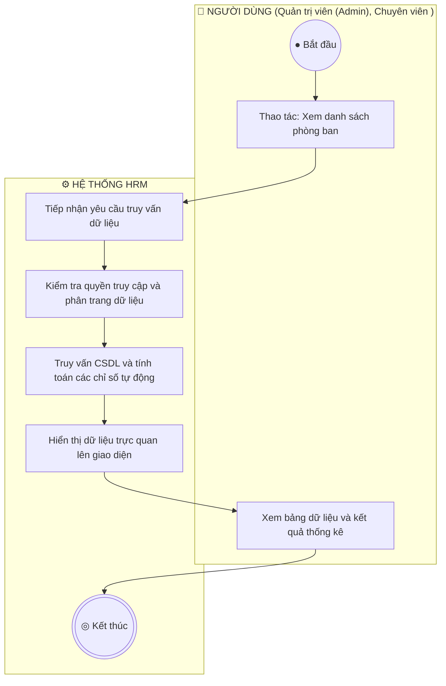

**Mô tả các bước luồng hoạt động:**
- **Điểm bắt đầu:** Chọn chức năng "Phòng ban" trong menu Cơ cấu Tổ chức.
- **Xử lý nghiệp vụ:** Làn Hệ thống tiếp nhận, thẩm định các quy tắc nghiệp vụ tại điểm rẽ nhánh hình thoi.
- **Xử lý rẽ nhánh:** Nếu thỏa mãn điều kiện, hệ thống lưu trữ và hoàn tất; nếu vi phạm, hệ thống hiển thị cảnh báo hướng dẫn người dùng sửa đổi khép kín.
- **Điểm kết thúc:** Quy trình hoàn tất và cập nhật trạng thái mới nhất lên toàn hệ thống.

---

### 2. Sơ đồ Hoạt động cho UC-ORG-01-02: Tìm kiếm và Lọc phòng ban
> **Mục tiêu quy trình:** Tra cứu nhanh chóng phòng ban theo tên gọi, mã viết tắt hoặc trạng thái mà không phải tìm qua nhiều trang.  
> **Tác nhân tham gia:** Quản trị viên, Chuyên viên Nhân sự. | **Sự kiện kích hoạt:** Người dùng nhập từ khóa vào ô tìm kiếm hoặc chọn lọc trạng thái.

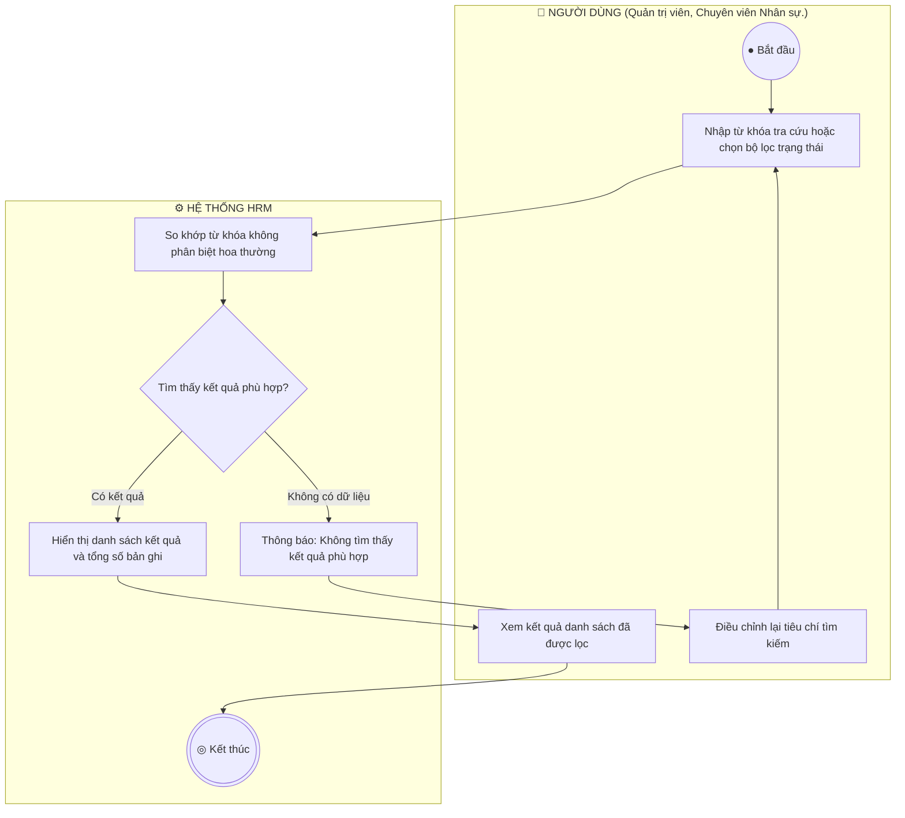

**Mô tả các bước luồng hoạt động:**
- **Điểm bắt đầu:** Người dùng nhập từ khóa vào ô tìm kiếm hoặc chọn lọc trạng thái.
- **Xử lý nghiệp vụ:** Làn Hệ thống tiếp nhận, thẩm định các quy tắc nghiệp vụ tại điểm rẽ nhánh hình thoi.
- **Xử lý rẽ nhánh:** Nếu thỏa mãn điều kiện, hệ thống lưu trữ và hoàn tất; nếu vi phạm, hệ thống hiển thị cảnh báo hướng dẫn người dùng sửa đổi khép kín.
- **Điểm kết thúc:** Quy trình hoàn tất và cập nhật trạng thái mới nhất lên toàn hệ thống.

---

### 3. Sơ đồ Hoạt động cho UC-ORG-01-03: Thêm mới phòng ban và Gán định biên
> **Mục tiêu quy trình:** Khởi tạo đơn vị mới vào sơ đồ cây tổ chức và ấn định chỉ tiêu định biên nhân sự tối đa (quota).  
> **Tác nhân tham gia:** Quản trị viên, Giám đốc Nhân sự. | **Sự kiện kích hoạt:** Người dùng nhấn nút "+ Thêm phòng ban".

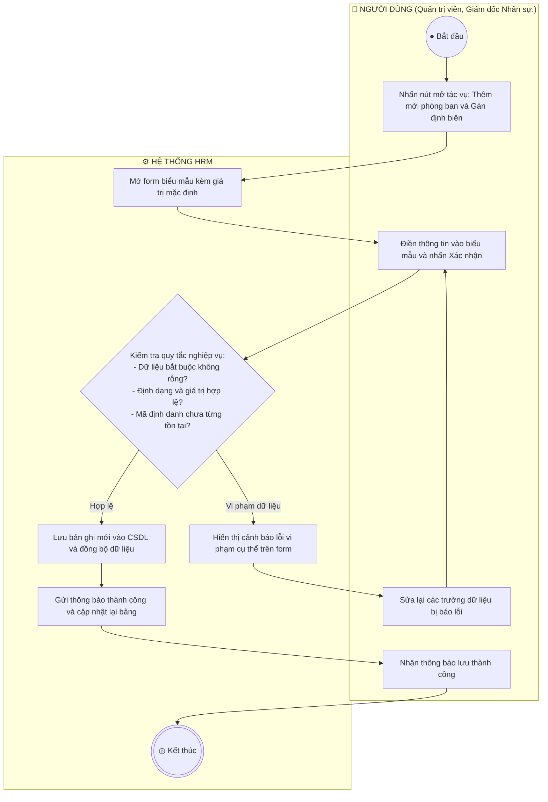

**Mô tả các bước luồng hoạt động:**
- **Điểm bắt đầu:** Người dùng nhấn nút "+ Thêm phòng ban".
- **Xử lý nghiệp vụ:** Làn Hệ thống tiếp nhận, thẩm định các quy tắc nghiệp vụ tại điểm rẽ nhánh hình thoi.
- **Xử lý rẽ nhánh:** Nếu thỏa mãn điều kiện, hệ thống lưu trữ và hoàn tất; nếu vi phạm, hệ thống hiển thị cảnh báo hướng dẫn người dùng sửa đổi khép kín.
- **Điểm kết thúc:** Quy trình hoàn tất và cập nhật trạng thái mới nhất lên toàn hệ thống.

---

### 4. Sơ đồ Hoạt động cho UC-ORG-01-04: Cập nhật thông tin phòng ban
> **Mục tiêu quy trình:** Điều chỉnh tên đơn vị, Trưởng phòng, nâng/hạ định biên hoặc luân chuyển đơn vị cấp trên trực tiếp.  
> **Tác nhân tham gia:** Quản trị viên, Giám đốc Nhân sự. | **Sự kiện kích hoạt:** Người dùng nhấn biểu tượng "Chỉnh sửa" tại dòng phòng ban.

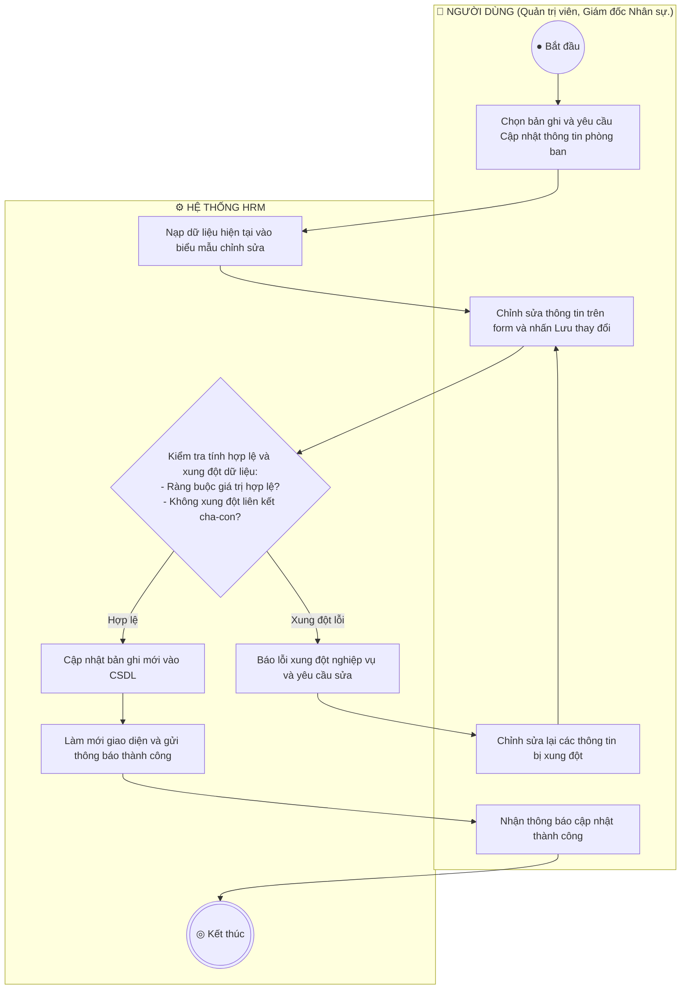

**Mô tả các bước luồng hoạt động:**
- **Điểm bắt đầu:** Người dùng nhấn biểu tượng "Chỉnh sửa" tại dòng phòng ban.
- **Xử lý nghiệp vụ:** Làn Hệ thống tiếp nhận, thẩm định các quy tắc nghiệp vụ tại điểm rẽ nhánh hình thoi.
- **Xử lý rẽ nhánh:** Nếu thỏa mãn điều kiện, hệ thống lưu trữ và hoàn tất; nếu vi phạm, hệ thống hiển thị cảnh báo hướng dẫn người dùng sửa đổi khép kín.
- **Điểm kết thúc:** Quy trình hoàn tất và cập nhật trạng thái mới nhất lên toàn hệ thống.

---

### 5. Sơ đồ Hoạt động cho UC-ORG-01-05: Khóa / Đóng băng phòng ban (Block / Inactive)
> **Mục tiêu quy trình:** Tạm dừng hoạt động hoặc giải thể mềm phòng ban mà không xóa dữ liệu, bảo toàn 100% lịch sử nhân sự cũ.  
> **Tác nhân tham gia:** Quản trị viên, Giám đốc Nhân sự. | **Sự kiện kích hoạt:** Người dùng nhấn biểu tượng Ổ khóa tại cột thao tác.

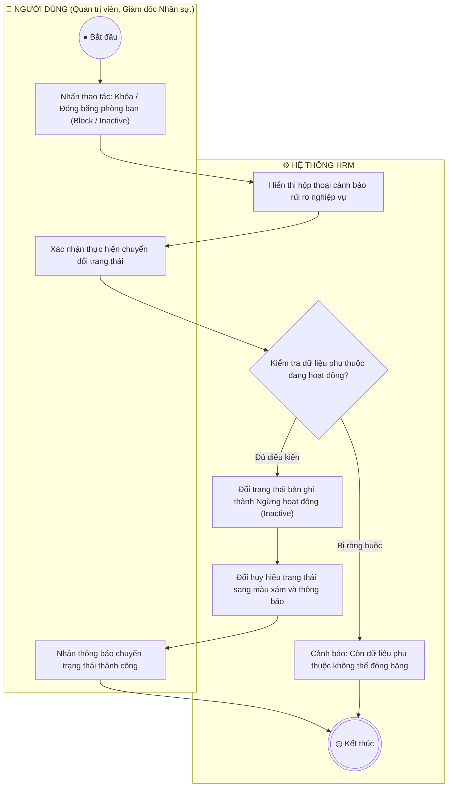

**Mô tả các bước luồng hoạt động:**
- **Điểm bắt đầu:** Người dùng nhấn biểu tượng Ổ khóa tại cột thao tác.
- **Xử lý nghiệp vụ:** Làn Hệ thống tiếp nhận, thẩm định các quy tắc nghiệp vụ tại điểm rẽ nhánh hình thoi.
- **Xử lý rẽ nhánh:** Nếu thỏa mãn điều kiện, hệ thống lưu trữ và hoàn tất; nếu vi phạm, hệ thống hiển thị cảnh báo hướng dẫn người dùng sửa đổi khép kín.
- **Điểm kết thúc:** Quy trình hoàn tất và cập nhật trạng thái mới nhất lên toàn hệ thống.

---

### 6. Sơ đồ Hoạt động cho UC-ORG-01-06: Xóa phòng ban (Hard Delete)
> **Mục tiêu quy trình:** Xóa vĩnh viễn các phòng ban tạo nhầm hoặc phòng ban trống không còn nhu cầu sử dụng.  
> **Tác nhân tham gia:** Quản trị viên cấp cao (Admin). | **Sự kiện kích hoạt:** Người dùng nhấn biểu tượng Thùng rác đỏ.


**Mô tả các bước luồng hoạt động:**
- **Điểm bắt đầu:** Người dùng nhấn biểu tượng Thùng rác đỏ.
- **Xử lý nghiệp vụ:** Làn Hệ thống tiếp nhận, thẩm định các quy tắc nghiệp vụ tại điểm rẽ nhánh hình thoi.
- **Xử lý rẽ nhánh:** Nếu thỏa mãn điều kiện, hệ thống lưu trữ và hoàn tất; nếu vi phạm, hệ thống hiển thị cảnh báo hướng dẫn người dùng sửa đổi khép kín.
- **Điểm kết thúc:** Quy trình hoàn tất và cập nhật trạng thái mới nhất lên toàn hệ thống.

---


## PHẦN 2: SƠ ĐỒ HOẠT ĐỘNG PHÂN HỆ ORG-02
---

### 7. Sơ đồ Hoạt động cho UC-ORG-02-01: Xem danh mục vị trí chức danh
> **Mục tiêu quy trình:** Theo dõi danh mục các vị trí công tác, cấp bậc chuyên môn và khung dải lương quy định.  
> **Tác nhân tham gia:** Quản trị viên, Chuyên viên Nhân sự. | **Sự kiện kích hoạt:** 


**Mô tả các bước luồng hoạt động:**
- **Điểm bắt đầu:** Người dùng khởi động tác vụ trên giao diện.
- **Xử lý nghiệp vụ:** Làn Hệ thống tiếp nhận, thẩm định các quy tắc nghiệp vụ tại điểm rẽ nhánh hình thoi.
- **Xử lý rẽ nhánh:** Nếu thỏa mãn điều kiện, hệ thống lưu trữ và hoàn tất; nếu vi phạm, hệ thống hiển thị cảnh báo hướng dẫn người dùng sửa đổi khép kín.
- **Điểm kết thúc:** Quy trình hoàn tất và cập nhật trạng thái mới nhất lên toàn hệ thống.

---

### 8. Sơ đồ Hoạt động cho UC-ORG-02-02: Thêm mới vị trí và Khung dải lương
> **Mục tiêu quy trình:** Thiết lập chức danh mới, cấp bậc và ấn định khung dải lương tuyển dụng (minSalary - maxSalary).  
> **Tác nhân tham gia:** Quản trị viên, Giám đốc Nhân sự, Chuyên viên CvàB. | **Sự kiện kích hoạt:** 


**Mô tả các bước luồng hoạt động:**
- **Điểm bắt đầu:** Người dùng khởi động tác vụ trên giao diện.
- **Xử lý nghiệp vụ:** Làn Hệ thống tiếp nhận, thẩm định các quy tắc nghiệp vụ tại điểm rẽ nhánh hình thoi.
- **Xử lý rẽ nhánh:** Nếu thỏa mãn điều kiện, hệ thống lưu trữ và hoàn tất; nếu vi phạm, hệ thống hiển thị cảnh báo hướng dẫn người dùng sửa đổi khép kín.
- **Điểm kết thúc:** Quy trình hoàn tất và cập nhật trạng thái mới nhất lên toàn hệ thống.

---

### 9. Sơ đồ Hoạt động cho UC-ORG-02-03: Cập nhật vị trí chức danh
> **Mục tiêu quy trình:** Điều chỉnh tên chức danh, sửa dải lương hoặc thay đổi cấp bậc chuyên môn.  
> **Tác nhân tham gia:** Quản trị viên, HR Manager. | **Sự kiện kích hoạt:** 

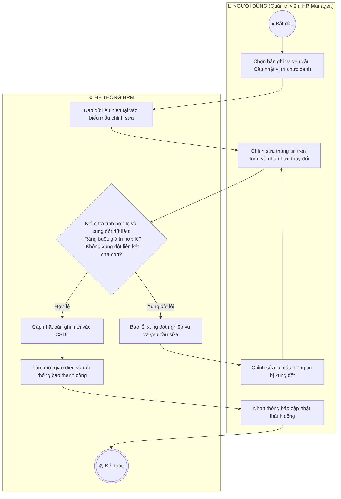

**Mô tả các bước luồng hoạt động:**
- **Điểm bắt đầu:** Người dùng khởi động tác vụ trên giao diện.
- **Xử lý nghiệp vụ:** Làn Hệ thống tiếp nhận, thẩm định các quy tắc nghiệp vụ tại điểm rẽ nhánh hình thoi.
- **Xử lý rẽ nhánh:** Nếu thỏa mãn điều kiện, hệ thống lưu trữ và hoàn tất; nếu vi phạm, hệ thống hiển thị cảnh báo hướng dẫn người dùng sửa đổi khép kín.
- **Điểm kết thúc:** Quy trình hoàn tất và cập nhật trạng thái mới nhất lên toàn hệ thống.

---

### 10. Sơ đồ Hoạt động cho UC-ORG-02-04: Khóa / Đóng băng vị trí chức danh
> **Mục tiêu quy trình:** Ngừng mở tuyển dụng hoặc ngừng bổ nhiệm vào vị trí chức danh cũ mà vẫn giữ nguyên hợp đồng của nhân sự đang nắm giữ vị trí này.  
> **Tác nhân tham gia:** Quản trị viên, HR Manager. | **Sự kiện kích hoạt:** 


**Mô tả các bước luồng hoạt động:**
- **Điểm bắt đầu:** Người dùng khởi động tác vụ trên giao diện.
- **Xử lý nghiệp vụ:** Làn Hệ thống tiếp nhận, thẩm định các quy tắc nghiệp vụ tại điểm rẽ nhánh hình thoi.
- **Xử lý rẽ nhánh:** Nếu thỏa mãn điều kiện, hệ thống lưu trữ và hoàn tất; nếu vi phạm, hệ thống hiển thị cảnh báo hướng dẫn người dùng sửa đổi khép kín.
- **Điểm kết thúc:** Quy trình hoàn tất và cập nhật trạng thái mới nhất lên toàn hệ thống.

---

### 11. Sơ đồ Hoạt động cho UC-ORG-02-05: Xóa vị trí chức danh
> **Mục tiêu quy trình:** Xóa vị trí chức danh không còn tồn tại trong doanh nghiệp.  
> **Tác nhân tham gia:** Quản trị viên. | **Sự kiện kích hoạt:** 

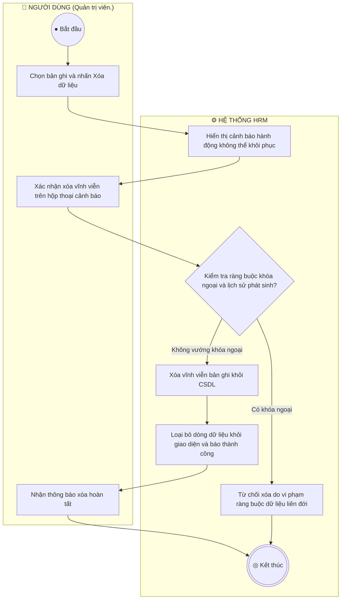

**Mô tả các bước luồng hoạt động:**
- **Điểm bắt đầu:** Người dùng khởi động tác vụ trên giao diện.
- **Xử lý nghiệp vụ:** Làn Hệ thống tiếp nhận, thẩm định các quy tắc nghiệp vụ tại điểm rẽ nhánh hình thoi.
- **Xử lý rẽ nhánh:** Nếu thỏa mãn điều kiện, hệ thống lưu trữ và hoàn tất; nếu vi phạm, hệ thống hiển thị cảnh báo hướng dẫn người dùng sửa đổi khép kín.
- **Điểm kết thúc:** Quy trình hoàn tất và cập nhật trạng thái mới nhất lên toàn hệ thống.

---


## PHẦN 3: SƠ ĐỒ HOẠT ĐỘNG PHÂN HỆ ORG-03
---

### 12. Sơ đồ Hoạt động cho UC-ORG-03-01: Xem biểu đồ phân cấp tổ chức hình cây
> **Mục tiêu quy trình:** Trực quan hóa toàn bộ mô hình phân cấp tổ chức doanh nghiệp (Ban Giám Đốc  ->  Khối  ->  Phòng ban  ->  Bộ phận con).  
> **Tác nhân tham gia:** Quản trị viên,  Toàn thể nhân viên. | **Sự kiện kích hoạt:** 

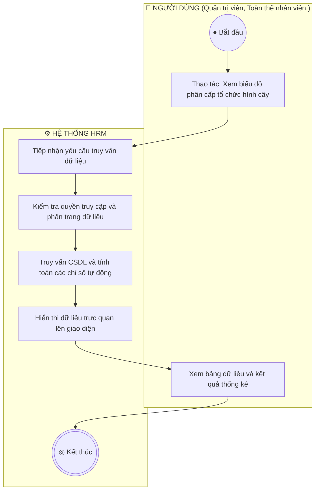

**Mô tả các bước luồng hoạt động:**
- **Điểm bắt đầu:** Người dùng khởi động tác vụ trên giao diện.
- **Xử lý nghiệp vụ:** Làn Hệ thống tiếp nhận, thẩm định các quy tắc nghiệp vụ tại điểm rẽ nhánh hình thoi.
- **Xử lý rẽ nhánh:** Nếu thỏa mãn điều kiện, hệ thống lưu trữ và hoàn tất; nếu vi phạm, hệ thống hiển thị cảnh báo hướng dẫn người dùng sửa đổi khép kín.
- **Điểm kết thúc:** Quy trình hoàn tất và cập nhật trạng thái mới nhất lên toàn hệ thống.

---

### 13. Sơ đồ Hoạt động cho UC-ORG-03-02: Thu gọn / Mở rộng nhánh cây tổ chức
> **Mục tiêu quy trình:** Cho phép người dùng tùy biến tầm nhìn sơ đồ cây bằng cách thu gọn các phòng ban cấp dưới hoặc mở rộng toàn bộ cấu trúc.  
> **Tác nhân tham gia:** Quản trị viên,  Nhân viên. | **Sự kiện kích hoạt:** 

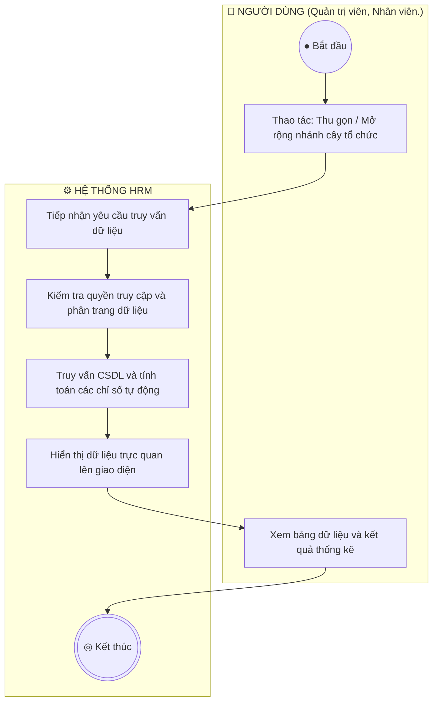

**Mô tả các bước luồng hoạt động:**
- **Điểm bắt đầu:** Người dùng khởi động tác vụ trên giao diện.
- **Xử lý nghiệp vụ:** Làn Hệ thống tiếp nhận, thẩm định các quy tắc nghiệp vụ tại điểm rẽ nhánh hình thoi.
- **Xử lý rẽ nhánh:** Nếu thỏa mãn điều kiện, hệ thống lưu trữ và hoàn tất; nếu vi phạm, hệ thống hiển thị cảnh báo hướng dẫn người dùng sửa đổi khép kín.
- **Điểm kết thúc:** Quy trình hoàn tất và cập nhật trạng thái mới nhất lên toàn hệ thống.

---

### 14. Sơ đồ Hoạt động cho UC-ORG-03-03: Xem tỷ lệ lấp đầy định biên trên sơ đồ
> **Mục tiêu quy trình:** Giúp lãnh đạo nhận diện nhanh các phòng ban đang thừa hoặc thiếu nhân sự so với chỉ tiêu được duyệt.  
> **Tác nhân tham gia:** Ban Giám đốc, HR Manager. | **Sự kiện kích hoạt:** 

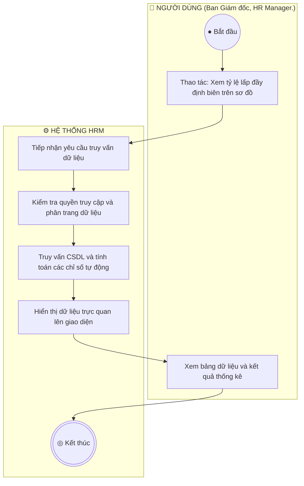

**Mô tả các bước luồng hoạt động:**
- **Điểm bắt đầu:** Người dùng khởi động tác vụ trên giao diện.
- **Xử lý nghiệp vụ:** Làn Hệ thống tiếp nhận, thẩm định các quy tắc nghiệp vụ tại điểm rẽ nhánh hình thoi.
- **Xử lý rẽ nhánh:** Nếu thỏa mãn điều kiện, hệ thống lưu trữ và hoàn tất; nếu vi phạm, hệ thống hiển thị cảnh báo hướng dẫn người dùng sửa đổi khép kín.
- **Điểm kết thúc:** Quy trình hoàn tất và cập nhật trạng thái mới nhất lên toàn hệ thống.

---

### 15. Sơ đồ Hoạt động cho UC-ORG-03-04: Xem danh sách nhân sự trực thuộc phòng ban
> **Mục tiêu quy trình:** Bấm vào một khối phòng ban để tra cứu nhanh danh sách các nhân viên đang làm việc tại đơn vị đó.  
> **Tác nhân tham gia:** Quản trị viên, HR. | **Sự kiện kích hoạt:** 

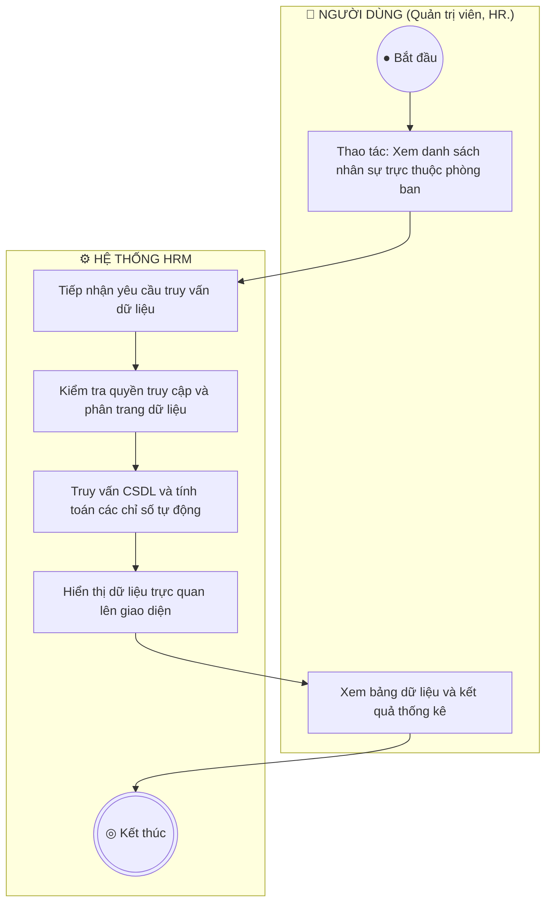

**Mô tả các bước luồng hoạt động:**
- **Điểm bắt đầu:** Người dùng khởi động tác vụ trên giao diện.
- **Xử lý nghiệp vụ:** Làn Hệ thống tiếp nhận, thẩm định các quy tắc nghiệp vụ tại điểm rẽ nhánh hình thoi.
- **Xử lý rẽ nhánh:** Nếu thỏa mãn điều kiện, hệ thống lưu trữ và hoàn tất; nếu vi phạm, hệ thống hiển thị cảnh báo hướng dẫn người dùng sửa đổi khép kín.
- **Điểm kết thúc:** Quy trình hoàn tất và cập nhật trạng thái mới nhất lên toàn hệ thống.

---


## PHẦN 4: SƠ ĐỒ HOẠT ĐỘNG PHÂN HỆ REC-01
---

### 16. Sơ đồ Hoạt động cho UC-REC-01-01: Xem danh sách yêu cầu tuyển dụng
> **Mục tiêu quy trình:** Theo dõi tình trạng các vị trí đang cần tuyển dụng, số lượng chỉ tiêu và tiến độ tuyển thực tế.  
> **Tác nhân tham gia:** Chuyên viên Tuyển dụng, Trưởng bộ phận. | **Sự kiện kích hoạt:** 

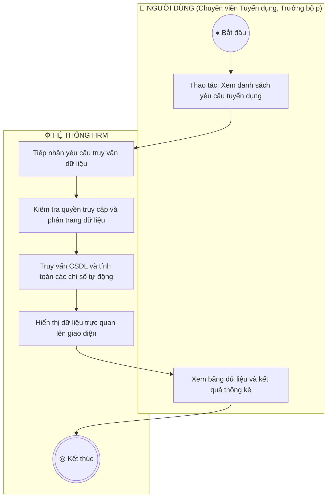

**Mô tả các bước luồng hoạt động:**
- **Điểm bắt đầu:** Người dùng khởi động tác vụ trên giao diện.
- **Xử lý nghiệp vụ:** Làn Hệ thống tiếp nhận, thẩm định các quy tắc nghiệp vụ tại điểm rẽ nhánh hình thoi.
- **Xử lý rẽ nhánh:** Nếu thỏa mãn điều kiện, hệ thống lưu trữ và hoàn tất; nếu vi phạm, hệ thống hiển thị cảnh báo hướng dẫn người dùng sửa đổi khép kín.
- **Điểm kết thúc:** Quy trình hoàn tất và cập nhật trạng thái mới nhất lên toàn hệ thống.

---

### 17. Sơ đồ Hoạt động cho UC-REC-01-02: Lập yêu cầu tuyển dụng và Kiểm tra định biên
> **Mục tiêu quy trình:** Tạo phiếu đề xuất bổ sung nhân sự, hệ thống tự động kiểm tra trần định biên để tránh tuyển vượt chỉ tiêu.  
> **Tác nhân tham gia:** Trưởng bộ phận, Chuyên viên Tuyển dụng. | **Sự kiện kích hoạt:** 

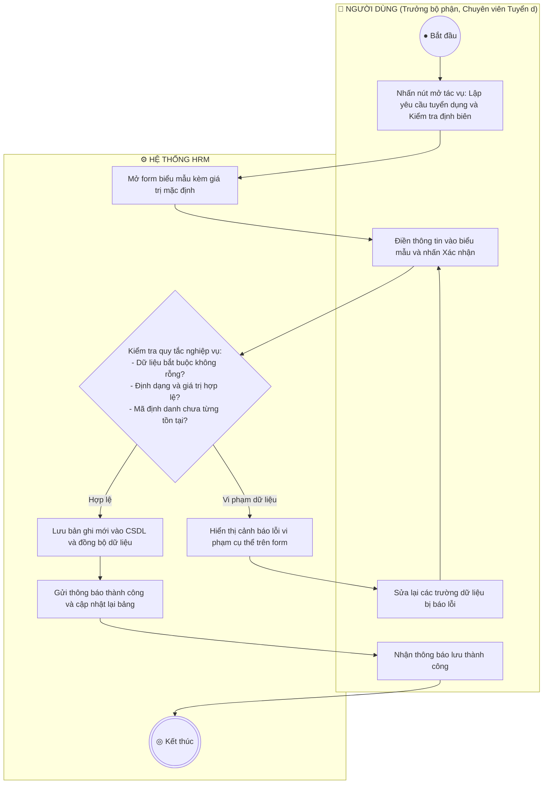

**Mô tả các bước luồng hoạt động:**
- **Điểm bắt đầu:** Người dùng khởi động tác vụ trên giao diện.
- **Xử lý nghiệp vụ:** Làn Hệ thống tiếp nhận, thẩm định các quy tắc nghiệp vụ tại điểm rẽ nhánh hình thoi.
- **Xử lý rẽ nhánh:** Nếu thỏa mãn điều kiện, hệ thống lưu trữ và hoàn tất; nếu vi phạm, hệ thống hiển thị cảnh báo hướng dẫn người dùng sửa đổi khép kín.
- **Điểm kết thúc:** Quy trình hoàn tất và cập nhật trạng thái mới nhất lên toàn hệ thống.

---

### 18. Sơ đồ Hoạt động cho UC-REC-01-03: Chỉnh sửa yêu cầu tuyển dụng
> **Mục tiêu quy trình:** Cập nhật lại yêu cầu kinh nghiệm, điều chỉnh dải lương hoặc gia hạn thời gian nộp hồ sơ.  
> **Tác nhân tham gia:** Chuyên viên Tuyển dụng. | **Sự kiện kích hoạt:** 

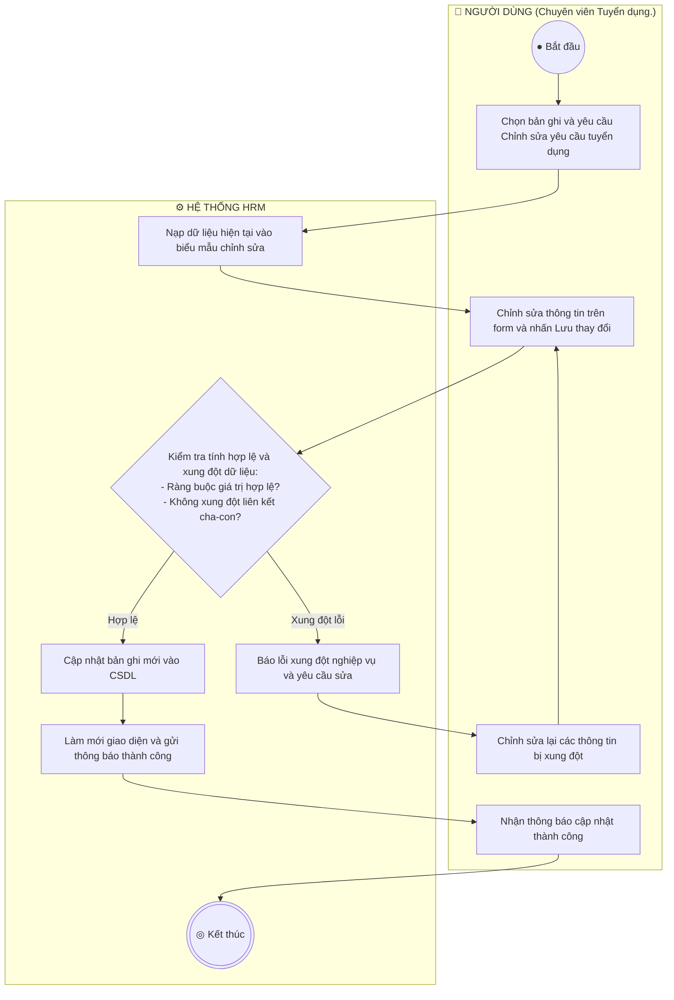

**Mô tả các bước luồng hoạt động:**
- **Điểm bắt đầu:** Người dùng khởi động tác vụ trên giao diện.
- **Xử lý nghiệp vụ:** Làn Hệ thống tiếp nhận, thẩm định các quy tắc nghiệp vụ tại điểm rẽ nhánh hình thoi.
- **Xử lý rẽ nhánh:** Nếu thỏa mãn điều kiện, hệ thống lưu trữ và hoàn tất; nếu vi phạm, hệ thống hiển thị cảnh báo hướng dẫn người dùng sửa đổi khép kín.
- **Điểm kết thúc:** Quy trình hoàn tất và cập nhật trạng thái mới nhất lên toàn hệ thống.

---

### 19. Sơ đồ Hoạt động cho UC-REC-01-04: Xuất bản tin ra Cổng Tuyển dụng Công khai
> **Mục tiêu quy trình:** Đưa tin tuyển dụng lên trang chủ việc làm để ứng viên bên ngoài tiếp cận và nộp hồ sơ.  
> **Tác nhân tham gia:** Chuyên viên Tuyển dụng. | **Sự kiện kích hoạt:** 

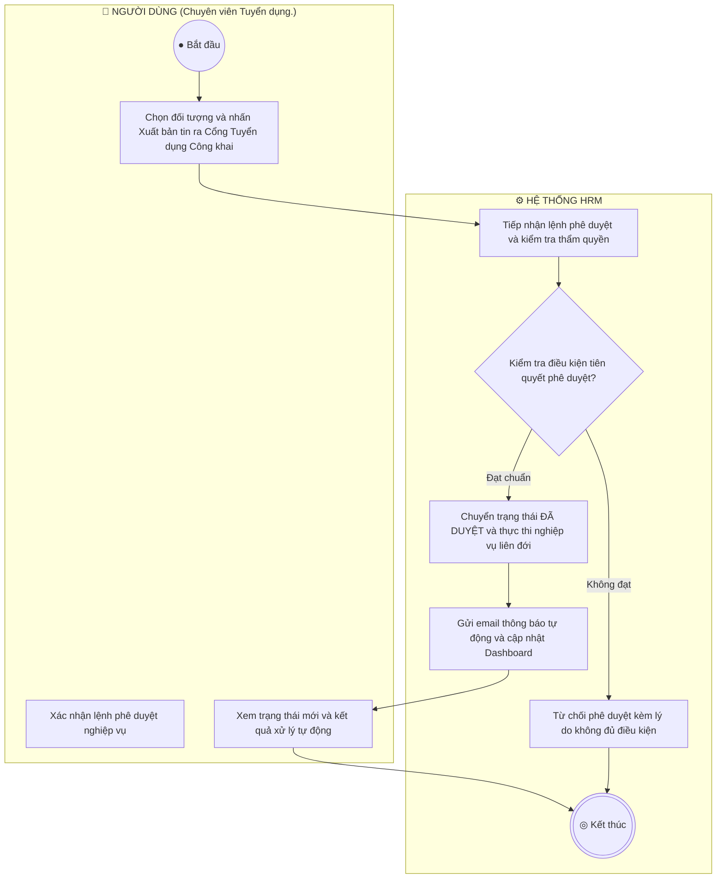

**Mô tả các bước luồng hoạt động:**
- **Điểm bắt đầu:** Người dùng khởi động tác vụ trên giao diện.
- **Xử lý nghiệp vụ:** Làn Hệ thống tiếp nhận, thẩm định các quy tắc nghiệp vụ tại điểm rẽ nhánh hình thoi.
- **Xử lý rẽ nhánh:** Nếu thỏa mãn điều kiện, hệ thống lưu trữ và hoàn tất; nếu vi phạm, hệ thống hiển thị cảnh báo hướng dẫn người dùng sửa đổi khép kín.
- **Điểm kết thúc:** Quy trình hoàn tất và cập nhật trạng thái mới nhất lên toàn hệ thống.

---

### 20. Sơ đồ Hoạt động cho UC-REC-01-05: Đóng nhận hồ sơ tuyển dụng
> **Mục tiêu quy trình:** Dừng nhận hồ sơ khi đã tuyển đủ chỉ tiêu hoặc hết thời hạn tuyển dụng.  
> **Tác nhân tham gia:** Chuyên viên Tuyển dụng. | **Sự kiện kích hoạt:** 


**Mô tả các bước luồng hoạt động:**
- **Điểm bắt đầu:** Người dùng khởi động tác vụ trên giao diện.
- **Xử lý nghiệp vụ:** Làn Hệ thống tiếp nhận, thẩm định các quy tắc nghiệp vụ tại điểm rẽ nhánh hình thoi.
- **Xử lý rẽ nhánh:** Nếu thỏa mãn điều kiện, hệ thống lưu trữ và hoàn tất; nếu vi phạm, hệ thống hiển thị cảnh báo hướng dẫn người dùng sửa đổi khép kín.
- **Điểm kết thúc:** Quy trình hoàn tất và cập nhật trạng thái mới nhất lên toàn hệ thống.

---


## PHẦN 5: SƠ ĐỒ HOẠT ĐỘNG PHÂN HỆ REC-02
---

### 21. Sơ đồ Hoạt động cho UC-REC-02-01: Xem bảng Kanban phân loại 7 bước
> **Mục tiêu quy trình:** Theo dõi toàn bộ ứng viên theo 7 bước phễu: Tiếp cận  ->  Ứng tuyển  ->  Sơ loại  ->  Phỏng vấn  ->  Đề nghị việc  ->  Tiếp nhận / Từ chối.  
> **Tác nhân tham gia:** Chuyên viên Tuyển dụng. | **Sự kiện kích hoạt:** 

```mermaid
flowchart TD
    subgraph USER ["👤 NGƯỜI DÙNG (Chuyên viên Tuyển dụng.)"]
        START((● Bắt đầu))
        U1["Thao tác: Xem bảng Kanban phân loại 7 bước"]
        U2["Xem bảng dữ liệu và kết quả thống kê"]
    end
    subgraph SYS ["⚙️ HỆ THỐNG HRM"]
        S1["Tiếp nhận yêu cầu truy vấn dữ liệu"]
        S2["Kiểm tra quyền truy cập và phân trang dữ liệu"]
        S3["Truy vấn CSDL và tính toán các chỉ số tự động"]
        S4["Hiển thị dữ liệu trực quan lên giao diện"]
        END_NODE(((◎ Kết thúc)))
    end
    START --> U1
    U1 --> S1
    S1 --> S2
    S2 --> S3
    S3 --> S4
    S4 --> U2
    U2 --> END_NODE
```

**Mô tả các bước luồng hoạt động:**
- **Điểm bắt đầu:** Người dùng khởi động tác vụ trên giao diện.
- **Xử lý nghiệp vụ:** Làn Hệ thống tiếp nhận, thẩm định các quy tắc nghiệp vụ tại điểm rẽ nhánh hình thoi.
- **Xử lý rẽ nhánh:** Nếu thỏa mãn điều kiện, hệ thống lưu trữ và hoàn tất; nếu vi phạm, hệ thống hiển thị cảnh báo hướng dẫn người dùng sửa đổi khép kín.
- **Điểm kết thúc:** Quy trình hoàn tất và cập nhật trạng thái mới nhất lên toàn hệ thống.

---

### 22. Sơ đồ Hoạt động cho UC-REC-02-02: Kéo thả chuyển trạng thái ứng viên
> **Mục tiêu quy trình:** Cập nhật tiến độ tuyển dụng nhanh chóng bằng thao tác kéo thả trực quan.  
> **Tác nhân tham gia:** Chuyên viên Tuyển dụng. | **Sự kiện kích hoạt:** 

```mermaid
flowchart TD
    subgraph USER ["👤 NGƯỜI DÙNG (Chuyên viên Tuyển dụng.)"]
        START((● Bắt đầu))
        U1["Chọn bản ghi và yêu cầu Kéo thả chuyển trạng thái ứng viên"]
        U2["Chỉnh sửa thông tin trên form và nhấn Lưu thay đổi"]
        U3["Nhận thông báo cập nhật thành công"]
        U4["Chỉnh sửa lại các thông tin bị xung đột"]
    end
    subgraph SYS ["⚙️ HỆ THỐNG HRM"]
        S1["Nạp dữ liệu hiện tại vào biểu mẫu chỉnh sửa"]
        S2{"Kiểm tra tính hợp lệ và xung đột dữ liệu:
- Ràng buộc giá trị hợp lệ?
- Không xung đột liên kết cha-con?"}
        S3["Cập nhật bản ghi mới vào CSDL"]
        S4["Làm mới giao diện và gửi thông báo thành công"]
        S5["Báo lỗi xung đột nghiệp vụ và yêu cầu sửa"]
        END_NODE(((◎ Kết thúc)))
    end
    START --> U1
    U1 --> S1
    S1 --> U2
    U2 --> S2
    S2 -- "Hợp lệ" --> S3
    S3 --> S4
    S4 --> U3
    U3 --> END_NODE
    S2 -- "Xung đột lỗi" --> S5
    S5 --> U4
    U4 --> U2
```

**Mô tả các bước luồng hoạt động:**
- **Điểm bắt đầu:** Người dùng khởi động tác vụ trên giao diện.
- **Xử lý nghiệp vụ:** Làn Hệ thống tiếp nhận, thẩm định các quy tắc nghiệp vụ tại điểm rẽ nhánh hình thoi.
- **Xử lý rẽ nhánh:** Nếu thỏa mãn điều kiện, hệ thống lưu trữ và hoàn tất; nếu vi phạm, hệ thống hiển thị cảnh báo hướng dẫn người dùng sửa đổi khép kín.
- **Điểm kết thúc:** Quy trình hoàn tất và cập nhật trạng thái mới nhất lên toàn hệ thống.

---

### 23. Sơ đồ Hoạt động cho UC-REC-02-03: Xem chi tiết CV và Đánh giá
> **Mục tiêu quy trình:** Xem trực tiếp file hồ sơ CV của ứng viên và ghi chú nhận xét ban đầu.  
> **Tác nhân tham gia:** Chuyên viên Tuyển dụng. | **Sự kiện kích hoạt:** 

```mermaid
flowchart TD
    subgraph USER ["👤 NGƯỜI DÙNG (Chuyên viên Tuyển dụng.)"]
        START((● Bắt đầu))
        U1["Thao tác: Xem chi tiết CV và Đánh giá"]
        U2["Xem bảng dữ liệu và kết quả thống kê"]
    end
    subgraph SYS ["⚙️ HỆ THỐNG HRM"]
        S1["Tiếp nhận yêu cầu truy vấn dữ liệu"]
        S2["Kiểm tra quyền truy cập và phân trang dữ liệu"]
        S3["Truy vấn CSDL và tính toán các chỉ số tự động"]
        S4["Hiển thị dữ liệu trực quan lên giao diện"]
        END_NODE(((◎ Kết thúc)))
    end
    START --> U1
    U1 --> S1
    S1 --> S2
    S2 --> S3
    S3 --> S4
    S4 --> U2
    U2 --> END_NODE
```

**Mô tả các bước luồng hoạt động:**
- **Điểm bắt đầu:** Người dùng khởi động tác vụ trên giao diện.
- **Xử lý nghiệp vụ:** Làn Hệ thống tiếp nhận, thẩm định các quy tắc nghiệp vụ tại điểm rẽ nhánh hình thoi.
- **Xử lý rẽ nhánh:** Nếu thỏa mãn điều kiện, hệ thống lưu trữ và hoàn tất; nếu vi phạm, hệ thống hiển thị cảnh báo hướng dẫn người dùng sửa đổi khép kín.
- **Điểm kết thúc:** Quy trình hoàn tất và cập nhật trạng thái mới nhất lên toàn hệ thống.

---

### 24. Sơ đồ Hoạt động cho UC-REC-02-04: Loại bỏ / Từ chối hồ sơ (Reject)
> **Mục tiêu quy trình:** Đánh dấu không phù hợp đối với các ứng viên không đạt yêu cầu.  
> **Tác nhân tham gia:** Chuyên viên Tuyển dụng. | **Sự kiện kích hoạt:** 

```mermaid
flowchart TD
    subgraph USER ["👤 NGƯỜI DÙNG (Chuyên viên Tuyển dụng.)"]
        START((● Bắt đầu))
        U1["Nhấn thao tác: Loại bỏ / Từ chối hồ sơ (Reject)"]
        U2["Xác nhận thực hiện chuyển đổi trạng thái"]
        U3["Nhận thông báo chuyển trạng thái thành công"]
    end
    subgraph SYS ["⚙️ HỆ THỐNG HRM"]
        S1["Hiển thị hộp thoại cảnh báo rủi ro nghiệp vụ"]
        S2{"Kiểm tra dữ liệu phụ thuộc đang hoạt động?"}
        S3["Đổi trạng thái bản ghi thành Ngừng hoạt động (Inactive)"]
        S4["Đổi huy hiệu trạng thái sang màu xám và thông báo"]
        S5["Cảnh báo: Còn dữ liệu phụ thuộc không thể đóng băng"]
        END_NODE(((◎ Kết thúc)))
    end
    START --> U1
    U1 --> S1
    S1 --> U2
    U2 --> S2
    S2 -- "Đủ điều kiện" --> S3
    S3 --> S4
    S4 --> U3
    U3 --> END_NODE
    S2 -- "Bị ràng buộc" --> S5
    S5 --> END_NODE
```

**Mô tả các bước luồng hoạt động:**
- **Điểm bắt đầu:** Người dùng khởi động tác vụ trên giao diện.
- **Xử lý nghiệp vụ:** Làn Hệ thống tiếp nhận, thẩm định các quy tắc nghiệp vụ tại điểm rẽ nhánh hình thoi.
- **Xử lý rẽ nhánh:** Nếu thỏa mãn điều kiện, hệ thống lưu trữ và hoàn tất; nếu vi phạm, hệ thống hiển thị cảnh báo hướng dẫn người dùng sửa đổi khép kín.
- **Điểm kết thúc:** Quy trình hoàn tất và cập nhật trạng thái mới nhất lên toàn hệ thống.

---


## PHẦN 6: SƠ ĐỒ HOẠT ĐỘNG PHÂN HỆ REC-03
---

### 25. Sơ đồ Hoạt động cho UC-REC-03-01: Xem lịch phỏng vấn
> **Mục tiêu quy trình:** Theo dõi danh sách các buổi phỏng vấn sắp diễn ra theo tuần hoặc tháng.  
> **Tác nhân tham gia:** Hội đồng phỏng vấn, Chuyên viên Tuyển dụng. | **Sự kiện kích hoạt:** 

```mermaid
flowchart TD
    subgraph USER ["👤 NGƯỜI DÙNG (Hội đồng phỏng vấn, Chuyên viên Tuy)"]
        START((● Bắt đầu))
        U1["Thao tác: Xem lịch phỏng vấn"]
        U2["Xem bảng dữ liệu và kết quả thống kê"]
    end
    subgraph SYS ["⚙️ HỆ THỐNG HRM"]
        S1["Tiếp nhận yêu cầu truy vấn dữ liệu"]
        S2["Kiểm tra quyền truy cập và phân trang dữ liệu"]
        S3["Truy vấn CSDL và tính toán các chỉ số tự động"]
        S4["Hiển thị dữ liệu trực quan lên giao diện"]
        END_NODE(((◎ Kết thúc)))
    end
    START --> U1
    U1 --> S1
    S1 --> S2
    S2 --> S3
    S3 --> S4
    S4 --> U2
    U2 --> END_NODE
```

**Mô tả các bước luồng hoạt động:**
- **Điểm bắt đầu:** Người dùng khởi động tác vụ trên giao diện.
- **Xử lý nghiệp vụ:** Làn Hệ thống tiếp nhận, thẩm định các quy tắc nghiệp vụ tại điểm rẽ nhánh hình thoi.
- **Xử lý rẽ nhánh:** Nếu thỏa mãn điều kiện, hệ thống lưu trữ và hoàn tất; nếu vi phạm, hệ thống hiển thị cảnh báo hướng dẫn người dùng sửa đổi khép kín.
- **Điểm kết thúc:** Quy trình hoàn tất và cập nhật trạng thái mới nhất lên toàn hệ thống.

---

### 26. Sơ đồ Hoạt động cho UC-REC-03-02: Tạo lịch và Gán người phỏng vấn
> **Mục tiêu quy trình:** Xếp lịch phỏng vấn và phân công người chấm thi phù hợp.  
> **Tác nhân tham gia:** Chuyên viên Tuyển dụng. | **Sự kiện kích hoạt:** 

```mermaid
flowchart TD
    subgraph USER ["👤 NGƯỜI DÙNG (Chuyên viên Tuyển dụng.)"]
        START((● Bắt đầu))
        U1["Nhấn nút mở tác vụ: Tạo lịch và Gán người phỏng vấn"]
        U2["Điền thông tin vào biểu mẫu và nhấn Xác nhận"]
        U3["Nhận thông báo lưu thành công"]
        U4["Sửa lại các trường dữ liệu bị báo lỗi"]
    end
    subgraph SYS ["⚙️ HỆ THỐNG HRM"]
        S1["Mở form biểu mẫu kèm giá trị mặc định"]
        S2{"Kiểm tra quy tắc nghiệp vụ:
- Dữ liệu bắt buộc không rỗng?
- Định dạng và giá trị hợp lệ?
- Mã định danh chưa từng tồn tại?"}
        S3["Lưu bản ghi mới vào CSDL và đồng bộ dữ liệu"]
        S4["Gửi thông báo thành công và cập nhật lại bảng"]
        S5["Hiển thị cảnh báo lỗi vi phạm cụ thể trên form"]
        END_NODE(((◎ Kết thúc)))
    end
    START --> U1
    U1 --> S1
    S1 --> U2
    U2 --> S2
    S2 -- "Hợp lệ" --> S3
    S3 --> S4
    S4 --> U3
    U3 --> END_NODE
    S2 -- "Vi phạm dữ liệu" --> S5
    S5 --> U4
    U4 --> U2
```

**Mô tả các bước luồng hoạt động:**
- **Điểm bắt đầu:** Người dùng khởi động tác vụ trên giao diện.
- **Xử lý nghiệp vụ:** Làn Hệ thống tiếp nhận, thẩm định các quy tắc nghiệp vụ tại điểm rẽ nhánh hình thoi.
- **Xử lý rẽ nhánh:** Nếu thỏa mãn điều kiện, hệ thống lưu trữ và hoàn tất; nếu vi phạm, hệ thống hiển thị cảnh báo hướng dẫn người dùng sửa đổi khép kín.
- **Điểm kết thúc:** Quy trình hoàn tất và cập nhật trạng thái mới nhất lên toàn hệ thống.

---

### 27. Sơ đồ Hoạt động cho UC-REC-03-03: Gửi email mời phỏng vấn tự động
> **Mục tiêu quy trình:** Tự động gửi thư mời phỏng vấn chuyên nghiệp đến hòm thư ứng viên kèm đường link xác nhận.  
> **Tác nhân tham gia:** Hệ thống tự động /  HR. | **Sự kiện kích hoạt:** 

```mermaid
flowchart TD
    subgraph USER ["👤 NGƯỜI DÙNG (Hệ thống tự động /  HR.)"]
        START((● Bắt đầu))
        U1["Chọn đối tượng và nhấn Gửi email mời phỏng vấn tự động"]
        U2["Xác nhận lệnh phê duyệt nghiệp vụ"]
        U3["Xem trạng thái mới và kết quả xử lý tự động"]
    end
    subgraph SYS ["⚙️ HỆ THỐNG HRM"]
        S1["Tiếp nhận lệnh phê duyệt và kiểm tra thẩm quyền"]
        S2{"Kiểm tra điều kiện tiên quyết phê duyệt?"}
        S3["Chuyển trạng thái ĐÃ DUYỆT và thực thi nghiệp vụ liên đới"]
        S4["Gửi email thông báo tự động và cập nhật Dashboard"]
        S5["Từ chối phê duyệt kèm lý do không đủ điều kiện"]
        END_NODE(((◎ Kết thúc)))
    end
    START --> U1
    U1 --> S1
    S1 --> S2
    S2 -- "Đạt chuẩn" --> S3
    S3 --> S4
    S4 --> U3
    U3 --> END_NODE
    S2 -- "Không đạt" --> S5
    S5 --> END_NODE
```

**Mô tả các bước luồng hoạt động:**
- **Điểm bắt đầu:** Người dùng khởi động tác vụ trên giao diện.
- **Xử lý nghiệp vụ:** Làn Hệ thống tiếp nhận, thẩm định các quy tắc nghiệp vụ tại điểm rẽ nhánh hình thoi.
- **Xử lý rẽ nhánh:** Nếu thỏa mãn điều kiện, hệ thống lưu trữ và hoàn tất; nếu vi phạm, hệ thống hiển thị cảnh báo hướng dẫn người dùng sửa đổi khép kín.
- **Điểm kết thúc:** Quy trình hoàn tất và cập nhật trạng thái mới nhất lên toàn hệ thống.

---

### 28. Sơ đồ Hoạt động cho UC-REC-03-04: Nhập điểm và Nhận xét đánh giá
> **Mục tiêu quy trình:** Cán bộ phỏng vấn ghi nhận kết quả đánh giá năng lực ứng viên làm căn cứ đề xuất phát hành Thư mời nhận việc.  
> **Tác nhân tham gia:** Cán bộ phỏng vấn. | **Sự kiện kích hoạt:** 

```mermaid
flowchart TD
    subgraph USER ["👤 NGƯỜI DÙNG (Cán bộ phỏng vấn.)"]
        START((● Bắt đầu))
        U1["Chọn bản ghi và yêu cầu Nhập điểm và Nhận xét đánh giá"]
        U2["Chỉnh sửa thông tin trên form và nhấn Lưu thay đổi"]
        U3["Nhận thông báo cập nhật thành công"]
        U4["Chỉnh sửa lại các thông tin bị xung đột"]
    end
    subgraph SYS ["⚙️ HỆ THỐNG HRM"]
        S1["Nạp dữ liệu hiện tại vào biểu mẫu chỉnh sửa"]
        S2{"Kiểm tra tính hợp lệ và xung đột dữ liệu:
- Ràng buộc giá trị hợp lệ?
- Không xung đột liên kết cha-con?"}
        S3["Cập nhật bản ghi mới vào CSDL"]
        S4["Làm mới giao diện và gửi thông báo thành công"]
        S5["Báo lỗi xung đột nghiệp vụ và yêu cầu sửa"]
        END_NODE(((◎ Kết thúc)))
    end
    START --> U1
    U1 --> S1
    S1 --> U2
    U2 --> S2
    S2 -- "Hợp lệ" --> S3
    S3 --> S4
    S4 --> U3
    U3 --> END_NODE
    S2 -- "Xung đột lỗi" --> S5
    S5 --> U4
    U4 --> U2
```

**Mô tả các bước luồng hoạt động:**
- **Điểm bắt đầu:** Người dùng khởi động tác vụ trên giao diện.
- **Xử lý nghiệp vụ:** Làn Hệ thống tiếp nhận, thẩm định các quy tắc nghiệp vụ tại điểm rẽ nhánh hình thoi.
- **Xử lý rẽ nhánh:** Nếu thỏa mãn điều kiện, hệ thống lưu trữ và hoàn tất; nếu vi phạm, hệ thống hiển thị cảnh báo hướng dẫn người dùng sửa đổi khép kín.
- **Điểm kết thúc:** Quy trình hoàn tất và cập nhật trạng thái mới nhất lên toàn hệ thống.

---

### 29. Sơ đồ Hoạt động cho UC-REC-03-05: Hủy / Đổi thời gian phỏng vấn
> **Mục tiêu quy trình:** Điều chỉnh thời gian khi có phát sinh từ phía ứng viên hoặc hội đồng phỏng vấn.  
> **Tác nhân tham gia:** Chuyên viên Tuyển dụng. | **Sự kiện kích hoạt:** 

```mermaid
flowchart TD
    subgraph USER ["👤 NGƯỜI DÙNG (Chuyên viên Tuyển dụng.)"]
        START((● Bắt đầu))
        U1["Chọn bản ghi và nhấn Xóa dữ liệu"]
        U2["Xác nhận xóa vĩnh viễn trên hộp thoại cảnh báo"]
        U3["Nhận thông báo xóa hoàn tất"]
    end
    subgraph SYS ["⚙️ HỆ THỐNG HRM"]
        S1["Hiển thị cảnh báo hành động không thể khôi phục"]
        S2{"Kiểm tra ràng buộc khóa ngoại và lịch sử phát sinh?"}
        S3["Xóa vĩnh viễn bản ghi khỏi CSDL"]
        S4["Loại bỏ dòng dữ liệu khỏi giao diện và báo thành công"]
        S5["Từ chối xóa do vi phạm ràng buộc dữ liệu liên đới"]
        END_NODE(((◎ Kết thúc)))
    end
    START --> U1
    U1 --> S1
    S1 --> U2
    U2 --> S2
    S2 -- "Không vướng khóa ngoại" --> S3
    S3 --> S4
    S4 --> U3
    U3 --> END_NODE
    S2 -- "Có khóa ngoại" --> S5
    S5 --> END_NODE
```

**Mô tả các bước luồng hoạt động:**
- **Điểm bắt đầu:** Người dùng khởi động tác vụ trên giao diện.
- **Xử lý nghiệp vụ:** Làn Hệ thống tiếp nhận, thẩm định các quy tắc nghiệp vụ tại điểm rẽ nhánh hình thoi.
- **Xử lý rẽ nhánh:** Nếu thỏa mãn điều kiện, hệ thống lưu trữ và hoàn tất; nếu vi phạm, hệ thống hiển thị cảnh báo hướng dẫn người dùng sửa đổi khép kín.
- **Điểm kết thúc:** Quy trình hoàn tất và cập nhật trạng thái mới nhất lên toàn hệ thống.

---


## PHẦN 7: SƠ ĐỒ HOẠT ĐỘNG PHÂN HỆ REC-04
---

### 30. Sơ đồ Hoạt động cho UC-REC-04-01: Xem danh sách Thư mời nhận việc
> **Mục tiêu quy trình:** Theo dõi tình trạng các thư mời nhận việc đã phát hành và hạn phản hồi của ứng viên.  
> **Tác nhân tham gia:** HR Manager, Chuyên viên CvàB. | **Sự kiện kích hoạt:** 

```mermaid
flowchart TD
    subgraph USER ["👤 NGƯỜI DÙNG (HR Manager, Chuyên viên CvàB.)"]
        START((● Bắt đầu))
        U1["Thao tác: Xem danh sách Thư mời nhận việc"]
        U2["Xem bảng dữ liệu và kết quả thống kê"]
    end
    subgraph SYS ["⚙️ HỆ THỐNG HRM"]
        S1["Tiếp nhận yêu cầu truy vấn dữ liệu"]
        S2["Kiểm tra quyền truy cập và phân trang dữ liệu"]
        S3["Truy vấn CSDL và tính toán các chỉ số tự động"]
        S4["Hiển thị dữ liệu trực quan lên giao diện"]
        END_NODE(((◎ Kết thúc)))
    end
    START --> U1
    U1 --> S1
    S1 --> S2
    S2 --> S3
    S3 --> S4
    S4 --> U2
    U2 --> END_NODE
```

**Mô tả các bước luồng hoạt động:**
- **Điểm bắt đầu:** Người dùng khởi động tác vụ trên giao diện.
- **Xử lý nghiệp vụ:** Làn Hệ thống tiếp nhận, thẩm định các quy tắc nghiệp vụ tại điểm rẽ nhánh hình thoi.
- **Xử lý rẽ nhánh:** Nếu thỏa mãn điều kiện, hệ thống lưu trữ và hoàn tất; nếu vi phạm, hệ thống hiển thị cảnh báo hướng dẫn người dùng sửa đổi khép kín.
- **Điểm kết thúc:** Quy trình hoàn tất và cập nhật trạng thái mới nhất lên toàn hệ thống.

---

### 31. Sơ đồ Hoạt động cho UC-REC-04-02: Soạn thảo Thư mời Offer theo luật lao động
> **Mục tiêu quy trình:** Soạn thảo thư mời nhận việc chính thức với tỷ lệ lương thử việc chuẩn 85% theo Bộ luật Lao động.  
> **Tác nhân tham gia:** HR Manager, Chuyên viên CvàB. | **Sự kiện kích hoạt:** 

```mermaid
flowchart TD
    subgraph USER ["👤 NGƯỜI DÙNG (HR Manager, Chuyên viên CvàB.)"]
        START((● Bắt đầu))
        U1["Nhấn nút mở tác vụ: Soạn thảo Thư mời Offer theo luật lao động"]
        U2["Điền thông tin vào biểu mẫu và nhấn Xác nhận"]
        U3["Nhận thông báo lưu thành công"]
        U4["Sửa lại các trường dữ liệu bị báo lỗi"]
    end
    subgraph SYS ["⚙️ HỆ THỐNG HRM"]
        S1["Mở form biểu mẫu kèm giá trị mặc định"]
        S2{"Kiểm tra quy tắc nghiệp vụ:
- Dữ liệu bắt buộc không rỗng?
- Định dạng và giá trị hợp lệ?
- Mã định danh chưa từng tồn tại?"}
        S3["Lưu bản ghi mới vào CSDL và đồng bộ dữ liệu"]
        S4["Gửi thông báo thành công và cập nhật lại bảng"]
        S5["Hiển thị cảnh báo lỗi vi phạm cụ thể trên form"]
        END_NODE(((◎ Kết thúc)))
    end
    START --> U1
    U1 --> S1
    S1 --> U2
    U2 --> S2
    S2 -- "Hợp lệ" --> S3
    S3 --> S4
    S4 --> U3
    U3 --> END_NODE
    S2 -- "Vi phạm dữ liệu" --> S5
    S5 --> U4
    U4 --> U2
```

**Mô tả các bước luồng hoạt động:**
- **Điểm bắt đầu:** Người dùng khởi động tác vụ trên giao diện.
- **Xử lý nghiệp vụ:** Làn Hệ thống tiếp nhận, thẩm định các quy tắc nghiệp vụ tại điểm rẽ nhánh hình thoi.
- **Xử lý rẽ nhánh:** Nếu thỏa mãn điều kiện, hệ thống lưu trữ và hoàn tất; nếu vi phạm, hệ thống hiển thị cảnh báo hướng dẫn người dùng sửa đổi khép kín.
- **Điểm kết thúc:** Quy trình hoàn tất và cập nhật trạng thái mới nhất lên toàn hệ thống.

---

### 32. Sơ đồ Hoạt động cho UC-REC-04-03: Gửi email Offer điện tử cho ứng viên
> **Mục tiêu quy trình:** Phát hành thư mời làm việc chính thức qua hòm thư điện tử của ứng viên.  
> **Tác nhân tham gia:** HR Manager. | **Sự kiện kích hoạt:** 

```mermaid
flowchart TD
    subgraph USER ["👤 NGƯỜI DÙNG (HR Manager.)"]
        START((● Bắt đầu))
        U1["Chọn đối tượng và nhấn Gửi email Offer điện tử cho ứng viên"]
        U2["Xác nhận lệnh phê duyệt nghiệp vụ"]
        U3["Xem trạng thái mới và kết quả xử lý tự động"]
    end
    subgraph SYS ["⚙️ HỆ THỐNG HRM"]
        S1["Tiếp nhận lệnh phê duyệt và kiểm tra thẩm quyền"]
        S2{"Kiểm tra điều kiện tiên quyết phê duyệt?"}
        S3["Chuyển trạng thái ĐÃ DUYỆT và thực thi nghiệp vụ liên đới"]
        S4["Gửi email thông báo tự động và cập nhật Dashboard"]
        S5["Từ chối phê duyệt kèm lý do không đủ điều kiện"]
        END_NODE(((◎ Kết thúc)))
    end
    START --> U1
    U1 --> S1
    S1 --> S2
    S2 -- "Đạt chuẩn" --> S3
    S3 --> S4
    S4 --> U3
    U3 --> END_NODE
    S2 -- "Không đạt" --> S5
    S5 --> END_NODE
```

**Mô tả các bước luồng hoạt động:**
- **Điểm bắt đầu:** Người dùng khởi động tác vụ trên giao diện.
- **Xử lý nghiệp vụ:** Làn Hệ thống tiếp nhận, thẩm định các quy tắc nghiệp vụ tại điểm rẽ nhánh hình thoi.
- **Xử lý rẽ nhánh:** Nếu thỏa mãn điều kiện, hệ thống lưu trữ và hoàn tất; nếu vi phạm, hệ thống hiển thị cảnh báo hướng dẫn người dùng sửa đổi khép kín.
- **Điểm kết thúc:** Quy trình hoàn tất và cập nhật trạng thái mới nhất lên toàn hệ thống.

---

### 33. Sơ đồ Hoạt động cho UC-REC-04-04: Theo dõi phản hồi Offer trong 24h
> **Mục tiêu quy trình:** Giám sát thời gian phản hồi của ứng viên; tự động đánh dấu quá hạn nếu sau 24h không nhận được câu trả lời.  
> **Tác nhân tham gia:** Hệ thống tự động /  HR. | **Sự kiện kích hoạt:** 

```mermaid
flowchart TD
    subgraph USER ["👤 NGƯỜI DÙNG (Hệ thống tự động /  HR.)"]
        START((● Bắt đầu))
        U1["Thao tác: Theo dõi phản hồi Offer trong 24h"]
        U2["Xem bảng dữ liệu và kết quả thống kê"]
    end
    subgraph SYS ["⚙️ HỆ THỐNG HRM"]
        S1["Tiếp nhận yêu cầu truy vấn dữ liệu"]
        S2["Kiểm tra quyền truy cập và phân trang dữ liệu"]
        S3["Truy vấn CSDL và tính toán các chỉ số tự động"]
        S4["Hiển thị dữ liệu trực quan lên giao diện"]
        END_NODE(((◎ Kết thúc)))
    end
    START --> U1
    U1 --> S1
    S1 --> S2
    S2 --> S3
    S3 --> S4
    S4 --> U2
    U2 --> END_NODE
```

**Mô tả các bước luồng hoạt động:**
- **Điểm bắt đầu:** Người dùng khởi động tác vụ trên giao diện.
- **Xử lý nghiệp vụ:** Làn Hệ thống tiếp nhận, thẩm định các quy tắc nghiệp vụ tại điểm rẽ nhánh hình thoi.
- **Xử lý rẽ nhánh:** Nếu thỏa mãn điều kiện, hệ thống lưu trữ và hoàn tất; nếu vi phạm, hệ thống hiển thị cảnh báo hướng dẫn người dùng sửa đổi khép kín.
- **Điểm kết thúc:** Quy trình hoàn tất và cập nhật trạng thái mới nhất lên toàn hệ thống.

---

### 34. Sơ đồ Hoạt động cho UC-REC-04-05: Kích hoạt Cổng Khai báo Pre-Onboarding
> **Mục tiêu quy trình:** Mở quyền để ứng viên trúng tuyển tự kê khai thông tin cá nhân trước ngày đi làm.  
> **Tác nhân tham gia:** Hệ thống tự động. | **Sự kiện kích hoạt:** 

```mermaid
flowchart TD
    subgraph USER ["👤 NGƯỜI DÙNG (Hệ thống tự động.)"]
        START((● Bắt đầu))
        U1["Chọn đối tượng và nhấn Kích hoạt Cổng Khai báo Pre-Onboarding"]
        U2["Xác nhận lệnh phê duyệt nghiệp vụ"]
        U3["Xem trạng thái mới và kết quả xử lý tự động"]
    end
    subgraph SYS ["⚙️ HỆ THỐNG HRM"]
        S1["Tiếp nhận lệnh phê duyệt và kiểm tra thẩm quyền"]
        S2{"Kiểm tra điều kiện tiên quyết phê duyệt?"}
        S3["Chuyển trạng thái ĐÃ DUYỆT và thực thi nghiệp vụ liên đới"]
        S4["Gửi email thông báo tự động và cập nhật Dashboard"]
        S5["Từ chối phê duyệt kèm lý do không đủ điều kiện"]
        END_NODE(((◎ Kết thúc)))
    end
    START --> U1
    U1 --> S1
    S1 --> S2
    S2 -- "Đạt chuẩn" --> S3
    S3 --> S4
    S4 --> U3
    U3 --> END_NODE
    S2 -- "Không đạt" --> S5
    S5 --> END_NODE
```

**Mô tả các bước luồng hoạt động:**
- **Điểm bắt đầu:** Người dùng khởi động tác vụ trên giao diện.
- **Xử lý nghiệp vụ:** Làn Hệ thống tiếp nhận, thẩm định các quy tắc nghiệp vụ tại điểm rẽ nhánh hình thoi.
- **Xử lý rẽ nhánh:** Nếu thỏa mãn điều kiện, hệ thống lưu trữ và hoàn tất; nếu vi phạm, hệ thống hiển thị cảnh báo hướng dẫn người dùng sửa đổi khép kín.
- **Điểm kết thúc:** Quy trình hoàn tất và cập nhật trạng thái mới nhất lên toàn hệ thống.

---


## PHẦN 8: SƠ ĐỒ HOẠT ĐỘNG PHÂN HỆ ONB-01
---

### 35. Sơ đồ Hoạt động cho UC-ONB-01-01: Xem hồ sơ ứng viên tự kê khai
> **Mục tiêu quy trình:** Kiểm tra các thông tin cá nhân, CCCD, số tài khoản ngân hàng và người thân do ứng viên trúng tuyển tự khai trực tuyến trước ngày đi làm.  
> **Tác nhân tham gia:** Chuyên viên Nhân sự. | **Sự kiện kích hoạt:** 

```mermaid
flowchart TD
    subgraph USER ["👤 NGƯỜI DÙNG (Chuyên viên Nhân sự.)"]
        START((● Bắt đầu))
        U1["Thao tác: Xem hồ sơ ứng viên tự kê khai"]
        U2["Xem bảng dữ liệu và kết quả thống kê"]
    end
    subgraph SYS ["⚙️ HỆ THỐNG HRM"]
        S1["Tiếp nhận yêu cầu truy vấn dữ liệu"]
        S2["Kiểm tra quyền truy cập và phân trang dữ liệu"]
        S3["Truy vấn CSDL và tính toán các chỉ số tự động"]
        S4["Hiển thị dữ liệu trực quan lên giao diện"]
        END_NODE(((◎ Kết thúc)))
    end
    START --> U1
    U1 --> S1
    S1 --> S2
    S2 --> S3
    S3 --> S4
    S4 --> U2
    U2 --> END_NODE
```

**Mô tả các bước luồng hoạt động:**
- **Điểm bắt đầu:** Người dùng khởi động tác vụ trên giao diện.
- **Xử lý nghiệp vụ:** Làn Hệ thống tiếp nhận, thẩm định các quy tắc nghiệp vụ tại điểm rẽ nhánh hình thoi.
- **Xử lý rẽ nhánh:** Nếu thỏa mãn điều kiện, hệ thống lưu trữ và hoàn tất; nếu vi phạm, hệ thống hiển thị cảnh báo hướng dẫn người dùng sửa đổi khép kín.
- **Điểm kết thúc:** Quy trình hoàn tất và cập nhật trạng thái mới nhất lên toàn hệ thống.

---

### 36. Sơ đồ Hoạt động cho UC-ONB-01-02: Đối soát thông tin CCCD và Tài khoản Ngân hàng
> **Mục tiêu quy trình:** Đảm bảo thông tin số định danh cá nhân và số tài khoản ngân hàng chi trả lương là chính xác và khớp với chứng từ.  
> **Tác nhân tham gia:** Chuyên viên Nhân sự. | **Sự kiện kích hoạt:** 

```mermaid
flowchart TD
    subgraph USER ["👤 NGƯỜI DÙNG (Chuyên viên Nhân sự.)"]
        START((● Bắt đầu))
        U1["Chọn đối tượng và nhấn Đối soát thông tin CCCD và Tài khoản Ngân hàng"]
        U2["Xác nhận lệnh phê duyệt nghiệp vụ"]
        U3["Xem trạng thái mới và kết quả xử lý tự động"]
    end
    subgraph SYS ["⚙️ HỆ THỐNG HRM"]
        S1["Tiếp nhận lệnh phê duyệt và kiểm tra thẩm quyền"]
        S2{"Kiểm tra điều kiện tiên quyết phê duyệt?"}
        S3["Chuyển trạng thái ĐÃ DUYỆT và thực thi nghiệp vụ liên đới"]
        S4["Gửi email thông báo tự động và cập nhật Dashboard"]
        S5["Từ chối phê duyệt kèm lý do không đủ điều kiện"]
        END_NODE(((◎ Kết thúc)))
    end
    START --> U1
    U1 --> S1
    S1 --> S2
    S2 -- "Đạt chuẩn" --> S3
    S3 --> S4
    S4 --> U3
    U3 --> END_NODE
    S2 -- "Không đạt" --> S5
    S5 --> END_NODE
```

**Mô tả các bước luồng hoạt động:**
- **Điểm bắt đầu:** Người dùng khởi động tác vụ trên giao diện.
- **Xử lý nghiệp vụ:** Làn Hệ thống tiếp nhận, thẩm định các quy tắc nghiệp vụ tại điểm rẽ nhánh hình thoi.
- **Xử lý rẽ nhánh:** Nếu thỏa mãn điều kiện, hệ thống lưu trữ và hoàn tất; nếu vi phạm, hệ thống hiển thị cảnh báo hướng dẫn người dùng sửa đổi khép kín.
- **Điểm kết thúc:** Quy trình hoàn tất và cập nhật trạng thái mới nhất lên toàn hệ thống.

---

### 37. Sơ đồ Hoạt động cho UC-ONB-01-03: Phê duyệt 1-chạm: Tự động tạo Nhân viên, Cấp tài khoản và Hợp đồng
> **Mục tiêu quy trình:** Chuyển đổi ứng viên thành nhân viên chính thức chỉ bằng 1 thao tác phê duyệt, xóa bỏ hoàn toàn việc nhập tay trùng lặp.  
> **Tác nhân tham gia:** Giám đốc Nhân sự / Admin. | **Sự kiện kích hoạt:** 

```mermaid
flowchart TD
    subgraph USER ["👤 NGƯỜI DÙNG (Giám đốc Nhân sự / Admin.)"]
        START((● Bắt đầu))
        U1["Nhấn nút mở tác vụ: Phê duyệt 1-chạm: Tự động tạo Nhân viên, Cấp tài khoản và Hợp đồng"]
        U2["Điền thông tin vào biểu mẫu và nhấn Xác nhận"]
        U3["Nhận thông báo lưu thành công"]
        U4["Sửa lại các trường dữ liệu bị báo lỗi"]
    end
    subgraph SYS ["⚙️ HỆ THỐNG HRM"]
        S1["Mở form biểu mẫu kèm giá trị mặc định"]
        S2{"Kiểm tra quy tắc nghiệp vụ:
- Dữ liệu bắt buộc không rỗng?
- Định dạng và giá trị hợp lệ?
- Mã định danh chưa từng tồn tại?"}
        S3["Lưu bản ghi mới vào CSDL và đồng bộ dữ liệu"]
        S4["Gửi thông báo thành công và cập nhật lại bảng"]
        S5["Hiển thị cảnh báo lỗi vi phạm cụ thể trên form"]
        END_NODE(((◎ Kết thúc)))
    end
    START --> U1
    U1 --> S1
    S1 --> U2
    U2 --> S2
    S2 -- "Hợp lệ" --> S3
    S3 --> S4
    S4 --> U3
    U3 --> END_NODE
    S2 -- "Vi phạm dữ liệu" --> S5
    S5 --> U4
    U4 --> U2
```

**Mô tả các bước luồng hoạt động:**
- **Điểm bắt đầu:** Người dùng khởi động tác vụ trên giao diện.
- **Xử lý nghiệp vụ:** Làn Hệ thống tiếp nhận, thẩm định các quy tắc nghiệp vụ tại điểm rẽ nhánh hình thoi.
- **Xử lý rẽ nhánh:** Nếu thỏa mãn điều kiện, hệ thống lưu trữ và hoàn tất; nếu vi phạm, hệ thống hiển thị cảnh báo hướng dẫn người dùng sửa đổi khép kín.
- **Điểm kết thúc:** Quy trình hoàn tất và cập nhật trạng thái mới nhất lên toàn hệ thống.

---

### 38. Sơ đồ Hoạt động cho UC-ONB-01-04: Yêu cầu bổ sung / chỉnh sửa thông tin
> **Mục tiêu quy trình:** Trả lại hồ sơ yêu cầu ứng viên kê khai lại khi phát hiện sai sót (ví dụ mờ ảnh CCCD hoặc sai số tài khoản).  
> **Tác nhân tham gia:** Chuyên viên Nhân sự. | **Sự kiện kích hoạt:** 

```mermaid
flowchart TD
    subgraph USER ["👤 NGƯỜI DÙNG (Chuyên viên Nhân sự.)"]
        START((● Bắt đầu))
        U1["Chọn bản ghi và yêu cầu Yêu cầu bổ sung / chỉnh sửa thông tin"]
        U2["Chỉnh sửa thông tin trên form và nhấn Lưu thay đổi"]
        U3["Nhận thông báo cập nhật thành công"]
        U4["Chỉnh sửa lại các thông tin bị xung đột"]
    end
    subgraph SYS ["⚙️ HỆ THỐNG HRM"]
        S1["Nạp dữ liệu hiện tại vào biểu mẫu chỉnh sửa"]
        S2{"Kiểm tra tính hợp lệ và xung đột dữ liệu:
- Ràng buộc giá trị hợp lệ?
- Không xung đột liên kết cha-con?"}
        S3["Cập nhật bản ghi mới vào CSDL"]
        S4["Làm mới giao diện và gửi thông báo thành công"]
        S5["Báo lỗi xung đột nghiệp vụ và yêu cầu sửa"]
        END_NODE(((◎ Kết thúc)))
    end
    START --> U1
    U1 --> S1
    S1 --> U2
    U2 --> S2
    S2 -- "Hợp lệ" --> S3
    S3 --> S4
    S4 --> U3
    U3 --> END_NODE
    S2 -- "Xung đột lỗi" --> S5
    S5 --> U4
    U4 --> U2
```

**Mô tả các bước luồng hoạt động:**
- **Điểm bắt đầu:** Người dùng khởi động tác vụ trên giao diện.
- **Xử lý nghiệp vụ:** Làn Hệ thống tiếp nhận, thẩm định các quy tắc nghiệp vụ tại điểm rẽ nhánh hình thoi.
- **Xử lý rẽ nhánh:** Nếu thỏa mãn điều kiện, hệ thống lưu trữ và hoàn tất; nếu vi phạm, hệ thống hiển thị cảnh báo hướng dẫn người dùng sửa đổi khép kín.
- **Điểm kết thúc:** Quy trình hoàn tất và cập nhật trạng thái mới nhất lên toàn hệ thống.

---


## PHẦN 9: SƠ ĐỒ HOẠT ĐỘNG PHÂN HỆ ONB-02
---

### 39. Sơ đồ Hoạt động cho UC-ONB-02-01: Giám sát tiến độ hội nhập qua 4 mốc thời gian
> **Mục tiêu quy trình:** Đảm bảo nhân sự mới hòa nhập văn hóa doanh nghiệp đúng tiến độ qua 4 mốc: Ngày đầu tiên, Tuần đầu tiên, Tháng đầu tiên, và Đánh giá hết thử việc.  
> **Tác nhân tham gia:** HR Onboarding, Trưởng phòng ban. | **Sự kiện kích hoạt:** 

```mermaid
flowchart TD
    subgraph USER ["👤 NGƯỜI DÙNG (HR Onboarding, Trưởng phòng ban.)"]
        START((● Bắt đầu))
        U1["Thao tác: Giám sát tiến độ hội nhập qua 4 mốc thời gian"]
        U2["Xem bảng dữ liệu và kết quả thống kê"]
    end
    subgraph SYS ["⚙️ HỆ THỐNG HRM"]
        S1["Tiếp nhận yêu cầu truy vấn dữ liệu"]
        S2["Kiểm tra quyền truy cập và phân trang dữ liệu"]
        S3["Truy vấn CSDL và tính toán các chỉ số tự động"]
        S4["Hiển thị dữ liệu trực quan lên giao diện"]
        END_NODE(((◎ Kết thúc)))
    end
    START --> U1
    U1 --> S1
    S1 --> S2
    S2 --> S3
    S3 --> S4
    S4 --> U2
    U2 --> END_NODE
```

**Mô tả các bước luồng hoạt động:**
- **Điểm bắt đầu:** Người dùng khởi động tác vụ trên giao diện.
- **Xử lý nghiệp vụ:** Làn Hệ thống tiếp nhận, thẩm định các quy tắc nghiệp vụ tại điểm rẽ nhánh hình thoi.
- **Xử lý rẽ nhánh:** Nếu thỏa mãn điều kiện, hệ thống lưu trữ và hoàn tất; nếu vi phạm, hệ thống hiển thị cảnh báo hướng dẫn người dùng sửa đổi khép kín.
- **Điểm kết thúc:** Quy trình hoàn tất và cập nhật trạng thái mới nhất lên toàn hệ thống.

---

### 40. Sơ đồ Hoạt động cho UC-ONB-02-02: Đánh dấu hoàn thành các hạng mục nhận việc
> **Mục tiêu quy trình:** Ghi nhận hoàn tất từng đầu việc hành chính và chuyên môn (Cấp máy tính, Cấp email, Đào tạo nội quy, Giới thiệu dự án).  
> **Tác nhân tham gia:** HR Onboarding, Nhân sự mới. | **Sự kiện kích hoạt:** 

```mermaid
flowchart TD
    subgraph USER ["👤 NGƯỜI DÙNG (HR Onboarding, Nhân sự mới.)"]
        START((● Bắt đầu))
        U1["Chọn đối tượng và nhấn Đánh dấu hoàn thành các hạng mục nhận việc"]
        U2["Xác nhận lệnh phê duyệt nghiệp vụ"]
        U3["Xem trạng thái mới và kết quả xử lý tự động"]
    end
    subgraph SYS ["⚙️ HỆ THỐNG HRM"]
        S1["Tiếp nhận lệnh phê duyệt và kiểm tra thẩm quyền"]
        S2{"Kiểm tra điều kiện tiên quyết phê duyệt?"}
        S3["Chuyển trạng thái ĐÃ DUYỆT và thực thi nghiệp vụ liên đới"]
        S4["Gửi email thông báo tự động và cập nhật Dashboard"]
        S5["Từ chối phê duyệt kèm lý do không đủ điều kiện"]
        END_NODE(((◎ Kết thúc)))
    end
    START --> U1
    U1 --> S1
    S1 --> S2
    S2 -- "Đạt chuẩn" --> S3
    S3 --> S4
    S4 --> U3
    U3 --> END_NODE
    S2 -- "Không đạt" --> S5
    S5 --> END_NODE
```

**Mô tả các bước luồng hoạt động:**
- **Điểm bắt đầu:** Người dùng khởi động tác vụ trên giao diện.
- **Xử lý nghiệp vụ:** Làn Hệ thống tiếp nhận, thẩm định các quy tắc nghiệp vụ tại điểm rẽ nhánh hình thoi.
- **Xử lý rẽ nhánh:** Nếu thỏa mãn điều kiện, hệ thống lưu trữ và hoàn tất; nếu vi phạm, hệ thống hiển thị cảnh báo hướng dẫn người dùng sửa đổi khép kín.
- **Điểm kết thúc:** Quy trình hoàn tất và cập nhật trạng thái mới nhất lên toàn hệ thống.

---

### 41. Sơ đồ Hoạt động cho UC-ONB-02-03: Gán Người hướng dẫn (Mentor) cho nhân sự mới
> **Mục tiêu quy trình:** Phân công một nhân sự có kinh nghiệm kèm cặp, hướng dẫn nghiệp vụ cho nhân viên mới trong giai đoạn thử việc.  
> **Tác nhân tham gia:** Trưởng bộ phận. | **Sự kiện kích hoạt:** 

```mermaid
flowchart TD
    subgraph USER ["👤 NGƯỜI DÙNG (Trưởng bộ phận.)"]
        START((● Bắt đầu))
        U1["Chọn bản ghi và yêu cầu Gán Người hướng dẫn (Mentor) cho nhân sự mới"]
        U2["Chỉnh sửa thông tin trên form và nhấn Lưu thay đổi"]
        U3["Nhận thông báo cập nhật thành công"]
        U4["Chỉnh sửa lại các thông tin bị xung đột"]
    end
    subgraph SYS ["⚙️ HỆ THỐNG HRM"]
        S1["Nạp dữ liệu hiện tại vào biểu mẫu chỉnh sửa"]
        S2{"Kiểm tra tính hợp lệ và xung đột dữ liệu:
- Ràng buộc giá trị hợp lệ?
- Không xung đột liên kết cha-con?"}
        S3["Cập nhật bản ghi mới vào CSDL"]
        S4["Làm mới giao diện và gửi thông báo thành công"]
        S5["Báo lỗi xung đột nghiệp vụ và yêu cầu sửa"]
        END_NODE(((◎ Kết thúc)))
    end
    START --> U1
    U1 --> S1
    S1 --> U2
    U2 --> S2
    S2 -- "Hợp lệ" --> S3
    S3 --> S4
    S4 --> U3
    U3 --> END_NODE
    S2 -- "Xung đột lỗi" --> S5
    S5 --> U4
    U4 --> U2
```

**Mô tả các bước luồng hoạt động:**
- **Điểm bắt đầu:** Người dùng khởi động tác vụ trên giao diện.
- **Xử lý nghiệp vụ:** Làn Hệ thống tiếp nhận, thẩm định các quy tắc nghiệp vụ tại điểm rẽ nhánh hình thoi.
- **Xử lý rẽ nhánh:** Nếu thỏa mãn điều kiện, hệ thống lưu trữ và hoàn tất; nếu vi phạm, hệ thống hiển thị cảnh báo hướng dẫn người dùng sửa đổi khép kín.
- **Điểm kết thúc:** Quy trình hoàn tất và cập nhật trạng thái mới nhất lên toàn hệ thống.

---


## PHẦN 10: SƠ ĐỒ HOẠT ĐỘNG PHÂN HỆ CORE-01
---

### 42. Sơ đồ Hoạt động cho UC-CORE-01-01: Xem danh sách và Lọc nhân sự đa tiêu chí
> **Mục tiêu quy trình:** Quản lý toàn bộ danh sách nhân viên trong công ty, lọc theo phòng ban, trạng thái (Chính thức, Thử việc, Đã thôi việc).  
> **Tác nhân tham gia:** Quản trị viên, HR. | **Sự kiện kích hoạt:** 

```mermaid
flowchart TD
    subgraph USER ["👤 NGƯỜI DÙNG (Quản trị viên, HR.)"]
        START((● Bắt đầu))
        U1["Nhập từ khóa tra cứu hoặc chọn bộ lọc trạng thái"]
        U2["Xem kết quả danh sách đã được lọc"]
        U3["Điều chỉnh lại tiêu chí tìm kiếm"]
    end
    subgraph SYS ["⚙️ HỆ THỐNG HRM"]
        S1["So khớp từ khóa không phân biệt hoa thường"]
        S2{"Tìm thấy kết quả phù hợp?"}
        S3["Hiển thị danh sách kết quả và tổng số bản ghi"]
        S4["Thông báo: Không tìm thấy kết quả phù hợp"]
        END_NODE(((◎ Kết thúc)))
    end
    START --> U1
    U1 --> S1
    S1 --> S2
    S2 -- "Có kết quả" --> S3
    S3 --> U2
    U2 --> END_NODE
    S2 -- "Không có dữ liệu" --> S4
    S4 --> U3
    U3 --> U1
```

**Mô tả các bước luồng hoạt động:**
- **Điểm bắt đầu:** Người dùng khởi động tác vụ trên giao diện.
- **Xử lý nghiệp vụ:** Làn Hệ thống tiếp nhận, thẩm định các quy tắc nghiệp vụ tại điểm rẽ nhánh hình thoi.
- **Xử lý rẽ nhánh:** Nếu thỏa mãn điều kiện, hệ thống lưu trữ và hoàn tất; nếu vi phạm, hệ thống hiển thị cảnh báo hướng dẫn người dùng sửa đổi khép kín.
- **Điểm kết thúc:** Quy trình hoàn tất và cập nhật trạng thái mới nhất lên toàn hệ thống.

---

### 43. Sơ đồ Hoạt động cho UC-CORE-01-02: Xem chi tiết hồ sơ 14 Tab chuyên sâu
> **Mục tiêu quy trình:** Nắm bắt trọn vẹn lý lịch 360° của người lao động qua 14 tab thông tin.  
> **Tác nhân tham gia:** Quản trị viên, HR. | **Sự kiện kích hoạt:** 

```mermaid
flowchart TD
    subgraph USER ["👤 NGƯỜI DÙNG (Quản trị viên, HR.)"]
        START((● Bắt đầu))
        U1["Thao tác: Xem chi tiết hồ sơ 14 Tab chuyên sâu"]
        U2["Xem bảng dữ liệu và kết quả thống kê"]
    end
    subgraph SYS ["⚙️ HỆ THỐNG HRM"]
        S1["Tiếp nhận yêu cầu truy vấn dữ liệu"]
        S2["Kiểm tra quyền truy cập và phân trang dữ liệu"]
        S3["Truy vấn CSDL và tính toán các chỉ số tự động"]
        S4["Hiển thị dữ liệu trực quan lên giao diện"]
        END_NODE(((◎ Kết thúc)))
    end
    START --> U1
    U1 --> S1
    S1 --> S2
    S2 --> S3
    S3 --> S4
    S4 --> U2
    U2 --> END_NODE
```

**Mô tả các bước luồng hoạt động:**
- **Điểm bắt đầu:** Người dùng khởi động tác vụ trên giao diện.
- **Xử lý nghiệp vụ:** Làn Hệ thống tiếp nhận, thẩm định các quy tắc nghiệp vụ tại điểm rẽ nhánh hình thoi.
- **Xử lý rẽ nhánh:** Nếu thỏa mãn điều kiện, hệ thống lưu trữ và hoàn tất; nếu vi phạm, hệ thống hiển thị cảnh báo hướng dẫn người dùng sửa đổi khép kín.
- **Điểm kết thúc:** Quy trình hoàn tất và cập nhật trạng thái mới nhất lên toàn hệ thống.

---

### 44. Sơ đồ Hoạt động cho UC-CORE-01-03: Cập nhật thông tin định danh cá nhân
> **Mục tiêu quy trình:** Điều chỉnh số CCCD, địa chỉ thường trú, tạm trú, số tài khoản ngân hàng chi trả lương khi có biến động.  
> **Tác nhân tham gia:** HR. | **Sự kiện kích hoạt:** 

```mermaid
flowchart TD
    subgraph USER ["👤 NGƯỜI DÙNG (HR.)"]
        START((● Bắt đầu))
        U1["Chọn bản ghi và yêu cầu Cập nhật thông tin định danh cá nhân"]
        U2["Chỉnh sửa thông tin trên form và nhấn Lưu thay đổi"]
        U3["Nhận thông báo cập nhật thành công"]
        U4["Chỉnh sửa lại các thông tin bị xung đột"]
    end
    subgraph SYS ["⚙️ HỆ THỐNG HRM"]
        S1["Nạp dữ liệu hiện tại vào biểu mẫu chỉnh sửa"]
        S2{"Kiểm tra tính hợp lệ và xung đột dữ liệu:
- Ràng buộc giá trị hợp lệ?
- Không xung đột liên kết cha-con?"}
        S3["Cập nhật bản ghi mới vào CSDL"]
        S4["Làm mới giao diện và gửi thông báo thành công"]
        S5["Báo lỗi xung đột nghiệp vụ và yêu cầu sửa"]
        END_NODE(((◎ Kết thúc)))
    end
    START --> U1
    U1 --> S1
    S1 --> U2
    U2 --> S2
    S2 -- "Hợp lệ" --> S3
    S3 --> S4
    S4 --> U3
    U3 --> END_NODE
    S2 -- "Xung đột lỗi" --> S5
    S5 --> U4
    U4 --> U2
```

**Mô tả các bước luồng hoạt động:**
- **Điểm bắt đầu:** Người dùng khởi động tác vụ trên giao diện.
- **Xử lý nghiệp vụ:** Làn Hệ thống tiếp nhận, thẩm định các quy tắc nghiệp vụ tại điểm rẽ nhánh hình thoi.
- **Xử lý rẽ nhánh:** Nếu thỏa mãn điều kiện, hệ thống lưu trữ và hoàn tất; nếu vi phạm, hệ thống hiển thị cảnh báo hướng dẫn người dùng sửa đổi khép kín.
- **Điểm kết thúc:** Quy trình hoàn tất và cập nhật trạng thái mới nhất lên toàn hệ thống.

---

### 45. Sơ đồ Hoạt động cho UC-CORE-01-04: Đăng ký Người thân và Giảm trừ gia cảnh thuế TNCN
> **Mục tiêu quy trình:** Ghi nhận thông tin thân nhân (Bố, Mẹ, Vợ, Con) và đăng ký người phụ thuộc để giảm trừ 4.400.000 VNĐ/tháng khi tính thuế TNCN.  
> **Tác nhân tham gia:** Chuyên viên CvàB, HR. | **Sự kiện kích hoạt:** 

```mermaid
flowchart TD
    subgraph USER ["👤 NGƯỜI DÙNG (Chuyên viên CvàB, HR.)"]
        START((● Bắt đầu))
        U1["Nhấn nút mở tác vụ: Đăng ký Người thân và Giảm trừ gia cảnh thuế TNCN"]
        U2["Điền thông tin vào biểu mẫu và nhấn Xác nhận"]
        U3["Nhận thông báo lưu thành công"]
        U4["Sửa lại các trường dữ liệu bị báo lỗi"]
    end
    subgraph SYS ["⚙️ HỆ THỐNG HRM"]
        S1["Mở form biểu mẫu kèm giá trị mặc định"]
        S2{"Kiểm tra quy tắc nghiệp vụ:
- Dữ liệu bắt buộc không rỗng?
- Định dạng và giá trị hợp lệ?
- Mã định danh chưa từng tồn tại?"}
        S3["Lưu bản ghi mới vào CSDL và đồng bộ dữ liệu"]
        S4["Gửi thông báo thành công và cập nhật lại bảng"]
        S5["Hiển thị cảnh báo lỗi vi phạm cụ thể trên form"]
        END_NODE(((◎ Kết thúc)))
    end
    START --> U1
    U1 --> S1
    S1 --> U2
    U2 --> S2
    S2 -- "Hợp lệ" --> S3
    S3 --> S4
    S4 --> U3
    U3 --> END_NODE
    S2 -- "Vi phạm dữ liệu" --> S5
    S5 --> U4
    U4 --> U2
```

**Mô tả các bước luồng hoạt động:**
- **Điểm bắt đầu:** Người dùng khởi động tác vụ trên giao diện.
- **Xử lý nghiệp vụ:** Làn Hệ thống tiếp nhận, thẩm định các quy tắc nghiệp vụ tại điểm rẽ nhánh hình thoi.
- **Xử lý rẽ nhánh:** Nếu thỏa mãn điều kiện, hệ thống lưu trữ và hoàn tất; nếu vi phạm, hệ thống hiển thị cảnh báo hướng dẫn người dùng sửa đổi khép kín.
- **Điểm kết thúc:** Quy trình hoàn tất và cập nhật trạng thái mới nhất lên toàn hệ thống.

---

### 46. Sơ đồ Hoạt động cho UC-CORE-01-05: Quản lý Bằng cấp và Chứng chỉ chuyên môn
> **Mục tiêu quy trình:** Lưu trữ trình độ học vấn (Đại học, Thạc sĩ) và các chứng chỉ nghề nghiệp quốc tế (AWS, PMP, CPA) phục vụ nâng lương và bổ nhiệm.  
> **Tác nhân tham gia:** HR. | **Sự kiện kích hoạt:** 

```mermaid
flowchart TD
    subgraph USER ["👤 NGƯỜI DÙNG (HR.)"]
        START((● Bắt đầu))
        U1["Chọn đối tượng và nhấn Quản lý Bằng cấp và Chứng chỉ chuyên môn"]
        U2["Xác nhận lệnh phê duyệt nghiệp vụ"]
        U3["Xem trạng thái mới và kết quả xử lý tự động"]
    end
    subgraph SYS ["⚙️ HỆ THỐNG HRM"]
        S1["Tiếp nhận lệnh phê duyệt và kiểm tra thẩm quyền"]
        S2{"Kiểm tra điều kiện tiên quyết phê duyệt?"}
        S3["Chuyển trạng thái ĐÃ DUYỆT và thực thi nghiệp vụ liên đới"]
        S4["Gửi email thông báo tự động và cập nhật Dashboard"]
        S5["Từ chối phê duyệt kèm lý do không đủ điều kiện"]
        END_NODE(((◎ Kết thúc)))
    end
    START --> U1
    U1 --> S1
    S1 --> S2
    S2 -- "Đạt chuẩn" --> S3
    S3 --> S4
    S4 --> U3
    U3 --> END_NODE
    S2 -- "Không đạt" --> S5
    S5 --> END_NODE
```

**Mô tả các bước luồng hoạt động:**
- **Điểm bắt đầu:** Người dùng khởi động tác vụ trên giao diện.
- **Xử lý nghiệp vụ:** Làn Hệ thống tiếp nhận, thẩm định các quy tắc nghiệp vụ tại điểm rẽ nhánh hình thoi.
- **Xử lý rẽ nhánh:** Nếu thỏa mãn điều kiện, hệ thống lưu trữ và hoàn tất; nếu vi phạm, hệ thống hiển thị cảnh báo hướng dẫn người dùng sửa đổi khép kín.
- **Điểm kết thúc:** Quy trình hoàn tất và cập nhật trạng thái mới nhất lên toàn hệ thống.

---

### 47. Sơ đồ Hoạt động cho UC-CORE-01-06: Đóng băng hồ sơ nhân sự (Inactive)
> **Mục tiêu quy trình:** Tạm hoãn hợp đồng lao động hoặc chuyển nhân viên sang diện nghỉ không lương mà không xóa dữ liệu.  
> **Tác nhân tham gia:** Giám đốc Nhân sự. | **Sự kiện kích hoạt:** 

```mermaid
flowchart TD
    subgraph USER ["👤 NGƯỜI DÙNG (Giám đốc Nhân sự.)"]
        START((● Bắt đầu))
        U1["Nhấn thao tác: Đóng băng hồ sơ nhân sự (Inactive)"]
        U2["Xác nhận thực hiện chuyển đổi trạng thái"]
        U3["Nhận thông báo chuyển trạng thái thành công"]
    end
    subgraph SYS ["⚙️ HỆ THỐNG HRM"]
        S1["Hiển thị hộp thoại cảnh báo rủi ro nghiệp vụ"]
        S2{"Kiểm tra dữ liệu phụ thuộc đang hoạt động?"}
        S3["Đổi trạng thái bản ghi thành Ngừng hoạt động (Inactive)"]
        S4["Đổi huy hiệu trạng thái sang màu xám và thông báo"]
        S5["Cảnh báo: Còn dữ liệu phụ thuộc không thể đóng băng"]
        END_NODE(((◎ Kết thúc)))
    end
    START --> U1
    U1 --> S1
    S1 --> U2
    U2 --> S2
    S2 -- "Đủ điều kiện" --> S3
    S3 --> S4
    S4 --> U3
    U3 --> END_NODE
    S2 -- "Bị ràng buộc" --> S5
    S5 --> END_NODE
```

**Mô tả các bước luồng hoạt động:**
- **Điểm bắt đầu:** Người dùng khởi động tác vụ trên giao diện.
- **Xử lý nghiệp vụ:** Làn Hệ thống tiếp nhận, thẩm định các quy tắc nghiệp vụ tại điểm rẽ nhánh hình thoi.
- **Xử lý rẽ nhánh:** Nếu thỏa mãn điều kiện, hệ thống lưu trữ và hoàn tất; nếu vi phạm, hệ thống hiển thị cảnh báo hướng dẫn người dùng sửa đổi khép kín.
- **Điểm kết thúc:** Quy trình hoàn tất và cập nhật trạng thái mới nhất lên toàn hệ thống.

---


## PHẦN 11: SƠ ĐỒ HOẠT ĐỘNG PHÂN HỆ CORE-02
---

### 48. Sơ đồ Hoạt động cho UC-CORE-02-01: Xem danh mục văn bản quyết định
> **Mục tiêu quy trình:** Tra cứu toàn bộ các văn bản quyết định nhân sự đã ban hành trong doanh nghiệp.  
> **Tác nhân tham gia:** Ban Giám đốc, HR Manager. | **Sự kiện kích hoạt:** 

```mermaid
flowchart TD
    subgraph USER ["👤 NGƯỜI DÙNG (Ban Giám đốc, HR Manager.)"]
        START((● Bắt đầu))
        U1["Thao tác: Xem danh mục văn bản quyết định"]
        U2["Xem bảng dữ liệu và kết quả thống kê"]
    end
    subgraph SYS ["⚙️ HỆ THỐNG HRM"]
        S1["Tiếp nhận yêu cầu truy vấn dữ liệu"]
        S2["Kiểm tra quyền truy cập và phân trang dữ liệu"]
        S3["Truy vấn CSDL và tính toán các chỉ số tự động"]
        S4["Hiển thị dữ liệu trực quan lên giao diện"]
        END_NODE(((◎ Kết thúc)))
    end
    START --> U1
    U1 --> S1
    S1 --> S2
    S2 --> S3
    S3 --> S4
    S4 --> U2
    U2 --> END_NODE
```

**Mô tả các bước luồng hoạt động:**
- **Điểm bắt đầu:** Người dùng khởi động tác vụ trên giao diện.
- **Xử lý nghiệp vụ:** Làn Hệ thống tiếp nhận, thẩm định các quy tắc nghiệp vụ tại điểm rẽ nhánh hình thoi.
- **Xử lý rẽ nhánh:** Nếu thỏa mãn điều kiện, hệ thống lưu trữ và hoàn tất; nếu vi phạm, hệ thống hiển thị cảnh báo hướng dẫn người dùng sửa đổi khép kín.
- **Điểm kết thúc:** Quy trình hoàn tất và cập nhật trạng thái mới nhất lên toàn hệ thống.

---

### 49. Sơ đồ Hoạt động cho UC-CORE-02-02: Khởi tạo dự thảo Quyết định (11 Loại chuẩn hóa)
> **Mục tiêu quy trình:** Tuyệt đối không cho phép sửa trực tiếp lương và chức danh trên hồ sơ. Mọi thay đổi bắt buộc qua dự thảo Quyết định.  
> **Tác nhân tham gia:** HR Manager. | **Sự kiện kích hoạt:** 

```mermaid
flowchart TD
    subgraph USER ["👤 NGƯỜI DÙNG (HR Manager.)"]
        START((● Bắt đầu))
        U1["Nhấn nút mở tác vụ: Khởi tạo dự thảo Quyết định (11 Loại chuẩn hóa)"]
        U2["Điền thông tin vào biểu mẫu và nhấn Xác nhận"]
        U3["Nhận thông báo lưu thành công"]
        U4["Sửa lại các trường dữ liệu bị báo lỗi"]
    end
    subgraph SYS ["⚙️ HỆ THỐNG HRM"]
        S1["Mở form biểu mẫu kèm giá trị mặc định"]
        S2{"Kiểm tra quy tắc nghiệp vụ:
- Dữ liệu bắt buộc không rỗng?
- Định dạng và giá trị hợp lệ?
- Mã định danh chưa từng tồn tại?"}
        S3["Lưu bản ghi mới vào CSDL và đồng bộ dữ liệu"]
        S4["Gửi thông báo thành công và cập nhật lại bảng"]
        S5["Hiển thị cảnh báo lỗi vi phạm cụ thể trên form"]
        END_NODE(((◎ Kết thúc)))
    end
    START --> U1
    U1 --> S1
    S1 --> U2
    U2 --> S2
    S2 -- "Hợp lệ" --> S3
    S3 --> S4
    S4 --> U3
    U3 --> END_NODE
    S2 -- "Vi phạm dữ liệu" --> S5
    S5 --> U4
    U4 --> U2
```

**Mô tả các bước luồng hoạt động:**
- **Điểm bắt đầu:** Người dùng khởi động tác vụ trên giao diện.
- **Xử lý nghiệp vụ:** Làn Hệ thống tiếp nhận, thẩm định các quy tắc nghiệp vụ tại điểm rẽ nhánh hình thoi.
- **Xử lý rẽ nhánh:** Nếu thỏa mãn điều kiện, hệ thống lưu trữ và hoàn tất; nếu vi phạm, hệ thống hiển thị cảnh báo hướng dẫn người dùng sửa đổi khép kín.
- **Điểm kết thúc:** Quy trình hoàn tất và cập nhật trạng thái mới nhất lên toàn hệ thống.

---

### 50. Sơ đồ Hoạt động cho UC-CORE-02-03: Phê duyệt quyết định và Sinh số hiệu văn bản
> **Mục tiêu quy trình:** Ban Giám đốc ký duyệt văn bản chính thức.  
> **Tác nhân tham gia:** Ban Giám đốc (CEO / BOD). | **Sự kiện kích hoạt:** 

```mermaid
flowchart TD
    subgraph USER ["👤 NGƯỜI DÙNG (Ban Giám đốc (CEO / BOD).)"]
        START((● Bắt đầu))
        U1["Chọn đối tượng và nhấn Phê duyệt quyết định và Sinh số hiệu văn bản"]
        U2["Xác nhận lệnh phê duyệt nghiệp vụ"]
        U3["Xem trạng thái mới và kết quả xử lý tự động"]
    end
    subgraph SYS ["⚙️ HỆ THỐNG HRM"]
        S1["Tiếp nhận lệnh phê duyệt và kiểm tra thẩm quyền"]
        S2{"Kiểm tra điều kiện tiên quyết phê duyệt?"}
        S3["Chuyển trạng thái ĐÃ DUYỆT và thực thi nghiệp vụ liên đới"]
        S4["Gửi email thông báo tự động và cập nhật Dashboard"]
        S5["Từ chối phê duyệt kèm lý do không đủ điều kiện"]
        END_NODE(((◎ Kết thúc)))
    end
    START --> U1
    U1 --> S1
    S1 --> S2
    S2 -- "Đạt chuẩn" --> S3
    S3 --> S4
    S4 --> U3
    U3 --> END_NODE
    S2 -- "Không đạt" --> S5
    S5 --> END_NODE
```

**Mô tả các bước luồng hoạt động:**
- **Điểm bắt đầu:** Người dùng khởi động tác vụ trên giao diện.
- **Xử lý nghiệp vụ:** Làn Hệ thống tiếp nhận, thẩm định các quy tắc nghiệp vụ tại điểm rẽ nhánh hình thoi.
- **Xử lý rẽ nhánh:** Nếu thỏa mãn điều kiện, hệ thống lưu trữ và hoàn tất; nếu vi phạm, hệ thống hiển thị cảnh báo hướng dẫn người dùng sửa đổi khép kín.
- **Điểm kết thúc:** Quy trình hoàn tất và cập nhật trạng thái mới nhất lên toàn hệ thống.

---

### 51. Sơ đồ Hoạt động cho UC-CORE-02-04: Tự động cập nhật Lương và Hồ sơ công tác
> **Mục tiêu quy trình:** Tự động đồng bộ các thông số mới vào hồ sơ nhân viên ngay khi quyết định có hiệu lực.  
> **Tác nhân tham gia:** Hệ thống tự động. | **Sự kiện kích hoạt:** 

```mermaid
flowchart TD
    subgraph USER ["👤 NGƯỜI DÙNG (Hệ thống tự động.)"]
        START((● Bắt đầu))
        U1["Chọn bản ghi và yêu cầu Tự động cập nhật Lương và Hồ sơ công tác"]
        U2["Chỉnh sửa thông tin trên form và nhấn Lưu thay đổi"]
        U3["Nhận thông báo cập nhật thành công"]
        U4["Chỉnh sửa lại các thông tin bị xung đột"]
    end
    subgraph SYS ["⚙️ HỆ THỐNG HRM"]
        S1["Nạp dữ liệu hiện tại vào biểu mẫu chỉnh sửa"]
        S2{"Kiểm tra tính hợp lệ và xung đột dữ liệu:
- Ràng buộc giá trị hợp lệ?
- Không xung đột liên kết cha-con?"}
        S3["Cập nhật bản ghi mới vào CSDL"]
        S4["Làm mới giao diện và gửi thông báo thành công"]
        S5["Báo lỗi xung đột nghiệp vụ và yêu cầu sửa"]
        END_NODE(((◎ Kết thúc)))
    end
    START --> U1
    U1 --> S1
    S1 --> U2
    U2 --> S2
    S2 -- "Hợp lệ" --> S3
    S3 --> S4
    S4 --> U3
    U3 --> END_NODE
    S2 -- "Xung đột lỗi" --> S5
    S5 --> U4
    U4 --> U2
```

**Mô tả các bước luồng hoạt động:**
- **Điểm bắt đầu:** Người dùng khởi động tác vụ trên giao diện.
- **Xử lý nghiệp vụ:** Làn Hệ thống tiếp nhận, thẩm định các quy tắc nghiệp vụ tại điểm rẽ nhánh hình thoi.
- **Xử lý rẽ nhánh:** Nếu thỏa mãn điều kiện, hệ thống lưu trữ và hoàn tất; nếu vi phạm, hệ thống hiển thị cảnh báo hướng dẫn người dùng sửa đổi khép kín.
- **Điểm kết thúc:** Quy trình hoàn tất và cập nhật trạng thái mới nhất lên toàn hệ thống.

---

### 52. Sơ đồ Hoạt động cho UC-CORE-02-05: Tự động sinh Phụ lục Hợp đồng lao động
> **Mục tiêu quy trình:** Tự động tạo văn bản Phụ lục HĐLĐ hợp pháp khi có quyết định nâng lương hoặc đổi chức danh mà không cần soạn thảo thủ công.  
> **Tác nhân tham gia:** Hệ thống tự động. | **Sự kiện kích hoạt:** 

```mermaid
flowchart TD
    subgraph USER ["👤 NGƯỜI DÙNG (Hệ thống tự động.)"]
        START((● Bắt đầu))
        U1["Chọn đối tượng và nhấn Tự động sinh Phụ lục Hợp đồng lao động"]
        U2["Xác nhận lệnh phê duyệt nghiệp vụ"]
        U3["Xem trạng thái mới và kết quả xử lý tự động"]
    end
    subgraph SYS ["⚙️ HỆ THỐNG HRM"]
        S1["Tiếp nhận lệnh phê duyệt và kiểm tra thẩm quyền"]
        S2{"Kiểm tra điều kiện tiên quyết phê duyệt?"}
        S3["Chuyển trạng thái ĐÃ DUYỆT và thực thi nghiệp vụ liên đới"]
        S4["Gửi email thông báo tự động và cập nhật Dashboard"]
        S5["Từ chối phê duyệt kèm lý do không đủ điều kiện"]
        END_NODE(((◎ Kết thúc)))
    end
    START --> U1
    U1 --> S1
    S1 --> S2
    S2 -- "Đạt chuẩn" --> S3
    S3 --> S4
    S4 --> U3
    U3 --> END_NODE
    S2 -- "Không đạt" --> S5
    S5 --> END_NODE
```

**Mô tả các bước luồng hoạt động:**
- **Điểm bắt đầu:** Người dùng khởi động tác vụ trên giao diện.
- **Xử lý nghiệp vụ:** Làn Hệ thống tiếp nhận, thẩm định các quy tắc nghiệp vụ tại điểm rẽ nhánh hình thoi.
- **Xử lý rẽ nhánh:** Nếu thỏa mãn điều kiện, hệ thống lưu trữ và hoàn tất; nếu vi phạm, hệ thống hiển thị cảnh báo hướng dẫn người dùng sửa đổi khép kín.
- **Điểm kết thúc:** Quy trình hoàn tất và cập nhật trạng thái mới nhất lên toàn hệ thống.

---


## PHẦN 12: SƠ ĐỒ HOẠT ĐỘNG PHÂN HỆ CORE-03
---

### 53. Sơ đồ Hoạt động cho UC-CORE-03-01: Xem danh sách hợp đồng
> **Mục tiêu quy trình:** Theo dõi tình trạng các hợp đồng lao động của toàn bộ nhân sự trong công ty.  
> **Tác nhân tham gia:** Chuyên viên CvàB. | **Sự kiện kích hoạt:** 

```mermaid
flowchart TD
    subgraph USER ["👤 NGƯỜI DÙNG (Chuyên viên CvàB.)"]
        START((● Bắt đầu))
        U1["Thao tác: Xem danh sách hợp đồng"]
        U2["Xem bảng dữ liệu và kết quả thống kê"]
    end
    subgraph SYS ["⚙️ HỆ THỐNG HRM"]
        S1["Tiếp nhận yêu cầu truy vấn dữ liệu"]
        S2["Kiểm tra quyền truy cập và phân trang dữ liệu"]
        S3["Truy vấn CSDL và tính toán các chỉ số tự động"]
        S4["Hiển thị dữ liệu trực quan lên giao diện"]
        END_NODE(((◎ Kết thúc)))
    end
    START --> U1
    U1 --> S1
    S1 --> S2
    S2 --> S3
    S3 --> S4
    S4 --> U2
    U2 --> END_NODE
```

**Mô tả các bước luồng hoạt động:**
- **Điểm bắt đầu:** Người dùng khởi động tác vụ trên giao diện.
- **Xử lý nghiệp vụ:** Làn Hệ thống tiếp nhận, thẩm định các quy tắc nghiệp vụ tại điểm rẽ nhánh hình thoi.
- **Xử lý rẽ nhánh:** Nếu thỏa mãn điều kiện, hệ thống lưu trữ và hoàn tất; nếu vi phạm, hệ thống hiển thị cảnh báo hướng dẫn người dùng sửa đổi khép kín.
- **Điểm kết thúc:** Quy trình hoàn tất và cập nhật trạng thái mới nhất lên toàn hệ thống.

---

### 54. Sơ đồ Hoạt động cho UC-CORE-03-02: Ký mới Hợp đồng lao động
> **Mục tiêu quy trình:** Thiết lập hợp đồng lao động chính thức cho nhân sự mới hoặc chuyển đổi sau thử việc.  
> **Tác nhân tham gia:** Chuyên viên CvàB. | **Sự kiện kích hoạt:** 

```mermaid
flowchart TD
    subgraph USER ["👤 NGƯỜI DÙNG (Chuyên viên CvàB.)"]
        START((● Bắt đầu))
        U1["Chọn đối tượng và nhấn Ký mới Hợp đồng lao động"]
        U2["Xác nhận lệnh phê duyệt nghiệp vụ"]
        U3["Xem trạng thái mới và kết quả xử lý tự động"]
    end
    subgraph SYS ["⚙️ HỆ THỐNG HRM"]
        S1["Tiếp nhận lệnh phê duyệt và kiểm tra thẩm quyền"]
        S2{"Kiểm tra điều kiện tiên quyết phê duyệt?"}
        S3["Chuyển trạng thái ĐÃ DUYỆT và thực thi nghiệp vụ liên đới"]
        S4["Gửi email thông báo tự động và cập nhật Dashboard"]
        S5["Từ chối phê duyệt kèm lý do không đủ điều kiện"]
        END_NODE(((◎ Kết thúc)))
    end
    START --> U1
    U1 --> S1
    S1 --> S2
    S2 -- "Đạt chuẩn" --> S3
    S3 --> S4
    S4 --> U3
    U3 --> END_NODE
    S2 -- "Không đạt" --> S5
    S5 --> END_NODE
```

**Mô tả các bước luồng hoạt động:**
- **Điểm bắt đầu:** Người dùng khởi động tác vụ trên giao diện.
- **Xử lý nghiệp vụ:** Làn Hệ thống tiếp nhận, thẩm định các quy tắc nghiệp vụ tại điểm rẽ nhánh hình thoi.
- **Xử lý rẽ nhánh:** Nếu thỏa mãn điều kiện, hệ thống lưu trữ và hoàn tất; nếu vi phạm, hệ thống hiển thị cảnh báo hướng dẫn người dùng sửa đổi khép kín.
- **Điểm kết thúc:** Quy trình hoàn tất và cập nhật trạng thái mới nhất lên toàn hệ thống.

---

### 55. Sơ đồ Hoạt động cho UC-CORE-03-03: Quản lý Phụ lục Hợp đồng lao động
> **Mục tiêu quy trình:** Theo dõi danh sách các phụ lục điều chỉnh lương và điều khoản gắn liền với từng hợp đồng gốc.  
> **Tác nhân tham gia:** Chuyên viên CvàB. | **Sự kiện kích hoạt:** 

```mermaid
flowchart TD
    subgraph USER ["👤 NGƯỜI DÙNG (Chuyên viên CvàB.)"]
        START((● Bắt đầu))
        U1["Chọn đối tượng và nhấn Quản lý Phụ lục Hợp đồng lao động"]
        U2["Xác nhận lệnh phê duyệt nghiệp vụ"]
        U3["Xem trạng thái mới và kết quả xử lý tự động"]
    end
    subgraph SYS ["⚙️ HỆ THỐNG HRM"]
        S1["Tiếp nhận lệnh phê duyệt và kiểm tra thẩm quyền"]
        S2{"Kiểm tra điều kiện tiên quyết phê duyệt?"}
        S3["Chuyển trạng thái ĐÃ DUYỆT và thực thi nghiệp vụ liên đới"]
        S4["Gửi email thông báo tự động và cập nhật Dashboard"]
        S5["Từ chối phê duyệt kèm lý do không đủ điều kiện"]
        END_NODE(((◎ Kết thúc)))
    end
    START --> U1
    U1 --> S1
    S1 --> S2
    S2 -- "Đạt chuẩn" --> S3
    S3 --> S4
    S4 --> U3
    U3 --> END_NODE
    S2 -- "Không đạt" --> S5
    S5 --> END_NODE
```

**Mô tả các bước luồng hoạt động:**
- **Điểm bắt đầu:** Người dùng khởi động tác vụ trên giao diện.
- **Xử lý nghiệp vụ:** Làn Hệ thống tiếp nhận, thẩm định các quy tắc nghiệp vụ tại điểm rẽ nhánh hình thoi.
- **Xử lý rẽ nhánh:** Nếu thỏa mãn điều kiện, hệ thống lưu trữ và hoàn tất; nếu vi phạm, hệ thống hiển thị cảnh báo hướng dẫn người dùng sửa đổi khép kín.
- **Điểm kết thúc:** Quy trình hoàn tất và cập nhật trạng thái mới nhất lên toàn hệ thống.

---

### 56. Sơ đồ Hoạt động cho UC-CORE-03-04: Cảnh báo tự động Hợp đồng hết hạn trước 30 ngày
> **Mục tiêu quy trình:** Giúp nhân sự chủ động thời gian làm thủ tục tái ký hoặc thanh lý theo luật lao động.  
> **Tác nhân tham gia:** Hệ thống tự động. | **Sự kiện kích hoạt:** 

```mermaid
flowchart TD
    subgraph USER ["👤 NGƯỜI DÙNG (Hệ thống tự động.)"]
        START((● Bắt đầu))
        U1["Chọn đối tượng và nhấn Cảnh báo tự động Hợp đồng hết hạn trước 30 ngày"]
        U2["Xác nhận lệnh phê duyệt nghiệp vụ"]
        U3["Xem trạng thái mới và kết quả xử lý tự động"]
    end
    subgraph SYS ["⚙️ HỆ THỐNG HRM"]
        S1["Tiếp nhận lệnh phê duyệt và kiểm tra thẩm quyền"]
        S2{"Kiểm tra điều kiện tiên quyết phê duyệt?"}
        S3["Chuyển trạng thái ĐÃ DUYỆT và thực thi nghiệp vụ liên đới"]
        S4["Gửi email thông báo tự động và cập nhật Dashboard"]
        S5["Từ chối phê duyệt kèm lý do không đủ điều kiện"]
        END_NODE(((◎ Kết thúc)))
    end
    START --> U1
    U1 --> S1
    S1 --> S2
    S2 -- "Đạt chuẩn" --> S3
    S3 --> S4
    S4 --> U3
    U3 --> END_NODE
    S2 -- "Không đạt" --> S5
    S5 --> END_NODE
```

**Mô tả các bước luồng hoạt động:**
- **Điểm bắt đầu:** Người dùng khởi động tác vụ trên giao diện.
- **Xử lý nghiệp vụ:** Làn Hệ thống tiếp nhận, thẩm định các quy tắc nghiệp vụ tại điểm rẽ nhánh hình thoi.
- **Xử lý rẽ nhánh:** Nếu thỏa mãn điều kiện, hệ thống lưu trữ và hoàn tất; nếu vi phạm, hệ thống hiển thị cảnh báo hướng dẫn người dùng sửa đổi khép kín.
- **Điểm kết thúc:** Quy trình hoàn tất và cập nhật trạng thái mới nhất lên toàn hệ thống.

---

### 57. Sơ đồ Hoạt động cho UC-CORE-03-05: Thanh lý / Chấm dứt hợp đồng lao động
> **Mục tiêu quy trình:** Chuyển trạng thái hợp đồng sang Đã chấm dứt khi nhân viên thôi việc hoặc không tái ký.  
> **Tác nhân tham gia:** HR Manager. | **Sự kiện kích hoạt:** 

```mermaid
flowchart TD
    subgraph USER ["👤 NGƯỜI DÙNG (HR Manager.)"]
        START((● Bắt đầu))
        U1["Chọn bản ghi và nhấn Xóa dữ liệu"]
        U2["Xác nhận xóa vĩnh viễn trên hộp thoại cảnh báo"]
        U3["Nhận thông báo xóa hoàn tất"]
    end
    subgraph SYS ["⚙️ HỆ THỐNG HRM"]
        S1["Hiển thị cảnh báo hành động không thể khôi phục"]
        S2{"Kiểm tra ràng buộc khóa ngoại và lịch sử phát sinh?"}
        S3["Xóa vĩnh viễn bản ghi khỏi CSDL"]
        S4["Loại bỏ dòng dữ liệu khỏi giao diện và báo thành công"]
        S5["Từ chối xóa do vi phạm ràng buộc dữ liệu liên đới"]
        END_NODE(((◎ Kết thúc)))
    end
    START --> U1
    U1 --> S1
    S1 --> U2
    U2 --> S2
    S2 -- "Không vướng khóa ngoại" --> S3
    S3 --> S4
    S4 --> U3
    U3 --> END_NODE
    S2 -- "Có khóa ngoại" --> S5
    S5 --> END_NODE
```

**Mô tả các bước luồng hoạt động:**
- **Điểm bắt đầu:** Người dùng khởi động tác vụ trên giao diện.
- **Xử lý nghiệp vụ:** Làn Hệ thống tiếp nhận, thẩm định các quy tắc nghiệp vụ tại điểm rẽ nhánh hình thoi.
- **Xử lý rẽ nhánh:** Nếu thỏa mãn điều kiện, hệ thống lưu trữ và hoàn tất; nếu vi phạm, hệ thống hiển thị cảnh báo hướng dẫn người dùng sửa đổi khép kín.
- **Điểm kết thúc:** Quy trình hoàn tất và cập nhật trạng thái mới nhất lên toàn hệ thống.

---


## PHẦN 12B: SƠ ĐỒ HOẠT ĐỘNG PHÂN HỆ CORE-04 (ĐIỀU CHUYỂN CÔNG TÁC - Transfers.jsx)
---

### 57A. Sơ đồ Hoạt động cho UC-CORE-04-01: Xem danh sách điều chuyển công tác
> **Mục tiêu quy trình:** Theo dõi toàn bộ các yêu cầu và quyết định điều chuyển nhân sự giữa các phòng ban hoặc vị trí.  
> **Tác nhân tham gia:** Quản trị viên, HR Manager. | **Sự kiện kích hoạt:** Chọn chức năng "Điều chuyển công tác" trong menu Nhân sự.

```mermaid
flowchart TD
    subgraph USER ["👤 NGƯỜI DÙNG (Quản trị viên, HR Manager)"]
        START((● Bắt đầu))
        U1["Truy cập màn hình Điều chuyển công tác"]
        U2["Xem bảng danh sách và các chỉ số thống kê"]
    end
    subgraph SYS ["⚙️ HỆ THỐNG HRM"]
        S1["Tiếp nhận yêu cầu truy vấn dữ liệu"]
        S2["Kiểm tra quyền truy cập và phân trang dữ liệu"]
        S3["Truy vấn CSDL danh sách quyết định điều chuyển (Mã quyết định, Nhân viên, Phòng ban cũ/mới, Vị trí cũ/mới, Trạng thái)"]
        S4["Hiển thị dữ liệu trực quan lên bảng và phân loại trạng thái (PENDING, APPROVED, REJECTED)"]
        END_NODE(((◎ Kết thúc)))
    end
    START --> U1
    U1 --> S1
    S1 --> S2
    S2 --> S3
    S3 --> S4
    S4 --> U2
    U2 --> END_NODE
```

**Mô tả các bước luồng hoạt động:**
- **Điểm bắt đầu:** Người dùng chọn màn hình Điều chuyển công tác.
- **Xử lý nghiệp vụ:** Làn Hệ thống truy vấn các bản ghi quyết định điều chuyển và hiển thị các số liệu tóm tắt.
- **Xử lý rẽ nhánh:** Nếu danh sách rỗng, giao diện hiển thị trạng thái chưa có yêu cầu điều chuyển nào.
- **Điểm kết thúc:** Bảng danh sách điều chuyển hiển thị đầy đủ thông tin chi tiết.

---

### 57B. Sơ đồ Hoạt động cho UC-CORE-04-02: Lập yêu cầu điều chuyển công tác
> **Mục tiêu quy trình:** Khởi tạo đề xuất luân chuyển nhân sự sang phòng ban mới hoặc bổ nhiệm chức danh mới.  
> **Tác nhân tham gia:** Trưởng bộ phận, HR. | **Sự kiện kích hoạt:** Nhấn nút "+ Tạo yêu cầu điều chuyển".

```mermaid
flowchart TD
    subgraph USER ["👤 NGƯỜI DÙNG (Trưởng bộ phận, HR)"]
        START((● Bắt đầu))
        U1["Nhấn nút '+ Tạo yêu cầu điều chuyển'"]
        U2["Chọn Nhân sự, Phòng ban đích, Vị trí đích, Ngày hiệu lực và nhập Lý do"]
        U3["Nhận thông báo lập yêu cầu thành công"]
        U4["Kiểm tra lại thông tin và sửa các trường báo lỗi"]
    end
    subgraph SYS ["⚙️ HỆ THỐNG HRM"]
        S1["Hiển thị biểu mẫu điều chuyển và nạp danh mục đơn vị"]
        S2{"Kiểm tra quy tắc nghiệp vụ:
- Nhân sự đang ở trạng thái Hoạt động?
- Đơn vị/vị trí đích khác đơn vị hiện tại?
- Phòng ban đích còn chỉ tiêu định biên (Quota)?"}
        S3["Lưu bản ghi quyết định điều chuyển ở trạng thái PENDING"]
        S4["Gửi thông báo thành công và chuyển vào hàng đợi phê duyệt"]
        S5["Hiển thị thông báo lỗi vi phạm (hết định biên hoặc trùng vị trí)"]
        END_NODE(((◎ Kết thúc)))
    end
    START --> U1
    U1 --> S1
    S1 --> U2
    U2 --> S2
    S2 -- "Hợp lệ & Còn định biên" --> S3
    S3 --> S4
    S4 --> U3
    U3 --> END_NODE
    S2 -- "Vi phạm điều kiện" --> S5
    S5 --> U4
    U4 --> U2
```

**Mô tả các bước luồng hoạt động:**
- **Điểm bắt đầu:** Người dùng mở biểu mẫu lập yêu cầu điều chuyển.
- **Xử lý nghiệp vụ:** Hệ thống kiểm tra tình trạng nhân sự và chỉ tiêu định biên tại phòng ban tiếp nhận.
- **Xử lý rẽ nhánh:** Nếu phòng ban đích đã đầy định biên hoặc trùng đơn vị cũ, hệ thống chặn gửi và cảnh báo chi tiết.
- **Điểm kết thúc:** Yêu cầu điều chuyển được lưu ở trạng thái chờ duyệt.

---

### 57C. Sơ đồ Hoạt động cho UC-CORE-04-03: Phê duyệt quyết định điều chuyển
> **Mục tiêu quy trình:** Ban Giám đốc hoặc HR Manager phê duyệt chính thức yêu cầu điều chuyển, tự động cập nhật sơ đồ nhân sự.  
> **Tác nhân tham gia:** Ban Giám đốc, HR Manager. | **Sự kiện kích hoạt:** Nhấn "Phê duyệt" trên hồ sơ điều chuyển PENDING.

```mermaid
flowchart TD
    subgraph USER ["👤 NGƯỜI DÙNG (Ban Giám đốc, HR Manager)"]
        START((● Bắt đầu))
        U1["Mở hồ sơ yêu cầu điều chuyển đang ở trạng thái PENDING"]
        U2["Nhấn 'Phê duyệt quyết định' và xác nhận"]
        U3["Nhận thông báo phê duyệt thành công"]
    end
    subgraph SYS ["⚙️ HỆ THỐNG HRM"]
        S1["Kiểm tra thẩm quyền phê duyệt và trạng thái hồ sơ"]
        S2{"Hồ sơ còn ở trạng thái PENDING?"}
        S3["Cập nhật trạng thái quyết định thành APPROVED"]
        S4["Tự động cập nhật DepartmentId, PositionId mới cho Nhân viên"]
        S5["Tự động ghi nhận một dòng mới vào Lịch sử công tác (EmploymentHistory)"]
        S6["Đồng bộ sơ đồ tổ chức cây phòng ban và gửi thông báo"]
        S7["Báo lỗi hồ sơ đã được xử lý trước đó"]
        END_NODE(((◎ Kết thúc)))
    end
    START --> U1
    U1 --> S1
    S1 --> S2
    S2 -- "Hợp lệ" --> S3
    S3 --> S4
    S4 --> S5
    S5 --> S6
    S6 --> U3
    U3 --> END_NODE
    S2 -- "Không hợp lệ" --> S7
    S7 --> END_NODE
```

**Mô tả các bước luồng hoạt động:**
- **Điểm bắt đầu:** Cấp quản lý có thẩm quyền xem xét hồ sơ điều chuyển.
- **Xử lý nghiệp vụ:** Hệ thống kích hoạt chuỗi cập nhật tự động: đổi trạng thái quyết định, đổi phòng ban/vị trí trên hồ sơ nhân viên, và lưu vết vào bảng Lịch sử công tác.
- **Xử lý rẽ nhánh:** Nếu hồ sơ đã bị từ chối hoặc đã duyệt trước đó, hệ thống không thực hiện lại.
- **Điểm kết thúc:** Nhân viên chính thức thuộc về phòng ban mới trên toàn bộ hệ thống.

---

### 57D. Sơ đồ Hoạt động cho UC-CORE-04-04: Từ chối yêu cầu điều chuyển kèm lý do
> **Mục tiêu quy trình:** Bác bỏ đề xuất điều chuyển nhân sự không phù hợp kèm lý do phản hồi rõ ràng.  
> **Tác nhân tham gia:** Ban Giám đốc, HR Manager. | **Sự kiện kích hoạt:** Nhấn "Từ chối" trên hồ sơ điều chuyển PENDING.

```mermaid
flowchart TD
    subgraph USER ["👤 NGƯỜI DÙNG (Ban Giám đốc, HR Manager)"]
        START((● Bắt đầu))
        U1["Nhấn nút 'Từ chối' trên yêu cầu điều chuyển PENDING"]
        U2["Nhập lý do từ chối vào hộp thoại và bấm Xác nhận"]
        U3["Nhận thông báo đã từ chối yêu cầu"]
    end
    subgraph SYS ["⚙️ HỆ THỐNG HRM"]
        S1["Hiển thị hộp thoại yêu cầu bắt buộc nhập lý do"]
        S2{"Lý do từ chối có hợp lệ (không để trống)?"}
        S3["Cập nhật trạng thái quyết định sang REJECTED và lưu lý do"]
        S4["Bảo toàn nguyên vẹn phòng ban, chức danh hiện tại của nhân sự"]
        S5["Gửi thông báo phản hồi kết quả đến người lập yêu cầu"]
        S6["Báo lỗi yêu cầu phải nhập lý do từ chối"]
        END_NODE(((◎ Kết thúc)))
    end
    START --> U1
    U1 --> S1
    S1 --> U2
    U2 --> S2
    S2 -- "Đã nhập lý do" --> S3
    S3 --> S4
    S4 --> S5
    S5 --> U3
    U3 --> END_NODE
    S2 -- "Để trống lý do" --> S6
    S6 --> U2
```

**Mô tả các bước luồng hoạt động:**
- **Điểm bắt đầu:** Quản lý thực hiện từ chối yêu cầu luân chuyển.
- **Xử lý nghiệp vụ:** Hệ thống yêu cầu bắt buộc nhập lý do từ chối và ghi nhận vào lịch sử.
- **Xử lý rẽ nhánh:** Nếu người dùng không nhập lý do, hệ thống chặn xác nhận.
- **Điểm kết thúc:** Quyết định bị bác bỏ, vị trí và phòng ban của nhân sự giữ nguyên.

---


## PHẦN 13: SƠ ĐỒ HOẠT ĐỘNG PHÂN HỆ ATT-01
---

### 58. Sơ đồ Hoạt động cho UC-ATT-01-01: Xem bảng công toàn công ty theo tháng
> **Mục tiêu quy trình:** Theo dõi tình hình đi làm thực tế của toàn bộ nhân viên trong tháng được chọn.  
> **Tác nhân tham gia:** Chuyên viên CvàB, Trưởng bộ phận. | **Sự kiện kích hoạt:** 

```mermaid
flowchart TD
    subgraph USER ["👤 NGƯỜI DÙNG (Chuyên viên CvàB, Trưởng bộ phận.)"]
        START((● Bắt đầu))
        U1["Thao tác: Xem bảng công toàn công ty theo tháng"]
        U2["Xem bảng dữ liệu và kết quả thống kê"]
    end
    subgraph SYS ["⚙️ HỆ THỐNG HRM"]
        S1["Tiếp nhận yêu cầu truy vấn dữ liệu"]
        S2["Kiểm tra quyền truy cập và phân trang dữ liệu"]
        S3["Truy vấn CSDL và tính toán các chỉ số tự động"]
        S4["Hiển thị dữ liệu trực quan lên giao diện"]
        END_NODE(((◎ Kết thúc)))
    end
    START --> U1
    U1 --> S1
    S1 --> S2
    S2 --> S3
    S3 --> S4
    S4 --> U2
    U2 --> END_NODE
```

**Mô tả các bước luồng hoạt động:**
- **Điểm bắt đầu:** Người dùng khởi động tác vụ trên giao diện.
- **Xử lý nghiệp vụ:** Làn Hệ thống tiếp nhận, thẩm định các quy tắc nghiệp vụ tại điểm rẽ nhánh hình thoi.
- **Xử lý rẽ nhánh:** Nếu thỏa mãn điều kiện, hệ thống lưu trữ và hoàn tất; nếu vi phạm, hệ thống hiển thị cảnh báo hướng dẫn người dùng sửa đổi khép kín.
- **Điểm kết thúc:** Quy trình hoàn tất và cập nhật trạng thái mới nhất lên toàn hệ thống.

---

### 59. Sơ đồ Hoạt động cho UC-ATT-01-02: Lọc bảng công theo phòng ban và Trạng thái
> **Mục tiêu quy trình:** Giúp quản lý chỉ theo dõi bảng công thuộc phòng ban mình phụ trách hoặc lọc các nhân sự đi trễ/vắng mặt.  
> **Tác nhân tham gia:** Trưởng bộ phận. | **Sự kiện kích hoạt:** 

```mermaid
flowchart TD
    subgraph USER ["👤 NGƯỜI DÙNG (Trưởng bộ phận.)"]
        START((● Bắt đầu))
        U1["Nhập từ khóa tra cứu hoặc chọn bộ lọc trạng thái"]
        U2["Xem kết quả danh sách đã được lọc"]
        U3["Điều chỉnh lại tiêu chí tìm kiếm"]
    end
    subgraph SYS ["⚙️ HỆ THỐNG HRM"]
        S1["So khớp từ khóa không phân biệt hoa thường"]
        S2{"Tìm thấy kết quả phù hợp?"}
        S3["Hiển thị danh sách kết quả và tổng số bản ghi"]
        S4["Thông báo: Không tìm thấy kết quả phù hợp"]
        END_NODE(((◎ Kết thúc)))
    end
    START --> U1
    U1 --> S1
    S1 --> S2
    S2 -- "Có kết quả" --> S3
    S3 --> U2
    U2 --> END_NODE
    S2 -- "Không có dữ liệu" --> S4
    S4 --> U3
    U3 --> U1
```

**Mô tả các bước luồng hoạt động:**
- **Điểm bắt đầu:** Người dùng khởi động tác vụ trên giao diện.
- **Xử lý nghiệp vụ:** Làn Hệ thống tiếp nhận, thẩm định các quy tắc nghiệp vụ tại điểm rẽ nhánh hình thoi.
- **Xử lý rẽ nhánh:** Nếu thỏa mãn điều kiện, hệ thống lưu trữ và hoàn tất; nếu vi phạm, hệ thống hiển thị cảnh báo hướng dẫn người dùng sửa đổi khép kín.
- **Điểm kết thúc:** Quy trình hoàn tất và cập nhật trạng thái mới nhất lên toàn hệ thống.

---

### 60. Sơ đồ Hoạt động cho UC-ATT-01-03: Quét chốt công và Tự động tính ngày công chuẩn
> **Mục tiêu quy trình:** Tự động so khớp thời gian check-in/out thực tế với ca làm việc để quy đổi thành số ngày công (1.0 công, 0.5 công).  
> **Tác nhân tham gia:** Hệ thống tự động /  CvàB. | **Sự kiện kích hoạt:** 

```mermaid
flowchart TD
    subgraph USER ["👤 NGƯỜI DÙNG (Hệ thống tự động /  CvàB.)"]
        START((● Bắt đầu))
        U1["Chọn đối tượng và nhấn Quét chốt công và Tự động tính ngày công chuẩn"]
        U2["Xác nhận lệnh phê duyệt nghiệp vụ"]
        U3["Xem trạng thái mới và kết quả xử lý tự động"]
    end
    subgraph SYS ["⚙️ HỆ THỐNG HRM"]
        S1["Tiếp nhận lệnh phê duyệt và kiểm tra thẩm quyền"]
        S2{"Kiểm tra điều kiện tiên quyết phê duyệt?"}
        S3["Chuyển trạng thái ĐÃ DUYỆT và thực thi nghiệp vụ liên đới"]
        S4["Gửi email thông báo tự động và cập nhật Dashboard"]
        S5["Từ chối phê duyệt kèm lý do không đủ điều kiện"]
        END_NODE(((◎ Kết thúc)))
    end
    START --> U1
    U1 --> S1
    S1 --> S2
    S2 -- "Đạt chuẩn" --> S3
    S3 --> S4
    S4 --> U3
    U3 --> END_NODE
    S2 -- "Không đạt" --> S5
    S5 --> END_NODE
```

**Mô tả các bước luồng hoạt động:**
- **Điểm bắt đầu:** Người dùng khởi động tác vụ trên giao diện.
- **Xử lý nghiệp vụ:** Làn Hệ thống tiếp nhận, thẩm định các quy tắc nghiệp vụ tại điểm rẽ nhánh hình thoi.
- **Xử lý rẽ nhánh:** Nếu thỏa mãn điều kiện, hệ thống lưu trữ và hoàn tất; nếu vi phạm, hệ thống hiển thị cảnh báo hướng dẫn người dùng sửa đổi khép kín.
- **Điểm kết thúc:** Quy trình hoàn tất và cập nhật trạng thái mới nhất lên toàn hệ thống.

---

### 61. Sơ đồ Hoạt động cho UC-ATT-01-04: Tự động ghi nhận công Nghỉ Lễ theo Điều 112 BLLĐ
> **Mục tiêu quy trình:** Đảm bảo quyền lợi hưởng nguyên lương ngày lễ tết theo đúng Bộ luật Lao động Việt Nam.  
> **Tác nhân tham gia:** Hệ thống tự động. | **Sự kiện kích hoạt:** 

```mermaid
flowchart TD
    subgraph USER ["👤 NGƯỜI DÙNG (Hệ thống tự động.)"]
        START((● Bắt đầu))
        U1["Chọn đối tượng và nhấn Tự động ghi nhận công Nghỉ Lễ theo Điều 112 BLLĐ"]
        U2["Xác nhận lệnh phê duyệt nghiệp vụ"]
        U3["Xem trạng thái mới và kết quả xử lý tự động"]
    end
    subgraph SYS ["⚙️ HỆ THỐNG HRM"]
        S1["Tiếp nhận lệnh phê duyệt và kiểm tra thẩm quyền"]
        S2{"Kiểm tra điều kiện tiên quyết phê duyệt?"}
        S3["Chuyển trạng thái ĐÃ DUYỆT và thực thi nghiệp vụ liên đới"]
        S4["Gửi email thông báo tự động và cập nhật Dashboard"]
        S5["Từ chối phê duyệt kèm lý do không đủ điều kiện"]
        END_NODE(((◎ Kết thúc)))
    end
    START --> U1
    U1 --> S1
    S1 --> S2
    S2 -- "Đạt chuẩn" --> S3
    S3 --> S4
    S4 --> U3
    U3 --> END_NODE
    S2 -- "Không đạt" --> S5
    S5 --> END_NODE
```

**Mô tả các bước luồng hoạt động:**
- **Điểm bắt đầu:** Người dùng khởi động tác vụ trên giao diện.
- **Xử lý nghiệp vụ:** Làn Hệ thống tiếp nhận, thẩm định các quy tắc nghiệp vụ tại điểm rẽ nhánh hình thoi.
- **Xử lý rẽ nhánh:** Nếu thỏa mãn điều kiện, hệ thống lưu trữ và hoàn tất; nếu vi phạm, hệ thống hiển thị cảnh báo hướng dẫn người dùng sửa đổi khép kín.
- **Điểm kết thúc:** Quy trình hoàn tất và cập nhật trạng thái mới nhất lên toàn hệ thống.

---

### 62. Sơ đồ Hoạt động cho UC-ATT-01-05: Xuất bảng chấm công sang file Excel
> **Mục tiêu quy trình:** Xuất bảng công dạng bảng tính để đối soát hoặc lưu trữ hồ sơ thanh tra lao động.  
> **Tác nhân tham gia:** Chuyên viên CvàB. | **Sự kiện kích hoạt:** 

```mermaid
flowchart TD
    subgraph USER ["👤 NGƯỜI DÙNG (Chuyên viên CvàB.)"]
        START((● Bắt đầu))
        U1["Chọn đối tượng và nhấn Xuất bảng chấm công sang file Excel"]
        U2["Xác nhận lệnh phê duyệt nghiệp vụ"]
        U3["Xem trạng thái mới và kết quả xử lý tự động"]
    end
    subgraph SYS ["⚙️ HỆ THỐNG HRM"]
        S1["Tiếp nhận lệnh phê duyệt và kiểm tra thẩm quyền"]
        S2{"Kiểm tra điều kiện tiên quyết phê duyệt?"}
        S3["Chuyển trạng thái ĐÃ DUYỆT và thực thi nghiệp vụ liên đới"]
        S4["Gửi email thông báo tự động và cập nhật Dashboard"]
        S5["Từ chối phê duyệt kèm lý do không đủ điều kiện"]
        END_NODE(((◎ Kết thúc)))
    end
    START --> U1
    U1 --> S1
    S1 --> S2
    S2 -- "Đạt chuẩn" --> S3
    S3 --> S4
    S4 --> U3
    U3 --> END_NODE
    S2 -- "Không đạt" --> S5
    S5 --> END_NODE
```

**Mô tả các bước luồng hoạt động:**
- **Điểm bắt đầu:** Người dùng khởi động tác vụ trên giao diện.
- **Xử lý nghiệp vụ:** Làn Hệ thống tiếp nhận, thẩm định các quy tắc nghiệp vụ tại điểm rẽ nhánh hình thoi.
- **Xử lý rẽ nhánh:** Nếu thỏa mãn điều kiện, hệ thống lưu trữ và hoàn tất; nếu vi phạm, hệ thống hiển thị cảnh báo hướng dẫn người dùng sửa đổi khép kín.
- **Điểm kết thúc:** Quy trình hoàn tất và cập nhật trạng thái mới nhất lên toàn hệ thống.

---


## PHẦN 14: SƠ ĐỒ HOẠT ĐỘNG PHÂN HỆ ATT-02
---

### 63. Sơ đồ Hoạt động cho UC-ATT-02-01: Xem danh sách đơn giải trình chấm công
> **Mục tiêu quy trình:** Cấp quản lý xem các đề xuất bù giờ vào/ra do nhân viên quên chấm công hoặc lỗi máy quét.  
> **Tác nhân tham gia:** Quản lý trực tiếp, HR. | **Sự kiện kích hoạt:** 

```mermaid
flowchart TD
    subgraph USER ["👤 NGƯỜI DÙNG (Quản lý trực tiếp, HR.)"]
        START((● Bắt đầu))
        U1["Thao tác: Xem danh sách đơn giải trình chấm công"]
        U2["Xem bảng dữ liệu và kết quả thống kê"]
    end
    subgraph SYS ["⚙️ HỆ THỐNG HRM"]
        S1["Tiếp nhận yêu cầu truy vấn dữ liệu"]
        S2["Kiểm tra quyền truy cập và phân trang dữ liệu"]
        S3["Truy vấn CSDL và tính toán các chỉ số tự động"]
        S4["Hiển thị dữ liệu trực quan lên giao diện"]
        END_NODE(((◎ Kết thúc)))
    end
    START --> U1
    U1 --> S1
    S1 --> S2
    S2 --> S3
    S3 --> S4
    S4 --> U2
    U2 --> END_NODE
```

**Mô tả các bước luồng hoạt động:**
- **Điểm bắt đầu:** Người dùng khởi động tác vụ trên giao diện.
- **Xử lý nghiệp vụ:** Làn Hệ thống tiếp nhận, thẩm định các quy tắc nghiệp vụ tại điểm rẽ nhánh hình thoi.
- **Xử lý rẽ nhánh:** Nếu thỏa mãn điều kiện, hệ thống lưu trữ và hoàn tất; nếu vi phạm, hệ thống hiển thị cảnh báo hướng dẫn người dùng sửa đổi khép kín.
- **Điểm kết thúc:** Quy trình hoàn tất và cập nhật trạng thái mới nhất lên toàn hệ thống.

---

### 64. Sơ đồ Hoạt động cho UC-ATT-02-02: Phê duyệt đơn và Tự động bù ngày công
> **Mục tiêu quy trình:** Chấp thuận lý do giải trình hợp lệ và tự động cập nhật lại ngày công trên bảng chấm công.  
> **Tác nhân tham gia:** Quản lý trực tiếp. | **Sự kiện kích hoạt:** 

```mermaid
flowchart TD
    subgraph USER ["👤 NGƯỜI DÙNG (Quản lý trực tiếp.)"]
        START((● Bắt đầu))
        U1["Chọn đối tượng và nhấn Phê duyệt đơn và Tự động bù ngày công"]
        U2["Xác nhận lệnh phê duyệt nghiệp vụ"]
        U3["Xem trạng thái mới và kết quả xử lý tự động"]
    end
    subgraph SYS ["⚙️ HỆ THỐNG HRM"]
        S1["Tiếp nhận lệnh phê duyệt và kiểm tra thẩm quyền"]
        S2{"Kiểm tra điều kiện tiên quyết phê duyệt?"}
        S3["Chuyển trạng thái ĐÃ DUYỆT và thực thi nghiệp vụ liên đới"]
        S4["Gửi email thông báo tự động và cập nhật Dashboard"]
        S5["Từ chối phê duyệt kèm lý do không đủ điều kiện"]
        END_NODE(((◎ Kết thúc)))
    end
    START --> U1
    U1 --> S1
    S1 --> S2
    S2 -- "Đạt chuẩn" --> S3
    S3 --> S4
    S4 --> U3
    U3 --> END_NODE
    S2 -- "Không đạt" --> S5
    S5 --> END_NODE
```

**Mô tả các bước luồng hoạt động:**
- **Điểm bắt đầu:** Người dùng khởi động tác vụ trên giao diện.
- **Xử lý nghiệp vụ:** Làn Hệ thống tiếp nhận, thẩm định các quy tắc nghiệp vụ tại điểm rẽ nhánh hình thoi.
- **Xử lý rẽ nhánh:** Nếu thỏa mãn điều kiện, hệ thống lưu trữ và hoàn tất; nếu vi phạm, hệ thống hiển thị cảnh báo hướng dẫn người dùng sửa đổi khép kín.
- **Điểm kết thúc:** Quy trình hoàn tất và cập nhật trạng thái mới nhất lên toàn hệ thống.

---

### 65. Sơ đồ Hoạt động cho UC-ATT-02-03: Từ chối đơn giải trình kèm lý do
> **Mục tiêu quy trình:** Không chấp thuận các giải trình không có căn cứ hoặc vi phạm nội quy.  
> **Tác nhân tham gia:** Quản lý trực tiếp. | **Sự kiện kích hoạt:** 

```mermaid
flowchart TD
    subgraph USER ["👤 NGƯỜI DÙNG (Quản lý trực tiếp.)"]
        START((● Bắt đầu))
        U1["Nhấn thao tác: Từ chối đơn giải trình kèm lý do"]
        U2["Xác nhận thực hiện chuyển đổi trạng thái"]
        U3["Nhận thông báo chuyển trạng thái thành công"]
    end
    subgraph SYS ["⚙️ HỆ THỐNG HRM"]
        S1["Hiển thị hộp thoại cảnh báo rủi ro nghiệp vụ"]
        S2{"Kiểm tra dữ liệu phụ thuộc đang hoạt động?"}
        S3["Đổi trạng thái bản ghi thành Ngừng hoạt động (Inactive)"]
        S4["Đổi huy hiệu trạng thái sang màu xám và thông báo"]
        S5["Cảnh báo: Còn dữ liệu phụ thuộc không thể đóng băng"]
        END_NODE(((◎ Kết thúc)))
    end
    START --> U1
    U1 --> S1
    S1 --> U2
    U2 --> S2
    S2 -- "Đủ điều kiện" --> S3
    S3 --> S4
    S4 --> U3
    U3 --> END_NODE
    S2 -- "Bị ràng buộc" --> S5
    S5 --> END_NODE
```

**Mô tả các bước luồng hoạt động:**
- **Điểm bắt đầu:** Người dùng khởi động tác vụ trên giao diện.
- **Xử lý nghiệp vụ:** Làn Hệ thống tiếp nhận, thẩm định các quy tắc nghiệp vụ tại điểm rẽ nhánh hình thoi.
- **Xử lý rẽ nhánh:** Nếu thỏa mãn điều kiện, hệ thống lưu trữ và hoàn tất; nếu vi phạm, hệ thống hiển thị cảnh báo hướng dẫn người dùng sửa đổi khép kín.
- **Điểm kết thúc:** Quy trình hoàn tất và cập nhật trạng thái mới nhất lên toàn hệ thống.

---


## PHẦN 14B: SƠ ĐỒ HOẠT ĐỘNG PHÂN HỆ ATT-03 (CA LÀM VIỆC - Shifts.jsx)
---

### 65A. Sơ đồ Hoạt động cho UC-ATT-03-01: Xem danh mục ca làm việc
> **Mục tiêu quy trình:** Quản trị các ca làm việc đang áp dụng trong doanh nghiệp (Ca hành chính 08:00 - 17:30, Ca sáng, Ca chiều).  
> **Tác nhân tham gia:** Chuyên viên C&B, HR. | **Sự kiện kích hoạt:** Truy cập chức năng "Ca làm việc" trong menu Chấm công.

```mermaid
flowchart TD
    subgraph USER ["👤 NGƯỜI DÙNG (Chuyên viên C&B, HR)"]
        START((● Bắt đầu))
        U1["Truy cập màn hình Quản lý Ca làm việc"]
        U2["Xem bảng danh mục ca và các thông số cài đặt"]
    end
    subgraph SYS ["⚙️ HỆ THỐNG HRM"]
        S1["Tiếp nhận yêu cầu truy vấn danh mục ca"]
        S2["Kiểm tra quyền truy cập và tải dữ liệu ca"]
        S3["Truy vấn CSDL bảng Shift (Mã ca, Tên ca, Giờ bắt đầu, Giờ kết thúc, Thời gian nghỉ, Hệ số công, Trạng thái)"]
        S4["Hiển thị danh sách ca làm việc kèm các nút thao tác chỉnh sửa / bật tắt"]
        END_NODE(((◎ Kết thúc)))
    end
    START --> U1
    U1 --> S1
    S1 --> S2
    S2 --> S3
    S3 --> S4
    S4 --> U2
    U2 --> END_NODE
```

**Mô tả các bước luồng hoạt động:**
- **Điểm bắt đầu:** Người dùng chọn màn hình Ca làm việc.
- **Xử lý nghiệp vụ:** Làn Hệ thống truy xuất danh sách các ca từ CSDL và định dạng hiển thị khung giờ.
- **Xử lý rẽ nhánh:** Nếu chưa có ca làm việc nào, hiển thị bảng trống kèm nút hướng dẫn tạo ca.
- **Điểm kết thúc:** Toàn bộ thông số ca làm việc được thể hiện trực quan.

---

### 65B. Sơ đồ Hoạt động cho UC-ATT-03-02: Thiết lập khung giờ ca & Nghỉ giữa ca
> **Mục tiêu quy trình:** Thêm mới hoặc điều chỉnh khung giờ làm việc theo quy chế công ty LLA.  
> **Tác nhân tham gia:** HR Manager, Quản trị viên. | **Sự kiện kích hoạt:** Nhấn nút "+ Thêm ca làm việc" hoặc biểu tượng Sửa.

```mermaid
flowchart TD
    subgraph USER ["👤 NGƯỜI DÙNG (HR Manager, Quản trị viên)"]
        START((● Bắt đầu))
        U1["Nhấn '+ Thêm ca làm việc' (hoặc 'Sửa ca')"]
        U2["Nhập Tên ca, Mã ca, Giờ vào, Giờ ra, Giờ nghỉ trưa và Hệ số công"]
        U3["Nhận thông báo lưu ca làm việc thành công"]
        U4["Điều chỉnh lại các trường giờ bị báo lỗi"]
    end
    subgraph SYS ["⚙️ HỆ THỐNG HRM"]
        S1["Hiển thị biểu mẫu cài đặt ca làm việc"]
        S2{"Kiểm tra tính logic thời gian:
- Giờ ra > Giờ vào?
- Khung nghỉ trưa nằm trong khung giờ làm việc?
- Mã ca chưa từng tồn tại?"}
        S3["Lưu bản ghi ca làm việc mới / cập nhật vào CSDL"]
        S4["Gửi thông báo thành công và làm mới bảng danh sách"]
        S5["Hiển thị thông báo lỗi logic thời gian hoặc trùng mã ca"]
        END_NODE(((◎ Kết thúc)))
    end
    START --> U1
    U1 --> S1
    S1 --> U2
    U2 --> S2
    S2 -- "Hợp lệ" --> S3
    S3 --> S4
    S4 --> U3
    U3 --> END_NODE
    S2 -- "Lỗi thời gian / Trùng mã" --> S5
    S5 --> U4
    U4 --> U2
```

**Mô tả các bước luồng hoạt động:**
- **Điểm bắt đầu:** Người dùng nhập các mốc thời gian của ca làm việc.
- **Xử lý nghiệp vụ:** Hệ thống kiểm tra tính chặt chẽ của khung thời gian (giờ kết thúc phải sau giờ bắt đầu, thời lượng nghỉ trưa phải nằm trong khoảng ca).
- **Xử lý rẽ nhánh:** Nếu giờ kết thúc trước giờ bắt đầu hoặc trùng mã, hệ thống từ chối lưu và chỉ rõ lỗi.
- **Điểm kết thúc:** Ca làm việc được lưu trữ và áp dụng vào thuật toán chấm công.

---

### 65C. Sơ đồ Hoạt động cho UC-ATT-03-03: Cấu hình thời gian ân hạn đi muộn (Grace Period)
> **Mục tiêu quy trình:** Thiết lập số phút châm chước đi muộn đầu ca làm việc (mặc định 5 hoặc 15 phút theo chính sách).  
> **Tác nhân tham gia:** HR Manager. | **Sự kiện kích hoạt:** Chỉnh sửa giá trị số phút ân hạn đi muộn trên ca làm việc.

```mermaid
flowchart TD
    subgraph USER ["👤 NGƯỜI DÙNG (HR Manager)"]
        START((● Bắt đầu))
        U1["Chọn ca làm việc cần cấu hình thời gian ân hạn"]
        U2["Nhập số phút ân hạn đi muộn (Grace Period) và bấm Lưu"]
        U3["Nhận thông báo cập nhật quy tắc ân hạn thành công"]
        U4["Nhập lại số phút trong khoảng hợp lệ"]
    end
    subgraph SYS ["⚙️ HỆ THỐNG HRM"]
        S1["Mở hộp thoại thiết lập chính sách chấm công của ca"]
        S2{"Kiểm tra số phút ân hạn:
- Giá trị là số nguyên?
- 0 <= Số phút <= 60?"}
        S3["Cập nhật trường GracePeriod vào bảng Shift trong CSDL"]
        S4["Gửi thông báo thành công và cập nhật động cơ tính công"]
        S5["Cảnh báo số phút ân hạn không được âm hoặc vượt quá 60 phút"]
        END_NODE(((◎ Kết thúc)))
    end
    START --> U1
    U1 --> S1
    S1 --> U2
    U2 --> S2
    S2 -- "Hợp lệ" --> S3
    S3 --> S4
    S4 --> U3
    U3 --> END_NODE
    S2 -- "Không hợp lệ" --> S5
    S5 --> U4
    U4 --> U2
```

**Mô tả các bước luồng hoạt động:**
- **Điểm bắt đầu:** HR Manager thiết lập số phút miễn phạt đi muộn cho ca làm việc.
- **Xử lý nghiệp vụ:** Hệ thống xác thực số phút nằm trong giới hạn cho phép từ 0 đến 60 phút.
- **Xử lý rẽ nhánh:** Nếu nhập số âm hoặc vượt quá 60 phút, hệ thống từ chối và yêu cầu nhập lại.
- **Điểm kết thúc:** Tham số ân hạn được lưu vào CSDL, áp dụng tự động khi nhân viên quẹt thẻ.

---

### 65D. Sơ đồ Hoạt động cho UC-ATT-03-04: Kích hoạt / Tạm dừng ca làm việc
> **Mục tiêu quy trình:** Đóng mở ca làm việc theo mùa hoặc dự án mà không làm mất lịch sử chấm công cũ.  
> **Tác nhân tham gia:** HR Manager. | **Sự kiện kích hoạt:** Gạt công tắc chuyển đổi trạng thái Active/Inactive của ca.

```mermaid
flowchart TD
    subgraph USER ["👤 NGƯỜI DÙNG (HR Manager)"]
        START((● Bắt đầu))
        U1["Gạt công tắc chuyển trạng thái của ca làm việc"]
        U2["Xác nhận thay đổi trạng thái trong hộp thoại xác thực"]
        U3["Nhận thông báo cập nhật trạng thái thành công"]
    end
    subgraph SYS ["⚙️ HỆ THỐNG HRM"]
        S1["Hiển thị cảnh báo ảnh hưởng đến lịch làm việc hiện tại"]
        S2{"Kiểm tra ràng buộc:
- Ca có đang được gán cho nhân viên trong chu kỳ này?"}
        S3["Cập nhật trạng thái Active/Inactive vào CSDL"]
        S4["Đổi màu sắc hiển thị của ca và làm mới giao diện"]
        S5["Cảnh báo ca đang áp dụng thực tế, yêu cầu điều chuyển trước khi tạm dừng"]
        END_NODE(((◎ Kết thúc)))
    end
    START --> U1
    U1 --> S1
    S1 --> U2
    U2 --> S2
    S2 -- "Không xung đột" --> S3
    S3 --> S4
    S4 --> U3
    U3 --> END_NODE
    S2 -- "Có xung đột dữ liệu" --> S5
    S5 --> END_NODE
```

**Mô tả các bước luồng hoạt động:**
- **Điểm bắt đầu:** Người dùng chuyển đổi trạng thái hoạt động của ca.
- **Xử lý nghiệp vụ:** Hệ thống kiểm tra xem ca có đang được phân bổ trong lịch làm việc hiện hành của nhân viên hay không.
- **Xử lý rẽ nhánh:** Nếu đang được áp dụng trực tiếp, hệ thống cảnh báo để tránh gián đoạn dữ liệu chấm công.
- **Điểm kết thúc:** Trạng thái ca được cập nhật an toàn trong CSDL.

---


## PHẦN 15: SƠ ĐỒ HOẠT ĐỘNG PHÂN HỆ LEA-01
---

### 66. Sơ đồ Hoạt động cho UC-LEA-01-01: Xem danh sách đơn xin nghỉ phép
> **Mục tiêu quy trình:** Quản lý tập trung toàn bộ các đơn xin nghỉ phép của nhân viên trong công ty.  
> **Tác nhân tham gia:** Quản lý trực tiếp, HR. | **Sự kiện kích hoạt:** 

```mermaid
flowchart TD
    subgraph USER ["👤 NGƯỜI DÙNG (Quản lý trực tiếp, HR.)"]
        START((● Bắt đầu))
        U1["Thao tác: Xem danh sách đơn xin nghỉ phép"]
        U2["Xem bảng dữ liệu và kết quả thống kê"]
    end
    subgraph SYS ["⚙️ HỆ THỐNG HRM"]
        S1["Tiếp nhận yêu cầu truy vấn dữ liệu"]
        S2["Kiểm tra quyền truy cập và phân trang dữ liệu"]
        S3["Truy vấn CSDL và tính toán các chỉ số tự động"]
        S4["Hiển thị dữ liệu trực quan lên giao diện"]
        END_NODE(((◎ Kết thúc)))
    end
    START --> U1
    U1 --> S1
    S1 --> S2
    S2 --> S3
    S3 --> S4
    S4 --> U2
    U2 --> END_NODE
```

**Mô tả các bước luồng hoạt động:**
- **Điểm bắt đầu:** Người dùng khởi động tác vụ trên giao diện.
- **Xử lý nghiệp vụ:** Làn Hệ thống tiếp nhận, thẩm định các quy tắc nghiệp vụ tại điểm rẽ nhánh hình thoi.
- **Xử lý rẽ nhánh:** Nếu thỏa mãn điều kiện, hệ thống lưu trữ và hoàn tất; nếu vi phạm, hệ thống hiển thị cảnh báo hướng dẫn người dùng sửa đổi khép kín.
- **Điểm kết thúc:** Quy trình hoàn tất và cập nhật trạng thái mới nhất lên toàn hệ thống.

---

### 67. Sơ đồ Hoạt động cho UC-LEA-01-02: Kiểm tra số dư quỹ phép năm của nhân viên
> **Mục tiêu quy trình:** Giúp người duyệt đối soát số ngày phép năm còn lại trước khi ra quyết định duyệt.  
> **Tác nhân tham gia:** Quản lý trực tiếp. | **Sự kiện kích hoạt:** 

```mermaid
flowchart TD
    subgraph USER ["👤 NGƯỜI DÙNG (Quản lý trực tiếp.)"]
        START((● Bắt đầu))
        U1["Chọn đối tượng và nhấn Kiểm tra số dư quỹ phép năm của nhân viên"]
        U2["Xác nhận lệnh phê duyệt nghiệp vụ"]
        U3["Xem trạng thái mới và kết quả xử lý tự động"]
    end
    subgraph SYS ["⚙️ HỆ THỐNG HRM"]
        S1["Tiếp nhận lệnh phê duyệt và kiểm tra thẩm quyền"]
        S2{"Kiểm tra điều kiện tiên quyết phê duyệt?"}
        S3["Chuyển trạng thái ĐÃ DUYỆT và thực thi nghiệp vụ liên đới"]
        S4["Gửi email thông báo tự động và cập nhật Dashboard"]
        S5["Từ chối phê duyệt kèm lý do không đủ điều kiện"]
        END_NODE(((◎ Kết thúc)))
    end
    START --> U1
    U1 --> S1
    S1 --> S2
    S2 -- "Đạt chuẩn" --> S3
    S3 --> S4
    S4 --> U3
    U3 --> END_NODE
    S2 -- "Không đạt" --> S5
    S5 --> END_NODE
```

**Mô tả các bước luồng hoạt động:**
- **Điểm bắt đầu:** Người dùng khởi động tác vụ trên giao diện.
- **Xử lý nghiệp vụ:** Làn Hệ thống tiếp nhận, thẩm định các quy tắc nghiệp vụ tại điểm rẽ nhánh hình thoi.
- **Xử lý rẽ nhánh:** Nếu thỏa mãn điều kiện, hệ thống lưu trữ và hoàn tất; nếu vi phạm, hệ thống hiển thị cảnh báo hướng dẫn người dùng sửa đổi khép kín.
- **Điểm kết thúc:** Quy trình hoàn tất và cập nhật trạng thái mới nhất lên toàn hệ thống.

---

### 68. Sơ đồ Hoạt động cho UC-LEA-01-03: Phê duyệt đơn và Tự động trừ quỹ phép năm
> **Mục tiêu quy trình:** Chấp thuận cho nhân viên nghỉ phép và tự động khấu trừ số dư phép năm.  
> **Tác nhân tham gia:** Quản lý trực tiếp. | **Sự kiện kích hoạt:** 

```mermaid
flowchart TD
    subgraph USER ["👤 NGƯỜI DÙNG (Quản lý trực tiếp.)"]
        START((● Bắt đầu))
        U1["Chọn đối tượng và nhấn Phê duyệt đơn và Tự động trừ quỹ phép năm"]
        U2["Xác nhận lệnh phê duyệt nghiệp vụ"]
        U3["Xem trạng thái mới và kết quả xử lý tự động"]
    end
    subgraph SYS ["⚙️ HỆ THỐNG HRM"]
        S1["Tiếp nhận lệnh phê duyệt và kiểm tra thẩm quyền"]
        S2{"Kiểm tra điều kiện tiên quyết phê duyệt?"}
        S3["Chuyển trạng thái ĐÃ DUYỆT và thực thi nghiệp vụ liên đới"]
        S4["Gửi email thông báo tự động và cập nhật Dashboard"]
        S5["Từ chối phê duyệt kèm lý do không đủ điều kiện"]
        END_NODE(((◎ Kết thúc)))
    end
    START --> U1
    U1 --> S1
    S1 --> S2
    S2 -- "Đạt chuẩn" --> S3
    S3 --> S4
    S4 --> U3
    U3 --> END_NODE
    S2 -- "Không đạt" --> S5
    S5 --> END_NODE
```

**Mô tả các bước luồng hoạt động:**
- **Điểm bắt đầu:** Người dùng khởi động tác vụ trên giao diện.
- **Xử lý nghiệp vụ:** Làn Hệ thống tiếp nhận, thẩm định các quy tắc nghiệp vụ tại điểm rẽ nhánh hình thoi.
- **Xử lý rẽ nhánh:** Nếu thỏa mãn điều kiện, hệ thống lưu trữ và hoàn tất; nếu vi phạm, hệ thống hiển thị cảnh báo hướng dẫn người dùng sửa đổi khép kín.
- **Điểm kết thúc:** Quy trình hoàn tất và cập nhật trạng thái mới nhất lên toàn hệ thống.

---

### 69. Sơ đồ Hoạt động cho UC-LEA-01-04: Từ chối đơn xin nghỉ phép
> **Mục tiêu quy trình:** Từ chối đơn xin nghỉ do công việc đột xuất hoặc trùng lịch trực.  
> **Tác nhân tham gia:** Quản lý trực tiếp. | **Sự kiện kích hoạt:** 

```mermaid
flowchart TD
    subgraph USER ["👤 NGƯỜI DÙNG (Quản lý trực tiếp.)"]
        START((● Bắt đầu))
        U1["Nhấn thao tác: Từ chối đơn xin nghỉ phép"]
        U2["Xác nhận thực hiện chuyển đổi trạng thái"]
        U3["Nhận thông báo chuyển trạng thái thành công"]
    end
    subgraph SYS ["⚙️ HỆ THỐNG HRM"]
        S1["Hiển thị hộp thoại cảnh báo rủi ro nghiệp vụ"]
        S2{"Kiểm tra dữ liệu phụ thuộc đang hoạt động?"}
        S3["Đổi trạng thái bản ghi thành Ngừng hoạt động (Inactive)"]
        S4["Đổi huy hiệu trạng thái sang màu xám và thông báo"]
        S5["Cảnh báo: Còn dữ liệu phụ thuộc không thể đóng băng"]
        END_NODE(((◎ Kết thúc)))
    end
    START --> U1
    U1 --> S1
    S1 --> U2
    U2 --> S2
    S2 -- "Đủ điều kiện" --> S3
    S3 --> S4
    S4 --> U3
    U3 --> END_NODE
    S2 -- "Bị ràng buộc" --> S5
    S5 --> END_NODE
```

**Mô tả các bước luồng hoạt động:**
- **Điểm bắt đầu:** Người dùng khởi động tác vụ trên giao diện.
- **Xử lý nghiệp vụ:** Làn Hệ thống tiếp nhận, thẩm định các quy tắc nghiệp vụ tại điểm rẽ nhánh hình thoi.
- **Xử lý rẽ nhánh:** Nếu thỏa mãn điều kiện, hệ thống lưu trữ và hoàn tất; nếu vi phạm, hệ thống hiển thị cảnh báo hướng dẫn người dùng sửa đổi khép kín.
- **Điểm kết thúc:** Quy trình hoàn tất và cập nhật trạng thái mới nhất lên toàn hệ thống.

---

### 70. Sơ đồ Hoạt động cho UC-LEA-01-05: Theo dõi lịch nghỉ của toàn bộ phòng ban
> **Mục tiêu quy trình:** Nhìn tổng thể lịch vắng mặt của các nhân sự trong phòng ban để sắp xếp công việc và phân công người trực hợp lý.  
> **Tác nhân tham gia:** Trưởng bộ phận. | **Sự kiện kích hoạt:** 

```mermaid
flowchart TD
    subgraph USER ["👤 NGƯỜI DÙNG (Trưởng bộ phận.)"]
        START((● Bắt đầu))
        U1["Thao tác: Theo dõi lịch nghỉ của toàn bộ phòng ban"]
        U2["Xem bảng dữ liệu và kết quả thống kê"]
    end
    subgraph SYS ["⚙️ HỆ THỐNG HRM"]
        S1["Tiếp nhận yêu cầu truy vấn dữ liệu"]
        S2["Kiểm tra quyền truy cập và phân trang dữ liệu"]
        S3["Truy vấn CSDL và tính toán các chỉ số tự động"]
        S4["Hiển thị dữ liệu trực quan lên giao diện"]
        END_NODE(((◎ Kết thúc)))
    end
    START --> U1
    U1 --> S1
    S1 --> S2
    S2 --> S3
    S3 --> S4
    S4 --> U2
    U2 --> END_NODE
```

**Mô tả các bước luồng hoạt động:**
- **Điểm bắt đầu:** Người dùng khởi động tác vụ trên giao diện.
- **Xử lý nghiệp vụ:** Làn Hệ thống tiếp nhận, thẩm định các quy tắc nghiệp vụ tại điểm rẽ nhánh hình thoi.
- **Xử lý rẽ nhánh:** Nếu thỏa mãn điều kiện, hệ thống lưu trữ và hoàn tất; nếu vi phạm, hệ thống hiển thị cảnh báo hướng dẫn người dùng sửa đổi khép kín.
- **Điểm kết thúc:** Quy trình hoàn tất và cập nhật trạng thái mới nhất lên toàn hệ thống.

---


## PHẦN 16: SƠ ĐỒ HOẠT ĐỘNG PHÂN HỆ LEA-02
---

### 71. Sơ đồ Hoạt động cho UC-LEA-02-01: Xem danh sách đăng ký làm thêm giờ
> **Mục tiêu quy trình:** Quản lý các đề xuất làm thêm giờ của nhân viên theo dự án hoặc khối lượng công việc.  
> **Tác nhân tham gia:** Quản lý dự án, Trưởng phòng. | **Sự kiện kích hoạt:** 

```mermaid
flowchart TD
    subgraph USER ["👤 NGƯỜI DÙNG (Quản lý dự án, Trưởng phòng.)"]
        START((● Bắt đầu))
        U1["Thao tác: Xem danh sách đăng ký làm thêm giờ"]
        U2["Xem bảng dữ liệu và kết quả thống kê"]
    end
    subgraph SYS ["⚙️ HỆ THỐNG HRM"]
        S1["Tiếp nhận yêu cầu truy vấn dữ liệu"]
        S2["Kiểm tra quyền truy cập và phân trang dữ liệu"]
        S3["Truy vấn CSDL và tính toán các chỉ số tự động"]
        S4["Hiển thị dữ liệu trực quan lên giao diện"]
        END_NODE(((◎ Kết thúc)))
    end
    START --> U1
    U1 --> S1
    S1 --> S2
    S2 --> S3
    S3 --> S4
    S4 --> U2
    U2 --> END_NODE
```

**Mô tả các bước luồng hoạt động:**
- **Điểm bắt đầu:** Người dùng khởi động tác vụ trên giao diện.
- **Xử lý nghiệp vụ:** Làn Hệ thống tiếp nhận, thẩm định các quy tắc nghiệp vụ tại điểm rẽ nhánh hình thoi.
- **Xử lý rẽ nhánh:** Nếu thỏa mãn điều kiện, hệ thống lưu trữ và hoàn tất; nếu vi phạm, hệ thống hiển thị cảnh báo hướng dẫn người dùng sửa đổi khép kín.
- **Điểm kết thúc:** Quy trình hoàn tất và cập nhật trạng thái mới nhất lên toàn hệ thống.

---

### 72. Sơ đồ Hoạt động cho UC-LEA-02-02: Phê duyệt OT theo hệ số quy định của Điều 98 BLLĐ
> **Mục tiêu quy trình:** Duyệt số giờ làm thêm thực tế và tự động phân loại hệ số nhân lương theo đúng luật lao động.  
> **Tác nhân tham gia:** Quản lý trực tiếp. | **Sự kiện kích hoạt:** 

```mermaid
flowchart TD
    subgraph USER ["👤 NGƯỜI DÙNG (Quản lý trực tiếp.)"]
        START((● Bắt đầu))
        U1["Chọn đối tượng và nhấn Phê duyệt OT theo hệ số quy định của Điều 98 BLLĐ"]
        U2["Xác nhận lệnh phê duyệt nghiệp vụ"]
        U3["Xem trạng thái mới và kết quả xử lý tự động"]
    end
    subgraph SYS ["⚙️ HỆ THỐNG HRM"]
        S1["Tiếp nhận lệnh phê duyệt và kiểm tra thẩm quyền"]
        S2{"Kiểm tra điều kiện tiên quyết phê duyệt?"}
        S3["Chuyển trạng thái ĐÃ DUYỆT và thực thi nghiệp vụ liên đới"]
        S4["Gửi email thông báo tự động và cập nhật Dashboard"]
        S5["Từ chối phê duyệt kèm lý do không đủ điều kiện"]
        END_NODE(((◎ Kết thúc)))
    end
    START --> U1
    U1 --> S1
    S1 --> S2
    S2 -- "Đạt chuẩn" --> S3
    S3 --> S4
    S4 --> U3
    U3 --> END_NODE
    S2 -- "Không đạt" --> S5
    S5 --> END_NODE
```

**Mô tả các bước luồng hoạt động:**
- **Điểm bắt đầu:** Người dùng khởi động tác vụ trên giao diện.
- **Xử lý nghiệp vụ:** Làn Hệ thống tiếp nhận, thẩm định các quy tắc nghiệp vụ tại điểm rẽ nhánh hình thoi.
- **Xử lý rẽ nhánh:** Nếu thỏa mãn điều kiện, hệ thống lưu trữ và hoàn tất; nếu vi phạm, hệ thống hiển thị cảnh báo hướng dẫn người dùng sửa đổi khép kín.
- **Điểm kết thúc:** Quy trình hoàn tất và cập nhật trạng thái mới nhất lên toàn hệ thống.

---

### 73. Sơ đồ Hoạt động cho UC-LEA-02-03: Từ chối đăng ký làm thêm giờ
> **Mục tiêu quy trình:** Không duyệt OT khi công việc không cấp thiết hoặc vượt trần ngân sách làm thêm.  
> **Tác nhân tham gia:** Quản lý. | **Sự kiện kích hoạt:** 

```mermaid
flowchart TD
    subgraph USER ["👤 NGƯỜI DÙNG (Quản lý.)"]
        START((● Bắt đầu))
        U1["Nhấn nút mở tác vụ: Từ chối đăng ký làm thêm giờ"]
        U2["Điền thông tin vào biểu mẫu và nhấn Xác nhận"]
        U3["Nhận thông báo lưu thành công"]
        U4["Sửa lại các trường dữ liệu bị báo lỗi"]
    end
    subgraph SYS ["⚙️ HỆ THỐNG HRM"]
        S1["Mở form biểu mẫu kèm giá trị mặc định"]
        S2{"Kiểm tra quy tắc nghiệp vụ:
- Dữ liệu bắt buộc không rỗng?
- Định dạng và giá trị hợp lệ?
- Mã định danh chưa từng tồn tại?"}
        S3["Lưu bản ghi mới vào CSDL và đồng bộ dữ liệu"]
        S4["Gửi thông báo thành công và cập nhật lại bảng"]
        S5["Hiển thị cảnh báo lỗi vi phạm cụ thể trên form"]
        END_NODE(((◎ Kết thúc)))
    end
    START --> U1
    U1 --> S1
    S1 --> U2
    U2 --> S2
    S2 -- "Hợp lệ" --> S3
    S3 --> S4
    S4 --> U3
    U3 --> END_NODE
    S2 -- "Vi phạm dữ liệu" --> S5
    S5 --> U4
    U4 --> U2
```

**Mô tả các bước luồng hoạt động:**
- **Điểm bắt đầu:** Người dùng khởi động tác vụ trên giao diện.
- **Xử lý nghiệp vụ:** Làn Hệ thống tiếp nhận, thẩm định các quy tắc nghiệp vụ tại điểm rẽ nhánh hình thoi.
- **Xử lý rẽ nhánh:** Nếu thỏa mãn điều kiện, hệ thống lưu trữ và hoàn tất; nếu vi phạm, hệ thống hiển thị cảnh báo hướng dẫn người dùng sửa đổi khép kín.
- **Điểm kết thúc:** Quy trình hoàn tất và cập nhật trạng thái mới nhất lên toàn hệ thống.

---


## PHẦN 17: SƠ ĐỒ HOẠT ĐỘNG PHÂN HỆ KPI-01
---

### 74. Sơ đồ Hoạt động cho UC-KPI-01-01: Xem danh sách đánh giá theo chu kỳ
> **Mục tiêu quy trình:** Theo dõi tiến độ chấm điểm hiệu suất của toàn thể nhân sự theo từng chu kỳ (Quý 1, Quý 2, Cả năm).  
> **Tác nhân tham gia:** HR Manager, Trưởng bộ phận. | **Sự kiện kích hoạt:** 

```mermaid
flowchart TD
    subgraph USER ["👤 NGƯỜI DÙNG (HR Manager, Trưởng bộ phận.)"]
        START((● Bắt đầu))
        U1["Thao tác: Xem danh sách đánh giá theo chu kỳ"]
        U2["Xem bảng dữ liệu và kết quả thống kê"]
    end
    subgraph SYS ["⚙️ HỆ THỐNG HRM"]
        S1["Tiếp nhận yêu cầu truy vấn dữ liệu"]
        S2["Kiểm tra quyền truy cập và phân trang dữ liệu"]
        S3["Truy vấn CSDL và tính toán các chỉ số tự động"]
        S4["Hiển thị dữ liệu trực quan lên giao diện"]
        END_NODE(((◎ Kết thúc)))
    end
    START --> U1
    U1 --> S1
    S1 --> S2
    S2 --> S3
    S3 --> S4
    S4 --> U2
    U2 --> END_NODE
```

**Mô tả các bước luồng hoạt động:**
- **Điểm bắt đầu:** Người dùng khởi động tác vụ trên giao diện.
- **Xử lý nghiệp vụ:** Làn Hệ thống tiếp nhận, thẩm định các quy tắc nghiệp vụ tại điểm rẽ nhánh hình thoi.
- **Xử lý rẽ nhánh:** Nếu thỏa mãn điều kiện, hệ thống lưu trữ và hoàn tất; nếu vi phạm, hệ thống hiển thị cảnh báo hướng dẫn người dùng sửa đổi khép kín.
- **Điểm kết thúc:** Quy trình hoàn tất và cập nhật trạng thái mới nhất lên toàn hệ thống.

---

### 75. Sơ đồ Hoạt động cho UC-KPI-01-02: Xem điểm tự đánh giá của nhân viên
> **Mục tiêu quy trình:** Tham khảo kết quả tự nhận xét và tự chấm điểm của cấp dưới đối với các mục tiêu công việc được giao.  
> **Tác nhân tham gia:** Quản lý trực tiếp. | **Sự kiện kích hoạt:** 

```mermaid
flowchart TD
    subgraph USER ["👤 NGƯỜI DÙNG (Quản lý trực tiếp.)"]
        START((● Bắt đầu))
        U1["Thao tác: Xem điểm tự đánh giá của nhân viên"]
        U2["Xem bảng dữ liệu và kết quả thống kê"]
    end
    subgraph SYS ["⚙️ HỆ THỐNG HRM"]
        S1["Tiếp nhận yêu cầu truy vấn dữ liệu"]
        S2["Kiểm tra quyền truy cập và phân trang dữ liệu"]
        S3["Truy vấn CSDL và tính toán các chỉ số tự động"]
        S4["Hiển thị dữ liệu trực quan lên giao diện"]
        END_NODE(((◎ Kết thúc)))
    end
    START --> U1
    U1 --> S1
    S1 --> S2
    S2 --> S3
    S3 --> S4
    S4 --> U2
    U2 --> END_NODE
```

**Mô tả các bước luồng hoạt động:**
- **Điểm bắt đầu:** Người dùng khởi động tác vụ trên giao diện.
- **Xử lý nghiệp vụ:** Làn Hệ thống tiếp nhận, thẩm định các quy tắc nghiệp vụ tại điểm rẽ nhánh hình thoi.
- **Xử lý rẽ nhánh:** Nếu thỏa mãn điều kiện, hệ thống lưu trữ và hoàn tất; nếu vi phạm, hệ thống hiển thị cảnh báo hướng dẫn người dùng sửa đổi khép kín.
- **Điểm kết thúc:** Quy trình hoàn tất và cập nhật trạng thái mới nhất lên toàn hệ thống.

---

### 76. Sơ đồ Hoạt động cho UC-KPI-01-03: Quản lý chấm điểm và Nhận xét hiệu suất
> **Mục tiêu quy trình:** Cấp quản lý trực tiếp đưa ra điểm đánh giá chính thức và phản hồi định hướng phát triển cho nhân viên.  
> **Tác nhân tham gia:** Quản lý trực tiếp. | **Sự kiện kích hoạt:** 

```mermaid
flowchart TD
    subgraph USER ["👤 NGƯỜI DÙNG (Quản lý trực tiếp.)"]
        START((● Bắt đầu))
        U1["Chọn đối tượng và nhấn Quản lý chấm điểm và Nhận xét hiệu suất"]
        U2["Xác nhận lệnh phê duyệt nghiệp vụ"]
        U3["Xem trạng thái mới và kết quả xử lý tự động"]
    end
    subgraph SYS ["⚙️ HỆ THỐNG HRM"]
        S1["Tiếp nhận lệnh phê duyệt và kiểm tra thẩm quyền"]
        S2{"Kiểm tra điều kiện tiên quyết phê duyệt?"}
        S3["Chuyển trạng thái ĐÃ DUYỆT và thực thi nghiệp vụ liên đới"]
        S4["Gửi email thông báo tự động và cập nhật Dashboard"]
        S5["Từ chối phê duyệt kèm lý do không đủ điều kiện"]
        END_NODE(((◎ Kết thúc)))
    end
    START --> U1
    U1 --> S1
    S1 --> S2
    S2 -- "Đạt chuẩn" --> S3
    S3 --> S4
    S4 --> U3
    U3 --> END_NODE
    S2 -- "Không đạt" --> S5
    S5 --> END_NODE
```

**Mô tả các bước luồng hoạt động:**
- **Điểm bắt đầu:** Người dùng khởi động tác vụ trên giao diện.
- **Xử lý nghiệp vụ:** Làn Hệ thống tiếp nhận, thẩm định các quy tắc nghiệp vụ tại điểm rẽ nhánh hình thoi.
- **Xử lý rẽ nhánh:** Nếu thỏa mãn điều kiện, hệ thống lưu trữ và hoàn tất; nếu vi phạm, hệ thống hiển thị cảnh báo hướng dẫn người dùng sửa đổi khép kín.
- **Điểm kết thúc:** Quy trình hoàn tất và cập nhật trạng thái mới nhất lên toàn hệ thống.

---

### 77. Sơ đồ Hoạt động cho UC-KPI-01-04: Tự động phân bổ xếp loại Force Ranking (20% - 60% - 20%)
> **Mục tiêu quy trình:** Tránh tình trạng cào bằng điểm số hoặc chấm điểm theo cảm tính, chuẩn hóa theo mô hình phân loại hiệu suất doanh nghiệp.  
> **Tác nhân tham gia:** Hệ thống tự động /  Ban Giám đốc. | **Sự kiện kích hoạt:** 

```mermaid
flowchart TD
    subgraph USER ["👤 NGƯỜI DÙNG (Hệ thống tự động /  Ban Giám đốc.)"]
        START((● Bắt đầu))
        U1["Nhấn thao tác: Tự động phân bổ xếp loại Force Ranking (20% - 60% - 20%)"]
        U2["Xác nhận thực hiện chuyển đổi trạng thái"]
        U3["Nhận thông báo chuyển trạng thái thành công"]
    end
    subgraph SYS ["⚙️ HỆ THỐNG HRM"]
        S1["Hiển thị hộp thoại cảnh báo rủi ro nghiệp vụ"]
        S2{"Kiểm tra dữ liệu phụ thuộc đang hoạt động?"}
        S3["Đổi trạng thái bản ghi thành Ngừng hoạt động (Inactive)"]
        S4["Đổi huy hiệu trạng thái sang màu xám và thông báo"]
        S5["Cảnh báo: Còn dữ liệu phụ thuộc không thể đóng băng"]
        END_NODE(((◎ Kết thúc)))
    end
    START --> U1
    U1 --> S1
    S1 --> U2
    U2 --> S2
    S2 -- "Đủ điều kiện" --> S3
    S3 --> S4
    S4 --> U3
    U3 --> END_NODE
    S2 -- "Bị ràng buộc" --> S5
    S5 --> END_NODE
```

**Mô tả các bước luồng hoạt động:**
- **Điểm bắt đầu:** Người dùng khởi động tác vụ trên giao diện.
- **Xử lý nghiệp vụ:** Làn Hệ thống tiếp nhận, thẩm định các quy tắc nghiệp vụ tại điểm rẽ nhánh hình thoi.
- **Xử lý rẽ nhánh:** Nếu thỏa mãn điều kiện, hệ thống lưu trữ và hoàn tất; nếu vi phạm, hệ thống hiển thị cảnh báo hướng dẫn người dùng sửa đổi khép kín.
- **Điểm kết thúc:** Quy trình hoàn tất và cập nhật trạng thái mới nhất lên toàn hệ thống.

---

### 78. Sơ đồ Hoạt động cho UC-KPI-01-05: Chốt duyệt kỳ đánh giá hiệu suất
> **Mục tiêu quy trình:** Ban Giám đốc phê duyệt kết quả cuối cùng làm căn cứ xét thưởng Tết và xét tăng lương định kỳ.  
> **Tác nhân tham gia:** Ban Giám đốc. | **Sự kiện kích hoạt:** 

```mermaid
flowchart TD
    subgraph USER ["👤 NGƯỜI DÙNG (Ban Giám đốc.)"]
        START((● Bắt đầu))
        U1["Chọn đối tượng và nhấn Chốt duyệt kỳ đánh giá hiệu suất"]
        U2["Xác nhận lệnh phê duyệt nghiệp vụ"]
        U3["Xem trạng thái mới và kết quả xử lý tự động"]
    end
    subgraph SYS ["⚙️ HỆ THỐNG HRM"]
        S1["Tiếp nhận lệnh phê duyệt và kiểm tra thẩm quyền"]
        S2{"Kiểm tra điều kiện tiên quyết phê duyệt?"}
        S3["Chuyển trạng thái ĐÃ DUYỆT và thực thi nghiệp vụ liên đới"]
        S4["Gửi email thông báo tự động và cập nhật Dashboard"]
        S5["Từ chối phê duyệt kèm lý do không đủ điều kiện"]
        END_NODE(((◎ Kết thúc)))
    end
    START --> U1
    U1 --> S1
    S1 --> S2
    S2 -- "Đạt chuẩn" --> S3
    S3 --> S4
    S4 --> U3
    U3 --> END_NODE
    S2 -- "Không đạt" --> S5
    S5 --> END_NODE
```

**Mô tả các bước luồng hoạt động:**
- **Điểm bắt đầu:** Người dùng khởi động tác vụ trên giao diện.
- **Xử lý nghiệp vụ:** Làn Hệ thống tiếp nhận, thẩm định các quy tắc nghiệp vụ tại điểm rẽ nhánh hình thoi.
- **Xử lý rẽ nhánh:** Nếu thỏa mãn điều kiện, hệ thống lưu trữ và hoàn tất; nếu vi phạm, hệ thống hiển thị cảnh báo hướng dẫn người dùng sửa đổi khép kín.
- **Điểm kết thúc:** Quy trình hoàn tất và cập nhật trạng thái mới nhất lên toàn hệ thống.

---


## PHẦN 17B: SƠ ĐỒ HOẠT ĐỘNG PHÂN HỆ KPI-02 (MẪU TIÊU CHÍ KPI - KPITemplates.jsx)
---

### 78A. Sơ đồ Hoạt động cho UC-KPI-02-01: Xem thư viện mẫu tiêu chí theo phòng ban
> **Mục tiêu quy trình:** Quản lý kho biểu mẫu KPI được thiết lập sẵn cho từng bộ phận (Kỹ thuật, Kinh doanh, Nhân sự, Vận hành).  
> **Tác nhân tham gia:** HR Manager, Trưởng bộ phận. | **Sự kiện kích hoạt:** Truy cập phân hệ Mẫu KPI.

```mermaid
flowchart TD
    subgraph USER ["👤 NGƯỜI DÙNG (HR Manager, Trưởng bộ phận)"]
        START((● Bắt đầu))
        U1["Truy cập thư viện Mẫu KPI"]
        U2["Chọn lọc theo phòng ban và duyệt danh sách các mẫu"]
    end
    subgraph SYS ["⚙️ HỆ THỐNG HRM"]
        S1["Tiếp nhận truy vấn danh mục mẫu KPI"]
        S2["Kiểm tra quyền truy cập và phân trang (8 mẫu/trang)"]
        S3["Truy vấn CSDL bảng KPITemplate kèm danh sách tiêu chí con"]
        S4["Hiển thị danh sách mẫu dưới dạng thẻ/bảng kèm cơ cấu trọng số"]
        END_NODE(((◎ Kết thúc)))
    end
    START --> U1
    U1 --> S1
    S1 --> S2
    S2 --> S3
    S3 --> S4
    S4 --> U2
    U2 --> END_NODE
```

**Mô tả các bước luồng hoạt động:**
- **Điểm bắt đầu:** Người dùng mở màn hình Thư viện Mẫu KPI.
- **Xử lý nghiệp vụ:** Làn Hệ thống truy vấn các mẫu tiêu chí đã lưu theo phòng ban.
- **Xử lý rẽ nhánh:** Nếu phòng ban chưa có mẫu, hiển thị giao diện trống gợi ý tạo mới.
- **Điểm kết thúc:** Danh sách bộ mẫu tiêu chí hiển thị trực quan.

---

### 78B. Sơ đồ Hoạt động cho UC-KPI-02-02: Tạo bộ mẫu tiêu chí & Ràng buộc tổng trọng số 100%
> **Mục tiêu quy trình:** Thiết lập bộ khung KPI chuẩn cho một vị trí/phòng ban với yêu cầu nghiệp vụ bắt buộc tổng trọng số các tiêu chí phải đạt đúng 100%.  
> **Tác nhân tham gia:** HR Manager, Trưởng bộ phận. | **Sự kiện kích hoạt:** Nhấn "+ Tạo mẫu mới" và điền các tiêu chí.

```mermaid
flowchart TD
    subgraph USER ["👤 NGƯỜI DÙNG (HR Manager, Trưởng bộ phận)"]
        START((● Bắt đầu))
        U1["Nhấn '+ Tạo mẫu mới'"]
        U2["Nhập Tên mẫu, Chọn phòng ban, Thêm các tiêu chí và nhập tỷ lệ % Trọng số"]
        U3["Nhận thông báo lưu mẫu KPI thành công"]
        U4["Cân đối lại trọng số giữa các tiêu chí cho đủ 100%"]
    end
    subgraph SYS ["⚙️ HỆ THỐNG HRM"]
        S1["Mở biểu mẫu cấu hình bộ tiêu chí KPI"]
        S2{"Kiểm tra quy tắc nghiệp vụ:
- Tổng trọng số SUM(Weight) = 100%?
- Tên mẫu không trùng trong phòng ban?
- Mỗi tiêu chí đều có đơn vị đo?"}
        S3["Lưu bản ghi KPITemplate và các tiêu chí chi tiết vào CSDL"]
        S4["Gửi thông báo thành công và làm mới thư viện mẫu"]
        S5["Báo lỗi tổng trọng số khác 100% (hiển thị độ chênh lệch)"]
        END_NODE(((◎ Kết thúc)))
    end
    START --> U1
    U1 --> S1
    S1 --> U2
    U2 --> S2
    S2 -- "Đạt chuẩn 100%" --> S3
    S3 --> S4
    S4 --> U3
    U3 --> END_NODE
    S2 -- "Chưa đủ hoặc vượt 100%" --> S5
    S5 --> U4
    U4 --> U2
```

**Mô tả các bước luồng hoạt động:**
- **Điểm bắt đầu:** Người dùng tạo mới bộ mẫu tiêu chí KPI.
- **Xử lý nghiệp vụ:** Hệ thống tự động tính tổng trọng số của các tiêu chí thành phần.
- **Xử lý rẽ nhánh:** Bắt buộc tổng tỷ lệ trọng số phải bằng chính xác 100%; nếu khác 100%, hệ thống từ chối lưu và hướng dẫn cân đối lại.
- **Điểm kết thúc:** Bộ mẫu tiêu chuẩn được lưu trữ để sẵn sàng giao việc.

---

### 78C. Sơ đồ Hoạt động cho UC-KPI-02-03: Chỉnh sửa cơ cấu trọng số & tiêu chí
> **Mục tiêu quy trình:** Cập nhật lại chỉ tiêu hoặc điều chỉnh tỷ trọng giữa các đầu việc cho phù hợp với định hướng mới của doanh nghiệp.  
> **Tác nhân tham gia:** HR Manager. | **Sự kiện kích hoạt:** Nhấn biểu tượng "Sửa" trên thẻ mẫu KPI.

```mermaid
flowchart TD
    subgraph USER ["👤 NGƯỜI DÙNG (HR Manager)"]
        START((● Bắt đầu))
        U1["Nhấn biểu tượng Sửa trên bộ mẫu KPI"]
        U2["Điều chỉnh nội dung tiêu chí hoặc phân bổ lại % trọng số"]
        U3["Nhận thông báo cập nhật mẫu thành công"]
        U4["Chỉnh lại số liệu trọng số cho cân bằng"]
    end
    subgraph SYS ["⚙️ HỆ THỐNG HRM"]
        S1["Tải dữ liệu mẫu vào form chỉnh sửa"]
        S2{"Kiểm tra tổng trọng số sau sửa đổi:
- Tổng SUM(Weight) = 100%?"}
        S3["Cập nhật bản ghi mẫu và danh sách tiêu chí con trong CSDL"]
        S4["Gửi thông báo thành công và cập nhật lại giao diện"]
        S5["Cảnh báo tổng trọng số chưa đạt 100%"]
        END_NODE(((◎ Kết thúc)))
    end
    START --> U1
    U1 --> S1
    S1 --> U2
    U2 --> S2
    S2 -- "Hợp lệ" --> S3
    S3 --> S4
    S4 --> U3
    U3 --> END_NODE
    S2 -- "Không hợp lệ" --> S5
    S5 --> U4
    U4 --> U2
```

**Mô tả các bước luồng hoạt động:**
- **Điểm bắt đầu:** Người dùng mở chế độ chỉnh sửa bộ mẫu KPI.
- **Xử lý nghiệp vụ:** Hệ thống kiểm tra điều kiện cân bằng 100% sau khi sửa đổi.
- **Xử lý rẽ nhánh:** Nếu vi phạm quy tắc 100%, hệ thống chặn cập nhật.
- **Điểm kết thúc:** Dữ liệu mới của bộ mẫu được lưu an toàn vào CSDL.

---

### 78D. Sơ đồ Hoạt động cho UC-KPI-02-04: Xóa mẫu tiêu chí & Phân trang danh sách (8 mẫu/trang)
> **Mục tiêu quy trình:** Loại bỏ mẫu không còn sử dụng và chuyển trang linh hoạt trong thư viện mẫu.  
> **Tác nhân tham gia:** HR Manager. | **Sự kiện kích hoạt:** Nhấn icon Thùng rác để Xóa hoặc chọn trang mới.

```mermaid
flowchart TD
    subgraph USER ["👤 NGƯỜI DÙNG (HR Manager)"]
        START((● Bắt đầu))
        U1["Thao tác: Nhấn Xóa mẫu (hoặc Chuyển trang phân trang)"]
        U2["Xác nhận thao tác xóa trong hộp thoại"]
        U3["Nhận kết quả phản hồi từ hệ thống"]
    end
    subgraph SYS ["⚙️ HỆ THỐNG HRM"]
        S1{"Phân loại tác vụ?"}
        S2["Tải dữ liệu trang N (Limit 8 mẫu) từ CSDL"]
        S3{"Kiểm tra liên kết dữ liệu:
- Mẫu đã được gán cho nhân sự nào chưa?"}
        S4["Xóa bản ghi mẫu KPI khỏi CSDL và tính lại phân trang"]
        S5["Từ chối xóa do mẫu đang được áp dụng trong chu kỳ đánh giá"]
        S6["Làm mới giao diện hiển thị"]
        END_NODE(((◎ Kết thúc)))
    end
    START --> U1
    U1 --> S1
    S1 -- "Chuyển trang" --> S2
    S2 --> S6
    S1 -- "Xóa mẫu" --> U2
    U2 --> S3
    S3 -- "Chưa gán ai" --> S4
    S4 --> S6
    S3 -- "Đang được dùng" --> S5
    S5 --> U3
    S6 --> U3
    U3 --> END_NODE
```

**Mô tả các bước luồng hoạt động:**
- **Điểm bắt đầu:** Người dùng thực hiện xóa mẫu hoặc chuyển trang danh mục.
- **Xử lý nghiệp vụ:** Hệ thống phân trang (8 mẫu/trang) hoặc kiểm tra toàn vẹn dữ liệu trước khi xóa.
- **Xử lý rẽ nhánh:** Không cho phép xóa mẫu nếu đang được gán cho nhân sự trong kỳ đánh giá.
- **Điểm kết thúc:** Giao diện được làm mới và dữ liệu được bảo toàn.

---


## PHẦN 17C: SƠ ĐỒ HOẠT ĐỘNG PHÂN HỆ KPI-03 (GIAO MỤC TIÊU KPI - KPIAssignments.jsx)
---

### 78E. Sơ đồ Hoạt động cho UC-KPI-03-01: Xem danh sách KPI đã giao theo chu kỳ
> **Mục tiêu quy trình:** Theo dõi tình hình giao chỉ tiêu công việc cho từng cán bộ nhân viên trong từng chu kỳ đánh giá (Tháng, Quý, Năm).  
> **Tác nhân tham gia:** Trưởng bộ phận, HR. | **Sự kiện kích hoạt:** Truy cập màn hình Giao KPI.

```mermaid
flowchart TD
    subgraph USER ["👤 NGƯỜI DÙNG (Trưởng bộ phận, HR)"]
        START((● Bắt đầu))
        U1["Truy cập màn hình Giao KPI"]
        U2["Chọn chu kỳ đánh giá và xem bảng phân bổ mục tiêu"]
    end
    subgraph SYS ["⚙️ HỆ THỐNG HRM"]
        S1["Tiếp nhận yêu cầu truy vấn bảng giao KPI"]
        S2["Kiểm tra quyền quản lý và nạp dữ liệu chu kỳ"]
        S3["Truy vấn CSDL danh sách KPI (Mã NV, Tên, Tiêu chí, Target, Achieved, Weight, Trạng thái)"]
        S4["Hiển thị bảng dữ liệu tổng hợp và thanh phân trang (8 dòng/trang)"]
        END_NODE(((◎ Kết thúc)))
    end
    START --> U1
    U1 --> S1
    S1 --> S2
    S2 --> S3
    S3 --> S4
    S4 --> U2
    U2 --> END_NODE
```

**Mô tả các bước luồng hoạt động:**
- **Điểm bắt đầu:** Quản lý truy cập phân hệ Giao KPI và chọn kỳ làm việc.
- **Xử lý nghiệp vụ:** Làn Hệ thống truy xuất danh mục chỉ tiêu đã giao của các nhân sự trong quyền quản lý.
- **Xử lý rẽ nhánh:** Nếu chu kỳ mới chưa giao, hiển thị thông báo chưa có dữ liệu và kích hoạt nút giao nhanh.
- **Điểm kết thúc:** Bảng phân bổ KPI hiển thị đầy đủ thông tin chi tiết.

---

### 78F. Sơ đồ Hoạt động cho UC-KPI-03-02: Giao mục tiêu theo mẫu chuẩn phòng ban 1-chạm
> **Mục tiêu quy trình:** Giao trọn bộ 4-5 tiêu chí KPI cho nhân viên mới vào đơn vị chỉ bằng một thao tác chọn mẫu chuẩn.  
> **Tác nhân tham gia:** Trưởng bộ phận. | **Sự kiện kích hoạt:** Nhấn "+ Giao KPI mới" và chọn Mẫu KPI phòng ban.

```mermaid
flowchart TD
    subgraph USER ["👤 NGƯỜI DÙNG (Trưởng bộ phận)"]
        START((● Bắt đầu))
        U1["Nhấn '+ Giao KPI mới'"]
        U2["Chọn Nhân viên, Chọn Mẫu KPI phòng ban và Chọn Chu kỳ"]
        U3["Nhận thông báo giao KPI thành công"]
        U4["Chọn thao tác chỉnh sửa thay vì tạo mới"]
    end
    subgraph SYS ["⚙️ HỆ THỐNG HRM"]
        S1["Hiển thị danh sách mẫu KPI tương ứng với phòng ban của nhân sự"]
        S2{"Kiểm tra nhân viên đã có KPI trong chu kỳ chưa?"}
        S3["Nhân bản toàn bộ các tiêu chí từ mẫu vào hồ sơ KPI của nhân viên"]
        S4["Lưu các bản ghi KPI chi tiết vào CSDL ở trạng thái Đang thực hiện"]
        S5["Gửi thông báo thành công và cập nhật bảng danh sách"]
        S6["Cảnh báo nhân sự đã được giao KPI trong chu kỳ này"]
        END_NODE(((◎ Kết thúc)))
    end
    START --> U1
    U1 --> S1
    S1 --> U2
    U2 --> S2
    S2 -- "Chưa có KPI" --> S3
    S3 --> S4
    S4 --> S5
    S5 --> U3
    U3 --> END_NODE
    S2 -- "Đã có KPI chu kỳ này" --> S6
    S6 --> U4
    U4 --> END_NODE
```

**Mô tả các bước luồng hoạt động:**
- **Điểm bắt đầu:** Quản lý chọn nhân viên cần giao mục tiêu.
- **Xử lý nghiệp vụ:** Hệ thống sao chép trọn gói tiêu chí từ mẫu chuẩn sang hồ sơ KPI của nhân viên chỉ bằng một thao tác.
- **Xử lý rẽ nhánh:** Nếu nhân viên đã có mục tiêu trong chu kỳ, hệ thống chặn tạo trùng và đề xuất chỉnh sửa trực tiếp.
- **Điểm kết thúc:** Toàn bộ mục tiêu được giao đồng bộ chỉ trong 1 chạm.

---

### 78G. Sơ đồ Hoạt động cho UC-KPI-03-03: Thiết lập Target & Khóa cứng Weight bảo vệ dữ liệu
> **Mục tiêu quy trình:** Tùy biến chỉ tiêu phù hợp năng lực nhân sự nhưng khóa cứng trọng số để đảm bảo tính công bằng toàn công ty.  
> **Tác nhân tham gia:** Trưởng bộ phận. | **Sự kiện kích hoạt:** Nhập chỉ tiêu Target và kích hoạt Khóa trọng số.

```mermaid
flowchart TD
    subgraph USER ["👤 NGƯỜI DÙNG (Trưởng bộ phận)"]
        START((● Bắt đầu))
        U1["Mở chi tiết KPI của nhân viên"]
        U2["Nhập số lượng chỉ tiêu cần đạt (Target) và kích hoạt chế độ Khóa trọng số"]
        U3["Nhận thông báo thiết lập chỉ tiêu thành công"]
        U4["Nhập lại giá trị Target hợp lệ"]
    end
    subgraph SYS ["⚙️ HỆ THỐNG HRM"]
        S1["Kiểm tra giá trị chỉ tiêu Target:
- Target > 0?"]
        S2{"Target hợp lệ?"}
        S3["Lưu giá trị Target vào CSDL"]
        S4["Thiết lập cờ IsWeightLocked = TRUE cho bản ghi KPI"]
        S5["Khóa quyền chỉnh sửa cột Trọng số đối với tài khoản nhân viên"]
        S6["Gửi thông báo thành công và cập nhật trạng thái ổ khóa trên giao diện"]
        S7["Báo lỗi giá trị chỉ tiêu Target phải lớn hơn 0"]
        END_NODE(((◎ Kết thúc)))
    end
    START --> U1
    U1 --> S1
    S1 --> S2
    S2 -- "Hợp lệ" --> S3
    S3 --> S4
    S4 --> S5
    S5 --> S6
    S6 --> U3
    U3 --> END_NODE
    S2 -- "Không hợp lệ" --> S7
    S7 --> U4
    U4 --> U2
```

**Mô tả các bước luồng hoạt động:**
- **Điểm bắt đầu:** Quản lý nhập số lượng chỉ tiêu công việc cần hoàn thành.
- **Xử lý nghiệp vụ:** Hệ thống lưu Target và kích hoạt cơ chế khóa cứng trọng số (Weight) chống gian lận.
- **Xử lý rẽ nhánh:** Nếu Target để trống hoặc bằng 0, hệ thống yêu cầu nhập lại.
- **Điểm kết thúc:** Chỉ tiêu được xác lập và trường trọng số được bảo vệ tuyệt đối.

---

### 78H. Sơ đồ Hoạt động cho UC-KPI-03-04: Lọc & Phân trang bảng giao KPI
> **Mục tiêu quy trình:** Tìm kiếm nhanh nhân sự theo tên/mã, lọc theo phòng ban và duyệt danh sách theo từng trang (8 bản ghi/trang).  
> **Tác nhân tham gia:** Quản lý, HR. | **Sự kiện kích hoạt:** Nhập từ khóa tìm kiếm hoặc bấm chọn trang phân trang.

```mermaid
flowchart TD
    subgraph USER ["👤 NGƯỜI DÙNG (Quản lý, HR)"]
        START((● Bắt đầu))
        U1["Nhập từ khóa tìm kiếm (Tên/Mã NV) hoặc chọn Bộ lọc phòng ban, số trang"]
        U2["Xem bảng kết quả lọc và thanh điều hướng phân trang"]
    end
    subgraph SYS ["⚙️ HỆ THỐNG HRM"]
        S1["Tiếp nhận tiêu chí tìm kiếm và số trang yêu cầu (Page, PageSize = 8)"]
        S2["Thực thi truy vấn lọc trên CSDL kèm mệnh đề giới hạn phân trang (LIMIT 8 OFFSET N)"]
        S3{"Có bản ghi phù hợp?"}
        S4["Kết xuất 8 bản ghi của trang hiện tại và tính toán tổng số trang"]
        S5["Hiển thị thông báo không tìm thấy kết quả phù hợp"]
        S6["Cập nhật bảng dữ liệu và thanh phân trang trực quan"]
        END_NODE(((◎ Kết thúc)))
    end
    START --> U1
    U1 --> S1
    S1 --> S2
    S2 --> S3
    S3 -- "Tìm thấy kết quả" --> S4
    S4 --> S6
    S3 -- "Không khớp" --> S5
    S5 --> S6
    S6 --> U2
    U2 --> END_NODE
```

**Mô tả các bước luồng hoạt động:**
- **Điểm bắt đầu:** Người dùng nhập điều kiện tìm kiếm hoặc chọn phòng ban và chọn trang dữ liệu.
- **Xử lý nghiệp vụ:** Làn Hệ thống lọc dữ liệu và phân chia chính xác 8 bản ghi mỗi trang.
- **Xử lý rẽ nhánh:** Nếu không có dữ liệu khớp, thông báo rõ ràng cho người dùng.
- **Điểm kết thúc:** Bảng phân bổ hiển thị kết quả chính xác theo trang.

---


## PHẦN 18: SƠ ĐỒ HOẠT ĐỘNG PHÂN HỆ PAY-01
---

### 79. Sơ đồ Hoạt động cho UC-PAY-01-01: Xem bảng lương tổng hợp nhân viên
> **Mục tiêu quy trình:** Theo dõi chi tiết thu nhập, các khoản khấu trừ và số tiền thực lĩnh của toàn công ty theo từng kỳ lương.  
> **Tác nhân tham gia:** Kế toán trưởng, Giám đốc Nhân sự. | **Sự kiện kích hoạt:** 

```mermaid
flowchart TD
    subgraph USER ["👤 NGƯỜI DÙNG (Kế toán trưởng, Giám đốc Nhân sự.)"]
        START((● Bắt đầu))
        U1["Thao tác: Xem bảng lương tổng hợp nhân viên"]
        U2["Xem bảng dữ liệu và kết quả thống kê"]
    end
    subgraph SYS ["⚙️ HỆ THỐNG HRM"]
        S1["Tiếp nhận yêu cầu truy vấn dữ liệu"]
        S2["Kiểm tra quyền truy cập và phân trang dữ liệu"]
        S3["Truy vấn CSDL và tính toán các chỉ số tự động"]
        S4["Hiển thị dữ liệu trực quan lên giao diện"]
        END_NODE(((◎ Kết thúc)))
    end
    START --> U1
    U1 --> S1
    S1 --> S2
    S2 --> S3
    S3 --> S4
    S4 --> U2
    U2 --> END_NODE
```

**Mô tả các bước luồng hoạt động:**
- **Điểm bắt đầu:** Người dùng khởi động tác vụ trên giao diện.
- **Xử lý nghiệp vụ:** Làn Hệ thống tiếp nhận, thẩm định các quy tắc nghiệp vụ tại điểm rẽ nhánh hình thoi.
- **Xử lý rẽ nhánh:** Nếu thỏa mãn điều kiện, hệ thống lưu trữ và hoàn tất; nếu vi phạm, hệ thống hiển thị cảnh báo hướng dẫn người dùng sửa đổi khép kín.
- **Điểm kết thúc:** Quy trình hoàn tất và cập nhật trạng thái mới nhất lên toàn hệ thống.

---

### 80. Sơ đồ Hoạt động cho UC-PAY-01-02: Chạy tính toán lương tự động Gross-to-Net
> **Mục tiêu quy trình:** Tự động tính toán lương Net bằng cách tích hợp ngày công thực tế, tiền làm thêm giờ (OT), trích bảo hiểm bắt buộc 10.5%, giảm trừ gia cảnh và tính thuế TNCN 7 bậc.  
> **Tác nhân tham gia:** Kế toán Lương, Chuyên viên CvàB. | **Sự kiện kích hoạt:** 

```mermaid
flowchart TD
    subgraph USER ["👤 NGƯỜI DÙNG (Kế toán Lương, Chuyên viên CvàB.)"]
        START((● Bắt đầu))
        U1["Chọn đối tượng và nhấn Chạy tính toán lương tự động Gross-to-Net"]
        U2["Xác nhận lệnh phê duyệt nghiệp vụ"]
        U3["Xem trạng thái mới và kết quả xử lý tự động"]
    end
    subgraph SYS ["⚙️ HỆ THỐNG HRM"]
        S1["Tiếp nhận lệnh phê duyệt và kiểm tra thẩm quyền"]
        S2{"Kiểm tra điều kiện tiên quyết phê duyệt?"}
        S3["Chuyển trạng thái ĐÃ DUYỆT và thực thi nghiệp vụ liên đới"]
        S4["Gửi email thông báo tự động và cập nhật Dashboard"]
        S5["Từ chối phê duyệt kèm lý do không đủ điều kiện"]
        END_NODE(((◎ Kết thúc)))
    end
    START --> U1
    U1 --> S1
    S1 --> S2
    S2 -- "Đạt chuẩn" --> S3
    S3 --> S4
    S4 --> U3
    U3 --> END_NODE
    S2 -- "Không đạt" --> S5
    S5 --> END_NODE
```

**Mô tả các bước luồng hoạt động:**
- **Điểm bắt đầu:** Người dùng khởi động tác vụ trên giao diện.
- **Xử lý nghiệp vụ:** Làn Hệ thống tiếp nhận, thẩm định các quy tắc nghiệp vụ tại điểm rẽ nhánh hình thoi.
- **Xử lý rẽ nhánh:** Nếu thỏa mãn điều kiện, hệ thống lưu trữ và hoàn tất; nếu vi phạm, hệ thống hiển thị cảnh báo hướng dẫn người dùng sửa đổi khép kín.
- **Điểm kết thúc:** Quy trình hoàn tất và cập nhật trạng thái mới nhất lên toàn hệ thống.

---

### 81. Sơ đồ Hoạt động cho UC-PAY-01-03: Khóa / Mở khóa sổ kỳ lương (Strict Lockout Rule)
> **Mục tiêu quy trình:** Đóng băng bảng lương sang trạng thái Chỉ đọc (Read-Only) sau khi Ban Giám đốc duyệt, ngăn chặn tuyệt đối mọi hành vi sửa đổi dữ liệu hồi tố.  
> **Tác nhân tham gia:** Kế toán trưởng, Ban Giám đốc. | **Sự kiện kích hoạt:** 

```mermaid
flowchart TD
    subgraph USER ["👤 NGƯỜI DÙNG (Kế toán trưởng, Ban Giám đốc.)"]
        START((● Bắt đầu))
        U1["Nhấn thao tác: Khóa / Mở khóa sổ kỳ lương (Strict Lockout Rule)"]
        U2["Xác nhận thực hiện chuyển đổi trạng thái"]
        U3["Nhận thông báo chuyển trạng thái thành công"]
    end
    subgraph SYS ["⚙️ HỆ THỐNG HRM"]
        S1["Hiển thị hộp thoại cảnh báo rủi ro nghiệp vụ"]
        S2{"Kiểm tra dữ liệu phụ thuộc đang hoạt động?"}
        S3["Đổi trạng thái bản ghi thành Ngừng hoạt động (Inactive)"]
        S4["Đổi huy hiệu trạng thái sang màu xám và thông báo"]
        S5["Cảnh báo: Còn dữ liệu phụ thuộc không thể đóng băng"]
        END_NODE(((◎ Kết thúc)))
    end
    START --> U1
    U1 --> S1
    S1 --> U2
    U2 --> S2
    S2 -- "Đủ điều kiện" --> S3
    S3 --> S4
    S4 --> U3
    U3 --> END_NODE
    S2 -- "Bị ràng buộc" --> S5
    S5 --> END_NODE
```

**Mô tả các bước luồng hoạt động:**
- **Điểm bắt đầu:** Người dùng khởi động tác vụ trên giao diện.
- **Xử lý nghiệp vụ:** Làn Hệ thống tiếp nhận, thẩm định các quy tắc nghiệp vụ tại điểm rẽ nhánh hình thoi.
- **Xử lý rẽ nhánh:** Nếu thỏa mãn điều kiện, hệ thống lưu trữ và hoàn tất; nếu vi phạm, hệ thống hiển thị cảnh báo hướng dẫn người dùng sửa đổi khép kín.
- **Điểm kết thúc:** Quy trình hoàn tất và cập nhật trạng thái mới nhất lên toàn hệ thống.

---

### 82. Sơ đồ Hoạt động cho UC-PAY-01-04: Tạm khóa chi trả lương do chậm nộp hồ sơ cứng
> **Mục tiêu quy trình:** Chế tài hành chính tự động giữ lệnh chi trả lương tháng đầu tiên đối với nhân viên mới quá 7 ngày làm việc chưa nộp đủ hồ sơ gốc bản cứng (CCCD sao y, Giấy khám sức khỏe, Bằng cấp công chứng).  
> **Tác nhân tham gia:** Hệ thống tự động /  HR (mở khóa khi đã nộp đủ). | **Sự kiện kích hoạt:** 

```mermaid
flowchart TD
    subgraph USER ["👤 NGƯỜI DÙNG (Hệ thống tự động /  HR (mở khóa khi)"]
        START((● Bắt đầu))
        U1["Nhấn nút mở tác vụ: Tạm khóa chi trả lương do chậm nộp hồ sơ cứng"]
        U2["Điền thông tin vào biểu mẫu và nhấn Xác nhận"]
        U3["Nhận thông báo lưu thành công"]
        U4["Sửa lại các trường dữ liệu bị báo lỗi"]
    end
    subgraph SYS ["⚙️ HỆ THỐNG HRM"]
        S1["Mở form biểu mẫu kèm giá trị mặc định"]
        S2{"Kiểm tra quy tắc nghiệp vụ:
- Dữ liệu bắt buộc không rỗng?
- Định dạng và giá trị hợp lệ?
- Mã định danh chưa từng tồn tại?"}
        S3["Lưu bản ghi mới vào CSDL và đồng bộ dữ liệu"]
        S4["Gửi thông báo thành công và cập nhật lại bảng"]
        S5["Hiển thị cảnh báo lỗi vi phạm cụ thể trên form"]
        END_NODE(((◎ Kết thúc)))
    end
    START --> U1
    U1 --> S1
    S1 --> U2
    U2 --> S2
    S2 -- "Hợp lệ" --> S3
    S3 --> S4
    S4 --> U3
    U3 --> END_NODE
    S2 -- "Vi phạm dữ liệu" --> S5
    S5 --> U4
    U4 --> U2
```

**Mô tả các bước luồng hoạt động:**
- **Điểm bắt đầu:** Người dùng khởi động tác vụ trên giao diện.
- **Xử lý nghiệp vụ:** Làn Hệ thống tiếp nhận, thẩm định các quy tắc nghiệp vụ tại điểm rẽ nhánh hình thoi.
- **Xử lý rẽ nhánh:** Nếu thỏa mãn điều kiện, hệ thống lưu trữ và hoàn tất; nếu vi phạm, hệ thống hiển thị cảnh báo hướng dẫn người dùng sửa đổi khép kín.
- **Điểm kết thúc:** Quy trình hoàn tất và cập nhật trạng thái mới nhất lên toàn hệ thống.

---

### 83. Sơ đồ Hoạt động cho UC-PAY-01-05: Xem chi tiết phiếu lương điện tử
> **Mục tiêu quy trình:** Mở phiếu lương dạng phiếu chi tiết của từng nhân viên để đối soát hoặc in ấn.  
> **Tác nhân tham gia:** Kế toán, HR. | **Sự kiện kích hoạt:** 

```mermaid
flowchart TD
    subgraph USER ["👤 NGƯỜI DÙNG (Kế toán, HR.)"]
        START((● Bắt đầu))
        U1["Thao tác: Xem chi tiết phiếu lương điện tử"]
        U2["Xem bảng dữ liệu và kết quả thống kê"]
    end
    subgraph SYS ["⚙️ HỆ THỐNG HRM"]
        S1["Tiếp nhận yêu cầu truy vấn dữ liệu"]
        S2["Kiểm tra quyền truy cập và phân trang dữ liệu"]
        S3["Truy vấn CSDL và tính toán các chỉ số tự động"]
        S4["Hiển thị dữ liệu trực quan lên giao diện"]
        END_NODE(((◎ Kết thúc)))
    end
    START --> U1
    U1 --> S1
    S1 --> S2
    S2 --> S3
    S3 --> S4
    S4 --> U2
    U2 --> END_NODE
```

**Mô tả các bước luồng hoạt động:**
- **Điểm bắt đầu:** Người dùng khởi động tác vụ trên giao diện.
- **Xử lý nghiệp vụ:** Làn Hệ thống tiếp nhận, thẩm định các quy tắc nghiệp vụ tại điểm rẽ nhánh hình thoi.
- **Xử lý rẽ nhánh:** Nếu thỏa mãn điều kiện, hệ thống lưu trữ và hoàn tất; nếu vi phạm, hệ thống hiển thị cảnh báo hướng dẫn người dùng sửa đổi khép kín.
- **Điểm kết thúc:** Quy trình hoàn tất và cập nhật trạng thái mới nhất lên toàn hệ thống.

---

### 84. Sơ đồ Hoạt động cho UC-PAY-01-06: Xuất file chi trả ngân hàng (CSV / Excel)
> **Mục tiêu quy trình:** Xuất danh sách chi trả gồm Số tài khoản, Tên chủ tài khoản, Ngân hàng và Số tiền Net để chuyển sang hệ thống Ngân hàng điện tử.  
> **Tác nhân tham gia:** Kế toán thanh toán. | **Sự kiện kích hoạt:** 

```mermaid
flowchart TD
    subgraph USER ["👤 NGƯỜI DÙNG (Kế toán thanh toán.)"]
        START((● Bắt đầu))
        U1["Chọn đối tượng và nhấn Xuất file chi trả ngân hàng (CSV / Excel)"]
        U2["Xác nhận lệnh phê duyệt nghiệp vụ"]
        U3["Xem trạng thái mới và kết quả xử lý tự động"]
    end
    subgraph SYS ["⚙️ HỆ THỐNG HRM"]
        S1["Tiếp nhận lệnh phê duyệt và kiểm tra thẩm quyền"]
        S2{"Kiểm tra điều kiện tiên quyết phê duyệt?"}
        S3["Chuyển trạng thái ĐÃ DUYỆT và thực thi nghiệp vụ liên đới"]
        S4["Gửi email thông báo tự động và cập nhật Dashboard"]
        S5["Từ chối phê duyệt kèm lý do không đủ điều kiện"]
        END_NODE(((◎ Kết thúc)))
    end
    START --> U1
    U1 --> S1
    S1 --> S2
    S2 -- "Đạt chuẩn" --> S3
    S3 --> S4
    S4 --> U3
    U3 --> END_NODE
    S2 -- "Không đạt" --> S5
    S5 --> END_NODE
```

**Mô tả các bước luồng hoạt động:**
- **Điểm bắt đầu:** Người dùng khởi động tác vụ trên giao diện.
- **Xử lý nghiệp vụ:** Làn Hệ thống tiếp nhận, thẩm định các quy tắc nghiệp vụ tại điểm rẽ nhánh hình thoi.
- **Xử lý rẽ nhánh:** Nếu thỏa mãn điều kiện, hệ thống lưu trữ và hoàn tất; nếu vi phạm, hệ thống hiển thị cảnh báo hướng dẫn người dùng sửa đổi khép kín.
- **Điểm kết thúc:** Quy trình hoàn tất và cập nhật trạng thái mới nhất lên toàn hệ thống.

---


## PHẦN 19: SƠ ĐỒ HOẠT ĐỘNG PHÂN HỆ AST-01
---

### 85. Sơ đồ Hoạt động cho UC-AST-01-01: Xem lịch sử cấp phát tài sản theo nhân viên
> **Mục tiêu quy trình:** Theo dõi các thiết bị mà mỗi nhân viên đang trực tiếp quản lý và sử dụng.  
> **Tác nhân tham gia:** Cán bộ IT, Quản trị viên. | **Sự kiện kích hoạt:** 

```mermaid
flowchart TD
    subgraph USER ["👤 NGƯỜI DÙNG (Cán bộ IT, Quản trị viên.)"]
        START((● Bắt đầu))
        U1["Thao tác: Xem lịch sử cấp phát tài sản theo nhân viên"]
        U2["Xem bảng dữ liệu và kết quả thống kê"]
    end
    subgraph SYS ["⚙️ HỆ THỐNG HRM"]
        S1["Tiếp nhận yêu cầu truy vấn dữ liệu"]
        S2["Kiểm tra quyền truy cập và phân trang dữ liệu"]
        S3["Truy vấn CSDL và tính toán các chỉ số tự động"]
        S4["Hiển thị dữ liệu trực quan lên giao diện"]
        END_NODE(((◎ Kết thúc)))
    end
    START --> U1
    U1 --> S1
    S1 --> S2
    S2 --> S3
    S3 --> S4
    S4 --> U2
    U2 --> END_NODE
```

**Mô tả các bước luồng hoạt động:**
- **Điểm bắt đầu:** Người dùng khởi động tác vụ trên giao diện.
- **Xử lý nghiệp vụ:** Làn Hệ thống tiếp nhận, thẩm định các quy tắc nghiệp vụ tại điểm rẽ nhánh hình thoi.
- **Xử lý rẽ nhánh:** Nếu thỏa mãn điều kiện, hệ thống lưu trữ và hoàn tất; nếu vi phạm, hệ thống hiển thị cảnh báo hướng dẫn người dùng sửa đổi khép kín.
- **Điểm kết thúc:** Quy trình hoàn tất và cập nhật trạng thái mới nhất lên toàn hệ thống.

---

### 86. Sơ đồ Hoạt động cho UC-AST-01-02: Lập Biên bản Bàn giao Onboarding (Biểu mẫu BM-01)
> **Mục tiêu quy trình:** Cấp phát trọn bộ thiết bị làm việc cho nhân viên mới và xuất biên bản bàn giao pháp lý mẫu BM-01 (BBBG-LLA).  
> **Tác nhân tham gia:** Cán bộ Hành chính - IT, Nhân viên mới. | **Sự kiện kích hoạt:** 

```mermaid
flowchart TD
    subgraph USER ["👤 NGƯỜI DÙNG (Cán bộ Hành chính - IT, Nhân viên m)"]
        START((● Bắt đầu))
        U1["Nhấn nút mở tác vụ: Lập Biên bản Bàn giao Onboarding (Biểu mẫu BM-01)"]
        U2["Điền thông tin vào biểu mẫu và nhấn Xác nhận"]
        U3["Nhận thông báo lưu thành công"]
        U4["Sửa lại các trường dữ liệu bị báo lỗi"]
    end
    subgraph SYS ["⚙️ HỆ THỐNG HRM"]
        S1["Mở form biểu mẫu kèm giá trị mặc định"]
        S2{"Kiểm tra quy tắc nghiệp vụ:
- Dữ liệu bắt buộc không rỗng?
- Định dạng và giá trị hợp lệ?
- Mã định danh chưa từng tồn tại?"}
        S3["Lưu bản ghi mới vào CSDL và đồng bộ dữ liệu"]
        S4["Gửi thông báo thành công và cập nhật lại bảng"]
        S5["Hiển thị cảnh báo lỗi vi phạm cụ thể trên form"]
        END_NODE(((◎ Kết thúc)))
    end
    START --> U1
    U1 --> S1
    S1 --> U2
    U2 --> S2
    S2 -- "Hợp lệ" --> S3
    S3 --> S4
    S4 --> U3
    U3 --> END_NODE
    S2 -- "Vi phạm dữ liệu" --> S5
    S5 --> U4
    U4 --> U2
```

**Mô tả các bước luồng hoạt động:**
- **Điểm bắt đầu:** Người dùng khởi động tác vụ trên giao diện.
- **Xử lý nghiệp vụ:** Làn Hệ thống tiếp nhận, thẩm định các quy tắc nghiệp vụ tại điểm rẽ nhánh hình thoi.
- **Xử lý rẽ nhánh:** Nếu thỏa mãn điều kiện, hệ thống lưu trữ và hoàn tất; nếu vi phạm, hệ thống hiển thị cảnh báo hướng dẫn người dùng sửa đổi khép kín.
- **Điểm kết thúc:** Quy trình hoàn tất và cập nhật trạng thái mới nhất lên toàn hệ thống.

---

### 87. Sơ đồ Hoạt động cho UC-AST-01-03: Thu hồi Thiết bị khi Thôi việc (Biểu mẫu BM-02)
> **Mục tiêu quy trình:** Thu hồi lại toàn bộ trang thiết bị khi nhân sự rời công ty để nhập lại kho.  
> **Tác nhân tham gia:** Cán bộ IT, Nhân sự thôi việc. | **Sự kiện kích hoạt:** 

```mermaid
flowchart TD
    subgraph USER ["👤 NGƯỜI DÙNG (Cán bộ IT, Nhân sự thôi việc.)"]
        START((● Bắt đầu))
        U1["Chọn đối tượng và nhấn Thu hồi Thiết bị khi Thôi việc (Biểu mẫu BM-02)"]
        U2["Xác nhận lệnh phê duyệt nghiệp vụ"]
        U3["Xem trạng thái mới và kết quả xử lý tự động"]
    end
    subgraph SYS ["⚙️ HỆ THỐNG HRM"]
        S1["Tiếp nhận lệnh phê duyệt và kiểm tra thẩm quyền"]
        S2{"Kiểm tra điều kiện tiên quyết phê duyệt?"}
        S3["Chuyển trạng thái ĐÃ DUYỆT và thực thi nghiệp vụ liên đới"]
        S4["Gửi email thông báo tự động và cập nhật Dashboard"]
        S5["Từ chối phê duyệt kèm lý do không đủ điều kiện"]
        END_NODE(((◎ Kết thúc)))
    end
    START --> U1
    U1 --> S1
    S1 --> S2
    S2 -- "Đạt chuẩn" --> S3
    S3 --> S4
    S4 --> U3
    U3 --> END_NODE
    S2 -- "Không đạt" --> S5
    S5 --> END_NODE
```

**Mô tả các bước luồng hoạt động:**
- **Điểm bắt đầu:** Người dùng khởi động tác vụ trên giao diện.
- **Xử lý nghiệp vụ:** Làn Hệ thống tiếp nhận, thẩm định các quy tắc nghiệp vụ tại điểm rẽ nhánh hình thoi.
- **Xử lý rẽ nhánh:** Nếu thỏa mãn điều kiện, hệ thống lưu trữ và hoàn tất; nếu vi phạm, hệ thống hiển thị cảnh báo hướng dẫn người dùng sửa đổi khép kín.
- **Điểm kết thúc:** Quy trình hoàn tất và cập nhật trạng thái mới nhất lên toàn hệ thống.

---

### 88. Sơ đồ Hoạt động cho UC-AST-01-04: Xử lý Bồi thường thiệt hại tài sản (Điều 129 BLLĐ)
> **Mục tiêu quy trình:** Ghi nhận trách nhiệm vật chất đối với các thiết bị bị làm mất mát hoặc hư hỏng do lỗi chủ quan.  
> **Tác nhân tham gia:** Cán bộ IT, Kế toán. | **Sự kiện kích hoạt:** 

```mermaid
flowchart TD
    subgraph USER ["👤 NGƯỜI DÙNG (Cán bộ IT, Kế toán.)"]
        START((● Bắt đầu))
        U1["Chọn đối tượng và nhấn Xử lý Bồi thường thiệt hại tài sản (Điều 129 BLLĐ)"]
        U2["Xác nhận lệnh phê duyệt nghiệp vụ"]
        U3["Xem trạng thái mới và kết quả xử lý tự động"]
    end
    subgraph SYS ["⚙️ HỆ THỐNG HRM"]
        S1["Tiếp nhận lệnh phê duyệt và kiểm tra thẩm quyền"]
        S2{"Kiểm tra điều kiện tiên quyết phê duyệt?"}
        S3["Chuyển trạng thái ĐÃ DUYỆT và thực thi nghiệp vụ liên đới"]
        S4["Gửi email thông báo tự động và cập nhật Dashboard"]
        S5["Từ chối phê duyệt kèm lý do không đủ điều kiện"]
        END_NODE(((◎ Kết thúc)))
    end
    START --> U1
    U1 --> S1
    S1 --> S2
    S2 -- "Đạt chuẩn" --> S3
    S3 --> S4
    S4 --> U3
    U3 --> END_NODE
    S2 -- "Không đạt" --> S5
    S5 --> END_NODE
```

**Mô tả các bước luồng hoạt động:**
- **Điểm bắt đầu:** Người dùng khởi động tác vụ trên giao diện.
- **Xử lý nghiệp vụ:** Làn Hệ thống tiếp nhận, thẩm định các quy tắc nghiệp vụ tại điểm rẽ nhánh hình thoi.
- **Xử lý rẽ nhánh:** Nếu thỏa mãn điều kiện, hệ thống lưu trữ và hoàn tất; nếu vi phạm, hệ thống hiển thị cảnh báo hướng dẫn người dùng sửa đổi khép kín.
- **Điểm kết thúc:** Quy trình hoàn tất và cập nhật trạng thái mới nhất lên toàn hệ thống.

---

### 89. Sơ đồ Hoạt động cho UC-AST-01-05: Xác nhận Xóa an toàn dữ liệu công vụ (Security Wipe)
> **Mục tiêu quy trình:** Tuân thủ an toàn thông tin và bảo vệ dữ liệu cá nhân theo Nghị định 13/2023/NĐ-CP trước khi bàn giao máy cho người khác.  
> **Tác nhân tham gia:** Cán bộ Kỹ thuật IT. | **Sự kiện kích hoạt:** 

```mermaid
flowchart TD
    subgraph USER ["👤 NGƯỜI DÙNG (Cán bộ Kỹ thuật IT.)"]
        START((● Bắt đầu))
        U1["Chọn bản ghi và nhấn Xóa dữ liệu"]
        U2["Xác nhận xóa vĩnh viễn trên hộp thoại cảnh báo"]
        U3["Nhận thông báo xóa hoàn tất"]
    end
    subgraph SYS ["⚙️ HỆ THỐNG HRM"]
        S1["Hiển thị cảnh báo hành động không thể khôi phục"]
        S2{"Kiểm tra ràng buộc khóa ngoại và lịch sử phát sinh?"}
        S3["Xóa vĩnh viễn bản ghi khỏi CSDL"]
        S4["Loại bỏ dòng dữ liệu khỏi giao diện và báo thành công"]
        S5["Từ chối xóa do vi phạm ràng buộc dữ liệu liên đới"]
        END_NODE(((◎ Kết thúc)))
    end
    START --> U1
    U1 --> S1
    S1 --> U2
    U2 --> S2
    S2 -- "Không vướng khóa ngoại" --> S3
    S3 --> S4
    S4 --> U3
    U3 --> END_NODE
    S2 -- "Có khóa ngoại" --> S5
    S5 --> END_NODE
```

**Mô tả các bước luồng hoạt động:**
- **Điểm bắt đầu:** Người dùng khởi động tác vụ trên giao diện.
- **Xử lý nghiệp vụ:** Làn Hệ thống tiếp nhận, thẩm định các quy tắc nghiệp vụ tại điểm rẽ nhánh hình thoi.
- **Xử lý rẽ nhánh:** Nếu thỏa mãn điều kiện, hệ thống lưu trữ và hoàn tất; nếu vi phạm, hệ thống hiển thị cảnh báo hướng dẫn người dùng sửa đổi khép kín.
- **Điểm kết thúc:** Quy trình hoàn tất và cập nhật trạng thái mới nhất lên toàn hệ thống.

---


## PHẦN 19B: SƠ ĐỒ HOẠT ĐỘNG PHÂN HỆ AST-02 (KHO THIẾT BỊ SERIAL - AssetInventory.jsx)
---

### 89A. Sơ đồ Hoạt động cho UC-AST-02-01: Xem danh mục kho thiết bị & Tình trạng sử dụng
> **Mục tiêu quy trình:** Theo dõi toàn bộ số lượng trang thiết bị công nghệ hiện có trong kho công ty và tình trạng cấp phát.  
> **Tác nhân tham gia:** Cán bộ Quản trị IT. | **Sự kiện kích hoạt:** Truy cập phân hệ Kho Thiết bị.

```mermaid
flowchart TD
    subgraph USER ["👤 NGƯỜI DÙNG (Cán bộ Quản trị IT)"]
        START((● Bắt đầu))
        U1["Truy cập màn hình Kho thiết bị"]
        U2["Chọn lọc theo chủng loại, trạng thái và xem danh mục tài sản"]
    end
    subgraph SYS ["⚙️ HỆ THỐNG HRM"]
        S1["Tiếp nhận truy vấn danh mục thiết bị kho"]
        S2["Kiểm tra quyền truy cập và nạp danh mục tài sản"]
        S3["Truy vấn CSDL bảng Asset (Mã tài sản, Tên máy, Serial, Chủng loại, Giá trị, Tình trạng, Người đang giữ)"]
        S4["Hiển thị danh sách thiết bị và thống kê số lượng tồn kho theo trạng thái (Sẵn sàng, Đang cấp phát, Bảo dưỡng, Hỏng)"]
        END_NODE(((◎ Kết thúc)))
    end
    START --> U1
    U1 --> S1
    S1 --> S2
    S2 --> S3
    S3 --> S4
    S4 --> U2
    U2 --> END_NODE
```

**Mô tả các bước luồng hoạt động:**
- **Điểm bắt đầu:** Cán bộ IT truy cập giao diện Kho thiết bị.
- **Xử lý nghiệp vụ:** Làn Hệ thống truy xuất danh mục máy móc định danh theo số Serial và tình trạng thực tế.
- **Xử lý rẽ nhánh:** Nếu kho chưa có thiết bị, hiển thị trạng thái kho trống và nút thêm mới.
- **Điểm kết thúc:** Toàn bộ dữ liệu thiết bị kho được kết xuất trực quan.

---

### 89B. Sơ đồ Hoạt động cho UC-AST-02-02: Nhập mới thiết bị định danh theo Serial/Model
> **Mục tiêu quy trình:** Nhập kho các lô máy móc thiết bị mới mua sắm, kiểm soát nghiêm ngặt theo số Serial duy nhất.  
> **Tác nhân tham gia:** Cán bộ IT. | **Sự kiện kích hoạt:** Nhấn nút "+ Thêm tài sản" và điền thông số.

```mermaid
flowchart TD
    subgraph USER ["👤 NGƯỜI DÙNG (Cán bộ IT)"]
        START((● Bắt đầu))
        U1["Nhấn '+ Thêm tài sản'"]
        U2["Nhập Tên thiết bị, Hãng, Model, Số Serial, Ngày mua, Bảo hành, Giá mua"]
        U3["Nhận thông báo nhập kho thành công"]
        U4["Kiểm tra lại số Serial trên thân máy và nhập lại"]
    end
    subgraph SYS ["⚙️ HỆ THỐNG HRM"]
        S1["Hiển thị biểu mẫu nhập kho thiết bị"]
        S2{"Kiểm tra số Serial:
- Số Serial chưa từng tồn tại trong CSDL?"}
        S3["Tạo bản ghi mới trong bảng Asset ở trạng thái 'Sẵn sàng cấp phát'"]
        S4["Gửi thông báo thành công và cập nhật lại bảng danh mục kho"]
        S5["Báo lỗi số Serial đã tồn tại trên hệ thống (chống trùng lặp thiết bị vật lý)"]
        END_NODE(((◎ Kết thúc)))
    end
    START --> U1
    U1 --> S1
    S1 --> U2
    U2 --> S2
    S2 -- "Serial hợp lệ" --> S3
    S3 --> S4
    S4 --> U3
    U3 --> END_NODE
    S2 -- "Serial đã tồn tại" --> S5
    S5 --> U4
    U4 --> U2
```

**Mô tả các bước luồng hoạt động:**
- **Điểm bắt đầu:** Cán bộ IT nhập thông số thiết bị mới.
- **Xử lý nghiệp vụ:** Hệ thống xác thực số Serial là duy nhất trên toàn bộ cơ sở dữ liệu.
- **Xử lý rẽ nhánh:** Nếu phát hiện trùng Serial, hệ thống từ chối lưu để bảo vệ tính toàn vẹn tài sản thực tế.
- **Điểm kết thúc:** Thiết bị được nhập kho thành công ở trạng thái sẵn sàng bàn giao.

---

### 89C. Sơ đồ Hoạt động cho UC-AST-02-03: Cập nhật tình trạng kỹ thuật & Ghi nhận bảo dưỡng
> **Mục tiêu quy trình:** Theo dõi lịch sử bảo trì, nâng cấp linh kiện (RAM, SSD) hoặc sửa chữa hỏng hóc.  
> **Tác nhân tham gia:** Cán bộ Kỹ thuật IT. | **Sự kiện kích hoạt:** Chọn thiết bị và nhấn Cập nhật bảo dưỡng.

```mermaid
flowchart TD
    subgraph USER ["👤 NGƯỜI DÙNG (Cán bộ Kỹ thuật IT)"]
        START((● Bắt đầu))
        U1["Chọn thiết bị cần bảo trì trong kho"]
        U2["Chuyển trạng thái sang 'Đang bảo dưỡng/sửa chữa' và nhập nội dung kỹ thuật"]
        U3["Nhận thông báo cập nhật nhật ký bảo trì thành công"]
    end
    subgraph SYS ["⚙️ HỆ THỐNG HRM"]
        S1["Hiển thị biểu mẫu ghi nhận kỹ thuật"]
        S2["Cập nhật trường Status = MAINTENANCE trong bảng Asset"]
        S3["Ghi nhận dòng lịch sử bảo trì vào bảng nhật ký kỹ thuật thiết bị"]
        S4["Đổi nhãn màu trạng thái thiết bị sang màu cam (Đang bảo dưỡng)"]
        END_NODE(((◎ Kết thúc)))
    end
    START --> U1
    U1 --> S1
    S1 --> U2
    U2 --> S2
    S2 --> S3
    S3 --> S4
    S4 --> U3
    U3 --> END_NODE
```

**Mô tả các bước luồng hoạt động:**
- **Điểm bắt đầu:** Cán bộ IT mở biểu mẫu bảo trì thiết bị.
- **Xử lý nghiệp vụ:** Làn Hệ thống lưu lại vết xử lý kỹ thuật và đổi trạng thái máy sang bảo dưỡng.
- **Xử lý rẽ nhánh:** Ngăn chặn việc cấp phát thiết bị khi đang ở trạng thái sửa chữa.
- **Điểm kết thúc:** Nhật ký máy móc được cập nhật đầy đủ để theo dõi khấu hao.

---

### 89D. Sơ đồ Hoạt động cho UC-AST-02-04: Thanh lý / Loại bỏ thiết bị hư hỏng khỏi kho
> **Mục tiêu quy trình:** Xóa sổ hoặc thanh lý các thiết bị đã hết khấu hao hoặc hư hỏng nặng không thể khắc phục.  
> **Tác nhân tham gia:** Cán bộ IT, Kế toán trưởng. | **Sự kiện kích hoạt:** Nhấn "Thanh lý tài sản" trên thiết bị hỏng.

```mermaid
flowchart TD
    subgraph USER ["👤 NGƯỜI DÙNG (Cán bộ IT, Kế toán trưởng)"]
        START((● Bắt đầu))
        U1["Chọn thiết bị hỏng và nhấn 'Thanh lý tài sản'"]
        U2["Nhập lý do thanh lý, số tiền thu hồi (nếu có) và xác nhận"]
        U3["Nhận thông báo hoàn tất thanh lý tài sản"]
        U4["Làm thủ tục thu hồi thiết bị về kho trước khi thanh lý"]
    end
    subgraph SYS ["⚙️ HỆ THỐNG HRM"]
        S1["Hiển thị hộp thoại cảnh báo thanh lý tài sản"]
        S2{"Kiểm tra hiện trạng thiết bị:
- Thiết bị đã thu hồi về kho (không ai đang giữ)?"}
        S3["Cập nhật trạng thái thiết bị sang 'DISPOSED' (Đã thanh lý)"]
        S4["Khóa tính năng cấp phát và loại khỏi danh mục kho thông thường"]
        S5["Gửi thông báo thành công và lưu vết kiểm toán"]
        S6["Từ chối thanh lý: Thiết bị vẫn đang do nhân viên giữ"]
        END_NODE(((◎ Kết thúc)))
    end
    START --> U1
    U1 --> S1
    S1 --> U2
    U2 --> S2
    S2 -- "Đã thu hồi về kho" --> S3
    S3 --> S4
    S4 --> S5
    S5 --> U3
    U3 --> END_NODE
    S2 -- "Chưa thu hồi" --> S6
    S6 --> U4
    U4 --> END_NODE
```

**Mô tả các bước luồng hoạt động:**
- **Điểm bắt đầu:** Cán bộ quản lý thực hiện thanh lý thiết bị cũ hỏng.
- **Xử lý nghiệp vụ:** Hệ thống kiểm tra thiết bị đã thu hồi về kho, không còn người lao động nào đứng tên.
- **Xử lý rẽ nhánh:** Nếu máy chưa thu hồi, hệ thống từ chối thanh lý để tránh thất thoát tài sản.
- **Điểm kết thúc:** Trạng thái tài sản chuyển sang Đã thanh lý, rút khỏi luân chuyển sử dụng.

---


## PHẦN 20: SƠ ĐỒ HOẠT ĐỘNG PHÂN HỆ OFFB-01
---

### 90. Sơ đồ Hoạt động cho UC-OFFB-01-01: Khởi tạo hồ sơ thôi việc
> **Mục tiêu quy trình:** Tiếp nhận đơn xin nghỉ việc hoặc ban hành quyết định chấm dứt hợp đồng, ấn định ngày làm việc cuối cùng.  
> **Tác nhân tham gia:** Trưởng bộ phận, Giám đốc Nhân sự. | **Sự kiện kích hoạt:** 

```mermaid
flowchart TD
    subgraph USER ["👤 NGƯỜI DÙNG (Trưởng bộ phận, Giám đốc Nhân sự.)"]
        START((● Bắt đầu))
        U1["Nhấn nút mở tác vụ: Khởi tạo hồ sơ thôi việc"]
        U2["Điền thông tin vào biểu mẫu và nhấn Xác nhận"]
        U3["Nhận thông báo lưu thành công"]
        U4["Sửa lại các trường dữ liệu bị báo lỗi"]
    end
    subgraph SYS ["⚙️ HỆ THỐNG HRM"]
        S1["Mở form biểu mẫu kèm giá trị mặc định"]
        S2{"Kiểm tra quy tắc nghiệp vụ:
- Dữ liệu bắt buộc không rỗng?
- Định dạng và giá trị hợp lệ?
- Mã định danh chưa từng tồn tại?"}
        S3["Lưu bản ghi mới vào CSDL và đồng bộ dữ liệu"]
        S4["Gửi thông báo thành công và cập nhật lại bảng"]
        S5["Hiển thị cảnh báo lỗi vi phạm cụ thể trên form"]
        END_NODE(((◎ Kết thúc)))
    end
    START --> U1
    U1 --> S1
    S1 --> U2
    U2 --> S2
    S2 -- "Hợp lệ" --> S3
    S3 --> S4
    S4 --> U3
    U3 --> END_NODE
    S2 -- "Vi phạm dữ liệu" --> S5
    S5 --> U4
    U4 --> U2
```

**Mô tả các bước luồng hoạt động:**
- **Điểm bắt đầu:** Người dùng khởi động tác vụ trên giao diện.
- **Xử lý nghiệp vụ:** Làn Hệ thống tiếp nhận, thẩm định các quy tắc nghiệp vụ tại điểm rẽ nhánh hình thoi.
- **Xử lý rẽ nhánh:** Nếu thỏa mãn điều kiện, hệ thống lưu trữ và hoàn tất; nếu vi phạm, hệ thống hiển thị cảnh báo hướng dẫn người dùng sửa đổi khép kín.
- **Điểm kết thúc:** Quy trình hoàn tất và cập nhật trạng thái mới nhất lên toàn hệ thống.

---

### 91. Sơ đồ Hoạt động cho UC-OFFB-01-02: Chốt chặn 2 Chiều Bàn giao Công việc và Tài sản
> **Mục tiêu quy trình:** Ngăn chặn thất thoát thiết bị hoặc bỏ dở công việc dự án trước khi thanh toán tiền lương thôi việc.  
> **Tác nhân tham gia:** Trưởng phòng, Cán bộ IT, Kế toán. | **Sự kiện kích hoạt:** 

```mermaid
flowchart TD
    subgraph USER ["👤 NGƯỜI DÙNG (Trưởng phòng, Cán bộ IT, Kế toán.)"]
        START((● Bắt đầu))
        U1["Chọn đối tượng và nhấn Chốt chặn 2 Chiều Bàn giao Công việc và Tài sản"]
        U2["Xác nhận lệnh phê duyệt nghiệp vụ"]
        U3["Xem trạng thái mới và kết quả xử lý tự động"]
    end
    subgraph SYS ["⚙️ HỆ THỐNG HRM"]
        S1["Tiếp nhận lệnh phê duyệt và kiểm tra thẩm quyền"]
        S2{"Kiểm tra điều kiện tiên quyết phê duyệt?"}
        S3["Chuyển trạng thái ĐÃ DUYỆT và thực thi nghiệp vụ liên đới"]
        S4["Gửi email thông báo tự động và cập nhật Dashboard"]
        S5["Từ chối phê duyệt kèm lý do không đủ điều kiện"]
        END_NODE(((◎ Kết thúc)))
    end
    START --> U1
    U1 --> S1
    S1 --> S2
    S2 -- "Đạt chuẩn" --> S3
    S3 --> S4
    S4 --> U3
    U3 --> END_NODE
    S2 -- "Không đạt" --> S5
    S5 --> END_NODE
```

**Mô tả các bước luồng hoạt động:**
- **Điểm bắt đầu:** Người dùng khởi động tác vụ trên giao diện.
- **Xử lý nghiệp vụ:** Làn Hệ thống tiếp nhận, thẩm định các quy tắc nghiệp vụ tại điểm rẽ nhánh hình thoi.
- **Xử lý rẽ nhánh:** Nếu thỏa mãn điều kiện, hệ thống lưu trữ và hoàn tất; nếu vi phạm, hệ thống hiển thị cảnh báo hướng dẫn người dùng sửa đổi khép kín.
- **Điểm kết thúc:** Quy trình hoàn tất và cập nhật trạng thái mới nhất lên toàn hệ thống.

---

### 92. Sơ đồ Hoạt động cho UC-OFFB-01-03: Kích hoạt Khóa An ninh Tự động lúc 18:00
> **Mục tiêu quy trình:** Tự động thu hồi toàn bộ quyền truy cập hệ thống đúng thời điểm kết thúc ngày làm việc cuối cùng.  
> **Tác nhân tham gia:** Hệ thống tự động. | **Sự kiện kích hoạt:** 

```mermaid
flowchart TD
    subgraph USER ["👤 NGƯỜI DÙNG (Hệ thống tự động.)"]
        START((● Bắt đầu))
        U1["Nhấn thao tác: Kích hoạt Khóa An ninh Tự động lúc 18:00"]
        U2["Xác nhận thực hiện chuyển đổi trạng thái"]
        U3["Nhận thông báo chuyển trạng thái thành công"]
    end
    subgraph SYS ["⚙️ HỆ THỐNG HRM"]
        S1["Hiển thị hộp thoại cảnh báo rủi ro nghiệp vụ"]
        S2{"Kiểm tra dữ liệu phụ thuộc đang hoạt động?"}
        S3["Đổi trạng thái bản ghi thành Ngừng hoạt động (Inactive)"]
        S4["Đổi huy hiệu trạng thái sang màu xám và thông báo"]
        S5["Cảnh báo: Còn dữ liệu phụ thuộc không thể đóng băng"]
        END_NODE(((◎ Kết thúc)))
    end
    START --> U1
    U1 --> S1
    S1 --> U2
    U2 --> S2
    S2 -- "Đủ điều kiện" --> S3
    S3 --> S4
    S4 --> U3
    U3 --> END_NODE
    S2 -- "Bị ràng buộc" --> S5
    S5 --> END_NODE
```

**Mô tả các bước luồng hoạt động:**
- **Điểm bắt đầu:** Người dùng khởi động tác vụ trên giao diện.
- **Xử lý nghiệp vụ:** Làn Hệ thống tiếp nhận, thẩm định các quy tắc nghiệp vụ tại điểm rẽ nhánh hình thoi.
- **Xử lý rẽ nhánh:** Nếu thỏa mãn điều kiện, hệ thống lưu trữ và hoàn tất; nếu vi phạm, hệ thống hiển thị cảnh báo hướng dẫn người dùng sửa đổi khép kín.
- **Điểm kết thúc:** Quy trình hoàn tất và cập nhật trạng thái mới nhất lên toàn hệ thống.

---

### 93. Sơ đồ Hoạt động cho UC-OFFB-01-04: Quyết toán Thôi việc theo Điều 48 BLLĐ trong 14 ngày
> **Mục tiêu quy trình:** Chốt ngày công tháng cuối, thanh toán tiền phép năm chưa nghỉ hết, cấn trừ bồi thường tài sản và hoàn tất chi trả trong vòng 14 ngày làm việc theo luật lao động.  
> **Tác nhân tham gia:** Kế toán trưởng, Giám đốc Nhân sự. | **Sự kiện kích hoạt:** 

```mermaid
flowchart TD
    subgraph USER ["👤 NGƯỜI DÙNG (Kế toán trưởng, Giám đốc Nhân sự.)"]
        START((● Bắt đầu))
        U1["Chọn đối tượng và nhấn Quyết toán Thôi việc theo Điều 48 BLLĐ trong 14 ngày"]
        U2["Xác nhận lệnh phê duyệt nghiệp vụ"]
        U3["Xem trạng thái mới và kết quả xử lý tự động"]
    end
    subgraph SYS ["⚙️ HỆ THỐNG HRM"]
        S1["Tiếp nhận lệnh phê duyệt và kiểm tra thẩm quyền"]
        S2{"Kiểm tra điều kiện tiên quyết phê duyệt?"}
        S3["Chuyển trạng thái ĐÃ DUYỆT và thực thi nghiệp vụ liên đới"]
        S4["Gửi email thông báo tự động và cập nhật Dashboard"]
        S5["Từ chối phê duyệt kèm lý do không đủ điều kiện"]
        END_NODE(((◎ Kết thúc)))
    end
    START --> U1
    U1 --> S1
    S1 --> S2
    S2 -- "Đạt chuẩn" --> S3
    S3 --> S4
    S4 --> U3
    U3 --> END_NODE
    S2 -- "Không đạt" --> S5
    S5 --> END_NODE
```

**Mô tả các bước luồng hoạt động:**
- **Điểm bắt đầu:** Người dùng khởi động tác vụ trên giao diện.
- **Xử lý nghiệp vụ:** Làn Hệ thống tiếp nhận, thẩm định các quy tắc nghiệp vụ tại điểm rẽ nhánh hình thoi.
- **Xử lý rẽ nhánh:** Nếu thỏa mãn điều kiện, hệ thống lưu trữ và hoàn tất; nếu vi phạm, hệ thống hiển thị cảnh báo hướng dẫn người dùng sửa đổi khép kín.
- **Điểm kết thúc:** Quy trình hoàn tất và cập nhật trạng thái mới nhất lên toàn hệ thống.

---


## PHẦN 21: SƠ ĐỒ HOẠT ĐỘNG PHÂN HỆ SYS-01
---

### 94. Sơ đồ Hoạt động cho UC-SYS-01-01: Xem Dashboard Phân tích Nhân sự (HR Analytics)
> **Mục tiêu quy trình:** Cung cấp các biểu đồ thống kê trực quan về tổng quân số, tỷ lệ biến động nhân sự, cơ cấu theo phòng ban, độ tuổi, giới tính và thâm niên.  
> **Tác nhân tham gia:** Ban Giám đốc, Giám đốc Nhân sự. | **Sự kiện kích hoạt:** 

```mermaid
flowchart TD
    subgraph USER ["👤 NGƯỜI DÙNG (Ban Giám đốc, Giám đốc Nhân sự.)"]
        START((● Bắt đầu))
        U1["Thao tác: Xem Dashboard Phân tích Nhân sự (HR Analytics)"]
        U2["Xem bảng dữ liệu và kết quả thống kê"]
    end
    subgraph SYS ["⚙️ HỆ THỐNG HRM"]
        S1["Tiếp nhận yêu cầu truy vấn dữ liệu"]
        S2["Kiểm tra quyền truy cập và phân trang dữ liệu"]
        S3["Truy vấn CSDL và tính toán các chỉ số tự động"]
        S4["Hiển thị dữ liệu trực quan lên giao diện"]
        END_NODE(((◎ Kết thúc)))
    end
    START --> U1
    U1 --> S1
    S1 --> S2
    S2 --> S3
    S3 --> S4
    S4 --> U2
    U2 --> END_NODE
```

**Mô tả các bước luồng hoạt động:**
- **Điểm bắt đầu:** Người dùng khởi động tác vụ trên giao diện.
- **Xử lý nghiệp vụ:** Làn Hệ thống tiếp nhận, thẩm định các quy tắc nghiệp vụ tại điểm rẽ nhánh hình thoi.
- **Xử lý rẽ nhánh:** Nếu thỏa mãn điều kiện, hệ thống lưu trữ và hoàn tất; nếu vi phạm, hệ thống hiển thị cảnh báo hướng dẫn người dùng sửa đổi khép kín.
- **Điểm kết thúc:** Quy trình hoàn tất và cập nhật trạng thái mới nhất lên toàn hệ thống.

---

### 95. Sơ đồ Hoạt động cho UC-SYS-01-02: Điều chỉnh Tham số Nghiệp vụ Động (SystemSetting)
> **Mục tiêu quy trình:** Cho phép quản trị viên điều chỉnh các tỷ lệ luật định (Tỷ lệ BHXH, Mức giảm trừ gia cảnh, Số công chuẩn) trực tiếp từ giao diện mà không phải sửa mã nguồn khi chính sách thay đổi.  
> **Tác nhân tham gia:** Quản trị viên cấp cao. | **Sự kiện kích hoạt:** 

```mermaid
flowchart TD
    subgraph USER ["👤 NGƯỜI DÙNG (Quản trị viên cấp cao.)"]
        START((● Bắt đầu))
        U1["Chọn bản ghi và yêu cầu Điều chỉnh Tham số Nghiệp vụ Động (SystemSetting)"]
        U2["Chỉnh sửa thông tin trên form và nhấn Lưu thay đổi"]
        U3["Nhận thông báo cập nhật thành công"]
        U4["Chỉnh sửa lại các thông tin bị xung đột"]
    end
    subgraph SYS ["⚙️ HỆ THỐNG HRM"]
        S1["Nạp dữ liệu hiện tại vào biểu mẫu chỉnh sửa"]
        S2{"Kiểm tra tính hợp lệ và xung đột dữ liệu:
- Ràng buộc giá trị hợp lệ?
- Không xung đột liên kết cha-con?"}
        S3["Cập nhật bản ghi mới vào CSDL"]
        S4["Làm mới giao diện và gửi thông báo thành công"]
        S5["Báo lỗi xung đột nghiệp vụ và yêu cầu sửa"]
        END_NODE(((◎ Kết thúc)))
    end
    START --> U1
    U1 --> S1
    S1 --> U2
    U2 --> S2
    S2 -- "Hợp lệ" --> S3
    S3 --> S4
    S4 --> U3
    U3 --> END_NODE
    S2 -- "Xung đột lỗi" --> S5
    S5 --> U4
    U4 --> U2
```

**Mô tả các bước luồng hoạt động:**
- **Điểm bắt đầu:** Người dùng khởi động tác vụ trên giao diện.
- **Xử lý nghiệp vụ:** Làn Hệ thống tiếp nhận, thẩm định các quy tắc nghiệp vụ tại điểm rẽ nhánh hình thoi.
- **Xử lý rẽ nhánh:** Nếu thỏa mãn điều kiện, hệ thống lưu trữ và hoàn tất; nếu vi phạm, hệ thống hiển thị cảnh báo hướng dẫn người dùng sửa đổi khép kín.
- **Điểm kết thúc:** Quy trình hoàn tất và cập nhật trạng thái mới nhất lên toàn hệ thống.

---

### 96. Sơ đồ Hoạt động cho UC-SYS-01-03: Tra cứu Nhật ký Kiểm toán Hệ thống (Audit Logs)
> **Mục tiêu quy trình:** Giám sát và truy cứu trách nhiệm mọi hành vi nhạy cảm trên hệ thống (Thêm nhân viên, Sửa lương, Phê duyệt đơn, Xóa phòng ban, Khóa kỳ lương).  
> **Tác nhân tham gia:** Quản trị viên An ninh hệ thống, Ban Kiểm soát. | **Sự kiện kích hoạt:** 

```mermaid
flowchart TD
    subgraph USER ["👤 NGƯỜI DÙNG (Quản trị viên An ninh hệ thống, Ban)"]
        START((● Bắt đầu))
        U1["Thao tác: Tra cứu Nhật ký Kiểm toán Hệ thống (Audit Logs)"]
        U2["Xem bảng dữ liệu và kết quả thống kê"]
    end
    subgraph SYS ["⚙️ HỆ THỐNG HRM"]
        S1["Tiếp nhận yêu cầu truy vấn dữ liệu"]
        S2["Kiểm tra quyền truy cập và phân trang dữ liệu"]
        S3["Truy vấn CSDL và tính toán các chỉ số tự động"]
        S4["Hiển thị dữ liệu trực quan lên giao diện"]
        END_NODE(((◎ Kết thúc)))
    end
    START --> U1
    U1 --> S1
    S1 --> S2
    S2 --> S3
    S3 --> S4
    S4 --> U2
    U2 --> END_NODE
```

**Mô tả các bước luồng hoạt động:**
- **Điểm bắt đầu:** Người dùng khởi động tác vụ trên giao diện.
- **Xử lý nghiệp vụ:** Làn Hệ thống tiếp nhận, thẩm định các quy tắc nghiệp vụ tại điểm rẽ nhánh hình thoi.
- **Xử lý rẽ nhánh:** Nếu thỏa mãn điều kiện, hệ thống lưu trữ và hoàn tất; nếu vi phạm, hệ thống hiển thị cảnh báo hướng dẫn người dùng sửa đổi khép kín.
- **Điểm kết thúc:** Quy trình hoàn tất và cập nhật trạng thái mới nhất lên toàn hệ thống.

---


## PHẦN 22A: SƠ ĐỒ HOẠT ĐỘNG PHÂN HỆ ESS-01 (CHẤM CÔNG TRỰC TUYẾN - Attendance.jsx)
---

### 96A. Sơ đồ Hoạt động cho UC-ESS-01-01: Điểm danh vào ca (Check-in) & Ra ca (Check-out)
> **Mục tiêu quy trình:** Nhân viên thực hiện bấm giờ điểm danh vào/ra ca làm việc trực tuyến đồng bộ thời gian thực vào cơ sở dữ liệu.  
> **Tác nhân tham gia:** Nhân viên. | **Sự kiện kích hoạt:** Nhấn nút Check-in hoặc Check-out trên cổng nhân viên.

```mermaid
flowchart TD
    subgraph USER ["👤 NGƯỜI DÙNG (Nhân viên)"]
        START((● Bắt đầu))
        U1["Nhấn nút 'Điểm danh vào ca (Check-in)' hoặc 'Check-out'"]
        U2["Xem thông báo xác nhận và đồng hồ đếm giờ làm việc"]
    end
    subgraph SYS ["⚙️ HỆ THỐNG HRM"]
        S1["Tiếp nhận thời gian bấm máy từ phía client"]
        S2["Lấy giờ hệ thống chuẩn từ Server (Timestamp Now)"]
        S3{"Kiểm tra lịch sử điểm danh trong ngày:
- Đã Check-in chưa?"}
        S4["Tạo bản ghi chấm công mới với CheckIn = Now"]
        S5["Cập nhật giờ CheckOut = Now và tính tổng giờ làm việc trong ngày"]
        S6["Đồng bộ tức thì lên bảng chấm công cá nhân"]
        END_NODE(((◎ Kết thúc)))
    end
    START --> U1
    U1 --> S1
    S1 --> S2
    S2 --> S3
    S3 -- "Chưa Check-in" --> S4
    S4 --> S6
    S3 -- "Đã Check-in" --> S5
    S5 --> S6
    S6 --> U2
    U2 --> END_NODE
```

**Mô tả các bước luồng hoạt động:**
- **Điểm bắt đầu:** Nhân viên bấm nút Check-in hoặc Check-out.
- **Xử lý nghiệp vụ:** Làn Hệ thống lấy giờ thực từ máy chủ và ghi nhận trạng thái vào/ra.
- **Xử lý rẽ nhánh:** Nếu chưa Check-in thì ghi nhận giờ vào; nếu đã vào thì ghi nhận giờ ra và tính số giờ làm.
- **Điểm kết thúc:** Dữ liệu chấm công đồng bộ tức thì lên bảng công cá nhân.

---

### 96B. Sơ đồ Hoạt động cho UC-ESS-01-02: Tra cứu Log vân tay & Lịch sử ngày công cá nhân
> **Mục tiêu quy trình:** Tự kiểm tra lịch sử quẹt vân tay, giờ In/Out và số ngày công tích lũy theo từng tháng.  
> **Tác nhân tham gia:** Nhân viên. | **Sự kiện kích hoạt:** Chọn Tháng/Năm trên màn hình Chấm công cá nhân.

```mermaid
flowchart TD
    subgraph USER ["👤 NGƯỜI DÙNG (Nhân viên)"]
        START((● Bắt đầu))
        U1["Chọn chu kỳ Tháng/Năm cần xem lịch sử"]
        U2["Xem bảng nhật ký quẹt vân tay và tổng hợp công tháng"]
    end
    subgraph SYS ["⚙️ HỆ THỐNG HRM"]
        S1["Xác thực danh tính nhân viên từ phiên đăng nhập (Anti-IDOR)"]
        S2["Truy vấn CSDL bảng Attendance và log máy quét của chính nhân viên đó"]
        S3["Tính toán tổng số công chuẩn, số giờ OT và số lần đi muộn"]
        S4["Hiển thị trực quan dữ liệu theo định dạng lịch và bảng chi tiết"]
        END_NODE(((◎ Kết thúc)))
    end
    START --> U1
    U1 --> S1
    S1 --> S2
    S2 --> S3
    S3 --> S4
    S4 --> U2
    U2 --> END_NODE
```

**Mô tả các bước luồng hoạt động:**
- **Điểm bắt đầu:** Nhân viên chọn tháng cần xem lịch sử công.
- **Xử lý nghiệp vụ:** Hệ thống thực thi cơ chế Anti-IDOR, chỉ trả về dữ liệu của đúng nhân viên đó.
- **Xử lý rẽ nhánh:** Nếu tháng chưa có dữ liệu, hiển thị giao diện thông báo chưa phát sinh công.
- **Điểm kết thúc:** Bảng công chi tiết hiển thị minh bạch từng ngày.

---

### 96C. Sơ đồ Hoạt động cho UC-ESS-01-03: Lập Đơn xin xác nhận chấm công & In biên bản A4
> **Mục tiêu quy trình:** Lập văn bản giải trình khi quên quẹt vân tay hoặc chưa làm dấu vân tay để trình Trưởng bộ phận ký xác nhận và nộp về phòng HCNS.  
> **Tác nhân tham gia:** Nhân viên. | **Sự kiện kích hoạt:** Nhấn "Làm đơn giải trình quên chấm công" và chọn "In biên bản A4".

```mermaid
flowchart TD
    subgraph USER ["👤 NGƯỜI DÙNG (Nhân viên)"]
        START((● Bắt đầu))
        U1["Nhấn 'Lập đơn giải trình quên chấm công'"]
        U2["Nhập Ngày quên quẹt, Giờ vào thực tế, Giờ ra thực tế và Lý do"]
        U3["Nhận thông báo nộp đơn thành công và bấm 'In biên bản A4'"]
        U4["In biên bản giấy trình Trưởng phòng ký duyệt"]
    end
    subgraph SYS ["⚙️ HỆ THỐNG HRM"]
        S1["Hiển thị biểu mẫu đơn xác nhận công"]
        S2{"Kiểm tra ngày xin giải trình:
- Kỳ lương đã bị khóa sổ (Locked) chưa?"}
        S3["Lưu đơn giải trình vào CSDL ở trạng thái PENDING"]
        S4["Tự động kết xuất biểu mẫu A4 chuẩn theo quy chế công ty LLA"]
        S5["Cảnh báo kỳ lương đã khóa sổ, không thể lập đơn hồi tố"]
        END_NODE(((◎ Kết thúc)))
    end
    START --> U1
    U1 --> S1
    S1 --> U2
    U2 --> S2
    S2 -- "Chưa khóa kỳ lương" --> S3
    S3 --> S4
    S4 --> U3
    U3 --> U4
    U4 --> END_NODE
    S2 -- "Kỳ lương đã khóa" --> S5
    S5 --> END_NODE
```

**Mô tả các bước luồng hoạt động:**
- **Điểm bắt đầu:** Nhân viên lập đơn giải trình quên chấm công.
- **Xử lý nghiệp vụ:** Hệ thống kiểm tra tình trạng sổ lương tháng và tạo mẫu in A4 chuẩn.
- **Xử lý rẽ nhánh:** Chặn gửi đơn nếu kỳ tính lương đã được đóng sổ.
- **Điểm kết thúc:** Đơn được ghi nhận và bản in A4 sẵn sàng trình ký.

---

### 96D. Sơ đồ Hoạt động cho UC-ESS-01-04: Lập Đơn xin phép đi muộn (Hạn mức 3 lần/tháng miễn phạt)
> **Mục tiêu quy trình:** Xin phép đến muộn từ 5 phút đến 1 tiếng theo đúng quy chuẩn Sổ tay vận hành LLA để được tính đủ ngày công và miễn phạt.  
> **Tác nhân tham gia:** Nhân viên. | **Sự kiện kích hoạt:** Nhấn "Làm Đơn xin đi muộn" và chọn ngày, số phút muộn.

```mermaid
flowchart TD
    subgraph USER ["👤 NGƯỜI DÙNG (Nhân viên)"]
        START((● Bắt đầu))
        U1["Nhấn 'Làm Đơn xin đi muộn'"]
        U2["Chọn ngày, khoảng thời gian xin muộn và nhập lý do"]
        U3["Nhận thông báo gửi đơn thành công (kèm số lượt miễn phạt còn lại)"]
        U4["Xác nhận đồng ý nộp đơn dù vượt hạn mức miễn phạt"]
    end
    subgraph SYS ["⚙️ HỆ THỐNG HRM"]
        S1["Mở biểu mẫu xin phép đi muộn"]
        S2{"Kiểm tra số lần xin muộn trong tháng:
- Đã dùng < 3 lần?"}
        S3["Lưu đơn xin đi muộn với trạng thái Miễn phạt trong hạn mức"]
        S4["Ghi nhận đơn kèm cờ Vượt hạn mức (áp dụng chế tài quy chế)"]
        S5["Cập nhật số lượt đã dùng lên thẻ theo dõi cá nhân"]
        END_NODE(((◎ Kết thúc)))
    end
    START --> U1
    U1 --> S1
    S1 --> U2
    U2 --> S2
    S2 -- "Còn hạn mức (< 3 lần)" --> S3
    S3 --> S5
    S2 -- "Hết hạn mức (>= 3 lần)" --> S4
    S4 --> U4
    U4 --> S5
    S5 --> U3
    U3 --> END_NODE
```

**Mô tả các bước luồng hoạt động:**
- **Điểm bắt đầu:** Nhân viên lập đơn xin phép đến muộn.
- **Xử lý nghiệp vụ:** Hệ thống đếm số lần xin muộn trong tháng theo hạn mức 3 lần của Sổ tay nhân sự.
- **Xử lý rẽ nhánh:** Nếu vượt hạn mức 3 lần, cảnh báo trước khi nộp đơn để áp dụng quy chế trừ thưởng.
- **Điểm kết thúc:** Đơn được ghi nhận chính xác vào cơ sở dữ liệu.

---

### 96E. Sơ đồ Hoạt động cho UC-ESS-01-05: Đăng ký Làm thêm giờ OT (Tuân thủ Điều 107 BLLĐ)
> **Mục tiêu quy trình:** Đăng ký làm thêm giờ phục vụ tiến độ dự án có phê duyệt trước, tránh tình trạng OT tự do.  
> **Tác nhân tham gia:** Nhân viên. | **Sự kiện kích hoạt:** Nhấn "Đăng ký làm thêm (OT)" và điền số giờ làm.

```mermaid
flowchart TD
    subgraph USER ["👤 NGƯỜI DÙNG (Nhân viên)"]
        START((● Bắt đầu))
        U1["Nhấn 'Đăng ký làm thêm (OT)'"]
        U2["Nhập Ngày làm thêm, Số giờ OT (0.5h - 4h) và Nội dung công việc"]
        U3["Nhận thông báo đăng ký OT thành công"]
        U4["Điều chỉnh lại số giờ OT cho đúng luật định"]
    end
    subgraph SYS ["⚙️ HỆ THỐNG HRM"]
        S1["Mở hộp thoại đăng ký OT qua createPortal"]
        S2{"Kiểm tra ngưỡng Điều 107 Bộ luật Lao động:
- Số giờ ngày <= 4 giờ?
- Tổng giờ OT tháng + Số giờ mới <= 40 giờ?"}
        S3["Lưu bản ghi OTRequest ở trạng thái PENDING"]
        S4["Gửi thông báo thành công và chuyển vào hàng đợi phê duyệt"]
        S5["Cảnh báo vi phạm trần thời gian làm thêm theo Bộ luật Lao động"]
        END_NODE(((◎ Kết thúc)))
    end
    START --> U1
    U1 --> S1
    S1 --> U2
    U2 --> S2
    S2 -- "Hợp lệ theo luật" --> S3
    S3 --> S4
    S4 --> U3
    U3 --> END_NODE
    S2 -- "Vượt trần luật định" --> S5
    S5 --> U4
    U4 --> U2
```

**Mô tả các bước luồng hoạt động:**
- **Điểm bắt đầu:** Nhân viên đăng ký làm ngoài giờ.
- **Xử lý nghiệp vụ:** Hệ thống kiểm tra trần thời gian theo Điều 107 BLLĐ (tối đa 4h/ngày và 40h/tháng).
- **Xử lý rẽ nhánh:** Chặn đăng ký nếu số giờ vượt trần pháp luật.
- **Điểm kết thúc:** Đơn OT chuyển đến cấp quản lý xem xét.

---


## PHẦN 22B: SƠ ĐỒ HOẠT ĐỘNG PHÂN HỆ ESS-02 (NGHỈ PHÉP CÁ NHÂN - Leave.jsx)
---

### 96F. Sơ đồ Hoạt động cho UC-ESS-02-01: Tra cứu quỹ phép năm & Ngày phép thâm niên
> **Mục tiêu quy trình:** Nắm rõ số ngày nghỉ phép năm được hưởng theo luật, số ngày đã sử dụng và số dư phép năm khả dụng.  
> **Tác nhân tham gia:** Nhân viên. | **Sự kiện kích hoạt:** Truy cập màn hình Nghỉ phép cá nhân.

```mermaid
flowchart TD
    subgraph USER ["👤 NGƯỜI DÙNG (Nhân viên)"]
        START((● Bắt đầu))
        U1["Truy cập màn hình Nghỉ phép cá nhân"]
        U2["Xem các thẻ chỉ số: Tổng quỹ phép, Đã dùng, Tạm giữ và Số dư khả dụng"]
    end
    subgraph SYS ["⚙️ HỆ THỐNG HRM"]
        S1["Xác thực nhân viên từ token đăng nhập"]
        S2["Truy vấn CSDL bảng LeaveBalance (Phép chuẩn 12 ngày + Phép thâm niên)"]
        S3["Tính toán số dư khả dụng = Tổng quỹ - (Đã nghỉ + Đang tạm giữ Soft-lock)"]
        S4["Hiển thị trực quan các thẻ quỹ phép và bảng lịch sử nghỉ"]
        END_NODE(((◎ Kết thúc)))
    end
    START --> U1
    U1 --> S1
    S1 --> S2
    S2 --> S3
    S3 --> S4
    S4 --> U2
    U2 --> END_NODE
```

**Mô tả các bước luồng hoạt động:**
- **Điểm bắt đầu:** Nhân viên mở phân hệ Nghỉ phép cá nhân.
- **Xử lý nghiệp vụ:** Làn Hệ thống tính toán chính xác quỹ phép chuẩn và ngày phép thâm niên (cứ 5 năm làm việc được cộng 1 ngày).
- **Xử lý rẽ nhánh:** Hiển thị rõ số ngày đang tạm giữ (Soft-lock) của các đơn chờ duyệt.
- **Điểm kết thúc:** Số dư khả dụng hiển thị rõ ràng để nhân viên chủ động kế hoạch.

---

### 96G. Sơ đồ Hoạt động cho UC-ESS-02-02: Nộp đơn xin nghỉ phép (Cả ngày / Nửa ngày)
> **Mục tiêu quy trình:** Gửi yêu cầu xin nghỉ làm việc theo quy định công ty (Nghỉ phép năm, ốm đau, chế độ, không lương).  
> **Tác nhân tham gia:** Nhân viên. | **Sự kiện kích hoạt:** Nhấn "+ Tạo đơn xin nghỉ" và điền thông tin.

```mermaid
flowchart TD
    subgraph USER ["👤 NGƯỜI DÙNG (Nhân viên)"]
        START((● Bắt đầu))
        U1["Nhấn '+ Tạo đơn xin nghỉ'"]
        U2["Chọn Loại nghỉ, Khoảng ngày, Ca nghỉ (Cả ngày / Sáng / Chiều) và nhập Lý do"]
        U3["Nhận thông báo nộp đơn thành công"]
        U4["Chuyển sang đăng ký Nghỉ không lương hoặc điều chỉnh ngày"]
    end
    subgraph SYS ["⚙️ HỆ THỐNG HRM"]
        S1["Hiển thị biểu mẫu xin nghỉ"]
        S2["Tự động loại trừ Thứ Bảy, Chủ Nhật và ngày Lễ để tính số ngày nghỉ thực tế"]
        S3{"Kiểm tra quỹ phép khả dụng:
- Số ngày nghỉ <= Số dư phép khả dụng?"}
        S4["Tạo bản ghi LeaveRequest ở trạng thái PENDING"]
        S5["Kích hoạt cơ chế Soft-lock tạm giữ số ngày phép tương ứng"]
        S6["Gửi thông báo thành công và cập nhật bảng đơn"]
        S7["Cảnh báo cạn quỹ phép năm"]
        END_NODE(((◎ Kết thúc)))
    end
    START --> U1
    U1 --> S1
    S1 --> U2
    U2 --> S2
    S2 --> S3
    S3 -- "Đủ quỹ phép" --> S4
    S4 --> S5
    S5 --> S6
    S6 --> U3
    U3 --> END_NODE
    S3 -- "Không đủ quỹ phép" --> S7
    S7 --> U4
    U4 --> U2
```

**Mô tả các bước luồng hoạt động:**
- **Điểm bắt đầu:** Nhân viên điền thông tin đơn xin nghỉ phép.
- **Xử lý nghiệp vụ:** Hệ thống tự loại trừ ngày lễ/T7-CN và kiểm tra số dư phép khả dụng.
- **Xử lý rẽ nhánh:** Nếu đủ phép, cơ chế Soft-lock tạm giữ số ngày để chống nộp trùng lặp; nếu thiếu phép, đề xuất chuyển sang nghỉ không lương.
- **Điểm kết thúc:** Đơn được đưa vào hàng đợi phê duyệt.

---

### 96H. Sơ đồ Hoạt động cho UC-ESS-02-03: Ràng buộc tồn quỹ phép & Đăng ký nghỉ không lương
> **Mục tiêu quy trình:** Đảm bảo nhân viên không nộp đơn vượt quá số ngày phép năm còn tồn, hướng dẫn chuyển sang nghỉ không lương.  
> **Tác nhân tham gia:** Nhân viên. | **Sự kiện kích hoạt:** Chọn loại nghỉ Phép năm khi số dư bằng 0.

```mermaid
flowchart TD
    subgraph USER ["👤 NGƯỜI DÙNG (Nhân viên)"]
        START((● Bắt đầu))
        U1["Chọn loại nghỉ Phép năm khi số dư = 0"]
        U2["Nhận cảnh báo và nhấn 'Đồng ý chuyển sang Nghỉ không lương'"]
        U3["Nhận thông báo nộp đơn Nghỉ không lương thành công"]
    end
    subgraph SYS ["⚙️ HỆ THỐNG HRM"]
        S1["Phát hiện số dư quỹ phép năm = 0"]
        S2["Hiển thị thông báo: Quỹ phép năm đã hết, bạn có muốn chuyển sang Nghỉ không lương (UNPAID)?"]
        S3{"Xác nhận từ người dùng?"}
        S4["Tự động chuyển đổi Type sang UNPAID và lưu đơn ở trạng thái PENDING"]
        S5["Gửi thông báo thành công (không trừ quỹ phép năm)"]
        S6["Hủy thao tác và giữ nguyên biểu mẫu"]
        END_NODE(((◎ Kết thúc)))
    end
    START --> U1
    U1 --> S1
    S1 --> S2
    S2 --> S3
    S3 -- "Đồng ý chuyển" --> S4
    S4 --> S5
    S5 --> U3
    U3 --> END_NODE
    S3 -- "Hủy bỏ" --> S6
    S6 --> END_NODE
```

**Mô tả các bước luồng hoạt động:**
- **Điểm bắt đầu:** Nhân viên nộp đơn phép năm khi đã hết hạn mức.
- **Xử lý nghiệp vụ:** Hệ thống gợi ý chuyển loại hình sang Nghỉ không lương.
- **Xử lý rẽ nhánh:** Nếu nhân viên xác nhận, lưu đơn loại `UNPAID` không trừ phép năm.
- **Điểm kết thúc:** Phân biệt rành mạch giữa nghỉ hưởng lương và không hưởng lương.

---

### 96I. Sơ đồ Hoạt động cho UC-ESS-02-04: Theo dõi tiến trình phê duyệt & Tự hủy đơn PENDING
> **Mục tiêu quy trình:** Nắm bắt phản hồi từ cấp trên; chủ động thu hồi đơn khi kế hoạch cá nhân thay đổi.  
> **Tác nhân tham gia:** Nhân viên. | **Sự kiện kích hoạt:** Nhấn nút "Hủy đơn" trên dòng đơn đang ở trạng thái Chờ duyệt.

```mermaid
flowchart TD
    subgraph USER ["👤 NGƯỜI DÙNG (Nhân viên)"]
        START((● Bắt đầu))
        U1["Xem bảng lịch sử đơn và nhấn 'Hủy đơn' trên đơn PENDING"]
        U2["Xác nhận hủy đơn trong hộp thoại cảnh báo"]
        U3["Nhận thông báo hủy đơn thành công và số ngày phép được hoàn trả"]
    end
    subgraph SYS ["⚙️ HỆ THỐNG HRM"]
        S1["Tiếp nhận yêu cầu hủy đơn"]
        S2{"Kiểm tra trạng thái đơn:
- Đơn vẫn ở trạng thái PENDING?"}
        S3["Cập nhật trạng thái đơn thành CANCELLED"]
        S4["Giải phóng số ngày phép tạm giữ (Release Soft-lock) về lại Quỹ phép khả dụng"]
        S5["Cập nhật lại bảng đơn và số dư hiển thị"]
        S6["Từ chối hủy: Đơn đã được Quản lý duyệt hoặc từ chối trước đó"]
        END_NODE(((◎ Kết thúc)))
    end
    START --> U1
    U1 --> S1
    S1 --> S2
    S2 -- "Vẫn PENDING" --> S3
    S3 --> S4
    S4 --> S5
    S5 --> U3
    U3 --> END_NODE
    S2 -- "Đã duyệt/Từ chối" --> S6
    S6 --> END_NODE
```

**Mô tả các bước luồng hoạt động:**
- **Điểm bắt đầu:** Nhân viên bấm hủy đơn xin nghỉ khi chưa được duyệt.
- **Xử lý nghiệp vụ:** Hệ thống xác thực trạng thái `PENDING` và lập tức giải phóng số ngày phép tạm giữ.
- **Xử lý rẽ nhánh:** Nếu đơn đã được duyệt hoặc từ chối, chặn tự hủy và yêu cầu liên hệ quản lý.
- **Điểm kết thúc:** Quỹ phép khả dụng được hoàn trả đầy đủ ngay tức thì.

---


## PHẦN 22C: SƠ ĐỒ HOẠT ĐỘNG PHÂN HỆ ESS-03 (PHIẾU LƯƠNG ĐIỆN TỬ - Payslip.jsx)
---

### 97. Sơ đồ Hoạt động cho UC-ESS-03-01: Xem danh sách phiếu lương các tháng
> **Mục tiêu quy trình:** Người lao động theo dõi lịch sử thu nhập hàng tháng của bản thân.  
> **Tác nhân tham gia:** Nhân viên. | **Sự kiện kích hoạt:** 

```mermaid
flowchart TD
    subgraph USER ["👤 NGƯỜI DÙNG (Nhân viên.)"]
        START((● Bắt đầu))
        U1["Thao tác: Xem danh sách phiếu lương các tháng"]
        U2["Xem bảng dữ liệu và kết quả thống kê"]
    end
    subgraph SYS ["⚙️ HỆ THỐNG HRM"]
        S1["Tiếp nhận yêu cầu truy vấn dữ liệu"]
        S2["Kiểm tra quyền truy cập và phân trang dữ liệu"]
        S3["Truy vấn CSDL và tính toán các chỉ số tự động"]
        S4["Hiển thị dữ liệu trực quan lên giao diện"]
        END_NODE(((◎ Kết thúc)))
    end
    START --> U1
    U1 --> S1
    S1 --> S2
    S2 --> S3
    S3 --> S4
    S4 --> U2
    U2 --> END_NODE
```

**Mô tả các bước luồng hoạt động:**
- **Điểm bắt đầu:** Người dùng khởi động tác vụ trên giao diện.
- **Xử lý nghiệp vụ:** Làn Hệ thống tiếp nhận, thẩm định các quy tắc nghiệp vụ tại điểm rẽ nhánh hình thoi.
- **Xử lý rẽ nhánh:** Nếu thỏa mãn điều kiện, hệ thống lưu trữ và hoàn tất; nếu vi phạm, hệ thống hiển thị cảnh báo hướng dẫn người dùng sửa đổi khép kín.
- **Điểm kết thúc:** Quy trình hoàn tất và cập nhật trạng thái mới nhất lên toàn hệ thống.

---

### 98. Sơ đồ Hoạt động cho UC-ESS-03-02: Xác thực quyền riêng tư (Chống xem trộm dữ liệu)
> **Mục tiêu quy trình:** Bảo vệ tính bí mật tiền lương trong doanh nghiệp, đảm bảo mỗi nhân viên chỉ nhìn thấy duy nhất phiếu lương của chính mình, tuyệt đối không thể xem trộm phiếu lương của người khác.  
> **Tác nhân tham gia:** Nhân viên. | **Sự kiện kích hoạt:** 

```mermaid
flowchart TD
    subgraph USER ["👤 NGƯỜI DÙNG (Nhân viên.)"]
        START((● Bắt đầu))
        U1["Thao tác: Xác thực quyền riêng tư (Chống xem trộm dữ liệu)"]
        U2["Xem bảng dữ liệu và kết quả thống kê"]
    end
    subgraph SYS ["⚙️ HỆ THỐNG HRM"]
        S1["Tiếp nhận yêu cầu truy vấn dữ liệu"]
        S2["Kiểm tra quyền truy cập và phân trang dữ liệu"]
        S3["Truy vấn CSDL và tính toán các chỉ số tự động"]
        S4["Hiển thị dữ liệu trực quan lên giao diện"]
        END_NODE(((◎ Kết thúc)))
    end
    START --> U1
    U1 --> S1
    S1 --> S2
    S2 --> S3
    S3 --> S4
    S4 --> U2
    U2 --> END_NODE
```

**Mô tả các bước luồng hoạt động:**
- **Điểm bắt đầu:** Người dùng khởi động tác vụ trên giao diện.
- **Xử lý nghiệp vụ:** Làn Hệ thống tiếp nhận, thẩm định các quy tắc nghiệp vụ tại điểm rẽ nhánh hình thoi.
- **Xử lý rẽ nhánh:** Nếu thỏa mãn điều kiện, hệ thống lưu trữ và hoàn tất; nếu vi phạm, hệ thống hiển thị cảnh báo hướng dẫn người dùng sửa đổi khép kín.
- **Điểm kết thúc:** Quy trình hoàn tất và cập nhật trạng thái mới nhất lên toàn hệ thống.

---

### 99. Sơ đồ Hoạt động cho UC-ESS-03-03: Xem chi tiết thu nhập và Ngày công thực tế
> **Mục tiêu quy trình:** Minh bạch số ngày công thực tế và các khoản tiền làm thêm giờ.  
> **Tác nhân tham gia:** Nhân viên. | **Sự kiện kích hoạt:** 

```mermaid
flowchart TD
    subgraph USER ["👤 NGƯỜI DÙNG (Nhân viên.)"]
        START((● Bắt đầu))
        U1["Thao tác: Xem chi tiết thu nhập và Ngày công thực tế"]
        U2["Xem bảng dữ liệu và kết quả thống kê"]
    end
    subgraph SYS ["⚙️ HỆ THỐNG HRM"]
        S1["Tiếp nhận yêu cầu truy vấn dữ liệu"]
        S2["Kiểm tra quyền truy cập và phân trang dữ liệu"]
        S3["Truy vấn CSDL và tính toán các chỉ số tự động"]
        S4["Hiển thị dữ liệu trực quan lên giao diện"]
        END_NODE(((◎ Kết thúc)))
    end
    START --> U1
    U1 --> S1
    S1 --> S2
    S2 --> S3
    S3 --> S4
    S4 --> U2
    U2 --> END_NODE
```

**Mô tả các bước luồng hoạt động:**
- **Điểm bắt đầu:** Người dùng khởi động tác vụ trên giao diện.
- **Xử lý nghiệp vụ:** Làn Hệ thống tiếp nhận, thẩm định các quy tắc nghiệp vụ tại điểm rẽ nhánh hình thoi.
- **Xử lý rẽ nhánh:** Nếu thỏa mãn điều kiện, hệ thống lưu trữ và hoàn tất; nếu vi phạm, hệ thống hiển thị cảnh báo hướng dẫn người dùng sửa đổi khép kín.
- **Điểm kết thúc:** Quy trình hoàn tất và cập nhật trạng thái mới nhất lên toàn hệ thống.

---

### 100. Sơ đồ Hoạt động cho UC-ESS-03-04: Xem chi tiết trích đóng Bảo hiểm 10.5%
> **Mục tiêu quy trình:** Người lao động nắm rõ các khoản bảo hiểm bắt buộc trích nộp theo luật.  
> **Tác nhân tham gia:** Nhân viên. | **Sự kiện kích hoạt:** 

```mermaid
flowchart TD
    subgraph USER ["👤 NGƯỜI DÙNG (Nhân viên.)"]
        START((● Bắt đầu))
        U1["Thao tác: Xem chi tiết trích đóng Bảo hiểm 10.5%"]
        U2["Xem bảng dữ liệu và kết quả thống kê"]
    end
    subgraph SYS ["⚙️ HỆ THỐNG HRM"]
        S1["Tiếp nhận yêu cầu truy vấn dữ liệu"]
        S2["Kiểm tra quyền truy cập và phân trang dữ liệu"]
        S3["Truy vấn CSDL và tính toán các chỉ số tự động"]
        S4["Hiển thị dữ liệu trực quan lên giao diện"]
        END_NODE(((◎ Kết thúc)))
    end
    START --> U1
    U1 --> S1
    S1 --> S2
    S2 --> S3
    S3 --> S4
    S4 --> U2
    U2 --> END_NODE
```

**Mô tả các bước luồng hoạt động:**
- **Điểm bắt đầu:** Người dùng khởi động tác vụ trên giao diện.
- **Xử lý nghiệp vụ:** Làn Hệ thống tiếp nhận, thẩm định các quy tắc nghiệp vụ tại điểm rẽ nhánh hình thoi.
- **Xử lý rẽ nhánh:** Nếu thỏa mãn điều kiện, hệ thống lưu trữ và hoàn tất; nếu vi phạm, hệ thống hiển thị cảnh báo hướng dẫn người dùng sửa đổi khép kín.
- **Điểm kết thúc:** Quy trình hoàn tất và cập nhật trạng thái mới nhất lên toàn hệ thống.

---

### 101. Sơ đồ Hoạt động cho UC-ESS-03-05: Xem chi tiết thuế TNCN đã khấu trừ
> **Mục tiêu quy trình:** Hiểu rõ cách tính thuế thu nhập cá nhân của bản thân.  
> **Tác nhân tham gia:** Nhân viên. | **Sự kiện kích hoạt:** 

```mermaid
flowchart TD
    subgraph USER ["👤 NGƯỜI DÙNG (Nhân viên.)"]
        START((● Bắt đầu))
        U1["Thao tác: Xem chi tiết thuế TNCN đã khấu trừ"]
        U2["Xem bảng dữ liệu và kết quả thống kê"]
    end
    subgraph SYS ["⚙️ HỆ THỐNG HRM"]
        S1["Tiếp nhận yêu cầu truy vấn dữ liệu"]
        S2["Kiểm tra quyền truy cập và phân trang dữ liệu"]
        S3["Truy vấn CSDL và tính toán các chỉ số tự động"]
        S4["Hiển thị dữ liệu trực quan lên giao diện"]
        END_NODE(((◎ Kết thúc)))
    end
    START --> U1
    U1 --> S1
    S1 --> S2
    S2 --> S3
    S3 --> S4
    S4 --> U2
    U2 --> END_NODE
```

**Mô tả các bước luồng hoạt động:**
- **Điểm bắt đầu:** Người dùng khởi động tác vụ trên giao diện.
- **Xử lý nghiệp vụ:** Làn Hệ thống tiếp nhận, thẩm định các quy tắc nghiệp vụ tại điểm rẽ nhánh hình thoi.
- **Xử lý rẽ nhánh:** Nếu thỏa mãn điều kiện, hệ thống lưu trữ và hoàn tất; nếu vi phạm, hệ thống hiển thị cảnh báo hướng dẫn người dùng sửa đổi khép kín.
- **Điểm kết thúc:** Quy trình hoàn tất và cập nhật trạng thái mới nhất lên toàn hệ thống.

---

### 102. Sơ đồ Hoạt động cho UC-ESS-03-06: Xem số tiền thực nhận (Net Salary)
> **Mục tiêu quy trình:** Xác nhận số tiền thực nhận chuyển về tài khoản ngân hàng.  
> **Tác nhân tham gia:** Nhân viên. | **Sự kiện kích hoạt:** 

```mermaid
flowchart TD
    subgraph USER ["👤 NGƯỜI DÙNG (Nhân viên.)"]
        START((● Bắt đầu))
        U1["Thao tác: Xem số tiền thực nhận (Net Salary)"]
        U2["Xem bảng dữ liệu và kết quả thống kê"]
    end
    subgraph SYS ["⚙️ HỆ THỐNG HRM"]
        S1["Tiếp nhận yêu cầu truy vấn dữ liệu"]
        S2["Kiểm tra quyền truy cập và phân trang dữ liệu"]
        S3["Truy vấn CSDL và tính toán các chỉ số tự động"]
        S4["Hiển thị dữ liệu trực quan lên giao diện"]
        END_NODE(((◎ Kết thúc)))
    end
    START --> U1
    U1 --> S1
    S1 --> S2
    S2 --> S3
    S3 --> S4
    S4 --> U2
    U2 --> END_NODE
```

**Mô tả các bước luồng hoạt động:**
- **Điểm bắt đầu:** Người dùng khởi động tác vụ trên giao diện.
- **Xử lý nghiệp vụ:** Làn Hệ thống tiếp nhận, thẩm định các quy tắc nghiệp vụ tại điểm rẽ nhánh hình thoi.
- **Xử lý rẽ nhánh:** Nếu thỏa mãn điều kiện, hệ thống lưu trữ và hoàn tất; nếu vi phạm, hệ thống hiển thị cảnh báo hướng dẫn người dùng sửa đổi khép kín.
- **Điểm kết thúc:** Quy trình hoàn tất và cập nhật trạng thái mới nhất lên toàn hệ thống.

---


## PHẦN 22D: SƠ ĐỒ HOẠT ĐỘNG PHÂN HỆ ESS-04 (TỰ ĐÁNH GIÁ KPI - KPI.jsx)
---

### 102A. Sơ đồ Hoạt động cho UC-ESS-04-01: Xem danh mục mục tiêu KPI được giao theo chu kỳ
> **Mục tiêu quy trình:** Người lao động nắm rõ các chỉ tiêu công việc và tỷ lệ trọng số chịu trách nhiệm trong kỳ.  
> **Tác nhân tham gia:** Nhân viên. | **Sự kiện kích hoạt:** Truy cập phân hệ Mục tiêu & Đánh giá KPI.

```mermaid
flowchart TD
    subgraph USER ["👤 NGƯỜI DÙNG (Nhân viên)"]
        START((● Bắt đầu))
        U1["Truy cập màn hình Đánh giá KPI cá nhân"]
        U2["Chọn chu kỳ đánh giá (Tháng/Quý) và xem bảng mục tiêu"]
    end
    subgraph SYS ["⚙️ HỆ THỐNG HRM"]
        S1["Xác thực nhân viên từ token đăng nhập"]
        S2["Truy vấn CSDL danh sách KPI do Quản lý giao cho nhân sự trong chu kỳ"]
        S3["Tính toán tỷ lệ hoàn thành tạm tính của các tiêu chí"]
        S4["Hiển thị danh mục tiêu chí: Tên, Target, Đơn vị tính, Trọng số %, Kết quả thực tế"]
        END_NODE(((◎ Kết thúc)))
    end
    START --> U1
    U1 --> S1
    S1 --> S2
    S2 --> S3
    S3 --> S4
    S4 --> U2
    U2 --> END_NODE
```

**Mô tả các bước luồng hoạt động:**
- **Điểm bắt đầu:** Nhân viên mở trang KPI trên cổng ESS.
- **Xử lý nghiệp vụ:** Làn Hệ thống truy vấn các tiêu chí và tỷ lệ trọng số tương ứng do cấp trên giao.
- **Xử lý rẽ nhánh:** Nếu chu kỳ chưa có KPI, hiển thị thông báo chưa được phân bổ mục tiêu.
- **Điểm kết thúc:** Bảng mục tiêu cá nhân hiển thị rõ ràng từng chỉ tiêu.

---

### 102B. Sơ đồ Hoạt động cho UC-ESS-04-02: Cập nhật kết quả thực tế đạt được (Achieved)
> **Mục tiêu quy trình:** Ghi nhận sản lượng hoặc tiến độ thực tế hoàn thành định kỳ.  
> **Tác nhân tham gia:** Nhân viên. | **Sự kiện kích hoạt:** Nhập giá trị vào cột Achieved và bấm "Cập nhật tiến độ".

```mermaid
flowchart TD
    subgraph USER ["👤 NGƯỜI DÙNG (Nhân viên)"]
        START((● Bắt đầu))
        U1["Nhập số lượng thực tế đạt được vào ô Achieved"]
        U2["Nhập ghi chú / liên kết minh chứng công việc và bấm Lưu"]
        U3["Nhận thông báo cập nhật tiến độ thành công"]
        U4["Điều chỉnh lại số liệu cho hợp lệ"]
    end
    subgraph SYS ["⚙️ HỆ THỐNG HRM"]
        S1["Kiểm tra định dạng số liệu nhập vào:
- Achieved >= 0 và là số hợp lệ?"]
        S2{"Số liệu hợp lệ?"}
        S3["Lưu giá trị Achieved và liên kết minh chứng vào CSDL"]
        S4["Kích hoạt động cơ tính điểm tự chấm thời gian thực"]
        S5["Gửi thông báo thành công và cập nhật thanh tiến độ"]
        S6["Báo lỗi số liệu thực tế không được là số âm hoặc sai định dạng"]
        END_NODE(((◎ Kết thúc)))
    end
    START --> U1
    U1 --> S1
    S1 --> S2
    S2 -- "Hợp lệ" --> S3
    S3 --> S4
    S4 --> S5
    S5 --> U3
    U3 --> END_NODE
    S2 -- "Không hợp lệ" --> S6
    S6 --> U4
    U4 --> U1
```

**Mô tả các bước luồng hoạt động:**
- **Điểm bắt đầu:** Nhân viên nhập số liệu công việc đã hoàn thành.
- **Xử lý nghiệp vụ:** Hệ thống kiểm tra tính hợp lệ số học và lưu kết quả cùng minh chứng.
- **Xử lý rẽ nhánh:** Nếu nhập số âm hoặc sai kiểu dữ liệu, hệ thống từ chối cập nhật.
- **Điểm kết thúc:** Kết quả thực tế được ghi nhận vào cơ sở dữ liệu.

---

### 102C. Sơ đồ Hoạt động cho UC-ESS-04-03: Tự động tính điểm tự đánh giá theo trọng số (Self Score)
> **Mục tiêu quy trình:** Minh bạch hóa điểm số năng lực cá nhân thời gian thực và đồng bộ sang màn hình chấm điểm của Quản lý.  
> **Tác nhân tham gia:** Hệ thống tự động. | **Sự kiện kích hoạt:** Sau khi cập nhật giá trị Achieved thành công.

```mermaid
flowchart TD
    subgraph SYS ["⚙️ ĐỘNG CƠ TÍNH ĐIỂM KPI TỰ ĐỘNG"]
        START((● Bắt đầu))
        S1["Kích hoạt sau khi cập nhật Achieved"]
        S2["Lấy danh sách các tiêu chí: Target_i, Achieved_i, Weight_i"]
        S3["Tính Tỷ lệ hoàn thành từng tiêu chí = (Achieved_i / Target_i)"]
        S4["Tính Điểm thành phần = Tỷ lệ * Weight_i"]
        S5["Tổng hợp Điểm tự chấm SelfScore = SUM(Điểm thành phần) (Thang điểm 100)"]
        S6["Lưu SelfScore vào bảng PerformanceReview trong CSDL"]
        S7["Đồng bộ ngay sang màn hình chấm điểm Quản lý (/internal/performance/reviews)"]
        END_NODE(((◎ Kết thúc)))
    end
    START --> S1
    S1 --> S2
    S2 --> S3
    S3 --> S4
    S4 --> S5
    S5 --> S6
    S6 --> S7
    S7 --> END_NODE
```

**Mô tả các bước luồng hoạt động:**
- **Điểm bắt đầu:** Động cơ tính điểm tự động chạy ngầm sau khi nhân viên cập nhật sản lượng.
- **Xử lý nghiệp vụ:** Tính toán tỷ lệ hoàn thành theo trọng số từng tiêu chí và tổng hợp điểm thang 100.
- **Xử lý rẽ nhánh:** Xử lý ngoại lệ chia cho 0 an toàn.
- **Điểm kết thúc:** Điểm số tự chấm được đồng bộ sang màn hình duyệt của Quản lý trực tiếp.

---

### 102D. Sơ đồ Hoạt động cho UC-ESS-04-04: Khóa cứng Target & Trọng số chống gian lận
> **Mục tiêu quy trình:** Bảo toàn tính liêm chính dữ liệu đánh giá hiệu suất, ngăn chặn nhân viên tự ý thay đổi chỉ tiêu và tỷ lệ phân bổ.  
> **Tác nhân tham gia:** Nhân viên, Hệ thống tự động. | **Sự kiện kích hoạt:** Nhân viên tương tác trên bảng mục tiêu KPI.

```mermaid
flowchart TD
    subgraph USER ["👤 NGƯỜI DÙNG (Nhân viên)"]
        START((● Bắt đầu))
        U1["Thao tác nhấp vào ô Chỉ tiêu (Target) hoặc Trọng số (Weight)"]
        U2["Nhận thấy ô bị khóa chỉ đọc (Disabled / Read-only) và có icon ổ khóa"]
    end
    subgraph SYS ["⚙️ HỆ THỐNG BẢO VỆ DỮ LIỆU"]
        S1["Kiểm tra vai trò người dùng hiện tại (Role = EMPLOYEE)"]
        S2{"Yêu cầu đến từ giao diện hay API trực tiếp?"}
        S3["Giao diện: Thiết lập thuộc tính disabled/read-only trên các input Target, Weight"]
        S4["Chặn yêu cầu API sửa đổi Target/Weight với mã 403 Forbidden"]
        S5["Ghi log cảnh báo can thiệp dữ liệu trái phép (Data Tampering Guard)"]
        END_NODE(((◎ Kết thúc)))
    end
    START --> U1
    U1 --> S1
    S1 --> S2
    S2 -- "Giao diện UI" --> S3
    S3 --> U2
    U2 --> END_NODE
    S2 -- "Can thiệp API" --> S4
    S4 --> S5
    S5 --> END_NODE
```

**Mô tả các bước luồng hoạt động:**
- **Điểm bắt đầu:** Nhân viên xem hoặc cố ý sửa trường Target/Weight.
- **Xử lý nghiệp vụ:** Hệ thống khóa cứng 2 trường này trên giao diện và bảo vệ chặn request ở tầng API.
- **Xử lý rẽ nhánh:** Nếu phát hiện cố tình bypass giao diện, hệ thống trả về mã lỗi 403 và ghi nhật ký kiểm toán.
- **Điểm kết thúc:** Dữ liệu mục tiêu và trọng số được bảo vệ liêm chính tuyệt đối.

---


## PHẦN 22E: SƠ ĐỒ HOẠT ĐỘNG PHÂN HỆ ESS-05 (HỒ SƠ CÁ NHÂN & BẢO MẬT - Profile.jsx)
---

### 102E. Sơ đồ Hoạt động cho UC-ESS-05-01: Xem chi tiết lý lịch 8 Tab thông tin
> **Mục tiêu quy trình:** Người lao động tra cứu hồ sơ 360° của chính mình trong doanh nghiệp.  
> **Tác nhân tham gia:** Nhân viên. | **Sự kiện kích hoạt:** Truy cập phân hệ Hồ sơ cá nhân.

```mermaid
flowchart TD
    subgraph USER ["👤 NGƯỜI DÙNG (Nhân viên)"]
        START((● Bắt đầu))
        U1["Truy cập màn hình Hồ sơ cá nhân"]
        U2["Chuyển đổi giữa 8 Tab: Thông tin chung, Công việc, Hợp đồng, Thuế/BHXH, Người thân, Bằng cấp, Tài sản, Quyết định"]
        U3["Xem chi tiết từng phân khu hồ sơ"]
    end
    subgraph SYS ["⚙️ HỆ THỐNG HRM"]
        S1["Xác thực token phiên làm việc của nhân viên"]
        S2["Truy vấn CSDL gom đủ dữ liệu từ 8 bảng liên kết"]
        S3["Định dạng dữ liệu an toàn và trả về theo cấu trúc tab"]
        S4["Hiển thị giao diện hồ sơ 360 độ trực quan"]
        END_NODE(((◎ Kết thúc)))
    end
    START --> U1
    U1 --> S1
    S1 --> S2
    S2 --> S3
    S3 --> S4
    S4 --> U2
    U2 --> U3
    U3 --> END_NODE
```

**Mô tả các bước luồng hoạt động:**
- **Điểm bắt đầu:** Nhân viên mở trang Hồ sơ cá nhân.
- **Xử lý nghiệp vụ:** Làn Hệ thống gom dữ liệu từ 8 phân khu hồ sơ cá nhân.
- **Xử lý rẽ nhánh:** Đảm bảo nhân viên chỉ xem được hồ sơ của chính mình (chống rò rỉ IDOR).
- **Điểm kết thúc:** Hồ sơ 360 độ hiển thị đầy đủ và an toàn.

---

### 102F. Sơ đồ Hoạt động cho UC-ESS-05-02: Chỉnh sửa thông tin liên lạc & STK ngân hàng
> **Mục tiêu quy trình:** Cập nhật thông tin khi thay đổi chỗ ở, số điện thoại hoặc tài khoản nhận lương.  
> **Tác nhân tham gia:** Nhân viên. | **Sự kiện kích hoạt:** Bật chế độ "Chỉnh sửa hồ sơ" và lưu thay đổi.

```mermaid
flowchart TD
    subgraph USER ["👤 NGƯỜI DÙNG (Nhân viên)"]
        START((● Bắt đầu))
        U1["Bật chế độ 'Chỉnh sửa thông tin'"]
        U2["Sửa Số điện thoại, Email cá nhân, Địa chỉ tạm trú, Tên ngân hàng, Số tài khoản"]
        U3["Nhận thông báo cập nhật hồ sơ thành công"]
        U4["Sửa lại trường dữ liệu bị báo lỗi định dạng"]
    end
    subgraph SYS ["⚙️ HỆ THỐNG HRM"]
        S1["Mở khóa các trường cho phép tự chỉnh sửa"]
        S2{"Kiểm tra định dạng:
- SĐT 10 chữ số hợp lệ?
- STK ngân hàng không để trống?
- Email đúng cú pháp?"}
        S3["Cập nhật bản ghi Employee trong CSDL"]
        S4["Gửi thông báo thành công và khóa lại biểu mẫu"]
        S5["Báo lỗi định dạng số điện thoại hoặc số tài khoản"]
        END_NODE(((◎ Kết thúc)))
    end
    START --> U1
    U1 --> S1
    S1 --> U2
    U2 --> S2
    S2 -- "Hợp lệ" --> S3
    S3 --> S4
    S4 --> U3
    U3 --> END_NODE
    S2 -- "Sai định dạng" --> S5
    S5 --> U4
    U4 --> U2
```

**Mô tả các bước luồng hoạt động:**
- **Điểm bắt đầu:** Nhân viên cập nhật số điện thoại hoặc tài khoản ngân hàng.
- **Xử lý nghiệp vụ:** Hệ thống kiểm tra định dạng dữ liệu liên lạc và tài chính.
- **Xử lý rẽ nhánh:** Nếu sai định dạng, chặn lưu và hướng dẫn sửa lại.
- **Điểm kết thúc:** Dữ liệu mới được cập nhật để phục vụ chi trả lương kỳ tiếp theo.

---

### 102G. Sơ đồ Hoạt động cho UC-ESS-05-03: Đăng ký Người phụ thuộc giảm trừ gia cảnh thuế TNCN
> **Mục tiêu quy trình:** Đăng ký người thân (con nhỏ, cha mẹ già) để được giảm trừ 4.400.000 đ/người/tháng vào thu nhập tính thuế TNCN trên Bảng lương.  
> **Tác nhân tham gia:** Nhân viên. | **Sự kiện kích hoạt:** Vào tab "Người thân & Phụ thuộc", nhấn "+ Thêm người thân".

```mermaid
flowchart TD
    subgraph USER ["👤 NGƯỜI DÙNG (Nhân viên)"]
        START((● Bắt đầu))
        U1["Nhấn '+ Thêm người thân' trong tab Người thân & Phụ thuộc"]
        U2["Nhập Họ tên, Quan hệ, Ngày sinh, Số CCCD/Mã định danh, MST người phụ thuộc"]
        U3["Nhận thông báo đăng ký người phụ thuộc thành công"]
        U4["Bổ sung đầy đủ mã số định danh cá nhân"]
    end
    subgraph SYS ["⚙️ HỆ THỐNG HRM"]
        S1["Hiển thị biểu mẫu khai báo người thân"]
        S2{"Kiểm tra tính pháp lý:
- Số CCCD/Mã định danh không rỗng?
- Ngày sinh hợp lệ?"}
        S3["Lưu bản ghi Relative kèm cờ IsDependent = TRUE"]
        S4["Tự động cập nhật mức giảm trừ gia cảnh 4.400.000 đ/người vào công thức lương"]
        S5["Gửi thông báo thành công và cập nhật danh sách"]
        S6["Cảnh báo thiếu mã số định danh cá nhân hoặc sai thông tin"]
        END_NODE(((◎ Kết thúc)))
    end
    START --> U1
    U1 --> S1
    S1 --> U2
    U2 --> S2
    S2 -- "Hợp lệ" --> S3
    S3 --> S4
    S4 --> S5
    S5 --> U3
    U3 --> END_NODE
    S2 -- "Thiếu định danh" --> S6
    S6 --> U4
    U4 --> U2
```

**Mô tả các bước luồng hoạt động:**
- **Điểm bắt đầu:** Nhân viên khai báo thông tin người phụ thuộc.
- **Xử lý nghiệp vụ:** Hệ thống kiểm tra căn cước công dân/mã định danh và lưu hồ sơ giảm trừ gia cảnh.
- **Xử lý rẽ nhánh:** Nếu thiếu mã định danh, chặn lưu để đảm bảo tính pháp lý thuế.
- **Điểm kết thúc:** Người phụ thuộc được tính giảm trừ tự động khi chạy bảng lương.

---

### 102H. Sơ đồ Hoạt động cho UC-ESS-05-04: Tải lên & Quản lý file scan Bằng cấp, Chứng chỉ
> **Mục tiêu quy trình:** Lưu trữ và cập nhật các văn bằng tốt nghiệp, chứng chỉ nghề nghiệp mới hoàn thành.  
> **Tác nhân tham gia:** Nhân viên. | **Sự kiện kích hoạt:** Vào tab "Học vấn & Bằng cấp", tải tệp scan văn bằng lên hệ thống.

```mermaid
flowchart TD
    subgraph USER ["👤 NGƯỜI DÙNG (Nhân viên)"]
        START((● Bắt đầu))
        U1["Nhấn 'Thêm bằng cấp / chứng chỉ'"]
        U2["Chọn tệp scan (PDF, JPG, PNG) và điền Tên bằng, Trường cấp, Xếp loại"]
        U3["Nhận thông báo tải lên thành công và có thể xem trước tệp"]
        U4["Chọn lại tệp đúng định dạng và dung lượng < 10MB"]
    end
    subgraph SYS ["⚙️ HỆ THỐNG HRM"]
        S1["Mở hộp thoại tải lên tài liệu scan"]
        S2{"Kiểm tra tệp tin:
- Dung lượng tệp < 10MB?
- Định dạng an toàn (PDF, JPG, PNG)?"}
        S3["Lưu tệp vào kho lưu trữ tài liệu bảo mật"]
        S4["Tạo bản ghi Degree / Certificate kèm đường dẫn tệp vào CSDL"]
        S5["Gửi thông báo thành công và hỗ trợ xem trước (Preview Modal)"]
        S6["Cảnh báo tệp quá lớn hoặc sai định dạng"]
        END_NODE(((◎ Kết thúc)))
    end
    START --> U1
    U1 --> S1
    S1 --> U2
    U2 --> S2
    S2 -- "Tệp hợp lệ" --> S3
    S3 --> S4
    S4 --> S5
    S5 --> U3
    U3 --> END_NODE
    S2 -- "Không hợp lệ" --> S6
    S6 --> U4
    U4 --> U2
```

**Mô tả các bước luồng hoạt động:**
- **Điểm bắt đầu:** Nhân viên tải tệp scan bằng cấp hoặc chứng chỉ.
- **Xử lý nghiệp vụ:** Hệ thống kiểm tra dung lượng (< 10MB) và định dạng tệp trước khi lưu trữ.
- **Xử lý rẽ nhánh:** Chặn tải tệp lạ hoặc quá dung lượng để bảo đảm an toàn máy chủ.
- **Điểm kết thúc:** Văn bằng được số hóa và sẵn sàng xem trước trực tuyến.

---


## PHẦN 23: SƠ ĐỒ HOẠT ĐỘNG PHÂN HỆ CAN-01
---

### 103. Sơ đồ Hoạt động cho UC-CAN-01-01: Xem việc làm và Nộp CV trực tuyến
> **Mục tiêu quy trình:** Ứng viên tìm kiếm việc làm và nộp hồ sơ trực tuyến thuận tiện mà không cần tạo tài khoản rườm rà.  
> **Tác nhân tham gia:** Ứng viên. | **Sự kiện kích hoạt:** 

```mermaid
flowchart TD
    subgraph USER ["👤 NGƯỜI DÙNG (Ứng viên.)"]
        START((● Bắt đầu))
        U1["Thao tác: Xem việc làm và Nộp CV trực tuyến"]
        U2["Xem bảng dữ liệu và kết quả thống kê"]
    end
    subgraph SYS ["⚙️ HỆ THỐNG HRM"]
        S1["Tiếp nhận yêu cầu truy vấn dữ liệu"]
        S2["Kiểm tra quyền truy cập và phân trang dữ liệu"]
        S3["Truy vấn CSDL và tính toán các chỉ số tự động"]
        S4["Hiển thị dữ liệu trực quan lên giao diện"]
        END_NODE(((◎ Kết thúc)))
    end
    START --> U1
    U1 --> S1
    S1 --> S2
    S2 --> S3
    S3 --> S4
    S4 --> U2
    U2 --> END_NODE
```

**Mô tả các bước luồng hoạt động:**
- **Điểm bắt đầu:** Người dùng khởi động tác vụ trên giao diện.
- **Xử lý nghiệp vụ:** Làn Hệ thống tiếp nhận, thẩm định các quy tắc nghiệp vụ tại điểm rẽ nhánh hình thoi.
- **Xử lý rẽ nhánh:** Nếu thỏa mãn điều kiện, hệ thống lưu trữ và hoàn tất; nếu vi phạm, hệ thống hiển thị cảnh báo hướng dẫn người dùng sửa đổi khép kín.
- **Điểm kết thúc:** Quy trình hoàn tất và cập nhật trạng thái mới nhất lên toàn hệ thống.

---

### 104. Sơ đồ Hoạt động cho UC-CAN-01-02: Nhận mã xác thực OTP qua Email
> **Mục tiêu quy trình:** Xác minh email chính chủ của ứng viên, ngăn chặn hồ sơ rác hoặc nộp hộ.  
> **Tác nhân tham gia:** Ứng viên. | **Sự kiện kích hoạt:** 

```mermaid
flowchart TD
    subgraph USER ["👤 NGƯỜI DÙNG (Ứng viên.)"]
        START((● Bắt đầu))
        U1["Chọn đối tượng và nhấn Nhận mã xác thực OTP qua Email"]
        U2["Xác nhận lệnh phê duyệt nghiệp vụ"]
        U3["Xem trạng thái mới và kết quả xử lý tự động"]
    end
    subgraph SYS ["⚙️ HỆ THỐNG HRM"]
        S1["Tiếp nhận lệnh phê duyệt và kiểm tra thẩm quyền"]
        S2{"Kiểm tra điều kiện tiên quyết phê duyệt?"}
        S3["Chuyển trạng thái ĐÃ DUYỆT và thực thi nghiệp vụ liên đới"]
        S4["Gửi email thông báo tự động và cập nhật Dashboard"]
        S5["Từ chối phê duyệt kèm lý do không đủ điều kiện"]
        END_NODE(((◎ Kết thúc)))
    end
    START --> U1
    U1 --> S1
    S1 --> S2
    S2 -- "Đạt chuẩn" --> S3
    S3 --> S4
    S4 --> U3
    U3 --> END_NODE
    S2 -- "Không đạt" --> S5
    S5 --> END_NODE
```

**Mô tả các bước luồng hoạt động:**
- **Điểm bắt đầu:** Người dùng khởi động tác vụ trên giao diện.
- **Xử lý nghiệp vụ:** Làn Hệ thống tiếp nhận, thẩm định các quy tắc nghiệp vụ tại điểm rẽ nhánh hình thoi.
- **Xử lý rẽ nhánh:** Nếu thỏa mãn điều kiện, hệ thống lưu trữ và hoàn tất; nếu vi phạm, hệ thống hiển thị cảnh báo hướng dẫn người dùng sửa đổi khép kín.
- **Điểm kết thúc:** Quy trình hoàn tất và cập nhật trạng thái mới nhất lên toàn hệ thống.

---

### 105. Sơ đồ Hoạt động cho UC-CAN-01-03: Tra cứu tiến độ hồ sơ 2 lớp bảo mật
> **Mục tiêu quy trình:** Ứng viên tự tra cứu kết quả duyệt hồ sơ và lịch phỏng vấn một cách chủ động.  
> **Tác nhân tham gia:** Ứng viên. | **Sự kiện kích hoạt:** 

```mermaid
flowchart TD
    subgraph USER ["👤 NGƯỜI DÙNG (Ứng viên.)"]
        START((● Bắt đầu))
        U1["Thao tác: Tra cứu tiến độ hồ sơ 2 lớp bảo mật"]
        U2["Xem bảng dữ liệu và kết quả thống kê"]
    end
    subgraph SYS ["⚙️ HỆ THỐNG HRM"]
        S1["Tiếp nhận yêu cầu truy vấn dữ liệu"]
        S2["Kiểm tra quyền truy cập và phân trang dữ liệu"]
        S3["Truy vấn CSDL và tính toán các chỉ số tự động"]
        S4["Hiển thị dữ liệu trực quan lên giao diện"]
        END_NODE(((◎ Kết thúc)))
    end
    START --> U1
    U1 --> S1
    S1 --> S2
    S2 --> S3
    S3 --> S4
    S4 --> U2
    U2 --> END_NODE
```

**Mô tả các bước luồng hoạt động:**
- **Điểm bắt đầu:** Người dùng khởi động tác vụ trên giao diện.
- **Xử lý nghiệp vụ:** Làn Hệ thống tiếp nhận, thẩm định các quy tắc nghiệp vụ tại điểm rẽ nhánh hình thoi.
- **Xử lý rẽ nhánh:** Nếu thỏa mãn điều kiện, hệ thống lưu trữ và hoàn tất; nếu vi phạm, hệ thống hiển thị cảnh báo hướng dẫn người dùng sửa đổi khép kín.
- **Điểm kết thúc:** Quy trình hoàn tất và cập nhật trạng thái mới nhất lên toàn hệ thống.

---

### 106. Sơ đồ Hoạt động cho UC-CAN-01-04: Phản hồi Thư mời nhận việc (Đồng ý / Từ chối)
> **Mục tiêu quy trình:** Ứng viên xác nhận đồng ý gia nhập công ty hoặc từ chối thư mời nhận việc.  
> **Tác nhân tham gia:** Ứng viên. | **Sự kiện kích hoạt:** 

```mermaid
flowchart TD
    subgraph USER ["👤 NGƯỜI DÙNG (Ứng viên.)"]
        START((● Bắt đầu))
        U1["Nhấn thao tác: Phản hồi Thư mời nhận việc (Đồng ý / Từ chối)"]
        U2["Xác nhận thực hiện chuyển đổi trạng thái"]
        U3["Nhận thông báo chuyển trạng thái thành công"]
    end
    subgraph SYS ["⚙️ HỆ THỐNG HRM"]
        S1["Hiển thị hộp thoại cảnh báo rủi ro nghiệp vụ"]
        S2{"Kiểm tra dữ liệu phụ thuộc đang hoạt động?"}
        S3["Đổi trạng thái bản ghi thành Ngừng hoạt động (Inactive)"]
        S4["Đổi huy hiệu trạng thái sang màu xám và thông báo"]
        S5["Cảnh báo: Còn dữ liệu phụ thuộc không thể đóng băng"]
        END_NODE(((◎ Kết thúc)))
    end
    START --> U1
    U1 --> S1
    S1 --> U2
    U2 --> S2
    S2 -- "Đủ điều kiện" --> S3
    S3 --> S4
    S4 --> U3
    U3 --> END_NODE
    S2 -- "Bị ràng buộc" --> S5
    S5 --> END_NODE
```

**Mô tả các bước luồng hoạt động:**
- **Điểm bắt đầu:** Người dùng khởi động tác vụ trên giao diện.
- **Xử lý nghiệp vụ:** Làn Hệ thống tiếp nhận, thẩm định các quy tắc nghiệp vụ tại điểm rẽ nhánh hình thoi.
- **Xử lý rẽ nhánh:** Nếu thỏa mãn điều kiện, hệ thống lưu trữ và hoàn tất; nếu vi phạm, hệ thống hiển thị cảnh báo hướng dẫn người dùng sửa đổi khép kín.
- **Điểm kết thúc:** Quy trình hoàn tất và cập nhật trạng thái mới nhất lên toàn hệ thống.

---

### 107. Sơ đồ Hoạt động cho UC-CAN-01-05: Khai báo Pre-Onboarding trước ngày nhận việc
> **Mục tiêu quy trình:** Ứng viên tự kê khai thông tin cá nhân và tài khoản ngân hàng trước ngày đầu tiên đến công ty làm việc.  
> **Tác nhân tham gia:** Ứng viên trúng tuyển. | **Sự kiện kích hoạt:** 

```mermaid
flowchart TD
    subgraph USER ["👤 NGƯỜI DÙNG (Ứng viên trúng tuyển.)"]
        START((● Bắt đầu))
        U1["Chọn đối tượng và nhấn Khai báo Pre-Onboarding trước ngày nhận việc"]
        U2["Xác nhận lệnh phê duyệt nghiệp vụ"]
        U3["Xem trạng thái mới và kết quả xử lý tự động"]
    end
    subgraph SYS ["⚙️ HỆ THỐNG HRM"]
        S1["Tiếp nhận lệnh phê duyệt và kiểm tra thẩm quyền"]
        S2{"Kiểm tra điều kiện tiên quyết phê duyệt?"}
        S3["Chuyển trạng thái ĐÃ DUYỆT và thực thi nghiệp vụ liên đới"]
        S4["Gửi email thông báo tự động và cập nhật Dashboard"]
        S5["Từ chối phê duyệt kèm lý do không đủ điều kiện"]
        END_NODE(((◎ Kết thúc)))
    end
    START --> U1
    U1 --> S1
    S1 --> S2
    S2 -- "Đạt chuẩn" --> S3
    S3 --> S4
    S4 --> U3
    U3 --> END_NODE
    S2 -- "Không đạt" --> S5
    S5 --> END_NODE
```

**Mô tả các bước luồng hoạt động:**
- **Điểm bắt đầu:** Người dùng khởi động tác vụ trên giao diện.
- **Xử lý nghiệp vụ:** Làn Hệ thống tiếp nhận, thẩm định các quy tắc nghiệp vụ tại điểm rẽ nhánh hình thoi.
- **Xử lý rẽ nhánh:** Nếu thỏa mãn điều kiện, hệ thống lưu trữ và hoàn tất; nếu vi phạm, hệ thống hiển thị cảnh báo hướng dẫn người dùng sửa đổi khép kín.
- **Điểm kết thúc:** Quy trình hoàn tất và cập nhật trạng thái mới nhất lên toàn hệ thống.

---
