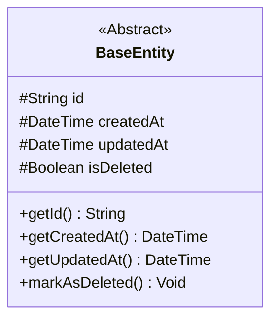
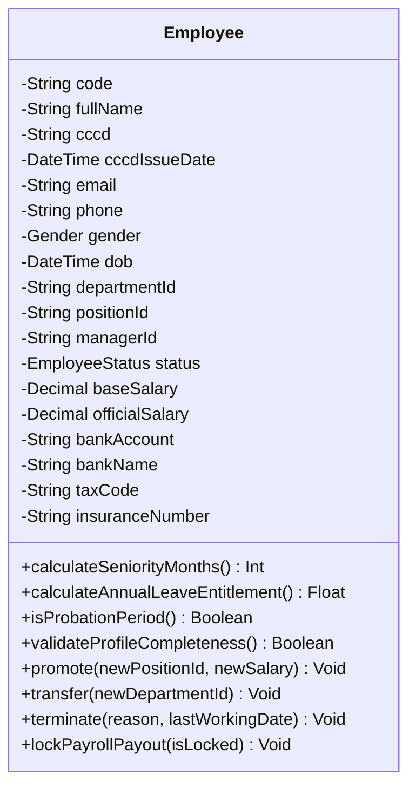
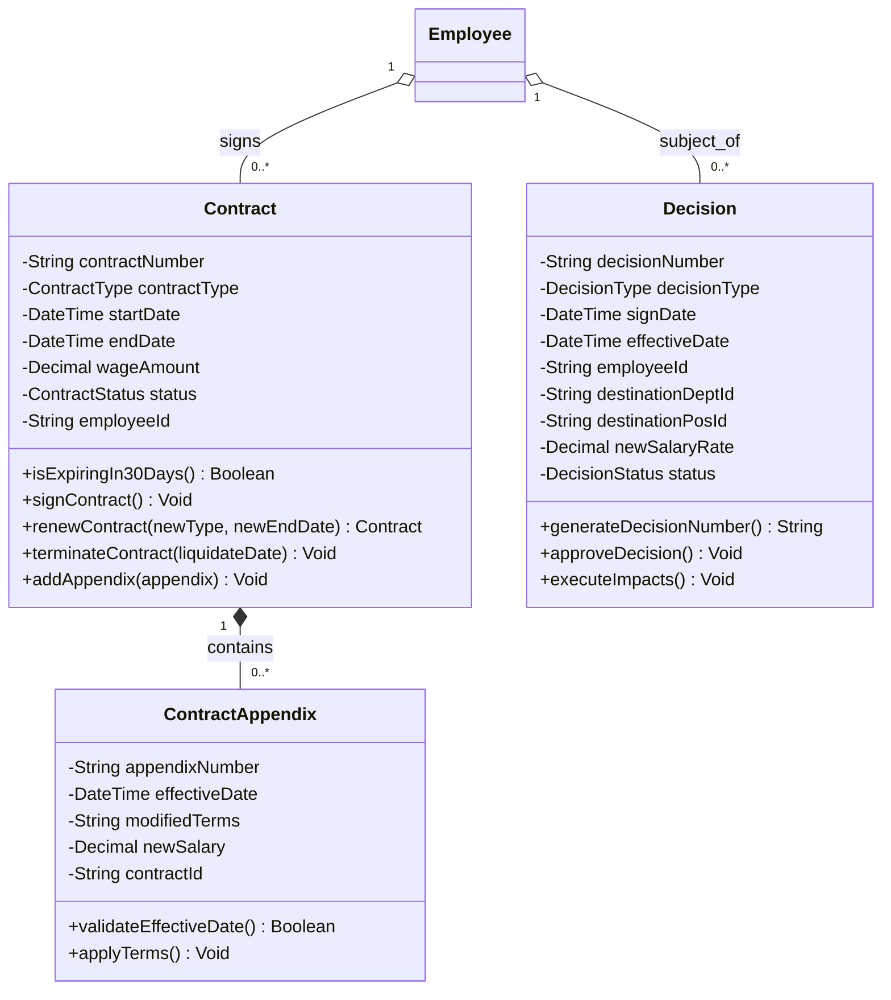
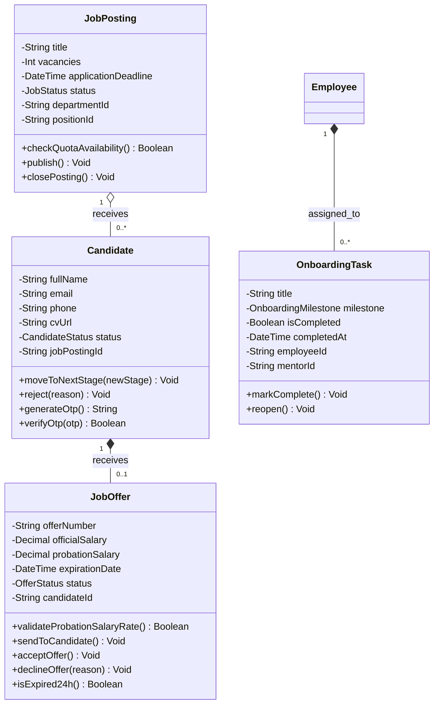
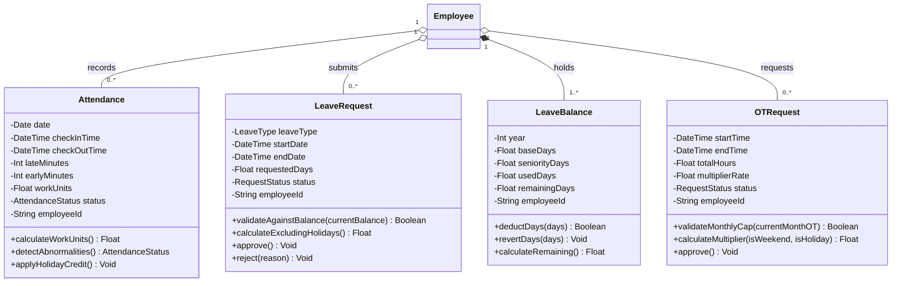
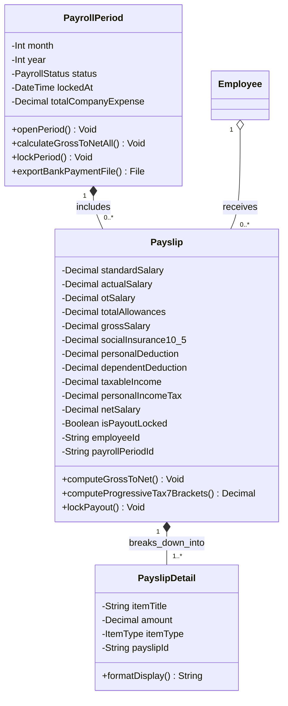
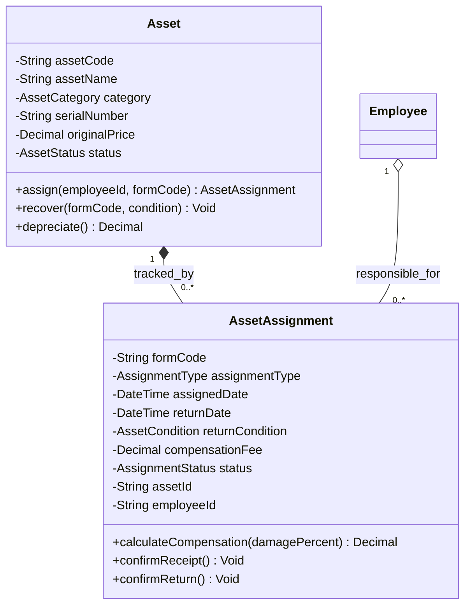
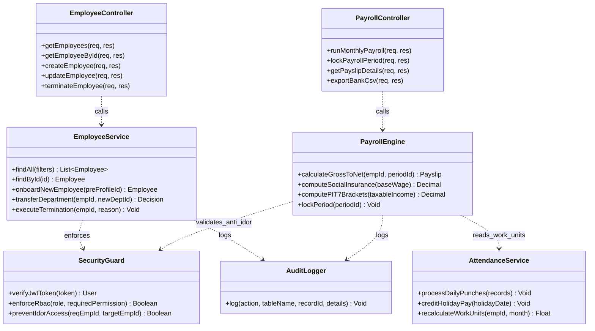

# BỘ HỒ SƠ THIẾT KẾ BIỂU ĐỒ LỚP TOÀN DIỆN (CLASS DIAGRAM) HỆ THỐNG HRM
## MÔ HÌNH HÓA CẤU TRÚC HƯỚNG ĐỐI TƯỢNG (OBJECT-ORIENTED ARCHITECTURE SPECIFICATION)

> **Dự án ĐATN:** Hệ Thống Quản Trị Nguồn Nhân Lực Doanh Nghiệp (Enterprise HRM SaaS)  
> **Sinh viên thực hiện:** Lê Hoàng Trúc | **Lớp:** 66PM1 | **Khoa:** CNTT - ĐHXDHN  
> **Kiến trúc ứng dụng:** Layered Architecture (Controller -> Service -> Domain Model -> Repository/ORM)  
> **Quy chuẩn thiết kế biểu đồ lớp UML 2.5:**  
> 1. **Quy ước ký hiệu phạm vi truy cập (Visibility):**  
>    - `-` : Private (Riêng tư - Áp dụng cho toàn bộ thuộc tính trạng thái).  
>    - `+` : Public (Công khai - Áp dụng cho các phương thức nghiệp vụ, truy vấn và tính toán).  
>    - `#` : Protected (Được bảo vệ - Áp dụng cho các thuộc tính/phương thức lớp cơ sở kế thừa).  
> 2. **Ký hiệu mối quan hệ hướng đối tượng chuẩn mực:**  
>    - `Kế thừa (Generalization): <|--` (Lớp con kế thừa thuộc tính và phương thức từ lớp cha `BaseEntity`).  
>    - `Cấu thành (Composition): *--` (Quan hệ sở hữu vòng đời chặt chẽ, khi đối tượng cha bị hủy thì đối tượng con bị xóa theo).  
>    - `Thu nạp (Aggregation): o--` (Quan hệ tập hợp, vòng đời đối tượng con độc lập với đối tượng cha).  
>    - `Hiệp hội (Association): -->` (Quan hệ tham chiếu và tương tác giữa 2 thực thể).  
>    - `Phụ thuộc (Dependency): ..>` (Lớp này sử dụng dịch vụ hoặc tham số của lớp kia).  
> 3. **Cấu trúc tài liệu:**  
>    - **Phần 1:** Tổng quan Kiến trúc Hướng đối tượng & Phân loại các nhóm lớp.  
>    - **Phần 2:** Đặc tả Chi tiết Thuộc tính & Phương thức của từng Lớp Nghiệp vụ.  
>    - **Phần 3:** Sơ đồ Class Diagram Hoàn chỉnh Toàn hệ thống (Master Class Diagram).  
>    - **Phần 4:** Sơ đồ Class Diagram Phân rã theo từng Phân hệ chuyên sâu.

---

# PHẦN 1: TỔNG QUAN KIẾN TRÚC HƯỚNG ĐỐI TƯỢNG & PHÂN LOẠI CÁC LỚP

Hệ thống HRM được thiết kế theo nguyên lý **Domain-Driven Design (DDD)** kết hợp mô hình phân tầng **Layered Architecture**, bao gồm 3 nhóm lớp cốt lõi:

1. **Lớp Thực thể Miền (Domain Entity Classes):**  
   Đại diện cho các đối tượng thực tế trong doanh nghiệp (Nhân viên, Phòng ban, Hợp đồng, Phiếu lương...). Tất cả các thực thể đều kế thừa từ lớp trừu tượng `BaseEntity` để chuẩn hóa các thuộc tính định danh (`id: UUID`) và thời gian ghi vết (`createdAt`, `updatedAt`). Các lớp này đóng gói dữ liệu và cung cấp các phương thức kiểm tra tính hợp lệ (Validation Rules) và tính toán cục bộ.

2. **Lớp Dịch vụ Nghiệp vụ (Domain Service Classes):**  
   Chịu trách nhiệm thực thi các luồng nghiệp vụ phức tạp liên quan đến nhiều thực thể: `PayrollEngine` (chạy tính toán Gross-to-Net, bảo hiểm, 7 bậc thuế), `AttendanceService` (đối soát quẹt thẻ và ngày công chuẩn), `RecruitmentService` (quản lý phễu Kanban 7 bước), `ContractService` (cảnh báo 30 ngày hết hạn).

3. **Lớp Tiện ích & Hỗ trợ (Infrastructure & Utility Classes):**  
   Các lớp dùng chung đảm bảo tính toàn vẹn hệ thống: `AuditLogger` (ghi vết bất biến), `MailerService` (gửi OTP, thư mời phỏng vấn, thư mời nhận việc), `SecurityGuard` (xác thực token, kiểm soát bảo mật Anti-IDOR và phân quyền RBAC).

---

# PHẦN 2: ĐẶC TẢ CHI TIẾT THUỘC TÍNH & PHƯƠNG THỨC TỪNG LỚP NGHIỆP VỤ

---

## 2.1. Lớp Cơ sở Trừu tượng: `BaseEntity`
> Lớp cha trừu tượng cung cấp các thuộc tính định danh và thời gian vết cho 100% các thực thể trong cơ sở dữ liệu.

---

## 2.2. Nhóm Lớp Cơ cấu Tổ chức: `Department` & `Position`

| Tên lớp | Trách nhiệm nghiệp vụ | Thuộc tính chính (Attributes) | Phương thức nghiệp vụ (Operations) |
| :--- | :--- | :--- | :--- |
| **`Department`** | Quản lý cây phân cấp tổ chức và định biên nhân sự | `- String code` `- String name` `- Int quota` `- String parentId` `- String managerId` | `+ validateQuota(): Boolean` `+ calculateFillRate(): Float` `+ checkHierarchyLoop(newParentId): Boolean` `+ blockDepartment(): Void` `+ getSubDepartments(): List~Department~` |
| **`Position`** | Quản lý chức danh và khung dải lương | `- String code` `- String title` `- Decimal minSalary` `- Decimal maxSalary` `- String departmentId` | `+ validateSalaryRange(): Boolean` `+ isSalaryInRange(salary): Boolean` `+ updateSalaryRange(min, max): Void` |

---

## 2.3. Nhóm Lớp Thực thể Trung tâm: `Employee` (Hồ sơ 360°)
> Lớp thực thể lớn nhất hệ thống, hội tụ toàn bộ các luồng giao dịch nhân sự, lý lịch, thân nhân và quan hệ công tác.

---

## 2.4. Nhóm Lớp Hợp đồng & Quyết định: `Contract`, `ContractAppendix`, `Decision`

---

## 2.5. Nhóm Lớp Tuyển dụng ATS & Hội nhập: `JobPosting`, `Candidate`, `JobOffer`, `OnboardingTask`

---

## 2.6. Nhóm Lớp Chấm công, Nghỉ phép & OT: `Attendance`, `LeaveRequest`, `OTRequest`

---

## 2.7. Nhóm Lớp Tiền lương Gross-to-Net: `PayrollPeriod`, `Payslip`, `PayslipDetail`

---

## 2.8. Nhóm Lớp Quản lý Tài sản Thiết bị IT: `Asset` & `AssetAssignment`

---

# PHẦN 3: SƠ ĐỒ CLASS DIAGRAM HOÀN CHỈNH TOÀN HỆ THỐNG (MASTER CLASS DIAGRAM)

Biểu đồ dưới đây tích hợp đầy đủ cấu trúc các lớp thực thể miền, mối quan hệ kế thừa `BaseEntity` và mạng lưới quan hệ đa cấp trong hệ thống HRM:

```mermaid
classDiagram
    %% Abstract Base Entity
    class BaseEntity {
        <<Abstract>>
        #String id
        #DateTime createdAt
        #DateTime updatedAt
        +getId() String
    }

    %% Core Organization & Employee
    class Department {
        -String code
        -String name
        -Int quota
        +validateQuota() Boolean
        +calculateFillRate() Float
    }

    class Position {
        -String code
        -String title
        -Decimal minSalary
        -Decimal maxSalary
        +isSalaryInRange(val) Boolean
    }

    class Employee {
        -String code
        -String fullName
        -String cccd
        -Decimal baseSalary
        -EmployeeStatus status
        +calculateTenure() Int
        +promote() Void
        +terminate() Void
    }

    class Account {
        -String username
        -String passwordHash
        -Boolean isActive
        +verifyPassword(pwd) Boolean
    }

    class Role {
        -String name
        -String description
        +hasPermission(p) Boolean
    }

    %% Recruitment & Onboarding
    class JobPosting {
        -String title
        -Int vacancies
        +checkQuota() Boolean
    }

    class Candidate {
        -String fullName
        -String email
        -CandidateStatus status
        +verifyOtp(code) Boolean
    }

    class JobOffer {
        -Decimal officialSalary
        -Decimal probationSalary
        +validateProbationRate() Boolean
    }

    class OnboardingTask {
        -String title
        -Boolean isCompleted
        +markComplete() Void
    }

    %% Contracts & Decisions
    class Contract {
        -String contractNumber
        -ContractType contractType
        +isExpiringIn30Days() Boolean
    }

    class ContractAppendix {
        -String appendixNumber
        -Decimal newSalary
    }

    class Decision {
        -String decisionNumber
        -DecisionType decisionType
        +approveDecision() Void
    }

    %% Time & Attendance
    class Attendance {
        -Date date
        -DateTime checkIn
        -DateTime checkOut
        -Float workUnits
        +calculateWorkUnits() Float
    }

    class LeaveRequest {
        -LeaveType leaveType
        -Float requestedDays
        +approve() Void
    }

    class LeaveBalance {
        -Int year
        -Float remainingDays
        +deductDays(d) Boolean
    }

    class OTRequest {
        -Float totalHours
        -Float multiplierRate
        +approve() Void
    }

    %% Payroll & Performance
    class PayrollPeriod {
        -Int month
        -Int year
        -PayrollStatus status
        +lockPeriod() Void
    }

    class Payslip {
        -Decimal grossSalary
        -Decimal netSalary
        +computeGrossToNet() Void
    }

    class PayslipDetail {
        -String itemTitle
        -Decimal amount
    }

    class PerformanceReview {
        -Float finalScore
        -String rankGrade
        +applyBellCurve() Void
    }

    %% Asset
    class Asset {
        -String assetCode
        -AssetStatus status
        +assign() AssetAssignment
    }

    class AssetAssignment {
        -String formCode
        -DateTime assignedDate
    }

    %% Inheritance
    BaseEntity <|-- Department
    BaseEntity <|-- Position
    BaseEntity <|-- Employee
    BaseEntity <|-- Account
    BaseEntity <|-- JobPosting
    BaseEntity <|-- Candidate
    BaseEntity <|-- Contract
    BaseEntity <|-- Decision
    BaseEntity <|-- Attendance
    BaseEntity <|-- LeaveRequest
    BaseEntity <|-- PayrollPeriod
    BaseEntity <|-- Payslip
    BaseEntity <|-- Asset

    %% Relationships
    Department "1" o-- "0..*" Position : has
    Department "1" o-- "0..*" Employee : employs
    Position "1" o-- "0..*" Employee : assigned
    Employee "1" o-- "0..*" Employee : manager/subordinates
    Employee "1" *-- "0..1" Account : authenticates
    Role "1" o-- "0..*" Account : assigned_role

    Employee "1" *-- "0..*" Contract : signs
    Contract "1" *-- "0..*" ContractAppendix : contains
    Employee "1" o-- "0..*" Decision : subject_of

    Department "1" o-- "0..*" JobPosting : recruits
    JobPosting "1" o-- "0..*" Candidate : receives
    Candidate "1" *-- "0..1" JobOffer : receives
    Employee "1" *-- "0..*" OnboardingTask : completes

    Employee "1" o-- "0..*" Attendance : logs
    Employee "1" o-- "0..*" LeaveRequest : requests
    Employee "1" *-- "1..*" LeaveBalance : holds
    Employee "1" o-- "0..*" OTRequest : overtime

    PayrollPeriod "1" *-- "0..*" Payslip : includes
    Employee "1" o-- "0..*" Payslip : receives
    Payslip "1" *-- "1..*" PayslipDetail : breakdowns

    Employee "1" o-- "0..*" PerformanceReview : evaluated
    Asset "1" *-- "0..*" AssetAssignment : assigned_via
    Employee "1" o-- "0..*" AssetAssignment : responsible
```

---

# PHẦN 4: SƠ ĐỒ CLASS DIAGRAM KIẾN TRÚC PHÂN TẦNG (CONTROLLER - SERVICE - DOMAIN)

Biểu đồ thể hiện cách các lớp dịch vụ nghiệp vụ (Service Layer) điều phối giữa các Lớp điều khiển API (Controller Layer) và các Thực thể dữ liệu (Domain Entity):

---

# KẾT LUẬN

Hồ sơ **Class Diagram (Biểu đồ Lớp)** trên đã mô hình hóa trọn vẹn kiến trúc tĩnh hướng đối tượng của hệ thống HRM:
1. **Đầy đủ 3 cấp độ:** Thực thể miền dữ liệu (Domain Entities), Kiến trúc phân tầng dịch vụ (Service Layer) và Tiện ích bảo mật (Security & Audit).
2. **Tuân thủ nguyên tắc OOP & SOLID:** Đóng gói chặt chẽ (Encapsulation), trừu tượng hóa qua `BaseEntity` (Abstraction), kế thừa và phân tách trách nhiệm đơn nhiệm (Single Responsibility).
3. **Tính liên kết tuyệt đối:** Phản ánh chính xác 100% các thực thể trong Schema PostgreSQL, các Use Case nghiệp vụ và Sơ đồ Tuần tự BCE đã đặc tả.
