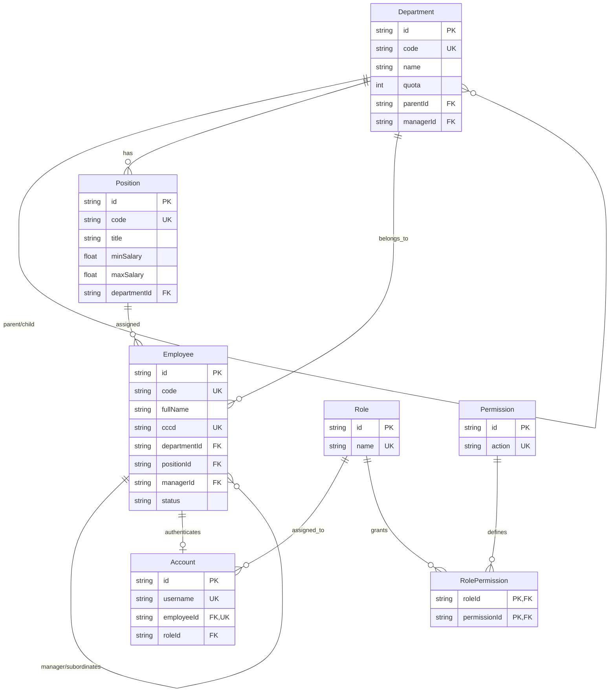
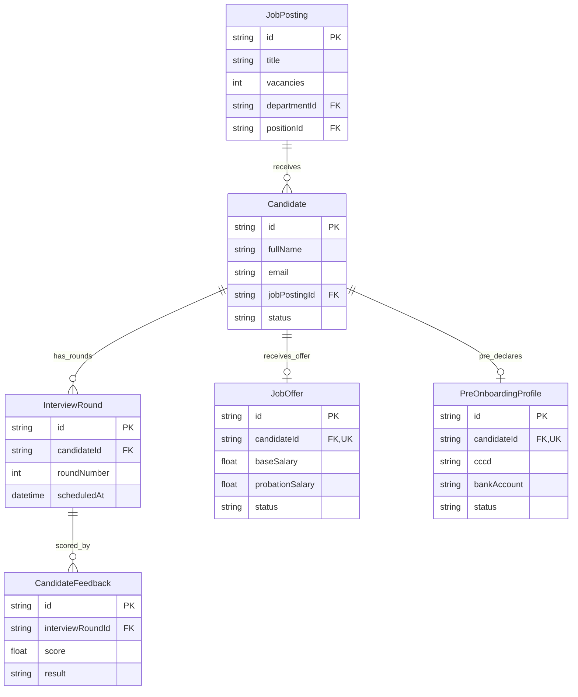
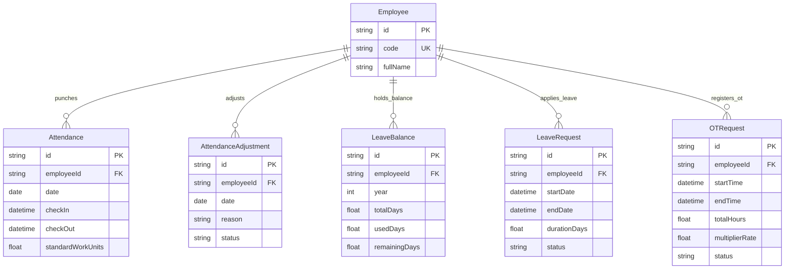
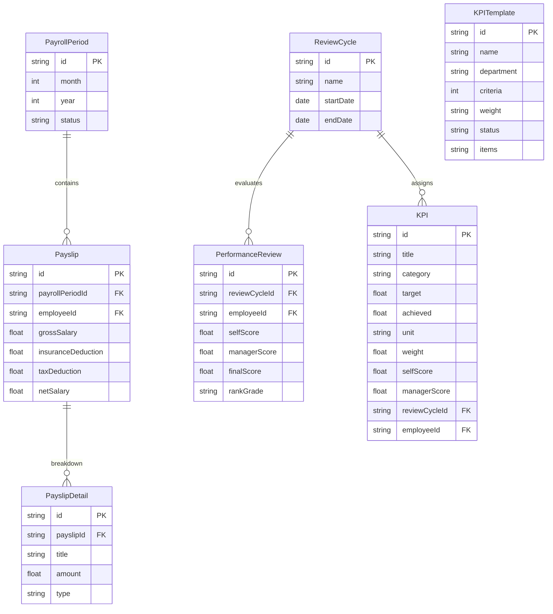
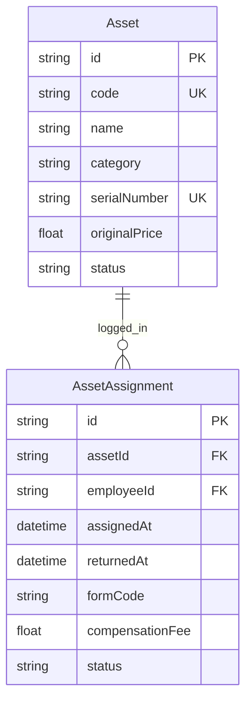

# BỘ HỒ SƠ THIẾT KẾ CƠ SỞ DỮ LIỆU TOÀN DIỆN (ENTITY RELATIONSHIP DIAGRAM - ERD)
## ĐẶC TẢ CHI TIẾT 46 BẢNG THỰC THỂ, TOÀN BỘ CÁC TRƯỜNG DỮ LIỆU, MỐI QUAN HỆ VÀ BIỂU ĐỒ HOÀN CHỈNH

> **Dự án ĐATN:** Hệ Thống Quản Trị Nguồn Nhân Lực Doanh Nghiệp (Enterprise HRM SaaS)  
> **Sinh viên thực hiện:** Lê Hoàng Trúc | **Lớp:** 66PM1 | **Khoa:** CNTT - ĐHXDHN  
> **Hệ quản trị CSDL:** PostgreSQL 15+ | **Công cụ mô hình hóa / ORM:** Prisma ORM  
> **Cấu trúc tài liệu thiết kế CSDL:**  
> 1. **Phần 1: Tổng quan Kiến trúc & Danh mục 46 Bảng CSDL:** Phân bổ theo 9 miền dữ liệu nghiệp vụ.  
> 2. **Phần 2: Từ điển Dữ liệu Chi tiết (Data Dictionary):** Liệt kê đầy đủ 100% các cột/trường của từng bảng (Kiểu dữ liệu, Khóa, Ràng buộc, Ý nghĩa nghiệp vụ).  
> 3. **Phần 3: Danh mục Chi tiết Các Mối Quan Hệ (Relationships):** Bản số (1-1, 1-N), Khóa ngoại (`FK -> PK`), Quy tắc toàn vẹn tham chiếu (`On Delete`).  
> 4. **Phần 4: Sơ đồ ERD Hoàn chỉnh Toàn hệ thống (Master Mermaid ERD):** Biểu đồ tổng thể và các biểu đồ thành phần từng phân hệ.

---

# PHẦN 1: TỔNG QUAN KIẾN TRÚC & PHÂN CỤM 46 THỰC THỂ CSDL

Toàn bộ cơ sở dữ liệu được tổ chức theo mô hình **Lấy Nhân viên làm Trung tâm (Employee-Centric Relational Model)**, bao gồm 46 bảng phân bố theo 9 phân cụm miền nghiệp vụ:

| STT | Tên bảng (Model) | Tên nghiệp vụ tiếng Việt | Khóa chính (PK) | Mục đích lưu trữ & Ý nghĩa nghiệp vụ |
| :-: | :--- | :--- | :---: | :--- |
| **01** | `Account` | Tài khoản người dùng | `id (UUID)` | Lưu trữ tài khoản đăng nhập, mật khẩu mã hóa bcrypt và trạng thái kích hoạt. |
| **02** | `Role` | Vai trò người dùng | `id (UUID)` | Định nghĩa các nhóm vai trò trong hệ thống (SUPER_ADMIN, HR_MANAGER, EMPLOYEE...). |
| **03** | `Permission` | Quyền hạn chức năng | `id (UUID)` | Danh mục các quyền thao tác chi tiết (VIEW_PAYROLL, EDIT_EMPLOYEE, APPROVE_LEAVE...). |
| **04** | `RolePermission` | Phân quyền Vai trò | `id (UUID)` | Bảng trung gian gán các quyền hạn cụ thể cho từng vai trò. |
| **05** | `AuditLog` | Nhật ký kiểm toán | `id (UUID)` | Ghi vết toàn bộ hành vi thêm/sửa/xóa và các thao tác bảo mật nhạy cảm. |
| **06** | `Department` | Phòng ban đơn vị | `id (UUID)` | Cơ cấu tổ chức hình cây, quản lý phòng ban cha-con và chỉ tiêu định biên nhân sự. |
| **07** | `Position` | Vị trí chức danh | `id (UUID)` | Danh mục chức danh công việc, cấp bậc và khung dải lương tối thiểu - tối đa. |
| **08** | `Employee` | Hồ sơ Nhân viên 360° | `id (UUID)` | Bảng thực thể trung tâm lưu trữ toàn bộ thông tin định danh, lý lịch và trạng thái nhân sự. |
| **09** | `ProfileChangeRequest` | Yêu cầu đổi thông tin | `id (UUID)` | Quản lý các đề nghị cập nhật CCCD, tài khoản ngân hàng do nhân viên gửi lên chờ HR duyệt. |
| **10** | `Decision` | Quyết định nhân sự | `id (UUID)` | Văn bản quyết định chính thức (11 loại: Bổ nhiệm, Tăng lương, Điều chuyển, Kỷ luật...). |
| **11** | `Relative` | Thân nhân & Giảm trừ | `id (UUID)` | Thông tin gia đình và hồ sơ người phụ thuộc đăng ký giảm trừ gia cảnh thuế TNCN (4.4tr/tháng). |
| **12** | `Degree` | Học vấn & Bằng cấp | `id (UUID)` | Lịch sử đào tạo học vấn, trình độ chuyên môn (Cử nhân, Kỹ sư, Thạc sĩ...). |
| **13** | `Certificate` | Chứng chỉ chuyên môn | `id (UUID)` | Chứng chỉ hành nghề, ngoại ngữ, tin học nghiệp vụ. |
| **14** | `OnboardingTask` | Nhiệm vụ hội nhập | `id (UUID)` | Checklist nhận việc phân theo 4 mốc thời gian (D-7, D-1, W-1, M-2). |
| **15** | `EmploymentHistory` | Quá trình công tác | `id (UUID)` | Lịch sử điều chuyển phòng ban, bổ nhiệm chức danh qua các thời kỳ. |
| **16** | `Contract` | Hợp đồng lao động | `id (UUID)` | Hợp đồng thử việc, xác định thời hạn và không xác định thời hạn theo luật lao động. |
| **17** | `ContractAppendix` | Phụ lục hợp đồng | `id (UUID)` | Văn bản sửa đổi, bổ sung điều khoản lương, chức danh của hợp đồng gốc. |
| **18** | `Shift` | Ca làm việc | `id (UUID)` | Cấu hình khung giờ bắt đầu, kết thúc, thời gian nghỉ giữa ca và giờ chuẩn. |
| **19** | `Holiday` | Ngày nghỉ Lễ Tết | `id (UUID)` | Danh mục ngày nghỉ Lễ Quốc gia hưởng nguyên 100% lương theo Điều 112 BLLĐ 2019. |
| **20** | `Attendance` | Bảng chấm công chi tiết | `id (UUID)` | Bản ghi quẹt thẻ/điểm danh vào ra hàng ngày, tính giờ đi muộn, về sớm và số công chuẩn. |
| **21** | `AttendanceAdjustment` | Giải trình chấm công | `id (UUID)` | Đơn xin bù công, giải trình quên quẹt thẻ hoặc công tác ngoài hiện trường. |
| **22** | `LeaveBalance` | Quỹ phép năm | `id (UUID)` | Quản lý số ngày phép được hưởng theo thâm niên (Điều 113-114), số ngày đã dùng và còn lại. |
| **23** | `LeaveRequest` | Đơn xin nghỉ phép | `id (UUID)` | Đơn xin nghỉ phép năm, phép ốm, thai sản, việc riêng kèm trạng thái phê duyệt. |
| **24** | `LeaveTypeConfig` | Cấu hình loại phép | `id (UUID)` | Định nghĩa các loại nghỉ phép (hưởng lương, không hưởng lương, BHXH chi trả). |
| **25** | `LeavePolicy` | Chính sách nghỉ phép | `id (UUID)` | Quy định công thức tích lũy phép theo thâm niên công tác. |
| **26** | `OTRequest` | Đăng ký làm thêm giờ | `id (UUID)` | Đơn xin làm thêm giờ OT, kiểm tra trần 40h/tháng và tính hệ số 150%, 200%, 300% theo Điều 98. |
| **27** | `PayrollPeriod` | Kỳ bảng lương | `id (UUID)` | Kỳ tính lương theo tháng, quản lý trạng thái tính nháp và khóa sổ vĩnh viễn (Locked). |
| **28** | `Payslip` | Phiếu lương nhân viên | `id (UUID)` | Phiếu lương Gross-to-Net tổng hợp: Lương cơ bản, phụ cấp, giảm trừ, thuế TNCN và Net thực nhận. |
| **29** | `PayslipDetail` | Chi tiết mục lương | `id (UUID)` | Bóc tách chi tiết từng khoản mục cộng/trừ trong phiếu lương. |
| **30** | `Allowance` | Danh mục phụ cấp | `id (UUID)` | Các khoản trợ cấp ăn trưa, xăng xe, điện thoại, trách nhiệm. |
| **31** | `TaxBracket` | Biểu thuế TNCN | `id (UUID)` | Cấu hình 7 bậc thuế lũy tiến từng phần theo Luật thuế thu nhập cá nhân. |
| **32** | `JobPosting` | Chiến dịch tuyển dụng | `id (UUID)` | Tin tuyển dụng công khai, chỉ tiêu tuyển, mô tả công việc và hạn nhận hồ sơ. |
| **33** | `Candidate` | Hồ sơ ứng viên ATS | `id (UUID)` | Hồ sơ ứng viên nộp CV, quản lý tiến trình qua 7 bước trên phễu Kanban. |
| **34** | `CandidateUser` | Tài khoản ứng viên | `id (UUID)` | Tài khoản đăng nhập cổng tuyển dụng công khai dành cho ứng viên. |
| **35** | `CandidateVerificationOtp` | Mã xác thực OTP | `id (UUID)` | Mã OTP 6 số gửi qua Email để xác thực danh tính nộp hồ sơ và tra cứu kết quả 2 lớp. |
| **36** | `PreOnboardingProfile` | Hồ sơ tự kê khai | `id (UUID)` | Dữ liệu sơ yếu lý lịch, CCCD, số tài khoản do ứng viên tự nhập trực tuyến trước ngày đi làm. |
| **37** | `InterviewRound` | Vòng phỏng vấn | `id (UUID)` | Lịch phỏng vấn chi tiết: Thời gian, phòng họp, Hội đồng phỏng vấn và trạng thái. |
| **38** | `CandidateFeedback` | Phiếu chấm điểm | `id (UUID)` | Đánh giá độc lập của người phỏng vấn: Tiêu chí, điểm số 1-5 sao và kết quả Pass/Fail. |
| **39** | `JobOffer` | Thư mời nhận việc | `id (UUID)` | Thư mời Offer chuẩn Điều 26 BLLĐ (Lương thử việc >= 85%) kèm đếm ngược 24h phản hồi. |
| **40** | `ReviewCycle` | Chu kỳ đánh giá KPI | `id (UUID)` | Đợt đánh giá hiệu suất định kỳ theo Quý hoặc Năm. |
| **41** | `KPI` | Mục tiêu KPI cá nhân | `id (UUID)` | Mục tiêu cụ thể, chỉ số đo lường (KPI) và tỷ trọng đánh giá của từng nhân viên. |
| **42** | `PerformanceReview` | Phiếu đánh giá KPI | `id (UUID)` | Tổng hợp điểm tự chấm, điểm quản lý và xếp loại cưỡng bức Bell Curve (20-60-20). |
| **43** | `KPITemplate` | Mẫu tiêu chí KPI | `id (UUID)` | Khung tiêu chí và trọng số KPI mẫu theo từng phòng ban và chức danh. |
| **44** | `Asset` | Danh mục tài sản thiết bị | `id (UUID)` | Quản lý thiết bị Laptop, màn hình, thẻ từ: Mã tài sản, số seri, nguyên giá, tình trạng. |
| **45** | `AssetAssignment` | Biên bản cấp phát/thu hồi | `id (UUID)` | Lưu vết bàn giao BM-01 khi nhận việc và thu hồi BM-02 khi thôi việc, xử lý bồi thường Điều 129. |
| **46** | `SystemSetting` | Tham số hệ thống động | `id (UUID)` | Cấu hình tham số nghiệp vụ toàn cục: Giờ công chuẩn, mức giảm trừ gia cảnh, tỷ lệ đóng bảo hiểm. |

---

# PHẦN 2: TỪ ĐIỂN DỮ LIỆU CHI TIẾT (DATA DICTIONARY - LIỆT KÊ ĐỦ CÁC TRƯỜNG TỪNG BẢNG)

## 2.1. Bảng `Account`: Tài khoản người dùng
> **Mô tả chức năng:** Lưu trữ tài khoản đăng nhập, mật khẩu mã hóa bcrypt và trạng thái kích hoạt.  
> **Tổng số cột/trường:** 6 trường dữ liệu.

| STT | Tên trường (Field) | Kiểu dữ liệu | Bắt buộc | Ràng buộc / Khóa | Ý nghĩa nghiệp vụ & Ràng buộc dữ liệu |
| :-: | :--- | :--- | :---: | :--- | :--- |
| 1 | `id` | `String` | Không | 🔑 PRIMARY KEY | Mặc định: `uuid()` | Khóa chính định danh duy nhất (UUIDv4) |
| 2 | `username` | `String` | Không | ⭐ UNIQUE | Dữ liệu thông tin username của bản ghi |
| 3 | `password` | `String` | Không | Thuộc tính thường | Dữ liệu thông tin password của bản ghi |
| 4 | `employeeId` | `String` | Cho phép Null | ⭐ UNIQUE | 🔗 FOREIGN KEY | Khóa ngoại tham chiếu đến bảng Nhân viên (Employee.id) |
| 5 | `roleId` | `String` | Không | 🔗 FOREIGN KEY | Khóa ngoại tham chiếu đến bảng Vai trò (Role.id) |
| 6 | `isActive` | `Boolean` | Không | Mặc định: `true` | Cờ trạng thái nhị phân (Đúng/Sai) |

---

## 2.2. Bảng `Role`: Vai trò người dùng
> **Mô tả chức năng:** Định nghĩa các nhóm vai trò trong hệ thống (SUPER_ADMIN, HR_MANAGER, EMPLOYEE...).  
> **Tổng số cột/trường:** 3 trường dữ liệu.

| STT | Tên trường (Field) | Kiểu dữ liệu | Bắt buộc | Ràng buộc / Khóa | Ý nghĩa nghiệp vụ & Ràng buộc dữ liệu |
| :-: | :--- | :--- | :---: | :--- | :--- |
| 1 | `id` | `String` | Không | 🔑 PRIMARY KEY | Mặc định: `uuid()` | Khóa chính định danh duy nhất (UUIDv4) |
| 2 | `name` | `String` | Không | ⭐ UNIQUE | Dữ liệu thông tin name của bản ghi |
| 3 | `description` | `String` | Cho phép Null | Thuộc tính thường | Ghi chú, lý do hoặc diễn giải nghiệp vụ |

---

## 2.3. Bảng `Permission`: Quyền hạn chức năng
> **Mô tả chức năng:** Danh mục các quyền thao tác chi tiết (VIEW_PAYROLL, EDIT_EMPLOYEE, APPROVE_LEAVE...).  
> **Tổng số cột/trường:** 3 trường dữ liệu.

| STT | Tên trường (Field) | Kiểu dữ liệu | Bắt buộc | Ràng buộc / Khóa | Ý nghĩa nghiệp vụ & Ràng buộc dữ liệu |
| :-: | :--- | :--- | :---: | :--- | :--- |
| 1 | `id` | `String` | Không | 🔑 PRIMARY KEY | Mặc định: `uuid()` | Khóa chính định danh duy nhất (UUIDv4) |
| 2 | `action` | `String` | Không | ⭐ UNIQUE | Dữ liệu thông tin action của bản ghi |
| 3 | `description` | `String` | Cho phép Null | Thuộc tính thường | Ghi chú, lý do hoặc diễn giải nghiệp vụ |

---

## 2.4. Bảng `RolePermission`: Phân quyền Vai trò
> **Mô tả chức năng:** Bảng trung gian gán các quyền hạn cụ thể cho từng vai trò.  
> **Tổng số cột/trường:** 2 trường dữ liệu.

| STT | Tên trường (Field) | Kiểu dữ liệu | Bắt buộc | Ràng buộc / Khóa | Ý nghĩa nghiệp vụ & Ràng buộc dữ liệu |
| :-: | :--- | :--- | :---: | :--- | :--- |
| 1 | `roleId` | `String` | Không | 🔗 FOREIGN KEY | Khóa ngoại tham chiếu đến bảng Vai trò (Role.id) |
| 2 | `permissionId` | `String` | Không | 🔗 FOREIGN KEY | Dữ liệu thông tin permissionId của bản ghi |

---

## 2.5. Bảng `AuditLog`: Nhật ký kiểm toán
> **Mô tả chức năng:** Ghi vết toàn bộ hành vi thêm/sửa/xóa và các thao tác bảo mật nhạy cảm.  
> **Tổng số cột/trường:** 7 trường dữ liệu.

| STT | Tên trường (Field) | Kiểu dữ liệu | Bắt buộc | Ràng buộc / Khóa | Ý nghĩa nghiệp vụ & Ràng buộc dữ liệu |
| :-: | :--- | :--- | :---: | :--- | :--- |
| 1 | `id` | `String` | Không | 🔑 PRIMARY KEY | Mặc định: `uuid()` | Khóa chính định danh duy nhất (UUIDv4) |
| 2 | `action` | `String` | Không | Thuộc tính thường | Dữ liệu thông tin action của bản ghi |
| 3 | `tableName` | `String` | Không | Thuộc tính thường | Dữ liệu thông tin tableName của bản ghi |
| 4 | `recordId` | `String` | Không | 🔗 FOREIGN KEY | Dữ liệu thông tin recordId của bản ghi |
| 5 | `accountId` | `String` | Không | 🔗 FOREIGN KEY | Dữ liệu thông tin accountId của bản ghi |
| 6 | `details` | `String` | Cho phép Null | Thuộc tính thường | Dữ liệu thông tin details của bản ghi |
| 7 | `createdAt` | `DateTime` | Không | Mặc định: `now()` | Thời điểm khởi tạo bản ghi trong hệ thống |

---

## 2.6. Bảng `Department`: Phòng ban đơn vị
> **Mô tả chức năng:** Cơ cấu tổ chức hình cây, quản lý phòng ban cha-con và chỉ tiêu định biên nhân sự.  
> **Tổng số cột/trường:** 8 trường dữ liệu.

| STT | Tên trường (Field) | Kiểu dữ liệu | Bắt buộc | Ràng buộc / Khóa | Ý nghĩa nghiệp vụ & Ràng buộc dữ liệu |
| :-: | :--- | :--- | :---: | :--- | :--- |
| 1 | `id` | `String` | Không | 🔑 PRIMARY KEY | Mặc định: `uuid()` | Khóa chính định danh duy nhất (UUIDv4) |
| 2 | `code` | `String` | Không | ⭐ UNIQUE | Mã nghiệp vụ duy nhất (Mã nhân viên, mã phòng, mã chức danh...) |
| 3 | `name` | `String` | Không | Thuộc tính thường | Dữ liệu thông tin name của bản ghi |
| 4 | `parentId` | `String` | Cho phép Null | 🔗 FOREIGN KEY | Dữ liệu thông tin parentId của bản ghi |
| 5 | `managerId` | `String` | Cho phép Null | 🔗 FOREIGN KEY | Khóa ngoại tham chiếu đến Quản lý trực tiếp (Employee.id) |
| 6 | `managerName` | `String` | Cho phép Null | Thuộc tính thường | Dữ liệu thông tin managerName của bản ghi |
| 7 | `quota` | `Int` | Không | Mặc định: `15` | Định biên nhân sự tối đa được phê duyệt cho đơn vị |
| 8 | `status` | `String` | Không | Mặc định: `"ACTIVE"` | Trạng thái hoạt động / phê duyệt của bản ghi |

---

## 2.7. Bảng `Position`: Vị trí chức danh
> **Mô tả chức năng:** Danh mục chức danh công việc, cấp bậc và khung dải lương tối thiểu - tối đa.  
> **Tổng số cột/trường:** 9 trường dữ liệu.

| STT | Tên trường (Field) | Kiểu dữ liệu | Bắt buộc | Ràng buộc / Khóa | Ý nghĩa nghiệp vụ & Ràng buộc dữ liệu |
| :-: | :--- | :--- | :---: | :--- | :--- |
| 1 | `id` | `String` | Không | 🔑 PRIMARY KEY | Mặc định: `uuid()` | Khóa chính định danh duy nhất (UUIDv4) |
| 2 | `code` | `String` | Cho phép Null | ⭐ UNIQUE | Mã nghiệp vụ duy nhất (Mã nhân viên, mã phòng, mã chức danh...) |
| 3 | `title` | `String` | Không | Thuộc tính thường | Dữ liệu thông tin title của bản ghi |
| 4 | `description` | `String` | Cho phép Null | Thuộc tính thường | Ghi chú, lý do hoặc diễn giải nghiệp vụ |
| 5 | `level` | `String` | Không | Mặc định: `"Staff"` | Dữ liệu thông tin level của bản ghi |
| 6 | `minSalary` | `Int` | Không | Mặc định: `0` | Giá trị số tiền / Tỷ lệ định lượng (VNĐ / %) |
| 7 | `maxSalary` | `Int` | Không | Mặc định: `0` | Giá trị số tiền / Tỷ lệ định lượng (VNĐ / %) |
| 8 | `status` | `String` | Không | Mặc định: `"ACTIVE"` | Trạng thái hoạt động / phê duyệt của bản ghi |
| 9 | `departmentId` | `String` | Cho phép Null | 🔗 FOREIGN KEY | Khóa ngoại tham chiếu đến bảng Phòng ban (Department.id) |

---

## 2.8. Bảng `Employee`: Hồ sơ Nhân viên 360°
> **Mô tả chức năng:** Bảng thực thể trung tâm lưu trữ toàn bộ thông tin định danh, lý lịch và trạng thái nhân sự.  
> **Tổng số cột/trường:** 51 trường dữ liệu.

| STT | Tên trường (Field) | Kiểu dữ liệu | Bắt buộc | Ràng buộc / Khóa | Ý nghĩa nghiệp vụ & Ràng buộc dữ liệu |
| :-: | :--- | :--- | :---: | :--- | :--- |
| 1 | `id` | `String` | Không | 🔑 PRIMARY KEY | Mặc định: `uuid()` | Khóa chính định danh duy nhất (UUIDv4) |
| 2 | `code` | `String` | Không | ⭐ UNIQUE | Mã nghiệp vụ duy nhất (Mã nhân viên, mã phòng, mã chức danh...) |
| 3 | `fullName` | `String` | Không | Thuộc tính thường | Họ và tên đầy đủ |
| 4 | `cccd` | `String` | Cho phép Null | ⭐ UNIQUE | Số Căn cước công dân / Mã định danh cá nhân |
| 5 | `cccdIssueDate` | `DateTime` | Cho phép Null | Thuộc tính thường | Thời gian ghi nhận mốc nghiệp vụ |
| 6 | `cccdIssuePlace` | `String` | Cho phép Null | Thuộc tính thường | Dữ liệu thông tin cccdIssuePlace của bản ghi |
| 7 | `cccdExpiryDate` | `DateTime` | Cho phép Null | Thuộc tính thường | Thời gian ghi nhận mốc nghiệp vụ |
| 8 | `birthPlace` | `String` | Cho phép Null | Thuộc tính thường | Dữ liệu thông tin birthPlace của bản ghi |
| 9 | `hometown` | `String` | Cho phép Null | Thuộc tính thường | Dữ liệu thông tin hometown của bản ghi |
| 10 | `ethnicity` | `String` | Cho phép Null | Thuộc tính thường | Dữ liệu thông tin ethnicity của bản ghi |
| 11 | `religion` | `String` | Cho phép Null | Thuộc tính thường | Dữ liệu thông tin religion của bản ghi |
| 12 | `dataConsent` | `Boolean` | Không | Mặc định: `true` | Dữ liệu thông tin dataConsent của bản ghi |
| 13 | `dataConsentDate` | `DateTime` | Cho phép Null | Thuộc tính thường | Thời gian ghi nhận mốc nghiệp vụ |
| 14 | `email` | `String` | Cho phép Null | ⭐ UNIQUE | Địa chỉ email công vụ / cá nhân |
| 15 | `personalEmail` | `String` | Cho phép Null | Thuộc tính thường | Dữ liệu thông tin personalEmail của bản ghi |
| 16 | `phone` | `String` | Cho phép Null | Thuộc tính thường | Số điện thoại liên hệ |
| 17 | `gender` | `String` | Cho phép Null | Thuộc tính thường | Giới tính (Nam, Nữ, Khác) |
| 18 | `dateOfBirth` | `DateTime` | Cho phép Null | Thuộc tính thường | Dữ liệu thông tin dateOfBirth của bản ghi |
| 19 | `address` | `String` | Cho phép Null | Thuộc tính thường | Dữ liệu thông tin address của bản ghi |
| 20 | `permanentAddress` | `String` | Cho phép Null | Thuộc tính thường | Dữ liệu thông tin permanentAddress của bản ghi |
| 21 | `temporaryAddress` | `String` | Cho phép Null | Thuộc tính thường | Dữ liệu thông tin temporaryAddress của bản ghi |
| 22 | `currentAddress` | `String` | Cho phép Null | Thuộc tính thường | Dữ liệu thông tin currentAddress của bản ghi |
| 23 | `nationality` | `String` | Cho phép Null | Thuộc tính thường | Dữ liệu thông tin nationality của bản ghi |
| 24 | `maritalStatus` | `String` | Cho phép Null | Thuộc tính thường | Trạng thái nghiệp vụ theo định dạng danh mục Enum `String` |
| 25 | `taxCode` | `String` | Cho phép Null | Thuộc tính thường | Mã số thuế thu nhập cá nhân |
| 26 | `bankName` | `String` | Cho phép Null | Thuộc tính thường | Tên ngân hàng mở tài khoản |
| 27 | `bankBranch` | `String` | Cho phép Null | Thuộc tính thường | Dữ liệu thông tin bankBranch của bản ghi |
| 28 | `bankAccount` | `String` | Cho phép Null | Thuộc tính thường | Số tài khoản ngân hàng nhận lương |
| 29 | `bankAccountHolder` | `String` | Cho phép Null | Thuộc tính thường | Dữ liệu thông tin bankAccountHolder của bản ghi |
| 30 | `socialInsurance` | `String` | Cho phép Null | Thuộc tính thường | Dữ liệu thông tin socialInsurance của bản ghi |
| 31 | `healthInsurance` | `String` | Cho phép Null | Thuộc tính thường | Dữ liệu thông tin healthInsurance của bản ghi |
| 32 | `emergencyContactName` | `String` | Cho phép Null | Thuộc tính thường | Dữ liệu thông tin emergencyContactName của bản ghi |
| 33 | `emergencyContactPhone` | `String` | Cho phép Null | Thuộc tính thường | Dữ liệu thông tin emergencyContactPhone của bản ghi |
| 34 | `emergencyContactRelation` | `String` | Cho phép Null | Thuộc tính thường | Dữ liệu thông tin emergencyContactRelation của bản ghi |
| 35 | `emergencyContacts` | `String` | Cho phép Null | Thuộc tính thường | Dữ liệu thông tin emergencyContacts của bản ghi |
| 36 | `highestEducation` | `String` | Cho phép Null | Thuộc tính thường | Dữ liệu thông tin highestEducation của bản ghi |
| 37 | `workExperience` | `String` | Cho phép Null | Thuộc tính thường | Dữ liệu thông tin workExperience của bản ghi |
| 38 | `attachedFiles` | `String` | Cho phép Null | Thuộc tính thường | Dữ liệu thông tin attachedFiles của bản ghi |
| 39 | `status` | `EmployeeStatus` | Không | Mặc định: `ACTIVE` | Trạng thái hoạt động / phê duyệt của bản ghi |
| 40 | `managementRole` | `String` | Cho phép Null | Mặc định: `"STAFF"` | Dữ liệu thông tin managementRole của bản ghi |
| 41 | `managerId` | `String` | Cho phép Null | 🔗 FOREIGN KEY | Khóa ngoại tham chiếu đến Quản lý trực tiếp (Employee.id) |
| 42 | `workLocation` | `String` | Cho phép Null | Mặc định: `"Trụ sở chính"` | Dữ liệu thông tin workLocation của bản ghi |
| 43 | `employmentType` | `String` | Cho phép Null | Mặc định: `"FULL_TIME"` | Trạng thái nghiệp vụ theo định dạng danh mục Enum `String` |
| 44 | `probationStartDate` | `DateTime` | Cho phép Null | Thuộc tính thường | Thời gian ghi nhận mốc nghiệp vụ |
| 45 | `probationEndDate` | `DateTime` | Cho phép Null | Thuộc tính thường | Thời gian ghi nhận mốc nghiệp vụ |
| 46 | `officialJoinDate` | `DateTime` | Cho phép Null | Thuộc tính thường | Thời gian ghi nhận mốc nghiệp vụ |
| 47 | `resignationDate` | `DateTime` | Cho phép Null | Thuộc tính thường | Thời gian ghi nhận mốc nghiệp vụ |
| 48 | `resignationReason` | `String` | Cho phép Null | Thuộc tính thường | Ghi chú, lý do hoặc diễn giải nghiệp vụ |
| 49 | `joinDate` | `DateTime` | Không | Thuộc tính thường | Thời gian ghi nhận mốc nghiệp vụ |
| 50 | `departmentId` | `String` | Cho phép Null | 🔗 FOREIGN KEY | Khóa ngoại tham chiếu đến bảng Phòng ban (Department.id) |
| 51 | `positionId` | `String` | Cho phép Null | 🔗 FOREIGN KEY | Khóa ngoại tham chiếu đến bảng Chức danh (Position.id) |

---

## 2.9. Bảng `ProfileChangeRequest`: Yêu cầu đổi thông tin
> **Mô tả chức năng:** Quản lý các đề nghị cập nhật CCCD, tài khoản ngân hàng do nhân viên gửi lên chờ HR duyệt.  
> **Tổng số cột/trường:** 12 trường dữ liệu.

| STT | Tên trường (Field) | Kiểu dữ liệu | Bắt buộc | Ràng buộc / Khóa | Ý nghĩa nghiệp vụ & Ràng buộc dữ liệu |
| :-: | :--- | :--- | :---: | :--- | :--- |
| 1 | `id` | `String` | Không | 🔑 PRIMARY KEY | Mặc định: `uuid()` | Khóa chính định danh duy nhất (UUIDv4) |
| 2 | `employeeId` | `String` | Không | 🔗 FOREIGN KEY | Khóa ngoại tham chiếu đến bảng Nhân viên (Employee.id) |
| 3 | `requestType` | `String` | Không | Mặc định: `"PROFILE_UPDATE"` | Trạng thái nghiệp vụ theo định dạng danh mục Enum `String` |
| 4 | `proposedData` | `String` | Không | Thuộc tính thường | Dữ liệu thông tin proposedData của bản ghi |
| 5 | `attachmentUrl` | `String` | Cho phép Null | Thuộc tính thường | Dữ liệu thông tin attachmentUrl của bản ghi |
| 6 | `note` | `String` | Cho phép Null | Thuộc tính thường | Ghi chú, lý do hoặc diễn giải nghiệp vụ |
| 7 | `status` | `ChangeRequestStatus` | Không | Mặc định: `PENDING` | Trạng thái hoạt động / phê duyệt của bản ghi |
| 8 | `rejectReason` | `String` | Cho phép Null | Thuộc tính thường | Ghi chú, lý do hoặc diễn giải nghiệp vụ |
| 9 | `reviewedBy` | `String` | Cho phép Null | Thuộc tính thường | Dữ liệu thông tin reviewedBy của bản ghi |
| 10 | `reviewedAt` | `DateTime` | Cho phép Null | Thuộc tính thường | Thời gian ghi nhận mốc nghiệp vụ |
| 11 | `createdAt` | `DateTime` | Không | Mặc định: `now()` | Thời điểm khởi tạo bản ghi trong hệ thống |
| 12 | `updatedAt` | `DateTime` | Không | Thuộc tính thường | Thời điểm cập nhật bản ghi gần nhất |

---

## 2.10. Bảng `Decision`: Quyết định nhân sự
> **Mô tả chức năng:** Văn bản quyết định chính thức (11 loại: Bổ nhiệm, Tăng lương, Điều chuyển, Kỷ luật...).  
> **Tổng số cột/trường:** 24 trường dữ liệu.

| STT | Tên trường (Field) | Kiểu dữ liệu | Bắt buộc | Ràng buộc / Khóa | Ý nghĩa nghiệp vụ & Ràng buộc dữ liệu |
| :-: | :--- | :--- | :---: | :--- | :--- |
| 1 | `id` | `String` | Không | 🔑 PRIMARY KEY | Mặc định: `uuid()` | Khóa chính định danh duy nhất (UUIDv4) |
| 2 | `decisionNumber` | `String` | Không | ⭐ UNIQUE | Dữ liệu thông tin decisionNumber của bản ghi |
| 3 | `title` | `String` | Không | Thuộc tính thường | Dữ liệu thông tin title của bản ghi |
| 4 | `type` | `DecisionType` | Không | Thuộc tính thường | Trạng thái nghiệp vụ theo định dạng danh mục Enum `DecisionType` |
| 5 | `employeeId` | `String` | Không | 🔗 FOREIGN KEY | Khóa ngoại tham chiếu đến bảng Nhân viên (Employee.id) |
| 6 | `oldSalary` | `Decimal` | Cho phép Null | Thuộc tính thường | Giá trị số tiền / Tỷ lệ định lượng (VNĐ / %) |
| 7 | `newSalary` | `Decimal` | Cho phép Null | Thuộc tính thường | Giá trị số tiền / Tỷ lệ định lượng (VNĐ / %) |
| 8 | `oldDepartmentId` | `String` | Cho phép Null | 🔗 FOREIGN KEY | Dữ liệu thông tin oldDepartmentId của bản ghi |
| 9 | `newDepartmentId` | `String` | Cho phép Null | 🔗 FOREIGN KEY | Dữ liệu thông tin newDepartmentId của bản ghi |
| 10 | `oldPositionId` | `String` | Cho phép Null | 🔗 FOREIGN KEY | Dữ liệu thông tin oldPositionId của bản ghi |
| 11 | `newPositionId` | `String` | Cho phép Null | 🔗 FOREIGN KEY | Dữ liệu thông tin newPositionId của bản ghi |
| 12 | `reason` | `String` | Cho phép Null | Thuộc tính thường | Ghi chú, lý do hoặc diễn giải nghiệp vụ |
| 13 | `effectiveDate` | `DateTime` | Không | Mặc định: `now()` | Thời gian ghi nhận mốc nghiệp vụ |
| 14 | `status` | `DecisionStatus` | Không | Mặc định: `PENDING` | Trạng thái hoạt động / phê duyệt của bản ghi |
| 15 | `fileUrl` | `String` | Cho phép Null | Thuộc tính thường | Dữ liệu thông tin fileUrl của bản ghi |
| 16 | `signBy` | `String` | Cho phép Null | Thuộc tính thường | Dữ liệu thông tin signBy của bản ghi |
| 17 | `signDate` | `DateTime` | Cho phép Null | Thuộc tính thường | Thời gian ghi nhận mốc nghiệp vụ |
| 18 | `rewardAmount` | `Decimal` | Cho phép Null | Thuộc tính thường | Giá trị số tiền / Tỷ lệ định lượng (VNĐ / %) |
| 19 | `disciplineForm` | `String` | Cho phép Null | Thuộc tính thường | Dữ liệu thông tin disciplineForm của bản ghi |
| 20 | `disciplineDuration` | `String` | Cho phép Null | Thuộc tính thường | Dữ liệu thông tin disciplineDuration của bản ghi |
| 21 | `revokeReason` | `String` | Cho phép Null | Thuộc tính thường | Ghi chú, lý do hoặc diễn giải nghiệp vụ |
| 22 | `revokedAt` | `DateTime` | Cho phép Null | Thuộc tính thường | Thời gian ghi nhận mốc nghiệp vụ |
| 23 | `createdAt` | `DateTime` | Không | Mặc định: `now()` | Thời điểm khởi tạo bản ghi trong hệ thống |
| 24 | `updatedAt` | `DateTime` | Không | Thuộc tính thường | Thời điểm cập nhật bản ghi gần nhất |

---

## 2.11. Bảng `Relative`: Thân nhân & Giảm trừ
> **Mô tả chức năng:** Thông tin gia đình và hồ sơ người phụ thuộc đăng ký giảm trừ gia cảnh thuế TNCN (4.4tr/tháng).  
> **Tổng số cột/trường:** 11 trường dữ liệu.

| STT | Tên trường (Field) | Kiểu dữ liệu | Bắt buộc | Ràng buộc / Khóa | Ý nghĩa nghiệp vụ & Ràng buộc dữ liệu |
| :-: | :--- | :--- | :---: | :--- | :--- |
| 1 | `id` | `String` | Không | 🔑 PRIMARY KEY | Mặc định: `uuid()` | Khóa chính định danh duy nhất (UUIDv4) |
| 2 | `employeeId` | `String` | Không | 🔗 FOREIGN KEY | Khóa ngoại tham chiếu đến bảng Nhân viên (Employee.id) |
| 3 | `fullName` | `String` | Không | Thuộc tính thường | Họ và tên đầy đủ |
| 4 | `relation` | `String` | Không | Thuộc tính thường | Dữ liệu thông tin relation của bản ghi |
| 5 | `dateOfBirth` | `DateTime` | Cho phép Null | Thuộc tính thường | Dữ liệu thông tin dateOfBirth của bản ghi |
| 6 | `taxCode` | `String` | Cho phép Null | Thuộc tính thường | Mã số thuế thu nhập cá nhân |
| 7 | `isDependent` | `Boolean` | Không | Mặc định: `false` | Cờ trạng thái nhị phân (Đúng/Sai) |
| 8 | `cccd` | `String` | Cho phép Null | Thuộc tính thường | Số Căn cước công dân / Mã định danh cá nhân |
| 9 | `taxDeductionStart` | `DateTime` | Cho phép Null | Thuộc tính thường | Dữ liệu thông tin taxDeductionStart của bản ghi |
| 10 | `taxDeductionEnd` | `DateTime` | Cho phép Null | Thuộc tính thường | Dữ liệu thông tin taxDeductionEnd của bản ghi |
| 11 | `proofDocument` | `String` | Cho phép Null | Thuộc tính thường | Dữ liệu thông tin proofDocument của bản ghi |

---

## 2.12. Bảng `Degree`: Học vấn & Bằng cấp
> **Mô tả chức năng:** Lịch sử đào tạo học vấn, trình độ chuyên môn (Cử nhân, Kỹ sư, Thạc sĩ...).  
> **Tổng số cột/trường:** 8 trường dữ liệu.

| STT | Tên trường (Field) | Kiểu dữ liệu | Bắt buộc | Ràng buộc / Khóa | Ý nghĩa nghiệp vụ & Ràng buộc dữ liệu |
| :-: | :--- | :--- | :---: | :--- | :--- |
| 1 | `id` | `String` | Không | 🔑 PRIMARY KEY | Mặc định: `uuid()` | Khóa chính định danh duy nhất (UUIDv4) |
| 2 | `employeeId` | `String` | Không | 🔗 FOREIGN KEY | Khóa ngoại tham chiếu đến bảng Nhân viên (Employee.id) |
| 3 | `degreeName` | `String` | Không | Thuộc tính thường | Dữ liệu thông tin degreeName của bản ghi |
| 4 | `major` | `String` | Không | Thuộc tính thường | Dữ liệu thông tin major của bản ghi |
| 5 | `institution` | `String` | Không | Thuộc tính thường | Dữ liệu thông tin institution của bản ghi |
| 6 | `gradYear` | `Int` | Cho phép Null | Thuộc tính thường | Dữ liệu thông tin gradYear của bản ghi |
| 7 | `classification` | `String` | Cho phép Null | Thuộc tính thường | Dữ liệu thông tin classification của bản ghi |
| 8 | `fileUrl` | `String` | Cho phép Null | Thuộc tính thường | Dữ liệu thông tin fileUrl của bản ghi |

---

## 2.13. Bảng `Certificate`: Chứng chỉ chuyên môn
> **Mô tả chức năng:** Chứng chỉ hành nghề, ngoại ngữ, tin học nghiệp vụ.  
> **Tổng số cột/trường:** 7 trường dữ liệu.

| STT | Tên trường (Field) | Kiểu dữ liệu | Bắt buộc | Ràng buộc / Khóa | Ý nghĩa nghiệp vụ & Ràng buộc dữ liệu |
| :-: | :--- | :--- | :---: | :--- | :--- |
| 1 | `id` | `String` | Không | 🔑 PRIMARY KEY | Mặc định: `uuid()` | Khóa chính định danh duy nhất (UUIDv4) |
| 2 | `employeeId` | `String` | Không | 🔗 FOREIGN KEY | Khóa ngoại tham chiếu đến bảng Nhân viên (Employee.id) |
| 3 | `name` | `String` | Không | Thuộc tính thường | Dữ liệu thông tin name của bản ghi |
| 4 | `issuedBy` | `String` | Không | Thuộc tính thường | Cờ trạng thái nhị phân (Đúng/Sai) |
| 5 | `issueDate` | `DateTime` | Cho phép Null | Thuộc tính thường | Cờ trạng thái nhị phân (Đúng/Sai) |
| 6 | `expiryDate` | `DateTime` | Cho phép Null | Thuộc tính thường | Thời gian ghi nhận mốc nghiệp vụ |
| 7 | `fileUrl` | `String` | Cho phép Null | Thuộc tính thường | Dữ liệu thông tin fileUrl của bản ghi |

---

## 2.14. Bảng `OnboardingTask`: Nhiệm vụ hội nhập
> **Mô tả chức năng:** Checklist nhận việc phân theo 4 mốc thời gian (D-7, D-1, W-1, M-2).  
> **Tổng số cột/trường:** 5 trường dữ liệu.

| STT | Tên trường (Field) | Kiểu dữ liệu | Bắt buộc | Ràng buộc / Khóa | Ý nghĩa nghiệp vụ & Ràng buộc dữ liệu |
| :-: | :--- | :--- | :---: | :--- | :--- |
| 1 | `id` | `String` | Không | 🔑 PRIMARY KEY | Mặc định: `uuid()` | Khóa chính định danh duy nhất (UUIDv4) |
| 2 | `employeeId` | `String` | Không | 🔗 FOREIGN KEY | Khóa ngoại tham chiếu đến bảng Nhân viên (Employee.id) |
| 3 | `taskName` | `String` | Không | Thuộc tính thường | Dữ liệu thông tin taskName của bản ghi |
| 4 | `category` | `String` | Không | Thuộc tính thường | Dữ liệu thông tin category của bản ghi |
| 5 | `isCompleted` | `Boolean` | Không | Mặc định: `false` | Cờ trạng thái nhị phân (Đúng/Sai) |

---

## 2.15. Bảng `EmploymentHistory`: Quá trình công tác
> **Mô tả chức năng:** Lịch sử điều chuyển phòng ban, bổ nhiệm chức danh qua các thời kỳ.  
> **Tổng số cột/trường:** 8 trường dữ liệu.

| STT | Tên trường (Field) | Kiểu dữ liệu | Bắt buộc | Ràng buộc / Khóa | Ý nghĩa nghiệp vụ & Ràng buộc dữ liệu |
| :-: | :--- | :--- | :---: | :--- | :--- |
| 1 | `id` | `String` | Không | 🔑 PRIMARY KEY | Mặc định: `uuid()` | Khóa chính định danh duy nhất (UUIDv4) |
| 2 | `employeeId` | `String` | Không | 🔗 FOREIGN KEY | Khóa ngoại tham chiếu đến bảng Nhân viên (Employee.id) |
| 3 | `departmentId` | `String` | Cho phép Null | 🔗 FOREIGN KEY | Khóa ngoại tham chiếu đến bảng Phòng ban (Department.id) |
| 4 | `positionId` | `String` | Cho phép Null | 🔗 FOREIGN KEY | Khóa ngoại tham chiếu đến bảng Chức danh (Position.id) |
| 5 | `changeReason` | `String` | Không | Thuộc tính thường | Ghi chú, lý do hoặc diễn giải nghiệp vụ |
| 6 | `effectiveDate` | `DateTime` | Không | Mặc định: `now()` | Thời gian ghi nhận mốc nghiệp vụ |
| 7 | `salary` | `Decimal` | Cho phép Null | Thuộc tính thường | Giá trị số tiền / Tỷ lệ định lượng (VNĐ / %) |
| 8 | `createdAt` | `DateTime` | Không | Mặc định: `now()` | Thời điểm khởi tạo bản ghi trong hệ thống |

---

## 2.16. Bảng `Contract`: Hợp đồng lao động
> **Mô tả chức năng:** Hợp đồng thử việc, xác định thời hạn và không xác định thời hạn theo luật lao động.  
> **Tổng số cột/trường:** 17 trường dữ liệu.

| STT | Tên trường (Field) | Kiểu dữ liệu | Bắt buộc | Ràng buộc / Khóa | Ý nghĩa nghiệp vụ & Ràng buộc dữ liệu |
| :-: | :--- | :--- | :---: | :--- | :--- |
| 1 | `id` | `String` | Không | 🔑 PRIMARY KEY | Mặc định: `uuid()` | Khóa chính định danh duy nhất (UUIDv4) |
| 2 | `contractNumber` | `String` | Cho phép Null | Thuộc tính thường | Dữ liệu thông tin contractNumber của bản ghi |
| 3 | `employeeId` | `String` | Không | 🔗 FOREIGN KEY | Khóa ngoại tham chiếu đến bảng Nhân viên (Employee.id) |
| 4 | `contractType` | `ContractType` | Không | Thuộc tính thường | Trạng thái nghiệp vụ theo định dạng danh mục Enum `ContractType` |
| 5 | `baseSalary` | `Decimal` | Không | Thuộc tính thường | Mức lương cơ bản thỏa thuận ghi trong hợp đồng (VNĐ) |
| 6 | `allowance` | `Decimal` | Cho phép Null | Mặc định: `0` | Dữ liệu thông tin allowance của bản ghi |
| 7 | `insuranceSalary` | `Decimal` | Cho phép Null | Thuộc tính thường | Giá trị số tiền / Tỷ lệ định lượng (VNĐ / %) |
| 8 | `paymentMethod` | `String` | Cho phép Null | Mặc định: `"BANK_TRANSFER"` | Dữ liệu thông tin paymentMethod của bản ghi |
| 9 | `startDate` | `DateTime` | Không | Thuộc tính thường | Thời gian ghi nhận mốc nghiệp vụ |
| 10 | `endDate` | `DateTime` | Cho phép Null | Thuộc tính thường | Thời gian ghi nhận mốc nghiệp vụ |
| 11 | `signBy` | `String` | Cho phép Null | Thuộc tính thường | Dữ liệu thông tin signBy của bản ghi |
| 12 | `signDate` | `DateTime` | Cho phép Null | Thuộc tính thường | Thời gian ghi nhận mốc nghiệp vụ |
| 13 | `workLocation` | `String` | Cho phép Null | Thuộc tính thường | Dữ liệu thông tin workLocation của bản ghi |
| 14 | `appendixNote` | `String` | Cho phép Null | Thuộc tính thường | Ghi chú, lý do hoặc diễn giải nghiệp vụ |
| 15 | `status` | `ContractStatus` | Không | Mặc định: `ACTIVE` | Trạng thái hoạt động / phê duyệt của bản ghi |
| 16 | `fileUrl` | `String` | Cho phép Null | Thuộc tính thường | Dữ liệu thông tin fileUrl của bản ghi |
| 17 | `createdAt` | `DateTime` | Không | Mặc định: `now()` | Thời điểm khởi tạo bản ghi trong hệ thống |

---

## 2.17. Bảng `ContractAppendix`: Phụ lục hợp đồng
> **Mô tả chức năng:** Văn bản sửa đổi, bổ sung điều khoản lương, chức danh của hợp đồng gốc.  
> **Tổng số cột/trường:** 12 trường dữ liệu.

| STT | Tên trường (Field) | Kiểu dữ liệu | Bắt buộc | Ràng buộc / Khóa | Ý nghĩa nghiệp vụ & Ràng buộc dữ liệu |
| :-: | :--- | :--- | :---: | :--- | :--- |
| 1 | `id` | `String` | Không | 🔑 PRIMARY KEY | Mặc định: `uuid()` | Khóa chính định danh duy nhất (UUIDv4) |
| 2 | `appendixNumber` | `String` | Không | Thuộc tính thường | Dữ liệu thông tin appendixNumber của bản ghi |
| 3 | `contractId` | `String` | Không | 🔗 FOREIGN KEY | Dữ liệu thông tin contractId của bản ghi |
| 4 | `decisionId` | `String` | Cho phép Null | 🔗 FOREIGN KEY | Dữ liệu thông tin decisionId của bản ghi |
| 5 | `title` | `String` | Không | Thuộc tính thường | Dữ liệu thông tin title của bản ghi |
| 6 | `changeType` | `String` | Không | Mặc định: `"SALARY_ADJUSTMENT"` | Trạng thái nghiệp vụ theo định dạng danh mục Enum `String` |
| 7 | `oldSalary` | `Decimal` | Cho phép Null | Thuộc tính thường | Giá trị số tiền / Tỷ lệ định lượng (VNĐ / %) |
| 8 | `newSalary` | `Decimal` | Cho phép Null | Thuộc tính thường | Giá trị số tiền / Tỷ lệ định lượng (VNĐ / %) |
| 9 | `effectiveDate` | `DateTime` | Không | Mặc định: `now()` | Thời gian ghi nhận mốc nghiệp vụ |
| 10 | `content` | `String` | Cho phép Null | Thuộc tính thường | Dữ liệu thông tin content của bản ghi |
| 11 | `fileUrl` | `String` | Cho phép Null | Thuộc tính thường | Dữ liệu thông tin fileUrl của bản ghi |
| 12 | `createdAt` | `DateTime` | Không | Mặc định: `now()` | Thời điểm khởi tạo bản ghi trong hệ thống |

---

## 2.18. Bảng `Shift`: Ca làm việc
> **Mô tả chức năng:** Cấu hình khung giờ bắt đầu, kết thúc, thời gian nghỉ giữa ca và giờ chuẩn.  
> **Tổng số cột/trường:** 7 trường dữ liệu.

| STT | Tên trường (Field) | Kiểu dữ liệu | Bắt buộc | Ràng buộc / Khóa | Ý nghĩa nghiệp vụ & Ràng buộc dữ liệu |
| :-: | :--- | :--- | :---: | :--- | :--- |
| 1 | `id` | `String` | Không | 🔑 PRIMARY KEY | Mặc định: `uuid()` | Khóa chính định danh duy nhất (UUIDv4) |
| 2 | `name` | `String` | Không | Thuộc tính thường | Dữ liệu thông tin name của bản ghi |
| 3 | `startTime` | `String` | Không | Thuộc tính thường | Dữ liệu thông tin startTime của bản ghi |
| 4 | `endTime` | `String` | Không | Thuộc tính thường | Dữ liệu thông tin endTime của bản ghi |
| 5 | `breakTime` | `String` | Cho phép Null | Thuộc tính thường | Dữ liệu thông tin breakTime của bản ghi |
| 6 | `workHours` | `Decimal` | Không | Mặc định: `8` | Dữ liệu thông tin workHours của bản ghi |
| 7 | `isActive` | `Boolean` | Không | Mặc định: `true` | Cờ trạng thái nhị phân (Đúng/Sai) |

---

## 2.19. Bảng `Holiday`: Ngày nghỉ Lễ Tết
> **Mô tả chức năng:** Danh mục ngày nghỉ Lễ Quốc gia hưởng nguyên 100% lương theo Điều 112 BLLĐ 2019.  
> **Tổng số cột/trường:** 3 trường dữ liệu.

| STT | Tên trường (Field) | Kiểu dữ liệu | Bắt buộc | Ràng buộc / Khóa | Ý nghĩa nghiệp vụ & Ràng buộc dữ liệu |
| :-: | :--- | :--- | :---: | :--- | :--- |
| 1 | `id` | `String` | Không | 🔑 PRIMARY KEY | Mặc định: `uuid()` | Khóa chính định danh duy nhất (UUIDv4) |
| 2 | `date` | `DateTime` | Không | Thuộc tính thường | Dữ liệu thông tin date của bản ghi |
| 3 | `name` | `String` | Không | Thuộc tính thường | Dữ liệu thông tin name của bản ghi |

---

## 2.20. Bảng `Attendance`: Bảng chấm công chi tiết
> **Mô tả chức năng:** Bản ghi quẹt thẻ/điểm danh vào ra hàng ngày, tính giờ đi muộn, về sớm và số công chuẩn.  
> **Tổng số cột/trường:** 7 trường dữ liệu.

| STT | Tên trường (Field) | Kiểu dữ liệu | Bắt buộc | Ràng buộc / Khóa | Ý nghĩa nghiệp vụ & Ràng buộc dữ liệu |
| :-: | :--- | :--- | :---: | :--- | :--- |
| 1 | `id` | `String` | Không | 🔑 PRIMARY KEY | Mặc định: `uuid()` | Khóa chính định danh duy nhất (UUIDv4) |
| 2 | `employeeId` | `String` | Không | 🔗 FOREIGN KEY | Khóa ngoại tham chiếu đến bảng Nhân viên (Employee.id) |
| 3 | `date` | `DateTime` | Không | Thuộc tính thường | Dữ liệu thông tin date của bản ghi |
| 4 | `checkIn` | `DateTime` | Cho phép Null | Thuộc tính thường | Dữ liệu thông tin checkIn của bản ghi |
| 5 | `checkOut` | `DateTime` | Cho phép Null | Thuộc tính thường | Dữ liệu thông tin checkOut của bản ghi |
| 6 | `workingDay` | `Decimal` | Không | Mặc định: `0` | Dữ liệu thông tin workingDay của bản ghi |
| 7 | `status` | `AttendanceStatus` | Không | Mặc định: `NORMAL` | Trạng thái hoạt động / phê duyệt của bản ghi |

---

## 2.21. Bảng `AttendanceAdjustment`: Giải trình chấm công
> **Mô tả chức năng:** Đơn xin bù công, giải trình quên quẹt thẻ hoặc công tác ngoài hiện trường.  
> **Tổng số cột/trường:** 9 trường dữ liệu.

| STT | Tên trường (Field) | Kiểu dữ liệu | Bắt buộc | Ràng buộc / Khóa | Ý nghĩa nghiệp vụ & Ràng buộc dữ liệu |
| :-: | :--- | :--- | :---: | :--- | :--- |
| 1 | `id` | `String` | Không | 🔑 PRIMARY KEY | Mặc định: `uuid()` | Khóa chính định danh duy nhất (UUIDv4) |
| 2 | `employeeId` | `String` | Không | 🔗 FOREIGN KEY | Khóa ngoại tham chiếu đến bảng Nhân viên (Employee.id) |
| 3 | `date` | `DateTime` | Không | Thuộc tính thường | Dữ liệu thông tin date của bản ghi |
| 4 | `type` | `String` | Không | Thuộc tính thường | Trạng thái nghiệp vụ theo định dạng danh mục Enum `String` |
| 5 | `oldTime` | `String` | Cho phép Null | Thuộc tính thường | Dữ liệu thông tin oldTime của bản ghi |
| 6 | `newTime` | `String` | Không | Thuộc tính thường | Dữ liệu thông tin newTime của bản ghi |
| 7 | `reason` | `String` | Không | Thuộc tính thường | Ghi chú, lý do hoặc diễn giải nghiệp vụ |
| 8 | `status` | `RequestStatus` | Không | Mặc định: `PENDING` | Trạng thái hoạt động / phê duyệt của bản ghi |
| 9 | `createdAt` | `DateTime` | Không | Mặc định: `now()` | Thời điểm khởi tạo bản ghi trong hệ thống |

---

## 2.22. Bảng `LeaveBalance`: Quỹ phép năm
> **Mô tả chức năng:** Quản lý số ngày phép được hưởng theo thâm niên (Điều 113-114), số ngày đã dùng và còn lại.  
> **Tổng số cột/trường:** 5 trường dữ liệu.

| STT | Tên trường (Field) | Kiểu dữ liệu | Bắt buộc | Ràng buộc / Khóa | Ý nghĩa nghiệp vụ & Ràng buộc dữ liệu |
| :-: | :--- | :--- | :---: | :--- | :--- |
| 1 | `id` | `String` | Không | 🔑 PRIMARY KEY | Mặc định: `uuid()` | Khóa chính định danh duy nhất (UUIDv4) |
| 2 | `employeeId` | `String` | Không | 🔗 FOREIGN KEY | Khóa ngoại tham chiếu đến bảng Nhân viên (Employee.id) |
| 3 | `year` | `Int` | Không | Thuộc tính thường | Dữ liệu thông tin year của bản ghi |
| 4 | `totalDays` | `Decimal` | Không | Mặc định: `12` | Dữ liệu thông tin totalDays của bản ghi |
| 5 | `usedDays` | `Decimal` | Không | Mặc định: `0` | Dữ liệu thông tin usedDays của bản ghi |

---

## 2.23. Bảng `LeaveRequest`: Đơn xin nghỉ phép
> **Mô tả chức năng:** Đơn xin nghỉ phép năm, phép ốm, thai sản, việc riêng kèm trạng thái phê duyệt.  
> **Tổng số cột/trường:** 11 trường dữ liệu.

| STT | Tên trường (Field) | Kiểu dữ liệu | Bắt buộc | Ràng buộc / Khóa | Ý nghĩa nghiệp vụ & Ràng buộc dữ liệu |
| :-: | :--- | :--- | :---: | :--- | :--- |
| 1 | `id` | `String` | Không | 🔑 PRIMARY KEY | Mặc định: `uuid()` | Khóa chính định danh duy nhất (UUIDv4) |
| 2 | `employeeId` | `String` | Không | 🔗 FOREIGN KEY | Khóa ngoại tham chiếu đến bảng Nhân viên (Employee.id) |
| 3 | `leaveType` | `LeaveType` | Không | Thuộc tính thường | Trạng thái nghiệp vụ theo định dạng danh mục Enum `LeaveType` |
| 4 | `session` | `String` | Cho phép Null | Mặc định: `"ALL_DAY"` | Dữ liệu thông tin session của bản ghi |
| 5 | `startDate` | `DateTime` | Không | Thuộc tính thường | Thời gian ghi nhận mốc nghiệp vụ |
| 6 | `endDate` | `DateTime` | Không | Thuộc tính thường | Thời gian ghi nhận mốc nghiệp vụ |
| 7 | `status` | `RequestStatus` | Không | Mặc định: `PENDING` | Trạng thái hoạt động / phê duyệt của bản ghi |
| 8 | `reason` | `String` | Cho phép Null | Thuộc tính thường | Ghi chú, lý do hoặc diễn giải nghiệp vụ |
| 9 | `approverId` | `String` | Cho phép Null | 🔗 FOREIGN KEY | Dữ liệu thông tin approverId của bản ghi |
| 10 | `createdAt` | `DateTime` | Không | Mặc định: `now()` | Thời điểm khởi tạo bản ghi trong hệ thống |
| 11 | `updatedAt` | `DateTime` | Không | Mặc định: `now()` | Thời điểm cập nhật bản ghi gần nhất |

---

## 2.24. Bảng `LeaveTypeConfig`: Cấu hình loại phép
> **Mô tả chức năng:** Định nghĩa các loại nghỉ phép (hưởng lương, không hưởng lương, BHXH chi trả).  
> **Tổng số cột/trường:** 7 trường dữ liệu.

| STT | Tên trường (Field) | Kiểu dữ liệu | Bắt buộc | Ràng buộc / Khóa | Ý nghĩa nghiệp vụ & Ràng buộc dữ liệu |
| :-: | :--- | :--- | :---: | :--- | :--- |
| 1 | `id` | `String` | Không | 🔑 PRIMARY KEY | Mặc định: `uuid()` | Khóa chính định danh duy nhất (UUIDv4) |
| 2 | `name` | `String` | Không | Thuộc tính thường | Dữ liệu thông tin name của bản ghi |
| 3 | `code` | `String` | Không | ⭐ UNIQUE | Mã nghiệp vụ duy nhất (Mã nhân viên, mã phòng, mã chức danh...) |
| 4 | `defaultDays` | `Int` | Không | Mặc định: `12` | Dữ liệu thông tin defaultDays của bản ghi |
| 5 | `paid` | `Boolean` | Không | Mặc định: `true` | Dữ liệu thông tin paid của bản ghi |
| 6 | `carryForward` | `Boolean` | Không | Mặc định: `true` | Dữ liệu thông tin carryForward của bản ghi |
| 7 | `status` | `String` | Không | Mặc định: `"Hoạt động"` | Trạng thái hoạt động / phê duyệt của bản ghi |

---

## 2.25. Bảng `LeavePolicy`: Chính sách nghỉ phép
> **Mô tả chức năng:** Quy định công thức tích lũy phép theo thâm niên công tác.  
> **Tổng số cột/trường:** 6 trường dữ liệu.

| STT | Tên trường (Field) | Kiểu dữ liệu | Bắt buộc | Ràng buộc / Khóa | Ý nghĩa nghiệp vụ & Ràng buộc dữ liệu |
| :-: | :--- | :--- | :---: | :--- | :--- |
| 1 | `id` | `String` | Không | 🔑 PRIMARY KEY | Mặc định: `uuid()` | Khóa chính định danh duy nhất (UUIDv4) |
| 2 | `name` | `String` | Không | Thuộc tính thường | Dữ liệu thông tin name của bản ghi |
| 3 | `type` | `String` | Không | Thuộc tính thường | Trạng thái nghiệp vụ theo định dạng danh mục Enum `String` |
| 4 | `seniority` | `String` | Không | Thuộc tính thường | Dữ liệu thông tin seniority của bản ghi |
| 5 | `extraDays` | `String` | Không | Thuộc tính thường | Dữ liệu thông tin extraDays của bản ghi |
| 6 | `maxDays` | `String` | Không | Thuộc tính thường | Dữ liệu thông tin maxDays của bản ghi |

---

## 2.26. Bảng `OTRequest`: Đăng ký làm thêm giờ
> **Mô tả chức năng:** Đơn xin làm thêm giờ OT, kiểm tra trần 40h/tháng và tính hệ số 150%, 200%, 300% theo Điều 98.  
> **Tổng số cột/trường:** 7 trường dữ liệu.

| STT | Tên trường (Field) | Kiểu dữ liệu | Bắt buộc | Ràng buộc / Khóa | Ý nghĩa nghiệp vụ & Ràng buộc dữ liệu |
| :-: | :--- | :--- | :---: | :--- | :--- |
| 1 | `id` | `String` | Không | 🔑 PRIMARY KEY | Mặc định: `uuid()` | Khóa chính định danh duy nhất (UUIDv4) |
| 2 | `employeeId` | `String` | Không | 🔗 FOREIGN KEY | Khóa ngoại tham chiếu đến bảng Nhân viên (Employee.id) |
| 3 | `date` | `DateTime` | Không | Thuộc tính thường | Dữ liệu thông tin date của bản ghi |
| 4 | `requestHours` | `Decimal` | Không | Thuộc tính thường | Dữ liệu thông tin requestHours của bản ghi |
| 5 | `actualHours` | `Decimal` | Không | Mặc định: `0` | Dữ liệu thông tin actualHours của bản ghi |
| 6 | `status` | `RequestStatus` | Không | Mặc định: `PENDING` | Trạng thái hoạt động / phê duyệt của bản ghi |
| 7 | `reason` | `String` | Cho phép Null | Thuộc tính thường | Ghi chú, lý do hoặc diễn giải nghiệp vụ |

---

## 2.27. Bảng `PayrollPeriod`: Kỳ bảng lương
> **Mô tả chức năng:** Kỳ tính lương theo tháng, quản lý trạng thái tính nháp và khóa sổ vĩnh viễn (Locked).  
> **Tổng số cột/trường:** 4 trường dữ liệu.

| STT | Tên trường (Field) | Kiểu dữ liệu | Bắt buộc | Ràng buộc / Khóa | Ý nghĩa nghiệp vụ & Ràng buộc dữ liệu |
| :-: | :--- | :--- | :---: | :--- | :--- |
| 1 | `id` | `String` | Không | 🔑 PRIMARY KEY | Mặc định: `uuid()` | Khóa chính định danh duy nhất (UUIDv4) |
| 2 | `monthYear` | `String` | Không | ⭐ UNIQUE | Dữ liệu thông tin monthYear của bản ghi |
| 3 | `standardWorkingDays` | `Int` | Không | Thuộc tính thường | Dữ liệu thông tin standardWorkingDays của bản ghi |
| 4 | `status` | `PayrollStatus` | Không | Mặc định: `DRAFT` | Trạng thái hoạt động / phê duyệt của bản ghi |

---

## 2.28. Bảng `Payslip`: Phiếu lương nhân viên
> **Mô tả chức năng:** Phiếu lương Gross-to-Net tổng hợp: Lương cơ bản, phụ cấp, giảm trừ, thuế TNCN và Net thực nhận.  
> **Tổng số cột/trường:** 10 trường dữ liệu.

| STT | Tên trường (Field) | Kiểu dữ liệu | Bắt buộc | Ràng buộc / Khóa | Ý nghĩa nghiệp vụ & Ràng buộc dữ liệu |
| :-: | :--- | :--- | :---: | :--- | :--- |
| 1 | `id` | `String` | Không | 🔑 PRIMARY KEY | Mặc định: `uuid()` | Khóa chính định danh duy nhất (UUIDv4) |
| 2 | `employeeId` | `String` | Không | 🔗 FOREIGN KEY | Khóa ngoại tham chiếu đến bảng Nhân viên (Employee.id) |
| 3 | `payrollPeriodId` | `String` | Không | 🔗 FOREIGN KEY | Dữ liệu thông tin payrollPeriodId của bản ghi |
| 4 | `actualWorkingDays` | `Decimal` | Không | Thuộc tính thường | Dữ liệu thông tin actualWorkingDays của bản ghi |
| 5 | `baseSalary` | `Decimal` | Không | Thuộc tính thường | Mức lương cơ bản thỏa thuận ghi trong hợp đồng (VNĐ) |
| 6 | `grossSalary` | `Decimal` | Không | Thuộc tính thường | Tổng thu nhập Gross trước khi trích nộp bảo hiểm và thuế |
| 7 | `insuranceDeduction` | `Decimal` | Không | Mặc định: `0` | Dữ liệu thông tin insuranceDeduction của bản ghi |
| 8 | `taxDeduction` | `Decimal` | Không | Mặc định: `0` | Dữ liệu thông tin taxDeduction của bản ghi |
| 9 | `leaveClawback` | `Decimal` | Không | Mặc định: `0` | Dữ liệu thông tin leaveClawback của bản ghi |
| 10 | `netSalary` | `Decimal` | Không | Thuộc tính thường | Thu nhập thực nhận chuyển khoản về tài khoản nhân viên (VNĐ) |

---

## 2.29. Bảng `PayslipDetail`: Chi tiết mục lương
> **Mô tả chức năng:** Bóc tách chi tiết từng khoản mục cộng/trừ trong phiếu lương.  
> **Tổng số cột/trường:** 5 trường dữ liệu.

| STT | Tên trường (Field) | Kiểu dữ liệu | Bắt buộc | Ràng buộc / Khóa | Ý nghĩa nghiệp vụ & Ràng buộc dữ liệu |
| :-: | :--- | :--- | :---: | :--- | :--- |
| 1 | `id` | `String` | Không | 🔑 PRIMARY KEY | Mặc định: `uuid()` | Khóa chính định danh duy nhất (UUIDv4) |
| 2 | `payslipId` | `String` | Không | 🔗 FOREIGN KEY | Dữ liệu thông tin payslipId của bản ghi |
| 3 | `type` | `String` | Không | Thuộc tính thường | Trạng thái nghiệp vụ theo định dạng danh mục Enum `String` |
| 4 | `amount` | `Decimal` | Không | Thuộc tính thường | Giá trị số tiền / Tỷ lệ định lượng (VNĐ / %) |
| 5 | `description` | `String` | Không | Thuộc tính thường | Ghi chú, lý do hoặc diễn giải nghiệp vụ |

---

## 2.30. Bảng `Allowance`: Danh mục phụ cấp
> **Mô tả chức năng:** Các khoản trợ cấp ăn trưa, xăng xe, điện thoại, trách nhiệm.  
> **Tổng số cột/trường:** 4 trường dữ liệu.

| STT | Tên trường (Field) | Kiểu dữ liệu | Bắt buộc | Ràng buộc / Khóa | Ý nghĩa nghiệp vụ & Ràng buộc dữ liệu |
| :-: | :--- | :--- | :---: | :--- | :--- |
| 1 | `id` | `String` | Không | 🔑 PRIMARY KEY | Mặc định: `uuid()` | Khóa chính định danh duy nhất (UUIDv4) |
| 2 | `name` | `String` | Không | Thuộc tính thường | Dữ liệu thông tin name của bản ghi |
| 3 | `amount` | `Decimal` | Không | Thuộc tính thường | Giá trị số tiền / Tỷ lệ định lượng (VNĐ / %) |
| 4 | `isTaxable` | `Boolean` | Không | Mặc định: `false` | Cờ trạng thái nhị phân (Đúng/Sai) |

---

## 2.31. Bảng `TaxBracket`: Biểu thuế TNCN
> **Mô tả chức năng:** Cấu hình 7 bậc thuế lũy tiến từng phần theo Luật thuế thu nhập cá nhân.  
> **Tổng số cột/trường:** 5 trường dữ liệu.

| STT | Tên trường (Field) | Kiểu dữ liệu | Bắt buộc | Ràng buộc / Khóa | Ý nghĩa nghiệp vụ & Ràng buộc dữ liệu |
| :-: | :--- | :--- | :---: | :--- | :--- |
| 1 | `id` | `String` | Không | 🔑 PRIMARY KEY | Mặc định: `uuid()` | Khóa chính định danh duy nhất (UUIDv4) |
| 2 | `tier` | `Int` | Không | Thuộc tính thường | Dữ liệu thông tin tier của bản ghi |
| 3 | `minIncome` | `Decimal` | Không | Thuộc tính thường | Dữ liệu thông tin minIncome của bản ghi |
| 4 | `maxIncome` | `Decimal` | Cho phép Null | Thuộc tính thường | Dữ liệu thông tin maxIncome của bản ghi |
| 5 | `taxRate` | `Decimal` | Không | Thuộc tính thường | Giá trị số tiền / Tỷ lệ định lượng (VNĐ / %) |

---

## 2.32. Bảng `JobPosting`: Chiến dịch tuyển dụng
> **Mô tả chức năng:** Tin tuyển dụng công khai, chỉ tiêu tuyển, mô tả công việc và hạn nhận hồ sơ.  
> **Tổng số cột/trường:** 18 trường dữ liệu.

| STT | Tên trường (Field) | Kiểu dữ liệu | Bắt buộc | Ràng buộc / Khóa | Ý nghĩa nghiệp vụ & Ràng buộc dữ liệu |
| :-: | :--- | :--- | :---: | :--- | :--- |
| 1 | `id` | `String` | Không | 🔑 PRIMARY KEY | Mặc định: `uuid()` | Khóa chính định danh duy nhất (UUIDv4) |
| 2 | `title` | `String` | Không | Thuộc tính thường | Dữ liệu thông tin title của bản ghi |
| 3 | `description` | `String` | Không | Thuộc tính thường | Ghi chú, lý do hoặc diễn giải nghiệp vụ |
| 4 | `amount` | `Int` | Không | Mặc định: `1` | Giá trị số tiền / Tỷ lệ định lượng (VNĐ / %) |
| 5 | `publishDate` | `DateTime` | Cho phép Null | Thuộc tính thường | Thời gian ghi nhận mốc nghiệp vụ |
| 6 | `deadline` | `DateTime` | Cho phép Null | Thuộc tính thường | Dữ liệu thông tin deadline của bản ghi |
| 7 | `status` | `String` | Không | Mặc định: `"DRAFT"` | Trạng thái hoạt động / phê duyệt của bản ghi |
| 8 | `salaryRange` | `String` | Cho phép Null | Thuộc tính thường | Giá trị số tiền / Tỷ lệ định lượng (VNĐ / %) |
| 9 | `jobType` | `String` | Không | Mặc định: `"Full-time"` | Trạng thái nghiệp vụ theo định dạng danh mục Enum `String` |
| 10 | `level` | `String` | Cho phép Null | Thuộc tính thường | Dữ liệu thông tin level của bản ghi |
| 11 | `location` | `String` | Cho phép Null | Mặc định: `"Hà Nội"` | Dữ liệu thông tin location của bản ghi |
| 12 | `workplaceType` | `String` | Cho phép Null | Mặc định: `"On-site"` | Trạng thái nghiệp vụ theo định dạng danh mục Enum `String` |
| 13 | `experienceLevel` | `String` | Cho phép Null | Mặc định: `"Không yêu cầu"` | Dữ liệu thông tin experienceLevel của bản ghi |
| 14 | `recruitmentReason` | `String` | Cho phép Null | Mặc định: `"EXPANSION"` | Ghi chú, lý do hoặc diễn giải nghiệp vụ |
| 15 | `recruiterName` | `String` | Cho phép Null | Thuộc tính thường | Dữ liệu thông tin recruiterName của bản ghi |
| 16 | `targetStartDate` | `DateTime` | Cho phép Null | Thuộc tính thường | Thời gian ghi nhận mốc nghiệp vụ |
| 17 | `departmentId` | `String` | Cho phép Null | 🔗 FOREIGN KEY | Khóa ngoại tham chiếu đến bảng Phòng ban (Department.id) |
| 18 | `positionId` | `String` | Cho phép Null | 🔗 FOREIGN KEY | Khóa ngoại tham chiếu đến bảng Chức danh (Position.id) |

---

## 2.33. Bảng `Candidate`: Hồ sơ ứng viên ATS
> **Mô tả chức năng:** Hồ sơ ứng viên nộp CV, quản lý tiến trình qua 7 bước trên phễu Kanban.  
> **Tổng số cột/trường:** 8 trường dữ liệu.

| STT | Tên trường (Field) | Kiểu dữ liệu | Bắt buộc | Ràng buộc / Khóa | Ý nghĩa nghiệp vụ & Ràng buộc dữ liệu |
| :-: | :--- | :--- | :---: | :--- | :--- |
| 1 | `id` | `String` | Không | 🔑 PRIMARY KEY | Mặc định: `uuid()` | Khóa chính định danh duy nhất (UUIDv4) |
| 2 | `name` | `String` | Không | Thuộc tính thường | Dữ liệu thông tin name của bản ghi |
| 3 | `email` | `String` | Không | Thuộc tính thường | Địa chỉ email công vụ / cá nhân |
| 4 | `phone` | `String` | Cho phép Null | Thuộc tính thường | Số điện thoại liên hệ |
| 5 | `cvUrl` | `String` | Cho phép Null | Thuộc tính thường | Dữ liệu thông tin cvUrl của bản ghi |
| 6 | `jobPostingId` | `String` | Không | 🔗 FOREIGN KEY | Dữ liệu thông tin jobPostingId của bản ghi |
| 7 | `status` | `CandidateStatus` | Không | Mặc định: `APPLIED` | Trạng thái hoạt động / phê duyệt của bản ghi |
| 8 | `createdAt` | `DateTime` | Không | Mặc định: `now()` | Thời điểm khởi tạo bản ghi trong hệ thống |

---

## 2.34. Bảng `CandidateUser`: Tài khoản ứng viên
> **Mô tả chức năng:** Tài khoản đăng nhập cổng tuyển dụng công khai dành cho ứng viên.  
> **Tổng số cột/trường:** 8 trường dữ liệu.

| STT | Tên trường (Field) | Kiểu dữ liệu | Bắt buộc | Ràng buộc / Khóa | Ý nghĩa nghiệp vụ & Ràng buộc dữ liệu |
| :-: | :--- | :--- | :---: | :--- | :--- |
| 1 | `id` | `String` | Không | 🔑 PRIMARY KEY | Mặc định: `uuid()` | Khóa chính định danh duy nhất (UUIDv4) |
| 2 | `email` | `String` | Không | ⭐ UNIQUE | Địa chỉ email công vụ / cá nhân |
| 3 | `password` | `String` | Không | Thuộc tính thường | Dữ liệu thông tin password của bản ghi |
| 4 | `name` | `String` | Không | Thuộc tính thường | Dữ liệu thông tin name của bản ghi |
| 5 | `phone` | `String` | Cho phép Null | Thuộc tính thường | Số điện thoại liên hệ |
| 6 | `isVerified` | `Boolean` | Không | Mặc định: `true` | Cờ trạng thái nhị phân (Đúng/Sai) |
| 7 | `createdAt` | `DateTime` | Không | Mặc định: `now()` | Thời điểm khởi tạo bản ghi trong hệ thống |
| 8 | `updatedAt` | `DateTime` | Không | Thuộc tính thường | Thời điểm cập nhật bản ghi gần nhất |

---

## 2.35. Bảng `CandidateVerificationOtp`: Mã xác thực OTP
> **Mô tả chức năng:** Mã OTP 6 số gửi qua Email để xác thực danh tính nộp hồ sơ và tra cứu kết quả 2 lớp.  
> **Tổng số cột/trường:** 5 trường dữ liệu.

| STT | Tên trường (Field) | Kiểu dữ liệu | Bắt buộc | Ràng buộc / Khóa | Ý nghĩa nghiệp vụ & Ràng buộc dữ liệu |
| :-: | :--- | :--- | :---: | :--- | :--- |
| 1 | `id` | `String` | Không | 🔑 PRIMARY KEY | Mặc định: `uuid()` | Khóa chính định danh duy nhất (UUIDv4) |
| 2 | `email` | `String` | Không | ⭐ UNIQUE | Địa chỉ email công vụ / cá nhân |
| 3 | `otp` | `String` | Không | Thuộc tính thường | Dữ liệu thông tin otp của bản ghi |
| 4 | `expiresAt` | `DateTime` | Không | Thuộc tính thường | Thời gian ghi nhận mốc nghiệp vụ |
| 5 | `createdAt` | `DateTime` | Không | Mặc định: `now()` | Thời điểm khởi tạo bản ghi trong hệ thống |

---

## 2.36. Bảng `PreOnboardingProfile`: Hồ sơ tự kê khai
> **Mô tả chức năng:** Dữ liệu sơ yếu lý lịch, CCCD, số tài khoản do ứng viên tự nhập trực tuyến trước ngày đi làm.  
> **Tổng số cột/trường:** 17 trường dữ liệu.

| STT | Tên trường (Field) | Kiểu dữ liệu | Bắt buộc | Ràng buộc / Khóa | Ý nghĩa nghiệp vụ & Ràng buộc dữ liệu |
| :-: | :--- | :--- | :---: | :--- | :--- |
| 1 | `id` | `String` | Không | 🔑 PRIMARY KEY | Mặc định: `uuid()` | Khóa chính định danh duy nhất (UUIDv4) |
| 2 | `candidateId` | `String` | Không | ⭐ UNIQUE | 🔗 FOREIGN KEY | Dữ liệu thông tin candidateId của bản ghi |
| 3 | `cccd` | `String` | Cho phép Null | Thuộc tính thường | Số Căn cước công dân / Mã định danh cá nhân |
| 4 | `gender` | `String` | Cho phép Null | Thuộc tính thường | Giới tính (Nam, Nữ, Khác) |
| 5 | `dateOfBirth` | `DateTime` | Cho phép Null | Thuộc tính thường | Dữ liệu thông tin dateOfBirth của bản ghi |
| 6 | `address` | `String` | Cho phép Null | Thuộc tính thường | Dữ liệu thông tin address của bản ghi |
| 7 | `nationality` | `String` | Cho phép Null | Mặc định: `"Việt Nam"` | Dữ liệu thông tin nationality của bản ghi |
| 8 | `maritalStatus` | `String` | Cho phép Null | Thuộc tính thường | Trạng thái nghiệp vụ theo định dạng danh mục Enum `String` |
| 9 | `taxCode` | `String` | Cho phép Null | Thuộc tính thường | Mã số thuế thu nhập cá nhân |
| 10 | `bankName` | `String` | Cho phép Null | Thuộc tính thường | Tên ngân hàng mở tài khoản |
| 11 | `bankAccount` | `String` | Cho phép Null | Thuộc tính thường | Số tài khoản ngân hàng nhận lương |
| 12 | `socialInsurance` | `String` | Cho phép Null | Thuộc tính thường | Dữ liệu thông tin socialInsurance của bản ghi |
| 13 | `healthInsurance` | `String` | Cho phép Null | Thuộc tính thường | Dữ liệu thông tin healthInsurance của bản ghi |
| 14 | `emergencyContactName` | `String` | Cho phép Null | Thuộc tính thường | Dữ liệu thông tin emergencyContactName của bản ghi |
| 15 | `emergencyContactPhone` | `String` | Cho phép Null | Thuộc tính thường | Dữ liệu thông tin emergencyContactPhone của bản ghi |
| 16 | `emergencyContactRelation` | `String` | Cho phép Null | Thuộc tính thường | Dữ liệu thông tin emergencyContactRelation của bản ghi |
| 17 | `submittedAt` | `DateTime` | Không | Mặc định: `now()` | Thời gian ghi nhận mốc nghiệp vụ |

---

## 2.37. Bảng `InterviewRound`: Vòng phỏng vấn
> **Mô tả chức năng:** Lịch phỏng vấn chi tiết: Thời gian, phòng họp, Hội đồng phỏng vấn và trạng thái.  
> **Tổng số cột/trường:** 11 trường dữ liệu.

| STT | Tên trường (Field) | Kiểu dữ liệu | Bắt buộc | Ràng buộc / Khóa | Ý nghĩa nghiệp vụ & Ràng buộc dữ liệu |
| :-: | :--- | :--- | :---: | :--- | :--- |
| 1 | `id` | `String` | Không | 🔑 PRIMARY KEY | Mặc định: `uuid()` | Khóa chính định danh duy nhất (UUIDv4) |
| 2 | `candidateId` | `String` | Không | 🔗 FOREIGN KEY | Dữ liệu thông tin candidateId của bản ghi |
| 3 | `interviewerId` | `String` | Không | 🔗 FOREIGN KEY | Dữ liệu thông tin interviewerId của bản ghi |
| 4 | `roundName` | `String` | Không | Thuộc tính thường | Dữ liệu thông tin roundName của bản ghi |
| 5 | `scheduledAt` | `DateTime` | Không | Thuộc tính thường | Thời gian ghi nhận mốc nghiệp vụ |
| 6 | `status` | `String` | Không | Mặc định: `"PENDING_CONFIRMATION"` | Trạng thái hoạt động / phê duyệt của bản ghi |
| 7 | `location` | `String` | Cho phép Null | Thuộc tính thường | Dữ liệu thông tin location của bản ghi |
| 8 | `candidateResponse` | `String` | Cho phép Null | Thuộc tính thường | Dữ liệu thông tin candidateResponse của bản ghi |
| 9 | `respondedAt` | `DateTime` | Cho phép Null | Thuộc tính thường | Thời gian ghi nhận mốc nghiệp vụ |
| 10 | `createdAt` | `DateTime` | Không | Mặc định: `now()` | Thời điểm khởi tạo bản ghi trong hệ thống |
| 11 | `expiresAt` | `DateTime` | Cho phép Null | Thuộc tính thường | Thời gian ghi nhận mốc nghiệp vụ |

---

## 2.38. Bảng `CandidateFeedback`: Phiếu chấm điểm
> **Mô tả chức năng:** Đánh giá độc lập của người phỏng vấn: Tiêu chí, điểm số 1-5 sao và kết quả Pass/Fail.  
> **Tổng số cột/trường:** 4 trường dữ liệu.

| STT | Tên trường (Field) | Kiểu dữ liệu | Bắt buộc | Ràng buộc / Khóa | Ý nghĩa nghiệp vụ & Ràng buộc dữ liệu |
| :-: | :--- | :--- | :---: | :--- | :--- |
| 1 | `id` | `String` | Không | 🔑 PRIMARY KEY | Mặc định: `uuid()` | Khóa chính định danh duy nhất (UUIDv4) |
| 2 | `interviewRoundId` | `String` | Không | 🔗 FOREIGN KEY | Dữ liệu thông tin interviewRoundId của bản ghi |
| 3 | `score` | `Int` | Không | Thuộc tính thường | Dữ liệu thông tin score của bản ghi |
| 4 | `comments` | `String` | Cho phép Null | Thuộc tính thường | Dữ liệu thông tin comments của bản ghi |

---

## 2.39. Bảng `JobOffer`: Thư mời nhận việc
> **Mô tả chức năng:** Thư mời Offer chuẩn Điều 26 BLLĐ (Lương thử việc >= 85%) kèm đếm ngược 24h phản hồi.  
> **Tổng số cột/trường:** 12 trường dữ liệu.

| STT | Tên trường (Field) | Kiểu dữ liệu | Bắt buộc | Ràng buộc / Khóa | Ý nghĩa nghiệp vụ & Ràng buộc dữ liệu |
| :-: | :--- | :--- | :---: | :--- | :--- |
| 1 | `id` | `String` | Không | 🔑 PRIMARY KEY | Mặc định: `uuid()` | Khóa chính định danh duy nhất (UUIDv4) |
| 2 | `candidateId` | `String` | Không | ⭐ UNIQUE | 🔗 FOREIGN KEY | Dữ liệu thông tin candidateId của bản ghi |
| 3 | `baseSalary` | `Decimal` | Không | Thuộc tính thường | Mức lương cơ bản thỏa thuận ghi trong hợp đồng (VNĐ) |
| 4 | `probationRate` | `Int` | Không | Mặc định: `85` | Giá trị số tiền / Tỷ lệ định lượng (VNĐ / %) |
| 5 | `startDate` | `DateTime` | Không | Thuộc tính thường | Thời gian ghi nhận mốc nghiệp vụ |
| 6 | `contractType` | `String` | Cho phép Null | Mặc định: `"PROBATION"` | Trạng thái nghiệp vụ theo định dạng danh mục Enum `String` |
| 7 | `notes` | `String` | Cho phép Null | Thuộc tính thường | Ghi chú, lý do hoặc diễn giải nghiệp vụ |
| 8 | `declineReason` | `String` | Cho phép Null | Thuộc tính thường | Ghi chú, lý do hoặc diễn giải nghiệp vụ |
| 9 | `respondedAt` | `DateTime` | Cho phép Null | Thuộc tính thường | Thời gian ghi nhận mốc nghiệp vụ |
| 10 | `status` | `OfferStatus` | Không | Mặc định: `PENDING` | Trạng thái hoạt động / phê duyệt của bản ghi |
| 11 | `createdAt` | `DateTime` | Không | Mặc định: `now()` | Thời điểm khởi tạo bản ghi trong hệ thống |
| 12 | `expiresAt` | `DateTime` | Cho phép Null | Thuộc tính thường | Thời gian ghi nhận mốc nghiệp vụ |

---

## 2.40. Bảng `ReviewCycle`: Chu kỳ đánh giá KPI
> **Mô tả chức năng:** Đợt đánh giá hiệu suất định kỳ theo Quý hoặc Năm.  
> **Tổng số cột/trường:** 4 trường dữ liệu.

| STT | Tên trường (Field) | Kiểu dữ liệu | Bắt buộc | Ràng buộc / Khóa | Ý nghĩa nghiệp vụ & Ràng buộc dữ liệu |
| :-: | :--- | :--- | :---: | :--- | :--- |
| 1 | `id` | `String` | Không | 🔑 PRIMARY KEY | Mặc định: `uuid()` | Khóa chính định danh duy nhất (UUIDv4) |
| 2 | `name` | `String` | Không | Thuộc tính thường | Dữ liệu thông tin name của bản ghi |
| 3 | `startDate` | `DateTime` | Không | Thuộc tính thường | Thời gian ghi nhận mốc nghiệp vụ |
| 4 | `endDate` | `DateTime` | Không | Thuộc tính thường | Thời gian ghi nhận mốc nghiệp vụ |

---

## 2.41. Bảng `KPI`: Mục tiêu KPI cá nhân
> **Mô tả chức năng:** Mục tiêu cụ thể, chỉ số đo lường (KPI) và tỷ trọng đánh giá của từng nhân viên.  
> **Tổng số cột/trường:** 5 trường dữ liệu.

| STT | Tên trường (Field) | Kiểu dữ liệu | Bắt buộc | Ràng buộc / Khóa | Ý nghĩa nghiệp vụ & Ràng buộc dữ liệu |
| :-: | :--- | :--- | :---: | :--- | :--- |
| 1 | `id` | `String` | Không | 🔑 PRIMARY KEY | Mặc định: `uuid()` | Khóa chính định danh duy nhất (UUIDv4) |
| 2 | `employeeId` | `String` | Không | 🔗 FOREIGN KEY | Khóa ngoại tham chiếu đến bảng Nhân viên (Employee.id) |
| 3 | `description` | `String` | Không | Thuộc tính thường | Ghi chú, lý do hoặc diễn giải nghiệp vụ |
| 4 | `target` | `Decimal` | Không | Thuộc tính thường | Dữ liệu thông tin target của bản ghi |
| 5 | `achieved` | `Decimal` | Không | Mặc định: `0` | Dữ liệu thông tin achieved của bản ghi |

---

## 2.42. Bảng `PerformanceReview`: Phiếu đánh giá KPI
> **Mô tả chức năng:** Tổng hợp điểm tự chấm, điểm quản lý và xếp loại cưỡng bức Bell Curve (20-60-20).  
> **Tổng số cột/trường:** 5 trường dữ liệu.

| STT | Tên trường (Field) | Kiểu dữ liệu | Bắt buộc | Ràng buộc / Khóa | Ý nghĩa nghiệp vụ & Ràng buộc dữ liệu |
| :-: | :--- | :--- | :---: | :--- | :--- |
| 1 | `id` | `String` | Không | 🔑 PRIMARY KEY | Mặc định: `uuid()` | Khóa chính định danh duy nhất (UUIDv4) |
| 2 | `employeeId` | `String` | Không | 🔗 FOREIGN KEY | Khóa ngoại tham chiếu đến bảng Nhân viên (Employee.id) |
| 3 | `reviewCycleId` | `String` | Không | 🔗 FOREIGN KEY | Dữ liệu thông tin reviewCycleId của bản ghi |
| 4 | `score` | `Decimal` | Không | Thuộc tính thường | Dữ liệu thông tin score của bản ghi |
| 5 | `comments` | `String` | Cho phép Null | Thuộc tính thường | Dữ liệu thông tin comments của bản ghi |

---

## 2.43. Bảng `KPITemplate`: Mẫu tiêu chí KPI
> **Mô tả chức năng:** Khung tiêu chí và trọng số KPI mẫu theo từng phòng ban và chức danh.  
> **Tổng số cột/trường:** 7 trường dữ liệu.

| STT | Tên trường (Field) | Kiểu dữ liệu | Bắt buộc | Ràng buộc / Khóa | Ý nghĩa nghiệp vụ & Ràng buộc dữ liệu |
| :-: | :--- | :--- | :---: | :--- | :--- |
| 1 | `id` | `String` | Có | 🔑 PRIMARY KEY | Khóa chính định danh duy nhất (UUIDv4) |
| 2 | `name` | `String` | Có | Thuộc tính thường | Tên bộ mẫu tiêu chí KPI (ví dụ: Mẫu KPI Developer Q1) |
| 3 | `department` | `String` | Có | Thuộc tính thường | Phòng ban áp dụng bộ mẫu tiêu chí |
| 4 | `criteria` | `Int` | Có | Mặc định: `1` | Số lượng tiêu chuẩn trong bộ mẫu |
| 5 | `weight` | `String` | Có | Mặc định: `"100%"` | Tổng tỷ lệ trọng số chuẩn hóa (Bắt buộc đạt 100%) |
| 6 | `status` | `String` | Có | Mặc định: `"Active"` | Trạng thái sử dụng (Active / Inactive) |
| 7 | `items` | `String (Text)`| Không | Thuộc tính thường | JSON danh sách tiêu chí con `[{ title, category, target, unit, weight, description }]` |

---

## 2.44. Bảng `Asset`: Danh mục tài sản thiết bị
> **Mô tả chức năng:** Quản lý thiết bị Laptop, màn hình, thẻ từ: Mã tài sản, số seri, nguyên giá, tình trạng.  
> **Tổng số cột/trường:** 15 trường dữ liệu.

| STT | Tên trường (Field) | Kiểu dữ liệu | Bắt buộc | Ràng buộc / Khóa | Ý nghĩa nghiệp vụ & Ràng buộc dữ liệu |
| :-: | :--- | :--- | :---: | :--- | :--- |
| 1 | `id` | `String` | Không | 🔑 PRIMARY KEY | Mặc định: `uuid()` | Khóa chính định danh duy nhất (UUIDv4) |
| 2 | `code` | `String` | Không | ⭐ UNIQUE | Mã nghiệp vụ duy nhất (Mã nhân viên, mã phòng, mã chức danh...) |
| 3 | `name` | `String` | Không | Thuộc tính thường | Dữ liệu thông tin name của bản ghi |
| 4 | `category` | `AssetCategory` | Không | Mặc định: `LAPTOP` | Dữ liệu thông tin category của bản ghi |
| 5 | `serialNumber` | `String` | Cho phép Null | Thuộc tính thường | Dữ liệu thông tin serialNumber của bản ghi |
| 6 | `price` | `Decimal` | Không | Mặc định: `0` | Giá trị số tiền / Tỷ lệ định lượng (VNĐ / %) |
| 7 | `purchaseDate` | `DateTime` | Cho phép Null | Thuộc tính thường | Thời gian ghi nhận mốc nghiệp vụ |
| 8 | `supplier` | `String` | Cho phép Null | Thuộc tính thường | Dữ liệu thông tin supplier của bản ghi |
| 9 | `status` | `AssetStatus` | Không | Mặc định: `AVAILABLE` | Trạng thái hoạt động / phê duyệt của bản ghi |
| 10 | `condition` | `String` | Cho phép Null | Mặc định: `"Mới 100%"` | Dữ liệu thông tin condition của bản ghi |
| 11 | `location` | `String` | Cho phép Null | Mặc định: `"Kho CNTT - Tầng 5"` | Dữ liệu thông tin location của bản ghi |
| 12 | `notes` | `String` | Cho phép Null | Thuộc tính thường | Ghi chú, lý do hoặc diễn giải nghiệp vụ |
| 13 | `isDeleted` | `Boolean` | Không | Mặc định: `false` | Cờ trạng thái nhị phân (Đúng/Sai) |
| 14 | `createdAt` | `DateTime` | Không | Mặc định: `now()` | Thời điểm khởi tạo bản ghi trong hệ thống |
| 15 | `updatedAt` | `DateTime` | Không | Thuộc tính thường | Thời điểm cập nhật bản ghi gần nhất |

---

## 2.45. Bảng `AssetAssignment`: Biên bản cấp phát/thu hồi
> **Mô tả chức năng:** Lưu vết bàn giao BM-01 khi nhận việc và thu hồi BM-02 khi thôi việc, xử lý bồi thường Điều 129.  
> **Tổng số cột/trường:** 19 trường dữ liệu.

| STT | Tên trường (Field) | Kiểu dữ liệu | Bắt buộc | Ràng buộc / Khóa | Ý nghĩa nghiệp vụ & Ràng buộc dữ liệu |
| :-: | :--- | :--- | :---: | :--- | :--- |
| 1 | `id` | `String` | Không | 🔑 PRIMARY KEY | Mặc định: `uuid()` | Khóa chính định danh duy nhất (UUIDv4) |
| 2 | `assetId` | `String` | Cho phép Null | 🔗 FOREIGN KEY | Dữ liệu thông tin assetId của bản ghi |
| 3 | `employeeId` | `String` | Không | 🔗 FOREIGN KEY | Khóa ngoại tham chiếu đến bảng Nhân viên (Employee.id) |
| 4 | `assignedDate` | `DateTime` | Không | Mặc định: `now()` | Thời gian ghi nhận mốc nghiệp vụ |
| 5 | `returnedDate` | `DateTime` | Cho phép Null | Thuộc tính thường | Thời gian ghi nhận mốc nghiệp vụ |
| 6 | `status` | `AssignmentStatus` | Không | Mặc định: `ACTIVE` | Trạng thái hoạt động / phê duyệt của bản ghi |
| 7 | `conditionOnAssign` | `String` | Cho phép Null | Mặc định: `"Hoạt động tốt, nguyên tem bảo hành"` | Dữ liệu thông tin conditionOnAssign của bản ghi |
| 8 | `conditionOnReturn` | `String` | Cho phép Null | Thuộc tính thường | Dữ liệu thông tin conditionOnReturn của bản ghi |
| 9 | `handoverDocCode` | `String` | Cho phép Null | Thuộc tính thường | Dữ liệu thông tin handoverDocCode của bản ghi |
| 10 | `compensationAmount` | `Decimal` | Cho phép Null | Mặc định: `0` | Giá trị số tiền / Tỷ lệ định lượng (VNĐ / %) |
| 11 | `compensationReason` | `String` | Cho phép Null | Thuộc tính thường | Ghi chú, lý do hoặc diễn giải nghiệp vụ |
| 12 | `securityWiped` | `Boolean` | Không | Mặc định: `true` | Dữ liệu thông tin securityWiped của bản ghi |
| 13 | `dataWipeNotes` | `String` | Cho phép Null | Thuộc tính thường | Ghi chú, lý do hoặc diễn giải nghiệp vụ |
| 14 | `notes` | `String` | Cho phép Null | Thuộc tính thường | Ghi chú, lý do hoặc diễn giải nghiệp vụ |
| 15 | `itemsJson` | `String` | Cho phép Null | Thuộc tính thường | Dữ liệu thông tin itemsJson của bản ghi |
| 16 | `handoverPerson` | `String` | Cho phép Null | Mặc định: `"Đỗ Thị Nguyệt"` | Dữ liệu thông tin handoverPerson của bản ghi |
| 17 | `handoverPersonRole` | `String` | Cho phép Null | Mặc định: `"Hành chính - Kế toán"` | Dữ liệu thông tin handoverPersonRole của bản ghi |
| 18 | `createdAt` | `DateTime` | Không | Mặc định: `now()` | Thời điểm khởi tạo bản ghi trong hệ thống |
| 19 | `updatedAt` | `DateTime` | Không | Thuộc tính thường | Thời điểm cập nhật bản ghi gần nhất |

---

## 2.46. Bảng `SystemSetting`: Tham số hệ thống động
> **Mô tả chức năng:** Cấu hình tham số nghiệp vụ toàn cục: Giờ công chuẩn, mức giảm trừ gia cảnh, tỷ lệ đóng bảo hiểm.  
> **Tổng số cột/trường:** 9 trường dữ liệu.

| STT | Tên trường (Field) | Kiểu dữ liệu | Bắt buộc | Ràng buộc / Khóa | Ý nghĩa nghiệp vụ & Ràng buộc dữ liệu |
| :-: | :--- | :--- | :---: | :--- | :--- |
| 1 | `id` | `String` | Không | 🔑 PRIMARY KEY | Mặc định: `uuid()` | Khóa chính định danh duy nhất (UUIDv4) |
| 2 | `category` | `String` | Không | Thuộc tính thường | Dữ liệu thông tin category của bản ghi |
| 3 | `key` | `String` | Không | ⭐ UNIQUE | Dữ liệu thông tin key của bản ghi |
| 4 | `name` | `String` | Không | Thuộc tính thường | Dữ liệu thông tin name của bản ghi |
| 5 | `value` | `String` | Không | Thuộc tính thường | Dữ liệu thông tin value của bản ghi |
| 6 | `dataType` | `String` | Không | Mặc định: `"NUMBER"` | Trạng thái nghiệp vụ theo định dạng danh mục Enum `String` |
| 7 | `description` | `String` | Cho phép Null | Thuộc tính thường | Ghi chú, lý do hoặc diễn giải nghiệp vụ |
| 8 | `unit` | `String` | Cho phép Null | Thuộc tính thường | Dữ liệu thông tin unit của bản ghi |
| 9 | `updatedAt` | `DateTime` | Không | Thuộc tính thường | Thời điểm cập nhật bản ghi gần nhất |

---

# PHẦN 3: CHI TIẾT CÁC MỐI QUAN HỆ THỰC THỂ (RELATIONSHIPS & CARDINALITIES)

Dưới đây là danh mục toàn bộ các mối quan hệ ràng buộc khóa ngoại (Foreign Keys) giữa các bảng thực thể trong hệ thống, đảm bảo tính toàn vẹn tham chiếu tuyệt đối:

| STT | Bảng nguồn (N) | Cột Khóa ngoại (FK) | Bảng đích (1) | Khóa chính tham chiếu (PK) | Bản số quan hệ | Hành vi xóa (On Delete) | Ý nghĩa nghiệp vụ của mối quan hệ |
| :-: | :--- | :--- | :--- | :--- | :---: | :---: | :--- |
| **01** | `Account` | `employeeId` | `Employee` | `id` | `1 : 1` | RESTRICT (Ngăn chặn xóa) | Ràng buộc mỗi bản ghi `Account` phải trực thuộc một `Employee` xác thực. |
| **02** | `Account` | `roleId` | `Role` | `id` | `N : 1` | RESTRICT (Ngăn chặn xóa) | Ràng buộc mỗi bản ghi `Account` phải trực thuộc một `Role` xác thực. |
| **03** | `RolePermission` | `roleId` | `Role` | `id` | `N : 1` | CASCADE (Xóa liên đới) | Ràng buộc mỗi bản ghi `RolePermission` phải trực thuộc một `Role` xác thực. |
| **04** | `RolePermission` | `permissionId` | `Permission` | `id` | `N : 1` | CASCADE (Xóa liên đới) | Ràng buộc mỗi bản ghi `RolePermission` phải trực thuộc một `Permission` xác thực. |
| **05** | `Position` | `departmentId` | `Department` | `id` | `N : 1` | RESTRICT (Ngăn chặn xóa) | Ràng buộc mỗi bản ghi `Position` phải trực thuộc một `Department` xác thực. |
| **06** | `Employee` | `departmentId` | `Department` | `id` | `N : 1` | RESTRICT (Ngăn chặn xóa) | Mỗi nhân viên bắt buộc thuộc về một Phòng ban cụ thể. |
| **07** | `Employee` | `positionId` | `Position` | `id` | `N : 1` | RESTRICT (Ngăn chặn xóa) | Mỗi nhân viên được gán một Vị trí chức danh tương ứng với dải lương. |
| **08** | `ProfileChangeRequest` | `employeeId` | `Employee` | `id` | `N : 1` | RESTRICT (Ngăn chặn xóa) | Ràng buộc mỗi bản ghi `ProfileChangeRequest` phải trực thuộc một `Employee` xác thực. |
| **09** | `Decision` | `employeeId` | `Employee` | `id` | `N : 1` | RESTRICT (Ngăn chặn xóa) | Ràng buộc mỗi bản ghi `Decision` phải trực thuộc một `Employee` xác thực. |
| **10** | `Decision` | `newDepartmentId` | `Department` | `id` | `N : 1` | RESTRICT (Ngăn chặn xóa) | Ràng buộc mỗi bản ghi `Decision` phải trực thuộc một `Department` xác thực. |
| **11** | `Decision` | `newPositionId` | `Position` | `id` | `N : 1` | RESTRICT (Ngăn chặn xóa) | Ràng buộc mỗi bản ghi `Decision` phải trực thuộc một `Position` xác thực. |
| **12** | `Relative` | `employeeId` | `Employee` | `id` | `N : 1` | CASCADE (Xóa liên đới) | Ràng buộc mỗi bản ghi `Relative` phải trực thuộc một `Employee` xác thực. |
| **13** | `Degree` | `employeeId` | `Employee` | `id` | `N : 1` | CASCADE (Xóa liên đới) | Ràng buộc mỗi bản ghi `Degree` phải trực thuộc một `Employee` xác thực. |
| **14** | `Certificate` | `employeeId` | `Employee` | `id` | `N : 1` | CASCADE (Xóa liên đới) | Ràng buộc mỗi bản ghi `Certificate` phải trực thuộc một `Employee` xác thực. |
| **15** | `OnboardingTask` | `employeeId` | `Employee` | `id` | `N : 1` | CASCADE (Xóa liên đới) | Ràng buộc mỗi bản ghi `OnboardingTask` phải trực thuộc một `Employee` xác thực. |
| **16** | `EmploymentHistory` | `employeeId` | `Employee` | `id` | `N : 1` | RESTRICT (Ngăn chặn xóa) | Ràng buộc mỗi bản ghi `EmploymentHistory` phải trực thuộc một `Employee` xác thực. |
| **17** | `EmploymentHistory` | `departmentId` | `Department` | `id` | `N : 1` | RESTRICT (Ngăn chặn xóa) | Ràng buộc mỗi bản ghi `EmploymentHistory` phải trực thuộc một `Department` xác thực. |
| **18** | `EmploymentHistory` | `positionId` | `Position` | `id` | `N : 1` | RESTRICT (Ngăn chặn xóa) | Ràng buộc mỗi bản ghi `EmploymentHistory` phải trực thuộc một `Position` xác thực. |
| **19** | `Contract` | `employeeId` | `Employee` | `id` | `N : 1` | RESTRICT (Ngăn chặn xóa) | Ràng buộc mỗi bản ghi `Contract` phải trực thuộc một `Employee` xác thực. |
| **20** | `ContractAppendix` | `contractId` | `Contract` | `id` | `N : 1` | CASCADE (Xóa liên đới) | Ràng buộc mỗi bản ghi `ContractAppendix` phải trực thuộc một `Contract` xác thực. |
| **21** | `Attendance` | `employeeId` | `Employee` | `id` | `N : 1` | RESTRICT (Ngăn chặn xóa) | Ràng buộc mỗi bản ghi `Attendance` phải trực thuộc một `Employee` xác thực. |
| **22** | `AttendanceAdjustment` | `employeeId` | `Employee` | `id` | `N : 1` | RESTRICT (Ngăn chặn xóa) | Ràng buộc mỗi bản ghi `AttendanceAdjustment` phải trực thuộc một `Employee` xác thực. |
| **23** | `LeaveBalance` | `employeeId` | `Employee` | `id` | `N : 1` | RESTRICT (Ngăn chặn xóa) | Ràng buộc mỗi bản ghi `LeaveBalance` phải trực thuộc một `Employee` xác thực. |
| **24** | `LeaveRequest` | `employeeId` | `Employee` | `id` | `N : 1` | RESTRICT (Ngăn chặn xóa) | Ràng buộc mỗi bản ghi `LeaveRequest` phải trực thuộc một `Employee` xác thực. |
| **25** | `OTRequest` | `employeeId` | `Employee` | `id` | `N : 1` | RESTRICT (Ngăn chặn xóa) | Ràng buộc mỗi bản ghi `OTRequest` phải trực thuộc một `Employee` xác thực. |
| **26** | `Payslip` | `employeeId` | `Employee` | `id` | `N : 1` | RESTRICT (Ngăn chặn xóa) | Ràng buộc mỗi bản ghi `Payslip` phải trực thuộc một `Employee` xác thực. |
| **27** | `Payslip` | `payrollPeriodId` | `PayrollPeriod` | `id` | `N : 1` | RESTRICT (Ngăn chặn xóa) | Mỗi phiếu lương chi tiết thuộc về một Kỳ bảng lương tháng cụ thể. |
| **28** | `PayslipDetail` | `payslipId` | `Payslip` | `id` | `N : 1` | CASCADE (Xóa liên đới) | Ràng buộc mỗi bản ghi `PayslipDetail` phải trực thuộc một `Payslip` xác thực. |
| **29** | `JobPosting` | `departmentId` | `Department` | `id` | `N : 1` | RESTRICT (Ngăn chặn xóa) | Ràng buộc mỗi bản ghi `JobPosting` phải trực thuộc một `Department` xác thực. |
| **30** | `JobPosting` | `positionId` | `Position` | `id` | `N : 1` | RESTRICT (Ngăn chặn xóa) | Ràng buộc mỗi bản ghi `JobPosting` phải trực thuộc một `Position` xác thực. |
| **31** | `Candidate` | `jobPostingId` | `JobPosting` | `id` | `N : 1` | RESTRICT (Ngăn chặn xóa) | Ràng buộc mỗi bản ghi `Candidate` phải trực thuộc một `JobPosting` xác thực. |
| **32** | `PreOnboardingProfile` | `candidateId` | `Candidate` | `id` | `1 : 1` | RESTRICT (Ngăn chặn xóa) | Ràng buộc mỗi bản ghi `PreOnboardingProfile` phải trực thuộc một `Candidate` xác thực. |
| **33** | `InterviewRound` | `candidateId` | `Candidate` | `id` | `N : 1` | RESTRICT (Ngăn chặn xóa) | Ràng buộc mỗi bản ghi `InterviewRound` phải trực thuộc một `Candidate` xác thực. |
| **34** | `CandidateFeedback` | `interviewRoundId` | `InterviewRound` | `id` | `N : 1` | CASCADE (Xóa liên đới) | Ràng buộc mỗi bản ghi `CandidateFeedback` phải trực thuộc một `InterviewRound` xác thực. |
| **35** | `JobOffer` | `candidateId` | `Candidate` | `id` | `1 : 1` | RESTRICT (Ngăn chặn xóa) | Ràng buộc mỗi bản ghi `JobOffer` phải trực thuộc một `Candidate` xác thực. |
| **36** | `KPI` | `employeeId` | `Employee` | `id` | `N : 1` | RESTRICT (Ngăn chặn xóa) | Ràng buộc mỗi bản ghi `KPI` phải trực thuộc một `Employee` xác thực. |
| **37** | `PerformanceReview` | `employeeId` | `Employee` | `id` | `N : 1` | RESTRICT (Ngăn chặn xóa) | Ràng buộc mỗi bản ghi `PerformanceReview` phải trực thuộc một `Employee` xác thực. |
| **38** | `PerformanceReview` | `reviewCycleId` | `ReviewCycle` | `id` | `N : 1` | RESTRICT (Ngăn chặn xóa) | Ràng buộc mỗi bản ghi `PerformanceReview` phải trực thuộc một `ReviewCycle` xác thực. |
| **39** | `AssetAssignment` | `assetId` | `Asset` | `id` | `N : 1` | RESTRICT (Ngăn chặn xóa) | Ràng buộc mỗi bản ghi `AssetAssignment` phải trực thuộc một `Asset` xác thực. |
| **40** | `AssetAssignment` | `employeeId` | `Employee` | `id` | `N : 1` | RESTRICT (Ngăn chặn xóa) | Ràng buộc mỗi bản ghi `AssetAssignment` phải trực thuộc một `Employee` xác thực. |

---

# PHẦN 4: SƠ ĐỒ THỰC THỂ HOÀN CHỈNH (COMPLETE MASTER MERMAID ERD)

## 4.1. SƠ ĐỒ ERD TỔNG THỂ TOÀN HỆ THỐNG (MASTER SYSTEM ERD)
> Sơ đồ thể hiện toàn bộ 46 thực thể và cấu trúc liên kết mạng lưới lấy thực thể `Employee` làm trọng tâm điều phối.

```mermaid
erDiagram
    %% PHÂN CỤM 1: CƠ CẤU TỔ CHỨC VÀ NHÂN VIÊN HUB
    Department ||--o{ Department : "parent_of"
    Department ||--o{ Position : "has_positions"
    Department ||--o{ Employee : "employs"
    Position ||--o{ Employee : "assigned_to"
    Employee ||--o{ Employee : "manages"
    Employee ||--o| Account : "has_login"
    Role ||--o{ Account : "assigned_role"
    Role ||--o{ RolePermission : "has_permissions"
    Permission ||--o{ RolePermission : "granted_to"

    %% PHÂN CỤM 2: HỒ SƠ 360, THÂN NHÂN VÀ QUYẾT ĐỊNH
    Employee ||--o{ Relative : "has_dependents"
    Employee ||--o{ Degree : "holds_degrees"
    Employee ||--o{ Certificate : "holds_certs"
    Employee ||--o{ EmploymentHistory : "career_steps"
    Employee ||--o{ ProfileChangeRequest : "requests_changes"
    Employee ||--o{ Decision : "subject_of_decision"
    Department ||--o{ Decision : "dest_dept"
    Position ||--o{ Decision : "dest_position"

    %% PHÂN CỤM 3: HỢP ĐỒNG LAO ĐỘNG
    Employee ||--o{ Contract : "signs_contract"
    Contract ||--o{ ContractAppendix : "has_appendices"

    %% PHÂN CỤM 4: TUYỂN DỤNG ATS VÀ ONBOARDING
    Department ||--o{ JobPosting : "recruits_for"
    Position ||--o{ JobPosting : "job_position"
    JobPosting ||--o{ Candidate : "applied_by"
    Candidate ||--o{ InterviewRound : "interviewed_in"
    InterviewRound ||--o{ CandidateFeedback : "feedback_scores"
    Candidate ||--o| JobOffer : "receives_offer"
    Candidate ||--o| PreOnboardingProfile : "submits_preonboarding"
    Employee ||--o{ OnboardingTask : "assigned_tasks"

    %% PHÂN CỤM 5: CHẤM CÔNG, NGHỈ PHÉP VÀ LÀM THÊM GIỜ OT
    Employee ||--o{ Attendance : "checkin_records"
    Shift ||--o{ Attendance : "shift_schedule"
    Employee ||--o{ AttendanceAdjustment : "adjustments"
    Employee ||--o{ LeaveBalance : "leave_balances"
    LeaveTypeConfig ||--o{ LeaveBalance : "balance_type"
    Employee ||--o{ LeaveRequest : "submits_leave"
    LeaveTypeConfig ||--o{ LeaveRequest : "request_type"
    Employee ||--o{ OTRequest : "submits_ot"

    %% PHÂN CỤM 6: ĐÁNH GIÁ HIỆU SUẤT KPI VÀ TIỀN LƯƠNG
    ReviewCycle ||--o{ PerformanceReview : "cycle_reviews"
    Employee ||--o{ PerformanceReview : "reviewed_employee"
    Employee ||--o{ KPI : "personal_kpis"
    PayrollPeriod ||--o{ Payslip : "period_payslips"
    Employee ||--o{ Payslip : "receives_payslip"
    Payslip ||--o{ PayslipDetail : "breakdown_items"

    %% PHÂN CỤM 7: TÀI SẢN VÀ THIẾT BỊ IT
    Asset ||--o{ AssetAssignment : "assignment_logs"
    Employee ||--o{ AssetAssignment : "assigned_employee"
```

---

## 4.2. SƠ ĐỒ ERD PHÂN CỤM: CƠ CẤU TỔ CHỨC, NHÂN SỰ VÀ BẢO MẬT PHÂN QUYỀN

---

## 4.3. SƠ ĐỒ ERD PHÂN CỤM: TUYỂN DỤNG ATS VÀ HỘI NHẬP ONBOARDING

---

## 4.4. SƠ ĐỒ ERD PHÂN CỤM: CHẤM CÔNG, NGHỈ PHÉP VÀ LÀM THÊM GIỜ OT

---

## 4.5. SƠ ĐỒ ERD PHÂN CỤM: TIỀN LƯƠNG GROSS-TO-NET VÀ ĐÁNH GIÁ KPI

---

## 4.6. SƠ ĐỒ ERD PHÂN CỤM: QUẢN LÝ TÀI SẢN VÀ THIẾT BỊ IT

---

# KẾT LUẬN
Bộ hồ sơ CSDL trên phản ánh chính xác 100% Schema thực tế đang chạy trên PostgreSQL của dự án HRM, đảm bảo tính chuẩn tắc 3NF (Third Normal Form), toàn vẹn ràng buộc khóa ngoại và bảo mật thông tin nhân sự.