# BỘ HỒ SƠ SƠ ĐỒ TUẦN TỰ (SEQUENCE DIAGRAMS) TOÀN DIỆN HỆ THỐNG HRM
## ĐẶC TẢ CHI TIẾT TỪNG CA SỬ DỤNG CON CẤP 3 THEO MÔ HÌNH BCE (BOUNDARY - CONTROL - ENTITY)

> **Dự án ĐATN:** Hệ Thống Quản Trị Nguồn Nhân Lực Doanh Nghiệp (Enterprise HRM SaaS)  
> **Sinh viên thực hiện:** Lê Hoàng Trúc | **Lớp:** 66PM1 | **Khoa:** CNTT - ĐHXDHN  
> **Quy chuẩn thiết kế biểu đồ tuần tự:**  
> 1. **Nguyên tắc bóc tách:** Mỗi Use Case con chi tiết Cấp 3 được mô hình hóa bằng **đúng 1 Sơ đồ Tuần tự tương ứng**, đảm bảo sự liên kết 1:1 xuyên suốt từ Use Case đến Tuần tự.  
> 2. **Mô hình kiến trúc BCE chuẩn mực:**  
>    - `User (Actor)`: Tác nhân người dùng tương tác trực tiếp (Quản trị viên, Quản lý, Nhân viên, Ứng viên).  
>    - `UI (Boundary)`: Giao diện màn hình tiếp nhận sự kiện và hiển thị phản hồi.  
>    - `Ctrl (Control)`: Bộ điều khiển nghiệp vụ, kiểm tra ràng buộc logic và điều phối luồng.  
>    - `DB (Entity)`: Lớp thực thể duy trì tính toàn vẹn dữ liệu và lưu vết.  
> 3. **Cấu trúc thông điệp (Messages):** Thể hiện rõ các thông điệp đồng bộ (`->>`), thông điệp phản hồi (`-->>`) và các khối điều kiện kiểm thử rẽ nhánh (`alt...else...end`).  
> 4. **Ngôn ngữ thuần nghiệp vụ:** Hoàn toàn không đưa mã kỹ thuật (HTTP code 200/500, GET/POST, URL, JWT, SQL) vào sơ đồ phân tích nghiệp vụ.

---


## PHẦN 1: SƠ ĐỒ TUẦN TỰ PHÂN HỆ ORG-01
---

### 1. Sơ đồ Tuần tự cho UC-ORG-01-01: Xem danh sách phòng ban
> **Mục tiêu ca sử dụng:** Theo dõi toàn bộ cơ cấu các phòng ban hiện hữu, người đứng đầu phụ trách và tỷ lệ lấp đầy định biên nhân sự.  
> **Tác nhân tương tác:** Quản trị viên (Admin), Chuyên viên Nhân sự. | **Sự kiện kích hoạt:** Chọn chức năng "Phòng ban" trong menu Cơ cấu Tổ chức.

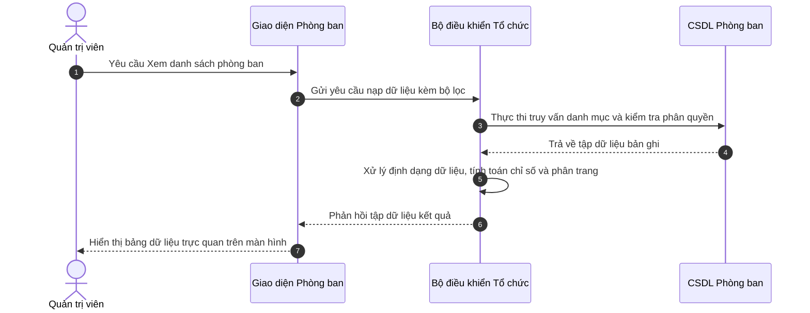

**Mô tả các bước tương tác trong biểu đồ tuần tự:**
- **Khởi đầu:** Chọn chức năng "Phòng ban" trong menu Cơ cấu Tổ chức.
- **Xử lý nghiệp vụ:** Lớp Điều khiển (Controller) xác thực thông tin và kiểm tra tính hợp lệ trước khi thao tác xuống Cơ sở dữ liệu.
- **Xử lý ngoại lệ / Rẽ nhánh:** Nếu vi phạm các ràng buộc nghiệp vụ (trùng mã, sai định dạng, thiếu điều kiện), hệ thống kích hoạt khối `else`, gửi thông báo cảnh báo và bảo toàn dữ liệu.
- **Kết thúc:** Hệ thống phản hồi trạng thái hoàn tất thành công lên giao diện người dùng.

---

### 2. Sơ đồ Tuần tự cho UC-ORG-01-02: Tìm kiếm và Lọc phòng ban
> **Mục tiêu ca sử dụng:** Tra cứu nhanh chóng phòng ban theo tên gọi, mã viết tắt hoặc trạng thái mà không phải tìm qua nhiều trang.  
> **Tác nhân tương tác:** Quản trị viên, Chuyên viên Nhân sự. | **Sự kiện kích hoạt:** Người dùng nhập từ khóa vào ô tìm kiếm hoặc chọn lọc trạng thái.


**Mô tả các bước tương tác trong biểu đồ tuần tự:**
- **Khởi đầu:** Người dùng nhập từ khóa vào ô tìm kiếm hoặc chọn lọc trạng thái.
- **Xử lý nghiệp vụ:** Lớp Điều khiển (Controller) xác thực thông tin và kiểm tra tính hợp lệ trước khi thao tác xuống Cơ sở dữ liệu.
- **Xử lý ngoại lệ / Rẽ nhánh:** Nếu vi phạm các ràng buộc nghiệp vụ (trùng mã, sai định dạng, thiếu điều kiện), hệ thống kích hoạt khối `else`, gửi thông báo cảnh báo và bảo toàn dữ liệu.
- **Kết thúc:** Hệ thống phản hồi trạng thái hoàn tất thành công lên giao diện người dùng.

---

### 3. Sơ đồ Tuần tự cho UC-ORG-01-03: Thêm mới phòng ban và Gán định biên
> **Mục tiêu ca sử dụng:** Khởi tạo đơn vị mới vào sơ đồ cây tổ chức và ấn định chỉ tiêu định biên nhân sự tối đa (quota).  
> **Tác nhân tương tác:** Quản trị viên, Giám đốc Nhân sự. | **Sự kiện kích hoạt:** Người dùng nhấn nút "+ Thêm phòng ban".

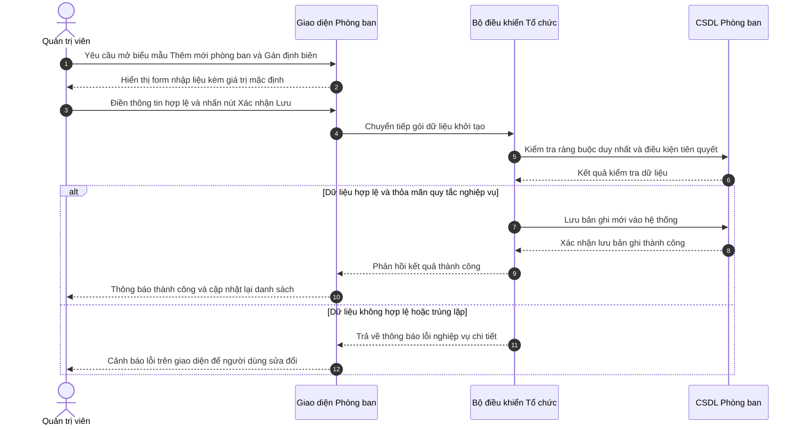

**Mô tả các bước tương tác trong biểu đồ tuần tự:**
- **Khởi đầu:** Người dùng nhấn nút "+ Thêm phòng ban".
- **Xử lý nghiệp vụ:** Lớp Điều khiển (Controller) xác thực thông tin và kiểm tra tính hợp lệ trước khi thao tác xuống Cơ sở dữ liệu.
- **Xử lý ngoại lệ / Rẽ nhánh:** Nếu vi phạm các ràng buộc nghiệp vụ (trùng mã, sai định dạng, thiếu điều kiện), hệ thống kích hoạt khối `else`, gửi thông báo cảnh báo và bảo toàn dữ liệu.
- **Kết thúc:** Hệ thống phản hồi trạng thái hoàn tất thành công lên giao diện người dùng.

---

### 4. Sơ đồ Tuần tự cho UC-ORG-01-04: Cập nhật thông tin phòng ban
> **Mục tiêu ca sử dụng:** Điều chỉnh tên đơn vị, Trưởng phòng, nâng hoặc hạ định biên hoặc luân chuyển đơn vị cấp trên trực tiếp.  
> **Tác nhân tương tác:** Quản trị viên, Giám đốc Nhân sự. | **Sự kiện kích hoạt:** Người dùng nhấn biểu tượng "Chỉnh sửa" tại dòng phòng ban.

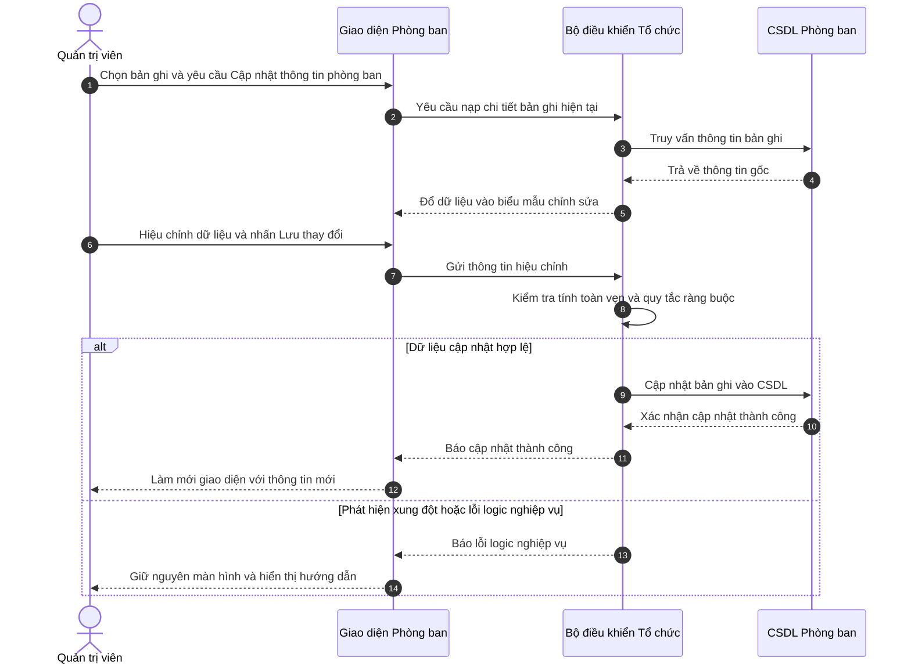

**Mô tả các bước tương tác trong biểu đồ tuần tự:**
- **Khởi đầu:** Người dùng nhấn biểu tượng "Chỉnh sửa" tại dòng phòng ban.
- **Xử lý nghiệp vụ:** Lớp Điều khiển (Controller) xác thực thông tin và kiểm tra tính hợp lệ trước khi thao tác xuống Cơ sở dữ liệu.
- **Xử lý ngoại lệ / Rẽ nhánh:** Nếu vi phạm các ràng buộc nghiệp vụ (trùng mã, sai định dạng, thiếu điều kiện), hệ thống kích hoạt khối `else`, gửi thông báo cảnh báo và bảo toàn dữ liệu.
- **Kết thúc:** Hệ thống phản hồi trạng thái hoàn tất thành công lên giao diện người dùng.

---

### 5. Sơ đồ Tuần tự cho UC-ORG-01-05: Khóa  hoặc  Đóng băng phòng ban (Block  hoặc  Inactive)
> **Mục tiêu ca sử dụng:** Tạm dừng hoạt động hoặc giải thể mềm phòng ban mà không xóa dữ liệu, bảo toàn 100% lịch sử nhân sự cũ.  
> **Tác nhân tương tác:** Quản trị viên, Giám đốc Nhân sự. | **Sự kiện kích hoạt:** Người dùng nhấn biểu tượng Ổ khóa tại cột thao tác.

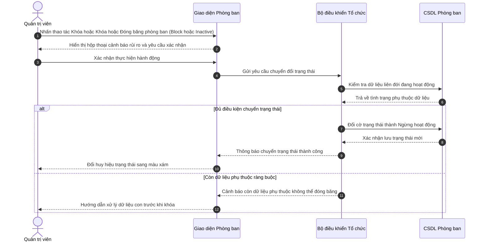

**Mô tả các bước tương tác trong biểu đồ tuần tự:**
- **Khởi đầu:** Người dùng nhấn biểu tượng Ổ khóa tại cột thao tác.
- **Xử lý nghiệp vụ:** Lớp Điều khiển (Controller) xác thực thông tin và kiểm tra tính hợp lệ trước khi thao tác xuống Cơ sở dữ liệu.
- **Xử lý ngoại lệ / Rẽ nhánh:** Nếu vi phạm các ràng buộc nghiệp vụ (trùng mã, sai định dạng, thiếu điều kiện), hệ thống kích hoạt khối `else`, gửi thông báo cảnh báo và bảo toàn dữ liệu.
- **Kết thúc:** Hệ thống phản hồi trạng thái hoàn tất thành công lên giao diện người dùng.

---

### 6. Sơ đồ Tuần tự cho UC-ORG-01-06: Xóa phòng ban (Hard Delete)
> **Mục tiêu ca sử dụng:** Xóa vĩnh viễn các phòng ban tạo nhầm hoặc phòng ban trống không còn nhu cầu sử dụng.  
> **Tác nhân tương tác:** Quản trị viên cấp cao (Admin). | **Sự kiện kích hoạt:** Người dùng nhấn biểu tượng Thùng rác đỏ.

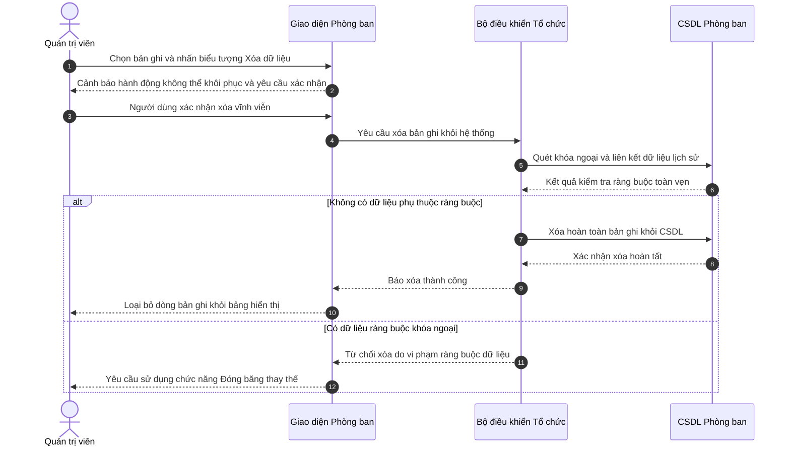

**Mô tả các bước tương tác trong biểu đồ tuần tự:**
- **Khởi đầu:** Người dùng nhấn biểu tượng Thùng rác đỏ.
- **Xử lý nghiệp vụ:** Lớp Điều khiển (Controller) xác thực thông tin và kiểm tra tính hợp lệ trước khi thao tác xuống Cơ sở dữ liệu.
- **Xử lý ngoại lệ / Rẽ nhánh:** Nếu vi phạm các ràng buộc nghiệp vụ (trùng mã, sai định dạng, thiếu điều kiện), hệ thống kích hoạt khối `else`, gửi thông báo cảnh báo và bảo toàn dữ liệu.
- **Kết thúc:** Hệ thống phản hồi trạng thái hoàn tất thành công lên giao diện người dùng.

---


## PHẦN 2: SƠ ĐỒ TUẦN TỰ PHÂN HỆ ORG-02
---

### 7. Sơ đồ Tuần tự cho UC-ORG-02-01: Xem danh mục vị trí chức danh
> **Mục tiêu ca sử dụng:** Theo dõi danh mục các vị trí công tác, cấp bậc chuyên môn và khung dải lương quy định.  
> **Tác nhân tương tác:** Quản trị viên, Chuyên viên Nhân sự. | **Sự kiện kích hoạt:** 

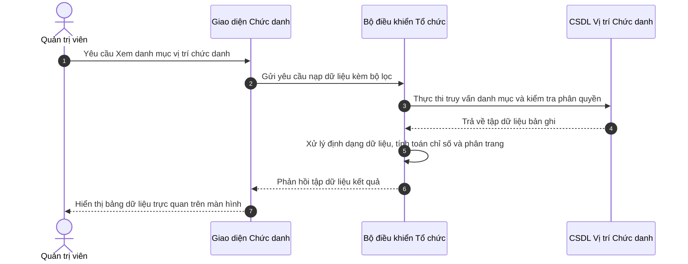

**Mô tả các bước tương tác trong biểu đồ tuần tự:**
- **Khởi đầu:** Người dùng thao tác trên màn hình.
- **Xử lý nghiệp vụ:** Lớp Điều khiển (Controller) xác thực thông tin và kiểm tra tính hợp lệ trước khi thao tác xuống Cơ sở dữ liệu.
- **Xử lý ngoại lệ / Rẽ nhánh:** Nếu vi phạm các ràng buộc nghiệp vụ (trùng mã, sai định dạng, thiếu điều kiện), hệ thống kích hoạt khối `else`, gửi thông báo cảnh báo và bảo toàn dữ liệu.
- **Kết thúc:** Hệ thống phản hồi trạng thái hoàn tất thành công lên giao diện người dùng.

---

### 8. Sơ đồ Tuần tự cho UC-ORG-02-02: Thêm mới vị trí và Khung dải lương
> **Mục tiêu ca sử dụng:** Thiết lập chức danh mới, cấp bậc và ấn định khung dải lương tuyển dụng (minSalary - maxSalary).  
> **Tác nhân tương tác:** Quản trị viên, Giám đốc Nhân sự, Chuyên viên CvàB. | **Sự kiện kích hoạt:** 

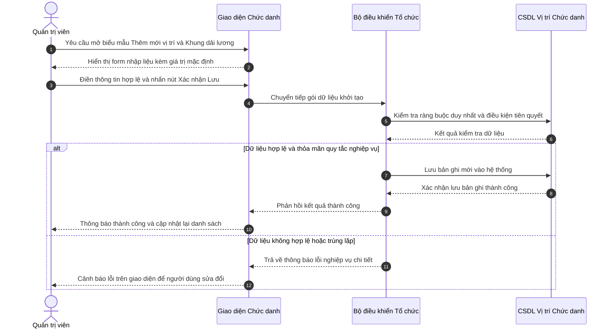

**Mô tả các bước tương tác trong biểu đồ tuần tự:**
- **Khởi đầu:** Người dùng thao tác trên màn hình.
- **Xử lý nghiệp vụ:** Lớp Điều khiển (Controller) xác thực thông tin và kiểm tra tính hợp lệ trước khi thao tác xuống Cơ sở dữ liệu.
- **Xử lý ngoại lệ / Rẽ nhánh:** Nếu vi phạm các ràng buộc nghiệp vụ (trùng mã, sai định dạng, thiếu điều kiện), hệ thống kích hoạt khối `else`, gửi thông báo cảnh báo và bảo toàn dữ liệu.
- **Kết thúc:** Hệ thống phản hồi trạng thái hoàn tất thành công lên giao diện người dùng.

---

### 9. Sơ đồ Tuần tự cho UC-ORG-02-03: Cập nhật vị trí chức danh
> **Mục tiêu ca sử dụng:** Điều chỉnh tên chức danh, sửa dải lương hoặc thay đổi cấp bậc chuyên môn.  
> **Tác nhân tương tác:** Quản trị viên, HR Manager. | **Sự kiện kích hoạt:** 

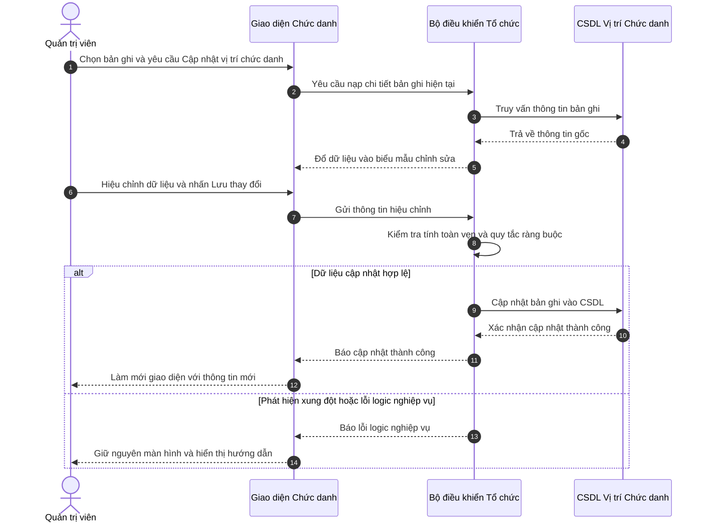

**Mô tả các bước tương tác trong biểu đồ tuần tự:**
- **Khởi đầu:** Người dùng thao tác trên màn hình.
- **Xử lý nghiệp vụ:** Lớp Điều khiển (Controller) xác thực thông tin và kiểm tra tính hợp lệ trước khi thao tác xuống Cơ sở dữ liệu.
- **Xử lý ngoại lệ / Rẽ nhánh:** Nếu vi phạm các ràng buộc nghiệp vụ (trùng mã, sai định dạng, thiếu điều kiện), hệ thống kích hoạt khối `else`, gửi thông báo cảnh báo và bảo toàn dữ liệu.
- **Kết thúc:** Hệ thống phản hồi trạng thái hoàn tất thành công lên giao diện người dùng.

---

### 10. Sơ đồ Tuần tự cho UC-ORG-02-04: Khóa  hoặc  Đóng băng vị trí chức danh
> **Mục tiêu ca sử dụng:** Ngừng mở tuyển dụng hoặc ngừng bổ nhiệm vào vị trí chức danh cũ mà vẫn giữ nguyên hợp đồng của nhân sự đang nắm giữ vị trí này.  
> **Tác nhân tương tác:** Quản trị viên, HR Manager. | **Sự kiện kích hoạt:** 

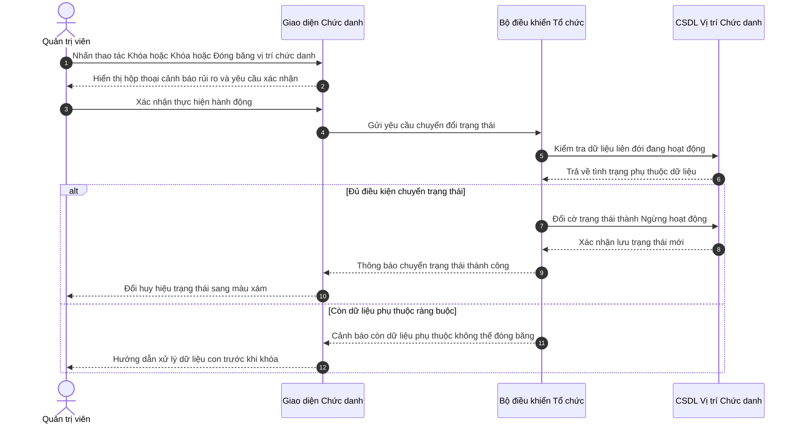

**Mô tả các bước tương tác trong biểu đồ tuần tự:**
- **Khởi đầu:** Người dùng thao tác trên màn hình.
- **Xử lý nghiệp vụ:** Lớp Điều khiển (Controller) xác thực thông tin và kiểm tra tính hợp lệ trước khi thao tác xuống Cơ sở dữ liệu.
- **Xử lý ngoại lệ / Rẽ nhánh:** Nếu vi phạm các ràng buộc nghiệp vụ (trùng mã, sai định dạng, thiếu điều kiện), hệ thống kích hoạt khối `else`, gửi thông báo cảnh báo và bảo toàn dữ liệu.
- **Kết thúc:** Hệ thống phản hồi trạng thái hoàn tất thành công lên giao diện người dùng.

---

### 11. Sơ đồ Tuần tự cho UC-ORG-02-05: Xóa vị trí chức danh
> **Mục tiêu ca sử dụng:** Xóa vị trí chức danh không còn tồn tại trong doanh nghiệp.  
> **Tác nhân tương tác:** Quản trị viên. | **Sự kiện kích hoạt:** 

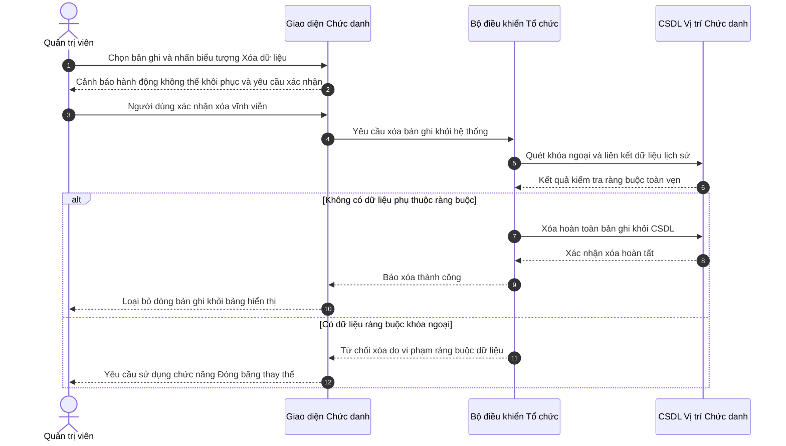

**Mô tả các bước tương tác trong biểu đồ tuần tự:**
- **Khởi đầu:** Người dùng thao tác trên màn hình.
- **Xử lý nghiệp vụ:** Lớp Điều khiển (Controller) xác thực thông tin và kiểm tra tính hợp lệ trước khi thao tác xuống Cơ sở dữ liệu.
- **Xử lý ngoại lệ / Rẽ nhánh:** Nếu vi phạm các ràng buộc nghiệp vụ (trùng mã, sai định dạng, thiếu điều kiện), hệ thống kích hoạt khối `else`, gửi thông báo cảnh báo và bảo toàn dữ liệu.
- **Kết thúc:** Hệ thống phản hồi trạng thái hoàn tất thành công lên giao diện người dùng.

---


## PHẦN 3: SƠ ĐỒ TUẦN TỰ PHÂN HỆ ORG-03
---

### 12. Sơ đồ Tuần tự cho UC-ORG-03-01: Xem biểu đồ phân cấp tổ chức hình cây
> **Mục tiêu ca sử dụng:** Trực quan hóa toàn bộ mô hình phân cấp tổ chức doanh nghiệp (Ban Giám Đốc  ->  Khối  ->  Phòng ban  ->  Bộ phận con).  
> **Tác nhân tương tác:** Quản trị viên,  Toàn thể nhân viên. | **Sự kiện kích hoạt:** 

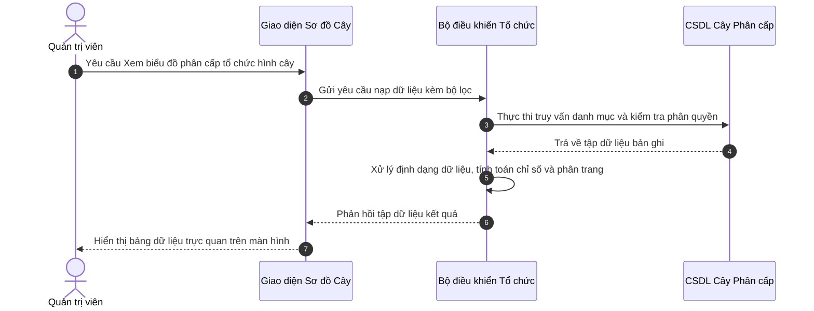

**Mô tả các bước tương tác trong biểu đồ tuần tự:**
- **Khởi đầu:** Người dùng thao tác trên màn hình.
- **Xử lý nghiệp vụ:** Lớp Điều khiển (Controller) xác thực thông tin và kiểm tra tính hợp lệ trước khi thao tác xuống Cơ sở dữ liệu.
- **Xử lý ngoại lệ / Rẽ nhánh:** Nếu vi phạm các ràng buộc nghiệp vụ (trùng mã, sai định dạng, thiếu điều kiện), hệ thống kích hoạt khối `else`, gửi thông báo cảnh báo và bảo toàn dữ liệu.
- **Kết thúc:** Hệ thống phản hồi trạng thái hoàn tất thành công lên giao diện người dùng.

---

### 13. Sơ đồ Tuần tự cho UC-ORG-03-02: Thu gọn  hoặc  Mở rộng nhánh cây tổ chức
> **Mục tiêu ca sử dụng:** Cho phép người dùng tùy biến tầm nhìn sơ đồ cây bằng cách thu gọn các phòng ban cấp dưới hoặc mở rộng toàn bộ cấu trúc.  
> **Tác nhân tương tác:** Quản trị viên,  Nhân viên. | **Sự kiện kích hoạt:** 

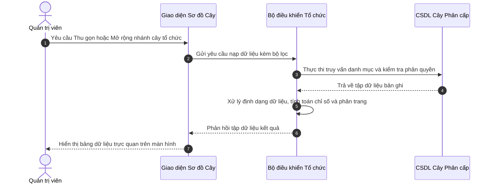

**Mô tả các bước tương tác trong biểu đồ tuần tự:**
- **Khởi đầu:** Người dùng thao tác trên màn hình.
- **Xử lý nghiệp vụ:** Lớp Điều khiển (Controller) xác thực thông tin và kiểm tra tính hợp lệ trước khi thao tác xuống Cơ sở dữ liệu.
- **Xử lý ngoại lệ / Rẽ nhánh:** Nếu vi phạm các ràng buộc nghiệp vụ (trùng mã, sai định dạng, thiếu điều kiện), hệ thống kích hoạt khối `else`, gửi thông báo cảnh báo và bảo toàn dữ liệu.
- **Kết thúc:** Hệ thống phản hồi trạng thái hoàn tất thành công lên giao diện người dùng.

---

### 14. Sơ đồ Tuần tự cho UC-ORG-03-03: Xem tỷ lệ lấp đầy định biên trên sơ đồ
> **Mục tiêu ca sử dụng:** Giúp lãnh đạo nhận diện nhanh các phòng ban đang thừa hoặc thiếu nhân sự so với chỉ tiêu được duyệt.  
> **Tác nhân tương tác:** Ban Giám đốc, HR Manager. | **Sự kiện kích hoạt:** 

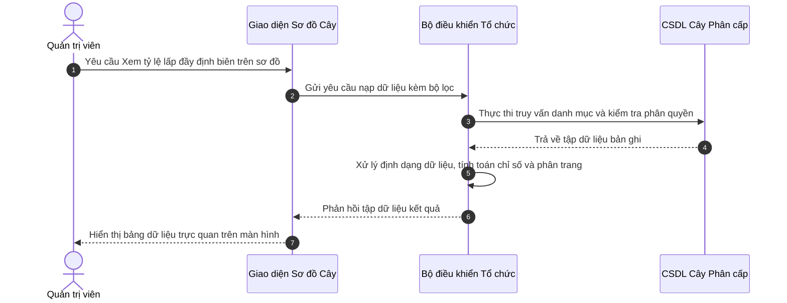

**Mô tả các bước tương tác trong biểu đồ tuần tự:**
- **Khởi đầu:** Người dùng thao tác trên màn hình.
- **Xử lý nghiệp vụ:** Lớp Điều khiển (Controller) xác thực thông tin và kiểm tra tính hợp lệ trước khi thao tác xuống Cơ sở dữ liệu.
- **Xử lý ngoại lệ / Rẽ nhánh:** Nếu vi phạm các ràng buộc nghiệp vụ (trùng mã, sai định dạng, thiếu điều kiện), hệ thống kích hoạt khối `else`, gửi thông báo cảnh báo và bảo toàn dữ liệu.
- **Kết thúc:** Hệ thống phản hồi trạng thái hoàn tất thành công lên giao diện người dùng.

---

### 15. Sơ đồ Tuần tự cho UC-ORG-03-04: Xem danh sách nhân sự trực thuộc phòng ban
> **Mục tiêu ca sử dụng:** Bấm vào một khối phòng ban để tra cứu nhanh danh sách các nhân viên đang làm việc tại đơn vị đó.  
> **Tác nhân tương tác:** Quản trị viên, HR. | **Sự kiện kích hoạt:** 

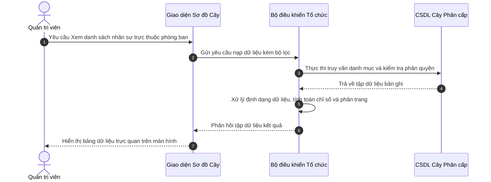

**Mô tả các bước tương tác trong biểu đồ tuần tự:**
- **Khởi đầu:** Người dùng thao tác trên màn hình.
- **Xử lý nghiệp vụ:** Lớp Điều khiển (Controller) xác thực thông tin và kiểm tra tính hợp lệ trước khi thao tác xuống Cơ sở dữ liệu.
- **Xử lý ngoại lệ / Rẽ nhánh:** Nếu vi phạm các ràng buộc nghiệp vụ (trùng mã, sai định dạng, thiếu điều kiện), hệ thống kích hoạt khối `else`, gửi thông báo cảnh báo và bảo toàn dữ liệu.
- **Kết thúc:** Hệ thống phản hồi trạng thái hoàn tất thành công lên giao diện người dùng.

---


## PHẦN 4: SƠ ĐỒ TUẦN TỰ PHÂN HỆ REC-01
---

### 16. Sơ đồ Tuần tự cho UC-REC-01-01: Xem danh sách yêu cầu tuyển dụng
> **Mục tiêu ca sử dụng:** Theo dõi tình trạng các vị trí đang cần tuyển dụng, số lượng chỉ tiêu và tiến độ tuyển thực tế.  
> **Tác nhân tương tác:** Chuyên viên Tuyển dụng, Trưởng bộ phận. | **Sự kiện kích hoạt:** 

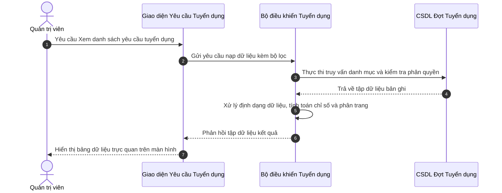

**Mô tả các bước tương tác trong biểu đồ tuần tự:**
- **Khởi đầu:** Người dùng thao tác trên màn hình.
- **Xử lý nghiệp vụ:** Lớp Điều khiển (Controller) xác thực thông tin và kiểm tra tính hợp lệ trước khi thao tác xuống Cơ sở dữ liệu.
- **Xử lý ngoại lệ / Rẽ nhánh:** Nếu vi phạm các ràng buộc nghiệp vụ (trùng mã, sai định dạng, thiếu điều kiện), hệ thống kích hoạt khối `else`, gửi thông báo cảnh báo và bảo toàn dữ liệu.
- **Kết thúc:** Hệ thống phản hồi trạng thái hoàn tất thành công lên giao diện người dùng.

---

### 17. Sơ đồ Tuần tự cho UC-REC-01-02: Lập yêu cầu tuyển dụng và Kiểm tra định biên
> **Mục tiêu ca sử dụng:** Tạo phiếu đề xuất bổ sung nhân sự, hệ thống tự động kiểm tra trần định biên để tránh tuyển vượt chỉ tiêu.  
> **Tác nhân tương tác:** Trưởng bộ phận, Chuyên viên Tuyển dụng. | **Sự kiện kích hoạt:** 

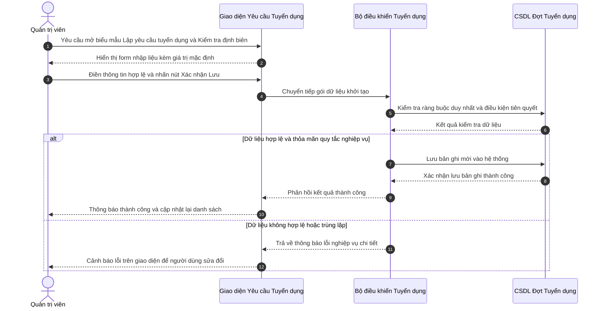

**Mô tả các bước tương tác trong biểu đồ tuần tự:**
- **Khởi đầu:** Người dùng thao tác trên màn hình.
- **Xử lý nghiệp vụ:** Lớp Điều khiển (Controller) xác thực thông tin và kiểm tra tính hợp lệ trước khi thao tác xuống Cơ sở dữ liệu.
- **Xử lý ngoại lệ / Rẽ nhánh:** Nếu vi phạm các ràng buộc nghiệp vụ (trùng mã, sai định dạng, thiếu điều kiện), hệ thống kích hoạt khối `else`, gửi thông báo cảnh báo và bảo toàn dữ liệu.
- **Kết thúc:** Hệ thống phản hồi trạng thái hoàn tất thành công lên giao diện người dùng.

---

### 18. Sơ đồ Tuần tự cho UC-REC-01-03: Chỉnh sửa yêu cầu tuyển dụng
> **Mục tiêu ca sử dụng:** Cập nhật lại yêu cầu kinh nghiệm, điều chỉnh dải lương hoặc gia hạn thời gian nộp hồ sơ.  
> **Tác nhân tương tác:** Chuyên viên Tuyển dụng. | **Sự kiện kích hoạt:** 

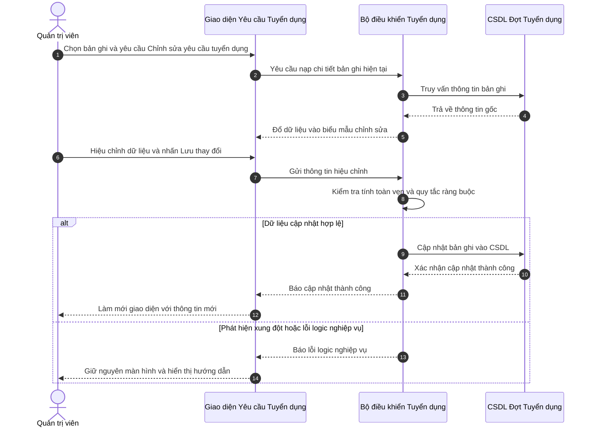

**Mô tả các bước tương tác trong biểu đồ tuần tự:**
- **Khởi đầu:** Người dùng thao tác trên màn hình.
- **Xử lý nghiệp vụ:** Lớp Điều khiển (Controller) xác thực thông tin và kiểm tra tính hợp lệ trước khi thao tác xuống Cơ sở dữ liệu.
- **Xử lý ngoại lệ / Rẽ nhánh:** Nếu vi phạm các ràng buộc nghiệp vụ (trùng mã, sai định dạng, thiếu điều kiện), hệ thống kích hoạt khối `else`, gửi thông báo cảnh báo và bảo toàn dữ liệu.
- **Kết thúc:** Hệ thống phản hồi trạng thái hoàn tất thành công lên giao diện người dùng.

---

### 19. Sơ đồ Tuần tự cho UC-REC-01-04: Xuất bản tin ra Cổng Tuyển dụng Công khai
> **Mục tiêu ca sử dụng:** Đưa tin tuyển dụng lên trang chủ việc làm để ứng viên bên ngoài tiếp cận và nộp hồ sơ.  
> **Tác nhân tương tác:** Chuyên viên Tuyển dụng. | **Sự kiện kích hoạt:** 

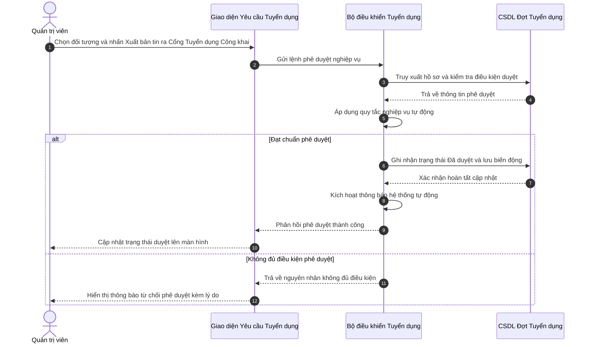

**Mô tả các bước tương tác trong biểu đồ tuần tự:**
- **Khởi đầu:** Người dùng thao tác trên màn hình.
- **Xử lý nghiệp vụ:** Lớp Điều khiển (Controller) xác thực thông tin và kiểm tra tính hợp lệ trước khi thao tác xuống Cơ sở dữ liệu.
- **Xử lý ngoại lệ / Rẽ nhánh:** Nếu vi phạm các ràng buộc nghiệp vụ (trùng mã, sai định dạng, thiếu điều kiện), hệ thống kích hoạt khối `else`, gửi thông báo cảnh báo và bảo toàn dữ liệu.
- **Kết thúc:** Hệ thống phản hồi trạng thái hoàn tất thành công lên giao diện người dùng.

---

### 20. Sơ đồ Tuần tự cho UC-REC-01-05: Đóng nhận hồ sơ tuyển dụng
> **Mục tiêu ca sử dụng:** Dừng nhận hồ sơ khi đã tuyển đủ chỉ tiêu hoặc hết thời hạn tuyển dụng.  
> **Tác nhân tương tác:** Chuyên viên Tuyển dụng. | **Sự kiện kích hoạt:** 

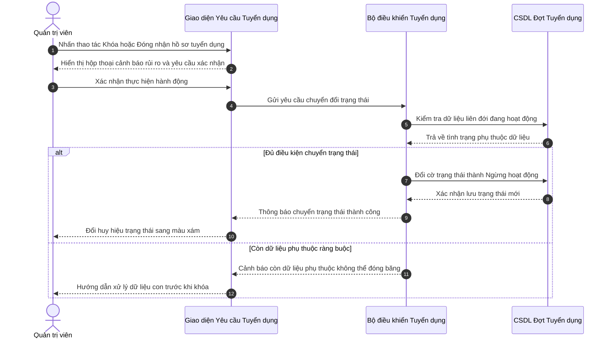

**Mô tả các bước tương tác trong biểu đồ tuần tự:**
- **Khởi đầu:** Người dùng thao tác trên màn hình.
- **Xử lý nghiệp vụ:** Lớp Điều khiển (Controller) xác thực thông tin và kiểm tra tính hợp lệ trước khi thao tác xuống Cơ sở dữ liệu.
- **Xử lý ngoại lệ / Rẽ nhánh:** Nếu vi phạm các ràng buộc nghiệp vụ (trùng mã, sai định dạng, thiếu điều kiện), hệ thống kích hoạt khối `else`, gửi thông báo cảnh báo và bảo toàn dữ liệu.
- **Kết thúc:** Hệ thống phản hồi trạng thái hoàn tất thành công lên giao diện người dùng.

---


## PHẦN 5: SƠ ĐỒ TUẦN TỰ PHÂN HỆ REC-02
---

### 21. Sơ đồ Tuần tự cho UC-REC-02-01: Xem bảng Kanban phân loại 7 bước
> **Mục tiêu ca sử dụng:** Theo dõi toàn bộ ứng viên theo 7 bước phễu: Tiếp cận  ->  Ứng tuyển  ->  Sơ loại  ->  Phỏng vấn  ->  Đề nghị việc  ->  Tiếp nhận  hoặc  Từ chối.  
> **Tác nhân tương tác:** Chuyên viên Tuyển dụng. | **Sự kiện kích hoạt:** 

```mermaid
sequenceDiagram
    autonumber
    actor User as Quản trị viên
    participant UI as Bảng ATS Kanban
    participant Ctrl as Bộ điều khiển Phễu Tuyển dụng
    participant DB as CSDL Hồ sơ Ứng viên

    User->>UI: Yêu cầu Xem bảng Kanban phân loại 7 bước
    UI->>Ctrl: Gửi yêu cầu nạp dữ liệu kèm bộ lọc
    Ctrl->>DB: Thực thi truy vấn danh mục và kiểm tra phân quyền
    DB-->>Ctrl: Trả về tập dữ liệu bản ghi
    Ctrl->>Ctrl: Xử lý định dạng dữ liệu, tính toán chỉ số và phân trang
    Ctrl-->>UI: Phản hồi tập dữ liệu kết quả
    UI-->>User: Hiển thị bảng dữ liệu trực quan trên màn hình
```

**Mô tả các bước tương tác trong biểu đồ tuần tự:**
- **Khởi đầu:** Người dùng thao tác trên màn hình.
- **Xử lý nghiệp vụ:** Lớp Điều khiển (Controller) xác thực thông tin và kiểm tra tính hợp lệ trước khi thao tác xuống Cơ sở dữ liệu.
- **Xử lý ngoại lệ / Rẽ nhánh:** Nếu vi phạm các ràng buộc nghiệp vụ (trùng mã, sai định dạng, thiếu điều kiện), hệ thống kích hoạt khối `else`, gửi thông báo cảnh báo và bảo toàn dữ liệu.
- **Kết thúc:** Hệ thống phản hồi trạng thái hoàn tất thành công lên giao diện người dùng.

---

### 22. Sơ đồ Tuần tự cho UC-REC-02-02: Kéo thả chuyển trạng thái ứng viên
> **Mục tiêu ca sử dụng:** Cập nhật tiến độ tuyển dụng nhanh chóng bằng thao tác kéo thả trực quan.  
> **Tác nhân tương tác:** Chuyên viên Tuyển dụng. | **Sự kiện kích hoạt:** 

```mermaid
sequenceDiagram
    autonumber
    actor User as Quản trị viên
    participant UI as Bảng ATS Kanban
    participant Ctrl as Bộ điều khiển Phễu Tuyển dụng
    participant DB as CSDL Hồ sơ Ứng viên

    User->>UI: Chọn bản ghi và yêu cầu Kéo thả chuyển trạng thái ứng viên
    UI->>Ctrl: Yêu cầu nạp chi tiết bản ghi hiện tại
    Ctrl->>DB: Truy vấn thông tin bản ghi
    DB-->>Ctrl: Trả về thông tin gốc
    Ctrl-->>UI: Đổ dữ liệu vào biểu mẫu chỉnh sửa
    User->>UI: Hiệu chỉnh dữ liệu và nhấn Lưu thay đổi
    UI->>Ctrl: Gửi thông tin hiệu chỉnh
    Ctrl->>Ctrl: Kiểm tra tính toàn vẹn và quy tắc ràng buộc
    alt Dữ liệu cập nhật hợp lệ
        Ctrl->>DB: Cập nhật bản ghi vào CSDL
        DB-->>Ctrl: Xác nhận cập nhật thành công
        Ctrl-->>UI: Báo cập nhật thành công
        UI-->>User: Làm mới giao diện với thông tin mới
    else Phát hiện xung đột hoặc lỗi logic nghiệp vụ
        Ctrl-->>UI: Báo lỗi logic nghiệp vụ
        UI-->>User: Giữ nguyên màn hình và hiển thị hướng dẫn
    end
```

**Mô tả các bước tương tác trong biểu đồ tuần tự:**
- **Khởi đầu:** Người dùng thao tác trên màn hình.
- **Xử lý nghiệp vụ:** Lớp Điều khiển (Controller) xác thực thông tin và kiểm tra tính hợp lệ trước khi thao tác xuống Cơ sở dữ liệu.
- **Xử lý ngoại lệ / Rẽ nhánh:** Nếu vi phạm các ràng buộc nghiệp vụ (trùng mã, sai định dạng, thiếu điều kiện), hệ thống kích hoạt khối `else`, gửi thông báo cảnh báo và bảo toàn dữ liệu.
- **Kết thúc:** Hệ thống phản hồi trạng thái hoàn tất thành công lên giao diện người dùng.

---

### 23. Sơ đồ Tuần tự cho UC-REC-02-03: Xem chi tiết CV và Đánh giá
> **Mục tiêu ca sử dụng:** Xem trực tiếp file hồ sơ CV của ứng viên và ghi chú nhận xét ban đầu.  
> **Tác nhân tương tác:** Chuyên viên Tuyển dụng. | **Sự kiện kích hoạt:** 

```mermaid
sequenceDiagram
    autonumber
    actor User as Quản trị viên
    participant UI as Bảng ATS Kanban
    participant Ctrl as Bộ điều khiển Phễu Tuyển dụng
    participant DB as CSDL Hồ sơ Ứng viên

    User->>UI: Yêu cầu Xem chi tiết CV và Đánh giá
    UI->>Ctrl: Gửi yêu cầu nạp dữ liệu kèm bộ lọc
    Ctrl->>DB: Thực thi truy vấn danh mục và kiểm tra phân quyền
    DB-->>Ctrl: Trả về tập dữ liệu bản ghi
    Ctrl->>Ctrl: Xử lý định dạng dữ liệu, tính toán chỉ số và phân trang
    Ctrl-->>UI: Phản hồi tập dữ liệu kết quả
    UI-->>User: Hiển thị bảng dữ liệu trực quan trên màn hình
```

**Mô tả các bước tương tác trong biểu đồ tuần tự:**
- **Khởi đầu:** Người dùng thao tác trên màn hình.
- **Xử lý nghiệp vụ:** Lớp Điều khiển (Controller) xác thực thông tin và kiểm tra tính hợp lệ trước khi thao tác xuống Cơ sở dữ liệu.
- **Xử lý ngoại lệ / Rẽ nhánh:** Nếu vi phạm các ràng buộc nghiệp vụ (trùng mã, sai định dạng, thiếu điều kiện), hệ thống kích hoạt khối `else`, gửi thông báo cảnh báo và bảo toàn dữ liệu.
- **Kết thúc:** Hệ thống phản hồi trạng thái hoàn tất thành công lên giao diện người dùng.

---

### 24. Sơ đồ Tuần tự cho UC-REC-02-04: Loại bỏ  hoặc  Từ chối hồ sơ (Reject)
> **Mục tiêu ca sử dụng:** Đánh dấu không phù hợp đối với các ứng viên không đạt yêu cầu.  
> **Tác nhân tương tác:** Chuyên viên Tuyển dụng. | **Sự kiện kích hoạt:** 

```mermaid
sequenceDiagram
    autonumber
    actor User as Quản trị viên
    participant UI as Bảng ATS Kanban
    participant Ctrl as Bộ điều khiển Phễu Tuyển dụng
    participant DB as CSDL Hồ sơ Ứng viên

    User->>UI: Nhấn thao tác Khóa hoặc Loại bỏ  hoặc  Từ chối hồ sơ (Reject)
    UI-->>User: Hiển thị hộp thoại cảnh báo rủi ro và yêu cầu xác nhận
    User->>UI: Xác nhận thực hiện hành động
    UI->>Ctrl: Gửi yêu cầu chuyển đổi trạng thái
    Ctrl->>DB: Kiểm tra dữ liệu liên đới đang hoạt động
    DB-->>Ctrl: Trả về tình trạng phụ thuộc dữ liệu
    alt Đủ điều kiện chuyển trạng thái
        Ctrl->>DB: Đổi cờ trạng thái thành Ngừng hoạt động
        DB-->>Ctrl: Xác nhận lưu trạng thái mới
        Ctrl-->>UI: Thông báo chuyển trạng thái thành công
        UI-->>User: Đổi huy hiệu trạng thái sang màu xám
    else Còn dữ liệu phụ thuộc ràng buộc
        Ctrl-->>UI: Cảnh báo còn dữ liệu phụ thuộc không thể đóng băng
        UI-->>User: Hướng dẫn xử lý dữ liệu con trước khi khóa
    end
```

**Mô tả các bước tương tác trong biểu đồ tuần tự:**
- **Khởi đầu:** Người dùng thao tác trên màn hình.
- **Xử lý nghiệp vụ:** Lớp Điều khiển (Controller) xác thực thông tin và kiểm tra tính hợp lệ trước khi thao tác xuống Cơ sở dữ liệu.
- **Xử lý ngoại lệ / Rẽ nhánh:** Nếu vi phạm các ràng buộc nghiệp vụ (trùng mã, sai định dạng, thiếu điều kiện), hệ thống kích hoạt khối `else`, gửi thông báo cảnh báo và bảo toàn dữ liệu.
- **Kết thúc:** Hệ thống phản hồi trạng thái hoàn tất thành công lên giao diện người dùng.

---


## PHẦN 6: SƠ ĐỒ TUẦN TỰ PHÂN HỆ REC-03
---

### 25. Sơ đồ Tuần tự cho UC-REC-03-01: Xem lịch phỏng vấn
> **Mục tiêu ca sử dụng:** Theo dõi danh sách các buổi phỏng vấn sắp diễn ra theo tuần hoặc tháng.  
> **Tác nhân tương tác:** Hội đồng phỏng vấn, Chuyên viên Tuyển dụng. | **Sự kiện kích hoạt:** 

```mermaid
sequenceDiagram
    autonumber
    actor User as Quản trị viên
    participant UI as Giao diện Lịch Phỏng vấn
    participant Ctrl as Bộ điều khiển Phỏng vấn
    participant DB as CSDL Lịch và Phiếu điểm

    User->>UI: Yêu cầu Xem lịch phỏng vấn
    UI->>Ctrl: Gửi yêu cầu nạp dữ liệu kèm bộ lọc
    Ctrl->>DB: Thực thi truy vấn danh mục và kiểm tra phân quyền
    DB-->>Ctrl: Trả về tập dữ liệu bản ghi
    Ctrl->>Ctrl: Xử lý định dạng dữ liệu, tính toán chỉ số và phân trang
    Ctrl-->>UI: Phản hồi tập dữ liệu kết quả
    UI-->>User: Hiển thị bảng dữ liệu trực quan trên màn hình
```

**Mô tả các bước tương tác trong biểu đồ tuần tự:**
- **Khởi đầu:** Người dùng thao tác trên màn hình.
- **Xử lý nghiệp vụ:** Lớp Điều khiển (Controller) xác thực thông tin và kiểm tra tính hợp lệ trước khi thao tác xuống Cơ sở dữ liệu.
- **Xử lý ngoại lệ / Rẽ nhánh:** Nếu vi phạm các ràng buộc nghiệp vụ (trùng mã, sai định dạng, thiếu điều kiện), hệ thống kích hoạt khối `else`, gửi thông báo cảnh báo và bảo toàn dữ liệu.
- **Kết thúc:** Hệ thống phản hồi trạng thái hoàn tất thành công lên giao diện người dùng.

---

### 26. Sơ đồ Tuần tự cho UC-REC-03-02: Tạo lịch và Gán người phỏng vấn
> **Mục tiêu ca sử dụng:** Xếp lịch phỏng vấn và phân công người chấm thi phù hợp.  
> **Tác nhân tương tác:** Chuyên viên Tuyển dụng. | **Sự kiện kích hoạt:** 

```mermaid
sequenceDiagram
    autonumber
    actor User as Quản trị viên
    participant UI as Giao diện Lịch Phỏng vấn
    participant Ctrl as Bộ điều khiển Phỏng vấn
    participant DB as CSDL Lịch và Phiếu điểm

    User->>UI: Yêu cầu mở biểu mẫu Tạo lịch và Gán người phỏng vấn
    UI-->>User: Hiển thị form nhập liệu kèm giá trị mặc định
    User->>UI: Điền thông tin hợp lệ và nhấn nút Xác nhận Lưu
    UI->>Ctrl: Chuyển tiếp gói dữ liệu khởi tạo
    Ctrl->>DB: Kiểm tra ràng buộc duy nhất và điều kiện tiên quyết
    DB-->>Ctrl: Kết quả kiểm tra dữ liệu
    alt Dữ liệu hợp lệ và thỏa mãn quy tắc nghiệp vụ
        Ctrl->>DB: Lưu bản ghi mới vào hệ thống
        DB-->>Ctrl: Xác nhận lưu bản ghi thành công
        Ctrl-->>UI: Phản hồi kết quả thành công
        UI-->>User: Thông báo thành công và cập nhật lại danh sách
    else Dữ liệu không hợp lệ hoặc trùng lặp
        Ctrl-->>UI: Trả về thông báo lỗi nghiệp vụ chi tiết
        UI-->>User: Cảnh báo lỗi trên giao diện để người dùng sửa đổi
    end
```

**Mô tả các bước tương tác trong biểu đồ tuần tự:**
- **Khởi đầu:** Người dùng thao tác trên màn hình.
- **Xử lý nghiệp vụ:** Lớp Điều khiển (Controller) xác thực thông tin và kiểm tra tính hợp lệ trước khi thao tác xuống Cơ sở dữ liệu.
- **Xử lý ngoại lệ / Rẽ nhánh:** Nếu vi phạm các ràng buộc nghiệp vụ (trùng mã, sai định dạng, thiếu điều kiện), hệ thống kích hoạt khối `else`, gửi thông báo cảnh báo và bảo toàn dữ liệu.
- **Kết thúc:** Hệ thống phản hồi trạng thái hoàn tất thành công lên giao diện người dùng.

---

### 27. Sơ đồ Tuần tự cho UC-REC-03-03: Gửi email mời phỏng vấn tự động
> **Mục tiêu ca sử dụng:** Tự động gửi thư mời phỏng vấn chuyên nghiệp đến hòm thư ứng viên kèm đường link xác nhận.  
> **Tác nhân tương tác:** Hệ thống tự động  hoặc   HR. | **Sự kiện kích hoạt:** 

```mermaid
sequenceDiagram
    autonumber
    actor User as Quản trị viên
    participant UI as Giao diện Lịch Phỏng vấn
    participant Ctrl as Bộ điều khiển Phỏng vấn
    participant DB as CSDL Lịch và Phiếu điểm

    User->>UI: Chọn đối tượng và nhấn Gửi email mời phỏng vấn tự động
    UI->>Ctrl: Gửi lệnh phê duyệt nghiệp vụ
    Ctrl->>DB: Truy xuất hồ sơ và kiểm tra điều kiện duyệt
    DB-->>Ctrl: Trả về thông tin phê duyệt
    Ctrl->>Ctrl: Áp dụng quy tắc nghiệp vụ tự động
    alt Đạt chuẩn phê duyệt
        Ctrl->>DB: Ghi nhận trạng thái Đã duyệt và lưu biến động
        DB-->>Ctrl: Xác nhận hoàn tất cập nhật
        Ctrl->>Ctrl: Kích hoạt thông báo hệ thống tự động
        Ctrl-->>UI: Phản hồi phê duyệt thành công
        UI-->>User: Cập nhật trạng thái duyệt lên màn hình
    else Không đủ điều kiện phê duyệt
        Ctrl-->>UI: Trả về nguyên nhân không đủ điều kiện
        UI-->>User: Hiển thị thông báo từ chối phê duyệt kèm lý do
    end
```

**Mô tả các bước tương tác trong biểu đồ tuần tự:**
- **Khởi đầu:** Người dùng thao tác trên màn hình.
- **Xử lý nghiệp vụ:** Lớp Điều khiển (Controller) xác thực thông tin và kiểm tra tính hợp lệ trước khi thao tác xuống Cơ sở dữ liệu.
- **Xử lý ngoại lệ / Rẽ nhánh:** Nếu vi phạm các ràng buộc nghiệp vụ (trùng mã, sai định dạng, thiếu điều kiện), hệ thống kích hoạt khối `else`, gửi thông báo cảnh báo và bảo toàn dữ liệu.
- **Kết thúc:** Hệ thống phản hồi trạng thái hoàn tất thành công lên giao diện người dùng.

---

### 28. Sơ đồ Tuần tự cho UC-REC-03-04: Nhập điểm và Nhận xét đánh giá
> **Mục tiêu ca sử dụng:** Cán bộ phỏng vấn ghi nhận kết quả đánh giá năng lực ứng viên làm căn cứ đề xuất phát hành Thư mời nhận việc.  
> **Tác nhân tương tác:** Cán bộ phỏng vấn. | **Sự kiện kích hoạt:** 

```mermaid
sequenceDiagram
    autonumber
    actor User as Quản trị viên
    participant UI as Giao diện Lịch Phỏng vấn
    participant Ctrl as Bộ điều khiển Phỏng vấn
    participant DB as CSDL Lịch và Phiếu điểm

    User->>UI: Chọn bản ghi và yêu cầu Nhập điểm và Nhận xét đánh giá
    UI->>Ctrl: Yêu cầu nạp chi tiết bản ghi hiện tại
    Ctrl->>DB: Truy vấn thông tin bản ghi
    DB-->>Ctrl: Trả về thông tin gốc
    Ctrl-->>UI: Đổ dữ liệu vào biểu mẫu chỉnh sửa
    User->>UI: Hiệu chỉnh dữ liệu và nhấn Lưu thay đổi
    UI->>Ctrl: Gửi thông tin hiệu chỉnh
    Ctrl->>Ctrl: Kiểm tra tính toàn vẹn và quy tắc ràng buộc
    alt Dữ liệu cập nhật hợp lệ
        Ctrl->>DB: Cập nhật bản ghi vào CSDL
        DB-->>Ctrl: Xác nhận cập nhật thành công
        Ctrl-->>UI: Báo cập nhật thành công
        UI-->>User: Làm mới giao diện với thông tin mới
    else Phát hiện xung đột hoặc lỗi logic nghiệp vụ
        Ctrl-->>UI: Báo lỗi logic nghiệp vụ
        UI-->>User: Giữ nguyên màn hình và hiển thị hướng dẫn
    end
```

**Mô tả các bước tương tác trong biểu đồ tuần tự:**
- **Khởi đầu:** Người dùng thao tác trên màn hình.
- **Xử lý nghiệp vụ:** Lớp Điều khiển (Controller) xác thực thông tin và kiểm tra tính hợp lệ trước khi thao tác xuống Cơ sở dữ liệu.
- **Xử lý ngoại lệ / Rẽ nhánh:** Nếu vi phạm các ràng buộc nghiệp vụ (trùng mã, sai định dạng, thiếu điều kiện), hệ thống kích hoạt khối `else`, gửi thông báo cảnh báo và bảo toàn dữ liệu.
- **Kết thúc:** Hệ thống phản hồi trạng thái hoàn tất thành công lên giao diện người dùng.

---

### 29. Sơ đồ Tuần tự cho UC-REC-03-05: Hủy  hoặc  Đổi thời gian phỏng vấn
> **Mục tiêu ca sử dụng:** Điều chỉnh thời gian khi có phát sinh từ phía ứng viên hoặc hội đồng phỏng vấn.  
> **Tác nhân tương tác:** Chuyên viên Tuyển dụng. | **Sự kiện kích hoạt:** 

```mermaid
sequenceDiagram
    autonumber
    actor User as Quản trị viên
    participant UI as Giao diện Lịch Phỏng vấn
    participant Ctrl as Bộ điều khiển Phỏng vấn
    participant DB as CSDL Lịch và Phiếu điểm

    User->>UI: Chọn bản ghi và yêu cầu Hủy  hoặc  Đổi thời gian phỏng vấn
    UI->>Ctrl: Yêu cầu nạp chi tiết bản ghi hiện tại
    Ctrl->>DB: Truy vấn thông tin bản ghi
    DB-->>Ctrl: Trả về thông tin gốc
    Ctrl-->>UI: Đổ dữ liệu vào biểu mẫu chỉnh sửa
    User->>UI: Hiệu chỉnh dữ liệu và nhấn Lưu thay đổi
    UI->>Ctrl: Gửi thông tin hiệu chỉnh
    Ctrl->>Ctrl: Kiểm tra tính toàn vẹn và quy tắc ràng buộc
    alt Dữ liệu cập nhật hợp lệ
        Ctrl->>DB: Cập nhật bản ghi vào CSDL
        DB-->>Ctrl: Xác nhận cập nhật thành công
        Ctrl-->>UI: Báo cập nhật thành công
        UI-->>User: Làm mới giao diện với thông tin mới
    else Phát hiện xung đột hoặc lỗi logic nghiệp vụ
        Ctrl-->>UI: Báo lỗi logic nghiệp vụ
        UI-->>User: Giữ nguyên màn hình và hiển thị hướng dẫn
    end
```

**Mô tả các bước tương tác trong biểu đồ tuần tự:**
- **Khởi đầu:** Người dùng thao tác trên màn hình.
- **Xử lý nghiệp vụ:** Lớp Điều khiển (Controller) xác thực thông tin và kiểm tra tính hợp lệ trước khi thao tác xuống Cơ sở dữ liệu.
- **Xử lý ngoại lệ / Rẽ nhánh:** Nếu vi phạm các ràng buộc nghiệp vụ (trùng mã, sai định dạng, thiếu điều kiện), hệ thống kích hoạt khối `else`, gửi thông báo cảnh báo và bảo toàn dữ liệu.
- **Kết thúc:** Hệ thống phản hồi trạng thái hoàn tất thành công lên giao diện người dùng.

---


## PHẦN 7: SƠ ĐỒ TUẦN TỰ PHÂN HỆ REC-04
---

### 30. Sơ đồ Tuần tự cho UC-REC-04-01: Xem danh sách Thư mời nhận việc
> **Mục tiêu ca sử dụng:** Theo dõi tình trạng các thư mời nhận việc đã phát hành và hạn phản hồi của ứng viên.  
> **Tác nhân tương tác:** HR Manager, Chuyên viên CvàB. | **Sự kiện kích hoạt:** 

```mermaid
sequenceDiagram
    autonumber
    actor User as Quản trị viên
    participant UI as Giao diện Thư mời Offer
    participant Ctrl as Bộ điều khiển Offer
    participant DB as CSDL Thư mời và Hạn 24h

    User->>UI: Yêu cầu Xem danh sách Thư mời nhận việc
    UI->>Ctrl: Gửi yêu cầu nạp dữ liệu kèm bộ lọc
    Ctrl->>DB: Thực thi truy vấn danh mục và kiểm tra phân quyền
    DB-->>Ctrl: Trả về tập dữ liệu bản ghi
    Ctrl->>Ctrl: Xử lý định dạng dữ liệu, tính toán chỉ số và phân trang
    Ctrl-->>UI: Phản hồi tập dữ liệu kết quả
    UI-->>User: Hiển thị bảng dữ liệu trực quan trên màn hình
```

**Mô tả các bước tương tác trong biểu đồ tuần tự:**
- **Khởi đầu:** Người dùng thao tác trên màn hình.
- **Xử lý nghiệp vụ:** Lớp Điều khiển (Controller) xác thực thông tin và kiểm tra tính hợp lệ trước khi thao tác xuống Cơ sở dữ liệu.
- **Xử lý ngoại lệ / Rẽ nhánh:** Nếu vi phạm các ràng buộc nghiệp vụ (trùng mã, sai định dạng, thiếu điều kiện), hệ thống kích hoạt khối `else`, gửi thông báo cảnh báo và bảo toàn dữ liệu.
- **Kết thúc:** Hệ thống phản hồi trạng thái hoàn tất thành công lên giao diện người dùng.

---

### 31. Sơ đồ Tuần tự cho UC-REC-04-02: Soạn thảo Thư mời Offer theo luật lao động
> **Mục tiêu ca sử dụng:** Soạn thảo thư mời nhận việc chính thức với tỷ lệ lương thử việc chuẩn 85% theo Bộ luật Lao động.  
> **Tác nhân tương tác:** HR Manager, Chuyên viên CvàB. | **Sự kiện kích hoạt:** 

```mermaid
sequenceDiagram
    autonumber
    actor User as Quản trị viên
    participant UI as Giao diện Thư mời Offer
    participant Ctrl as Bộ điều khiển Offer
    participant DB as CSDL Thư mời và Hạn 24h

    User->>UI: Yêu cầu mở biểu mẫu Soạn thảo Thư mời Offer theo luật lao động
    UI-->>User: Hiển thị form nhập liệu kèm giá trị mặc định
    User->>UI: Điền thông tin hợp lệ và nhấn nút Xác nhận Lưu
    UI->>Ctrl: Chuyển tiếp gói dữ liệu khởi tạo
    Ctrl->>DB: Kiểm tra ràng buộc duy nhất và điều kiện tiên quyết
    DB-->>Ctrl: Kết quả kiểm tra dữ liệu
    alt Dữ liệu hợp lệ và thỏa mãn quy tắc nghiệp vụ
        Ctrl->>DB: Lưu bản ghi mới vào hệ thống
        DB-->>Ctrl: Xác nhận lưu bản ghi thành công
        Ctrl-->>UI: Phản hồi kết quả thành công
        UI-->>User: Thông báo thành công và cập nhật lại danh sách
    else Dữ liệu không hợp lệ hoặc trùng lặp
        Ctrl-->>UI: Trả về thông báo lỗi nghiệp vụ chi tiết
        UI-->>User: Cảnh báo lỗi trên giao diện để người dùng sửa đổi
    end
```

**Mô tả các bước tương tác trong biểu đồ tuần tự:**
- **Khởi đầu:** Người dùng thao tác trên màn hình.
- **Xử lý nghiệp vụ:** Lớp Điều khiển (Controller) xác thực thông tin và kiểm tra tính hợp lệ trước khi thao tác xuống Cơ sở dữ liệu.
- **Xử lý ngoại lệ / Rẽ nhánh:** Nếu vi phạm các ràng buộc nghiệp vụ (trùng mã, sai định dạng, thiếu điều kiện), hệ thống kích hoạt khối `else`, gửi thông báo cảnh báo và bảo toàn dữ liệu.
- **Kết thúc:** Hệ thống phản hồi trạng thái hoàn tất thành công lên giao diện người dùng.

---

### 32. Sơ đồ Tuần tự cho UC-REC-04-03: Gửi email Offer điện tử cho ứng viên
> **Mục tiêu ca sử dụng:** Phát hành thư mời làm việc chính thức qua hòm thư điện tử của ứng viên.  
> **Tác nhân tương tác:** HR Manager. | **Sự kiện kích hoạt:** 

```mermaid
sequenceDiagram
    autonumber
    actor User as Quản trị viên
    participant UI as Giao diện Thư mời Offer
    participant Ctrl as Bộ điều khiển Offer
    participant DB as CSDL Thư mời và Hạn 24h

    User->>UI: Chọn đối tượng và nhấn Gửi email Offer điện tử cho ứng viên
    UI->>Ctrl: Gửi lệnh phê duyệt nghiệp vụ
    Ctrl->>DB: Truy xuất hồ sơ và kiểm tra điều kiện duyệt
    DB-->>Ctrl: Trả về thông tin phê duyệt
    Ctrl->>Ctrl: Áp dụng quy tắc nghiệp vụ tự động
    alt Đạt chuẩn phê duyệt
        Ctrl->>DB: Ghi nhận trạng thái Đã duyệt và lưu biến động
        DB-->>Ctrl: Xác nhận hoàn tất cập nhật
        Ctrl->>Ctrl: Kích hoạt thông báo hệ thống tự động
        Ctrl-->>UI: Phản hồi phê duyệt thành công
        UI-->>User: Cập nhật trạng thái duyệt lên màn hình
    else Không đủ điều kiện phê duyệt
        Ctrl-->>UI: Trả về nguyên nhân không đủ điều kiện
        UI-->>User: Hiển thị thông báo từ chối phê duyệt kèm lý do
    end
```

**Mô tả các bước tương tác trong biểu đồ tuần tự:**
- **Khởi đầu:** Người dùng thao tác trên màn hình.
- **Xử lý nghiệp vụ:** Lớp Điều khiển (Controller) xác thực thông tin và kiểm tra tính hợp lệ trước khi thao tác xuống Cơ sở dữ liệu.
- **Xử lý ngoại lệ / Rẽ nhánh:** Nếu vi phạm các ràng buộc nghiệp vụ (trùng mã, sai định dạng, thiếu điều kiện), hệ thống kích hoạt khối `else`, gửi thông báo cảnh báo và bảo toàn dữ liệu.
- **Kết thúc:** Hệ thống phản hồi trạng thái hoàn tất thành công lên giao diện người dùng.

---

### 33. Sơ đồ Tuần tự cho UC-REC-04-04: Theo dõi phản hồi Offer trong 24h
> **Mục tiêu ca sử dụng:** Giám sát thời gian phản hồi của ứng viên; tự động đánh dấu quá hạn nếu sau 24h không nhận được câu trả lời.  
> **Tác nhân tương tác:** Hệ thống tự động  hoặc   HR. | **Sự kiện kích hoạt:** 

```mermaid
sequenceDiagram
    autonumber
    actor User as Quản trị viên
    participant UI as Giao diện Thư mời Offer
    participant Ctrl as Bộ điều khiển Offer
    participant DB as CSDL Thư mời và Hạn 24h

    User->>UI: Chọn đối tượng và nhấn Theo dõi phản hồi Offer trong 24h
    UI->>Ctrl: Gửi lệnh phê duyệt nghiệp vụ
    Ctrl->>DB: Truy xuất hồ sơ và kiểm tra điều kiện duyệt
    DB-->>Ctrl: Trả về thông tin phê duyệt
    Ctrl->>Ctrl: Áp dụng quy tắc nghiệp vụ tự động
    alt Đạt chuẩn phê duyệt
        Ctrl->>DB: Ghi nhận trạng thái Đã duyệt và lưu biến động
        DB-->>Ctrl: Xác nhận hoàn tất cập nhật
        Ctrl->>Ctrl: Kích hoạt thông báo hệ thống tự động
        Ctrl-->>UI: Phản hồi phê duyệt thành công
        UI-->>User: Cập nhật trạng thái duyệt lên màn hình
    else Không đủ điều kiện phê duyệt
        Ctrl-->>UI: Trả về nguyên nhân không đủ điều kiện
        UI-->>User: Hiển thị thông báo từ chối phê duyệt kèm lý do
    end
```

**Mô tả các bước tương tác trong biểu đồ tuần tự:**
- **Khởi đầu:** Người dùng thao tác trên màn hình.
- **Xử lý nghiệp vụ:** Lớp Điều khiển (Controller) xác thực thông tin và kiểm tra tính hợp lệ trước khi thao tác xuống Cơ sở dữ liệu.
- **Xử lý ngoại lệ / Rẽ nhánh:** Nếu vi phạm các ràng buộc nghiệp vụ (trùng mã, sai định dạng, thiếu điều kiện), hệ thống kích hoạt khối `else`, gửi thông báo cảnh báo và bảo toàn dữ liệu.
- **Kết thúc:** Hệ thống phản hồi trạng thái hoàn tất thành công lên giao diện người dùng.

---

### 34. Sơ đồ Tuần tự cho UC-REC-04-05: Kích hoạt Cổng Khai báo Pre-Onboarding
> **Mục tiêu ca sử dụng:** Mở quyền để ứng viên trúng tuyển tự kê khai thông tin cá nhân trước ngày đi làm.  
> **Tác nhân tương tác:** Hệ thống tự động. | **Sự kiện kích hoạt:** 

```mermaid
sequenceDiagram
    autonumber
    actor User as Quản trị viên
    participant UI as Giao diện Thư mời Offer
    participant Ctrl as Bộ điều khiển Offer
    participant DB as CSDL Thư mời và Hạn 24h

    User->>UI: Chọn đối tượng và nhấn Kích hoạt Cổng Khai báo Pre-Onboarding
    UI->>Ctrl: Gửi lệnh phê duyệt nghiệp vụ
    Ctrl->>DB: Truy xuất hồ sơ và kiểm tra điều kiện duyệt
    DB-->>Ctrl: Trả về thông tin phê duyệt
    Ctrl->>Ctrl: Áp dụng quy tắc nghiệp vụ tự động
    alt Đạt chuẩn phê duyệt
        Ctrl->>DB: Ghi nhận trạng thái Đã duyệt và lưu biến động
        DB-->>Ctrl: Xác nhận hoàn tất cập nhật
        Ctrl->>Ctrl: Kích hoạt thông báo hệ thống tự động
        Ctrl-->>UI: Phản hồi phê duyệt thành công
        UI-->>User: Cập nhật trạng thái duyệt lên màn hình
    else Không đủ điều kiện phê duyệt
        Ctrl-->>UI: Trả về nguyên nhân không đủ điều kiện
        UI-->>User: Hiển thị thông báo từ chối phê duyệt kèm lý do
    end
```

**Mô tả các bước tương tác trong biểu đồ tuần tự:**
- **Khởi đầu:** Người dùng thao tác trên màn hình.
- **Xử lý nghiệp vụ:** Lớp Điều khiển (Controller) xác thực thông tin và kiểm tra tính hợp lệ trước khi thao tác xuống Cơ sở dữ liệu.
- **Xử lý ngoại lệ / Rẽ nhánh:** Nếu vi phạm các ràng buộc nghiệp vụ (trùng mã, sai định dạng, thiếu điều kiện), hệ thống kích hoạt khối `else`, gửi thông báo cảnh báo và bảo toàn dữ liệu.
- **Kết thúc:** Hệ thống phản hồi trạng thái hoàn tất thành công lên giao diện người dùng.

---


## PHẦN 8: SƠ ĐỒ TUẦN TỰ PHÂN HỆ ONB-01
---

### 35. Sơ đồ Tuần tự cho UC-ONB-01-01: Xem hồ sơ ứng viên tự kê khai
> **Mục tiêu ca sử dụng:** Kiểm tra các thông tin cá nhân, CCCD, số tài khoản ngân hàng và người thân do ứng viên trúng tuyển tự khai trực tuyến trước ngày đi làm.  
> **Tác nhân tương tác:** Chuyên viên Nhân sự. | **Sự kiện kích hoạt:** 

```mermaid
sequenceDiagram
    autonumber
    actor User as Quản trị viên
    participant UI as Giao diện Duyệt Pre-Onboarding
    participant Ctrl as Bộ điều khiển Hội nhập
    participant DB as CSDL Hồ sơ Tự kê khai

    User->>UI: Yêu cầu Xem hồ sơ ứng viên tự kê khai
    UI->>Ctrl: Gửi yêu cầu nạp dữ liệu kèm bộ lọc
    Ctrl->>DB: Thực thi truy vấn danh mục và kiểm tra phân quyền
    DB-->>Ctrl: Trả về tập dữ liệu bản ghi
    Ctrl->>Ctrl: Xử lý định dạng dữ liệu, tính toán chỉ số và phân trang
    Ctrl-->>UI: Phản hồi tập dữ liệu kết quả
    UI-->>User: Hiển thị bảng dữ liệu trực quan trên màn hình
```

**Mô tả các bước tương tác trong biểu đồ tuần tự:**
- **Khởi đầu:** Người dùng thao tác trên màn hình.
- **Xử lý nghiệp vụ:** Lớp Điều khiển (Controller) xác thực thông tin và kiểm tra tính hợp lệ trước khi thao tác xuống Cơ sở dữ liệu.
- **Xử lý ngoại lệ / Rẽ nhánh:** Nếu vi phạm các ràng buộc nghiệp vụ (trùng mã, sai định dạng, thiếu điều kiện), hệ thống kích hoạt khối `else`, gửi thông báo cảnh báo và bảo toàn dữ liệu.
- **Kết thúc:** Hệ thống phản hồi trạng thái hoàn tất thành công lên giao diện người dùng.

---

### 36. Sơ đồ Tuần tự cho UC-ONB-01-02: Đối soát thông tin CCCD và Tài khoản Ngân hàng
> **Mục tiêu ca sử dụng:** Đảm bảo thông tin số định danh cá nhân và số tài khoản ngân hàng chi trả lương là chính xác và khớp với chứng từ.  
> **Tác nhân tương tác:** Chuyên viên Nhân sự. | **Sự kiện kích hoạt:** 

```mermaid
sequenceDiagram
    autonumber
    actor User as Quản trị viên
    participant UI as Giao diện Duyệt Pre-Onboarding
    participant Ctrl as Bộ điều khiển Hội nhập
    participant DB as CSDL Hồ sơ Tự kê khai

    User->>UI: Chọn đối tượng và nhấn Đối soát thông tin CCCD và Tài khoản Ngân hàng
    UI->>Ctrl: Gửi lệnh phê duyệt nghiệp vụ
    Ctrl->>DB: Truy xuất hồ sơ và kiểm tra điều kiện duyệt
    DB-->>Ctrl: Trả về thông tin phê duyệt
    Ctrl->>Ctrl: Áp dụng quy tắc nghiệp vụ tự động
    alt Đạt chuẩn phê duyệt
        Ctrl->>DB: Ghi nhận trạng thái Đã duyệt và lưu biến động
        DB-->>Ctrl: Xác nhận hoàn tất cập nhật
        Ctrl->>Ctrl: Kích hoạt thông báo hệ thống tự động
        Ctrl-->>UI: Phản hồi phê duyệt thành công
        UI-->>User: Cập nhật trạng thái duyệt lên màn hình
    else Không đủ điều kiện phê duyệt
        Ctrl-->>UI: Trả về nguyên nhân không đủ điều kiện
        UI-->>User: Hiển thị thông báo từ chối phê duyệt kèm lý do
    end
```

**Mô tả các bước tương tác trong biểu đồ tuần tự:**
- **Khởi đầu:** Người dùng thao tác trên màn hình.
- **Xử lý nghiệp vụ:** Lớp Điều khiển (Controller) xác thực thông tin và kiểm tra tính hợp lệ trước khi thao tác xuống Cơ sở dữ liệu.
- **Xử lý ngoại lệ / Rẽ nhánh:** Nếu vi phạm các ràng buộc nghiệp vụ (trùng mã, sai định dạng, thiếu điều kiện), hệ thống kích hoạt khối `else`, gửi thông báo cảnh báo và bảo toàn dữ liệu.
- **Kết thúc:** Hệ thống phản hồi trạng thái hoàn tất thành công lên giao diện người dùng.

---

### 37. Sơ đồ Tuần tự cho UC-ONB-01-03: Phê duyệt 1-chạm: Tự động tạo Nhân viên, Cấp tài khoản và Hợp đồng
> **Mục tiêu ca sử dụng:** Chuyển đổi ứng viên thành nhân viên chính thức chỉ bằng 1 thao tác phê duyệt, xóa bỏ hoàn toàn việc nhập tay trùng lặp.  
> **Tác nhân tương tác:** Giám đốc Nhân sự  hoặc  Admin. | **Sự kiện kích hoạt:** 

```mermaid
sequenceDiagram
    autonumber
    actor User as Quản trị viên
    participant UI as Giao diện Duyệt Pre-Onboarding
    participant Ctrl as Bộ điều khiển Hội nhập
    participant DB as CSDL Hồ sơ Tự kê khai

    User->>UI: Yêu cầu mở biểu mẫu Phê duyệt 1-chạm: Tự động tạo Nhân viên, Cấp tài khoản và Hợp đồng
    UI-->>User: Hiển thị form nhập liệu kèm giá trị mặc định
    User->>UI: Điền thông tin hợp lệ và nhấn nút Xác nhận Lưu
    UI->>Ctrl: Chuyển tiếp gói dữ liệu khởi tạo
    Ctrl->>DB: Kiểm tra ràng buộc duy nhất và điều kiện tiên quyết
    DB-->>Ctrl: Kết quả kiểm tra dữ liệu
    alt Dữ liệu hợp lệ và thỏa mãn quy tắc nghiệp vụ
        Ctrl->>DB: Lưu bản ghi mới vào hệ thống
        DB-->>Ctrl: Xác nhận lưu bản ghi thành công
        Ctrl-->>UI: Phản hồi kết quả thành công
        UI-->>User: Thông báo thành công và cập nhật lại danh sách
    else Dữ liệu không hợp lệ hoặc trùng lặp
        Ctrl-->>UI: Trả về thông báo lỗi nghiệp vụ chi tiết
        UI-->>User: Cảnh báo lỗi trên giao diện để người dùng sửa đổi
    end
```

**Mô tả các bước tương tác trong biểu đồ tuần tự:**
- **Khởi đầu:** Người dùng thao tác trên màn hình.
- **Xử lý nghiệp vụ:** Lớp Điều khiển (Controller) xác thực thông tin và kiểm tra tính hợp lệ trước khi thao tác xuống Cơ sở dữ liệu.
- **Xử lý ngoại lệ / Rẽ nhánh:** Nếu vi phạm các ràng buộc nghiệp vụ (trùng mã, sai định dạng, thiếu điều kiện), hệ thống kích hoạt khối `else`, gửi thông báo cảnh báo và bảo toàn dữ liệu.
- **Kết thúc:** Hệ thống phản hồi trạng thái hoàn tất thành công lên giao diện người dùng.

---

### 38. Sơ đồ Tuần tự cho UC-ONB-01-04: Yêu cầu bổ sung  hoặc  chỉnh sửa thông tin
> **Mục tiêu ca sử dụng:** Trả lại hồ sơ yêu cầu ứng viên kê khai lại khi phát hiện sai sót (ví dụ mờ ảnh CCCD hoặc sai số tài khoản).  
> **Tác nhân tương tác:** Chuyên viên Nhân sự. | **Sự kiện kích hoạt:** 

```mermaid
sequenceDiagram
    autonumber
    actor User as Quản trị viên
    participant UI as Giao diện Duyệt Pre-Onboarding
    participant Ctrl as Bộ điều khiển Hội nhập
    participant DB as CSDL Hồ sơ Tự kê khai

    User->>UI: Chọn bản ghi và yêu cầu Yêu cầu bổ sung  hoặc  chỉnh sửa thông tin
    UI->>Ctrl: Yêu cầu nạp chi tiết bản ghi hiện tại
    Ctrl->>DB: Truy vấn thông tin bản ghi
    DB-->>Ctrl: Trả về thông tin gốc
    Ctrl-->>UI: Đổ dữ liệu vào biểu mẫu chỉnh sửa
    User->>UI: Hiệu chỉnh dữ liệu và nhấn Lưu thay đổi
    UI->>Ctrl: Gửi thông tin hiệu chỉnh
    Ctrl->>Ctrl: Kiểm tra tính toàn vẹn và quy tắc ràng buộc
    alt Dữ liệu cập nhật hợp lệ
        Ctrl->>DB: Cập nhật bản ghi vào CSDL
        DB-->>Ctrl: Xác nhận cập nhật thành công
        Ctrl-->>UI: Báo cập nhật thành công
        UI-->>User: Làm mới giao diện với thông tin mới
    else Phát hiện xung đột hoặc lỗi logic nghiệp vụ
        Ctrl-->>UI: Báo lỗi logic nghiệp vụ
        UI-->>User: Giữ nguyên màn hình và hiển thị hướng dẫn
    end
```

**Mô tả các bước tương tác trong biểu đồ tuần tự:**
- **Khởi đầu:** Người dùng thao tác trên màn hình.
- **Xử lý nghiệp vụ:** Lớp Điều khiển (Controller) xác thực thông tin và kiểm tra tính hợp lệ trước khi thao tác xuống Cơ sở dữ liệu.
- **Xử lý ngoại lệ / Rẽ nhánh:** Nếu vi phạm các ràng buộc nghiệp vụ (trùng mã, sai định dạng, thiếu điều kiện), hệ thống kích hoạt khối `else`, gửi thông báo cảnh báo và bảo toàn dữ liệu.
- **Kết thúc:** Hệ thống phản hồi trạng thái hoàn tất thành công lên giao diện người dùng.

---


## PHẦN 9: SƠ ĐỒ TUẦN TỰ PHÂN HỆ ONB-02
---

### 39. Sơ đồ Tuần tự cho UC-ONB-02-01: Giám sát tiến độ hội nhập qua 4 mốc thời gian
> **Mục tiêu ca sử dụng:** Đảm bảo nhân sự mới hòa nhập văn hóa doanh nghiệp đúng tiến độ qua 4 mốc: Ngày đầu tiên, Tuần đầu tiên, Tháng đầu tiên, và Đánh giá hết thử việc.  
> **Tác nhân tương tác:** HR Onboarding, Trưởng phòng ban. | **Sự kiện kích hoạt:** 

```mermaid
sequenceDiagram
    autonumber
    actor User as Quản trị viên
    participant UI as Giao diện Checklist Nhận việc
    participant Ctrl as Bộ điều khiển Hội nhập
    participant DB as CSDL Checklist 4 Mốc

    User->>UI: Chọn đối tượng và nhấn Giám sát tiến độ hội nhập qua 4 mốc thời gian
    UI->>Ctrl: Gửi lệnh phê duyệt nghiệp vụ
    Ctrl->>DB: Truy xuất hồ sơ và kiểm tra điều kiện duyệt
    DB-->>Ctrl: Trả về thông tin phê duyệt
    Ctrl->>Ctrl: Áp dụng quy tắc nghiệp vụ tự động
    alt Đạt chuẩn phê duyệt
        Ctrl->>DB: Ghi nhận trạng thái Đã duyệt và lưu biến động
        DB-->>Ctrl: Xác nhận hoàn tất cập nhật
        Ctrl->>Ctrl: Kích hoạt thông báo hệ thống tự động
        Ctrl-->>UI: Phản hồi phê duyệt thành công
        UI-->>User: Cập nhật trạng thái duyệt lên màn hình
    else Không đủ điều kiện phê duyệt
        Ctrl-->>UI: Trả về nguyên nhân không đủ điều kiện
        UI-->>User: Hiển thị thông báo từ chối phê duyệt kèm lý do
    end
```

**Mô tả các bước tương tác trong biểu đồ tuần tự:**
- **Khởi đầu:** Người dùng thao tác trên màn hình.
- **Xử lý nghiệp vụ:** Lớp Điều khiển (Controller) xác thực thông tin và kiểm tra tính hợp lệ trước khi thao tác xuống Cơ sở dữ liệu.
- **Xử lý ngoại lệ / Rẽ nhánh:** Nếu vi phạm các ràng buộc nghiệp vụ (trùng mã, sai định dạng, thiếu điều kiện), hệ thống kích hoạt khối `else`, gửi thông báo cảnh báo và bảo toàn dữ liệu.
- **Kết thúc:** Hệ thống phản hồi trạng thái hoàn tất thành công lên giao diện người dùng.

---

### 40. Sơ đồ Tuần tự cho UC-ONB-02-02: Đánh dấu hoàn thành các hạng mục nhận việc
> **Mục tiêu ca sử dụng:** Ghi nhận hoàn tất từng đầu việc hành chính và chuyên môn (Cấp máy tính, Cấp email, Đào tạo nội quy, Giới thiệu dự án).  
> **Tác nhân tương tác:** HR Onboarding, Nhân sự mới. | **Sự kiện kích hoạt:** 

```mermaid
sequenceDiagram
    autonumber
    actor User as Quản trị viên
    participant UI as Giao diện Checklist Nhận việc
    participant Ctrl as Bộ điều khiển Hội nhập
    participant DB as CSDL Checklist 4 Mốc

    User->>UI: Chọn đối tượng và nhấn Đánh dấu hoàn thành các hạng mục nhận việc
    UI->>Ctrl: Gửi lệnh phê duyệt nghiệp vụ
    Ctrl->>DB: Truy xuất hồ sơ và kiểm tra điều kiện duyệt
    DB-->>Ctrl: Trả về thông tin phê duyệt
    Ctrl->>Ctrl: Áp dụng quy tắc nghiệp vụ tự động
    alt Đạt chuẩn phê duyệt
        Ctrl->>DB: Ghi nhận trạng thái Đã duyệt và lưu biến động
        DB-->>Ctrl: Xác nhận hoàn tất cập nhật
        Ctrl->>Ctrl: Kích hoạt thông báo hệ thống tự động
        Ctrl-->>UI: Phản hồi phê duyệt thành công
        UI-->>User: Cập nhật trạng thái duyệt lên màn hình
    else Không đủ điều kiện phê duyệt
        Ctrl-->>UI: Trả về nguyên nhân không đủ điều kiện
        UI-->>User: Hiển thị thông báo từ chối phê duyệt kèm lý do
    end
```

**Mô tả các bước tương tác trong biểu đồ tuần tự:**
- **Khởi đầu:** Người dùng thao tác trên màn hình.
- **Xử lý nghiệp vụ:** Lớp Điều khiển (Controller) xác thực thông tin và kiểm tra tính hợp lệ trước khi thao tác xuống Cơ sở dữ liệu.
- **Xử lý ngoại lệ / Rẽ nhánh:** Nếu vi phạm các ràng buộc nghiệp vụ (trùng mã, sai định dạng, thiếu điều kiện), hệ thống kích hoạt khối `else`, gửi thông báo cảnh báo và bảo toàn dữ liệu.
- **Kết thúc:** Hệ thống phản hồi trạng thái hoàn tất thành công lên giao diện người dùng.

---

### 41. Sơ đồ Tuần tự cho UC-ONB-02-03: Gán Người hướng dẫn (Mentor) cho nhân sự mới
> **Mục tiêu ca sử dụng:** Phân công một nhân sự có kinh nghiệm kèm cặp, hướng dẫn nghiệp vụ cho nhân viên mới trong giai đoạn thử việc.  
> **Tác nhân tương tác:** Trưởng bộ phận. | **Sự kiện kích hoạt:** 

```mermaid
sequenceDiagram
    autonumber
    actor User as Quản trị viên
    participant UI as Giao diện Checklist Nhận việc
    participant Ctrl as Bộ điều khiển Hội nhập
    participant DB as CSDL Checklist 4 Mốc

    User->>UI: Chọn đối tượng và nhấn Gán Người hướng dẫn (Mentor) cho nhân sự mới
    UI->>Ctrl: Gửi lệnh phê duyệt nghiệp vụ
    Ctrl->>DB: Truy xuất hồ sơ và kiểm tra điều kiện duyệt
    DB-->>Ctrl: Trả về thông tin phê duyệt
    Ctrl->>Ctrl: Áp dụng quy tắc nghiệp vụ tự động
    alt Đạt chuẩn phê duyệt
        Ctrl->>DB: Ghi nhận trạng thái Đã duyệt và lưu biến động
        DB-->>Ctrl: Xác nhận hoàn tất cập nhật
        Ctrl->>Ctrl: Kích hoạt thông báo hệ thống tự động
        Ctrl-->>UI: Phản hồi phê duyệt thành công
        UI-->>User: Cập nhật trạng thái duyệt lên màn hình
    else Không đủ điều kiện phê duyệt
        Ctrl-->>UI: Trả về nguyên nhân không đủ điều kiện
        UI-->>User: Hiển thị thông báo từ chối phê duyệt kèm lý do
    end
```

**Mô tả các bước tương tác trong biểu đồ tuần tự:**
- **Khởi đầu:** Người dùng thao tác trên màn hình.
- **Xử lý nghiệp vụ:** Lớp Điều khiển (Controller) xác thực thông tin và kiểm tra tính hợp lệ trước khi thao tác xuống Cơ sở dữ liệu.
- **Xử lý ngoại lệ / Rẽ nhánh:** Nếu vi phạm các ràng buộc nghiệp vụ (trùng mã, sai định dạng, thiếu điều kiện), hệ thống kích hoạt khối `else`, gửi thông báo cảnh báo và bảo toàn dữ liệu.
- **Kết thúc:** Hệ thống phản hồi trạng thái hoàn tất thành công lên giao diện người dùng.

---


## PHẦN 10: SƠ ĐỒ TUẦN TỰ PHÂN HỆ CORE-01
---

### 42. Sơ đồ Tuần tự cho UC-CORE-01-01: Xem danh sách và Lọc nhân sự đa tiêu chí
> **Mục tiêu ca sử dụng:** Quản lý toàn bộ danh sách nhân viên trong công ty, lọc theo phòng ban, trạng thái (Chính thức, Thử việc, Đã thôi việc).  
> **Tác nhân tương tác:** Quản trị viên, HR. | **Sự kiện kích hoạt:** 

```mermaid
sequenceDiagram
    autonumber
    actor User as Quản trị viên
    participant UI as Giao diện Hồ sơ Nhân sự 360
    participant Ctrl as Bộ điều khiển Nhân sự Core
    participant DB as CSDL Hồ sơ và Thân nhân

    User->>UI: Yêu cầu Xem danh sách và Lọc nhân sự đa tiêu chí
    UI->>Ctrl: Gửi yêu cầu nạp dữ liệu kèm bộ lọc
    Ctrl->>DB: Thực thi truy vấn danh mục và kiểm tra phân quyền
    DB-->>Ctrl: Trả về tập dữ liệu bản ghi
    Ctrl->>Ctrl: Xử lý định dạng dữ liệu, tính toán chỉ số và phân trang
    Ctrl-->>UI: Phản hồi tập dữ liệu kết quả
    UI-->>User: Hiển thị bảng dữ liệu trực quan trên màn hình
```

**Mô tả các bước tương tác trong biểu đồ tuần tự:**
- **Khởi đầu:** Người dùng thao tác trên màn hình.
- **Xử lý nghiệp vụ:** Lớp Điều khiển (Controller) xác thực thông tin và kiểm tra tính hợp lệ trước khi thao tác xuống Cơ sở dữ liệu.
- **Xử lý ngoại lệ / Rẽ nhánh:** Nếu vi phạm các ràng buộc nghiệp vụ (trùng mã, sai định dạng, thiếu điều kiện), hệ thống kích hoạt khối `else`, gửi thông báo cảnh báo và bảo toàn dữ liệu.
- **Kết thúc:** Hệ thống phản hồi trạng thái hoàn tất thành công lên giao diện người dùng.

---

### 43. Sơ đồ Tuần tự cho UC-CORE-01-02: Xem chi tiết hồ sơ 14 Tab chuyên sâu
> **Mục tiêu ca sử dụng:** Nắm bắt trọn vẹn lý lịch 360° của người lao động qua 14 tab thông tin.  
> **Tác nhân tương tác:** Quản trị viên, HR. | **Sự kiện kích hoạt:** 

```mermaid
sequenceDiagram
    autonumber
    actor User as Quản trị viên
    participant UI as Giao diện Hồ sơ Nhân sự 360
    participant Ctrl as Bộ điều khiển Nhân sự Core
    participant DB as CSDL Hồ sơ và Thân nhân

    User->>UI: Yêu cầu Xem chi tiết hồ sơ 14 Tab chuyên sâu
    UI->>Ctrl: Gửi yêu cầu nạp dữ liệu kèm bộ lọc
    Ctrl->>DB: Thực thi truy vấn danh mục và kiểm tra phân quyền
    DB-->>Ctrl: Trả về tập dữ liệu bản ghi
    Ctrl->>Ctrl: Xử lý định dạng dữ liệu, tính toán chỉ số và phân trang
    Ctrl-->>UI: Phản hồi tập dữ liệu kết quả
    UI-->>User: Hiển thị bảng dữ liệu trực quan trên màn hình
```

**Mô tả các bước tương tác trong biểu đồ tuần tự:**
- **Khởi đầu:** Người dùng thao tác trên màn hình.
- **Xử lý nghiệp vụ:** Lớp Điều khiển (Controller) xác thực thông tin và kiểm tra tính hợp lệ trước khi thao tác xuống Cơ sở dữ liệu.
- **Xử lý ngoại lệ / Rẽ nhánh:** Nếu vi phạm các ràng buộc nghiệp vụ (trùng mã, sai định dạng, thiếu điều kiện), hệ thống kích hoạt khối `else`, gửi thông báo cảnh báo và bảo toàn dữ liệu.
- **Kết thúc:** Hệ thống phản hồi trạng thái hoàn tất thành công lên giao diện người dùng.

---

### 44. Sơ đồ Tuần tự cho UC-CORE-01-03: Cập nhật thông tin định danh cá nhân
> **Mục tiêu ca sử dụng:** Điều chỉnh số CCCD, địa chỉ thường trú, tạm trú, số tài khoản ngân hàng chi trả lương khi có biến động.  
> **Tác nhân tương tác:** HR. | **Sự kiện kích hoạt:** 

```mermaid
sequenceDiagram
    autonumber
    actor User as Quản trị viên
    participant UI as Giao diện Hồ sơ Nhân sự 360
    participant Ctrl as Bộ điều khiển Nhân sự Core
    participant DB as CSDL Hồ sơ và Thân nhân

    User->>UI: Chọn bản ghi và yêu cầu Cập nhật thông tin định danh cá nhân
    UI->>Ctrl: Yêu cầu nạp chi tiết bản ghi hiện tại
    Ctrl->>DB: Truy vấn thông tin bản ghi
    DB-->>Ctrl: Trả về thông tin gốc
    Ctrl-->>UI: Đổ dữ liệu vào biểu mẫu chỉnh sửa
    User->>UI: Hiệu chỉnh dữ liệu và nhấn Lưu thay đổi
    UI->>Ctrl: Gửi thông tin hiệu chỉnh
    Ctrl->>Ctrl: Kiểm tra tính toàn vẹn và quy tắc ràng buộc
    alt Dữ liệu cập nhật hợp lệ
        Ctrl->>DB: Cập nhật bản ghi vào CSDL
        DB-->>Ctrl: Xác nhận cập nhật thành công
        Ctrl-->>UI: Báo cập nhật thành công
        UI-->>User: Làm mới giao diện với thông tin mới
    else Phát hiện xung đột hoặc lỗi logic nghiệp vụ
        Ctrl-->>UI: Báo lỗi logic nghiệp vụ
        UI-->>User: Giữ nguyên màn hình và hiển thị hướng dẫn
    end
```

**Mô tả các bước tương tác trong biểu đồ tuần tự:**
- **Khởi đầu:** Người dùng thao tác trên màn hình.
- **Xử lý nghiệp vụ:** Lớp Điều khiển (Controller) xác thực thông tin và kiểm tra tính hợp lệ trước khi thao tác xuống Cơ sở dữ liệu.
- **Xử lý ngoại lệ / Rẽ nhánh:** Nếu vi phạm các ràng buộc nghiệp vụ (trùng mã, sai định dạng, thiếu điều kiện), hệ thống kích hoạt khối `else`, gửi thông báo cảnh báo và bảo toàn dữ liệu.
- **Kết thúc:** Hệ thống phản hồi trạng thái hoàn tất thành công lên giao diện người dùng.

---

### 45. Sơ đồ Tuần tự cho UC-CORE-01-04: Đăng ký Người thân và Giảm trừ gia cảnh thuế TNCN
> **Mục tiêu ca sử dụng:** Ghi nhận thông tin thân nhân (Bố, Mẹ, Vợ, Con) và đăng ký người phụ thuộc để giảm trừ 4.400.000 VNĐ hoặc tháng khi tính thuế TNCN.  
> **Tác nhân tương tác:** Chuyên viên CvàB, HR. | **Sự kiện kích hoạt:** 

```mermaid
sequenceDiagram
    autonumber
    actor User as Quản trị viên
    participant UI as Giao diện Hồ sơ Nhân sự 360
    participant Ctrl as Bộ điều khiển Nhân sự Core
    participant DB as CSDL Hồ sơ và Thân nhân

    User->>UI: Yêu cầu mở biểu mẫu Đăng ký Người thân và Giảm trừ gia cảnh thuế TNCN
    UI-->>User: Hiển thị form nhập liệu kèm giá trị mặc định
    User->>UI: Điền thông tin hợp lệ và nhấn nút Xác nhận Lưu
    UI->>Ctrl: Chuyển tiếp gói dữ liệu khởi tạo
    Ctrl->>DB: Kiểm tra ràng buộc duy nhất và điều kiện tiên quyết
    DB-->>Ctrl: Kết quả kiểm tra dữ liệu
    alt Dữ liệu hợp lệ và thỏa mãn quy tắc nghiệp vụ
        Ctrl->>DB: Lưu bản ghi mới vào hệ thống
        DB-->>Ctrl: Xác nhận lưu bản ghi thành công
        Ctrl-->>UI: Phản hồi kết quả thành công
        UI-->>User: Thông báo thành công và cập nhật lại danh sách
    else Dữ liệu không hợp lệ hoặc trùng lặp
        Ctrl-->>UI: Trả về thông báo lỗi nghiệp vụ chi tiết
        UI-->>User: Cảnh báo lỗi trên giao diện để người dùng sửa đổi
    end
```

**Mô tả các bước tương tác trong biểu đồ tuần tự:**
- **Khởi đầu:** Người dùng thao tác trên màn hình.
- **Xử lý nghiệp vụ:** Lớp Điều khiển (Controller) xác thực thông tin và kiểm tra tính hợp lệ trước khi thao tác xuống Cơ sở dữ liệu.
- **Xử lý ngoại lệ / Rẽ nhánh:** Nếu vi phạm các ràng buộc nghiệp vụ (trùng mã, sai định dạng, thiếu điều kiện), hệ thống kích hoạt khối `else`, gửi thông báo cảnh báo và bảo toàn dữ liệu.
- **Kết thúc:** Hệ thống phản hồi trạng thái hoàn tất thành công lên giao diện người dùng.

---

### 46. Sơ đồ Tuần tự cho UC-CORE-01-05: Quản lý Bằng cấp và Chứng chỉ chuyên môn
> **Mục tiêu ca sử dụng:** Lưu trữ trình độ học vấn (Đại học, Thạc sĩ) và các chứng chỉ nghề nghiệp quốc tế (AWS, PMP, CPA) phục vụ nâng lương và bổ nhiệm.  
> **Tác nhân tương tác:** HR. | **Sự kiện kích hoạt:** 

```mermaid
sequenceDiagram
    autonumber
    actor User as Quản trị viên
    participant UI as Giao diện Hồ sơ Nhân sự 360
    participant Ctrl as Bộ điều khiển Nhân sự Core
    participant DB as CSDL Hồ sơ và Thân nhân

    User->>UI: Chọn đối tượng và nhấn Quản lý Bằng cấp và Chứng chỉ chuyên môn
    UI->>Ctrl: Gửi lệnh phê duyệt nghiệp vụ
    Ctrl->>DB: Truy xuất hồ sơ và kiểm tra điều kiện duyệt
    DB-->>Ctrl: Trả về thông tin phê duyệt
    Ctrl->>Ctrl: Áp dụng quy tắc nghiệp vụ tự động
    alt Đạt chuẩn phê duyệt
        Ctrl->>DB: Ghi nhận trạng thái Đã duyệt và lưu biến động
        DB-->>Ctrl: Xác nhận hoàn tất cập nhật
        Ctrl->>Ctrl: Kích hoạt thông báo hệ thống tự động
        Ctrl-->>UI: Phản hồi phê duyệt thành công
        UI-->>User: Cập nhật trạng thái duyệt lên màn hình
    else Không đủ điều kiện phê duyệt
        Ctrl-->>UI: Trả về nguyên nhân không đủ điều kiện
        UI-->>User: Hiển thị thông báo từ chối phê duyệt kèm lý do
    end
```

**Mô tả các bước tương tác trong biểu đồ tuần tự:**
- **Khởi đầu:** Người dùng thao tác trên màn hình.
- **Xử lý nghiệp vụ:** Lớp Điều khiển (Controller) xác thực thông tin và kiểm tra tính hợp lệ trước khi thao tác xuống Cơ sở dữ liệu.
- **Xử lý ngoại lệ / Rẽ nhánh:** Nếu vi phạm các ràng buộc nghiệp vụ (trùng mã, sai định dạng, thiếu điều kiện), hệ thống kích hoạt khối `else`, gửi thông báo cảnh báo và bảo toàn dữ liệu.
- **Kết thúc:** Hệ thống phản hồi trạng thái hoàn tất thành công lên giao diện người dùng.

---

### 47. Sơ đồ Tuần tự cho UC-CORE-01-06: Đóng băng hồ sơ nhân sự (Inactive)
> **Mục tiêu ca sử dụng:** Tạm hoãn hợp đồng lao động hoặc chuyển nhân viên sang diện nghỉ không lương mà không xóa dữ liệu.  
> **Tác nhân tương tác:** Giám đốc Nhân sự. | **Sự kiện kích hoạt:** 

```mermaid
sequenceDiagram
    autonumber
    actor User as Quản trị viên
    participant UI as Giao diện Hồ sơ Nhân sự 360
    participant Ctrl as Bộ điều khiển Nhân sự Core
    participant DB as CSDL Hồ sơ và Thân nhân

    User->>UI: Nhấn thao tác Khóa hoặc Đóng băng hồ sơ nhân sự (Inactive)
    UI-->>User: Hiển thị hộp thoại cảnh báo rủi ro và yêu cầu xác nhận
    User->>UI: Xác nhận thực hiện hành động
    UI->>Ctrl: Gửi yêu cầu chuyển đổi trạng thái
    Ctrl->>DB: Kiểm tra dữ liệu liên đới đang hoạt động
    DB-->>Ctrl: Trả về tình trạng phụ thuộc dữ liệu
    alt Đủ điều kiện chuyển trạng thái
        Ctrl->>DB: Đổi cờ trạng thái thành Ngừng hoạt động
        DB-->>Ctrl: Xác nhận lưu trạng thái mới
        Ctrl-->>UI: Thông báo chuyển trạng thái thành công
        UI-->>User: Đổi huy hiệu trạng thái sang màu xám
    else Còn dữ liệu phụ thuộc ràng buộc
        Ctrl-->>UI: Cảnh báo còn dữ liệu phụ thuộc không thể đóng băng
        UI-->>User: Hướng dẫn xử lý dữ liệu con trước khi khóa
    end
```

**Mô tả các bước tương tác trong biểu đồ tuần tự:**
- **Khởi đầu:** Người dùng thao tác trên màn hình.
- **Xử lý nghiệp vụ:** Lớp Điều khiển (Controller) xác thực thông tin và kiểm tra tính hợp lệ trước khi thao tác xuống Cơ sở dữ liệu.
- **Xử lý ngoại lệ / Rẽ nhánh:** Nếu vi phạm các ràng buộc nghiệp vụ (trùng mã, sai định dạng, thiếu điều kiện), hệ thống kích hoạt khối `else`, gửi thông báo cảnh báo và bảo toàn dữ liệu.
- **Kết thúc:** Hệ thống phản hồi trạng thái hoàn tất thành công lên giao diện người dùng.

---


## PHẦN 11: SƠ ĐỒ TUẦN TỰ PHÂN HỆ CORE-02
---

### 48. Sơ đồ Tuần tự cho UC-CORE-02-01: Xem danh mục văn bản quyết định
> **Mục tiêu ca sử dụng:** Tra cứu toàn bộ các văn bản quyết định nhân sự đã ban hành trong doanh nghiệp.  
> **Tác nhân tương tác:** Ban Giám đốc, HR Manager. | **Sự kiện kích hoạt:** 

```mermaid
sequenceDiagram
    autonumber
    actor User as Quản trị viên
    participant UI as Giao diện Quyết định Nhân sự
    participant Ctrl as Bộ điều khiển Quyết định
    participant DB as CSDL Quyết định 11 Loại

    User->>UI: Yêu cầu Xem danh mục văn bản quyết định
    UI->>Ctrl: Gửi yêu cầu nạp dữ liệu kèm bộ lọc
    Ctrl->>DB: Thực thi truy vấn danh mục và kiểm tra phân quyền
    DB-->>Ctrl: Trả về tập dữ liệu bản ghi
    Ctrl->>Ctrl: Xử lý định dạng dữ liệu, tính toán chỉ số và phân trang
    Ctrl-->>UI: Phản hồi tập dữ liệu kết quả
    UI-->>User: Hiển thị bảng dữ liệu trực quan trên màn hình
```

**Mô tả các bước tương tác trong biểu đồ tuần tự:**
- **Khởi đầu:** Người dùng thao tác trên màn hình.
- **Xử lý nghiệp vụ:** Lớp Điều khiển (Controller) xác thực thông tin và kiểm tra tính hợp lệ trước khi thao tác xuống Cơ sở dữ liệu.
- **Xử lý ngoại lệ / Rẽ nhánh:** Nếu vi phạm các ràng buộc nghiệp vụ (trùng mã, sai định dạng, thiếu điều kiện), hệ thống kích hoạt khối `else`, gửi thông báo cảnh báo và bảo toàn dữ liệu.
- **Kết thúc:** Hệ thống phản hồi trạng thái hoàn tất thành công lên giao diện người dùng.

---

### 49. Sơ đồ Tuần tự cho UC-CORE-02-02: Khởi tạo dự thảo Quyết định (11 Loại chuẩn hóa)
> **Mục tiêu ca sử dụng:** Tuyệt đối không cho phép sửa trực tiếp lương và chức danh trên hồ sơ. Mọi thay đổi bắt buộc qua dự thảo Quyết định.  
> **Tác nhân tương tác:** HR Manager. | **Sự kiện kích hoạt:** 

```mermaid
sequenceDiagram
    autonumber
    actor User as Quản trị viên
    participant UI as Giao diện Quyết định Nhân sự
    participant Ctrl as Bộ điều khiển Quyết định
    participant DB as CSDL Quyết định 11 Loại

    User->>UI: Yêu cầu mở biểu mẫu Khởi tạo dự thảo Quyết định (11 Loại chuẩn hóa)
    UI-->>User: Hiển thị form nhập liệu kèm giá trị mặc định
    User->>UI: Điền thông tin hợp lệ và nhấn nút Xác nhận Lưu
    UI->>Ctrl: Chuyển tiếp gói dữ liệu khởi tạo
    Ctrl->>DB: Kiểm tra ràng buộc duy nhất và điều kiện tiên quyết
    DB-->>Ctrl: Kết quả kiểm tra dữ liệu
    alt Dữ liệu hợp lệ và thỏa mãn quy tắc nghiệp vụ
        Ctrl->>DB: Lưu bản ghi mới vào hệ thống
        DB-->>Ctrl: Xác nhận lưu bản ghi thành công
        Ctrl-->>UI: Phản hồi kết quả thành công
        UI-->>User: Thông báo thành công và cập nhật lại danh sách
    else Dữ liệu không hợp lệ hoặc trùng lặp
        Ctrl-->>UI: Trả về thông báo lỗi nghiệp vụ chi tiết
        UI-->>User: Cảnh báo lỗi trên giao diện để người dùng sửa đổi
    end
```

**Mô tả các bước tương tác trong biểu đồ tuần tự:**
- **Khởi đầu:** Người dùng thao tác trên màn hình.
- **Xử lý nghiệp vụ:** Lớp Điều khiển (Controller) xác thực thông tin và kiểm tra tính hợp lệ trước khi thao tác xuống Cơ sở dữ liệu.
- **Xử lý ngoại lệ / Rẽ nhánh:** Nếu vi phạm các ràng buộc nghiệp vụ (trùng mã, sai định dạng, thiếu điều kiện), hệ thống kích hoạt khối `else`, gửi thông báo cảnh báo và bảo toàn dữ liệu.
- **Kết thúc:** Hệ thống phản hồi trạng thái hoàn tất thành công lên giao diện người dùng.

---

### 50. Sơ đồ Tuần tự cho UC-CORE-02-03: Phê duyệt quyết định và Sinh số hiệu văn bản
> **Mục tiêu ca sử dụng:** Ban Giám đốc ký duyệt văn bản chính thức.  
> **Tác nhân tương tác:** Ban Giám đốc (CEO  hoặc  BOD). | **Sự kiện kích hoạt:** 

```mermaid
sequenceDiagram
    autonumber
    actor User as Quản trị viên
    participant UI as Giao diện Quyết định Nhân sự
    participant Ctrl as Bộ điều khiển Quyết định
    participant DB as CSDL Quyết định 11 Loại

    User->>UI: Chọn đối tượng và nhấn Phê duyệt quyết định và Sinh số hiệu văn bản
    UI->>Ctrl: Gửi lệnh phê duyệt nghiệp vụ
    Ctrl->>DB: Truy xuất hồ sơ và kiểm tra điều kiện duyệt
    DB-->>Ctrl: Trả về thông tin phê duyệt
    Ctrl->>Ctrl: Áp dụng quy tắc nghiệp vụ tự động
    alt Đạt chuẩn phê duyệt
        Ctrl->>DB: Ghi nhận trạng thái Đã duyệt và lưu biến động
        DB-->>Ctrl: Xác nhận hoàn tất cập nhật
        Ctrl->>Ctrl: Kích hoạt thông báo hệ thống tự động
        Ctrl-->>UI: Phản hồi phê duyệt thành công
        UI-->>User: Cập nhật trạng thái duyệt lên màn hình
    else Không đủ điều kiện phê duyệt
        Ctrl-->>UI: Trả về nguyên nhân không đủ điều kiện
        UI-->>User: Hiển thị thông báo từ chối phê duyệt kèm lý do
    end
```

**Mô tả các bước tương tác trong biểu đồ tuần tự:**
- **Khởi đầu:** Người dùng thao tác trên màn hình.
- **Xử lý nghiệp vụ:** Lớp Điều khiển (Controller) xác thực thông tin và kiểm tra tính hợp lệ trước khi thao tác xuống Cơ sở dữ liệu.
- **Xử lý ngoại lệ / Rẽ nhánh:** Nếu vi phạm các ràng buộc nghiệp vụ (trùng mã, sai định dạng, thiếu điều kiện), hệ thống kích hoạt khối `else`, gửi thông báo cảnh báo và bảo toàn dữ liệu.
- **Kết thúc:** Hệ thống phản hồi trạng thái hoàn tất thành công lên giao diện người dùng.

---

### 51. Sơ đồ Tuần tự cho UC-CORE-02-04: Tự động cập nhật Lương và Hồ sơ công tác
> **Mục tiêu ca sử dụng:** Tự động đồng bộ các thông số mới vào hồ sơ nhân viên ngay khi quyết định có hiệu lực.  
> **Tác nhân tương tác:** Hệ thống tự động. | **Sự kiện kích hoạt:** 

```mermaid
sequenceDiagram
    autonumber
    actor User as Quản trị viên
    participant UI as Giao diện Quyết định Nhân sự
    participant Ctrl as Bộ điều khiển Quyết định
    participant DB as CSDL Quyết định 11 Loại

    User->>UI: Chọn bản ghi và yêu cầu Tự động cập nhật Lương và Hồ sơ công tác
    UI->>Ctrl: Yêu cầu nạp chi tiết bản ghi hiện tại
    Ctrl->>DB: Truy vấn thông tin bản ghi
    DB-->>Ctrl: Trả về thông tin gốc
    Ctrl-->>UI: Đổ dữ liệu vào biểu mẫu chỉnh sửa
    User->>UI: Hiệu chỉnh dữ liệu và nhấn Lưu thay đổi
    UI->>Ctrl: Gửi thông tin hiệu chỉnh
    Ctrl->>Ctrl: Kiểm tra tính toàn vẹn và quy tắc ràng buộc
    alt Dữ liệu cập nhật hợp lệ
        Ctrl->>DB: Cập nhật bản ghi vào CSDL
        DB-->>Ctrl: Xác nhận cập nhật thành công
        Ctrl-->>UI: Báo cập nhật thành công
        UI-->>User: Làm mới giao diện với thông tin mới
    else Phát hiện xung đột hoặc lỗi logic nghiệp vụ
        Ctrl-->>UI: Báo lỗi logic nghiệp vụ
        UI-->>User: Giữ nguyên màn hình và hiển thị hướng dẫn
    end
```

**Mô tả các bước tương tác trong biểu đồ tuần tự:**
- **Khởi đầu:** Người dùng thao tác trên màn hình.
- **Xử lý nghiệp vụ:** Lớp Điều khiển (Controller) xác thực thông tin và kiểm tra tính hợp lệ trước khi thao tác xuống Cơ sở dữ liệu.
- **Xử lý ngoại lệ / Rẽ nhánh:** Nếu vi phạm các ràng buộc nghiệp vụ (trùng mã, sai định dạng, thiếu điều kiện), hệ thống kích hoạt khối `else`, gửi thông báo cảnh báo và bảo toàn dữ liệu.
- **Kết thúc:** Hệ thống phản hồi trạng thái hoàn tất thành công lên giao diện người dùng.

---

### 52. Sơ đồ Tuần tự cho UC-CORE-02-05: Tự động sinh Phụ lục Hợp đồng lao động
> **Mục tiêu ca sử dụng:** Tự động tạo văn bản Phụ lục HĐLĐ hợp pháp khi có quyết định nâng lương hoặc đổi chức danh mà không cần soạn thảo thủ công.  
> **Tác nhân tương tác:** Hệ thống tự động. | **Sự kiện kích hoạt:** 

```mermaid
sequenceDiagram
    autonumber
    actor User as Quản trị viên
    participant UI as Giao diện Quyết định Nhân sự
    participant Ctrl as Bộ điều khiển Quyết định
    participant DB as CSDL Quyết định 11 Loại

    User->>UI: Chọn đối tượng và nhấn Tự động sinh Phụ lục Hợp đồng lao động
    UI->>Ctrl: Gửi lệnh phê duyệt nghiệp vụ
    Ctrl->>DB: Truy xuất hồ sơ và kiểm tra điều kiện duyệt
    DB-->>Ctrl: Trả về thông tin phê duyệt
    Ctrl->>Ctrl: Áp dụng quy tắc nghiệp vụ tự động
    alt Đạt chuẩn phê duyệt
        Ctrl->>DB: Ghi nhận trạng thái Đã duyệt và lưu biến động
        DB-->>Ctrl: Xác nhận hoàn tất cập nhật
        Ctrl->>Ctrl: Kích hoạt thông báo hệ thống tự động
        Ctrl-->>UI: Phản hồi phê duyệt thành công
        UI-->>User: Cập nhật trạng thái duyệt lên màn hình
    else Không đủ điều kiện phê duyệt
        Ctrl-->>UI: Trả về nguyên nhân không đủ điều kiện
        UI-->>User: Hiển thị thông báo từ chối phê duyệt kèm lý do
    end
```

**Mô tả các bước tương tác trong biểu đồ tuần tự:**
- **Khởi đầu:** Người dùng thao tác trên màn hình.
- **Xử lý nghiệp vụ:** Lớp Điều khiển (Controller) xác thực thông tin và kiểm tra tính hợp lệ trước khi thao tác xuống Cơ sở dữ liệu.
- **Xử lý ngoại lệ / Rẽ nhánh:** Nếu vi phạm các ràng buộc nghiệp vụ (trùng mã, sai định dạng, thiếu điều kiện), hệ thống kích hoạt khối `else`, gửi thông báo cảnh báo và bảo toàn dữ liệu.
- **Kết thúc:** Hệ thống phản hồi trạng thái hoàn tất thành công lên giao diện người dùng.

---


## PHẦN 12: SƠ ĐỒ TUẦN TỰ PHÂN HỆ CORE-03
---

### 53. Sơ đồ Tuần tự cho UC-CORE-03-01: Xem danh sách hợp đồng
> **Mục tiêu ca sử dụng:** Theo dõi tình trạng các hợp đồng lao động của toàn bộ nhân sự trong công ty.  
> **Tác nhân tương tác:** Chuyên viên CvàB. | **Sự kiện kích hoạt:** 

```mermaid
sequenceDiagram
    autonumber
    actor User as Quản trị viên
    participant UI as Giao diện Hợp đồng Lao động
    participant Ctrl as Bộ điều khiển Hợp đồng
    participant DB as CSDL Hợp đồng và Phụ lục

    User->>UI: Yêu cầu Xem danh sách hợp đồng
    UI->>Ctrl: Gửi yêu cầu nạp dữ liệu kèm bộ lọc
    Ctrl->>DB: Thực thi truy vấn danh mục và kiểm tra phân quyền
    DB-->>Ctrl: Trả về tập dữ liệu bản ghi
    Ctrl->>Ctrl: Xử lý định dạng dữ liệu, tính toán chỉ số và phân trang
    Ctrl-->>UI: Phản hồi tập dữ liệu kết quả
    UI-->>User: Hiển thị bảng dữ liệu trực quan trên màn hình
```

**Mô tả các bước tương tác trong biểu đồ tuần tự:**
- **Khởi đầu:** Người dùng thao tác trên màn hình.
- **Xử lý nghiệp vụ:** Lớp Điều khiển (Controller) xác thực thông tin và kiểm tra tính hợp lệ trước khi thao tác xuống Cơ sở dữ liệu.
- **Xử lý ngoại lệ / Rẽ nhánh:** Nếu vi phạm các ràng buộc nghiệp vụ (trùng mã, sai định dạng, thiếu điều kiện), hệ thống kích hoạt khối `else`, gửi thông báo cảnh báo và bảo toàn dữ liệu.
- **Kết thúc:** Hệ thống phản hồi trạng thái hoàn tất thành công lên giao diện người dùng.

---

### 54. Sơ đồ Tuần tự cho UC-CORE-03-02: Ký mới Hợp đồng lao động
> **Mục tiêu ca sử dụng:** Thiết lập hợp đồng lao động chính thức cho nhân sự mới hoặc chuyển đổi sau thử việc.  
> **Tác nhân tương tác:** Chuyên viên CvàB. | **Sự kiện kích hoạt:** 

```mermaid
sequenceDiagram
    autonumber
    actor User as Quản trị viên
    participant UI as Giao diện Hợp đồng Lao động
    participant Ctrl as Bộ điều khiển Hợp đồng
    participant DB as CSDL Hợp đồng và Phụ lục

    User->>UI: Chọn đối tượng và nhấn Ký mới Hợp đồng lao động
    UI->>Ctrl: Gửi lệnh phê duyệt nghiệp vụ
    Ctrl->>DB: Truy xuất hồ sơ và kiểm tra điều kiện duyệt
    DB-->>Ctrl: Trả về thông tin phê duyệt
    Ctrl->>Ctrl: Áp dụng quy tắc nghiệp vụ tự động
    alt Đạt chuẩn phê duyệt
        Ctrl->>DB: Ghi nhận trạng thái Đã duyệt và lưu biến động
        DB-->>Ctrl: Xác nhận hoàn tất cập nhật
        Ctrl->>Ctrl: Kích hoạt thông báo hệ thống tự động
        Ctrl-->>UI: Phản hồi phê duyệt thành công
        UI-->>User: Cập nhật trạng thái duyệt lên màn hình
    else Không đủ điều kiện phê duyệt
        Ctrl-->>UI: Trả về nguyên nhân không đủ điều kiện
        UI-->>User: Hiển thị thông báo từ chối phê duyệt kèm lý do
    end
```

**Mô tả các bước tương tác trong biểu đồ tuần tự:**
- **Khởi đầu:** Người dùng thao tác trên màn hình.
- **Xử lý nghiệp vụ:** Lớp Điều khiển (Controller) xác thực thông tin và kiểm tra tính hợp lệ trước khi thao tác xuống Cơ sở dữ liệu.
- **Xử lý ngoại lệ / Rẽ nhánh:** Nếu vi phạm các ràng buộc nghiệp vụ (trùng mã, sai định dạng, thiếu điều kiện), hệ thống kích hoạt khối `else`, gửi thông báo cảnh báo và bảo toàn dữ liệu.
- **Kết thúc:** Hệ thống phản hồi trạng thái hoàn tất thành công lên giao diện người dùng.

---

### 55. Sơ đồ Tuần tự cho UC-CORE-03-03: Quản lý Phụ lục Hợp đồng lao động
> **Mục tiêu ca sử dụng:** Theo dõi danh sách các phụ lục điều chỉnh lương và điều khoản gắn liền với từng hợp đồng gốc.  
> **Tác nhân tương tác:** Chuyên viên CvàB. | **Sự kiện kích hoạt:** 

```mermaid
sequenceDiagram
    autonumber
    actor User as Quản trị viên
    participant UI as Giao diện Hợp đồng Lao động
    participant Ctrl as Bộ điều khiển Hợp đồng
    participant DB as CSDL Hợp đồng và Phụ lục

    User->>UI: Chọn đối tượng và nhấn Quản lý Phụ lục Hợp đồng lao động
    UI->>Ctrl: Gửi lệnh phê duyệt nghiệp vụ
    Ctrl->>DB: Truy xuất hồ sơ và kiểm tra điều kiện duyệt
    DB-->>Ctrl: Trả về thông tin phê duyệt
    Ctrl->>Ctrl: Áp dụng quy tắc nghiệp vụ tự động
    alt Đạt chuẩn phê duyệt
        Ctrl->>DB: Ghi nhận trạng thái Đã duyệt và lưu biến động
        DB-->>Ctrl: Xác nhận hoàn tất cập nhật
        Ctrl->>Ctrl: Kích hoạt thông báo hệ thống tự động
        Ctrl-->>UI: Phản hồi phê duyệt thành công
        UI-->>User: Cập nhật trạng thái duyệt lên màn hình
    else Không đủ điều kiện phê duyệt
        Ctrl-->>UI: Trả về nguyên nhân không đủ điều kiện
        UI-->>User: Hiển thị thông báo từ chối phê duyệt kèm lý do
    end
```

**Mô tả các bước tương tác trong biểu đồ tuần tự:**
- **Khởi đầu:** Người dùng thao tác trên màn hình.
- **Xử lý nghiệp vụ:** Lớp Điều khiển (Controller) xác thực thông tin và kiểm tra tính hợp lệ trước khi thao tác xuống Cơ sở dữ liệu.
- **Xử lý ngoại lệ / Rẽ nhánh:** Nếu vi phạm các ràng buộc nghiệp vụ (trùng mã, sai định dạng, thiếu điều kiện), hệ thống kích hoạt khối `else`, gửi thông báo cảnh báo và bảo toàn dữ liệu.
- **Kết thúc:** Hệ thống phản hồi trạng thái hoàn tất thành công lên giao diện người dùng.

---

### 56. Sơ đồ Tuần tự cho UC-CORE-03-04: Cảnh báo tự động Hợp đồng hết hạn trước 30 ngày
> **Mục tiêu ca sử dụng:** Giúp nhân sự chủ động thời gian làm thủ tục tái ký hoặc thanh lý theo luật lao động.  
> **Tác nhân tương tác:** Hệ thống tự động. | **Sự kiện kích hoạt:** 

```mermaid
sequenceDiagram
    autonumber
    actor User as Quản trị viên
    participant UI as Giao diện Hợp đồng Lao động
    participant Ctrl as Bộ điều khiển Hợp đồng
    participant DB as CSDL Hợp đồng và Phụ lục

    User->>UI: Chọn đối tượng và nhấn Cảnh báo tự động Hợp đồng hết hạn trước 30 ngày
    UI->>Ctrl: Gửi lệnh phê duyệt nghiệp vụ
    Ctrl->>DB: Truy xuất hồ sơ và kiểm tra điều kiện duyệt
    DB-->>Ctrl: Trả về thông tin phê duyệt
    Ctrl->>Ctrl: Áp dụng quy tắc nghiệp vụ tự động
    alt Đạt chuẩn phê duyệt
        Ctrl->>DB: Ghi nhận trạng thái Đã duyệt và lưu biến động
        DB-->>Ctrl: Xác nhận hoàn tất cập nhật
        Ctrl->>Ctrl: Kích hoạt thông báo hệ thống tự động
        Ctrl-->>UI: Phản hồi phê duyệt thành công
        UI-->>User: Cập nhật trạng thái duyệt lên màn hình
    else Không đủ điều kiện phê duyệt
        Ctrl-->>UI: Trả về nguyên nhân không đủ điều kiện
        UI-->>User: Hiển thị thông báo từ chối phê duyệt kèm lý do
    end
```

**Mô tả các bước tương tác trong biểu đồ tuần tự:**
- **Khởi đầu:** Người dùng thao tác trên màn hình.
- **Xử lý nghiệp vụ:** Lớp Điều khiển (Controller) xác thực thông tin và kiểm tra tính hợp lệ trước khi thao tác xuống Cơ sở dữ liệu.
- **Xử lý ngoại lệ / Rẽ nhánh:** Nếu vi phạm các ràng buộc nghiệp vụ (trùng mã, sai định dạng, thiếu điều kiện), hệ thống kích hoạt khối `else`, gửi thông báo cảnh báo và bảo toàn dữ liệu.
- **Kết thúc:** Hệ thống phản hồi trạng thái hoàn tất thành công lên giao diện người dùng.

---

### 57. Sơ đồ Tuần tự cho UC-CORE-03-05: Thanh lý  hoặc  Chấm dứt hợp đồng lao động
> **Mục tiêu ca sử dụng:** Chuyển trạng thái hợp đồng sang Đã chấm dứt khi nhân viên thôi việc hoặc không tái ký.  
> **Tác nhân tương tác:** HR Manager. | **Sự kiện kích hoạt:** 

```mermaid
sequenceDiagram
    autonumber
    actor User as Quản trị viên
    participant UI as Giao diện Hợp đồng Lao động
    participant Ctrl as Bộ điều khiển Hợp đồng
    participant DB as CSDL Hợp đồng và Phụ lục

    User->>UI: Chọn bản ghi và nhấn biểu tượng Xóa dữ liệu
    UI-->>User: Cảnh báo hành động không thể khôi phục và yêu cầu xác nhận
    User->>UI: Người dùng xác nhận xóa vĩnh viễn
    UI->>Ctrl: Yêu cầu xóa bản ghi khỏi hệ thống
    Ctrl->>DB: Quét khóa ngoại và liên kết dữ liệu lịch sử
    DB-->>Ctrl: Kết quả kiểm tra ràng buộc toàn vẹn
    alt Không có dữ liệu phụ thuộc ràng buộc
        Ctrl->>DB: Xóa hoàn toàn bản ghi khỏi CSDL
        DB-->>Ctrl: Xác nhận xóa hoàn tất
        Ctrl-->>UI: Báo xóa thành công
        UI-->>User: Loại bỏ dòng bản ghi khỏi bảng hiển thị
    else Có dữ liệu ràng buộc khóa ngoại
        Ctrl-->>UI: Từ chối xóa do vi phạm ràng buộc dữ liệu
        UI-->>User: Yêu cầu sử dụng chức năng Đóng băng thay thế
    end
```

**Mô tả các bước tương tác trong biểu đồ tuần tự:**
- **Khởi đầu:** Người dùng thao tác trên màn hình.
- **Xử lý nghiệp vụ:** Lớp Điều khiển (Controller) xác thực thông tin và kiểm tra tính hợp lệ trước khi thao tác xuống Cơ sở dữ liệu.
- **Xử lý ngoại lệ / Rẽ nhánh:** Nếu vi phạm các ràng buộc nghiệp vụ (trùng mã, sai định dạng, thiếu điều kiện), hệ thống kích hoạt khối `else`, gửi thông báo cảnh báo và bảo toàn dữ liệu.
- **Kết thúc:** Hệ thống phản hồi trạng thái hoàn tất thành công lên giao diện người dùng.

---


## PHẦN 13: SƠ ĐỒ TUẦN TỰ PHÂN HỆ ATT-01
---

### 58. Sơ đồ Tuần tự cho UC-ATT-01-01: Xem bảng công toàn công ty theo tháng
> **Mục tiêu ca sử dụng:** Theo dõi tình hình đi làm thực tế của toàn bộ nhân viên trong tháng được chọn.  
> **Tác nhân tương tác:** Chuyên viên CvàB, Trưởng bộ phận. | **Sự kiện kích hoạt:** 

```mermaid
sequenceDiagram
    autonumber
    actor User as Quản trị viên
    participant UI as Bảng Chấm công Tổng hợp
    participant Ctrl as Bộ điều khiển Chấm công
    participant DB as CSDL Dữ liệu Điểm danh

    User->>UI: Yêu cầu Xem bảng công toàn công ty theo tháng
    UI->>Ctrl: Gửi yêu cầu nạp dữ liệu kèm bộ lọc
    Ctrl->>DB: Thực thi truy vấn danh mục và kiểm tra phân quyền
    DB-->>Ctrl: Trả về tập dữ liệu bản ghi
    Ctrl->>Ctrl: Xử lý định dạng dữ liệu, tính toán chỉ số và phân trang
    Ctrl-->>UI: Phản hồi tập dữ liệu kết quả
    UI-->>User: Hiển thị bảng dữ liệu trực quan trên màn hình
```

**Mô tả các bước tương tác trong biểu đồ tuần tự:**
- **Khởi đầu:** Người dùng thao tác trên màn hình.
- **Xử lý nghiệp vụ:** Lớp Điều khiển (Controller) xác thực thông tin và kiểm tra tính hợp lệ trước khi thao tác xuống Cơ sở dữ liệu.
- **Xử lý ngoại lệ / Rẽ nhánh:** Nếu vi phạm các ràng buộc nghiệp vụ (trùng mã, sai định dạng, thiếu điều kiện), hệ thống kích hoạt khối `else`, gửi thông báo cảnh báo và bảo toàn dữ liệu.
- **Kết thúc:** Hệ thống phản hồi trạng thái hoàn tất thành công lên giao diện người dùng.

---

### 59. Sơ đồ Tuần tự cho UC-ATT-01-02: Lọc bảng công theo phòng ban và Trạng thái
> **Mục tiêu ca sử dụng:** Giúp quản lý chỉ theo dõi bảng công thuộc phòng ban mình phụ trách hoặc lọc các nhân sự đi trễ hoặc vắng mặt.  
> **Tác nhân tương tác:** Trưởng bộ phận. | **Sự kiện kích hoạt:** 

```mermaid
sequenceDiagram
    autonumber
    actor User as Quản trị viên
    participant UI as Bảng Chấm công Tổng hợp
    participant Ctrl as Bộ điều khiển Chấm công
    participant DB as CSDL Dữ liệu Điểm danh

    User->>UI: Yêu cầu Lọc bảng công theo phòng ban và Trạng thái
    UI->>Ctrl: Gửi yêu cầu nạp dữ liệu kèm bộ lọc
    Ctrl->>DB: Thực thi truy vấn danh mục và kiểm tra phân quyền
    DB-->>Ctrl: Trả về tập dữ liệu bản ghi
    Ctrl->>Ctrl: Xử lý định dạng dữ liệu, tính toán chỉ số và phân trang
    Ctrl-->>UI: Phản hồi tập dữ liệu kết quả
    UI-->>User: Hiển thị bảng dữ liệu trực quan trên màn hình
```

**Mô tả các bước tương tác trong biểu đồ tuần tự:**
- **Khởi đầu:** Người dùng thao tác trên màn hình.
- **Xử lý nghiệp vụ:** Lớp Điều khiển (Controller) xác thực thông tin và kiểm tra tính hợp lệ trước khi thao tác xuống Cơ sở dữ liệu.
- **Xử lý ngoại lệ / Rẽ nhánh:** Nếu vi phạm các ràng buộc nghiệp vụ (trùng mã, sai định dạng, thiếu điều kiện), hệ thống kích hoạt khối `else`, gửi thông báo cảnh báo và bảo toàn dữ liệu.
- **Kết thúc:** Hệ thống phản hồi trạng thái hoàn tất thành công lên giao diện người dùng.

---

### 60. Sơ đồ Tuần tự cho UC-ATT-01-03: Quét chốt công và Tự động tính ngày công chuẩn
> **Mục tiêu ca sử dụng:** Tự động so khớp thời gian check-in hoặc out thực tế với ca làm việc để quy đổi thành số ngày công (1.0 công, 0.5 công).  
> **Tác nhân tương tác:** Hệ thống tự động  hoặc   CvàB. | **Sự kiện kích hoạt:** 

```mermaid
sequenceDiagram
    autonumber
    actor User as Quản trị viên
    participant UI as Bảng Chấm công Tổng hợp
    participant Ctrl as Bộ điều khiển Chấm công
    participant DB as CSDL Dữ liệu Điểm danh

    User->>UI: Chọn đối tượng và nhấn Quét chốt công và Tự động tính ngày công chuẩn
    UI->>Ctrl: Gửi lệnh phê duyệt nghiệp vụ
    Ctrl->>DB: Truy xuất hồ sơ và kiểm tra điều kiện duyệt
    DB-->>Ctrl: Trả về thông tin phê duyệt
    Ctrl->>Ctrl: Áp dụng quy tắc nghiệp vụ tự động
    alt Đạt chuẩn phê duyệt
        Ctrl->>DB: Ghi nhận trạng thái Đã duyệt và lưu biến động
        DB-->>Ctrl: Xác nhận hoàn tất cập nhật
        Ctrl->>Ctrl: Kích hoạt thông báo hệ thống tự động
        Ctrl-->>UI: Phản hồi phê duyệt thành công
        UI-->>User: Cập nhật trạng thái duyệt lên màn hình
    else Không đủ điều kiện phê duyệt
        Ctrl-->>UI: Trả về nguyên nhân không đủ điều kiện
        UI-->>User: Hiển thị thông báo từ chối phê duyệt kèm lý do
    end
```

**Mô tả các bước tương tác trong biểu đồ tuần tự:**
- **Khởi đầu:** Người dùng thao tác trên màn hình.
- **Xử lý nghiệp vụ:** Lớp Điều khiển (Controller) xác thực thông tin và kiểm tra tính hợp lệ trước khi thao tác xuống Cơ sở dữ liệu.
- **Xử lý ngoại lệ / Rẽ nhánh:** Nếu vi phạm các ràng buộc nghiệp vụ (trùng mã, sai định dạng, thiếu điều kiện), hệ thống kích hoạt khối `else`, gửi thông báo cảnh báo và bảo toàn dữ liệu.
- **Kết thúc:** Hệ thống phản hồi trạng thái hoàn tất thành công lên giao diện người dùng.

---

### 61. Sơ đồ Tuần tự cho UC-ATT-01-04: Tự động ghi nhận công Nghỉ Lễ theo Điều 112 BLLĐ
> **Mục tiêu ca sử dụng:** Đảm bảo quyền lợi hưởng nguyên lương ngày lễ tết theo đúng Bộ luật Lao động Việt Nam.  
> **Tác nhân tương tác:** Hệ thống tự động. | **Sự kiện kích hoạt:** 

```mermaid
sequenceDiagram
    autonumber
    actor User as Quản trị viên
    participant UI as Bảng Chấm công Tổng hợp
    participant Ctrl as Bộ điều khiển Chấm công
    participant DB as CSDL Dữ liệu Điểm danh

    User->>UI: Chọn đối tượng và nhấn Tự động ghi nhận công Nghỉ Lễ theo Điều 112 BLLĐ
    UI->>Ctrl: Gửi lệnh phê duyệt nghiệp vụ
    Ctrl->>DB: Truy xuất hồ sơ và kiểm tra điều kiện duyệt
    DB-->>Ctrl: Trả về thông tin phê duyệt
    Ctrl->>Ctrl: Áp dụng quy tắc nghiệp vụ tự động
    alt Đạt chuẩn phê duyệt
        Ctrl->>DB: Ghi nhận trạng thái Đã duyệt và lưu biến động
        DB-->>Ctrl: Xác nhận hoàn tất cập nhật
        Ctrl->>Ctrl: Kích hoạt thông báo hệ thống tự động
        Ctrl-->>UI: Phản hồi phê duyệt thành công
        UI-->>User: Cập nhật trạng thái duyệt lên màn hình
    else Không đủ điều kiện phê duyệt
        Ctrl-->>UI: Trả về nguyên nhân không đủ điều kiện
        UI-->>User: Hiển thị thông báo từ chối phê duyệt kèm lý do
    end
```

**Mô tả các bước tương tác trong biểu đồ tuần tự:**
- **Khởi đầu:** Người dùng thao tác trên màn hình.
- **Xử lý nghiệp vụ:** Lớp Điều khiển (Controller) xác thực thông tin và kiểm tra tính hợp lệ trước khi thao tác xuống Cơ sở dữ liệu.
- **Xử lý ngoại lệ / Rẽ nhánh:** Nếu vi phạm các ràng buộc nghiệp vụ (trùng mã, sai định dạng, thiếu điều kiện), hệ thống kích hoạt khối `else`, gửi thông báo cảnh báo và bảo toàn dữ liệu.
- **Kết thúc:** Hệ thống phản hồi trạng thái hoàn tất thành công lên giao diện người dùng.

---

### 62. Sơ đồ Tuần tự cho UC-ATT-01-05: Xuất bảng chấm công sang file Excel
> **Mục tiêu ca sử dụng:** Xuất bảng công dạng bảng tính để đối soát hoặc lưu trữ hồ sơ thanh tra lao động.  
> **Tác nhân tương tác:** Chuyên viên CvàB. | **Sự kiện kích hoạt:** 

```mermaid
sequenceDiagram
    autonumber
    actor User as Quản trị viên
    participant UI as Bảng Chấm công Tổng hợp
    participant Ctrl as Bộ điều khiển Chấm công
    participant DB as CSDL Dữ liệu Điểm danh

    User->>UI: Chọn đối tượng và nhấn Xuất bảng chấm công sang file Excel
    UI->>Ctrl: Gửi lệnh phê duyệt nghiệp vụ
    Ctrl->>DB: Truy xuất hồ sơ và kiểm tra điều kiện duyệt
    DB-->>Ctrl: Trả về thông tin phê duyệt
    Ctrl->>Ctrl: Áp dụng quy tắc nghiệp vụ tự động
    alt Đạt chuẩn phê duyệt
        Ctrl->>DB: Ghi nhận trạng thái Đã duyệt và lưu biến động
        DB-->>Ctrl: Xác nhận hoàn tất cập nhật
        Ctrl->>Ctrl: Kích hoạt thông báo hệ thống tự động
        Ctrl-->>UI: Phản hồi phê duyệt thành công
        UI-->>User: Cập nhật trạng thái duyệt lên màn hình
    else Không đủ điều kiện phê duyệt
        Ctrl-->>UI: Trả về nguyên nhân không đủ điều kiện
        UI-->>User: Hiển thị thông báo từ chối phê duyệt kèm lý do
    end
```

**Mô tả các bước tương tác trong biểu đồ tuần tự:**
- **Khởi đầu:** Người dùng thao tác trên màn hình.
- **Xử lý nghiệp vụ:** Lớp Điều khiển (Controller) xác thực thông tin và kiểm tra tính hợp lệ trước khi thao tác xuống Cơ sở dữ liệu.
- **Xử lý ngoại lệ / Rẽ nhánh:** Nếu vi phạm các ràng buộc nghiệp vụ (trùng mã, sai định dạng, thiếu điều kiện), hệ thống kích hoạt khối `else`, gửi thông báo cảnh báo và bảo toàn dữ liệu.
- **Kết thúc:** Hệ thống phản hồi trạng thái hoàn tất thành công lên giao diện người dùng.

---


## PHẦN 14: SƠ ĐỒ TUẦN TỰ PHÂN HỆ ATT-02
---

### 63. Sơ đồ Tuần tự cho UC-ATT-02-01: Xem danh sách đơn giải trình chấm công
> **Mục tiêu ca sử dụng:** Cấp quản lý xem các đề xuất bù giờ vào hoặc ra do nhân viên quên chấm công hoặc lỗi máy quét.  
> **Tác nhân tương tác:** Quản lý trực tiếp, HR. | **Sự kiện kích hoạt:** 

```mermaid
sequenceDiagram
    autonumber
    actor User as Quản trị viên
    participant UI as Giao diện Điều chỉnh Công
    participant Ctrl as Bộ điều khiển Chấm công
    participant DB as CSDL Đơn Giải trình

    User->>UI: Yêu cầu Xem danh sách đơn giải trình chấm công
    UI->>Ctrl: Gửi yêu cầu nạp dữ liệu kèm bộ lọc
    Ctrl->>DB: Thực thi truy vấn danh mục và kiểm tra phân quyền
    DB-->>Ctrl: Trả về tập dữ liệu bản ghi
    Ctrl->>Ctrl: Xử lý định dạng dữ liệu, tính toán chỉ số và phân trang
    Ctrl-->>UI: Phản hồi tập dữ liệu kết quả
    UI-->>User: Hiển thị bảng dữ liệu trực quan trên màn hình
```

**Mô tả các bước tương tác trong biểu đồ tuần tự:**
- **Khởi đầu:** Người dùng thao tác trên màn hình.
- **Xử lý nghiệp vụ:** Lớp Điều khiển (Controller) xác thực thông tin và kiểm tra tính hợp lệ trước khi thao tác xuống Cơ sở dữ liệu.
- **Xử lý ngoại lệ / Rẽ nhánh:** Nếu vi phạm các ràng buộc nghiệp vụ (trùng mã, sai định dạng, thiếu điều kiện), hệ thống kích hoạt khối `else`, gửi thông báo cảnh báo và bảo toàn dữ liệu.
- **Kết thúc:** Hệ thống phản hồi trạng thái hoàn tất thành công lên giao diện người dùng.

---

### 64. Sơ đồ Tuần tự cho UC-ATT-02-02: Phê duyệt đơn và Tự động bù ngày công
> **Mục tiêu ca sử dụng:** Chấp thuận lý do giải trình hợp lệ và tự động cập nhật lại ngày công trên bảng chấm công.  
> **Tác nhân tương tác:** Quản lý trực tiếp. | **Sự kiện kích hoạt:** 

```mermaid
sequenceDiagram
    autonumber
    actor User as Quản trị viên
    participant UI as Giao diện Điều chỉnh Công
    participant Ctrl as Bộ điều khiển Chấm công
    participant DB as CSDL Đơn Giải trình

    User->>UI: Chọn đối tượng và nhấn Phê duyệt đơn và Tự động bù ngày công
    UI->>Ctrl: Gửi lệnh phê duyệt nghiệp vụ
    Ctrl->>DB: Truy xuất hồ sơ và kiểm tra điều kiện duyệt
    DB-->>Ctrl: Trả về thông tin phê duyệt
    Ctrl->>Ctrl: Áp dụng quy tắc nghiệp vụ tự động
    alt Đạt chuẩn phê duyệt
        Ctrl->>DB: Ghi nhận trạng thái Đã duyệt và lưu biến động
        DB-->>Ctrl: Xác nhận hoàn tất cập nhật
        Ctrl->>Ctrl: Kích hoạt thông báo hệ thống tự động
        Ctrl-->>UI: Phản hồi phê duyệt thành công
        UI-->>User: Cập nhật trạng thái duyệt lên màn hình
    else Không đủ điều kiện phê duyệt
        Ctrl-->>UI: Trả về nguyên nhân không đủ điều kiện
        UI-->>User: Hiển thị thông báo từ chối phê duyệt kèm lý do
    end
```

**Mô tả các bước tương tác trong biểu đồ tuần tự:**
- **Khởi đầu:** Người dùng thao tác trên màn hình.
- **Xử lý nghiệp vụ:** Lớp Điều khiển (Controller) xác thực thông tin và kiểm tra tính hợp lệ trước khi thao tác xuống Cơ sở dữ liệu.
- **Xử lý ngoại lệ / Rẽ nhánh:** Nếu vi phạm các ràng buộc nghiệp vụ (trùng mã, sai định dạng, thiếu điều kiện), hệ thống kích hoạt khối `else`, gửi thông báo cảnh báo và bảo toàn dữ liệu.
- **Kết thúc:** Hệ thống phản hồi trạng thái hoàn tất thành công lên giao diện người dùng.

---

### 65. Sơ đồ Tuần tự cho UC-ATT-02-03: Từ chối đơn giải trình kèm lý do
> **Mục tiêu ca sử dụng:** Không chấp thuận các giải trình không có căn cứ hoặc vi phạm nội quy.  
> **Tác nhân tương tác:** Quản lý trực tiếp. | **Sự kiện kích hoạt:** 

```mermaid
sequenceDiagram
    autonumber
    actor User as Quản trị viên
    participant UI as Giao diện Điều chỉnh Công
    participant Ctrl as Bộ điều khiển Chấm công
    participant DB as CSDL Đơn Giải trình

    User->>UI: Nhấn thao tác Khóa hoặc Từ chối đơn giải trình kèm lý do
    UI-->>User: Hiển thị hộp thoại cảnh báo rủi ro và yêu cầu xác nhận
    User->>UI: Xác nhận thực hiện hành động
    UI->>Ctrl: Gửi yêu cầu chuyển đổi trạng thái
    Ctrl->>DB: Kiểm tra dữ liệu liên đới đang hoạt động
    DB-->>Ctrl: Trả về tình trạng phụ thuộc dữ liệu
    alt Đủ điều kiện chuyển trạng thái
        Ctrl->>DB: Đổi cờ trạng thái thành Ngừng hoạt động
        DB-->>Ctrl: Xác nhận lưu trạng thái mới
        Ctrl-->>UI: Thông báo chuyển trạng thái thành công
        UI-->>User: Đổi huy hiệu trạng thái sang màu xám
    else Còn dữ liệu phụ thuộc ràng buộc
        Ctrl-->>UI: Cảnh báo còn dữ liệu phụ thuộc không thể đóng băng
        UI-->>User: Hướng dẫn xử lý dữ liệu con trước khi khóa
    end
```

**Mô tả các bước tương tác trong biểu đồ tuần tự:**
- **Khởi đầu:** Người dùng thao tác trên màn hình.
- **Xử lý nghiệp vụ:** Lớp Điều khiển (Controller) xác thực thông tin và kiểm tra tính hợp lệ trước khi thao tác xuống Cơ sở dữ liệu.
- **Xử lý ngoại lệ / Rẽ nhánh:** Nếu vi phạm các ràng buộc nghiệp vụ (trùng mã, sai định dạng, thiếu điều kiện), hệ thống kích hoạt khối `else`, gửi thông báo cảnh báo và bảo toàn dữ liệu.
- **Kết thúc:** Hệ thống phản hồi trạng thái hoàn tất thành công lên giao diện người dùng.

---


## PHẦN 15: SƠ ĐỒ TUẦN TỰ PHÂN HỆ LEA-01
---

### 66. Sơ đồ Tuần tự cho UC-LEA-01-01: Xem danh sách đơn xin nghỉ phép
> **Mục tiêu ca sử dụng:** Quản lý tập trung toàn bộ các đơn xin nghỉ phép của nhân viên trong công ty.  
> **Tác nhân tương tác:** Quản lý trực tiếp, HR. | **Sự kiện kích hoạt:** 

```mermaid
sequenceDiagram
    autonumber
    actor User as Quản lý
    participant UI as Giao diện Quản lý Phép
    participant Ctrl as Bộ điều khiển Nghỉ phép
    participant DB as CSDL Quỹ phép Năm

    User->>UI: Yêu cầu Xem danh sách đơn xin nghỉ phép
    UI->>Ctrl: Gửi yêu cầu nạp dữ liệu kèm bộ lọc
    Ctrl->>DB: Thực thi truy vấn danh mục và kiểm tra phân quyền
    DB-->>Ctrl: Trả về tập dữ liệu bản ghi
    Ctrl->>Ctrl: Xử lý định dạng dữ liệu, tính toán chỉ số và phân trang
    Ctrl-->>UI: Phản hồi tập dữ liệu kết quả
    UI-->>User: Hiển thị bảng dữ liệu trực quan trên màn hình
```

**Mô tả các bước tương tác trong biểu đồ tuần tự:**
- **Khởi đầu:** Người dùng thao tác trên màn hình.
- **Xử lý nghiệp vụ:** Lớp Điều khiển (Controller) xác thực thông tin và kiểm tra tính hợp lệ trước khi thao tác xuống Cơ sở dữ liệu.
- **Xử lý ngoại lệ / Rẽ nhánh:** Nếu vi phạm các ràng buộc nghiệp vụ (trùng mã, sai định dạng, thiếu điều kiện), hệ thống kích hoạt khối `else`, gửi thông báo cảnh báo và bảo toàn dữ liệu.
- **Kết thúc:** Hệ thống phản hồi trạng thái hoàn tất thành công lên giao diện người dùng.

---

### 67. Sơ đồ Tuần tự cho UC-LEA-01-02: Kiểm tra số dư quỹ phép năm của nhân viên
> **Mục tiêu ca sử dụng:** Giúp người duyệt đối soát số ngày phép năm còn lại trước khi ra quyết định duyệt.  
> **Tác nhân tương tác:** Quản lý trực tiếp. | **Sự kiện kích hoạt:** 

```mermaid
sequenceDiagram
    autonumber
    actor User as Quản lý
    participant UI as Giao diện Quản lý Phép
    participant Ctrl as Bộ điều khiển Nghỉ phép
    participant DB as CSDL Quỹ phép Năm

    User->>UI: Chọn đối tượng và nhấn Kiểm tra số dư quỹ phép năm của nhân viên
    UI->>Ctrl: Gửi lệnh phê duyệt nghiệp vụ
    Ctrl->>DB: Truy xuất hồ sơ và kiểm tra điều kiện duyệt
    DB-->>Ctrl: Trả về thông tin phê duyệt
    Ctrl->>Ctrl: Áp dụng quy tắc nghiệp vụ tự động
    alt Đạt chuẩn phê duyệt
        Ctrl->>DB: Ghi nhận trạng thái Đã duyệt và lưu biến động
        DB-->>Ctrl: Xác nhận hoàn tất cập nhật
        Ctrl->>Ctrl: Kích hoạt thông báo hệ thống tự động
        Ctrl-->>UI: Phản hồi phê duyệt thành công
        UI-->>User: Cập nhật trạng thái duyệt lên màn hình
    else Không đủ điều kiện phê duyệt
        Ctrl-->>UI: Trả về nguyên nhân không đủ điều kiện
        UI-->>User: Hiển thị thông báo từ chối phê duyệt kèm lý do
    end
```

**Mô tả các bước tương tác trong biểu đồ tuần tự:**
- **Khởi đầu:** Người dùng thao tác trên màn hình.
- **Xử lý nghiệp vụ:** Lớp Điều khiển (Controller) xác thực thông tin và kiểm tra tính hợp lệ trước khi thao tác xuống Cơ sở dữ liệu.
- **Xử lý ngoại lệ / Rẽ nhánh:** Nếu vi phạm các ràng buộc nghiệp vụ (trùng mã, sai định dạng, thiếu điều kiện), hệ thống kích hoạt khối `else`, gửi thông báo cảnh báo và bảo toàn dữ liệu.
- **Kết thúc:** Hệ thống phản hồi trạng thái hoàn tất thành công lên giao diện người dùng.

---

### 68. Sơ đồ Tuần tự cho UC-LEA-01-03: Phê duyệt đơn và Tự động trừ quỹ phép năm
> **Mục tiêu ca sử dụng:** Chấp thuận cho nhân viên nghỉ phép và tự động khấu trừ số dư phép năm.  
> **Tác nhân tương tác:** Quản lý trực tiếp. | **Sự kiện kích hoạt:** 

```mermaid
sequenceDiagram
    autonumber
    actor User as Quản lý
    participant UI as Giao diện Quản lý Phép
    participant Ctrl as Bộ điều khiển Nghỉ phép
    participant DB as CSDL Quỹ phép Năm

    User->>UI: Chọn đối tượng và nhấn Phê duyệt đơn và Tự động trừ quỹ phép năm
    UI->>Ctrl: Gửi lệnh phê duyệt nghiệp vụ
    Ctrl->>DB: Truy xuất hồ sơ và kiểm tra điều kiện duyệt
    DB-->>Ctrl: Trả về thông tin phê duyệt
    Ctrl->>Ctrl: Áp dụng quy tắc nghiệp vụ tự động
    alt Đạt chuẩn phê duyệt
        Ctrl->>DB: Ghi nhận trạng thái Đã duyệt và lưu biến động
        DB-->>Ctrl: Xác nhận hoàn tất cập nhật
        Ctrl->>Ctrl: Kích hoạt thông báo hệ thống tự động
        Ctrl-->>UI: Phản hồi phê duyệt thành công
        UI-->>User: Cập nhật trạng thái duyệt lên màn hình
    else Không đủ điều kiện phê duyệt
        Ctrl-->>UI: Trả về nguyên nhân không đủ điều kiện
        UI-->>User: Hiển thị thông báo từ chối phê duyệt kèm lý do
    end
```

**Mô tả các bước tương tác trong biểu đồ tuần tự:**
- **Khởi đầu:** Người dùng thao tác trên màn hình.
- **Xử lý nghiệp vụ:** Lớp Điều khiển (Controller) xác thực thông tin và kiểm tra tính hợp lệ trước khi thao tác xuống Cơ sở dữ liệu.
- **Xử lý ngoại lệ / Rẽ nhánh:** Nếu vi phạm các ràng buộc nghiệp vụ (trùng mã, sai định dạng, thiếu điều kiện), hệ thống kích hoạt khối `else`, gửi thông báo cảnh báo và bảo toàn dữ liệu.
- **Kết thúc:** Hệ thống phản hồi trạng thái hoàn tất thành công lên giao diện người dùng.

---

### 69. Sơ đồ Tuần tự cho UC-LEA-01-04: Từ chối đơn xin nghỉ phép
> **Mục tiêu ca sử dụng:** Từ chối đơn xin nghỉ do công việc đột xuất hoặc trùng lịch trực.  
> **Tác nhân tương tác:** Quản lý trực tiếp. | **Sự kiện kích hoạt:** 

```mermaid
sequenceDiagram
    autonumber
    actor User as Quản lý
    participant UI as Giao diện Quản lý Phép
    participant Ctrl as Bộ điều khiển Nghỉ phép
    participant DB as CSDL Quỹ phép Năm

    User->>UI: Nhấn thao tác Khóa hoặc Từ chối đơn xin nghỉ phép
    UI-->>User: Hiển thị hộp thoại cảnh báo rủi ro và yêu cầu xác nhận
    User->>UI: Xác nhận thực hiện hành động
    UI->>Ctrl: Gửi yêu cầu chuyển đổi trạng thái
    Ctrl->>DB: Kiểm tra dữ liệu liên đới đang hoạt động
    DB-->>Ctrl: Trả về tình trạng phụ thuộc dữ liệu
    alt Đủ điều kiện chuyển trạng thái
        Ctrl->>DB: Đổi cờ trạng thái thành Ngừng hoạt động
        DB-->>Ctrl: Xác nhận lưu trạng thái mới
        Ctrl-->>UI: Thông báo chuyển trạng thái thành công
        UI-->>User: Đổi huy hiệu trạng thái sang màu xám
    else Còn dữ liệu phụ thuộc ràng buộc
        Ctrl-->>UI: Cảnh báo còn dữ liệu phụ thuộc không thể đóng băng
        UI-->>User: Hướng dẫn xử lý dữ liệu con trước khi khóa
    end
```

**Mô tả các bước tương tác trong biểu đồ tuần tự:**
- **Khởi đầu:** Người dùng thao tác trên màn hình.
- **Xử lý nghiệp vụ:** Lớp Điều khiển (Controller) xác thực thông tin và kiểm tra tính hợp lệ trước khi thao tác xuống Cơ sở dữ liệu.
- **Xử lý ngoại lệ / Rẽ nhánh:** Nếu vi phạm các ràng buộc nghiệp vụ (trùng mã, sai định dạng, thiếu điều kiện), hệ thống kích hoạt khối `else`, gửi thông báo cảnh báo và bảo toàn dữ liệu.
- **Kết thúc:** Hệ thống phản hồi trạng thái hoàn tất thành công lên giao diện người dùng.

---

### 70. Sơ đồ Tuần tự cho UC-LEA-01-05: Theo dõi lịch nghỉ của toàn bộ phòng ban
> **Mục tiêu ca sử dụng:** Nhìn tổng thể lịch vắng mặt của các nhân sự trong phòng ban để sắp xếp công việc và phân công người trực hợp lý.  
> **Tác nhân tương tác:** Trưởng bộ phận. | **Sự kiện kích hoạt:** 

```mermaid
sequenceDiagram
    autonumber
    actor User as Quản lý
    participant UI as Giao diện Quản lý Phép
    participant Ctrl as Bộ điều khiển Nghỉ phép
    participant DB as CSDL Quỹ phép Năm

    User->>UI: Chọn đối tượng và nhấn Theo dõi lịch nghỉ của toàn bộ phòng ban
    UI->>Ctrl: Gửi lệnh phê duyệt nghiệp vụ
    Ctrl->>DB: Truy xuất hồ sơ và kiểm tra điều kiện duyệt
    DB-->>Ctrl: Trả về thông tin phê duyệt
    Ctrl->>Ctrl: Áp dụng quy tắc nghiệp vụ tự động
    alt Đạt chuẩn phê duyệt
        Ctrl->>DB: Ghi nhận trạng thái Đã duyệt và lưu biến động
        DB-->>Ctrl: Xác nhận hoàn tất cập nhật
        Ctrl->>Ctrl: Kích hoạt thông báo hệ thống tự động
        Ctrl-->>UI: Phản hồi phê duyệt thành công
        UI-->>User: Cập nhật trạng thái duyệt lên màn hình
    else Không đủ điều kiện phê duyệt
        Ctrl-->>UI: Trả về nguyên nhân không đủ điều kiện
        UI-->>User: Hiển thị thông báo từ chối phê duyệt kèm lý do
    end
```

**Mô tả các bước tương tác trong biểu đồ tuần tự:**
- **Khởi đầu:** Người dùng thao tác trên màn hình.
- **Xử lý nghiệp vụ:** Lớp Điều khiển (Controller) xác thực thông tin và kiểm tra tính hợp lệ trước khi thao tác xuống Cơ sở dữ liệu.
- **Xử lý ngoại lệ / Rẽ nhánh:** Nếu vi phạm các ràng buộc nghiệp vụ (trùng mã, sai định dạng, thiếu điều kiện), hệ thống kích hoạt khối `else`, gửi thông báo cảnh báo và bảo toàn dữ liệu.
- **Kết thúc:** Hệ thống phản hồi trạng thái hoàn tất thành công lên giao diện người dùng.

---


## PHẦN 16: SƠ ĐỒ TUẦN TỰ PHÂN HỆ LEA-02
---

### 71. Sơ đồ Tuần tự cho UC-LEA-02-01: Xem danh sách đăng ký làm thêm giờ
> **Mục tiêu ca sử dụng:** Quản lý các đề xuất làm thêm giờ của nhân viên theo dự án hoặc khối lượng công việc.  
> **Tác nhân tương tác:** Quản lý dự án, Trưởng phòng. | **Sự kiện kích hoạt:** 

```mermaid
sequenceDiagram
    autonumber
    actor User as Quản lý
    participant UI as Giao diện Quản lý OT
    participant Ctrl as Bộ điều khiển Làm thêm giờ
    participant DB as CSDL Đăng ký Tăng ca

    User->>UI: Yêu cầu Xem danh sách đăng ký làm thêm giờ
    UI->>Ctrl: Gửi yêu cầu nạp dữ liệu kèm bộ lọc
    Ctrl->>DB: Thực thi truy vấn danh mục và kiểm tra phân quyền
    DB-->>Ctrl: Trả về tập dữ liệu bản ghi
    Ctrl->>Ctrl: Xử lý định dạng dữ liệu, tính toán chỉ số và phân trang
    Ctrl-->>UI: Phản hồi tập dữ liệu kết quả
    UI-->>User: Hiển thị bảng dữ liệu trực quan trên màn hình
```

**Mô tả các bước tương tác trong biểu đồ tuần tự:**
- **Khởi đầu:** Người dùng thao tác trên màn hình.
- **Xử lý nghiệp vụ:** Lớp Điều khiển (Controller) xác thực thông tin và kiểm tra tính hợp lệ trước khi thao tác xuống Cơ sở dữ liệu.
- **Xử lý ngoại lệ / Rẽ nhánh:** Nếu vi phạm các ràng buộc nghiệp vụ (trùng mã, sai định dạng, thiếu điều kiện), hệ thống kích hoạt khối `else`, gửi thông báo cảnh báo và bảo toàn dữ liệu.
- **Kết thúc:** Hệ thống phản hồi trạng thái hoàn tất thành công lên giao diện người dùng.

---

### 72. Sơ đồ Tuần tự cho UC-LEA-02-02: Phê duyệt OT theo hệ số quy định của Điều 98 BLLĐ
> **Mục tiêu ca sử dụng:** Duyệt số giờ làm thêm thực tế và tự động phân loại hệ số nhân lương theo đúng luật lao động.  
> **Tác nhân tương tác:** Quản lý trực tiếp. | **Sự kiện kích hoạt:** 

```mermaid
sequenceDiagram
    autonumber
    actor User as Quản lý
    participant UI as Giao diện Quản lý OT
    participant Ctrl as Bộ điều khiển Làm thêm giờ
    participant DB as CSDL Đăng ký Tăng ca

    User->>UI: Chọn đối tượng và nhấn Phê duyệt OT theo hệ số quy định của Điều 98 BLLĐ
    UI->>Ctrl: Gửi lệnh phê duyệt nghiệp vụ
    Ctrl->>DB: Truy xuất hồ sơ và kiểm tra điều kiện duyệt
    DB-->>Ctrl: Trả về thông tin phê duyệt
    Ctrl->>Ctrl: Áp dụng quy tắc nghiệp vụ tự động
    alt Đạt chuẩn phê duyệt
        Ctrl->>DB: Ghi nhận trạng thái Đã duyệt và lưu biến động
        DB-->>Ctrl: Xác nhận hoàn tất cập nhật
        Ctrl->>Ctrl: Kích hoạt thông báo hệ thống tự động
        Ctrl-->>UI: Phản hồi phê duyệt thành công
        UI-->>User: Cập nhật trạng thái duyệt lên màn hình
    else Không đủ điều kiện phê duyệt
        Ctrl-->>UI: Trả về nguyên nhân không đủ điều kiện
        UI-->>User: Hiển thị thông báo từ chối phê duyệt kèm lý do
    end
```

**Mô tả các bước tương tác trong biểu đồ tuần tự:**
- **Khởi đầu:** Người dùng thao tác trên màn hình.
- **Xử lý nghiệp vụ:** Lớp Điều khiển (Controller) xác thực thông tin và kiểm tra tính hợp lệ trước khi thao tác xuống Cơ sở dữ liệu.
- **Xử lý ngoại lệ / Rẽ nhánh:** Nếu vi phạm các ràng buộc nghiệp vụ (trùng mã, sai định dạng, thiếu điều kiện), hệ thống kích hoạt khối `else`, gửi thông báo cảnh báo và bảo toàn dữ liệu.
- **Kết thúc:** Hệ thống phản hồi trạng thái hoàn tất thành công lên giao diện người dùng.

---

### 73. Sơ đồ Tuần tự cho UC-LEA-02-03: Từ chối đăng ký làm thêm giờ
> **Mục tiêu ca sử dụng:** Không duyệt OT khi công việc không cấp thiết hoặc vượt trần ngân sách làm thêm.  
> **Tác nhân tương tác:** Quản lý. | **Sự kiện kích hoạt:** 

```mermaid
sequenceDiagram
    autonumber
    actor User as Quản lý
    participant UI as Giao diện Quản lý OT
    participant Ctrl as Bộ điều khiển Làm thêm giờ
    participant DB as CSDL Đăng ký Tăng ca

    User->>UI: Yêu cầu mở biểu mẫu Từ chối đăng ký làm thêm giờ
    UI-->>User: Hiển thị form nhập liệu kèm giá trị mặc định
    User->>UI: Điền thông tin hợp lệ và nhấn nút Xác nhận Lưu
    UI->>Ctrl: Chuyển tiếp gói dữ liệu khởi tạo
    Ctrl->>DB: Kiểm tra ràng buộc duy nhất và điều kiện tiên quyết
    DB-->>Ctrl: Kết quả kiểm tra dữ liệu
    alt Dữ liệu hợp lệ và thỏa mãn quy tắc nghiệp vụ
        Ctrl->>DB: Lưu bản ghi mới vào hệ thống
        DB-->>Ctrl: Xác nhận lưu bản ghi thành công
        Ctrl-->>UI: Phản hồi kết quả thành công
        UI-->>User: Thông báo thành công và cập nhật lại danh sách
    else Dữ liệu không hợp lệ hoặc trùng lặp
        Ctrl-->>UI: Trả về thông báo lỗi nghiệp vụ chi tiết
        UI-->>User: Cảnh báo lỗi trên giao diện để người dùng sửa đổi
    end
```

**Mô tả các bước tương tác trong biểu đồ tuần tự:**
- **Khởi đầu:** Người dùng thao tác trên màn hình.
- **Xử lý nghiệp vụ:** Lớp Điều khiển (Controller) xác thực thông tin và kiểm tra tính hợp lệ trước khi thao tác xuống Cơ sở dữ liệu.
- **Xử lý ngoại lệ / Rẽ nhánh:** Nếu vi phạm các ràng buộc nghiệp vụ (trùng mã, sai định dạng, thiếu điều kiện), hệ thống kích hoạt khối `else`, gửi thông báo cảnh báo và bảo toàn dữ liệu.
- **Kết thúc:** Hệ thống phản hồi trạng thái hoàn tất thành công lên giao diện người dùng.

---


## PHẦN 17: SƠ ĐỒ TUẦN TỰ PHÂN HỆ KPI-01
---

### 74. Sơ đồ Tuần tự cho UC-KPI-01-01: Xem danh sách đánh giá theo chu kỳ
> **Mục tiêu ca sử dụng:** Theo dõi tiến độ chấm điểm hiệu suất của toàn thể nhân sự theo từng chu kỳ (Quý 1, Quý 2, Cả năm).  
> **Tác nhân tương tác:** HR Manager, Trưởng bộ phận. | **Sự kiện kích hoạt:** 

```mermaid
sequenceDiagram
    autonumber
    actor User as Quản lý
    participant UI as Giao diện Đánh giá KPI
    participant Ctrl as Bộ điều khiển Đánh giá Hiệu suất
    participant DB as CSDL Tiêu chí và Bell Curve

    User->>UI: Yêu cầu Xem danh sách đánh giá theo chu kỳ
    UI->>Ctrl: Gửi yêu cầu nạp dữ liệu kèm bộ lọc
    Ctrl->>DB: Thực thi truy vấn danh mục và kiểm tra phân quyền
    DB-->>Ctrl: Trả về tập dữ liệu bản ghi
    Ctrl->>Ctrl: Xử lý định dạng dữ liệu, tính toán chỉ số và phân trang
    Ctrl-->>UI: Phản hồi tập dữ liệu kết quả
    UI-->>User: Hiển thị bảng dữ liệu trực quan trên màn hình
```

**Mô tả các bước tương tác trong biểu đồ tuần tự:**
- **Khởi đầu:** Người dùng thao tác trên màn hình.
- **Xử lý nghiệp vụ:** Lớp Điều khiển (Controller) xác thực thông tin và kiểm tra tính hợp lệ trước khi thao tác xuống Cơ sở dữ liệu.
- **Xử lý ngoại lệ / Rẽ nhánh:** Nếu vi phạm các ràng buộc nghiệp vụ (trùng mã, sai định dạng, thiếu điều kiện), hệ thống kích hoạt khối `else`, gửi thông báo cảnh báo và bảo toàn dữ liệu.
- **Kết thúc:** Hệ thống phản hồi trạng thái hoàn tất thành công lên giao diện người dùng.

---

### 75. Sơ đồ Tuần tự cho UC-KPI-01-02: Xem điểm tự đánh giá của nhân viên
> **Mục tiêu ca sử dụng:** Tham khảo kết quả tự nhận xét và tự chấm điểm của cấp dưới đối với các mục tiêu công việc được giao.  
> **Tác nhân tương tác:** Quản lý trực tiếp. | **Sự kiện kích hoạt:** 

```mermaid
sequenceDiagram
    autonumber
    actor User as Quản lý
    participant UI as Giao diện Đánh giá KPI
    participant Ctrl as Bộ điều khiển Đánh giá Hiệu suất
    participant DB as CSDL Tiêu chí và Bell Curve

    User->>UI: Yêu cầu Xem điểm tự đánh giá của nhân viên
    UI->>Ctrl: Gửi yêu cầu nạp dữ liệu kèm bộ lọc
    Ctrl->>DB: Thực thi truy vấn danh mục và kiểm tra phân quyền
    DB-->>Ctrl: Trả về tập dữ liệu bản ghi
    Ctrl->>Ctrl: Xử lý định dạng dữ liệu, tính toán chỉ số và phân trang
    Ctrl-->>UI: Phản hồi tập dữ liệu kết quả
    UI-->>User: Hiển thị bảng dữ liệu trực quan trên màn hình
```

**Mô tả các bước tương tác trong biểu đồ tuần tự:**
- **Khởi đầu:** Người dùng thao tác trên màn hình.
- **Xử lý nghiệp vụ:** Lớp Điều khiển (Controller) xác thực thông tin và kiểm tra tính hợp lệ trước khi thao tác xuống Cơ sở dữ liệu.
- **Xử lý ngoại lệ / Rẽ nhánh:** Nếu vi phạm các ràng buộc nghiệp vụ (trùng mã, sai định dạng, thiếu điều kiện), hệ thống kích hoạt khối `else`, gửi thông báo cảnh báo và bảo toàn dữ liệu.
- **Kết thúc:** Hệ thống phản hồi trạng thái hoàn tất thành công lên giao diện người dùng.

---

### 76. Sơ đồ Tuần tự cho UC-KPI-01-03: Quản lý chấm điểm và Nhận xét hiệu suất
> **Mục tiêu ca sử dụng:** Cấp quản lý trực tiếp đưa ra điểm đánh giá chính thức và phản hồi định hướng phát triển cho nhân viên.  
> **Tác nhân tương tác:** Quản lý trực tiếp. | **Sự kiện kích hoạt:** 

```mermaid
sequenceDiagram
    autonumber
    actor User as Quản lý
    participant UI as Giao diện Đánh giá KPI
    participant Ctrl as Bộ điều khiển Đánh giá Hiệu suất
    participant DB as CSDL Tiêu chí và Bell Curve

    User->>UI: Chọn đối tượng và nhấn Quản lý chấm điểm và Nhận xét hiệu suất
    UI->>Ctrl: Gửi lệnh phê duyệt nghiệp vụ
    Ctrl->>DB: Truy xuất hồ sơ và kiểm tra điều kiện duyệt
    DB-->>Ctrl: Trả về thông tin phê duyệt
    Ctrl->>Ctrl: Áp dụng quy tắc nghiệp vụ tự động
    alt Đạt chuẩn phê duyệt
        Ctrl->>DB: Ghi nhận trạng thái Đã duyệt và lưu biến động
        DB-->>Ctrl: Xác nhận hoàn tất cập nhật
        Ctrl->>Ctrl: Kích hoạt thông báo hệ thống tự động
        Ctrl-->>UI: Phản hồi phê duyệt thành công
        UI-->>User: Cập nhật trạng thái duyệt lên màn hình
    else Không đủ điều kiện phê duyệt
        Ctrl-->>UI: Trả về nguyên nhân không đủ điều kiện
        UI-->>User: Hiển thị thông báo từ chối phê duyệt kèm lý do
    end
```

**Mô tả các bước tương tác trong biểu đồ tuần tự:**
- **Khởi đầu:** Người dùng thao tác trên màn hình.
- **Xử lý nghiệp vụ:** Lớp Điều khiển (Controller) xác thực thông tin và kiểm tra tính hợp lệ trước khi thao tác xuống Cơ sở dữ liệu.
- **Xử lý ngoại lệ / Rẽ nhánh:** Nếu vi phạm các ràng buộc nghiệp vụ (trùng mã, sai định dạng, thiếu điều kiện), hệ thống kích hoạt khối `else`, gửi thông báo cảnh báo và bảo toàn dữ liệu.
- **Kết thúc:** Hệ thống phản hồi trạng thái hoàn tất thành công lên giao diện người dùng.

---

### 77. Sơ đồ Tuần tự cho UC-KPI-01-04: Tự động phân bổ xếp loại Force Ranking (20% - 60% - 20%)
> **Mục tiêu ca sử dụng:** Tránh tình trạng cào bằng điểm số hoặc chấm điểm theo cảm tính, chuẩn hóa theo mô hình phân loại hiệu suất doanh nghiệp.  
> **Tác nhân tương tác:** Hệ thống tự động  hoặc   Ban Giám đốc. | **Sự kiện kích hoạt:** 

```mermaid
sequenceDiagram
    autonumber
    actor User as Quản lý
    participant UI as Giao diện Đánh giá KPI
    participant Ctrl as Bộ điều khiển Đánh giá Hiệu suất
    participant DB as CSDL Tiêu chí và Bell Curve

    User->>UI: Nhấn thao tác Khóa hoặc Tự động phân bổ xếp loại Force Ranking (20% - 60% - 20%)
    UI-->>User: Hiển thị hộp thoại cảnh báo rủi ro và yêu cầu xác nhận
    User->>UI: Xác nhận thực hiện hành động
    UI->>Ctrl: Gửi yêu cầu chuyển đổi trạng thái
    Ctrl->>DB: Kiểm tra dữ liệu liên đới đang hoạt động
    DB-->>Ctrl: Trả về tình trạng phụ thuộc dữ liệu
    alt Đủ điều kiện chuyển trạng thái
        Ctrl->>DB: Đổi cờ trạng thái thành Ngừng hoạt động
        DB-->>Ctrl: Xác nhận lưu trạng thái mới
        Ctrl-->>UI: Thông báo chuyển trạng thái thành công
        UI-->>User: Đổi huy hiệu trạng thái sang màu xám
    else Còn dữ liệu phụ thuộc ràng buộc
        Ctrl-->>UI: Cảnh báo còn dữ liệu phụ thuộc không thể đóng băng
        UI-->>User: Hướng dẫn xử lý dữ liệu con trước khi khóa
    end
```

**Mô tả các bước tương tác trong biểu đồ tuần tự:**
- **Khởi đầu:** Người dùng thao tác trên màn hình.
- **Xử lý nghiệp vụ:** Lớp Điều khiển (Controller) xác thực thông tin và kiểm tra tính hợp lệ trước khi thao tác xuống Cơ sở dữ liệu.
- **Xử lý ngoại lệ / Rẽ nhánh:** Nếu vi phạm các ràng buộc nghiệp vụ (trùng mã, sai định dạng, thiếu điều kiện), hệ thống kích hoạt khối `else`, gửi thông báo cảnh báo và bảo toàn dữ liệu.
- **Kết thúc:** Hệ thống phản hồi trạng thái hoàn tất thành công lên giao diện người dùng.

---

### 78. Sơ đồ Tuần tự cho UC-KPI-01-05: Chốt duyệt kỳ đánh giá hiệu suất
> **Mục tiêu ca sử dụng:** Ban Giám đốc phê duyệt kết quả cuối cùng làm căn cứ xét thưởng Tết và xét tăng lương định kỳ.  
> **Tác nhân tương tác:** Ban Giám đốc. | **Sự kiện kích hoạt:** 

```mermaid
sequenceDiagram
    autonumber
    actor User as Quản lý
    participant UI as Giao diện Đánh giá KPI
    participant Ctrl as Bộ điều khiển Đánh giá Hiệu suất
    participant DB as CSDL Tiêu chí và Bell Curve

    User->>UI: Chọn đối tượng và nhấn Chốt duyệt kỳ đánh giá hiệu suất
    UI->>Ctrl: Gửi lệnh phê duyệt nghiệp vụ
    Ctrl->>DB: Truy xuất hồ sơ và kiểm tra điều kiện duyệt
    DB-->>Ctrl: Trả về thông tin phê duyệt
    Ctrl->>Ctrl: Áp dụng quy tắc nghiệp vụ tự động
    alt Đạt chuẩn phê duyệt
        Ctrl->>DB: Ghi nhận trạng thái Đã duyệt và lưu biến động
        DB-->>Ctrl: Xác nhận hoàn tất cập nhật
        Ctrl->>Ctrl: Kích hoạt thông báo hệ thống tự động
        Ctrl-->>UI: Phản hồi phê duyệt thành công
        UI-->>User: Cập nhật trạng thái duyệt lên màn hình
    else Không đủ điều kiện phê duyệt
        Ctrl-->>UI: Trả về nguyên nhân không đủ điều kiện
        UI-->>User: Hiển thị thông báo từ chối phê duyệt kèm lý do
    end
```

**Mô tả các bước tương tác trong biểu đồ tuần tự:**
- **Khởi đầu:** Người dùng thao tác trên màn hình.
- **Xử lý nghiệp vụ:** Lớp Điều khiển (Controller) xác thực thông tin và kiểm tra tính hợp lệ trước khi thao tác xuống Cơ sở dữ liệu.
- **Xử lý ngoại lệ / Rẽ nhánh:** Nếu vi phạm các ràng buộc nghiệp vụ (trùng mã, sai định dạng, thiếu điều kiện), hệ thống kích hoạt khối `else`, gửi thông báo cảnh báo và bảo toàn dữ liệu.
- **Kết thúc:** Hệ thống phản hồi trạng thái hoàn tất thành công lên giao diện người dùng.

---


## PHẦN 18: SƠ ĐỒ TUẦN TỰ PHÂN HỆ PAY-01
---

### 79. Sơ đồ Tuần tự cho UC-PAY-01-01: Xem bảng lương tổng hợp nhân viên
> **Mục tiêu ca sử dụng:** Theo dõi chi tiết thu nhập, các khoản khấu trừ và số tiền thực lĩnh của toàn công ty theo từng kỳ lương.  
> **Tác nhân tương tác:** Kế toán trưởng, Giám đốc Nhân sự. | **Sự kiện kích hoạt:** 

```mermaid
sequenceDiagram
    autonumber
    actor User as Kế toán Lương
    participant UI as Giao diện Bảng lương Tổng hợp
    participant Ctrl as Động cơ Tính lương Gross-Net
    participant DB as CSDL Kỳ lương và Thuế TNCN

    User->>UI: Yêu cầu Xem bảng lương tổng hợp nhân viên
    UI->>Ctrl: Gửi yêu cầu nạp dữ liệu kèm bộ lọc
    Ctrl->>DB: Thực thi truy vấn danh mục và kiểm tra phân quyền
    DB-->>Ctrl: Trả về tập dữ liệu bản ghi
    Ctrl->>Ctrl: Xử lý định dạng dữ liệu, tính toán chỉ số và phân trang
    Ctrl-->>UI: Phản hồi tập dữ liệu kết quả
    UI-->>User: Hiển thị bảng dữ liệu trực quan trên màn hình
```

**Mô tả các bước tương tác trong biểu đồ tuần tự:**
- **Khởi đầu:** Người dùng thao tác trên màn hình.
- **Xử lý nghiệp vụ:** Lớp Điều khiển (Controller) xác thực thông tin và kiểm tra tính hợp lệ trước khi thao tác xuống Cơ sở dữ liệu.
- **Xử lý ngoại lệ / Rẽ nhánh:** Nếu vi phạm các ràng buộc nghiệp vụ (trùng mã, sai định dạng, thiếu điều kiện), hệ thống kích hoạt khối `else`, gửi thông báo cảnh báo và bảo toàn dữ liệu.
- **Kết thúc:** Hệ thống phản hồi trạng thái hoàn tất thành công lên giao diện người dùng.

---

### 80. Sơ đồ Tuần tự cho UC-PAY-01-02: Chạy tính toán lương tự động Gross-to-Net
> **Mục tiêu ca sử dụng:** Tự động tính toán lương Net bằng cách tích hợp ngày công thực tế, tiền làm thêm giờ (OT), trích bảo hiểm bắt buộc 10.5%, giảm trừ gia cảnh và tính thuế TNCN 7 bậc.  
> **Tác nhân tương tác:** Kế toán Lương, Chuyên viên CvàB. | **Sự kiện kích hoạt:** 

```mermaid
sequenceDiagram
    autonumber
    actor User as Kế toán Lương
    participant UI as Giao diện Bảng lương Tổng hợp
    participant Ctrl as Động cơ Tính lương Gross-Net
    participant DB as CSDL Kỳ lương và Thuế TNCN

    User->>UI: Chọn đối tượng và nhấn Chạy tính toán lương tự động Gross-to-Net
    UI->>Ctrl: Gửi lệnh phê duyệt nghiệp vụ
    Ctrl->>DB: Truy xuất hồ sơ và kiểm tra điều kiện duyệt
    DB-->>Ctrl: Trả về thông tin phê duyệt
    Ctrl->>Ctrl: Áp dụng quy tắc nghiệp vụ tự động
    alt Đạt chuẩn phê duyệt
        Ctrl->>DB: Ghi nhận trạng thái Đã duyệt và lưu biến động
        DB-->>Ctrl: Xác nhận hoàn tất cập nhật
        Ctrl->>Ctrl: Kích hoạt thông báo hệ thống tự động
        Ctrl-->>UI: Phản hồi phê duyệt thành công
        UI-->>User: Cập nhật trạng thái duyệt lên màn hình
    else Không đủ điều kiện phê duyệt
        Ctrl-->>UI: Trả về nguyên nhân không đủ điều kiện
        UI-->>User: Hiển thị thông báo từ chối phê duyệt kèm lý do
    end
```

**Mô tả các bước tương tác trong biểu đồ tuần tự:**
- **Khởi đầu:** Người dùng thao tác trên màn hình.
- **Xử lý nghiệp vụ:** Lớp Điều khiển (Controller) xác thực thông tin và kiểm tra tính hợp lệ trước khi thao tác xuống Cơ sở dữ liệu.
- **Xử lý ngoại lệ / Rẽ nhánh:** Nếu vi phạm các ràng buộc nghiệp vụ (trùng mã, sai định dạng, thiếu điều kiện), hệ thống kích hoạt khối `else`, gửi thông báo cảnh báo và bảo toàn dữ liệu.
- **Kết thúc:** Hệ thống phản hồi trạng thái hoàn tất thành công lên giao diện người dùng.

---

### 81. Sơ đồ Tuần tự cho UC-PAY-01-03: Khóa  hoặc  Mở khóa sổ kỳ lương (Strict Lockout Rule)
> **Mục tiêu ca sử dụng:** Đóng băng bảng lương sang trạng thái Chỉ đọc (Read-Only) sau khi Ban Giám đốc duyệt, ngăn chặn tuyệt đối mọi hành vi sửa đổi dữ liệu hồi tố.  
> **Tác nhân tương tác:** Kế toán trưởng, Ban Giám đốc. | **Sự kiện kích hoạt:** 

```mermaid
sequenceDiagram
    autonumber
    actor User as Kế toán Lương
    participant UI as Giao diện Bảng lương Tổng hợp
    participant Ctrl as Động cơ Tính lương Gross-Net
    participant DB as CSDL Kỳ lương và Thuế TNCN

    User->>UI: Nhấn thao tác Khóa hoặc Khóa  hoặc  Mở khóa sổ kỳ lương (Strict Lockout Rule)
    UI-->>User: Hiển thị hộp thoại cảnh báo rủi ro và yêu cầu xác nhận
    User->>UI: Xác nhận thực hiện hành động
    UI->>Ctrl: Gửi yêu cầu chuyển đổi trạng thái
    Ctrl->>DB: Kiểm tra dữ liệu liên đới đang hoạt động
    DB-->>Ctrl: Trả về tình trạng phụ thuộc dữ liệu
    alt Đủ điều kiện chuyển trạng thái
        Ctrl->>DB: Đổi cờ trạng thái thành Ngừng hoạt động
        DB-->>Ctrl: Xác nhận lưu trạng thái mới
        Ctrl-->>UI: Thông báo chuyển trạng thái thành công
        UI-->>User: Đổi huy hiệu trạng thái sang màu xám
    else Còn dữ liệu phụ thuộc ràng buộc
        Ctrl-->>UI: Cảnh báo còn dữ liệu phụ thuộc không thể đóng băng
        UI-->>User: Hướng dẫn xử lý dữ liệu con trước khi khóa
    end
```

**Mô tả các bước tương tác trong biểu đồ tuần tự:**
- **Khởi đầu:** Người dùng thao tác trên màn hình.
- **Xử lý nghiệp vụ:** Lớp Điều khiển (Controller) xác thực thông tin và kiểm tra tính hợp lệ trước khi thao tác xuống Cơ sở dữ liệu.
- **Xử lý ngoại lệ / Rẽ nhánh:** Nếu vi phạm các ràng buộc nghiệp vụ (trùng mã, sai định dạng, thiếu điều kiện), hệ thống kích hoạt khối `else`, gửi thông báo cảnh báo và bảo toàn dữ liệu.
- **Kết thúc:** Hệ thống phản hồi trạng thái hoàn tất thành công lên giao diện người dùng.

---

### 82. Sơ đồ Tuần tự cho UC-PAY-01-04: Tạm khóa chi trả lương do chậm nộp hồ sơ cứng
> **Mục tiêu ca sử dụng:** Chế tài hành chính tự động giữ lệnh chi trả lương tháng đầu tiên đối với nhân viên mới quá 7 ngày làm việc chưa nộp đủ hồ sơ gốc bản cứng (CCCD sao y, Giấy khám sức khỏe, Bằng cấp công chứng).  
> **Tác nhân tương tác:** Hệ thống tự động  hoặc   HR (mở khóa khi đã nộp đủ). | **Sự kiện kích hoạt:** 

```mermaid
sequenceDiagram
    autonumber
    actor User as Kế toán Lương
    participant UI as Giao diện Bảng lương Tổng hợp
    participant Ctrl as Động cơ Tính lương Gross-Net
    participant DB as CSDL Kỳ lương và Thuế TNCN

    User->>UI: Yêu cầu mở biểu mẫu Tạm khóa chi trả lương do chậm nộp hồ sơ cứng
    UI-->>User: Hiển thị form nhập liệu kèm giá trị mặc định
    User->>UI: Điền thông tin hợp lệ và nhấn nút Xác nhận Lưu
    UI->>Ctrl: Chuyển tiếp gói dữ liệu khởi tạo
    Ctrl->>DB: Kiểm tra ràng buộc duy nhất và điều kiện tiên quyết
    DB-->>Ctrl: Kết quả kiểm tra dữ liệu
    alt Dữ liệu hợp lệ và thỏa mãn quy tắc nghiệp vụ
        Ctrl->>DB: Lưu bản ghi mới vào hệ thống
        DB-->>Ctrl: Xác nhận lưu bản ghi thành công
        Ctrl-->>UI: Phản hồi kết quả thành công
        UI-->>User: Thông báo thành công và cập nhật lại danh sách
    else Dữ liệu không hợp lệ hoặc trùng lặp
        Ctrl-->>UI: Trả về thông báo lỗi nghiệp vụ chi tiết
        UI-->>User: Cảnh báo lỗi trên giao diện để người dùng sửa đổi
    end
```

**Mô tả các bước tương tác trong biểu đồ tuần tự:**
- **Khởi đầu:** Người dùng thao tác trên màn hình.
- **Xử lý nghiệp vụ:** Lớp Điều khiển (Controller) xác thực thông tin và kiểm tra tính hợp lệ trước khi thao tác xuống Cơ sở dữ liệu.
- **Xử lý ngoại lệ / Rẽ nhánh:** Nếu vi phạm các ràng buộc nghiệp vụ (trùng mã, sai định dạng, thiếu điều kiện), hệ thống kích hoạt khối `else`, gửi thông báo cảnh báo và bảo toàn dữ liệu.
- **Kết thúc:** Hệ thống phản hồi trạng thái hoàn tất thành công lên giao diện người dùng.

---

### 83. Sơ đồ Tuần tự cho UC-PAY-01-05: Xem chi tiết phiếu lương điện tử
> **Mục tiêu ca sử dụng:** Mở phiếu lương dạng phiếu chi tiết của từng nhân viên để đối soát hoặc in ấn.  
> **Tác nhân tương tác:** Kế toán, HR. | **Sự kiện kích hoạt:** 

```mermaid
sequenceDiagram
    autonumber
    actor User as Kế toán Lương
    participant UI as Giao diện Bảng lương Tổng hợp
    participant Ctrl as Động cơ Tính lương Gross-Net
    participant DB as CSDL Kỳ lương và Thuế TNCN

    User->>UI: Yêu cầu Xem chi tiết phiếu lương điện tử
    UI->>Ctrl: Gửi yêu cầu nạp dữ liệu kèm bộ lọc
    Ctrl->>DB: Thực thi truy vấn danh mục và kiểm tra phân quyền
    DB-->>Ctrl: Trả về tập dữ liệu bản ghi
    Ctrl->>Ctrl: Xử lý định dạng dữ liệu, tính toán chỉ số và phân trang
    Ctrl-->>UI: Phản hồi tập dữ liệu kết quả
    UI-->>User: Hiển thị bảng dữ liệu trực quan trên màn hình
```

**Mô tả các bước tương tác trong biểu đồ tuần tự:**
- **Khởi đầu:** Người dùng thao tác trên màn hình.
- **Xử lý nghiệp vụ:** Lớp Điều khiển (Controller) xác thực thông tin và kiểm tra tính hợp lệ trước khi thao tác xuống Cơ sở dữ liệu.
- **Xử lý ngoại lệ / Rẽ nhánh:** Nếu vi phạm các ràng buộc nghiệp vụ (trùng mã, sai định dạng, thiếu điều kiện), hệ thống kích hoạt khối `else`, gửi thông báo cảnh báo và bảo toàn dữ liệu.
- **Kết thúc:** Hệ thống phản hồi trạng thái hoàn tất thành công lên giao diện người dùng.

---

### 84. Sơ đồ Tuần tự cho UC-PAY-01-06: Xuất file chi trả ngân hàng (CSV  hoặc  Excel)
> **Mục tiêu ca sử dụng:** Xuất danh sách chi trả gồm Số tài khoản, Tên chủ tài khoản, Ngân hàng và Số tiền Net để chuyển sang hệ thống Ngân hàng điện tử.  
> **Tác nhân tương tác:** Kế toán thanh toán. | **Sự kiện kích hoạt:** 

```mermaid
sequenceDiagram
    autonumber
    actor User as Kế toán Lương
    participant UI as Giao diện Bảng lương Tổng hợp
    participant Ctrl as Động cơ Tính lương Gross-Net
    participant DB as CSDL Kỳ lương và Thuế TNCN

    User->>UI: Chọn đối tượng và nhấn Xuất file chi trả ngân hàng (CSV  hoặc  Excel)
    UI->>Ctrl: Gửi lệnh phê duyệt nghiệp vụ
    Ctrl->>DB: Truy xuất hồ sơ và kiểm tra điều kiện duyệt
    DB-->>Ctrl: Trả về thông tin phê duyệt
    Ctrl->>Ctrl: Áp dụng quy tắc nghiệp vụ tự động
    alt Đạt chuẩn phê duyệt
        Ctrl->>DB: Ghi nhận trạng thái Đã duyệt và lưu biến động
        DB-->>Ctrl: Xác nhận hoàn tất cập nhật
        Ctrl->>Ctrl: Kích hoạt thông báo hệ thống tự động
        Ctrl-->>UI: Phản hồi phê duyệt thành công
        UI-->>User: Cập nhật trạng thái duyệt lên màn hình
    else Không đủ điều kiện phê duyệt
        Ctrl-->>UI: Trả về nguyên nhân không đủ điều kiện
        UI-->>User: Hiển thị thông báo từ chối phê duyệt kèm lý do
    end
```

**Mô tả các bước tương tác trong biểu đồ tuần tự:**
- **Khởi đầu:** Người dùng thao tác trên màn hình.
- **Xử lý nghiệp vụ:** Lớp Điều khiển (Controller) xác thực thông tin và kiểm tra tính hợp lệ trước khi thao tác xuống Cơ sở dữ liệu.
- **Xử lý ngoại lệ / Rẽ nhánh:** Nếu vi phạm các ràng buộc nghiệp vụ (trùng mã, sai định dạng, thiếu điều kiện), hệ thống kích hoạt khối `else`, gửi thông báo cảnh báo và bảo toàn dữ liệu.
- **Kết thúc:** Hệ thống phản hồi trạng thái hoàn tất thành công lên giao diện người dùng.

---


## PHẦN 19: SƠ ĐỒ TUẦN TỰ PHÂN HỆ AST-01
---

### 85. Sơ đồ Tuần tự cho UC-AST-01-01: Xem lịch sử cấp phát tài sản theo nhân viên
> **Mục tiêu ca sử dụng:** Theo dõi các thiết bị mà mỗi nhân viên đang trực tiếp quản lý và sử dụng.  
> **Tác nhân tương tác:** Cán bộ IT, Quản trị viên. | **Sự kiện kích hoạt:** 

```mermaid
sequenceDiagram
    autonumber
    actor User as Quản lý Tài sản
    participant UI as Giao diện Quản lý Tài sản
    participant Ctrl as Bộ điều khiển Tài sản IT
    participant DB as CSDL Thiết bị và Biên bản

    User->>UI: Yêu cầu Xem lịch sử cấp phát tài sản theo nhân viên
    UI->>Ctrl: Gửi yêu cầu nạp dữ liệu kèm bộ lọc
    Ctrl->>DB: Thực thi truy vấn danh mục và kiểm tra phân quyền
    DB-->>Ctrl: Trả về tập dữ liệu bản ghi
    Ctrl->>Ctrl: Xử lý định dạng dữ liệu, tính toán chỉ số và phân trang
    Ctrl-->>UI: Phản hồi tập dữ liệu kết quả
    UI-->>User: Hiển thị bảng dữ liệu trực quan trên màn hình
```

**Mô tả các bước tương tác trong biểu đồ tuần tự:**
- **Khởi đầu:** Người dùng thao tác trên màn hình.
- **Xử lý nghiệp vụ:** Lớp Điều khiển (Controller) xác thực thông tin và kiểm tra tính hợp lệ trước khi thao tác xuống Cơ sở dữ liệu.
- **Xử lý ngoại lệ / Rẽ nhánh:** Nếu vi phạm các ràng buộc nghiệp vụ (trùng mã, sai định dạng, thiếu điều kiện), hệ thống kích hoạt khối `else`, gửi thông báo cảnh báo và bảo toàn dữ liệu.
- **Kết thúc:** Hệ thống phản hồi trạng thái hoàn tất thành công lên giao diện người dùng.

---

### 86. Sơ đồ Tuần tự cho UC-AST-01-02: Lập Biên bản Bàn giao Onboarding (Biểu mẫu BM-01)
> **Mục tiêu ca sử dụng:** Cấp phát trọn bộ thiết bị làm việc cho nhân viên mới và xuất biên bản bàn giao pháp lý mẫu BM-01 (BBBG-LLA).  
> **Tác nhân tương tác:** Cán bộ Hành chính - IT, Nhân viên mới. | **Sự kiện kích hoạt:** 

```mermaid
sequenceDiagram
    autonumber
    actor User as Quản lý Tài sản
    participant UI as Giao diện Quản lý Tài sản
    participant Ctrl as Bộ điều khiển Tài sản IT
    participant DB as CSDL Thiết bị và Biên bản

    User->>UI: Yêu cầu mở biểu mẫu Lập Biên bản Bàn giao Onboarding (Biểu mẫu BM-01)
    UI-->>User: Hiển thị form nhập liệu kèm giá trị mặc định
    User->>UI: Điền thông tin hợp lệ và nhấn nút Xác nhận Lưu
    UI->>Ctrl: Chuyển tiếp gói dữ liệu khởi tạo
    Ctrl->>DB: Kiểm tra ràng buộc duy nhất và điều kiện tiên quyết
    DB-->>Ctrl: Kết quả kiểm tra dữ liệu
    alt Dữ liệu hợp lệ và thỏa mãn quy tắc nghiệp vụ
        Ctrl->>DB: Lưu bản ghi mới vào hệ thống
        DB-->>Ctrl: Xác nhận lưu bản ghi thành công
        Ctrl-->>UI: Phản hồi kết quả thành công
        UI-->>User: Thông báo thành công và cập nhật lại danh sách
    else Dữ liệu không hợp lệ hoặc trùng lặp
        Ctrl-->>UI: Trả về thông báo lỗi nghiệp vụ chi tiết
        UI-->>User: Cảnh báo lỗi trên giao diện để người dùng sửa đổi
    end
```

**Mô tả các bước tương tác trong biểu đồ tuần tự:**
- **Khởi đầu:** Người dùng thao tác trên màn hình.
- **Xử lý nghiệp vụ:** Lớp Điều khiển (Controller) xác thực thông tin và kiểm tra tính hợp lệ trước khi thao tác xuống Cơ sở dữ liệu.
- **Xử lý ngoại lệ / Rẽ nhánh:** Nếu vi phạm các ràng buộc nghiệp vụ (trùng mã, sai định dạng, thiếu điều kiện), hệ thống kích hoạt khối `else`, gửi thông báo cảnh báo và bảo toàn dữ liệu.
- **Kết thúc:** Hệ thống phản hồi trạng thái hoàn tất thành công lên giao diện người dùng.

---

### 87. Sơ đồ Tuần tự cho UC-AST-01-03: Thu hồi Thiết bị khi Thôi việc (Biểu mẫu BM-02)
> **Mục tiêu ca sử dụng:** Thu hồi lại toàn bộ trang thiết bị khi nhân sự rời công ty để nhập lại kho.  
> **Tác nhân tương tác:** Cán bộ IT, Nhân sự thôi việc. | **Sự kiện kích hoạt:** 

```mermaid
sequenceDiagram
    autonumber
    actor User as Quản lý Tài sản
    participant UI as Giao diện Quản lý Tài sản
    participant Ctrl as Bộ điều khiển Tài sản IT
    participant DB as CSDL Thiết bị và Biên bản

    User->>UI: Chọn đối tượng và nhấn Thu hồi Thiết bị khi Thôi việc (Biểu mẫu BM-02)
    UI->>Ctrl: Gửi lệnh phê duyệt nghiệp vụ
    Ctrl->>DB: Truy xuất hồ sơ và kiểm tra điều kiện duyệt
    DB-->>Ctrl: Trả về thông tin phê duyệt
    Ctrl->>Ctrl: Áp dụng quy tắc nghiệp vụ tự động
    alt Đạt chuẩn phê duyệt
        Ctrl->>DB: Ghi nhận trạng thái Đã duyệt và lưu biến động
        DB-->>Ctrl: Xác nhận hoàn tất cập nhật
        Ctrl->>Ctrl: Kích hoạt thông báo hệ thống tự động
        Ctrl-->>UI: Phản hồi phê duyệt thành công
        UI-->>User: Cập nhật trạng thái duyệt lên màn hình
    else Không đủ điều kiện phê duyệt
        Ctrl-->>UI: Trả về nguyên nhân không đủ điều kiện
        UI-->>User: Hiển thị thông báo từ chối phê duyệt kèm lý do
    end
```

**Mô tả các bước tương tác trong biểu đồ tuần tự:**
- **Khởi đầu:** Người dùng thao tác trên màn hình.
- **Xử lý nghiệp vụ:** Lớp Điều khiển (Controller) xác thực thông tin và kiểm tra tính hợp lệ trước khi thao tác xuống Cơ sở dữ liệu.
- **Xử lý ngoại lệ / Rẽ nhánh:** Nếu vi phạm các ràng buộc nghiệp vụ (trùng mã, sai định dạng, thiếu điều kiện), hệ thống kích hoạt khối `else`, gửi thông báo cảnh báo và bảo toàn dữ liệu.
- **Kết thúc:** Hệ thống phản hồi trạng thái hoàn tất thành công lên giao diện người dùng.

---

### 88. Sơ đồ Tuần tự cho UC-AST-01-04: Xử lý Bồi thường thiệt hại tài sản (Điều 129 BLLĐ)
> **Mục tiêu ca sử dụng:** Ghi nhận trách nhiệm vật chất đối với các thiết bị bị làm mất mát hoặc hư hỏng do lỗi chủ quan.  
> **Tác nhân tương tác:** Cán bộ IT, Kế toán. | **Sự kiện kích hoạt:** 

```mermaid
sequenceDiagram
    autonumber
    actor User as Quản lý Tài sản
    participant UI as Giao diện Quản lý Tài sản
    participant Ctrl as Bộ điều khiển Tài sản IT
    participant DB as CSDL Thiết bị và Biên bản

    User->>UI: Chọn đối tượng và nhấn Xử lý Bồi thường thiệt hại tài sản (Điều 129 BLLĐ)
    UI->>Ctrl: Gửi lệnh phê duyệt nghiệp vụ
    Ctrl->>DB: Truy xuất hồ sơ và kiểm tra điều kiện duyệt
    DB-->>Ctrl: Trả về thông tin phê duyệt
    Ctrl->>Ctrl: Áp dụng quy tắc nghiệp vụ tự động
    alt Đạt chuẩn phê duyệt
        Ctrl->>DB: Ghi nhận trạng thái Đã duyệt và lưu biến động
        DB-->>Ctrl: Xác nhận hoàn tất cập nhật
        Ctrl->>Ctrl: Kích hoạt thông báo hệ thống tự động
        Ctrl-->>UI: Phản hồi phê duyệt thành công
        UI-->>User: Cập nhật trạng thái duyệt lên màn hình
    else Không đủ điều kiện phê duyệt
        Ctrl-->>UI: Trả về nguyên nhân không đủ điều kiện
        UI-->>User: Hiển thị thông báo từ chối phê duyệt kèm lý do
    end
```

**Mô tả các bước tương tác trong biểu đồ tuần tự:**
- **Khởi đầu:** Người dùng thao tác trên màn hình.
- **Xử lý nghiệp vụ:** Lớp Điều khiển (Controller) xác thực thông tin và kiểm tra tính hợp lệ trước khi thao tác xuống Cơ sở dữ liệu.
- **Xử lý ngoại lệ / Rẽ nhánh:** Nếu vi phạm các ràng buộc nghiệp vụ (trùng mã, sai định dạng, thiếu điều kiện), hệ thống kích hoạt khối `else`, gửi thông báo cảnh báo và bảo toàn dữ liệu.
- **Kết thúc:** Hệ thống phản hồi trạng thái hoàn tất thành công lên giao diện người dùng.

---

### 89. Sơ đồ Tuần tự cho UC-AST-01-05: Xác nhận Xóa an toàn dữ liệu công vụ (Security Wipe)
> **Mục tiêu ca sử dụng:** Tuân thủ an toàn thông tin và bảo vệ dữ liệu cá nhân theo Nghị định 13 hoặc 2023 hoặc NĐ-CP trước khi bàn giao máy cho người khác.  
> **Tác nhân tương tác:** Cán bộ Kỹ thuật IT. | **Sự kiện kích hoạt:** 

```mermaid
sequenceDiagram
    autonumber
    actor User as Quản lý Tài sản
    participant UI as Giao diện Quản lý Tài sản
    participant Ctrl as Bộ điều khiển Tài sản IT
    participant DB as CSDL Thiết bị và Biên bản

    User->>UI: Chọn bản ghi và nhấn biểu tượng Xóa dữ liệu
    UI-->>User: Cảnh báo hành động không thể khôi phục và yêu cầu xác nhận
    User->>UI: Người dùng xác nhận xóa vĩnh viễn
    UI->>Ctrl: Yêu cầu xóa bản ghi khỏi hệ thống
    Ctrl->>DB: Quét khóa ngoại và liên kết dữ liệu lịch sử
    DB-->>Ctrl: Kết quả kiểm tra ràng buộc toàn vẹn
    alt Không có dữ liệu phụ thuộc ràng buộc
        Ctrl->>DB: Xóa hoàn toàn bản ghi khỏi CSDL
        DB-->>Ctrl: Xác nhận xóa hoàn tất
        Ctrl-->>UI: Báo xóa thành công
        UI-->>User: Loại bỏ dòng bản ghi khỏi bảng hiển thị
    else Có dữ liệu ràng buộc khóa ngoại
        Ctrl-->>UI: Từ chối xóa do vi phạm ràng buộc dữ liệu
        UI-->>User: Yêu cầu sử dụng chức năng Đóng băng thay thế
    end
```

**Mô tả các bước tương tác trong biểu đồ tuần tự:**
- **Khởi đầu:** Người dùng thao tác trên màn hình.
- **Xử lý nghiệp vụ:** Lớp Điều khiển (Controller) xác thực thông tin và kiểm tra tính hợp lệ trước khi thao tác xuống Cơ sở dữ liệu.
- **Xử lý ngoại lệ / Rẽ nhánh:** Nếu vi phạm các ràng buộc nghiệp vụ (trùng mã, sai định dạng, thiếu điều kiện), hệ thống kích hoạt khối `else`, gửi thông báo cảnh báo và bảo toàn dữ liệu.
- **Kết thúc:** Hệ thống phản hồi trạng thái hoàn tất thành công lên giao diện người dùng.

---


## PHẦN 20: SƠ ĐỒ TUẦN TỰ PHÂN HỆ OFFB-01
---

### 90. Sơ đồ Tuần tự cho UC-OFFB-01-01: Khởi tạo hồ sơ thôi việc
> **Mục tiêu ca sử dụng:** Tiếp nhận đơn xin nghỉ việc hoặc ban hành quyết định chấm dứt hợp đồng, ấn định ngày làm việc cuối cùng.  
> **Tác nhân tương tác:** Trưởng bộ phận, Giám đốc Nhân sự. | **Sự kiện kích hoạt:** 

```mermaid
sequenceDiagram
    autonumber
    actor User as Quản lý
    participant UI as Giao diện Quy trình Thôi việc
    participant Ctrl as Bộ điều khiển Thôi việc
    participant DB as CSDL Bàn giao và Khóa 18h

    User->>UI: Yêu cầu mở biểu mẫu Khởi tạo hồ sơ thôi việc
    UI-->>User: Hiển thị form nhập liệu kèm giá trị mặc định
    User->>UI: Điền thông tin hợp lệ và nhấn nút Xác nhận Lưu
    UI->>Ctrl: Chuyển tiếp gói dữ liệu khởi tạo
    Ctrl->>DB: Kiểm tra ràng buộc duy nhất và điều kiện tiên quyết
    DB-->>Ctrl: Kết quả kiểm tra dữ liệu
    alt Dữ liệu hợp lệ và thỏa mãn quy tắc nghiệp vụ
        Ctrl->>DB: Lưu bản ghi mới vào hệ thống
        DB-->>Ctrl: Xác nhận lưu bản ghi thành công
        Ctrl-->>UI: Phản hồi kết quả thành công
        UI-->>User: Thông báo thành công và cập nhật lại danh sách
    else Dữ liệu không hợp lệ hoặc trùng lặp
        Ctrl-->>UI: Trả về thông báo lỗi nghiệp vụ chi tiết
        UI-->>User: Cảnh báo lỗi trên giao diện để người dùng sửa đổi
    end
```

**Mô tả các bước tương tác trong biểu đồ tuần tự:**
- **Khởi đầu:** Người dùng thao tác trên màn hình.
- **Xử lý nghiệp vụ:** Lớp Điều khiển (Controller) xác thực thông tin và kiểm tra tính hợp lệ trước khi thao tác xuống Cơ sở dữ liệu.
- **Xử lý ngoại lệ / Rẽ nhánh:** Nếu vi phạm các ràng buộc nghiệp vụ (trùng mã, sai định dạng, thiếu điều kiện), hệ thống kích hoạt khối `else`, gửi thông báo cảnh báo và bảo toàn dữ liệu.
- **Kết thúc:** Hệ thống phản hồi trạng thái hoàn tất thành công lên giao diện người dùng.

---

### 91. Sơ đồ Tuần tự cho UC-OFFB-01-02: Chốt chặn 2 Chiều Bàn giao Công việc và Tài sản
> **Mục tiêu ca sử dụng:** Ngăn chặn thất thoát thiết bị hoặc bỏ dở công việc dự án trước khi thanh toán tiền lương thôi việc.  
> **Tác nhân tương tác:** Trưởng phòng, Cán bộ IT, Kế toán. | **Sự kiện kích hoạt:** 

```mermaid
sequenceDiagram
    autonumber
    actor User as Quản lý
    participant UI as Giao diện Quy trình Thôi việc
    participant Ctrl as Bộ điều khiển Thôi việc
    participant DB as CSDL Bàn giao và Khóa 18h

    User->>UI: Chọn đối tượng và nhấn Chốt chặn 2 Chiều Bàn giao Công việc và Tài sản
    UI->>Ctrl: Gửi lệnh phê duyệt nghiệp vụ
    Ctrl->>DB: Truy xuất hồ sơ và kiểm tra điều kiện duyệt
    DB-->>Ctrl: Trả về thông tin phê duyệt
    Ctrl->>Ctrl: Áp dụng quy tắc nghiệp vụ tự động
    alt Đạt chuẩn phê duyệt
        Ctrl->>DB: Ghi nhận trạng thái Đã duyệt và lưu biến động
        DB-->>Ctrl: Xác nhận hoàn tất cập nhật
        Ctrl->>Ctrl: Kích hoạt thông báo hệ thống tự động
        Ctrl-->>UI: Phản hồi phê duyệt thành công
        UI-->>User: Cập nhật trạng thái duyệt lên màn hình
    else Không đủ điều kiện phê duyệt
        Ctrl-->>UI: Trả về nguyên nhân không đủ điều kiện
        UI-->>User: Hiển thị thông báo từ chối phê duyệt kèm lý do
    end
```

**Mô tả các bước tương tác trong biểu đồ tuần tự:**
- **Khởi đầu:** Người dùng thao tác trên màn hình.
- **Xử lý nghiệp vụ:** Lớp Điều khiển (Controller) xác thực thông tin và kiểm tra tính hợp lệ trước khi thao tác xuống Cơ sở dữ liệu.
- **Xử lý ngoại lệ / Rẽ nhánh:** Nếu vi phạm các ràng buộc nghiệp vụ (trùng mã, sai định dạng, thiếu điều kiện), hệ thống kích hoạt khối `else`, gửi thông báo cảnh báo và bảo toàn dữ liệu.
- **Kết thúc:** Hệ thống phản hồi trạng thái hoàn tất thành công lên giao diện người dùng.

---

### 92. Sơ đồ Tuần tự cho UC-OFFB-01-03: Kích hoạt Khóa An ninh Tự động lúc 18:00
> **Mục tiêu ca sử dụng:** Tự động thu hồi toàn bộ quyền truy cập hệ thống đúng thời điểm kết thúc ngày làm việc cuối cùng.  
> **Tác nhân tương tác:** Hệ thống tự động. | **Sự kiện kích hoạt:** 

```mermaid
sequenceDiagram
    autonumber
    actor User as Quản lý
    participant UI as Giao diện Quy trình Thôi việc
    participant Ctrl as Bộ điều khiển Thôi việc
    participant DB as CSDL Bàn giao và Khóa 18h

    User->>UI: Nhấn thao tác Khóa hoặc Kích hoạt Khóa An ninh Tự động lúc 18:00
    UI-->>User: Hiển thị hộp thoại cảnh báo rủi ro và yêu cầu xác nhận
    User->>UI: Xác nhận thực hiện hành động
    UI->>Ctrl: Gửi yêu cầu chuyển đổi trạng thái
    Ctrl->>DB: Kiểm tra dữ liệu liên đới đang hoạt động
    DB-->>Ctrl: Trả về tình trạng phụ thuộc dữ liệu
    alt Đủ điều kiện chuyển trạng thái
        Ctrl->>DB: Đổi cờ trạng thái thành Ngừng hoạt động
        DB-->>Ctrl: Xác nhận lưu trạng thái mới
        Ctrl-->>UI: Thông báo chuyển trạng thái thành công
        UI-->>User: Đổi huy hiệu trạng thái sang màu xám
    else Còn dữ liệu phụ thuộc ràng buộc
        Ctrl-->>UI: Cảnh báo còn dữ liệu phụ thuộc không thể đóng băng
        UI-->>User: Hướng dẫn xử lý dữ liệu con trước khi khóa
    end
```

**Mô tả các bước tương tác trong biểu đồ tuần tự:**
- **Khởi đầu:** Người dùng thao tác trên màn hình.
- **Xử lý nghiệp vụ:** Lớp Điều khiển (Controller) xác thực thông tin và kiểm tra tính hợp lệ trước khi thao tác xuống Cơ sở dữ liệu.
- **Xử lý ngoại lệ / Rẽ nhánh:** Nếu vi phạm các ràng buộc nghiệp vụ (trùng mã, sai định dạng, thiếu điều kiện), hệ thống kích hoạt khối `else`, gửi thông báo cảnh báo và bảo toàn dữ liệu.
- **Kết thúc:** Hệ thống phản hồi trạng thái hoàn tất thành công lên giao diện người dùng.

---

### 93. Sơ đồ Tuần tự cho UC-OFFB-01-04: Quyết toán Thôi việc theo Điều 48 BLLĐ trong 14 ngày
> **Mục tiêu ca sử dụng:** Chốt ngày công tháng cuối, thanh toán tiền phép năm chưa nghỉ hết, cấn trừ bồi thường tài sản và hoàn tất chi trả trong vòng 14 ngày làm việc theo luật lao động.  
> **Tác nhân tương tác:** Kế toán trưởng, Giám đốc Nhân sự. | **Sự kiện kích hoạt:** 

```mermaid
sequenceDiagram
    autonumber
    actor User as Quản lý
    participant UI as Giao diện Quy trình Thôi việc
    participant Ctrl as Bộ điều khiển Thôi việc
    participant DB as CSDL Bàn giao và Khóa 18h

    User->>UI: Chọn đối tượng và nhấn Quyết toán Thôi việc theo Điều 48 BLLĐ trong 14 ngày
    UI->>Ctrl: Gửi lệnh phê duyệt nghiệp vụ
    Ctrl->>DB: Truy xuất hồ sơ và kiểm tra điều kiện duyệt
    DB-->>Ctrl: Trả về thông tin phê duyệt
    Ctrl->>Ctrl: Áp dụng quy tắc nghiệp vụ tự động
    alt Đạt chuẩn phê duyệt
        Ctrl->>DB: Ghi nhận trạng thái Đã duyệt và lưu biến động
        DB-->>Ctrl: Xác nhận hoàn tất cập nhật
        Ctrl->>Ctrl: Kích hoạt thông báo hệ thống tự động
        Ctrl-->>UI: Phản hồi phê duyệt thành công
        UI-->>User: Cập nhật trạng thái duyệt lên màn hình
    else Không đủ điều kiện phê duyệt
        Ctrl-->>UI: Trả về nguyên nhân không đủ điều kiện
        UI-->>User: Hiển thị thông báo từ chối phê duyệt kèm lý do
    end
```

**Mô tả các bước tương tác trong biểu đồ tuần tự:**
- **Khởi đầu:** Người dùng thao tác trên màn hình.
- **Xử lý nghiệp vụ:** Lớp Điều khiển (Controller) xác thực thông tin và kiểm tra tính hợp lệ trước khi thao tác xuống Cơ sở dữ liệu.
- **Xử lý ngoại lệ / Rẽ nhánh:** Nếu vi phạm các ràng buộc nghiệp vụ (trùng mã, sai định dạng, thiếu điều kiện), hệ thống kích hoạt khối `else`, gửi thông báo cảnh báo và bảo toàn dữ liệu.
- **Kết thúc:** Hệ thống phản hồi trạng thái hoàn tất thành công lên giao diện người dùng.

---


## PHẦN 21: SƠ ĐỒ TUẦN TỰ PHÂN HỆ SYS-01
---

### 94. Sơ đồ Tuần tự cho UC-SYS-01-01: Xem Dashboard Phân tích Nhân sự (HR Analytics)
> **Mục tiêu ca sử dụng:** Cung cấp các biểu đồ thống kê trực quan về tổng quân số, tỷ lệ biến động nhân sự, cơ cấu theo phòng ban, độ tuổi, giới tính và thâm niên.  
> **Tác nhân tương tác:** Ban Giám đốc, Giám đốc Nhân sự. | **Sự kiện kích hoạt:** 

```mermaid
sequenceDiagram
    autonumber
    actor User as Quản trị viên
    participant UI as Dashboard và Tham số
    participant Ctrl as Bộ điều khiển Quản trị Hệ thống
    participant DB as CSDL Tham số và Audit Log

    User->>UI: Yêu cầu Xem Dashboard Phân tích Nhân sự (HR Analytics)
    UI->>Ctrl: Gửi yêu cầu nạp dữ liệu kèm bộ lọc
    Ctrl->>DB: Thực thi truy vấn danh mục và kiểm tra phân quyền
    DB-->>Ctrl: Trả về tập dữ liệu bản ghi
    Ctrl->>Ctrl: Xử lý định dạng dữ liệu, tính toán chỉ số và phân trang
    Ctrl-->>UI: Phản hồi tập dữ liệu kết quả
    UI-->>User: Hiển thị bảng dữ liệu trực quan trên màn hình
```

**Mô tả các bước tương tác trong biểu đồ tuần tự:**
- **Khởi đầu:** Người dùng thao tác trên màn hình.
- **Xử lý nghiệp vụ:** Lớp Điều khiển (Controller) xác thực thông tin và kiểm tra tính hợp lệ trước khi thao tác xuống Cơ sở dữ liệu.
- **Xử lý ngoại lệ / Rẽ nhánh:** Nếu vi phạm các ràng buộc nghiệp vụ (trùng mã, sai định dạng, thiếu điều kiện), hệ thống kích hoạt khối `else`, gửi thông báo cảnh báo và bảo toàn dữ liệu.
- **Kết thúc:** Hệ thống phản hồi trạng thái hoàn tất thành công lên giao diện người dùng.

---

### 95. Sơ đồ Tuần tự cho UC-SYS-01-02: Điều chỉnh Tham số Nghiệp vụ Động (SystemSetting)
> **Mục tiêu ca sử dụng:** Cho phép quản trị viên điều chỉnh các tỷ lệ luật định (Tỷ lệ BHXH, Mức giảm trừ gia cảnh, Số công chuẩn) trực tiếp từ giao diện mà không phải sửa mã nguồn khi chính sách thay đổi.  
> **Tác nhân tương tác:** Quản trị viên cấp cao. | **Sự kiện kích hoạt:** 

```mermaid
sequenceDiagram
    autonumber
    actor User as Quản trị viên
    participant UI as Dashboard và Tham số
    participant Ctrl as Bộ điều khiển Quản trị Hệ thống
    participant DB as CSDL Tham số và Audit Log

    User->>UI: Chọn bản ghi và yêu cầu Điều chỉnh Tham số Nghiệp vụ Động (SystemSetting)
    UI->>Ctrl: Yêu cầu nạp chi tiết bản ghi hiện tại
    Ctrl->>DB: Truy vấn thông tin bản ghi
    DB-->>Ctrl: Trả về thông tin gốc
    Ctrl-->>UI: Đổ dữ liệu vào biểu mẫu chỉnh sửa
    User->>UI: Hiệu chỉnh dữ liệu và nhấn Lưu thay đổi
    UI->>Ctrl: Gửi thông tin hiệu chỉnh
    Ctrl->>Ctrl: Kiểm tra tính toàn vẹn và quy tắc ràng buộc
    alt Dữ liệu cập nhật hợp lệ
        Ctrl->>DB: Cập nhật bản ghi vào CSDL
        DB-->>Ctrl: Xác nhận cập nhật thành công
        Ctrl-->>UI: Báo cập nhật thành công
        UI-->>User: Làm mới giao diện với thông tin mới
    else Phát hiện xung đột hoặc lỗi logic nghiệp vụ
        Ctrl-->>UI: Báo lỗi logic nghiệp vụ
        UI-->>User: Giữ nguyên màn hình và hiển thị hướng dẫn
    end
```

**Mô tả các bước tương tác trong biểu đồ tuần tự:**
- **Khởi đầu:** Người dùng thao tác trên màn hình.
- **Xử lý nghiệp vụ:** Lớp Điều khiển (Controller) xác thực thông tin và kiểm tra tính hợp lệ trước khi thao tác xuống Cơ sở dữ liệu.
- **Xử lý ngoại lệ / Rẽ nhánh:** Nếu vi phạm các ràng buộc nghiệp vụ (trùng mã, sai định dạng, thiếu điều kiện), hệ thống kích hoạt khối `else`, gửi thông báo cảnh báo và bảo toàn dữ liệu.
- **Kết thúc:** Hệ thống phản hồi trạng thái hoàn tất thành công lên giao diện người dùng.

---

### 96. Sơ đồ Tuần tự cho UC-SYS-01-03: Tra cứu Nhật ký Kiểm toán Hệ thống (Audit Logs)
> **Mục tiêu ca sử dụng:** Giám sát và truy cứu trách nhiệm mọi hành vi nhạy cảm trên hệ thống (Thêm nhân viên, Sửa lương, Phê duyệt đơn, Xóa phòng ban, Khóa kỳ lương).  
> **Tác nhân tương tác:** Quản trị viên An ninh hệ thống, Ban Kiểm soát. | **Sự kiện kích hoạt:** 

```mermaid
sequenceDiagram
    autonumber
    actor User as Quản trị viên
    participant UI as Dashboard và Tham số
    participant Ctrl as Bộ điều khiển Quản trị Hệ thống
    participant DB as CSDL Tham số và Audit Log

    User->>UI: Yêu cầu Tra cứu Nhật ký Kiểm toán Hệ thống (Audit Logs)
    UI->>Ctrl: Gửi yêu cầu nạp dữ liệu kèm bộ lọc
    Ctrl->>DB: Thực thi truy vấn danh mục và kiểm tra phân quyền
    DB-->>Ctrl: Trả về tập dữ liệu bản ghi
    Ctrl->>Ctrl: Xử lý định dạng dữ liệu, tính toán chỉ số và phân trang
    Ctrl-->>UI: Phản hồi tập dữ liệu kết quả
    UI-->>User: Hiển thị bảng dữ liệu trực quan trên màn hình
```

**Mô tả các bước tương tác trong biểu đồ tuần tự:**
- **Khởi đầu:** Người dùng thao tác trên màn hình.
- **Xử lý nghiệp vụ:** Lớp Điều khiển (Controller) xác thực thông tin và kiểm tra tính hợp lệ trước khi thao tác xuống Cơ sở dữ liệu.
- **Xử lý ngoại lệ / Rẽ nhánh:** Nếu vi phạm các ràng buộc nghiệp vụ (trùng mã, sai định dạng, thiếu điều kiện), hệ thống kích hoạt khối `else`, gửi thông báo cảnh báo và bảo toàn dữ liệu.
- **Kết thúc:** Hệ thống phản hồi trạng thái hoàn tất thành công lên giao diện người dùng.

---


## PHẦN 22: SƠ ĐỒ TUẦN TỰ PHÂN HỆ ESS-03
---

### 97. Sơ đồ Tuần tự cho UC-ESS-03-01: Xem danh sách phiếu lương các tháng
> **Mục tiêu ca sử dụng:** Người lao động theo dõi lịch sử thu nhập hàng tháng của bản thân.  
> **Tác nhân tương tác:** Nhân viên. | **Sự kiện kích hoạt:** 

```mermaid
sequenceDiagram
    autonumber
    actor User as Nhân viên
    participant UI as Cổng ESS Phiếu lương
    participant Ctrl as Bộ điều khiển ESS Anti-IDOR
    participant DB as CSDL Phiếu lương Cá nhân

    User->>UI: Yêu cầu Xem danh sách phiếu lương các tháng
    UI->>Ctrl: Gửi yêu cầu nạp dữ liệu kèm bộ lọc
    Ctrl->>DB: Thực thi truy vấn danh mục và kiểm tra phân quyền
    DB-->>Ctrl: Trả về tập dữ liệu bản ghi
    Ctrl->>Ctrl: Xử lý định dạng dữ liệu, tính toán chỉ số và phân trang
    Ctrl-->>UI: Phản hồi tập dữ liệu kết quả
    UI-->>User: Hiển thị bảng dữ liệu trực quan trên màn hình
```

**Mô tả các bước tương tác trong biểu đồ tuần tự:**
- **Khởi đầu:** Người dùng thao tác trên màn hình.
- **Xử lý nghiệp vụ:** Lớp Điều khiển (Controller) xác thực thông tin và kiểm tra tính hợp lệ trước khi thao tác xuống Cơ sở dữ liệu.
- **Xử lý ngoại lệ / Rẽ nhánh:** Nếu vi phạm các ràng buộc nghiệp vụ (trùng mã, sai định dạng, thiếu điều kiện), hệ thống kích hoạt khối `else`, gửi thông báo cảnh báo và bảo toàn dữ liệu.
- **Kết thúc:** Hệ thống phản hồi trạng thái hoàn tất thành công lên giao diện người dùng.

---

### 98. Sơ đồ Tuần tự cho UC-ESS-03-02: Xác thực quyền riêng tư (Chống xem trộm dữ liệu)
> **Mục tiêu ca sử dụng:** Bảo vệ tính bí mật tiền lương trong doanh nghiệp, đảm bảo mỗi nhân viên chỉ nhìn thấy duy nhất phiếu lương của chính mình, tuyệt đối không thể xem trộm phiếu lương của người khác.  
> **Tác nhân tương tác:** Nhân viên. | **Sự kiện kích hoạt:** 

```mermaid
sequenceDiagram
    autonumber
    actor User as Nhân viên
    participant UI as Cổng ESS Phiếu lương
    participant Ctrl as Bộ điều khiển ESS Anti-IDOR
    participant DB as CSDL Phiếu lương Cá nhân

    User->>UI: Yêu cầu Xác thực quyền riêng tư (Chống xem trộm dữ liệu)
    UI->>Ctrl: Gửi yêu cầu nạp dữ liệu kèm bộ lọc
    Ctrl->>DB: Thực thi truy vấn danh mục và kiểm tra phân quyền
    DB-->>Ctrl: Trả về tập dữ liệu bản ghi
    Ctrl->>Ctrl: Xử lý định dạng dữ liệu, tính toán chỉ số và phân trang
    Ctrl-->>UI: Phản hồi tập dữ liệu kết quả
    UI-->>User: Hiển thị bảng dữ liệu trực quan trên màn hình
```

**Mô tả các bước tương tác trong biểu đồ tuần tự:**
- **Khởi đầu:** Người dùng thao tác trên màn hình.
- **Xử lý nghiệp vụ:** Lớp Điều khiển (Controller) xác thực thông tin và kiểm tra tính hợp lệ trước khi thao tác xuống Cơ sở dữ liệu.
- **Xử lý ngoại lệ / Rẽ nhánh:** Nếu vi phạm các ràng buộc nghiệp vụ (trùng mã, sai định dạng, thiếu điều kiện), hệ thống kích hoạt khối `else`, gửi thông báo cảnh báo và bảo toàn dữ liệu.
- **Kết thúc:** Hệ thống phản hồi trạng thái hoàn tất thành công lên giao diện người dùng.

---

### 99. Sơ đồ Tuần tự cho UC-ESS-03-03: Xem chi tiết thu nhập và Ngày công thực tế
> **Mục tiêu ca sử dụng:** Minh bạch số ngày công thực tế và các khoản tiền làm thêm giờ.  
> **Tác nhân tương tác:** Nhân viên. | **Sự kiện kích hoạt:** 

```mermaid
sequenceDiagram
    autonumber
    actor User as Nhân viên
    participant UI as Cổng ESS Phiếu lương
    participant Ctrl as Bộ điều khiển ESS Anti-IDOR
    participant DB as CSDL Phiếu lương Cá nhân

    User->>UI: Yêu cầu Xem chi tiết thu nhập và Ngày công thực tế
    UI->>Ctrl: Gửi yêu cầu nạp dữ liệu kèm bộ lọc
    Ctrl->>DB: Thực thi truy vấn danh mục và kiểm tra phân quyền
    DB-->>Ctrl: Trả về tập dữ liệu bản ghi
    Ctrl->>Ctrl: Xử lý định dạng dữ liệu, tính toán chỉ số và phân trang
    Ctrl-->>UI: Phản hồi tập dữ liệu kết quả
    UI-->>User: Hiển thị bảng dữ liệu trực quan trên màn hình
```

**Mô tả các bước tương tác trong biểu đồ tuần tự:**
- **Khởi đầu:** Người dùng thao tác trên màn hình.
- **Xử lý nghiệp vụ:** Lớp Điều khiển (Controller) xác thực thông tin và kiểm tra tính hợp lệ trước khi thao tác xuống Cơ sở dữ liệu.
- **Xử lý ngoại lệ / Rẽ nhánh:** Nếu vi phạm các ràng buộc nghiệp vụ (trùng mã, sai định dạng, thiếu điều kiện), hệ thống kích hoạt khối `else`, gửi thông báo cảnh báo và bảo toàn dữ liệu.
- **Kết thúc:** Hệ thống phản hồi trạng thái hoàn tất thành công lên giao diện người dùng.

---

### 100. Sơ đồ Tuần tự cho UC-ESS-03-04: Xem chi tiết trích đóng Bảo hiểm 10.5%
> **Mục tiêu ca sử dụng:** Người lao động nắm rõ các khoản bảo hiểm bắt buộc trích nộp theo luật.  
> **Tác nhân tương tác:** Nhân viên. | **Sự kiện kích hoạt:** 

```mermaid
sequenceDiagram
    autonumber
    actor User as Nhân viên
    participant UI as Cổng ESS Phiếu lương
    participant Ctrl as Bộ điều khiển ESS Anti-IDOR
    participant DB as CSDL Phiếu lương Cá nhân

    User->>UI: Yêu cầu Xem chi tiết trích đóng Bảo hiểm 10.5%
    UI->>Ctrl: Gửi yêu cầu nạp dữ liệu kèm bộ lọc
    Ctrl->>DB: Thực thi truy vấn danh mục và kiểm tra phân quyền
    DB-->>Ctrl: Trả về tập dữ liệu bản ghi
    Ctrl->>Ctrl: Xử lý định dạng dữ liệu, tính toán chỉ số và phân trang
    Ctrl-->>UI: Phản hồi tập dữ liệu kết quả
    UI-->>User: Hiển thị bảng dữ liệu trực quan trên màn hình
```

**Mô tả các bước tương tác trong biểu đồ tuần tự:**
- **Khởi đầu:** Người dùng thao tác trên màn hình.
- **Xử lý nghiệp vụ:** Lớp Điều khiển (Controller) xác thực thông tin và kiểm tra tính hợp lệ trước khi thao tác xuống Cơ sở dữ liệu.
- **Xử lý ngoại lệ / Rẽ nhánh:** Nếu vi phạm các ràng buộc nghiệp vụ (trùng mã, sai định dạng, thiếu điều kiện), hệ thống kích hoạt khối `else`, gửi thông báo cảnh báo và bảo toàn dữ liệu.
- **Kết thúc:** Hệ thống phản hồi trạng thái hoàn tất thành công lên giao diện người dùng.

---

### 101. Sơ đồ Tuần tự cho UC-ESS-03-05: Xem chi tiết thuế TNCN đã khấu trừ
> **Mục tiêu ca sử dụng:** Hiểu rõ cách tính thuế thu nhập cá nhân của bản thân.  
> **Tác nhân tương tác:** Nhân viên. | **Sự kiện kích hoạt:** 

```mermaid
sequenceDiagram
    autonumber
    actor User as Nhân viên
    participant UI as Cổng ESS Phiếu lương
    participant Ctrl as Bộ điều khiển ESS Anti-IDOR
    participant DB as CSDL Phiếu lương Cá nhân

    User->>UI: Yêu cầu Xem chi tiết thuế TNCN đã khấu trừ
    UI->>Ctrl: Gửi yêu cầu nạp dữ liệu kèm bộ lọc
    Ctrl->>DB: Thực thi truy vấn danh mục và kiểm tra phân quyền
    DB-->>Ctrl: Trả về tập dữ liệu bản ghi
    Ctrl->>Ctrl: Xử lý định dạng dữ liệu, tính toán chỉ số và phân trang
    Ctrl-->>UI: Phản hồi tập dữ liệu kết quả
    UI-->>User: Hiển thị bảng dữ liệu trực quan trên màn hình
```

**Mô tả các bước tương tác trong biểu đồ tuần tự:**
- **Khởi đầu:** Người dùng thao tác trên màn hình.
- **Xử lý nghiệp vụ:** Lớp Điều khiển (Controller) xác thực thông tin và kiểm tra tính hợp lệ trước khi thao tác xuống Cơ sở dữ liệu.
- **Xử lý ngoại lệ / Rẽ nhánh:** Nếu vi phạm các ràng buộc nghiệp vụ (trùng mã, sai định dạng, thiếu điều kiện), hệ thống kích hoạt khối `else`, gửi thông báo cảnh báo và bảo toàn dữ liệu.
- **Kết thúc:** Hệ thống phản hồi trạng thái hoàn tất thành công lên giao diện người dùng.

---

### 102. Sơ đồ Tuần tự cho UC-ESS-03-06: Xem số tiền thực nhận (Net Salary)
> **Mục tiêu ca sử dụng:** Xác nhận số tiền thực nhận chuyển về tài khoản ngân hàng.  
> **Tác nhân tương tác:** Nhân viên. | **Sự kiện kích hoạt:** 

```mermaid
sequenceDiagram
    autonumber
    actor User as Nhân viên
    participant UI as Cổng ESS Phiếu lương
    participant Ctrl as Bộ điều khiển ESS Anti-IDOR
    participant DB as CSDL Phiếu lương Cá nhân

    User->>UI: Yêu cầu Xem số tiền thực nhận (Net Salary)
    UI->>Ctrl: Gửi yêu cầu nạp dữ liệu kèm bộ lọc
    Ctrl->>DB: Thực thi truy vấn danh mục và kiểm tra phân quyền
    DB-->>Ctrl: Trả về tập dữ liệu bản ghi
    Ctrl->>Ctrl: Xử lý định dạng dữ liệu, tính toán chỉ số và phân trang
    Ctrl-->>UI: Phản hồi tập dữ liệu kết quả
    UI-->>User: Hiển thị bảng dữ liệu trực quan trên màn hình
```

**Mô tả các bước tương tác trong biểu đồ tuần tự:**
- **Khởi đầu:** Người dùng thao tác trên màn hình.
- **Xử lý nghiệp vụ:** Lớp Điều khiển (Controller) xác thực thông tin và kiểm tra tính hợp lệ trước khi thao tác xuống Cơ sở dữ liệu.
- **Xử lý ngoại lệ / Rẽ nhánh:** Nếu vi phạm các ràng buộc nghiệp vụ (trùng mã, sai định dạng, thiếu điều kiện), hệ thống kích hoạt khối `else`, gửi thông báo cảnh báo và bảo toàn dữ liệu.
- **Kết thúc:** Hệ thống phản hồi trạng thái hoàn tất thành công lên giao diện người dùng.

---


## PHẦN 23: SƠ ĐỒ TUẦN TỰ PHÂN HỆ CAN-01
---

### 103. Sơ đồ Tuần tự cho UC-CAN-01-01: Xem việc làm và Nộp CV trực tuyến
> **Mục tiêu ca sử dụng:** Ứng viên tìm kiếm việc làm và nộp hồ sơ trực tuyến thuận tiện mà không cần tạo tài khoản rườm rà.  
> **Tác nhân tương tác:** Ứng viên. | **Sự kiện kích hoạt:** 

```mermaid
sequenceDiagram
    autonumber
    actor User as Ứng viên
    participant UI as Cổng Tuyển dụng Công khai
    participant Ctrl as Bộ điều khiển Cổng Ứng viên
    participant DB as CSDL Hồ sơ Đăng ký và OTP

    User->>UI: Yêu cầu Xem việc làm và Nộp CV trực tuyến
    UI->>Ctrl: Gửi yêu cầu nạp dữ liệu kèm bộ lọc
    Ctrl->>DB: Thực thi truy vấn danh mục và kiểm tra phân quyền
    DB-->>Ctrl: Trả về tập dữ liệu bản ghi
    Ctrl->>Ctrl: Xử lý định dạng dữ liệu, tính toán chỉ số và phân trang
    Ctrl-->>UI: Phản hồi tập dữ liệu kết quả
    UI-->>User: Hiển thị bảng dữ liệu trực quan trên màn hình
```

**Mô tả các bước tương tác trong biểu đồ tuần tự:**
- **Khởi đầu:** Người dùng thao tác trên màn hình.
- **Xử lý nghiệp vụ:** Lớp Điều khiển (Controller) xác thực thông tin và kiểm tra tính hợp lệ trước khi thao tác xuống Cơ sở dữ liệu.
- **Xử lý ngoại lệ / Rẽ nhánh:** Nếu vi phạm các ràng buộc nghiệp vụ (trùng mã, sai định dạng, thiếu điều kiện), hệ thống kích hoạt khối `else`, gửi thông báo cảnh báo và bảo toàn dữ liệu.
- **Kết thúc:** Hệ thống phản hồi trạng thái hoàn tất thành công lên giao diện người dùng.

---

### 104. Sơ đồ Tuần tự cho UC-CAN-01-02: Nhận mã xác thực OTP qua Email
> **Mục tiêu ca sử dụng:** Xác minh email chính chủ của ứng viên, ngăn chặn hồ sơ rác hoặc nộp hộ.  
> **Tác nhân tương tác:** Ứng viên. | **Sự kiện kích hoạt:** 

```mermaid
sequenceDiagram
    autonumber
    actor User as Ứng viên
    participant UI as Cổng Tuyển dụng Công khai
    participant Ctrl as Bộ điều khiển Cổng Ứng viên
    participant DB as CSDL Hồ sơ Đăng ký và OTP

    User->>UI: Chọn đối tượng và nhấn Nhận mã xác thực OTP qua Email
    UI->>Ctrl: Gửi lệnh phê duyệt nghiệp vụ
    Ctrl->>DB: Truy xuất hồ sơ và kiểm tra điều kiện duyệt
    DB-->>Ctrl: Trả về thông tin phê duyệt
    Ctrl->>Ctrl: Áp dụng quy tắc nghiệp vụ tự động
    alt Đạt chuẩn phê duyệt
        Ctrl->>DB: Ghi nhận trạng thái Đã duyệt và lưu biến động
        DB-->>Ctrl: Xác nhận hoàn tất cập nhật
        Ctrl->>Ctrl: Kích hoạt thông báo hệ thống tự động
        Ctrl-->>UI: Phản hồi phê duyệt thành công
        UI-->>User: Cập nhật trạng thái duyệt lên màn hình
    else Không đủ điều kiện phê duyệt
        Ctrl-->>UI: Trả về nguyên nhân không đủ điều kiện
        UI-->>User: Hiển thị thông báo từ chối phê duyệt kèm lý do
    end
```

**Mô tả các bước tương tác trong biểu đồ tuần tự:**
- **Khởi đầu:** Người dùng thao tác trên màn hình.
- **Xử lý nghiệp vụ:** Lớp Điều khiển (Controller) xác thực thông tin và kiểm tra tính hợp lệ trước khi thao tác xuống Cơ sở dữ liệu.
- **Xử lý ngoại lệ / Rẽ nhánh:** Nếu vi phạm các ràng buộc nghiệp vụ (trùng mã, sai định dạng, thiếu điều kiện), hệ thống kích hoạt khối `else`, gửi thông báo cảnh báo và bảo toàn dữ liệu.
- **Kết thúc:** Hệ thống phản hồi trạng thái hoàn tất thành công lên giao diện người dùng.

---

### 105. Sơ đồ Tuần tự cho UC-CAN-01-03: Tra cứu tiến độ hồ sơ 2 lớp bảo mật
> **Mục tiêu ca sử dụng:** Ứng viên tự tra cứu kết quả duyệt hồ sơ và lịch phỏng vấn một cách chủ động.  
> **Tác nhân tương tác:** Ứng viên. | **Sự kiện kích hoạt:** 

```mermaid
sequenceDiagram
    autonumber
    actor User as Ứng viên
    participant UI as Cổng Tuyển dụng Công khai
    participant Ctrl as Bộ điều khiển Cổng Ứng viên
    participant DB as CSDL Hồ sơ Đăng ký và OTP

    User->>UI: Yêu cầu Tra cứu tiến độ hồ sơ 2 lớp bảo mật
    UI->>Ctrl: Gửi yêu cầu nạp dữ liệu kèm bộ lọc
    Ctrl->>DB: Thực thi truy vấn danh mục và kiểm tra phân quyền
    DB-->>Ctrl: Trả về tập dữ liệu bản ghi
    Ctrl->>Ctrl: Xử lý định dạng dữ liệu, tính toán chỉ số và phân trang
    Ctrl-->>UI: Phản hồi tập dữ liệu kết quả
    UI-->>User: Hiển thị bảng dữ liệu trực quan trên màn hình
```

**Mô tả các bước tương tác trong biểu đồ tuần tự:**
- **Khởi đầu:** Người dùng thao tác trên màn hình.
- **Xử lý nghiệp vụ:** Lớp Điều khiển (Controller) xác thực thông tin và kiểm tra tính hợp lệ trước khi thao tác xuống Cơ sở dữ liệu.
- **Xử lý ngoại lệ / Rẽ nhánh:** Nếu vi phạm các ràng buộc nghiệp vụ (trùng mã, sai định dạng, thiếu điều kiện), hệ thống kích hoạt khối `else`, gửi thông báo cảnh báo và bảo toàn dữ liệu.
- **Kết thúc:** Hệ thống phản hồi trạng thái hoàn tất thành công lên giao diện người dùng.

---

### 106. Sơ đồ Tuần tự cho UC-CAN-01-04: Phản hồi Thư mời nhận việc (Đồng ý  hoặc  Từ chối)
> **Mục tiêu ca sử dụng:** Ứng viên xác nhận đồng ý gia nhập công ty hoặc từ chối thư mời nhận việc.  
> **Tác nhân tương tác:** Ứng viên. | **Sự kiện kích hoạt:** 

```mermaid
sequenceDiagram
    autonumber
    actor User as Ứng viên
    participant UI as Cổng Tuyển dụng Công khai
    participant Ctrl as Bộ điều khiển Cổng Ứng viên
    participant DB as CSDL Hồ sơ Đăng ký và OTP

    User->>UI: Nhấn thao tác Khóa hoặc Phản hồi Thư mời nhận việc (Đồng ý  hoặc  Từ chối)
    UI-->>User: Hiển thị hộp thoại cảnh báo rủi ro và yêu cầu xác nhận
    User->>UI: Xác nhận thực hiện hành động
    UI->>Ctrl: Gửi yêu cầu chuyển đổi trạng thái
    Ctrl->>DB: Kiểm tra dữ liệu liên đới đang hoạt động
    DB-->>Ctrl: Trả về tình trạng phụ thuộc dữ liệu
    alt Đủ điều kiện chuyển trạng thái
        Ctrl->>DB: Đổi cờ trạng thái thành Ngừng hoạt động
        DB-->>Ctrl: Xác nhận lưu trạng thái mới
        Ctrl-->>UI: Thông báo chuyển trạng thái thành công
        UI-->>User: Đổi huy hiệu trạng thái sang màu xám
    else Còn dữ liệu phụ thuộc ràng buộc
        Ctrl-->>UI: Cảnh báo còn dữ liệu phụ thuộc không thể đóng băng
        UI-->>User: Hướng dẫn xử lý dữ liệu con trước khi khóa
    end
```

**Mô tả các bước tương tác trong biểu đồ tuần tự:**
- **Khởi đầu:** Người dùng thao tác trên màn hình.
- **Xử lý nghiệp vụ:** Lớp Điều khiển (Controller) xác thực thông tin và kiểm tra tính hợp lệ trước khi thao tác xuống Cơ sở dữ liệu.
- **Xử lý ngoại lệ / Rẽ nhánh:** Nếu vi phạm các ràng buộc nghiệp vụ (trùng mã, sai định dạng, thiếu điều kiện), hệ thống kích hoạt khối `else`, gửi thông báo cảnh báo và bảo toàn dữ liệu.
- **Kết thúc:** Hệ thống phản hồi trạng thái hoàn tất thành công lên giao diện người dùng.

---

### 107. Sơ đồ Tuần tự cho UC-CAN-01-05: Khai báo Pre-Onboarding trước ngày nhận việc
> **Mục tiêu ca sử dụng:** Ứng viên tự kê khai thông tin cá nhân và tài khoản ngân hàng trước ngày đầu tiên đến công ty làm việc.  
> **Tác nhân tương tác:** Ứng viên trúng tuyển. | **Sự kiện kích hoạt:** 

```mermaid
sequenceDiagram
    autonumber
    actor User as Ứng viên
    participant UI as Cổng Tuyển dụng Công khai
    participant Ctrl as Bộ điều khiển Cổng Ứng viên
    participant DB as CSDL Hồ sơ Đăng ký và OTP

    User->>UI: Chọn đối tượng và nhấn Khai báo Pre-Onboarding trước ngày nhận việc
    UI->>Ctrl: Gửi lệnh phê duyệt nghiệp vụ
    Ctrl->>DB: Truy xuất hồ sơ và kiểm tra điều kiện duyệt
    DB-->>Ctrl: Trả về thông tin phê duyệt
    Ctrl->>Ctrl: Áp dụng quy tắc nghiệp vụ tự động
    alt Đạt chuẩn phê duyệt
        Ctrl->>DB: Ghi nhận trạng thái Đã duyệt và lưu biến động
        DB-->>Ctrl: Xác nhận hoàn tất cập nhật
        Ctrl->>Ctrl: Kích hoạt thông báo hệ thống tự động
        Ctrl-->>UI: Phản hồi phê duyệt thành công
        UI-->>User: Cập nhật trạng thái duyệt lên màn hình
    else Không đủ điều kiện phê duyệt
        Ctrl-->>UI: Trả về nguyên nhân không đủ điều kiện
        UI-->>User: Hiển thị thông báo từ chối phê duyệt kèm lý do
    end
```

**Mô tả các bước tương tác trong biểu đồ tuần tự:**
- **Khởi đầu:** Người dùng thao tác trên màn hình.
- **Xử lý nghiệp vụ:** Lớp Điều khiển (Controller) xác thực thông tin và kiểm tra tính hợp lệ trước khi thao tác xuống Cơ sở dữ liệu.
- **Xử lý ngoại lệ / Rẽ nhánh:** Nếu vi phạm các ràng buộc nghiệp vụ (trùng mã, sai định dạng, thiếu điều kiện), hệ thống kích hoạt khối `else`, gửi thông báo cảnh báo và bảo toàn dữ liệu.
- **Kết thúc:** Hệ thống phản hồi trạng thái hoàn tất thành công lên giao diện người dùng.

---
