# BỘ HỒ SƠ SƠ ĐỒ TUẦN TỰ (SEQUENCE DIAGRAMS) TOÀN DIỆN HỆ THỐNG HRM
## ĐẶC TẢ CHI TIẾT TỪNG CA SỬ DỤNG CON CẤP 3 THEO MÔ HÌNH BCE (BOUNDARY - CONTROL - ENTITY)

> **Dự án ĐATN:** Hệ Thống Quản Trị Nguồn Nhân Lực Doanh Nghiệp (Enterprise HRM SaaS)  
> **Sinh viên thực hiện:** Lê Hoàng Trúc | **Lớp:** 66PM1 | **Khoa:** CNTT - ĐHXDHN  
> **Quy chuẩn thiết kế biểu đồ tuần tự:**  
> 1. **Nguyên tắc bóc tách:** Mỗi Use Case con chi tiết Cấp 3 được mô hình hóa bằng **đúng 1 Sơ đồ Tuần tự tương ứng**, đảm bảo sự liên kết 1:1 xuyên suốt từ Use Case đến Tuần tự.  
> 2. **Mô hình kiến trúc BCE chuẩn mực:**  
>    - `User (Actor)`: Tác nhân người dùng tương tác trực tiếp (Quản trị viên, Quản lý, Nhân viên, Ứng viên).  
>    - `UI (Boundary)`: Giao diện màn hình tiếp nhận sự kiện và hiển thị phản hồi.  
>    - `Ctrl (Control)`: Bộ điều khiển nghiệp vụ, kiểm tra ràng buộc logic và điều phối luồng.  
>    - `DB (Entity)`: Lớp thực thể duy trì tính toàn vẹn dữ liệu và lưu vết.  
> 3. **Cấu trúc thông điệp (Messages):** Thể hiện rõ các thông điệp đồng bộ (`->>`), thông điệp phản hồi (`-->>`) và các khối điều kiện kiểm thử rẽ nhánh (`alt...else...end`).  
> 4. **Ngôn ngữ thuần nghiệp vụ:** Hoàn toàn không đưa mã kỹ thuật (HTTP code 200/500, GET/POST, URL, JWT, SQL) vào sơ đồ phân tích nghiệp vụ.

---


## 1. SƠ ĐỒ TUẦN TỰ PHÂN HỆ ORG-01
---

### 1.1. 1. 1. 1. Sơ đồ Tuần tự cho UC-ORG-01-01: Xem danh sách phòng ban
> **Mục tiêu ca sử dụng:** Theo dõi toàn bộ cơ cấu các phòng ban hiện hữu, người đứng đầu phụ trách và tỷ lệ lấp đầy định biên nhân sự.  
> **Tác nhân tương tác:** Quản trị viên (Admin). | **Sự kiện kích hoạt:** Chọn chức năng "Phòng ban" trong menu Cơ cấu Tổ chức.

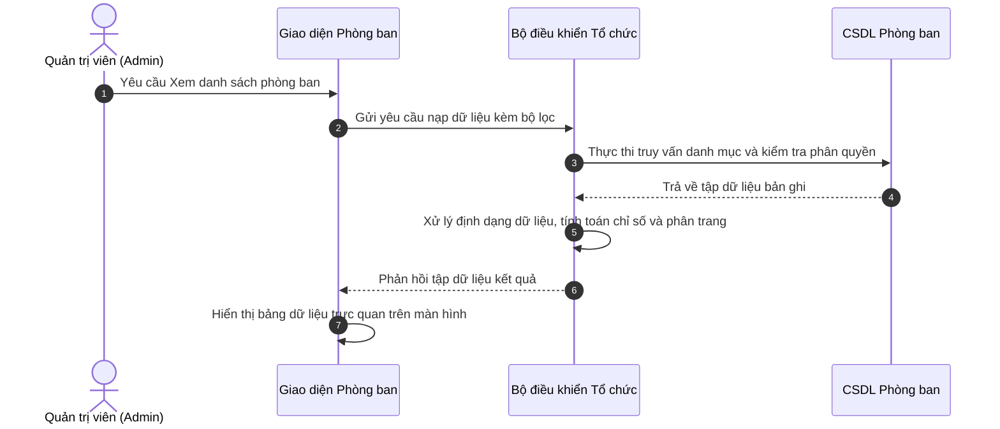

**Mô tả các bước tương tác trong biểu đồ tuần tự:**
- **Khởi đầu:** Chọn chức năng "Phòng ban" trong menu Cơ cấu Tổ chức.
- **Xử lý nghiệp vụ:** Lớp Điều khiển (Controller) xác thực thông tin và kiểm tra tính hợp lệ trước khi thao tác xuống Cơ sở dữ liệu.
- **Xử lý ngoại lệ / Rẽ nhánh:** Nếu vi phạm các ràng buộc nghiệp vụ (trùng mã, sai định dạng, thiếu điều kiện), hệ thống kích hoạt khối `else`, gửi thông báo cảnh báo và bảo toàn dữ liệu.
- **Kết thúc:** Hệ thống phản hồi trạng thái hoàn tất thành công lên giao diện người dùng.

---

### 1.2. 2. 2. 2. Sơ đồ Tuần tự cho UC-ORG-01-02: Tìm kiếm và Lọc phòng ban
> **Mục tiêu ca sử dụng:** Tra cứu nhanh chóng phòng ban theo tên gọi, mã viết tắt hoặc trạng thái mà không phải tìm qua nhiều trang.  
> **Tác nhân tương tác:** Quản trị viên (Admin). | **Sự kiện kích hoạt:** Người dùng nhập từ khóa vào ô tìm kiếm hoặc chọn lọc trạng thái.

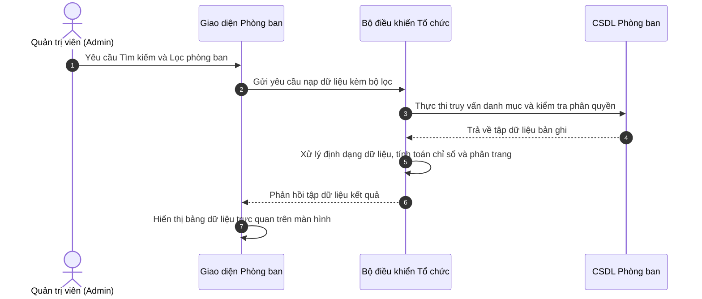

**Mô tả các bước tương tác trong biểu đồ tuần tự:**
- **Khởi đầu:** Người dùng nhập từ khóa vào ô tìm kiếm hoặc chọn lọc trạng thái.
- **Xử lý nghiệp vụ:** Lớp Điều khiển (Controller) xác thực thông tin và kiểm tra tính hợp lệ trước khi thao tác xuống Cơ sở dữ liệu.
- **Xử lý ngoại lệ / Rẽ nhánh:** Nếu vi phạm các ràng buộc nghiệp vụ (trùng mã, sai định dạng, thiếu điều kiện), hệ thống kích hoạt khối `else`, gửi thông báo cảnh báo và bảo toàn dữ liệu.
- **Kết thúc:** Hệ thống phản hồi trạng thái hoàn tất thành công lên giao diện người dùng.

---

### 1.3. 3. 3. 3. Sơ đồ Tuần tự cho UC-ORG-01-03: Thêm mới phòng ban và Gán định biên
> **Mục tiêu ca sử dụng:** Khởi tạo đơn vị mới vào sơ đồ cây tổ chức và ấn định chỉ tiêu định biên nhân sự tối đa (quota).  
> **Tác nhân tương tác:** Quản trị viên (Admin). | **Sự kiện kích hoạt:** Người dùng nhấn nút "+ Thêm phòng ban".

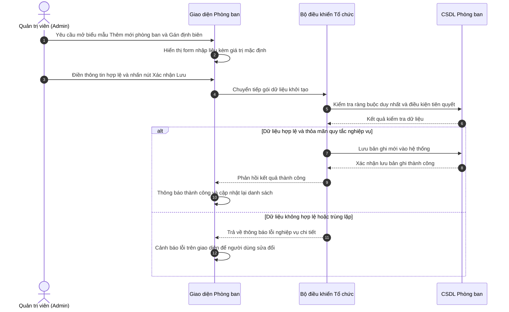

**Mô tả các bước tương tác trong biểu đồ tuần tự:**
- **Khởi đầu:** Người dùng nhấn nút "+ Thêm phòng ban".
- **Xử lý nghiệp vụ:** Lớp Điều khiển (Controller) xác thực thông tin và kiểm tra tính hợp lệ trước khi thao tác xuống Cơ sở dữ liệu.
- **Xử lý ngoại lệ / Rẽ nhánh:** Nếu vi phạm các ràng buộc nghiệp vụ (trùng mã, sai định dạng, thiếu điều kiện), hệ thống kích hoạt khối `else`, gửi thông báo cảnh báo và bảo toàn dữ liệu.
- **Kết thúc:** Hệ thống phản hồi trạng thái hoàn tất thành công lên giao diện người dùng.

---

### 1.4. 4. 4. 4. Sơ đồ Tuần tự cho UC-ORG-01-04: Cập nhật thông tin phòng ban
> **Mục tiêu ca sử dụng:** Điều chỉnh tên đơn vị, Trưởng phòng, nâng hoặc hạ định biên hoặc luân chuyển đơn vị cấp trên trực tiếp.  
> **Tác nhân tương tác:** Quản trị viên (Admin). | **Sự kiện kích hoạt:** Người dùng nhấn biểu tượng "Chỉnh sửa" tại dòng phòng ban.

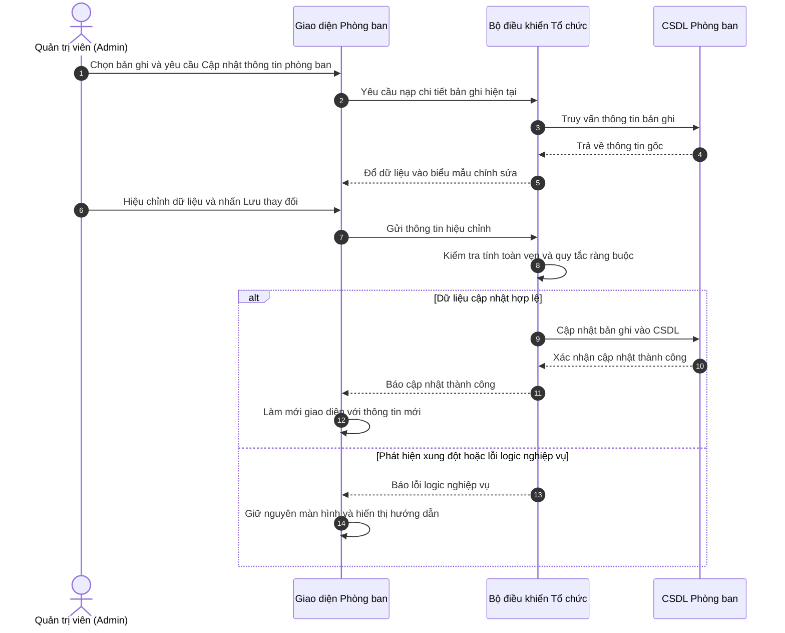

**Mô tả các bước tương tác trong biểu đồ tuần tự:**
- **Khởi đầu:** Người dùng nhấn biểu tượng "Chỉnh sửa" tại dòng phòng ban.
- **Xử lý nghiệp vụ:** Lớp Điều khiển (Controller) xác thực thông tin và kiểm tra tính hợp lệ trước khi thao tác xuống Cơ sở dữ liệu.
- **Xử lý ngoại lệ / Rẽ nhánh:** Nếu vi phạm các ràng buộc nghiệp vụ (trùng mã, sai định dạng, thiếu điều kiện), hệ thống kích hoạt khối `else`, gửi thông báo cảnh báo và bảo toàn dữ liệu.
- **Kết thúc:** Hệ thống phản hồi trạng thái hoàn tất thành công lên giao diện người dùng.

---

### 1.5. 5. 5. 5. Sơ đồ Tuần tự cho UC-ORG-01-05: Khóa  hoặc  Đóng băng phòng ban (Block  hoặc  Inactive)
> **Mục tiêu ca sử dụng:** Tạm dừng hoạt động hoặc giải thể mềm phòng ban mà không xóa dữ liệu, bảo toàn 100% lịch sử nhân sự cũ.  
> **Tác nhân tương tác:** Quản trị viên (Admin). | **Sự kiện kích hoạt:** Người dùng nhấn biểu tượng Ổ khóa tại cột thao tác.

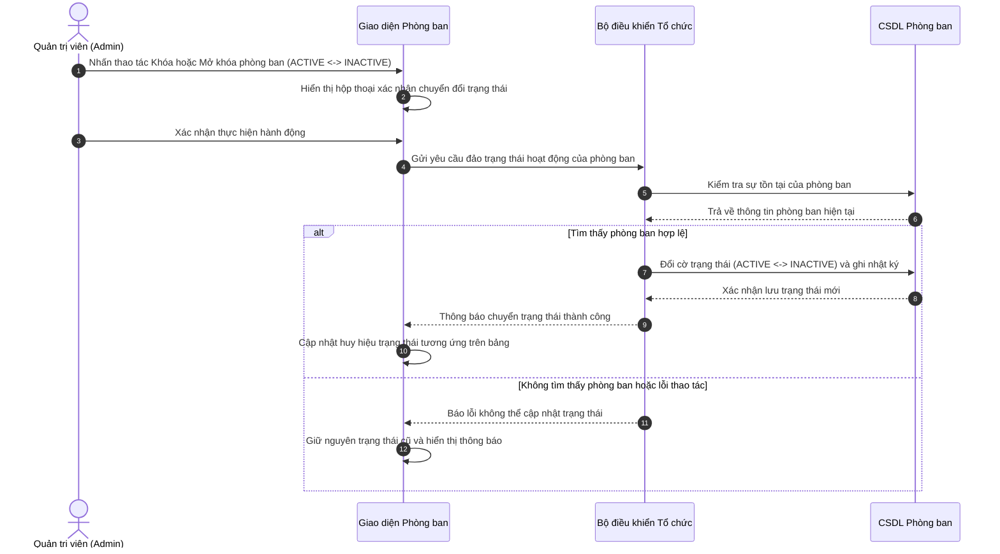

**Mô tả các bước tương tác trong biểu đồ tuần tự:**
- **Khởi đầu:** Người dùng nhấn biểu tượng Ổ khóa tại cột thao tác.
- **Xử lý nghiệp vụ:** Lớp Điều khiển (Controller) xác thực thông tin và kiểm tra tính hợp lệ trước khi thao tác xuống Cơ sở dữ liệu.
- **Xử lý ngoại lệ / Rẽ nhánh:** Nếu vi phạm các ràng buộc nghiệp vụ (trùng mã, sai định dạng, thiếu điều kiện), hệ thống kích hoạt khối `else`, gửi thông báo cảnh báo và bảo toàn dữ liệu.
- **Kết thúc:** Hệ thống phản hồi trạng thái hoàn tất thành công lên giao diện người dùng.

---

### 1.6. 6. 6. 6. Sơ đồ Tuần tự cho UC-ORG-01-06: Xóa phòng ban (Hard Delete)
> **Mục tiêu ca sử dụng:** Xóa vĩnh viễn các phòng ban tạo nhầm hoặc phòng ban trống không còn nhu cầu sử dụng.  
> **Tác nhân tương tác:** Quản trị viên (Admin). | **Sự kiện kích hoạt:** Người dùng nhấn biểu tượng Thùng rác đỏ.

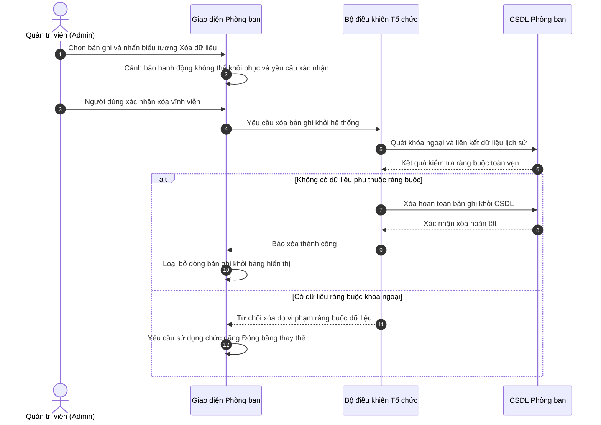

**Mô tả các bước tương tác trong biểu đồ tuần tự:**
- **Khởi đầu:** Người dùng nhấn biểu tượng Thùng rác đỏ.
- **Xử lý nghiệp vụ:** Lớp Điều khiển (Controller) xác thực thông tin và kiểm tra tính hợp lệ trước khi thao tác xuống Cơ sở dữ liệu.
- **Xử lý ngoại lệ / Rẽ nhánh:** Nếu vi phạm các ràng buộc nghiệp vụ (trùng mã, sai định dạng, thiếu điều kiện), hệ thống kích hoạt khối `else`, gửi thông báo cảnh báo và bảo toàn dữ liệu.
- **Kết thúc:** Hệ thống phản hồi trạng thái hoàn tất thành công lên giao diện người dùng.

---


## 2. SƠ ĐỒ TUẦN TỰ PHÂN HỆ ORG-02
---

### 2.1. 1. 1. 1. Sơ đồ Tuần tự cho UC-ORG-02-01: Xem danh mục vị trí chức danh
> **Mục tiêu ca sử dụng:** Theo dõi danh mục các vị trí công tác, cấp bậc chuyên môn và khung dải lương quy định.  
> **Tác nhân tương tác:** Quản trị viên (Admin). | **Sự kiện kích hoạt:** 

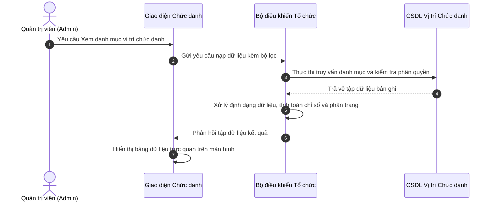

**Mô tả các bước tương tác trong biểu đồ tuần tự:**
- **Khởi đầu:** Người dùng thao tác trên màn hình.
- **Xử lý nghiệp vụ:** Lớp Điều khiển (Controller) xác thực thông tin và kiểm tra tính hợp lệ trước khi thao tác xuống Cơ sở dữ liệu.
- **Xử lý ngoại lệ / Rẽ nhánh:** Nếu vi phạm các ràng buộc nghiệp vụ (trùng mã, sai định dạng, thiếu điều kiện), hệ thống kích hoạt khối `else`, gửi thông báo cảnh báo và bảo toàn dữ liệu.
- **Kết thúc:** Hệ thống phản hồi trạng thái hoàn tất thành công lên giao diện người dùng.

---

### 2.2. 2. 2. 2. Sơ đồ Tuần tự cho UC-ORG-02-02: Thêm mới vị trí và Khung dải lương
> **Mục tiêu ca sử dụng:** Thiết lập chức danh mới, cấp bậc và ấn định khung dải lương tuyển dụng (minSalary - maxSalary).  
> **Tác nhân tương tác:** Quản trị viên (Admin). | **Sự kiện kích hoạt:** 

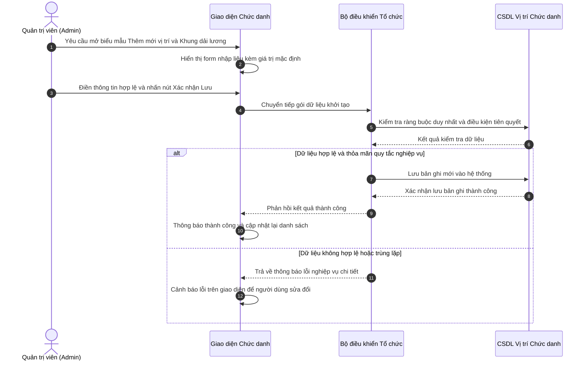

**Mô tả các bước tương tác trong biểu đồ tuần tự:**
- **Khởi đầu:** Người dùng thao tác trên màn hình.
- **Xử lý nghiệp vụ:** Lớp Điều khiển (Controller) xác thực thông tin và kiểm tra tính hợp lệ trước khi thao tác xuống Cơ sở dữ liệu.
- **Xử lý ngoại lệ / Rẽ nhánh:** Nếu vi phạm các ràng buộc nghiệp vụ (trùng mã, sai định dạng, thiếu điều kiện), hệ thống kích hoạt khối `else`, gửi thông báo cảnh báo và bảo toàn dữ liệu.
- **Kết thúc:** Hệ thống phản hồi trạng thái hoàn tất thành công lên giao diện người dùng.

---

### 2.3. 3. 3. 3. Sơ đồ Tuần tự cho UC-ORG-02-03: Cập nhật vị trí chức danh
> **Mục tiêu ca sử dụng:** Điều chỉnh tên chức danh, sửa dải lương hoặc thay đổi cấp bậc chuyên môn.  
> **Tác nhân tương tác:** Quản trị viên (Admin). | **Sự kiện kích hoạt:** 

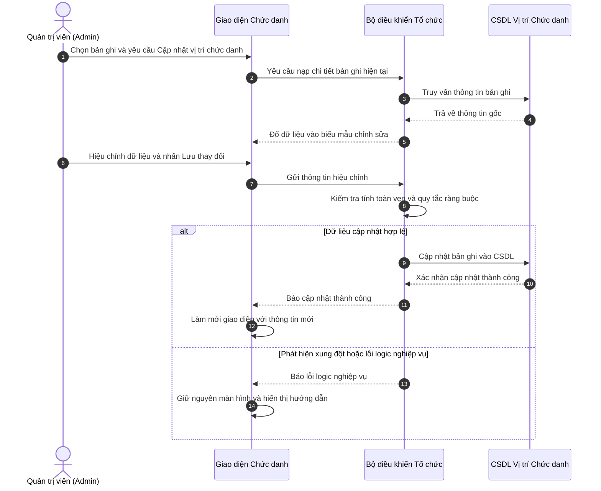

**Mô tả các bước tương tác trong biểu đồ tuần tự:**
- **Khởi đầu:** Người dùng thao tác trên màn hình.
- **Xử lý nghiệp vụ:** Lớp Điều khiển (Controller) xác thực thông tin và kiểm tra tính hợp lệ trước khi thao tác xuống Cơ sở dữ liệu.
- **Xử lý ngoại lệ / Rẽ nhánh:** Nếu vi phạm các ràng buộc nghiệp vụ (trùng mã, sai định dạng, thiếu điều kiện), hệ thống kích hoạt khối `else`, gửi thông báo cảnh báo và bảo toàn dữ liệu.
- **Kết thúc:** Hệ thống phản hồi trạng thái hoàn tất thành công lên giao diện người dùng.

---

### 2.4. 4. 4. 4. Sơ đồ Tuần tự cho UC-ORG-02-04: Khóa  hoặc  Đóng băng vị trí chức danh
> **Mục tiêu ca sử dụng:** Ngừng mở tuyển dụng hoặc ngừng bổ nhiệm vào vị trí chức danh cũ mà vẫn giữ nguyên hợp đồng của nhân sự đang nắm giữ vị trí này.  
> **Tác nhân tương tác:** Quản trị viên (Admin). | **Sự kiện kích hoạt:** 

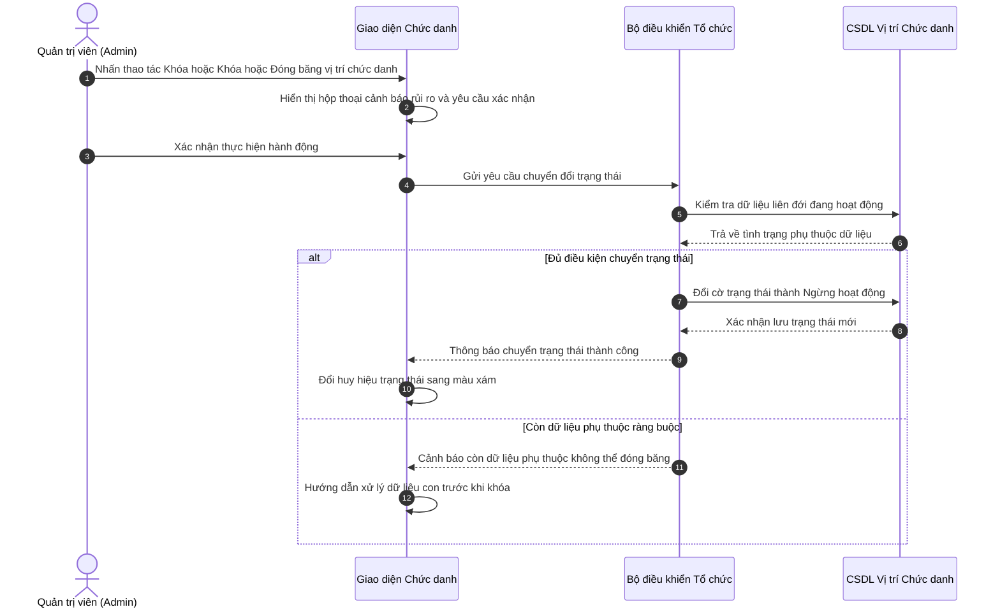

**Mô tả các bước tương tác trong biểu đồ tuần tự:**
- **Khởi đầu:** Người dùng thao tác trên màn hình.
- **Xử lý nghiệp vụ:** Lớp Điều khiển (Controller) xác thực thông tin và kiểm tra tính hợp lệ trước khi thao tác xuống Cơ sở dữ liệu.
- **Xử lý ngoại lệ / Rẽ nhánh:** Nếu vi phạm các ràng buộc nghiệp vụ (trùng mã, sai định dạng, thiếu điều kiện), hệ thống kích hoạt khối `else`, gửi thông báo cảnh báo và bảo toàn dữ liệu.
- **Kết thúc:** Hệ thống phản hồi trạng thái hoàn tất thành công lên giao diện người dùng.

---

### 2.5. 5. 5. 5. Sơ đồ Tuần tự cho UC-ORG-02-05: Xóa vị trí chức danh
> **Mục tiêu ca sử dụng:** Xóa vị trí chức danh không còn tồn tại trong doanh nghiệp.  
> **Tác nhân tương tác:** Quản trị viên (Admin). | **Sự kiện kích hoạt:** 

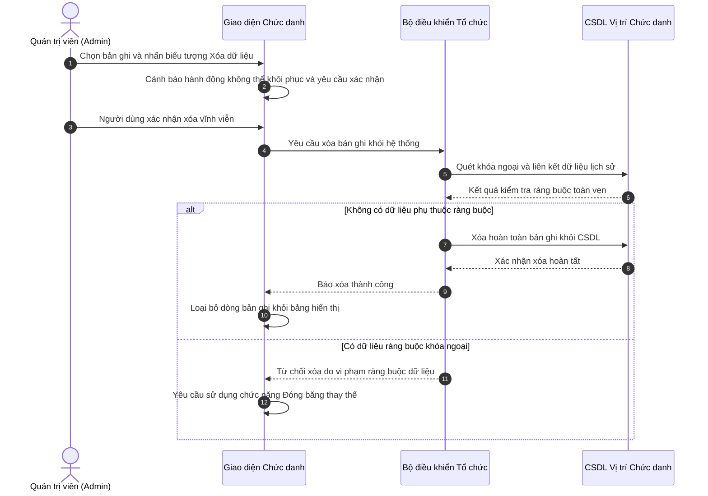

**Mô tả các bước tương tác trong biểu đồ tuần tự:**
- **Khởi đầu:** Người dùng thao tác trên màn hình.
- **Xử lý nghiệp vụ:** Lớp Điều khiển (Controller) xác thực thông tin và kiểm tra tính hợp lệ trước khi thao tác xuống Cơ sở dữ liệu.
- **Xử lý ngoại lệ / Rẽ nhánh:** Nếu vi phạm các ràng buộc nghiệp vụ (trùng mã, sai định dạng, thiếu điều kiện), hệ thống kích hoạt khối `else`, gửi thông báo cảnh báo và bảo toàn dữ liệu.
- **Kết thúc:** Hệ thống phản hồi trạng thái hoàn tất thành công lên giao diện người dùng.

---


## 3. SƠ ĐỒ TUẦN TỰ PHÂN HỆ ORG-03
---

### 3.1. 1. 1. 1. Sơ đồ Tuần tự cho UC-ORG-03-01: Xem biểu đồ phân cấp tổ chức hình cây
> **Mục tiêu ca sử dụng:** Trực quan hóa toàn bộ mô hình phân cấp tổ chức doanh nghiệp (Ban Giám Đốc  ->  Khối  ->  Phòng ban  ->  Bộ phận con).  
> **Tác nhân tương tác:** Quản trị viên (Admin). | **Sự kiện kích hoạt:** 


**Mô tả các bước tương tác trong biểu đồ tuần tự:**
- **Khởi đầu:** Người dùng thao tác trên màn hình.
- **Xử lý nghiệp vụ:** Lớp Điều khiển (Controller) xác thực thông tin và kiểm tra tính hợp lệ trước khi thao tác xuống Cơ sở dữ liệu.
- **Xử lý ngoại lệ / Rẽ nhánh:** Nếu vi phạm các ràng buộc nghiệp vụ (trùng mã, sai định dạng, thiếu điều kiện), hệ thống kích hoạt khối `else`, gửi thông báo cảnh báo và bảo toàn dữ liệu.
- **Kết thúc:** Hệ thống phản hồi trạng thái hoàn tất thành công lên giao diện người dùng.

---

### 3.2. 2. 2. 2. Sơ đồ Tuần tự cho UC-ORG-03-02: Thu gọn  hoặc  Mở rộng nhánh cây tổ chức
> **Mục tiêu ca sử dụng:** Cho phép người dùng tùy biến tầm nhìn sơ đồ cây bằng cách thu gọn các phòng ban cấp dưới hoặc mở rộng toàn bộ cấu trúc.  
> **Tác nhân tương tác:** Quản trị viên (Admin). | **Sự kiện kích hoạt:** 

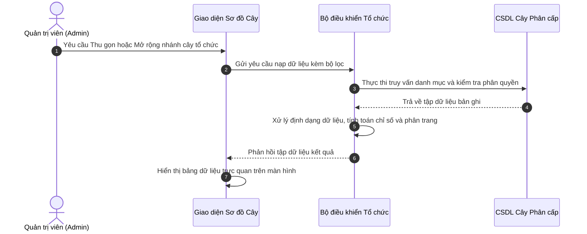

**Mô tả các bước tương tác trong biểu đồ tuần tự:**
- **Khởi đầu:** Người dùng thao tác trên màn hình.
- **Xử lý nghiệp vụ:** Lớp Điều khiển (Controller) xác thực thông tin và kiểm tra tính hợp lệ trước khi thao tác xuống Cơ sở dữ liệu.
- **Xử lý ngoại lệ / Rẽ nhánh:** Nếu vi phạm các ràng buộc nghiệp vụ (trùng mã, sai định dạng, thiếu điều kiện), hệ thống kích hoạt khối `else`, gửi thông báo cảnh báo và bảo toàn dữ liệu.
- **Kết thúc:** Hệ thống phản hồi trạng thái hoàn tất thành công lên giao diện người dùng.

---

### 3.3. 3. 3. 3. Sơ đồ Tuần tự cho UC-ORG-03-03: Xem tỷ lệ lấp đầy định biên trên sơ đồ
> **Mục tiêu ca sử dụng:** Giúp lãnh đạo nhận diện nhanh các phòng ban đang thừa hoặc thiếu nhân sự so với chỉ tiêu được duyệt.  
> **Tác nhân tương tác:** Quản trị viên (Admin). | **Sự kiện kích hoạt:** 

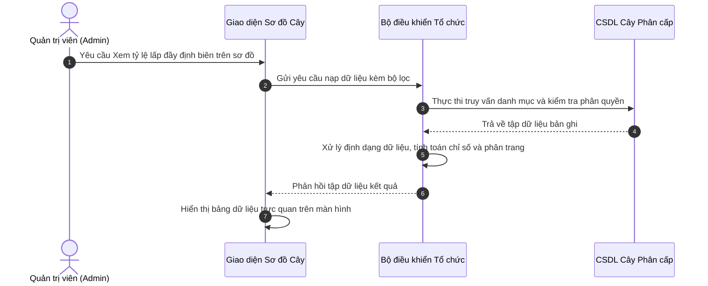

**Mô tả các bước tương tác trong biểu đồ tuần tự:**
- **Khởi đầu:** Người dùng thao tác trên màn hình.
- **Xử lý nghiệp vụ:** Lớp Điều khiển (Controller) xác thực thông tin và kiểm tra tính hợp lệ trước khi thao tác xuống Cơ sở dữ liệu.
- **Xử lý ngoại lệ / Rẽ nhánh:** Nếu vi phạm các ràng buộc nghiệp vụ (trùng mã, sai định dạng, thiếu điều kiện), hệ thống kích hoạt khối `else`, gửi thông báo cảnh báo và bảo toàn dữ liệu.
- **Kết thúc:** Hệ thống phản hồi trạng thái hoàn tất thành công lên giao diện người dùng.

---

### 3.4. 4. 4. 4. Sơ đồ Tuần tự cho UC-ORG-03-04: Xem danh sách nhân sự trực thuộc phòng ban
> **Mục tiêu ca sử dụng:** Bấm vào một khối phòng ban để tra cứu nhanh danh sách các nhân viên đang làm việc tại đơn vị đó.  
> **Tác nhân tương tác:** Quản trị viên (Admin). | **Sự kiện kích hoạt:** 

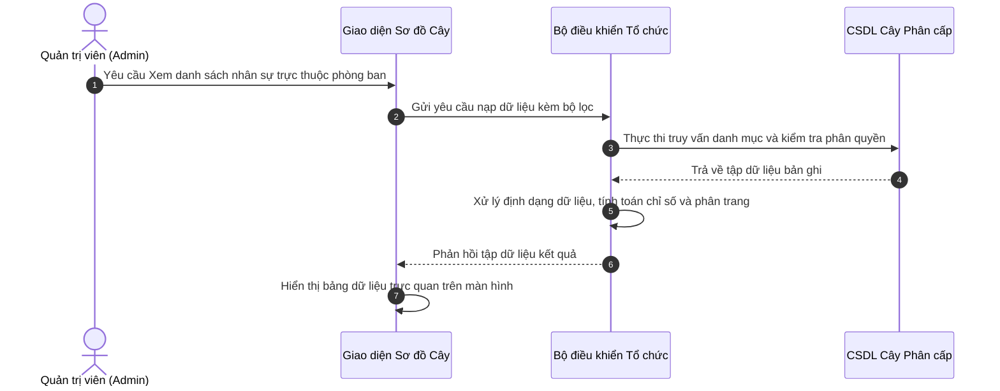

**Mô tả các bước tương tác trong biểu đồ tuần tự:**
- **Khởi đầu:** Người dùng thao tác trên màn hình.
- **Xử lý nghiệp vụ:** Lớp Điều khiển (Controller) xác thực thông tin và kiểm tra tính hợp lệ trước khi thao tác xuống Cơ sở dữ liệu.
- **Xử lý ngoại lệ / Rẽ nhánh:** Nếu vi phạm các ràng buộc nghiệp vụ (trùng mã, sai định dạng, thiếu điều kiện), hệ thống kích hoạt khối `else`, gửi thông báo cảnh báo và bảo toàn dữ liệu.
- **Kết thúc:** Hệ thống phản hồi trạng thái hoàn tất thành công lên giao diện người dùng.

---


## 4. SƠ ĐỒ TUẦN TỰ PHÂN HỆ REC-01
---

### 4.1. 1. 1. 1. Sơ đồ Tuần tự cho UC-REC-01-01: Xem danh sách yêu cầu tuyển dụng
> **Mục tiêu ca sử dụng:** Theo dõi tình trạng các vị trí đang cần tuyển dụng, số lượng chỉ tiêu và tiến độ tuyển thực tế.  
> **Tác nhân tương tác:** Quản trị viên (Admin). | **Sự kiện kích hoạt:** 

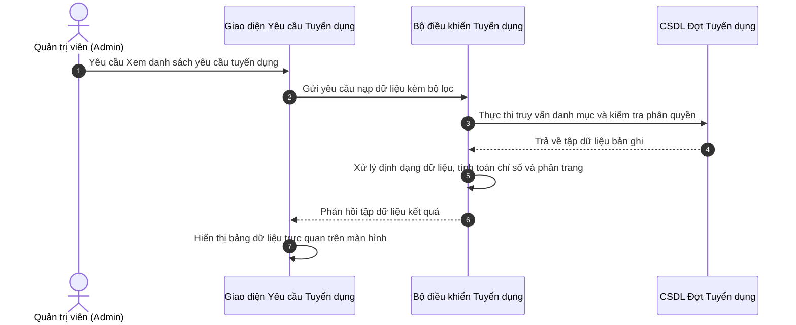

**Mô tả các bước tương tác trong biểu đồ tuần tự:**
- **Khởi đầu:** Người dùng thao tác trên màn hình.
- **Xử lý nghiệp vụ:** Lớp Điều khiển (Controller) xác thực thông tin và kiểm tra tính hợp lệ trước khi thao tác xuống Cơ sở dữ liệu.
- **Xử lý ngoại lệ / Rẽ nhánh:** Nếu vi phạm các ràng buộc nghiệp vụ (trùng mã, sai định dạng, thiếu điều kiện), hệ thống kích hoạt khối `else`, gửi thông báo cảnh báo và bảo toàn dữ liệu.
- **Kết thúc:** Hệ thống phản hồi trạng thái hoàn tất thành công lên giao diện người dùng.

---

### 4.2. 2. 2. 2. Sơ đồ Tuần tự cho UC-REC-01-02: Lập yêu cầu tuyển dụng và Kiểm tra định biên
> **Mục tiêu ca sử dụng:** Tạo tin tuyển dụng mới và kiểm tra trần định biên phòng ban (`currentEmployees + requestedAmount <= quota`).  
> **Tác nhân tương tác:** Quản trị viên (Admin). | **Sự kiện kích hoạt:** Nhấn "+ Tạo tin tuyển dụng".

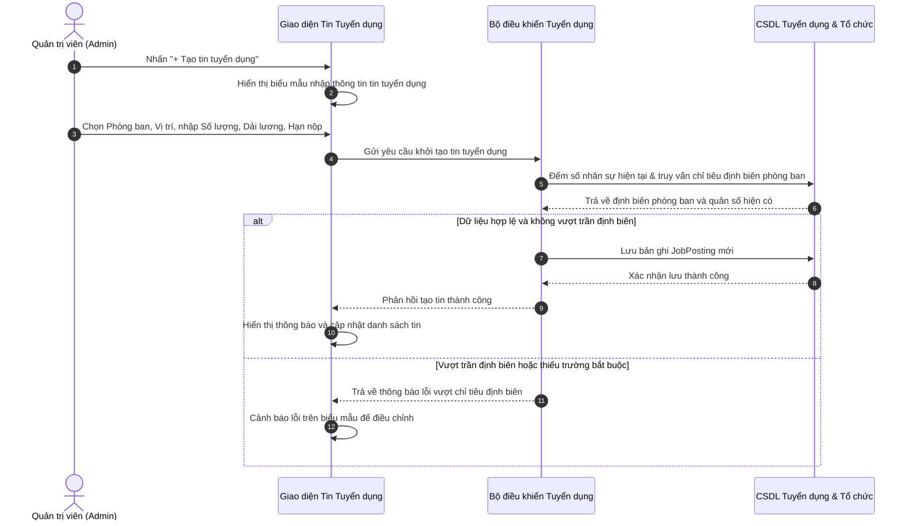

**Mô tả các bước tương tác trong biểu đồ tuần tự:**
- **Khởi đầu:** Admin mở form tạo tin tuyển dụng.
- **Xử lý nghiệp vụ:** Bộ điều khiển cộng dồn nhân sự hiện tại và số lượng yêu cầu tuyển để đối chiếu định biên phòng ban.
- **Xử lý ngoại lệ / Rẽ nhánh:** Vượt định biên sẽ chặn lưu và báo lỗi cụ thể.
- **Kết thúc:** Tin tuyển dụng mới được lưu thành công.

---

### 4.3. 3. 3. 3. Sơ đồ Tuần tự cho UC-REC-01-03: Chỉnh sửa yêu cầu tuyển dụng (Khóa trường khi PUBLISHED)
> **Mục tiêu ca sử dụng:** Cập nhật số lượng, hạn nộp hoặc nội dung tin theo quy tắc khóa các trường cốt lõi khi tin đã xuất bản (`PUBLISHED`) hoặc đã có ứng viên.  
> **Tác nhân tương tác:** Quản trị viên (Admin). | **Sự kiện kích hoạt:** Chọn "Chỉnh sửa" tin tuyển dụng.

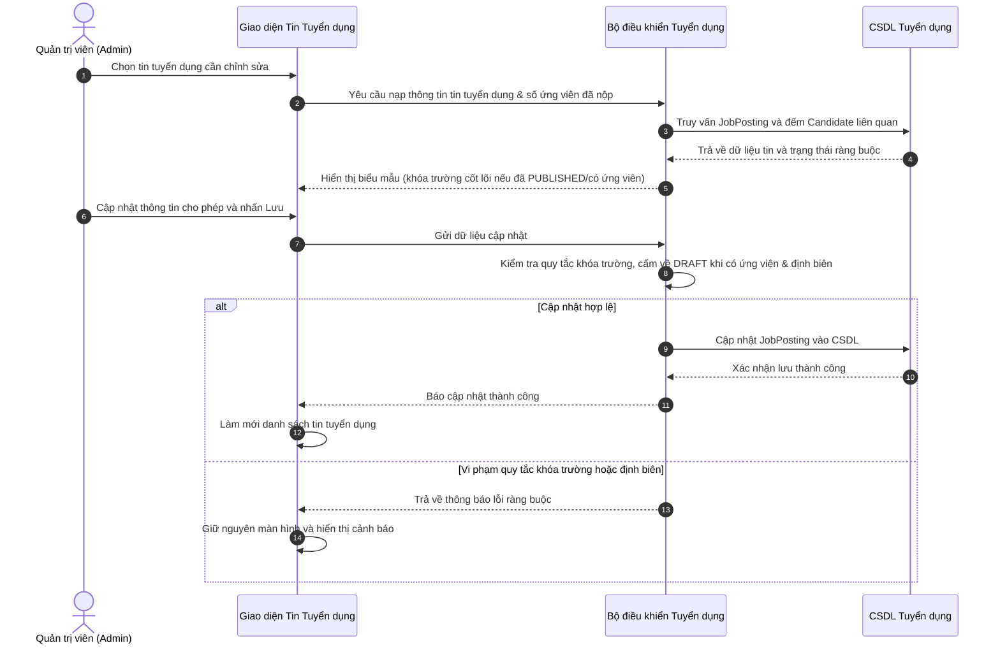

**Mô tả các bước tương tác trong biểu đồ tuần tự:**
- **Khởi đầu:** Admin mở form chỉnh sửa tin tuyển dụng.
- **Xử lý nghiệp vụ:** Hệ thống khóa các trường cốt lõi nếu tin đang `PUBLISHED` và cấm chuyển về `DRAFT` nếu đã phát sinh hồ sơ ứng viên.
- **Xử lý ngoại lệ / Rẽ nhánh:** Vi phạm quy tắc sẽ báo lỗi và từ chối lưu.
- **Kết thúc:** Tin tuyển dụng được cập nhật an toàn.

---

### 4.4. 4. 4. 4. Sơ đồ Tuần tự cho UC-REC-01-04: Xuất bản tin ra Cổng Tuyển dụng Công khai
> **Mục tiêu ca sử dụng:** Chuyển tin tuyển dụng từ Nháp (`DRAFT`) sang Đang tuyển (`PUBLISHED`) để hiển thị công khai cho ứng viên nộp CV.  
> **Tác nhân tương tác:** Quản trị viên (Admin). | **Sự kiện kích hoạt:** Nhấn "Xuất bản" trên tin tuyển dụng.

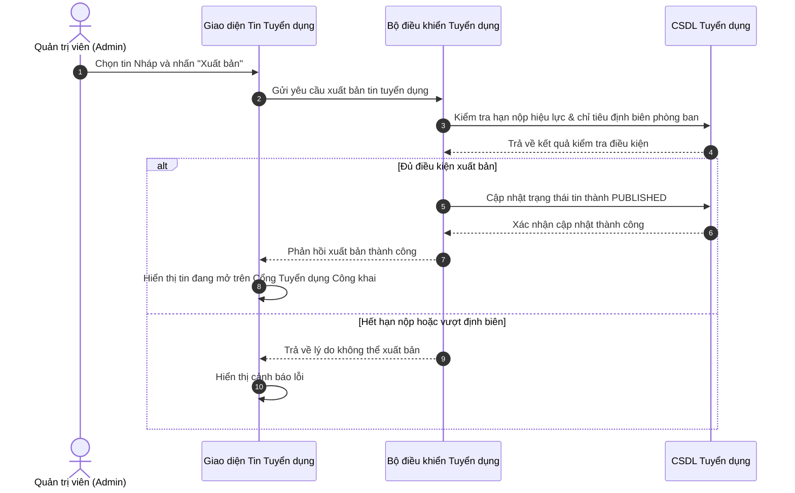

**Mô tả các bước tương tác trong biểu đồ tuần tự:**
- **Khởi đầu:** Admin bấm Xuất bản tin tuyển dụng.
- **Xử lý nghiệp vụ:** Bộ điều khiển xác thực hạn nộp và định biên phòng ban trước khi công khai.
- **Xử lý ngoại lệ / Rẽ nhánh:** Không đủ điều kiện sẽ từ chối xuất bản.
- **Kết thúc:** Tin tuyển dụng hiển thị công khai trên Trang tuyển dụng.

---

### 4.5. 5. 5. 5. Sơ đồ Tuần tự cho UC-REC-01-05: Đóng nhận hồ sơ tuyển dụng (Thủ công & Tự động)
> **Mục tiêu ca sử dụng:** Ngừng nhận hồ sơ khi đóng tin thủ công hoặc hệ thống tự động đóng tin khi đã tuyển đủ chỉ tiêu `HIRED`.  
> **Tác nhân tương tác:** Quản trị viên (Admin). | **Sự kiện kích hoạt:** Nhấn "Đóng tin" hoặc ứng viên thứ N chuyển sang `HIRED`.

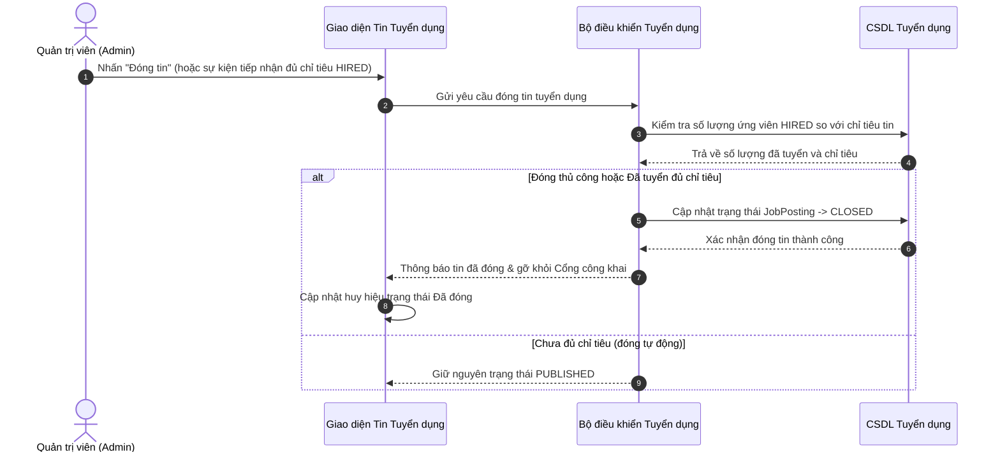

**Mô tả các bước tương tác trong biểu đồ tuần tự:**
- **Khởi đầu:** Admin đóng tin thủ công hoặc kích hoạt kiểm tra sau khi có người nhận việc.
- **Xử lý nghiệp vụ:** Khi đủ chỉ tiêu hoặc có lệnh đóng thủ công, chuyển trạng thái sang `CLOSED`.
- **Xử lý ngoại lệ / Rẽ nhánh:** Chưa đủ chỉ tiêu (ở chế độ tự động) sẽ giữ nguyên trạng thái Đang tuyển.
- **Kết thúc:** Tin ngừng tiếp nhận hồ sơ mới.

---


## 5. SƠ ĐỒ TUẦN TỰ PHÂN HỆ REC-02
---

### 5.1. 1. 1. 1. Sơ đồ Tuần tự cho UC-REC-02-01: Xem bảng Kanban phân loại 6 cột
> **Mục tiêu ca sử dụng:** Theo dõi phễu ứng viên qua 6 cột quy trình: Tiếp nhận (Sourced/Applied) -> Sơ loại (Screening) -> Phỏng vấn (Interview) -> Đề nghị việc (Offer) -> Tiếp nhận (Hired) -> Từ chối (Rejected).  
> **Tác nhân tương tác:** Quản trị viên (Admin). | **Sự kiện kích hoạt:** Mở màn hình ATS Kanban.

```mermaid
sequenceDiagram
    autonumber
    actor User as Quản trị viên (Admin)
    participant UI as Bảng ATS Kanban
    participant Ctrl as Bộ điều khiển Phễu Tuyển dụng
    participant DB as CSDL Hồ sơ Ứng viên

    User->>UI: Truy cập màn hình ATS Kanban (có thể lọc theo tin tuyển dụng)
    UI->>Ctrl: Yêu cầu nạp danh sách ứng viên kèm lịch PV & Offer
    Ctrl->>DB: Truy vấn Candidate, InterviewRound và JobOffer
    DB-->>Ctrl: Trả về tập dữ liệu ứng viên
    Ctrl->>Ctrl: Gom nhóm SOURCED & APPLIED vào cột đầu thành 6 cột Kanban chuẩn
    Ctrl-->>UI: Phản hồi dữ liệu 6 cột Kanban
    UI->>UI: Hiển thị bảng Kanban trực quan theo từng giai đoạn
```

**Mô tả các bước tương tác trong biểu đồ tuần tự:**
- **Khởi đầu:** Admin mở màn hình ATS Kanban.
- **Xử lý nghiệp vụ:** Bộ điều khiển truy vấn toàn bộ ứng viên và phân nhóm vào 6 cột chuẩn.
- **Xử lý ngoại lệ / Rẽ nhánh:** Nếu bộ lọc rỗng sẽ hiển thị cột trống.
- **Kết thúc:** Bảng Kanban hiển thị đầy đủ thẻ ứng viên.

---

### 5.2. 2. 2. 2. Sơ đồ Tuần tự cho UC-REC-02-02: Kéo thả chuyển trạng thái ứng viên (Theo ma trận hợp lệ)
> **Mục tiêu ca sử dụng:** Cập nhật tiến độ ứng viên theo ma trận `validTransitions` (`HIRED` khóa cứng, `REJECTED` cho khôi phục) và tự tạo hồ sơ Nhân viên khi chuyển sang `HIRED`.  
> **Tác nhân tương tác:** Quản trị viên (Admin). | **Sự kiện kích hoạt:** Kéo thả thẻ ứng viên sang cột trạng thái mới.

```mermaid
sequenceDiagram
    autonumber
    actor User as Quản trị viên (Admin)
    participant UI as Bảng ATS Kanban
    participant Ctrl as Bộ điều khiển Phễu Tuyển dụng
    participant DB as CSDL Ứng viên & Nhân sự

    User->>UI: Kéo thả thẻ ứng viên sang cột trạng thái mới
    UI->>Ctrl: Gửi yêu cầu chuyển trạng thái ứng viên
    Ctrl->>DB: Lấy trạng thái hiện tại của ứng viên
    DB-->>Ctrl: Trả về trạng thái gốc
    Ctrl->>Ctrl: Kiểm tra ma trận chuyển trạng thái hợp lệ (validTransitions)
    alt Chuyển trạng thái hợp lệ
        alt Đích là Đã tiếp nhận (HIRED)
            Ctrl->>DB: Transaction: Cập nhật HIRED, tạo Employee (ONBOARDING), Contract & EmploymentHistory
            Ctrl->>DB: Kiểm tra tự động đóng Tin tuyển dụng nếu đủ chỉ tiêu
            DB-->>Ctrl: Xác nhận hoàn tất giao dịch tiếp nhận
        else Bước trung gian (SCREENING / INTERVIEW / OFFER)
            Ctrl->>DB: Cập nhật trạng thái mới cho ứng viên
            DB-->>Ctrl: Xác nhận cập nhật thành công
        end
        Ctrl-->>UI: Phản hồi chuyển trạng thái thành công
        UI->>UI: Cập nhật vị trí thẻ ứng viên trên Kanban
    else Bước chuyển không hợp lệ (VD: kéo lùi từ HIRED)
        Ctrl-->>UI: Báo lỗi vi phạm quy trình chuyển trạng thái
        UI->>UI: Giữ thẻ ở cột cũ và hiển thị cảnh báo
    end
```

**Mô tả các bước tương tác trong biểu đồ tuần tự:**
- **Khởi đầu:** Admin kéo thả thẻ ứng viên trên bảng ATS.
- **Xử lý nghiệp vụ:** Bộ điều khiển đối chiếu `validTransitions`; nếu chuyển sang `HIRED`, tự động chạy Transaction tạo Nhân viên (`ONBOARDING`), Hợp đồng & Lịch sử công tác.
- **Xử lý ngoại lệ / Rẽ nhánh:** Chặn kéo lùi ứng viên đã `HIRED`.
- **Kết thúc:** Trạng thái ứng viên và dữ liệu nhân sự đồng bộ an toàn.

---

### 5.3. 3. 3. 3. Sơ đồ Tuần tự cho UC-REC-02-03: Xem chi tiết CV và Đánh giá
> **Mục tiêu ca sử dụng:** Xem trực tiếp hồ sơ CV, các vòng phỏng vấn, điểm số và thông tin Offer của ứng viên.  
> **Tác nhân tương tác:** Quản trị viên (Admin). | **Sự kiện kích hoạt:** Nhấp vào thẻ ứng viên trên Kanban.

```mermaid
sequenceDiagram
    autonumber
    actor User as Quản trị viên (Admin)
    participant UI as Bảng ATS Kanban
    participant Ctrl as Bộ điều khiển Phễu Tuyển dụng
    participant DB as CSDL Hồ sơ Ứng viên

    User->>UI: Nhấp chọn thẻ ứng viên cần xem chi tiết
    UI->>Ctrl: Yêu cầu nạp hồ sơ chi tiết ứng viên
    Ctrl->>DB: Truy vấn Candidate kèm InterviewRound, CandidateFeedback, JobOffer & PreOnboarding
    DB-->>Ctrl: Trả về đầy đủ dữ liệu hồ sơ
    Ctrl-->>UI: Phản hồi dữ liệu chi tiết ứng viên
    UI->>UI: Hiển thị hộp thoại chi tiết CV và lịch sử đánh giá
```

**Mô tả các bước tương tác trong biểu đồ tuần tự:**
- **Khởi đầu:** Admin mở chi tiết một ứng viên.
- **Xử lý nghiệp vụ:** Tổng hợp CV, lịch sử các vòng phỏng vấn và Offer liên quan.
- **Xử lý ngoại lệ / Rẽ nhánh:** Đảm bảo hiển thị đầy đủ thông tin kể cả khi chưa có Offer.
- **Kết thúc:** Thông tin chi tiết hiển thị trực quan.

---

### 5.4. 4. 4. 4. Sơ đồ Tuần tự cho UC-REC-02-04: Loại bỏ hoặc Từ chối hồ sơ (Reject)
> **Mục tiêu ca sử dụng:** Chuyển ứng viên không đạt yêu cầu sang trạng thái `REJECTED` (cho phép khôi phục lại về `SOURCED`/`APPLIED`/`SCREENING` khi cần).  
> **Tác nhân tương tác:** Quản trị viên (Admin). | **Sự kiện kích hoạt:** Kéo thẻ ứng viên sang cột Từ chối.

```mermaid
sequenceDiagram
    autonumber
    actor User as Quản trị viên (Admin)
    participant UI as Bảng ATS Kanban
    participant Ctrl as Bộ điều khiển Phễu Tuyển dụng
    participant DB as CSDL Hồ sơ Ứng viên

    User->>UI: Kéo ứng viên sang cột Từ chối (hoặc nhấn Từ chối)
    UI->>Ctrl: Gửi yêu cầu chuyển trạng thái sang REJECTED
    Ctrl->>DB: Kiểm tra trạng thái hiện tại của ứng viên
    DB-->>Ctrl: Trả về trạng thái gốc
    alt Chưa ở trạng thái HIRED
        Ctrl->>DB: Cập nhật trạng thái Candidate -> REJECTED
        DB-->>Ctrl: Xác nhận lưu trạng thái mới
        Ctrl-->>UI: Thông báo đã chuyển sang Từ chối
        UI->>UI: Đưa thẻ vào cột Từ chối trên Kanban
    else Đã ở trạng thái HIRED
        Ctrl-->>UI: Báo lỗi không thể loại bỏ ứng viên đã tiếp nhận
        UI->>UI: Giữ nguyên thẻ và hiển thị cảnh báo
    end
```

**Mô tả các bước tương tác trong biểu đồ tuần tự:**
- **Khởi đầu:** Admin chuyển ứng viên sang cột Từ chối.
- **Xử lý nghiệp vụ:** Chỉ cho phép từ chối các ứng viên chưa `HIRED`.
- **Xử lý ngoại lệ / Rẽ nhánh:** Chặn nếu ứng viên đã thành nhân viên chính thức.
- **Kết thúc:** Hồ sơ được phân loại vào cột Từ chối.

---


## 6. SƠ ĐỒ TUẦN TỰ PHÂN HỆ REC-03
---

### 6.1. 1. 1. 1. Sơ đồ Tuần tự cho UC-REC-03-01: Xem lịch phỏng vấn
> **Mục tiêu ca sử dụng:** Theo dõi danh sách các buổi phỏng vấn, trạng thái xác nhận Magic Link của ứng viên và kết quả đánh giá.  
> **Tác nhân tương tác:** Quản trị viên (Admin). | **Sự kiện kích hoạt:** Mở mục Phỏng vấn.

```mermaid
sequenceDiagram
    autonumber
    actor User as Quản trị viên (Admin)
    participant UI as Giao diện Lịch Phỏng vấn
    participant Ctrl as Bộ điều khiển Phỏng vấn
    participant DB as CSDL Lịch và Phiếu điểm

    User->>UI: Truy cập màn hình Quản lý Lịch phỏng vấn
    UI->>Ctrl: Gửi yêu cầu nạp danh sách vòng phỏng vấn
    Ctrl->>DB: Truy vấn InterviewRound kèm thông tin Candidate & CandidateFeedback
    DB-->>Ctrl: Trả về danh sách lịch phỏng vấn
    Ctrl-->>UI: Phản hồi tập dữ liệu kết quả
    UI->>UI: Hiển thị lịch phỏng vấn và trạng thái xác nhận của ứng viên
```

**Mô tả các bước tương tác trong biểu đồ tuần tự:**
- **Khởi đầu:** Admin truy cập mục Lịch phỏng vấn.
- **Xử lý nghiệp vụ:** Truy vấn toàn bộ vòng phỏng vấn kèm phản hồi và điểm đánh giá.
- **Xử lý ngoại lệ / Rẽ nhánh:** Hiển thị thông báo trống nếu chưa có lịch.
- **Kết thúc:** Danh sách lịch phỏng vấn hiển thị đầy đủ.

---

### 6.2. 2. 2. 2. Sơ đồ Tuần tự cho UC-REC-03-02: Tạo lịch phỏng vấn & Gửi Magic Link xác nhận tự động
> **Mục tiêu ca sử dụng:** Xếp lịch phỏng vấn, tự động đặt hạn phản hồi 24 giờ, sinh JWT Magic Link và gửi email mời ngay lập tức.  
> **Tác nhân tương tác:** Quản trị viên (Admin). | **Sự kiện kích hoạt:** Nhấn "+ Lên lịch phỏng vấn".

```mermaid
sequenceDiagram
    autonumber
    actor User as Quản trị viên (Admin)
    participant UI as Giao diện Lịch Phỏng vấn
    participant Ctrl as Bộ điều khiển Phỏng vấn
    participant DB as CSDL Lịch và Ứng viên
    participant Mail as Dịch vụ Email

    User->>UI: Nhấn "+ Lên lịch phỏng vấn", điền Ứng viên, Vòng, Thời gian, Địa điểm
    UI->>Ctrl: Gửi thông tin khởi tạo lịch phỏng vấn
    Ctrl->>Ctrl: Kiểm tra tính hợp lệ của dữ liệu đầu vào
    alt Dữ liệu hợp lệ
        Ctrl->>DB: Lưu InterviewRound (đặt hạn expiresAt = +24 giờ) & nâng Candidate -> INTERVIEW
        DB-->>Ctrl: Xác nhận lưu thành công
        Ctrl->>Mail: Sinh JWT Magic Link 24h & gửi email mời phỏng vấn cho ứng viên
        Mail-->>Ctrl: Xác nhận gửi email thành công
        Ctrl-->>UI: Phản hồi xếp lịch & gửi email thành công
        UI->>UI: Cập nhật bảng lịch phỏng vấn
    else Thiếu thông tin bắt buộc
        Ctrl-->>UI: Trả về lỗi dữ liệu không hợp lệ
        UI->>UI: Hiển thị cảnh báo lỗi trên biểu mẫu
    end
```

**Mô tả các bước tương tác trong biểu đồ tuần tự:**
- **Khởi đầu:** Admin lên lịch phỏng vấn mới cho ứng viên.
- **Xử lý nghiệp vụ:** Lưu lịch với thời hạn 24h, tự động chuyển ứng viên sang `INTERVIEW` và gửi email đính kèm Magic Link 1-chạm.
- **Xử lý ngoại lệ / Rẽ nhánh:** Thiếu trường bắt buộc sẽ báo lỗi ngay trên form.
- **Kết thúc:** Lịch phỏng vấn được tạo và thư mời đã gửi tới ứng viên.

---

### 6.3. 3. 3. 3. Sơ đồ Tuần tự cho UC-REC-03-03: Đánh dấu Ứng viên Vắng mặt không lý do (No-show)
> **Mục tiêu ca sử dụng:** Ghi nhận trạng thái `NO_SHOW` khi ứng viên không tham gia buổi phỏng vấn đúng hẹn (kèm tùy chọn loại hồ sơ).  
> **Tác nhân tương tác:** Quản trị viên (Admin). | **Sự kiện kích hoạt:** Nhấn "Đánh dấu No-show" trên lịch phỏng vấn.

```mermaid
sequenceDiagram
    autonumber
    actor User as Quản trị viên (Admin)
    participant UI as Giao diện Lịch Phỏng vấn
    participant Ctrl as Bộ điều khiển Phỏng vấn
    participant DB as CSDL Lịch và AuditLog

    User->>UI: Chọn lịch phỏng vấn và nhấn "Đánh dấu No-show"
    UI->>Ctrl: Gửi yêu cầu ghi nhận ứng viên vắng mặt
    Ctrl->>DB: Cập nhật trạng thái InterviewRound -> NO_SHOW
    opt Có chọn tự động loại hồ sơ
        Ctrl->>DB: Cập nhật trạng thái Candidate -> REJECTED
    end
    Ctrl->>DB: Ghi Audit Log sự kiện No-show
    DB-->>Ctrl: Xác nhận hoàn tất cập nhật
    Ctrl-->>UI: Phản hồi cập nhật thành công
    UI->>UI: Hiển thị huy hiệu NO_SHOW trên lịch phỏng vấn
```

**Mô tả các bước tương tác trong biểu đồ tuần tự:**
- **Khởi đầu:** Admin báo ứng viên vắng mặt không lý do.
- **Xử lý nghiệp vụ:** Đổi trạng thái vòng phỏng vấn sang `NO_SHOW`, tùy chọn chuyển ứng viên sang `REJECTED` và lưu Audit Log.
- **Xử lý ngoại lệ / Rẽ nhánh:** Khối `opt` xử lý khi Admin chọn từ chối hồ sơ luôn.
- **Kết thúc:** Kết quả vắng mặt được lưu vết minh bạch.

---

### 6.4. 4. 4. 4. Sơ đồ Tuần tự cho UC-REC-03-04: Nhập điểm và Nhận xét đánh giá (Thang 1–10)
> **Mục tiêu ca sử dụng:** Ghi nhận kết quả chấm điểm năng lực theo thang điểm nguyên 1–10 và nhận xét chuyên môn.  
> **Tác nhân tương tác:** Quản trị viên (Admin). | **Sự kiện kích hoạt:** Mở form đánh giá trên vòng phỏng vấn.

```mermaid
sequenceDiagram
    autonumber
    actor User as Quản trị viên (Admin)
    participant UI as Giao diện Lịch Phỏng vấn
    participant Ctrl as Bộ điều khiển Phỏng vấn
    participant DB as CSDL Phiếu điểm

    User->>UI: Chọn vòng phỏng vấn, nhập Điểm (1–10) & Nhận xét
    UI->>Ctrl: Gửi dữ liệu chấm điểm đánh giá
    Ctrl->>Ctrl: Kiểm tra điểm là số nguyên từ 1 đến 10 & nhận xét không rỗng
    alt Điểm số 1–10 và nhận xét hợp lệ
        Ctrl->>DB: Lưu bản ghi CandidateFeedback vào CSDL
        DB-->>Ctrl: Xác nhận lưu đánh giá thành công
        Ctrl-->>UI: Báo lưu đánh giá thành công
        UI->>UI: Hiển thị điểm & nhận xét trên hồ sơ ứng viên
    else Điểm ngoài thang 1–10 hoặc thiếu nhận xét
        Ctrl-->>UI: Báo lỗi thang điểm bắt buộc từ 1 đến 10
        UI->>UI: Yêu cầu nhập lại điểm hợp lệ
    end
```

**Mô tả các bước tương tác trong biểu đồ tuần tự:**
- **Khởi đầu:** Admin nhập điểm và nhận xét buổi phỏng vấn.
- **Xử lý nghiệp vụ:** Xác thực chặt chẽ thang điểm nguyên 1–10.
- **Xử lý ngoại lệ / Rẽ nhánh:** Nhập ngoài khoảng 1–10 sẽ bị từ chối.
- **Kết thúc:** Phiếu điểm được lưu làm căn cứ ra Offer.

---

### 6.5. 5. 5. 5. Sơ đồ Tuần tự cho UC-REC-03-05: Hủy hoặc Đổi thời gian phỏng vấn
> **Mục tiêu ca sử dụng:** Cập nhật thời gian mới (reset hạn 24h và gửi lại email Magic Link) hoặc hủy bỏ vòng phỏng vấn trong Transaction.  
> **Tác nhân tương tác:** Quản trị viên (Admin). | **Sự kiện kích hoạt:** Chọn "Đổi lịch" hoặc "Hủy lịch" phỏng vấn.

```mermaid
sequenceDiagram
    autonumber
    actor User as Quản trị viên (Admin)
    participant UI as Giao diện Lịch Phỏng vấn
    participant Ctrl as Bộ điều khiển Phỏng vấn
    participant DB as CSDL Lịch và Phiếu điểm
    participant Mail as Dịch vụ Email

    User->>UI: Chọn vòng phỏng vấn và thao tác Đổi lịch hoặc Hủy lịch
    alt Đổi thời gian / địa điểm phỏng vấn
        User->>UI: Nhập thời gian/địa điểm mới và bấm Lưu
        UI->>Ctrl: Gửi thông tin dời lịch
        Ctrl->>DB: Cập nhật lịch mới & reset hạn phản hồi +24 giờ
        DB-->>Ctrl: Xác nhận cập nhật
        Ctrl->>Mail: Sinh lại Magic Link & gửi email dời lịch cho ứng viên
        Mail-->>Ctrl: Xác nhận đã gửi email
        Ctrl-->>UI: Báo đổi lịch & gửi email thành công
    else Hủy vòng phỏng vấn
        User->>UI: Xác nhận hủy lịch phỏng vấn
        UI->>Ctrl: Gửi yêu cầu hủy lịch
        Ctrl->>DB: Transaction xóa CandidateFeedback liên quan & xóa InterviewRound
        DB-->>Ctrl: Xác nhận đã hủy lịch
        Ctrl-->>UI: Thông báo hủy lịch thành công
    end
    UI->>UI: Làm mới danh sách lịch phỏng vấn
```

**Mô tả các bước tương tác trong biểu đồ tuần tự:**
- **Khởi đầu:** Admin chọn Đổi lịch hoặc Hủy lịch phỏng vấn.
- **Xử lý nghiệp vụ:** Đổi lịch tự động gia hạn Magic Link 24h và gửi lại email; Hủy lịch dọn dẹp dữ liệu trong Transaction an toàn.
- **Xử lý ngoại lệ / Rẽ nhánh:** Tách biệt rõ hai nhánh Đổi lịch và Hủy lịch.
- **Kết thúc:** Danh sách phỏng vấn được cập nhật đồng bộ.

---


## 7. SƠ ĐỒ TUẦN TỰ PHÂN HỆ REC-04
---

### 7.1. 1. 1. 1. Sơ đồ Tuần tự cho UC-REC-04-01: Xem danh sách Thư mời nhận việc
> **Mục tiêu ca sử dụng:** Theo dõi tình trạng các thư mời nhận việc đã phát hành, hạn phản hồi và trạng thái Pre-Onboarding.  
> **Tác nhân tương tác:** Quản trị viên (Admin). | **Sự kiện kích hoạt:** Mở màn hình Quản lý Offer.

```mermaid
sequenceDiagram
    autonumber
    actor User as Quản trị viên (Admin)
    participant UI as Giao diện Thư mời Offer
    participant Ctrl as Bộ điều khiển Offer
    participant DB as CSDL Thư mời Offer

    User->>UI: Truy cập màn hình Quản lý Offer
    UI->>Ctrl: Gửi yêu cầu nạp danh sách Offer
    Ctrl->>DB: Truy vấn JobOffer kèm thông tin Candidate & PreOnboardingProfile
    DB-->>Ctrl: Trả về danh sách Offer
    Ctrl->>Ctrl: Đối chiếu hạn phản hồi expiresAt với thời điểm hiện tại
    Ctrl-->>UI: Phản hồi danh sách kèm trạng thái (PENDING/ACCEPTED/REJECTED/EXPIRED)
    UI->>UI: Hiển thị bảng danh sách Offer trực quan
```

**Mô tả các bước tương tác trong biểu đồ tuần tự:**
- **Khởi đầu:** Admin truy cập màn hình Offer.
- **Xử lý nghiệp vụ:** Truy vấn Offer kèm hồ sơ Pre-Onboarding và kiểm tra trạng thái quá hạn.
- **Xử lý ngoại lệ / Rẽ nhánh:** Tự động nhận diện Offer đã quá hạn phản hồi.
- **Kết thúc:** Bảng quản lý Offer hiển thị đầy đủ.

---

### 7.2. 2. 2. 2. Sơ đồ Tuần tự cho UC-REC-04-02: Soạn thảo và Gửi Thư mời Offer (Tuân thủ BLLĐ)
> **Mục tiêu ca sử dụng:** Tạo Offer với tỷ lệ lương thử việc >= 85% (Điều 26 BLLĐ), hạn phản hồi theo `OFFER_EXPIRY_DAYS` (mặc định 3 ngày) và tự động gửi email kèm Magic Link.  
> **Tác nhân tương tác:** Quản trị viên (Admin). | **Sự kiện kích hoạt:** Nhấn "+ Tạo Thư mời Offer".

```mermaid
sequenceDiagram
    autonumber
    actor User as Quản trị viên (Admin)
    participant UI as Giao diện Thư mời Offer
    participant Ctrl as Bộ điều khiển Offer
    participant DB as CSDL Offer và Tham số
    participant Mail as Dịch vụ Email

    User->>UI: Nhấn "+ Tạo Thư mời Offer", nhập Lương, Tỷ lệ thử việc (>=85%), Ngày nhận việc
    UI->>Ctrl: Gửi dữ liệu phát hành Offer
    Ctrl->>DB: Đọc tham số PROBATION_SALARY_PERCENT (85%) & OFFER_EXPIRY_DAYS (3 ngày)
    DB-->>Ctrl: Trả về cấu hình tham số
    Ctrl->>Ctrl: Kiểm tra tỷ lệ lương thử việc >= 85% & lương > 0
    alt Hợp lệ theo BLLĐ
        Ctrl->>DB: Lưu JobOffer (PENDING, tính expiresAt = +OFFER_EXPIRY_DAYS) & nâng Candidate -> OFFER
        DB-->>Ctrl: Xác nhận lưu Offer thành công
        Ctrl->>Mail: Sinh JWT Magic Link & gửi Email Thư mời nhận việc cho ứng viên
        Mail-->>Ctrl: Xác nhận gửi email thành công
        Ctrl-->>UI: Phản hồi tạo và gửi Offer thành công
        UI->>UI: Cập nhật danh sách Offer
    else Tỷ lệ thử việc < 85% hoặc thiếu dữ liệu
        Ctrl-->>UI: Báo lỗi vi phạm Điều 26 BLLĐ (lương thử việc tối thiểu 85%)
        UI->>UI: Hiển thị cảnh báo lỗi trên form
    end
```

**Mô tả các bước tương tác trong biểu đồ tuần tự:**
- **Khởi đầu:** Admin soạn thảo và phát hành Thư mời nhận việc.
- **Xử lý nghiệp vụ:** Đọc tham số động `PROBATION_SALARY_PERCENT` (85%) và `OFFER_EXPIRY_DAYS` (3 ngày), lưu Offer và gửi email Magic Link.
- **Xử lý ngoại lệ / Rẽ nhánh:** Chặn ngay nếu tỷ lệ lương thử việc nhỏ hơn 85%.
- **Kết thúc:** Offer được phát hành và gửi tới ứng viên.

---

### 7.3. 3. 3. 3. Sơ đồ Tuần tự cho UC-REC-04-03: Theo dõi & Xử lý Offer Quá hạn
> **Mục tiêu ca sử dụng:** Giám sát thời hạn phản hồi Offer theo tham số `OFFER_EXPIRY_DAYS` (mặc định 3 ngày) và chặn phản hồi nếu đã quá hạn.  
> **Tác nhân tương tác:** Quản trị viên (Admin). | **Sự kiện kích hoạt:** Kiểm tra hiệu lực Offer.

```mermaid
sequenceDiagram
    autonumber
    actor User as Quản trị viên (Admin)
    participant UI as Giao diện Thư mời Offer
    participant Ctrl as Bộ điều khiển Offer
    participant DB as CSDL Thư mời Offer

    User->>UI: Kiểm tra trạng thái phản hồi Offer
    UI->>Ctrl: Yêu cầu kiểm tra hiệu lực các Offer đang PENDING
    Ctrl->>DB: Truy vấn danh sách Offer và mốc expiresAt
    DB-->>Ctrl: Trả về dữ liệu Offer
    alt Thời gian hiện tại > expiresAt và vẫn PENDING
        Ctrl->>DB: Đánh dấu trạng thái quá hạn (EXPIRED)
        DB-->>Ctrl: Xác nhận cập nhật trạng thái
        Ctrl-->>UI: Hiển thị trạng thái Quá hạn (EXPIRED)
    else Vẫn còn trong hạn phản hồi
        Ctrl-->>UI: Giữ nguyên trạng thái Chờ phản hồi (PENDING)
    end
    UI->>UI: Hiển thị kết quả hiệu lực Offer
```

**Mô tả các bước tương tác trong biểu đồ tuần tự:**
- **Khởi đầu:** Kiểm tra hạn hiệu lực của Offer.
- **Xử lý nghiệp vụ:** So sánh thời gian hiện tại với `expiresAt` (tính theo `OFFER_EXPIRY_DAYS`).
- **Xử lý ngoại lệ / Rẽ nhánh:** Quá hạn sẽ đánh dấu `EXPIRED`.
- **Kết thúc:** Trạng thái hiệu lực Offer được phản ánh chính xác.

---

### 7.4. 4. 4. 4. Sơ đồ Tuần tự cho UC-REC-04-04: Duyệt tiếp nhận Pre-Onboarding & Chuyển đổi thành Nhân viên
> **Mục tiêu ca sử dụng:** Admin kiểm tra hồ sơ Pre-Onboarding do ứng viên đã khai báo và bấm duyệt tiếp nhận để tự động sinh Nhân viên, Hợp đồng, Tài khoản `EMPLOYEE` & gửi email chào mừng.  
> **Tác nhân tương tác:** Quản trị viên (Admin). | **Sự kiện kích hoạt:** Nhấn "Xác nhận Tiếp nhận" tại Pre-Onboarding Hub.

```mermaid
sequenceDiagram
    autonumber
    actor User as Quản trị viên (Admin)
    participant UI as Giao diện Pre-Onboarding Hub
    participant Ctrl as Bộ điều khiển Hội nhập
    participant DB as CSDL Nhân sự, HĐ & Tài khoản
    participant Mail as Dịch vụ Email

    User->>UI: Kiểm tra thông tin Pre-Onboarding và nhấn "Xác nhận Tiếp nhận"
    UI->>Ctrl: Gửi yêu cầu tiếp nhận nhân sự mới
    Ctrl->>DB: Kiểm tra Offer đã ACCEPTED và đã có PreOnboardingProfile
    DB-->>Ctrl: Trả về dữ liệu Offer & Pre-Onboarding
    alt Đủ điều kiện tiếp nhận
        Ctrl->>DB: Transaction: Tạo Employee (ONBOARDING), Contract, EmploymentHistory, Account EMPLOYEE & Checklist
        Ctrl->>DB: Cập nhật Candidate -> HIRED & kiểm tra tự động đóng Tin tuyển dụng
        DB-->>Ctrl: Xác nhận hoàn tất giao dịch tạo nhân sự
        Ctrl->>Mail: Gửi email chào mừng kèm Username & Mật khẩu đăng nhập ESS
        Mail-->>Ctrl: Xác nhận gửi email thành công
        Ctrl-->>UI: Phản hồi tiếp nhận thành công
        UI->>UI: Thông báo đã tạo Hồ sơ Nhân viên, Hợp đồng & Tài khoản
    else Thiếu hồ sơ Pre-Onboarding hoặc chưa ACCEPTED
        Ctrl-->>UI: Trả về thông báo lỗi chưa đủ điều kiện tiếp nhận
        UI->>UI: Hiển thị cảnh báo lỗi trên giao diện
    end
```

**Mô tả các bước tương tác trong biểu đồ tuần tự:**
- **Khởi đầu:** Admin kiểm tra hồ sơ ứng viên đã khai báo Pre-Onboarding và bấm duyệt tiếp nhận.
- **Xử lý nghiệp vụ:** Thực thi Transaction đồng bộ tạo Employee, Hợp đồng, Tài khoản `EMPLOYEE`, Checklist Onboarding và đóng tin tuyển dụng nếu đủ chỉ tiêu.
- **Xử lý ngoại lệ / Rẽ nhánh:** Chặn nếu ứng viên chưa hoàn tất Pre-Onboarding.
- **Kết thúc:** Nhân sự mới được cấp tài khoản và nhận email chào mừng.


## 8. SƠ ĐỒ TUẦN TỰ PHÂN HỆ ONB-01
---

### 8.1. 1. 1. 1. Sơ đồ Tuần tự cho UC-ONB-01-01: Xem hồ sơ ứng viên tự kê khai
> **Mục tiêu ca sử dụng:** Kiểm tra các thông tin cá nhân, CCCD, số tài khoản ngân hàng và người thân do ứng viên trúng tuyển tự khai trực tuyến trước ngày đi làm.  
> **Tác nhân tương tác:** Quản trị viên (Admin). | **Sự kiện kích hoạt:** 

```mermaid
sequenceDiagram
    autonumber
    actor User as Quản trị viên (Admin)
    participant UI as Giao diện Duyệt Pre-Onboarding
    participant Ctrl as Bộ điều khiển Hội nhập
    participant DB as CSDL Hồ sơ Tự kê khai

    User->>UI: Yêu cầu Xem hồ sơ ứng viên tự kê khai
    UI->>Ctrl: Gửi yêu cầu nạp dữ liệu kèm bộ lọc
    Ctrl->>DB: Thực thi truy vấn danh mục và kiểm tra phân quyền
    DB-->>Ctrl: Trả về tập dữ liệu bản ghi
    Ctrl->>Ctrl: Xử lý định dạng dữ liệu, tính toán chỉ số và phân trang
    Ctrl-->>UI: Phản hồi tập dữ liệu kết quả
    UI->>UI: Hiển thị bảng dữ liệu trực quan trên màn hình
```

**Mô tả các bước tương tác trong biểu đồ tuần tự:**
- **Khởi đầu:** Người dùng thao tác trên màn hình.
- **Xử lý nghiệp vụ:** Lớp Điều khiển (Controller) xác thực thông tin và kiểm tra tính hợp lệ trước khi thao tác xuống Cơ sở dữ liệu.
- **Xử lý ngoại lệ / Rẽ nhánh:** Nếu vi phạm các ràng buộc nghiệp vụ (trùng mã, sai định dạng, thiếu điều kiện), hệ thống kích hoạt khối `else`, gửi thông báo cảnh báo và bảo toàn dữ liệu.
- **Kết thúc:** Hệ thống phản hồi trạng thái hoàn tất thành công lên giao diện người dùng.

---

### 8.2. 2. 2. 2. Sơ đồ Tuần tự cho UC-ONB-01-02: Đối soát thông tin CCCD và Tài khoản Ngân hàng
> **Mục tiêu ca sử dụng:** Đảm bảo thông tin số định danh cá nhân và số tài khoản ngân hàng chi trả lương là chính xác và khớp với chứng từ.  
> **Tác nhân tương tác:** Quản trị viên (Admin). | **Sự kiện kích hoạt:** 

```mermaid
sequenceDiagram
    autonumber
    actor User as Quản trị viên (Admin)
    participant UI as Giao diện Duyệt Pre-Onboarding
    participant Ctrl as Bộ điều khiển Hội nhập
    participant DB as CSDL Hồ sơ Tự kê khai

    User->>UI: Chọn đối tượng và nhấn Đối soát thông tin CCCD và Tài khoản Ngân hàng
    UI->>Ctrl: Gửi lệnh phê duyệt nghiệp vụ
    Ctrl->>DB: Truy xuất hồ sơ và kiểm tra điều kiện duyệt
    DB-->>Ctrl: Trả về thông tin phê duyệt
    Ctrl->>Ctrl: Áp dụng quy tắc nghiệp vụ tự động
    alt Đạt chuẩn phê duyệt
        Ctrl->>DB: Ghi nhận trạng thái Đã duyệt và lưu biến động
        DB-->>Ctrl: Xác nhận hoàn tất cập nhật
        Ctrl->>Ctrl: Kích hoạt thông báo hệ thống tự động
        Ctrl-->>UI: Phản hồi phê duyệt thành công
        UI->>UI: Cập nhật trạng thái duyệt lên màn hình
    else Không đủ điều kiện phê duyệt
        Ctrl-->>UI: Trả về nguyên nhân không đủ điều kiện
        UI->>UI: Hiển thị thông báo từ chối phê duyệt kèm lý do
    end
```

**Mô tả các bước tương tác trong biểu đồ tuần tự:**
- **Khởi đầu:** Người dùng thao tác trên màn hình.
- **Xử lý nghiệp vụ:** Lớp Điều khiển (Controller) xác thực thông tin và kiểm tra tính hợp lệ trước khi thao tác xuống Cơ sở dữ liệu.
- **Xử lý ngoại lệ / Rẽ nhánh:** Nếu vi phạm các ràng buộc nghiệp vụ (trùng mã, sai định dạng, thiếu điều kiện), hệ thống kích hoạt khối `else`, gửi thông báo cảnh báo và bảo toàn dữ liệu.
- **Kết thúc:** Hệ thống phản hồi trạng thái hoàn tất thành công lên giao diện người dùng.

---

### 8.3. 3. 3. 3. Sơ đồ Tuần tự cho UC-ONB-01-03: Phê duyệt 1-chạm: Tự động tạo Nhân viên, Cấp tài khoản và Hợp đồng
> **Mục tiêu ca sử dụng:** Chuyển đổi ứng viên thành nhân viên chính thức chỉ bằng 1 thao tác phê duyệt, xóa bỏ hoàn toàn việc nhập tay trùng lặp.  
> **Tác nhân tương tác:** Quản trị viên (Admin). | **Sự kiện kích hoạt:** 

```mermaid
sequenceDiagram
    autonumber
    actor User as Quản trị viên (Admin)
    participant UI as Giao diện Duyệt Pre-Onboarding
    participant Ctrl as Bộ điều khiển Hội nhập
    participant DB as CSDL Hồ sơ Tự kê khai

    User->>UI: Yêu cầu mở biểu mẫu Phê duyệt 1-chạm: Tự động tạo Nhân viên, Cấp tài khoản và Hợp đồng
    UI->>UI: Hiển thị form nhập liệu kèm giá trị mặc định
    User->>UI: Điền thông tin hợp lệ và nhấn nút Xác nhận Lưu
    UI->>Ctrl: Chuyển tiếp gói dữ liệu khởi tạo
    Ctrl->>DB: Kiểm tra ràng buộc duy nhất và điều kiện tiên quyết
    DB-->>Ctrl: Kết quả kiểm tra dữ liệu
    alt Dữ liệu hợp lệ và thỏa mãn quy tắc nghiệp vụ
        Ctrl->>DB: Lưu bản ghi mới vào hệ thống
        DB-->>Ctrl: Xác nhận lưu bản ghi thành công
        Ctrl-->>UI: Phản hồi kết quả thành công
        UI->>UI: Thông báo thành công và cập nhật lại danh sách
    else Dữ liệu không hợp lệ hoặc trùng lặp
        Ctrl-->>UI: Trả về thông báo lỗi nghiệp vụ chi tiết
        UI->>UI: Cảnh báo lỗi trên giao diện để người dùng sửa đổi
    end
```

**Mô tả các bước tương tác trong biểu đồ tuần tự:**
- **Khởi đầu:** Người dùng thao tác trên màn hình.
- **Xử lý nghiệp vụ:** Lớp Điều khiển (Controller) xác thực thông tin và kiểm tra tính hợp lệ trước khi thao tác xuống Cơ sở dữ liệu.
- **Xử lý ngoại lệ / Rẽ nhánh:** Nếu vi phạm các ràng buộc nghiệp vụ (trùng mã, sai định dạng, thiếu điều kiện), hệ thống kích hoạt khối `else`, gửi thông báo cảnh báo và bảo toàn dữ liệu.
- **Kết thúc:** Hệ thống phản hồi trạng thái hoàn tất thành công lên giao diện người dùng.

---

### 8.4. 4. 4. 4. Sơ đồ Tuần tự cho UC-ONB-01-04: Yêu cầu bổ sung  hoặc  chỉnh sửa thông tin
> **Mục tiêu ca sử dụng:** Trả lại hồ sơ yêu cầu ứng viên kê khai lại khi phát hiện sai sót (ví dụ mờ ảnh CCCD hoặc sai số tài khoản).  
> **Tác nhân tương tác:** Quản trị viên (Admin). | **Sự kiện kích hoạt:** 

```mermaid
sequenceDiagram
    autonumber
    actor User as Quản trị viên (Admin)
    participant UI as Giao diện Duyệt Pre-Onboarding
    participant Ctrl as Bộ điều khiển Hội nhập
    participant DB as CSDL Hồ sơ Tự kê khai

    User->>UI: Chọn bản ghi và yêu cầu Yêu cầu bổ sung  hoặc  chỉnh sửa thông tin
    UI->>Ctrl: Yêu cầu nạp chi tiết bản ghi hiện tại
    Ctrl->>DB: Truy vấn thông tin bản ghi
    DB-->>Ctrl: Trả về thông tin gốc
    Ctrl-->>UI: Đổ dữ liệu vào biểu mẫu chỉnh sửa
    User->>UI: Hiệu chỉnh dữ liệu và nhấn Lưu thay đổi
    UI->>Ctrl: Gửi thông tin hiệu chỉnh
    Ctrl->>Ctrl: Kiểm tra tính toàn vẹn và quy tắc ràng buộc
    alt Dữ liệu cập nhật hợp lệ
        Ctrl->>DB: Cập nhật bản ghi vào CSDL
        DB-->>Ctrl: Xác nhận cập nhật thành công
        Ctrl-->>UI: Báo cập nhật thành công
        UI->>UI: Làm mới giao diện với thông tin mới
    else Phát hiện xung đột hoặc lỗi logic nghiệp vụ
        Ctrl-->>UI: Báo lỗi logic nghiệp vụ
        UI->>UI: Giữ nguyên màn hình và hiển thị hướng dẫn
    end
```

**Mô tả các bước tương tác trong biểu đồ tuần tự:**
- **Khởi đầu:** Người dùng thao tác trên màn hình.
- **Xử lý nghiệp vụ:** Lớp Điều khiển (Controller) xác thực thông tin và kiểm tra tính hợp lệ trước khi thao tác xuống Cơ sở dữ liệu.
- **Xử lý ngoại lệ / Rẽ nhánh:** Nếu vi phạm các ràng buộc nghiệp vụ (trùng mã, sai định dạng, thiếu điều kiện), hệ thống kích hoạt khối `else`, gửi thông báo cảnh báo và bảo toàn dữ liệu.
- **Kết thúc:** Hệ thống phản hồi trạng thái hoàn tất thành công lên giao diện người dùng.

---


## 9. SƠ ĐỒ TUẦN TỰ PHÂN HỆ ONB-02
---

### 9.1. 1. 1. 1. Sơ đồ Tuần tự cho UC-ONB-02-01: Giám sát tiến độ hội nhập qua 4 giai đoạn liên phòng ban
> **Mục tiêu ca sử dụng:** Theo dõi tiến độ hoàn thành checklist hội nhập của nhân sự mới theo 4 nhóm trách nhiệm liên phòng ban (`IT`, `Hành chính`, `Nhân sự`, `Quản lý trực tiếp`) và 4 mốc thời gian.  
> **Tác nhân tương tác:** Quản trị viên (Admin). | **Sự kiện kích hoạt:** Chọn nhân sự mới trên bảng theo dõi Hội nhập.

```mermaid
sequenceDiagram
    autonumber
    actor User as Quản trị viên (Admin)
    participant UI as Giao diện Checklist Hội nhập
    participant Ctrl as Bộ điều khiển Hội nhập
    participant DB as CSDL Checklist Hội nhập

    User->>UI: Chọn nhân sự mới cần giám sát tiến độ hội nhập
    UI->>Ctrl: Yêu cầu tải danh sách hạng mục và tiến độ hội nhập
    Ctrl->>DB: Truy vấn checklist theo 4 nhóm (IT, Hành chính, Nhân sự, Quản lý)
    DB-->>Ctrl: Trả về danh sách đầu việc, người phụ trách và trạng thái
    Ctrl->>Ctrl: Tính toán tỷ lệ hoàn thành (%) và kiểm tra cảnh báo quá hạn (> 7 ngày)
    opt Chưa hoàn tất hồ sơ bắt buộc quá 7 ngày làm việc
        Ctrl->>Ctrl: Gắn cờ cảnh báo Tạm giữ chi trả lương kỳ tới
    end
    Ctrl-->>UI: Phản hồi chi tiết tiến độ hội nhập
    UI->>UI: Hiển thị thanh tiến độ, bảng checklist 4 nhóm và cảnh báo (nếu có)
```

**Mô tả các bước tương tác trong biểu đồ tuần tự:**
- **Khởi đầu:** Quản trị viên chọn hồ sơ hội nhập của nhân viên mới.
- **Xử lý nghiệp vụ:** Bộ điều khiển tổng hợp trạng thái các đầu việc thuộc 4 nhóm phòng ban và kiểm tra ngưỡng cảnh báo chậm hồ sơ quá 7 ngày.
- **Kết thúc:** Giao diện hiển thị trực quan phần trăm hoàn tất và các hạng mục còn tồn đọng.

---

### 9.2. 2. 2. 2. Sơ đồ Tuần tự cho UC-ONB-02-02: Đánh dấu hoàn thành các hạng mục nhận việc & BOD Override
> **Mục tiêu ca sử dụng:** Cập nhật trạng thái hoàn tất từng đầu việc hội nhập hoặc thực hiện ngoại lệ mở khóa giữ lương (BOD Override) khi nhân sự quá hạn bổ sung hồ sơ.  
> **Tác nhân tương tác:** Quản trị viên (Admin). | **Sự kiện kích hoạt:** Tích chọn hoàn thành hạng mục hoặc nhấn "Mở khóa giữ lương (BOD Override)".

```mermaid
sequenceDiagram
    autonumber
    actor User as Quản trị viên (Admin)
    participant UI as Giao diện Checklist Hội nhập
    participant Ctrl as Bộ điều khiển Hội nhập
    participant DB as CSDL Checklist & Hồ sơ

    User->>UI: Chọn thao tác (Đánh dấu hoàn thành hạng mục hoặc BOD Override)
    UI->>Ctrl: Gửi yêu cầu cập nhật trạng thái hội nhập
    alt Đánh dấu hoàn thành hạng mục
        Ctrl->>DB: Cập nhật trạng thái hạng mục thành Hoàn tất và lưu thời gian
        DB-->>Ctrl: Xác nhận lưu thành công
        Ctrl->>Ctrl: Tính lại tỷ lệ hoàn thành tổng thể
        Ctrl-->>UI: Phản hồi cập nhật hạng mục thành công
        UI->>UI: Cập nhật tiến độ mới lên màn hình
    else Thực hiện BOD Override (Mở khóa giữ lương)
        Ctrl->>DB: Ghi nhận cờ phê duyệt ngoại lệ và lý do mở khóa của Ban Giám đốc
        DB-->>Ctrl: Xác nhận mở khóa giữ lương thành công
        Ctrl-->>UI: Thông báo đã gỡ trạng thái tạm giữ lương
        UI->>UI: Hiển thị trạng thái cho phép tính và chi trả lương kỳ tới
    end
```

**Mô tả các bước tương tác trong biểu đồ tuần tự:**
- **Khởi đầu:** Quản trị viên cập nhật tiến độ đầu việc hoặc xử lý trường hợp bị tạm giữ lương do thiếu hồ sơ quá 7 ngày.
- **Xử lý nghiệp vụ:** Hệ thống cập nhật trạng thái checklist hoặc ghi nhận phê duyệt ngoại lệ từ Ban Giám đốc để giải phóng quyền nhận lương.
- **Kết thúc:** Trạng thái hội nhập và quyền chi trả lương được cập nhật tức thì.

---

### 9.3. 3. 3. 3. Sơ đồ Tuần tự cho UC-ONB-02-03: Đánh giá kết thúc Thử việc / Thực tập (Đạt hoặc Không đạt)
> **Mục tiêu ca sử dụng:** Chốt kết quả đánh giá cuối kỳ thử việc/thực tập: chuyển chính thức nếu Đạt, hoặc tự động thanh lý hợp đồng, chuyển trạng thái nghỉ việc và khóa tài khoản nếu Không đạt.  
> **Tác nhân tương tác:** Quản trị viên (Admin). | **Sự kiện kích hoạt:** Nhấn "Đánh giá thử việc" và chọn kết quả (Đạt / Không đạt).

```mermaid
sequenceDiagram
    autonumber
    actor User as Quản trị viên (Admin)
    participant UI as Giao diện Đánh giá Thử việc
    participant Ctrl as Bộ điều khiển Hội nhập
    participant DB as CSDL Nhân sự, HĐ & Tài khoản

    User->>UI: Nhập nhận xét và chọn kết quả đánh giá (Đạt / Không đạt)
    UI->>Ctrl: Gửi kết quả đánh giá kết thúc thử việc
    Ctrl->>DB: Kiểm tra hồ sơ nhân sự và hợp đồng hiện hành
    DB-->>Ctrl: Trả về thông tin hợp đồng và tài khoản
    alt Kết quả Đạt (PASSED)
        Ctrl->>DB: Cập nhật kết quả Đạt và lưu lịch sử đánh giá
        DB-->>Ctrl: Xác nhận lưu đánh giá thành công
        Ctrl-->>UI: Thông báo Đạt thử việc (sẵn sàng chuyển/ký hợp đồng chính thức)
        UI->>UI: Hiển thị trạng thái Đạt trên hồ sơ nhân sự
    else Kết quả Không đạt (FAILED)
        Ctrl->>DB: Thanh lý chấm dứt các hợp đồng đang hiệu lực
        Ctrl->>DB: Chuyển trạng thái nhân viên thành Đã nghỉ việc (RESIGNED)
        Ctrl->>DB: Vô hiệu hóa tài khoản đăng nhập hệ thống
        DB-->>Ctrl: Xác nhận hoàn tất giao dịch xử lý Không đạt
        Ctrl-->>UI: Thông báo đã chốt Không đạt, chấm dứt hợp đồng và khóa tài khoản
        UI->>UI: Cập nhật trạng thái nhân sự thành Đã nghỉ việc
    end
```

**Mô tả các bước tương tác trong biểu đồ tuần tự:**
- **Khởi đầu:** Quản trị viên nhập kết quả đánh giá kết thúc giai đoạn thử việc hoặc thực tập.
- **Xử lý ngoại lệ / Rẽ nhánh:** Nếu kết quả là `Không đạt`, hệ thống tự động thực hiện chuỗi giao dịch thanh lý hợp đồng, chuyển trạng thái `Đã nghỉ việc` và khóa tài khoản đăng nhập.
- **Kết thúc:** Trạng thái nhân sự và hợp đồng phản ánh chính xác quyết định đánh giá.

---


## 10. SƠ ĐỒ TUẦN TỰ PHÂN HỆ CORE-01
---

### 10.1. 1. 1. 1. Sơ đồ Tuần tự cho UC-CORE-01-01: Xem danh sách và Lọc nhân sự đa tiêu chí
> **Mục tiêu ca sử dụng:** Quản lý toàn bộ danh sách nhân viên trong công ty, lọc theo phòng ban, trạng thái (Chính thức, Thử việc, Đã thôi việc).  
> **Tác nhân tương tác:** Quản trị viên (Admin). | **Sự kiện kích hoạt:** 

```mermaid
sequenceDiagram
    autonumber
    actor User as Quản trị viên (Admin)
    participant UI as Giao diện Hồ sơ Nhân sự 360
    participant Ctrl as Bộ điều khiển Nhân sự Core
    participant DB as CSDL Hồ sơ và Thân nhân

    User->>UI: Yêu cầu Xem danh sách và Lọc nhân sự đa tiêu chí
    UI->>Ctrl: Gửi yêu cầu nạp dữ liệu kèm bộ lọc
    Ctrl->>DB: Thực thi truy vấn danh mục và kiểm tra phân quyền
    DB-->>Ctrl: Trả về tập dữ liệu bản ghi
    Ctrl->>Ctrl: Xử lý định dạng dữ liệu, tính toán chỉ số và phân trang
    Ctrl-->>UI: Phản hồi tập dữ liệu kết quả
    UI->>UI: Hiển thị bảng dữ liệu trực quan trên màn hình
```

**Mô tả các bước tương tác trong biểu đồ tuần tự:**
- **Khởi đầu:** Người dùng thao tác trên màn hình.
- **Xử lý nghiệp vụ:** Lớp Điều khiển (Controller) xác thực thông tin và kiểm tra tính hợp lệ trước khi thao tác xuống Cơ sở dữ liệu.
- **Xử lý ngoại lệ / Rẽ nhánh:** Nếu vi phạm các ràng buộc nghiệp vụ (trùng mã, sai định dạng, thiếu điều kiện), hệ thống kích hoạt khối `else`, gửi thông báo cảnh báo và bảo toàn dữ liệu.
- **Kết thúc:** Hệ thống phản hồi trạng thái hoàn tất thành công lên giao diện người dùng.

---

### 10.2. 2. 2. 2. Sơ đồ Tuần tự cho UC-CORE-01-02: Xem chi tiết hồ sơ 14 Tab chuyên sâu
> **Mục tiêu ca sử dụng:** Nắm bắt trọn vẹn lý lịch 360° của người lao động qua 14 tab thông tin.  
> **Tác nhân tương tác:** Quản trị viên (Admin). | **Sự kiện kích hoạt:** 

```mermaid
sequenceDiagram
    autonumber
    actor User as Quản trị viên (Admin)
    participant UI as Giao diện Hồ sơ Nhân sự 360
    participant Ctrl as Bộ điều khiển Nhân sự Core
    participant DB as CSDL Hồ sơ và Thân nhân

    User->>UI: Yêu cầu Xem chi tiết hồ sơ 14 Tab chuyên sâu
    UI->>Ctrl: Gửi yêu cầu nạp dữ liệu kèm bộ lọc
    Ctrl->>DB: Thực thi truy vấn danh mục và kiểm tra phân quyền
    DB-->>Ctrl: Trả về tập dữ liệu bản ghi
    Ctrl->>Ctrl: Xử lý định dạng dữ liệu, tính toán chỉ số và phân trang
    Ctrl-->>UI: Phản hồi tập dữ liệu kết quả
    UI->>UI: Hiển thị bảng dữ liệu trực quan trên màn hình
```

**Mô tả các bước tương tác trong biểu đồ tuần tự:**
- **Khởi đầu:** Người dùng thao tác trên màn hình.
- **Xử lý nghiệp vụ:** Lớp Điều khiển (Controller) xác thực thông tin và kiểm tra tính hợp lệ trước khi thao tác xuống Cơ sở dữ liệu.
- **Xử lý ngoại lệ / Rẽ nhánh:** Nếu vi phạm các ràng buộc nghiệp vụ (trùng mã, sai định dạng, thiếu điều kiện), hệ thống kích hoạt khối `else`, gửi thông báo cảnh báo và bảo toàn dữ liệu.
- **Kết thúc:** Hệ thống phản hồi trạng thái hoàn tất thành công lên giao diện người dùng.

---

### 10.3. 3. 3. 3. Sơ đồ Tuần tự cho UC-CORE-01-03: Cập nhật thông tin định danh cá nhân
> **Mục tiêu ca sử dụng:** Điều chỉnh số CCCD, địa chỉ thường trú, tạm trú, số tài khoản ngân hàng chi trả lương khi có biến động.  
> **Tác nhân tương tác:** Quản trị viên (Admin). | **Sự kiện kích hoạt:** 

```mermaid
sequenceDiagram
    autonumber
    actor User as Quản trị viên (Admin)
    participant UI as Giao diện Hồ sơ Nhân sự 360
    participant Ctrl as Bộ điều khiển Nhân sự Core
    participant DB as CSDL Hồ sơ và Thân nhân

    User->>UI: Chọn bản ghi và yêu cầu Cập nhật thông tin định danh cá nhân
    UI->>Ctrl: Yêu cầu nạp chi tiết bản ghi hiện tại
    Ctrl->>DB: Truy vấn thông tin bản ghi
    DB-->>Ctrl: Trả về thông tin gốc
    Ctrl-->>UI: Đổ dữ liệu vào biểu mẫu chỉnh sửa
    User->>UI: Hiệu chỉnh dữ liệu và nhấn Lưu thay đổi
    UI->>Ctrl: Gửi thông tin hiệu chỉnh
    Ctrl->>Ctrl: Kiểm tra tính toàn vẹn và quy tắc ràng buộc
    alt Dữ liệu cập nhật hợp lệ
        Ctrl->>DB: Cập nhật bản ghi vào CSDL
        DB-->>Ctrl: Xác nhận cập nhật thành công
        Ctrl-->>UI: Báo cập nhật thành công
        UI->>UI: Làm mới giao diện với thông tin mới
    else Phát hiện xung đột hoặc lỗi logic nghiệp vụ
        Ctrl-->>UI: Báo lỗi logic nghiệp vụ
        UI->>UI: Giữ nguyên màn hình và hiển thị hướng dẫn
    end
```

**Mô tả các bước tương tác trong biểu đồ tuần tự:**
- **Khởi đầu:** Người dùng thao tác trên màn hình.
- **Xử lý nghiệp vụ:** Lớp Điều khiển (Controller) xác thực thông tin và kiểm tra tính hợp lệ trước khi thao tác xuống Cơ sở dữ liệu.
- **Xử lý ngoại lệ / Rẽ nhánh:** Nếu vi phạm các ràng buộc nghiệp vụ (trùng mã, sai định dạng, thiếu điều kiện), hệ thống kích hoạt khối `else`, gửi thông báo cảnh báo và bảo toàn dữ liệu.
- **Kết thúc:** Hệ thống phản hồi trạng thái hoàn tất thành công lên giao diện người dùng.

---

### 10.4. 4. 4. 4. Sơ đồ Tuần tự cho UC-CORE-01-04: Đăng ký Người thân và Giảm trừ gia cảnh thuế TNCN
> **Mục tiêu ca sử dụng:** Ghi nhận thông tin thân nhân (Bố, Mẹ, Vợ, Con) và đăng ký người phụ thuộc để giảm trừ 4.400.000 VNĐ hoặc tháng khi tính thuế TNCN.  
> **Tác nhân tương tác:** Quản trị viên (Admin). | **Sự kiện kích hoạt:** 

```mermaid
sequenceDiagram
    autonumber
    actor User as Quản trị viên (Admin)
    participant UI as Giao diện Hồ sơ Nhân sự 360
    participant Ctrl as Bộ điều khiển Nhân sự Core
    participant DB as CSDL Hồ sơ và Thân nhân

    User->>UI: Yêu cầu mở biểu mẫu Đăng ký Người thân và Giảm trừ gia cảnh thuế TNCN
    UI->>UI: Hiển thị form nhập liệu kèm giá trị mặc định
    User->>UI: Điền thông tin hợp lệ và nhấn nút Xác nhận Lưu
    UI->>Ctrl: Chuyển tiếp gói dữ liệu khởi tạo
    Ctrl->>DB: Kiểm tra ràng buộc duy nhất và điều kiện tiên quyết
    DB-->>Ctrl: Kết quả kiểm tra dữ liệu
    alt Dữ liệu hợp lệ và thỏa mãn quy tắc nghiệp vụ
        Ctrl->>DB: Lưu bản ghi mới vào hệ thống
        DB-->>Ctrl: Xác nhận lưu bản ghi thành công
        Ctrl-->>UI: Phản hồi kết quả thành công
        UI->>UI: Thông báo thành công và cập nhật lại danh sách
    else Dữ liệu không hợp lệ hoặc trùng lặp
        Ctrl-->>UI: Trả về thông báo lỗi nghiệp vụ chi tiết
        UI->>UI: Cảnh báo lỗi trên giao diện để người dùng sửa đổi
    end
```

**Mô tả các bước tương tác trong biểu đồ tuần tự:**
- **Khởi đầu:** Người dùng thao tác trên màn hình.
- **Xử lý nghiệp vụ:** Lớp Điều khiển (Controller) xác thực thông tin và kiểm tra tính hợp lệ trước khi thao tác xuống Cơ sở dữ liệu.
- **Xử lý ngoại lệ / Rẽ nhánh:** Nếu vi phạm các ràng buộc nghiệp vụ (trùng mã, sai định dạng, thiếu điều kiện), hệ thống kích hoạt khối `else`, gửi thông báo cảnh báo và bảo toàn dữ liệu.
- **Kết thúc:** Hệ thống phản hồi trạng thái hoàn tất thành công lên giao diện người dùng.

---

### 10.5. 5. 5. 5. Sơ đồ Tuần tự cho UC-CORE-01-05: Quản lý Bằng cấp và Chứng chỉ chuyên môn
> **Mục tiêu ca sử dụng:** Lưu trữ trình độ học vấn (Đại học, Thạc sĩ) và các chứng chỉ nghề nghiệp quốc tế (AWS, PMP, CPA) phục vụ nâng lương và bổ nhiệm.  
> **Tác nhân tương tác:** Quản trị viên (Admin). | **Sự kiện kích hoạt:** 

```mermaid
sequenceDiagram
    autonumber
    actor User as Quản trị viên (Admin)
    participant UI as Giao diện Hồ sơ Nhân sự 360
    participant Ctrl as Bộ điều khiển Nhân sự Core
    participant DB as CSDL Hồ sơ và Thân nhân

    User->>UI: Chọn đối tượng và nhấn Quản lý Bằng cấp và Chứng chỉ chuyên môn
    UI->>Ctrl: Gửi lệnh phê duyệt nghiệp vụ
    Ctrl->>DB: Truy xuất hồ sơ và kiểm tra điều kiện duyệt
    DB-->>Ctrl: Trả về thông tin phê duyệt
    Ctrl->>Ctrl: Áp dụng quy tắc nghiệp vụ tự động
    alt Đạt chuẩn phê duyệt
        Ctrl->>DB: Ghi nhận trạng thái Đã duyệt và lưu biến động
        DB-->>Ctrl: Xác nhận hoàn tất cập nhật
        Ctrl->>Ctrl: Kích hoạt thông báo hệ thống tự động
        Ctrl-->>UI: Phản hồi phê duyệt thành công
        UI->>UI: Cập nhật trạng thái duyệt lên màn hình
    else Không đủ điều kiện phê duyệt
        Ctrl-->>UI: Trả về nguyên nhân không đủ điều kiện
        UI->>UI: Hiển thị thông báo từ chối phê duyệt kèm lý do
    end
```

**Mô tả các bước tương tác trong biểu đồ tuần tự:**
- **Khởi đầu:** Người dùng thao tác trên màn hình.
- **Xử lý nghiệp vụ:** Lớp Điều khiển (Controller) xác thực thông tin và kiểm tra tính hợp lệ trước khi thao tác xuống Cơ sở dữ liệu.
- **Xử lý ngoại lệ / Rẽ nhánh:** Nếu vi phạm các ràng buộc nghiệp vụ (trùng mã, sai định dạng, thiếu điều kiện), hệ thống kích hoạt khối `else`, gửi thông báo cảnh báo và bảo toàn dữ liệu.
- **Kết thúc:** Hệ thống phản hồi trạng thái hoàn tất thành công lên giao diện người dùng.

---

### 10.6. 6. 6. 6. Sơ đồ Tuần tự cho UC-CORE-01-06: Đóng băng hồ sơ nhân sự (Inactive)
> **Mục tiêu ca sử dụng:** Tạm hoãn hợp đồng lao động hoặc chuyển nhân viên sang diện nghỉ không lương mà không xóa dữ liệu.  
> **Tác nhân tương tác:** Quản trị viên (Admin). | **Sự kiện kích hoạt:** 

```mermaid
sequenceDiagram
    autonumber
    actor User as Quản trị viên (Admin)
    participant UI as Giao diện Hồ sơ Nhân sự 360
    participant Ctrl as Bộ điều khiển Nhân sự Core
    participant DB as CSDL Hồ sơ và Thân nhân

    User->>UI: Nhấn thao tác Khóa hoặc Đóng băng hồ sơ nhân sự (Inactive)
    UI->>UI: Hiển thị hộp thoại cảnh báo rủi ro và yêu cầu xác nhận
    User->>UI: Xác nhận thực hiện hành động
    UI->>Ctrl: Gửi yêu cầu chuyển đổi trạng thái
    Ctrl->>DB: Kiểm tra dữ liệu liên đới đang hoạt động
    DB-->>Ctrl: Trả về tình trạng phụ thuộc dữ liệu
    alt Đủ điều kiện chuyển trạng thái
        Ctrl->>DB: Đổi cờ trạng thái thành Ngừng hoạt động
        DB-->>Ctrl: Xác nhận lưu trạng thái mới
        Ctrl-->>UI: Thông báo chuyển trạng thái thành công
        UI->>UI: Đổi huy hiệu trạng thái sang màu xám
    else Còn dữ liệu phụ thuộc ràng buộc
        Ctrl-->>UI: Cảnh báo còn dữ liệu phụ thuộc không thể đóng băng
        UI->>UI: Hướng dẫn xử lý dữ liệu con trước khi khóa
    end
```

**Mô tả các bước tương tác trong biểu đồ tuần tự:**
- **Khởi đầu:** Người dùng thao tác trên màn hình.
- **Xử lý nghiệp vụ:** Lớp Điều khiển (Controller) xác thực thông tin và kiểm tra tính hợp lệ trước khi thao tác xuống Cơ sở dữ liệu.
- **Xử lý ngoại lệ / Rẽ nhánh:** Nếu vi phạm các ràng buộc nghiệp vụ (trùng mã, sai định dạng, thiếu điều kiện), hệ thống kích hoạt khối `else`, gửi thông báo cảnh báo và bảo toàn dữ liệu.
- **Kết thúc:** Hệ thống phản hồi trạng thái hoàn tất thành công lên giao diện người dùng.

---


## 11. SƠ ĐỒ TUẦN TỰ PHÂN HỆ CORE-02
---

### 11.1. 1. 1. 1. Sơ đồ Tuần tự cho UC-CORE-02-01: Xem danh mục văn bản quyết định
> **Mục tiêu ca sử dụng:** Tra cứu toàn bộ các văn bản quyết định nhân sự đã ban hành trong doanh nghiệp.  
> **Tác nhân tương tác:** Quản trị viên (Admin). | **Sự kiện kích hoạt:** 

```mermaid
sequenceDiagram
    autonumber
    actor User as Quản trị viên (Admin)
    participant UI as Giao diện Quyết định Nhân sự
    participant Ctrl as Bộ điều khiển Quyết định
    participant DB as CSDL Quyết định Nhân sự

    User->>UI: Yêu cầu Xem danh mục văn bản quyết định
    UI->>Ctrl: Gửi yêu cầu nạp dữ liệu kèm bộ lọc
    Ctrl->>DB: Thực thi truy vấn danh mục và kiểm tra phân quyền
    DB-->>Ctrl: Trả về tập dữ liệu bản ghi
    Ctrl->>Ctrl: Xử lý định dạng dữ liệu, tính toán chỉ số và phân trang
    Ctrl-->>UI: Phản hồi tập dữ liệu kết quả
    UI->>UI: Hiển thị bảng dữ liệu trực quan trên màn hình
```

**Mô tả các bước tương tác trong biểu đồ tuần tự:**
- **Khởi đầu:** Người dùng thao tác trên màn hình.
- **Xử lý nghiệp vụ:** Lớp Điều khiển (Controller) xác thực thông tin và kiểm tra tính hợp lệ trước khi thao tác xuống Cơ sở dữ liệu.
- **Xử lý ngoại lệ / Rẽ nhánh:** Nếu vi phạm các ràng buộc nghiệp vụ (trùng mã, sai định dạng, thiếu điều kiện), hệ thống kích hoạt khối `else`, gửi thông báo cảnh báo và bảo toàn dữ liệu.
- **Kết thúc:** Hệ thống phản hồi trạng thái hoàn tất thành công lên giao diện người dùng.

---

### 11.2. 2. 2. 2. Sơ đồ Tuần tự cho UC-CORE-02-02: Khởi tạo dự thảo Quyết định (Bao gồm Điều chuyển & 7 loại trên giao diện)
> **Mục tiêu ca sử dụng:** Đảm bảo mọi biến động lương, phụ cấp, chức danh, khen thưởng, kỷ luật hoặc điều chuyển phòng ban đều phải lập qua dự thảo Quyết định và kiểm tra định biên nếu là Điều chuyển.  
> **Tác nhân tương tác:** Quản trị viên (Admin). | **Sự kiện kích hoạt:** Nhấn nút "+ Tạo quyết định mới" hoặc "+ Lập lệnh điều chuyển".

```mermaid
sequenceDiagram
    autonumber
    actor User as Quản trị viên (Admin)
    participant UI as Giao diện Quyết định Nhân sự
    participant Ctrl as Bộ điều khiển Quyết định
    participant DB as CSDL Quyết định & Định biên

    User->>UI: Mở biểu mẫu tạo dự thảo Quyết định (chọn 1 trong 7 loại nghiệp vụ)
    UI->>UI: Hiển thị các trường tương ứng (Lương mới, Phòng ban/Chức danh mới, Ngày hiệu lực)
    User->>UI: Nhập thông tin và nhấn Lưu dự thảo
    UI->>Ctrl: Gửi gói dữ liệu dự thảo Quyết định
    Ctrl->>DB: Kiểm tra hồ sơ nhân viên và loại quyết định
    alt Loại quyết định là Điều chuyển công tác (TRANSFER)
        Ctrl->>DB: Kiểm tra chỉ tiêu định biên phòng ban tiếp nhận
        DB-->>Ctrl: Trả về số lượng nhân sự hiện tại và định biên tối đa
    end
    alt Dữ liệu hợp lệ và không vượt trần định biên
        Ctrl->>DB: Lưu dự thảo Quyết định ở trạng thái Chờ duyệt (PENDING)
        DB-->>Ctrl: Xác nhận lưu bản ghi thành công
        Ctrl-->>UI: Phản hồi tạo dự thảo thành công
        UI->>UI: Thông báo thành công và hiển thị trong danh sách chờ duyệt
    else Phòng ban tiếp nhận hết định biên hoặc thiếu dữ liệu bắt buộc
        Ctrl-->>UI: Trả về thông báo lỗi nghiệp vụ chi tiết
        UI->>UI: Cảnh báo lỗi trên giao diện để người dùng điều chỉnh
    end
```

**Mô tả các bước tương tác trong biểu đồ tuần tự:**
- **Khởi đầu:** Quản trị viên khởi tạo dự thảo quyết định thay vì sửa trực tiếp lương hay phòng ban trên hồ sơ.
- **Xử lý nghiệp vụ:** Với quyết định Điều chuyển, hệ thống kiểm tra tự động trần định biên của phòng ban đích trước khi cho phép lưu dự thảo.
- **Kết thúc:** Dự thảo quyết định được lưu ở trạng thái chờ phê duyệt.

---

### 11.3. 3. 3. 3. Sơ đồ Tuần tự cho UC-CORE-02-03 & 02-04 & 02-05: Phê duyệt / Thu hồi Quyết định & Đồng bộ Hồ sơ - Phụ lục HĐ
> **Mục tiêu ca sử dụng:** Thực thi giao dịch nguyên tử khi duyệt quyết định (cập nhật Lương/Phòng ban/Chức danh, ghi Lịch sử công tác và tự động sinh Phụ lục HĐLĐ), hoặc Thu hồi quyết định để hoàn tác nguyên trạng.  
> **Tác nhân tương tác:** Quản trị viên (Admin). | **Sự kiện kích hoạt:** Nhấn nút "Phê duyệt" hoặc "Thu hồi quyết định".

```mermaid
sequenceDiagram
    autonumber
    actor User as Quản trị viên (Admin)
    participant UI as Giao diện Quyết định Nhân sự
    participant Ctrl as Bộ điều khiển Quyết định
    participant DB as CSDL Nhân sự, Lịch sử & Phụ lục

    User->>UI: Chọn quyết định và nhấn Phê duyệt hoặc Thu hồi
    UI->>Ctrl: Gửi yêu cầu xử lý quyết định
    Ctrl->>DB: Truy xuất chi tiết quyết định và hồ sơ nhân viên
    DB-->>Ctrl: Trả về trạng thái quyết định và thông số gốc
    alt Thực hiện Phê duyệt quyết định
        Ctrl->>DB: Bắt đầu giao dịch nguyên tử (Atomic Transaction)
        Ctrl->>DB: Chuyển trạng thái Đã duyệt và sinh số hiệu văn bản
        Ctrl->>DB: Cập nhật Lương, Phòng ban hoặc Chức danh mới vào Hồ sơ nhân viên
        Ctrl->>DB: Ghi nhận biến động vào Lịch sử công tác (EmploymentHistory)
        opt Quyết định làm thay đổi lương hoặc chức danh/đơn vị
            Ctrl->>DB: Tự động sinh Phụ lục Hợp đồng lao động đính kèm
        end
        DB-->>Ctrl: Xác nhận hoàn tất toàn bộ giao dịch
        Ctrl-->>UI: Phản hồi phê duyệt và đồng bộ thành công
        UI->>UI: Cập nhật trạng thái Đã duyệt và số quyết định
    else Thực hiện Thu hồi quyết định (Rollback)
        Ctrl->>DB: Khôi phục Lương, Phòng ban và Chức danh cũ cho nhân viên
        Ctrl->>DB: Hủy bỏ Phụ lục Hợp đồng liên kết (nếu có)
        Ctrl->>DB: Chuyển trạng thái quyết định sang Đã thu hồi kèm lý do
        DB-->>Ctrl: Xác nhận hoàn tác nguyên trạng thành công
        Ctrl-->>UI: Phản hồi thu hồi thành công
        UI->>UI: Cập nhật trạng thái Đã thu hồi trên màn hình
    end
```

**Mô tả các bước tương tác trong biểu đồ tuần tự:**
- **Khởi đầu:** Quản trị viên thực hiện phê duyệt hoặc thu hồi một quyết định nhân sự.
- **Xử lý nghiệp vụ:** Khi phê duyệt, hệ thống chạy giao dịch nguyên tử để đồng bộ đồng thời hồ sơ nhân viên, lịch sử công tác và phụ lục hợp đồng. Khi thu hồi, hệ thống hoàn tác chính xác về thông số trước khi duyệt.
- **Kết thúc:** Dữ liệu hồ sơ và hợp đồng luôn nhất quán tuyệt đối.

---


## 12. SƠ ĐỒ TUẦN TỰ PHÂN HỆ CORE-03
---

### 12.1. 1. 1. 1. Sơ đồ Tuần tự cho UC-CORE-03-01: Xem danh sách hợp đồng (Có kiểm soát Anti-IDOR)
> **Mục tiêu ca sử dụng:** Theo dõi danh sách hợp đồng lao động với cơ chế bảo mật chống xem trộm (Anti-IDOR), chỉ cho phép nhân viên xem hợp đồng của chính mình nếu truy cập cá nhân.  
> **Tác nhân tương tác:** Quản trị viên (Admin). | **Sự kiện kích hoạt:** Truy cập phân hệ Hợp đồng lao động.

```mermaid
sequenceDiagram
    autonumber
    actor User as Quản trị viên (Admin)
    participant UI as Giao diện Hợp đồng Lao động
    participant Ctrl as Bộ điều khiển Hợp đồng
    participant DB as CSDL Hợp đồng và Phụ lục

    User->>UI: Yêu cầu xem danh sách hoặc chi tiết hợp đồng
    UI->>Ctrl: Gửi yêu cầu nạp dữ liệu kèm bộ lọc
    Ctrl->>Ctrl: Kiểm tra phạm vi quyền sở hữu dữ liệu (Anti-IDOR)
    alt Có quyền quản trị hoặc đúng chủ sở hữu hợp đồng
        Ctrl->>DB: Truy vấn danh sách hợp đồng và thông tin nhân sự liên quan
        DB-->>Ctrl: Trả về tập dữ liệu hợp đồng
        Ctrl-->>UI: Phản hồi danh sách hợp đồng
        UI->>UI: Hiển thị bảng hợp đồng trên màn hình
    else Vi phạm quyền truy cập dữ liệu người khác
        Ctrl-->>UI: Từ chối truy xuất dữ liệu trái phép
        UI->>UI: Hiển thị thông báo không có quyền xem hợp đồng này
    end
```

**Mô tả các bước tương tác trong biểu đồ tuần tự:**
- **Khởi đầu:** Người dùng truy cập danh sách hoặc chi tiết hợp đồng.
- **Xử lý nghiệp vụ:** Bộ điều khiển xác thực quyền truy cập theo cơ chế Anti-IDOR trước khi truy vấn dữ liệu.
- **Kết thúc:** Chỉ các hợp đồng hợp lệ với quyền hạn mới được trả về giao diện.

---

### 12.2. 2. 2. 2. Sơ đồ Tuần tự cho UC-CORE-03-02: Ký mới / Gia hạn Hợp đồng lao động (Tuân thủ BLLĐ 2019)
> **Mục tiêu ca sử dụng:** Thiết lập hợp đồng lao động mới hoặc gia hạn, kiểm soát giới hạn thực tập tối đa 93 ngày và Điều 20 BLLĐ (tối đa 2 lần hợp đồng xác định thời hạn liên tiếp).  
> **Tác nhân tương tác:** Quản trị viên (Admin). | **Sự kiện kích hoạt:** Nhấn "+ Tạo hợp đồng mới" hoặc "Gia hạn hợp đồng".

```mermaid
sequenceDiagram
    autonumber
    actor User as Quản trị viên (Admin)
    participant UI as Giao diện Hợp đồng Lao động
    participant Ctrl as Bộ điều khiển Hợp đồng
    participant DB as CSDL Hợp đồng và Nhân sự

    User->>UI: Nhập loại hợp đồng, thời hạn, mức lương và nhấn Lưu
    UI->>Ctrl: Gửi thông tin khởi tạo hợp đồng
    Ctrl->>DB: Truy xuất lịch sử các hợp đồng trước đó của nhân viên
    DB-->>Ctrl: Trả về danh sách hợp đồng cũ
    Ctrl->>Ctrl: Kiểm tra quy tắc BLLĐ (Thực tập <= 93 ngày; HĐ xác định thời hạn <= 2 lần liên tiếp)
    alt Tuân thủ quy định Bộ luật Lao động 2019
        Ctrl->>DB: Lưu hợp đồng mới và cập nhật trạng thái hiệu lực
        DB-->>Ctrl: Xác nhận lưu hợp đồng thành công
        Ctrl-->>UI: Phản hồi ký kết hợp đồng thành công
        UI->>UI: Thông báo thành công và hiển thị hợp đồng mới
    else Vi phạm trần thời hạn thực tập hoặc Điều 20 BLLĐ
        Ctrl-->>UI: Trả về cảnh báo vi phạm quy định pháp lý
        UI->>UI: Yêu cầu chuyển sang hợp đồng không xác định thời hạn hoặc chỉnh ngày
    end
```

**Mô tả các bước tương tác trong biểu đồ tuần tự:**
- **Khởi đầu:** Quản trị viên nhập thông tin ký mới hoặc gia hạn hợp đồng.
- **Xử lý nghiệp vụ:** Bộ điều khiển kiểm tra tổng thời gian thực tập (tối đa 93 ngày) và số lần ký hợp đồng xác định thời hạn liên tiếp theo Điều 20 BLLĐ 2019.
- **Kết thúc:** Hợp đồng chỉ được lưu khi thỏa mãn các ràng buộc pháp lý.

---

### 12.3. 3. 3. 3. Sơ đồ Tuần tự cho UC-CORE-03-03 & 03-04: Quản lý Phụ lục & Cảnh báo Hợp đồng sắp hết hạn (30 ngày)
> **Mục tiêu ca sử dụng:** Theo dõi phụ lục hợp đồng gắn liền hợp đồng gốc và tự động rà soát cảnh báo các hợp đồng sắp hết hạn trong vòng 30 ngày.  
> **Tác nhân tương tác:** Quản trị viên (Admin). | **Sự kiện kích hoạt:** Xem chi tiết hợp đồng hoặc mở danh sách cảnh báo hết hạn.

```mermaid
sequenceDiagram
    autonumber
    actor User as Quản trị viên (Admin)
    participant UI as Giao diện Hợp đồng Lao động
    participant Ctrl as Bộ điều khiển Hợp đồng
    participant DB as CSDL Hợp đồng và Phụ lục

    User->>UI: Mở tab Phụ lục hoặc bộ lọc Hợp đồng sắp hết hạn (<= 30 ngày)
    UI->>Ctrl: Yêu cầu nạp dữ liệu phụ lục và danh sách cảnh báo hết hạn
    Ctrl->>DB: Truy vấn phụ lục theo hợp đồng gốc và quét ngày hết hạn trong 30 ngày tới
    DB-->>Ctrl: Trả về danh sách phụ lục và hợp đồng sắp đáo hạn
    alt Có hợp đồng sắp hết hạn trong vòng 30 ngày
        Ctrl-->>UI: Phản hồi danh sách kèm nhãn cảnh báo màu cần tái ký/thanh lý
        UI->>UI: Hiển thị phụ lục và danh sách hợp đồng cần xử lý gấp
    else Không có hợp đồng sắp hết hạn
        Ctrl-->>UI: Phản hồi danh sách phụ lục và trạng thái an toàn
        UI->>UI: Hiển thị phụ lục và thông báo chưa có hợp đồng sắp đáo hạn
    end
```

**Mô tả các bước tương tác trong biểu đồ tuần tự:**
- **Khởi đầu:** Quản trị viên kiểm tra phụ lục hoặc theo dõi hạn hợp đồng.
- **Xử lý nghiệp vụ:** Hệ thống quét mốc thời gian 30 ngày trước ngày hết hạn hợp đồng để cảnh báo chủ động.
- **Kết thúc:** Hiển thị đầy đủ danh sách phụ lục và cảnh báo đáo hạn.

---

### 12.4. 4. 4. 4. Sơ đồ Tuần tự cho UC-CORE-03-05: Thanh lý / Chấm dứt hợp đồng lao động (Chuyển trạng thái, Không xóa cứng)
> **Mục tiêu ca sử dụng:** Chấm dứt hiệu lực hợp đồng khi nhân viên thôi việc hoặc kết thúc hợp tác bằng cách cập nhật trạng thái `TERMINATED`, bảo toàn dữ liệu lịch sử.  
> **Tác nhân tương tác:** Quản trị viên (Admin). | **Sự kiện kích hoạt:** Nhấn "Chấm dứt hợp đồng" trên dòng hợp đồng đang hiệu lực.

```mermaid
sequenceDiagram
    autonumber
    actor User as Quản trị viên (Admin)
    participant UI as Giao diện Hợp đồng Lao động
    participant Ctrl as Bộ điều khiển Hợp đồng
    participant DB as CSDL Hợp đồng và Phụ lục

    User->>UI: Chọn hợp đồng và nhấn Chấm dứt / Thanh lý hợp đồng
    UI->>UI: Yêu cầu nhập lý do và xác nhận chấm dứt hiệu lực
    User->>UI: Xác nhận thanh lý hợp đồng
    UI->>Ctrl: Gửi yêu cầu chấm dứt hợp đồng
    Ctrl->>DB: Kiểm tra trạng thái hợp đồng hiện tại
    DB-->>Ctrl: Trả về thông tin hợp đồng
    alt Hợp đồng đang ở trạng thái Hiệu lực
        Ctrl->>DB: Chuyển trạng thái hợp đồng thành Đã chấm dứt (TERMINATED) và lưu ngày thanh lý
        DB-->>Ctrl: Xác nhận cập nhật trạng thái thành công
        Ctrl-->>UI: Thông báo chấm dứt hợp đồng thành công
        UI->>UI: Cập nhật huy hiệu Đã chấm dứt trên bảng (giữ nguyên dữ liệu lưu trữ)
    else Hợp đồng đã chấm dứt hoặc không hợp lệ
        Ctrl-->>UI: Báo lỗi trạng thái hợp đồng không thể thanh lý
        UI->>UI: Giữ nguyên trạng thái và hiển thị thông báo
    end
```

**Mô tả các bước tương tác trong biểu đồ tuần tự:**
- **Khởi đầu:** Quản trị viên chọn thao tác thanh lý hợp đồng đang có hiệu lực.
- **Xử lý nghiệp vụ:** Hệ thống chuyển cờ trạng thái sang `Đã chấm dứt (TERMINATED)` thay vì xóa cứng bản ghi để bảo toàn lịch sử pháp lý và tính lương.
- **Kết thúc:** Hợp đồng chuyển sang trạng thái đã chấm dứt và được lưu trữ an toàn.

---

## 13. SƠ ĐỒ TUẦN TỰ PHÂN HỆ ATT-01
---

### 13.1. 1. 1. 1. Sơ đồ Tuần tự cho UC-ATT-01-01: Xem bảng công toàn công ty theo tháng
> **Mục tiêu ca sử dụng:** Theo dõi tình hình đi làm thực tế của toàn bộ nhân viên trong tháng được chọn.  
> **Tác nhân tương tác:** Quản trị viên (Admin). | **Sự kiện kích hoạt:** 

```mermaid
sequenceDiagram
    autonumber
    actor User as Quản trị viên (Admin)
    participant UI as Bảng Chấm công Tổng hợp
    participant Ctrl as Bộ điều khiển Chấm công
    participant DB as CSDL Dữ liệu Điểm danh

    User->>UI: Yêu cầu Xem bảng công toàn công ty theo tháng
    UI->>Ctrl: Gửi yêu cầu nạp dữ liệu kèm bộ lọc
    Ctrl->>DB: Thực thi truy vấn danh mục và kiểm tra phân quyền
    DB-->>Ctrl: Trả về tập dữ liệu bản ghi
    Ctrl->>Ctrl: Xử lý định dạng dữ liệu, tính toán chỉ số và phân trang
    Ctrl-->>UI: Phản hồi tập dữ liệu kết quả
    UI->>UI: Hiển thị bảng dữ liệu trực quan trên màn hình
```

**Mô tả các bước tương tác trong biểu đồ tuần tự:**
- **Khởi đầu:** Người dùng thao tác trên màn hình.
- **Xử lý nghiệp vụ:** Lớp Điều khiển (Controller) xác thực thông tin và kiểm tra tính hợp lệ trước khi thao tác xuống Cơ sở dữ liệu.
- **Xử lý ngoại lệ / Rẽ nhánh:** Nếu vi phạm các ràng buộc nghiệp vụ (trùng mã, sai định dạng, thiếu điều kiện), hệ thống kích hoạt khối `else`, gửi thông báo cảnh báo và bảo toàn dữ liệu.
- **Kết thúc:** Hệ thống phản hồi trạng thái hoàn tất thành công lên giao diện người dùng.

---

### 13.2. 2. 2. 2. Sơ đồ Tuần tự cho UC-ATT-01-02: Lọc bảng công theo phòng ban và Trạng thái
> **Mục tiêu ca sử dụng:** Giúp quản lý chỉ theo dõi bảng công thuộc phòng ban mình phụ trách hoặc lọc các nhân sự đi trễ hoặc vắng mặt.  
> **Tác nhân tương tác:** Quản trị viên (Admin). | **Sự kiện kích hoạt:** 

```mermaid
sequenceDiagram
    autonumber
    actor User as Quản trị viên (Admin)
    participant UI as Bảng Chấm công Tổng hợp
    participant Ctrl as Bộ điều khiển Chấm công
    participant DB as CSDL Dữ liệu Điểm danh

    User->>UI: Yêu cầu Lọc bảng công theo phòng ban và Trạng thái
    UI->>Ctrl: Gửi yêu cầu nạp dữ liệu kèm bộ lọc
    Ctrl->>DB: Thực thi truy vấn danh mục và kiểm tra phân quyền
    DB-->>Ctrl: Trả về tập dữ liệu bản ghi
    Ctrl->>Ctrl: Xử lý định dạng dữ liệu, tính toán chỉ số và phân trang
    Ctrl-->>UI: Phản hồi tập dữ liệu kết quả
    UI->>UI: Hiển thị bảng dữ liệu trực quan trên màn hình
```

**Mô tả các bước tương tác trong biểu đồ tuần tự:**
- **Khởi đầu:** Người dùng thao tác trên màn hình.
- **Xử lý nghiệp vụ:** Lớp Điều khiển (Controller) xác thực thông tin và kiểm tra tính hợp lệ trước khi thao tác xuống Cơ sở dữ liệu.
- **Xử lý ngoại lệ / Rẽ nhánh:** Nếu vi phạm các ràng buộc nghiệp vụ (trùng mã, sai định dạng, thiếu điều kiện), hệ thống kích hoạt khối `else`, gửi thông báo cảnh báo và bảo toàn dữ liệu.
- **Kết thúc:** Hệ thống phản hồi trạng thái hoàn tất thành công lên giao diện người dùng.

---

### 13.3. 3. 3. 3. Sơ đồ Tuần tự cho UC-ATT-01-03: Quét chốt công và Tự động tính ngày công chuẩn
> **Mục tiêu ca sử dụng:** Tự động so khớp thời gian check-in hoặc out thực tế với ca làm việc để quy đổi thành số ngày công (1.0 công, 0.5 công).  
> **Tác nhân tương tác:** Quản trị viên (Admin). | **Sự kiện kích hoạt:** 

```mermaid
sequenceDiagram
    autonumber
    actor User as Quản trị viên (Admin)
    participant UI as Bảng Chấm công Tổng hợp
    participant Ctrl as Bộ điều khiển Chấm công
    participant DB as CSDL Dữ liệu Điểm danh

    User->>UI: Chọn đối tượng và nhấn Quét chốt công và Tự động tính ngày công chuẩn
    UI->>Ctrl: Gửi lệnh phê duyệt nghiệp vụ
    Ctrl->>DB: Truy xuất hồ sơ và kiểm tra điều kiện duyệt
    DB-->>Ctrl: Trả về thông tin phê duyệt
    Ctrl->>Ctrl: Áp dụng quy tắc nghiệp vụ tự động
    alt Đạt chuẩn phê duyệt
        Ctrl->>DB: Ghi nhận trạng thái Đã duyệt và lưu biến động
        DB-->>Ctrl: Xác nhận hoàn tất cập nhật
        Ctrl->>Ctrl: Kích hoạt thông báo hệ thống tự động
        Ctrl-->>UI: Phản hồi phê duyệt thành công
        UI->>UI: Cập nhật trạng thái duyệt lên màn hình
    else Không đủ điều kiện phê duyệt
        Ctrl-->>UI: Trả về nguyên nhân không đủ điều kiện
        UI->>UI: Hiển thị thông báo từ chối phê duyệt kèm lý do
    end
```

**Mô tả các bước tương tác trong biểu đồ tuần tự:**
- **Khởi đầu:** Người dùng thao tác trên màn hình.
- **Xử lý nghiệp vụ:** Lớp Điều khiển (Controller) xác thực thông tin và kiểm tra tính hợp lệ trước khi thao tác xuống Cơ sở dữ liệu.
- **Xử lý ngoại lệ / Rẽ nhánh:** Nếu vi phạm các ràng buộc nghiệp vụ (trùng mã, sai định dạng, thiếu điều kiện), hệ thống kích hoạt khối `else`, gửi thông báo cảnh báo và bảo toàn dữ liệu.
- **Kết thúc:** Hệ thống phản hồi trạng thái hoàn tất thành công lên giao diện người dùng.

---

### 13.4. 4. 4. 4. Sơ đồ Tuần tự cho UC-ATT-01-04: Tự động ghi nhận công Nghỉ Lễ theo Điều 112 BLLĐ
> **Mục tiêu ca sử dụng:** Đảm bảo quyền lợi hưởng nguyên lương ngày lễ tết theo đúng Bộ luật Lao động Việt Nam.  
> **Tác nhân tương tác:** Quản trị viên (Admin). | **Sự kiện kích hoạt:** 

```mermaid
sequenceDiagram
    autonumber
    actor User as Quản trị viên (Admin)
    participant UI as Bảng Chấm công Tổng hợp
    participant Ctrl as Bộ điều khiển Chấm công
    participant DB as CSDL Dữ liệu Điểm danh

    User->>UI: Chọn đối tượng và nhấn Tự động ghi nhận công Nghỉ Lễ theo Điều 112 BLLĐ
    UI->>Ctrl: Gửi lệnh phê duyệt nghiệp vụ
    Ctrl->>DB: Truy xuất hồ sơ và kiểm tra điều kiện duyệt
    DB-->>Ctrl: Trả về thông tin phê duyệt
    Ctrl->>Ctrl: Áp dụng quy tắc nghiệp vụ tự động
    alt Đạt chuẩn phê duyệt
        Ctrl->>DB: Ghi nhận trạng thái Đã duyệt và lưu biến động
        DB-->>Ctrl: Xác nhận hoàn tất cập nhật
        Ctrl->>Ctrl: Kích hoạt thông báo hệ thống tự động
        Ctrl-->>UI: Phản hồi phê duyệt thành công
        UI->>UI: Cập nhật trạng thái duyệt lên màn hình
    else Không đủ điều kiện phê duyệt
        Ctrl-->>UI: Trả về nguyên nhân không đủ điều kiện
        UI->>UI: Hiển thị thông báo từ chối phê duyệt kèm lý do
    end
```

**Mô tả các bước tương tác trong biểu đồ tuần tự:**
- **Khởi đầu:** Người dùng thao tác trên màn hình.
- **Xử lý nghiệp vụ:** Lớp Điều khiển (Controller) xác thực thông tin và kiểm tra tính hợp lệ trước khi thao tác xuống Cơ sở dữ liệu.
- **Xử lý ngoại lệ / Rẽ nhánh:** Nếu vi phạm các ràng buộc nghiệp vụ (trùng mã, sai định dạng, thiếu điều kiện), hệ thống kích hoạt khối `else`, gửi thông báo cảnh báo và bảo toàn dữ liệu.
- **Kết thúc:** Hệ thống phản hồi trạng thái hoàn tất thành công lên giao diện người dùng.

---

### 13.5. 5. 5. 5. Sơ đồ Tuần tự cho UC-ATT-01-05: Xuất bảng chấm công sang file Excel
> **Mục tiêu ca sử dụng:** Xuất bảng công dạng bảng tính để đối soát hoặc lưu trữ hồ sơ thanh tra lao động.  
> **Tác nhân tương tác:** Quản trị viên (Admin). | **Sự kiện kích hoạt:** 

```mermaid
sequenceDiagram
    autonumber
    actor User as Quản trị viên (Admin)
    participant UI as Bảng Chấm công Tổng hợp
    participant Ctrl as Bộ điều khiển Chấm công
    participant DB as CSDL Dữ liệu Điểm danh

    User->>UI: Chọn đối tượng và nhấn Xuất bảng chấm công sang file Excel
    UI->>Ctrl: Gửi lệnh phê duyệt nghiệp vụ
    Ctrl->>DB: Truy xuất hồ sơ và kiểm tra điều kiện duyệt
    DB-->>Ctrl: Trả về thông tin phê duyệt
    Ctrl->>Ctrl: Áp dụng quy tắc nghiệp vụ tự động
    alt Đạt chuẩn phê duyệt
        Ctrl->>DB: Ghi nhận trạng thái Đã duyệt và lưu biến động
        DB-->>Ctrl: Xác nhận hoàn tất cập nhật
        Ctrl->>Ctrl: Kích hoạt thông báo hệ thống tự động
        Ctrl-->>UI: Phản hồi phê duyệt thành công
        UI->>UI: Cập nhật trạng thái duyệt lên màn hình
    else Không đủ điều kiện phê duyệt
        Ctrl-->>UI: Trả về nguyên nhân không đủ điều kiện
        UI->>UI: Hiển thị thông báo từ chối phê duyệt kèm lý do
    end
```

**Mô tả các bước tương tác trong biểu đồ tuần tự:**
- **Khởi đầu:** Người dùng thao tác trên màn hình.
- **Xử lý nghiệp vụ:** Lớp Điều khiển (Controller) xác thực thông tin và kiểm tra tính hợp lệ trước khi thao tác xuống Cơ sở dữ liệu.
- **Xử lý ngoại lệ / Rẽ nhánh:** Nếu vi phạm các ràng buộc nghiệp vụ (trùng mã, sai định dạng, thiếu điều kiện), hệ thống kích hoạt khối `else`, gửi thông báo cảnh báo và bảo toàn dữ liệu.
- **Kết thúc:** Hệ thống phản hồi trạng thái hoàn tất thành công lên giao diện người dùng.

---


## 14. SƠ ĐỒ TUẦN TỰ PHÂN HỆ ATT-02
---

### 14.1. 1. 1. 1. Sơ đồ Tuần tự cho UC-ATT-02-01: Xem danh sách đơn giải trình chấm công
> **Mục tiêu ca sử dụng:** Cấp quản lý xem các đề xuất bù giờ vào hoặc ra do nhân viên quên chấm công hoặc lỗi máy quét.  
> **Tác nhân tương tác:** Quản trị viên (Admin). | **Sự kiện kích hoạt:** 

```mermaid
sequenceDiagram
    autonumber
    actor User as Quản trị viên (Admin)
    participant UI as Giao diện Điều chỉnh Công
    participant Ctrl as Bộ điều khiển Chấm công
    participant DB as CSDL Đơn Giải trình

    User->>UI: Yêu cầu Xem danh sách đơn giải trình chấm công
    UI->>Ctrl: Gửi yêu cầu nạp dữ liệu kèm bộ lọc
    Ctrl->>DB: Thực thi truy vấn danh mục và kiểm tra phân quyền
    DB-->>Ctrl: Trả về tập dữ liệu bản ghi
    Ctrl->>Ctrl: Xử lý định dạng dữ liệu, tính toán chỉ số và phân trang
    Ctrl-->>UI: Phản hồi tập dữ liệu kết quả
    UI->>UI: Hiển thị bảng dữ liệu trực quan trên màn hình
```

**Mô tả các bước tương tác trong biểu đồ tuần tự:**
- **Khởi đầu:** Người dùng thao tác trên màn hình.
- **Xử lý nghiệp vụ:** Lớp Điều khiển (Controller) xác thực thông tin và kiểm tra tính hợp lệ trước khi thao tác xuống Cơ sở dữ liệu.
- **Xử lý ngoại lệ / Rẽ nhánh:** Nếu vi phạm các ràng buộc nghiệp vụ (trùng mã, sai định dạng, thiếu điều kiện), hệ thống kích hoạt khối `else`, gửi thông báo cảnh báo và bảo toàn dữ liệu.
- **Kết thúc:** Hệ thống phản hồi trạng thái hoàn tất thành công lên giao diện người dùng.

---

### 14.2. 2. 2. 2. Sơ đồ Tuần tự cho UC-ATT-02-02: Phê duyệt đơn và Tự động bù ngày công
> **Mục tiêu ca sử dụng:** Chấp thuận lý do giải trình hợp lệ và tự động cập nhật lại ngày công trên bảng chấm công.  
> **Tác nhân tương tác:** Quản trị viên (Admin). | **Sự kiện kích hoạt:** 

```mermaid
sequenceDiagram
    autonumber
    actor User as Quản trị viên (Admin)
    participant UI as Giao diện Điều chỉnh Công
    participant Ctrl as Bộ điều khiển Chấm công
    participant DB as CSDL Đơn Giải trình

    User->>UI: Chọn đối tượng và nhấn Phê duyệt đơn và Tự động bù ngày công
    UI->>Ctrl: Gửi lệnh phê duyệt nghiệp vụ
    Ctrl->>DB: Truy xuất hồ sơ và kiểm tra điều kiện duyệt
    DB-->>Ctrl: Trả về thông tin phê duyệt
    Ctrl->>Ctrl: Áp dụng quy tắc nghiệp vụ tự động
    alt Đạt chuẩn phê duyệt
        Ctrl->>DB: Ghi nhận trạng thái Đã duyệt và lưu biến động
        DB-->>Ctrl: Xác nhận hoàn tất cập nhật
        Ctrl->>Ctrl: Kích hoạt thông báo hệ thống tự động
        Ctrl-->>UI: Phản hồi phê duyệt thành công
        UI->>UI: Cập nhật trạng thái duyệt lên màn hình
    else Không đủ điều kiện phê duyệt
        Ctrl-->>UI: Trả về nguyên nhân không đủ điều kiện
        UI->>UI: Hiển thị thông báo từ chối phê duyệt kèm lý do
    end
```

**Mô tả các bước tương tác trong biểu đồ tuần tự:**
- **Khởi đầu:** Người dùng thao tác trên màn hình.
- **Xử lý nghiệp vụ:** Lớp Điều khiển (Controller) xác thực thông tin và kiểm tra tính hợp lệ trước khi thao tác xuống Cơ sở dữ liệu.
- **Xử lý ngoại lệ / Rẽ nhánh:** Nếu vi phạm các ràng buộc nghiệp vụ (trùng mã, sai định dạng, thiếu điều kiện), hệ thống kích hoạt khối `else`, gửi thông báo cảnh báo và bảo toàn dữ liệu.
- **Kết thúc:** Hệ thống phản hồi trạng thái hoàn tất thành công lên giao diện người dùng.

---

### 14.3. 3. 3. 3. Sơ đồ Tuần tự cho UC-ATT-02-03: Từ chối đơn giải trình kèm lý do
> **Mục tiêu ca sử dụng:** Không chấp thuận các giải trình không có căn cứ hoặc vi phạm nội quy.  
> **Tác nhân tương tác:** Quản trị viên (Admin). | **Sự kiện kích hoạt:** 

```mermaid
sequenceDiagram
    autonumber
    actor User as Quản trị viên (Admin)
    participant UI as Giao diện Điều chỉnh Công
    participant Ctrl as Bộ điều khiển Chấm công
    participant DB as CSDL Đơn Giải trình

    User->>UI: Nhấn thao tác Khóa hoặc Từ chối đơn giải trình kèm lý do
    UI->>UI: Hiển thị hộp thoại cảnh báo rủi ro và yêu cầu xác nhận
    User->>UI: Xác nhận thực hiện hành động
    UI->>Ctrl: Gửi yêu cầu chuyển đổi trạng thái
    Ctrl->>DB: Kiểm tra dữ liệu liên đới đang hoạt động
    DB-->>Ctrl: Trả về tình trạng phụ thuộc dữ liệu
    alt Đủ điều kiện chuyển trạng thái
        Ctrl->>DB: Đổi cờ trạng thái thành Ngừng hoạt động
        DB-->>Ctrl: Xác nhận lưu trạng thái mới
        Ctrl-->>UI: Thông báo chuyển trạng thái thành công
        UI->>UI: Đổi huy hiệu trạng thái sang màu xám
    else Còn dữ liệu phụ thuộc ràng buộc
        Ctrl-->>UI: Cảnh báo còn dữ liệu phụ thuộc không thể đóng băng
        UI->>UI: Hướng dẫn xử lý dữ liệu con trước khi khóa
    end
```

**Mô tả các bước tương tác trong biểu đồ tuần tự:**
- **Khởi đầu:** Người dùng thao tác trên màn hình.
- **Xử lý nghiệp vụ:** Lớp Điều khiển (Controller) xác thực thông tin và kiểm tra tính hợp lệ trước khi thao tác xuống Cơ sở dữ liệu.
- **Xử lý ngoại lệ / Rẽ nhánh:** Nếu vi phạm các ràng buộc nghiệp vụ (trùng mã, sai định dạng, thiếu điều kiện), hệ thống kích hoạt khối `else`, gửi thông báo cảnh báo và bảo toàn dữ liệu.
- **Kết thúc:** Hệ thống phản hồi trạng thái hoàn tất thành công lên giao diện người dùng.

---


## 15. SƠ ĐỒ TUẦN TỰ PHÂN HỆ ATT-03 (CA LÀM VIỆC - Shifts.jsx)
---

### 15.1. 1. 1. 1. Sơ đồ Tuần tự cho UC-ATT-03-01: Xem danh mục ca làm việc
> **Mục tiêu ca sử dụng:** Quản trị các ca làm việc đang áp dụng trong doanh nghiệp (Ca hành chính 08:00 - 17:30, Ca sáng, Ca chiều).  
> **Tác nhân tương tác:** Quản trị viên (Admin). | **Sự kiện kích hoạt:** Truy cập phân hệ Quản lý Ca làm việc.

```mermaid
sequenceDiagram
    autonumber
    actor User as Quản trị viên (Admin)
    participant UI as Giao diện Ca làm việc
    participant Ctrl as Bộ điều khiển Ca làm việc
    participant DB as CSDL Ca làm việc

    User->>UI: Truy cập danh mục ca làm việc
    UI->>Ctrl: Yêu cầu lấy danh sách ca làm việc và tham số ân hạn toàn cục
    Ctrl->>DB: Truy vấn danh mục ca (Tên ca, Giờ bắt đầu, Giờ kết thúc, Nghỉ giữa ca, Trạng thái)
    DB-->>Ctrl: Trả về danh sách ca làm việc hiện hành
    Ctrl-->>UI: Hiển thị danh mục ca và cấu hình ân hạn đi muộn
    UI->>UI: Hiển thị bảng danh mục ca với đầy đủ thông số cấu hình
```

**Mô tả các bước tương tác trong biểu đồ tuần tự:**
- **Khởi đầu:** Người dùng mở màn hình quản lý ca làm việc.
- **Xử lý nghiệp vụ:** Lớp Điều khiển truy vấn cơ sở dữ liệu để lấy danh sách các ca làm việc đã cấu hình trong hệ thống.
- **Kết thúc:** Danh mục ca được hiển thị chi tiết với tên ca, giờ bắt đầu/kết thúc, thời gian nghỉ giữa ca và trạng thái hoạt động.

---

### 15.2. 2. 2. 2. Sơ đồ Tuần tự cho UC-ATT-03-02: Thiết lập khung giờ ca & Nghỉ giữa ca
> **Mục tiêu ca sử dụng:** Thêm mới hoặc điều chỉnh khung giờ làm việc và thời gian nghỉ giữa ca theo quy chế công ty.  
> **Tác nhân tương tác:** Quản trị viên (Admin). | **Sự kiện kích hoạt:** Nhấn nút "+ Thêm ca làm việc" hoặc Sửa ca.

```mermaid
sequenceDiagram
    autonumber
    actor User as Quản trị viên (Admin)
    participant UI as Giao diện Ca làm việc
    participant Ctrl as Bộ điều khiển Ca làm việc
    participant DB as CSDL Ca làm việc

    User->>UI: Nhập thông tin ca (Tên ca, Giờ bắt đầu, Giờ kết thúc, Thời gian nghỉ giữa ca)
    UI->>Ctrl: Gửi yêu cầu lưu thông tin cấu hình ca làm việc
    Ctrl->>Ctrl: Kiểm tra hợp lệ khung giờ (Giờ kết thúc, Giờ bắt đầu, Nghỉ giữa ca)
    alt Thông tin khung giờ hợp lệ
        Ctrl->>DB: Lưu bản ghi ca làm việc mới hoặc cập nhật ca hiện tại
        DB-->>Ctrl: Xác nhận lưu ca làm việc thành công
        Ctrl-->>UI: Phản hồi thông báo lưu ca làm việc thành công
        UI->>UI: Cập nhật danh sách ca làm việc trên bảng hiển thị
    else Khung giờ không hợp lệ hoặc thiếu tên ca
        Ctrl-->>UI: Cảnh báo lỗi thông tin ca làm việc
        UI->>UI: Giữ lại biểu mẫu và thông báo lỗi chi tiết
    end
```

**Mô tả các bước tương tác trong biểu đồ tuần tự:**
- **Khởi đầu:** Quản trị viên mở biểu mẫu thêm/sửa ca và điền các thông số giờ làm việc, giờ nghỉ giữa ca.
- **Xử lý nghiệp vụ:** Bộ điều khiển xác thực tính hợp lệ của khung giờ và lưu cấu hình ca.
- **Kết thúc:** Bản ghi ca làm việc được lưu vào CSDL và bảng danh sách được làm mới.

---

### 15.3. 3. 3. 3. Sơ đồ Tuần tự cho UC-ATT-03-03: Cấu hình thời gian ân hạn đi muộn toàn cục (Grace Period)
> **Mục tiêu ca sử dụng:** Thiết lập tham số số phút ân hạn đi muộn toàn cục (`LATE_GRACE_PERIOD_MINUTES`) áp dụng chung cho toàn hệ thống.  
> **Tác nhân tương tác:** Quản trị viên (Admin). | **Sự kiện kích hoạt:** Chỉnh sửa tham số ân hạn đi muộn toàn cục.

```mermaid
sequenceDiagram
    autonumber
    actor User as Quản trị viên (Admin)
    participant UI as Giao diện Ca làm việc
    participant Ctrl as Bộ điều khiển Cấu hình
    participant DB as CSDL Tham số Hệ thống

    User->>UI: Nhập số phút ân hạn đi muộn toàn cục (Grace Period)
    UI->>Ctrl: Gửi yêu cầu cập nhật tham số ân hạn toàn cục
    Ctrl->>Ctrl: Kiểm tra giá trị số phút hợp lệ (>= 0)
    alt Tham số hợp lệ
        Ctrl->>DB: Cập nhật cấu hình ân hạn đi muộn toàn cục (SystemSetting)
        DB-->>Ctrl: Xác nhận lưu cấu hình thành công
        Ctrl-->>UI: Thông báo đã áp dụng thời gian ân hạn toàn cục mới
        UI->>UI: Hiển thị mốc thời gian ân hạn mới trên giao diện
    else Giá trị không hợp lệ
        Ctrl-->>UI: Cảnh báo giá trị ân hạn không hợp lệ
        UI->>UI: Báo lỗi và giữ nguyên giá trị cũ
    end
```

**Mô tả các bước tương tác trong biểu đồ tuần tự:**
- **Khởi đầu:** Quản trị viên thiết lập số phút ân hạn đi muộn áp dụng chung toàn công ty.
- **Xử lý nghiệp vụ:** Bộ điều khiển xác thực và lưu vào bảng Tham số Hệ thống (`SystemSetting`) thay vì gắn riêng lẻ từng ca.
- **Kết thúc:** Thông số ân hạn được áp dụng cho động cơ tính công khi nhân viên chấm công muộn.

---

### 15.4. 4. 4. 4. Sơ đồ Tuần tự cho UC-ATT-03-04: Kích hoạt / Tạm dừng ca làm việc
> **Mục tiêu ca sử dụng:** Chuyển đổi trạng thái hoạt động (`Active`/`Inactive`) của ca làm việc mà không làm mất lịch sử chấm công cũ.  
> **Tác nhân tương tác:** Quản trị viên (Admin). | **Sự kiện kích hoạt:** Gạt công tắc chuyển trạng thái ca làm việc.

```mermaid
sequenceDiagram
    autonumber
    actor User as Quản trị viên (Admin)
    participant UI as Giao diện Ca làm việc
    participant Ctrl as Bộ điều khiển Ca làm việc
    participant DB as CSDL Ca làm việc

    User->>UI: Nhấn chuyển đổi trạng thái hoạt động của ca làm việc
    UI->>Ctrl: Gửi yêu cầu cập nhật trạng thái ca (Kích hoạt / Tạm dừng)
    Ctrl->>DB: Kiểm tra sự tồn tại của ca làm việc trong CSDL
    DB-->>Ctrl: Trả về thông tin ca làm việc
    alt Tìm thấy ca làm việc hợp lệ
        Ctrl->>DB: Cập nhật cờ trạng thái hoạt động (Active <-> Inactive)
        DB-->>Ctrl: Xác nhận đổi trạng thái thành công
        Ctrl-->>UI: Thông báo cập nhật trạng thái ca thành công
        UI->>UI: Cập nhật màu sắc và trạng thái hiển thị của ca
    else Không tìm thấy ca làm việc
        Ctrl-->>UI: Báo lỗi không tìm thấy dữ liệu ca làm việc
        UI->>UI: Giữ nguyên danh sách và hiển thị thông báo lỗi
    end
```

**Mô tả các bước tương tác trong biểu đồ tuần tự:**
- **Khởi đầu:** Quản trị viên nhấn thay đổi trạng thái hoạt động của ca.
- **Xử lý nghiệp vụ:** Bộ điều khiển cập nhật trực tiếp cờ trạng thái của ca làm việc trong CSDL.
- **Kết thúc:** Trạng thái ca được cập nhật và giao diện đổi màu hiển thị tương ứng.

---


## 16. SƠ ĐỒ TUẦN TỰ PHÂN HỆ LEA-01
---

### 16.1. 1. 1. 1. Sơ đồ Tuần tự cho UC-LEA-01-01: Xem danh sách đơn xin nghỉ phép
> **Mục tiêu ca sử dụng:** Quản lý tập trung toàn bộ các đơn xin nghỉ phép của nhân viên trong công ty.  
> **Tác nhân tương tác:** Quản trị viên (Admin). | **Sự kiện kích hoạt:** 

```mermaid
sequenceDiagram
    autonumber
    actor User as Quản trị viên (Admin)
    participant UI as Giao diện Quản lý Phép
    participant Ctrl as Bộ điều khiển Nghỉ phép
    participant DB as CSDL Quỹ phép Năm

    User->>UI: Yêu cầu Xem danh sách đơn xin nghỉ phép
    UI->>Ctrl: Gửi yêu cầu nạp dữ liệu kèm bộ lọc
    Ctrl->>DB: Thực thi truy vấn danh mục và kiểm tra phân quyền
    DB-->>Ctrl: Trả về tập dữ liệu bản ghi
    Ctrl->>Ctrl: Xử lý định dạng dữ liệu, tính toán chỉ số và phân trang
    Ctrl-->>UI: Phản hồi tập dữ liệu kết quả
    UI->>UI: Hiển thị bảng dữ liệu trực quan trên màn hình
```

**Mô tả các bước tương tác trong biểu đồ tuần tự:**
- **Khởi đầu:** Người dùng thao tác trên màn hình.
- **Xử lý nghiệp vụ:** Lớp Điều khiển (Controller) xác thực thông tin và kiểm tra tính hợp lệ trước khi thao tác xuống Cơ sở dữ liệu.
- **Xử lý ngoại lệ / Rẽ nhánh:** Nếu vi phạm các ràng buộc nghiệp vụ (trùng mã, sai định dạng, thiếu điều kiện), hệ thống kích hoạt khối `else`, gửi thông báo cảnh báo và bảo toàn dữ liệu.
- **Kết thúc:** Hệ thống phản hồi trạng thái hoàn tất thành công lên giao diện người dùng.

---

### 16.2. 2. 2. 2. Sơ đồ Tuần tự cho UC-LEA-01-02: Quản lý Danh mục Loại nghỉ phép (Tự sinh mã) & Lịch nghỉ lễ
> **Mục tiêu ca sử dụng:** Cấu hình các loại hình nghỉ phép (tự động sinh mã chuẩn hóa) và quản lý danh sách ngày nghỉ Lễ, Tết theo Điều 112 BLLĐ để loại trừ khi đếm ngày phép.  
> **Tác nhân tương tác:** Quản trị viên (Admin). | **Sự kiện kích hoạt:** Truy cập cấu hình Loại nghỉ phép hoặc Lịch nghỉ lễ.

```mermaid
sequenceDiagram
    autonumber
    actor User as Quản trị viên (Admin)
    participant UI as Giao diện Cấu hình Nghỉ phép
    participant Ctrl as Bộ điều khiển Nghỉ phép
    participant DB as CSDL Loại phép & Ngày lễ

    User->>UI: Nhập thông tin Loại nghỉ phép mới hoặc Ngày nghỉ Lễ/Tết
    UI->>Ctrl: Gửi yêu cầu lưu cấu hình
    alt Tạo Loại nghỉ phép mới
        Ctrl->>DB: Truy vấn mã loại phép lớn nhất hiện có
        DB-->>Ctrl: Trả về số thứ tự mã hiện tại
        Ctrl->>Ctrl: Tự động sinh mã định danh (LP01, LP02...)
        Ctrl->>DB: Lưu Loại nghỉ phép và hạn mức ngày tối đa
        DB-->>Ctrl: Xác nhận lưu thành công
    else Thêm/Sửa Lịch nghỉ Lễ, Tết
        Ctrl->>DB: Lưu ngày nghỉ lễ theo quy định Điều 112 BLLĐ
        DB-->>Ctrl: Xác nhận cập nhật lịch nghỉ lễ
    end
    Ctrl-->>UI: Phản hồi lưu cấu hình thành công
    UI->>UI: Cập nhật danh sách Loại nghỉ phép / Lịch nghỉ lễ
```

**Mô tả các bước tương tác trong biểu đồ tuần tự:**
- **Khởi đầu:** Quản trị viên cấu hình danh mục loại nghỉ phép hoặc lịch nghỉ lễ trong năm.
- **Xử lý nghiệp vụ:** Hệ thống tự động sinh mã loại phép theo thứ tự chuẩn và lưu trữ ngày lễ để phục vụ đối soát ngày công và trừ phép.
- **Kết thúc:** Danh mục loại nghỉ phép và ngày nghỉ lễ được cập nhật đồng bộ.

---

### 16.3. 3. 3. 3. Sơ đồ Tuần tự cho UC-LEA-01-03: Phê duyệt đơn nghỉ phép & Đồng bộ Bảng công
> **Mục tiêu ca sử dụng:** Phê duyệt đơn xin nghỉ phép sau khi kiểm tra khóa sổ kỳ lương, chặn tự duyệt, trừ quỹ phép chính thức và đồng bộ trạng thái nghỉ phép lên Bảng chấm công.  
> **Tác nhân tương tác:** Quản trị viên (Admin). | **Sự kiện kích hoạt:** Nhấn nút "Phê duyệt" trên đơn xin nghỉ phép.

```mermaid
sequenceDiagram
    autonumber
    actor User as Quản trị viên (Admin)
    participant UI as Giao diện Quản lý Phép
    participant Ctrl as Bộ điều khiển Nghỉ phép
    participant DB as CSDL Phép & Bảng công

    User->>UI: Chọn đơn nghỉ phép và nhấn Phê duyệt
    UI->>Ctrl: Gửi lệnh phê duyệt đơn nghỉ phép
    Ctrl->>DB: Kiểm tra trạng thái khóa sổ kỳ lương của tháng nghỉ phép
    DB-->>Ctrl: Trả về trạng thái khóa sổ kỳ lương
    Ctrl->>Ctrl: Kiểm tra chống tự duyệt (người duyệt khác người nộp đơn)
    alt Kỳ lương chưa khóa và hợp lệ quyền duyệt
        Ctrl->>DB: Chuyển trạng thái đơn thành Đã duyệt (APPROVED)
        Ctrl->>DB: Khấu trừ quỹ phép năm chính thức (nếu là phép năm)
        Ctrl->>DB: Đồng bộ trạng thái Nghỉ phép (ON_LEAVE) vào Bảng chấm công
        DB-->>Ctrl: Xác nhận hoàn tất đồng bộ
        Ctrl-->>UI: Phản hồi phê duyệt và đồng bộ công thành công
        UI->>UI: Cập nhật trạng thái Đã duyệt lên màn hình
    else Kỳ lương đã khóa hoặc vi phạm tự duyệt
        Ctrl-->>UI: Trả về thông báo từ chối (Kỳ lương đã khóa hoặc Không thể tự duyệt)
        UI->>UI: Hiển thị cảnh báo lý do không thể phê duyệt
    end
```

**Mô tả các bước tương tác trong biểu đồ tuần tự:**
- **Khởi đầu:** Quản trị viên thực hiện phê duyệt đơn nghỉ phép đang chờ xử lý.
- **Xử lý nghiệp vụ:** Hệ thống kiểm tra trạng thái khóa sổ kỳ lương, chặn tự duyệt, khấu trừ quỹ phép và ghi nhận trạng thái `ON_LEAVE` sang Bảng chấm công.
- **Kết thúc:** Đơn nghỉ phép được duyệt và dữ liệu công/phép khớp nhau tức thì.

---

### 16.4. 4. 4. 4. Sơ đồ Tuần tự cho UC-LEA-01-04: Từ chối hoặc Thu hồi đơn nghỉ phép (Hoàn phép & Rollback công)
> **Mục tiêu ca sử dụng:** Từ chối đơn đang chờ duyệt hoặc thu hồi đơn đã duyệt (hoàn trả số ngày phép đã trừ và hoàn tác bản ghi chấm công `ON_LEAVE`).  
> **Tác nhân tương tác:** Quản trị viên (Admin). | **Sự kiện kích hoạt:** Nhấn "Từ chối" hoặc "Thu hồi" đơn nghỉ phép.

```mermaid
sequenceDiagram
    autonumber
    actor User as Quản trị viên (Admin)
    participant UI as Giao diện Quản lý Phép
    participant Ctrl as Bộ điều khiển Nghỉ phép
    participant DB as CSDL Phép & Bảng công

    User->>UI: Nhấn Từ chối (nếu PENDING) hoặc Thu hồi (nếu APPROVED) kèm lý do
    UI->>Ctrl: Gửi yêu cầu từ chối hoặc thu hồi đơn nghỉ phép
    Ctrl->>DB: Kiểm tra khóa sổ kỳ lương và trạng thái hiện tại của đơn
    DB-->>Ctrl: Trả về trạng thái đơn và tình trạng kỳ lương
    alt Kỳ lương chưa khóa
        alt Đơn đang Chờ duyệt (PENDING -> REJECTED)
            Ctrl->>DB: Cập nhật trạng thái Từ chối và giải phóng ngày phép tạm giữ (Soft-lock)
        else Thu hồi đơn Đã duyệt (APPROVED -> REJECTED)
            Ctrl->>DB: Cập nhật trạng thái Từ chối và hoàn trả số ngày phép đã khấu trừ
            Ctrl->>DB: Hoàn tác (Rollback) các bản ghi Nghỉ phép (ON_LEAVE) trên Bảng công
        end
        DB-->>Ctrl: Xác nhận hoàn tất cập nhật
        Ctrl-->>UI: Thông báo xử lý đơn và hoàn phép thành công
        UI->>UI: Cập nhật trạng thái đơn trên giao diện
    else Kỳ lương đã khóa sổ
        Ctrl-->>UI: Cảnh báo kỳ lương đã khóa, không thể thay đổi trạng thái đơn
        UI->>UI: Giữ nguyên trạng thái đơn và hiển thị thông báo
    end
```

**Mô tả các bước tương tác trong biểu đồ tuần tự:**
- **Khởi đầu:** Quản trị viên từ chối đơn chờ duyệt hoặc thu hồi đơn đã duyệt trước đó.
- **Xử lý nghiệp vụ:** Nếu kỳ lương chưa khóa, hệ thống hoàn trả quỹ phép (giải phóng Soft-lock hoặc hoàn phép đã trừ) và hoàn tác bản ghi công `ON_LEAVE`.
- **Kết thúc:** Quỹ phép và bảng chấm công trở về trạng thái chính xác.

---

### 16.5. 5. 5. 5. Sơ đồ Tuần tự cho UC-LEA-01-05: Theo dõi lịch nghỉ của toàn bộ phòng ban
> **Mục tiêu ca sử dụng:** Nhìn tổng thể lịch vắng mặt của các nhân sự trong phòng ban để sắp xếp công việc và phân công người trực hợp lý.  
> **Tác nhân tương tác:** Quản trị viên (Admin). | **Sự kiện kích hoạt:** 

```mermaid
sequenceDiagram
    autonumber
    actor User as Quản trị viên (Admin)
    participant UI as Giao diện Quản lý Phép
    participant Ctrl as Bộ điều khiển Nghỉ phép
    participant DB as CSDL Quỹ phép Năm

    User->>UI: Chọn đối tượng và nhấn Theo dõi lịch nghỉ của toàn bộ phòng ban
    UI->>Ctrl: Gửi lệnh phê duyệt nghiệp vụ
    Ctrl->>DB: Truy xuất hồ sơ và kiểm tra điều kiện duyệt
    DB-->>Ctrl: Trả về thông tin phê duyệt
    Ctrl->>Ctrl: Áp dụng quy tắc nghiệp vụ tự động
    alt Đạt chuẩn phê duyệt
        Ctrl->>DB: Ghi nhận trạng thái Đã duyệt và lưu biến động
        DB-->>Ctrl: Xác nhận hoàn tất cập nhật
        Ctrl->>Ctrl: Kích hoạt thông báo hệ thống tự động
        Ctrl-->>UI: Phản hồi phê duyệt thành công
        UI->>UI: Cập nhật trạng thái duyệt lên màn hình
    else Không đủ điều kiện phê duyệt
        Ctrl-->>UI: Trả về nguyên nhân không đủ điều kiện
        UI->>UI: Hiển thị thông báo từ chối phê duyệt kèm lý do
    end
```

**Mô tả các bước tương tác trong biểu đồ tuần tự:**
- **Khởi đầu:** Người dùng thao tác trên màn hình.
- **Xử lý nghiệp vụ:** Lớp Điều khiển (Controller) xác thực thông tin và kiểm tra tính hợp lệ trước khi thao tác xuống Cơ sở dữ liệu.
- **Xử lý ngoại lệ / Rẽ nhánh:** Nếu vi phạm các ràng buộc nghiệp vụ (trùng mã, sai định dạng, thiếu điều kiện), hệ thống kích hoạt khối `else`, gửi thông báo cảnh báo và bảo toàn dữ liệu.
- **Kết thúc:** Hệ thống phản hồi trạng thái hoàn tất thành công lên giao diện người dùng.

---


## 17. SƠ ĐỒ TUẦN TỰ PHÂN HỆ LEA-02
---

### 17.1. 1. 1. 1. Sơ đồ Tuần tự cho UC-LEA-02-01: Xem danh sách đăng ký làm thêm giờ
> **Mục tiêu ca sử dụng:** Quản lý các đề xuất làm thêm giờ của nhân viên theo dự án hoặc khối lượng công việc.  
> **Tác nhân tương tác:** Quản trị viên (Admin). | **Sự kiện kích hoạt:** 

```mermaid
sequenceDiagram
    autonumber
    actor User as Quản trị viên (Admin)
    participant UI as Giao diện Quản lý OT
    participant Ctrl as Bộ điều khiển Làm thêm giờ
    participant DB as CSDL Đăng ký Tăng ca

    User->>UI: Yêu cầu Xem danh sách đăng ký làm thêm giờ
    UI->>Ctrl: Gửi yêu cầu nạp dữ liệu kèm bộ lọc
    Ctrl->>DB: Thực thi truy vấn danh mục và kiểm tra phân quyền
    DB-->>Ctrl: Trả về tập dữ liệu bản ghi
    Ctrl->>Ctrl: Xử lý định dạng dữ liệu, tính toán chỉ số và phân trang
    Ctrl-->>UI: Phản hồi tập dữ liệu kết quả
    UI->>UI: Hiển thị bảng dữ liệu trực quan trên màn hình
```

**Mô tả các bước tương tác trong biểu đồ tuần tự:**
- **Khởi đầu:** Người dùng thao tác trên màn hình.
- **Xử lý nghiệp vụ:** Lớp Điều khiển (Controller) xác thực thông tin và kiểm tra tính hợp lệ trước khi thao tác xuống Cơ sở dữ liệu.
- **Xử lý ngoại lệ / Rẽ nhánh:** Nếu vi phạm các ràng buộc nghiệp vụ (trùng mã, sai định dạng, thiếu điều kiện), hệ thống kích hoạt khối `else`, gửi thông báo cảnh báo và bảo toàn dữ liệu.
- **Kết thúc:** Hệ thống phản hồi trạng thái hoàn tất thành công lên giao diện người dùng.

---

### 17.2. 2. 2. 2. Sơ đồ Tuần tự cho UC-LEA-02-02: Đối soát Log chấm công & Phê duyệt OT theo Điều 98 BLLĐ
> **Mục tiêu ca sử dụng:** Đối soát giờ ra thực tế trên máy chấm công với giờ OT đăng ký (phân loại Đủ điều kiện / Thiếu giờ / Không có OT / Chưa có log ra) và phê duyệt theo hệ số Điều 98 BLLĐ.  
> **Tác nhân tương tác:** Quản trị viên (Admin). | **Sự kiện kích hoạt:** Nhấn "Phê duyệt" trên đơn đăng ký làm thêm giờ OT.

```mermaid
sequenceDiagram
    autonumber
    actor User as Quản trị viên (Admin)
    participant UI as Giao diện Quản lý OT
    participant Ctrl as Bộ điều khiển Làm thêm giờ
    participant DB as CSDL OT & Log Chấm công

    User->>UI: Chọn đơn OT cần xét duyệt và xem thông tin đối soát log
    UI->>Ctrl: Gửi yêu cầu đối soát log chấm công và phê duyệt OT
    Ctrl->>DB: Kiểm tra khóa sổ kỳ lương và chặn tự duyệt
    Ctrl->>DB: Truy xuất log giờ ra (Check-out) trong ngày làm thêm
    DB-->>Ctrl: Trả về giờ ra thực tế và trạng thái đối soát
    Ctrl->>Ctrl: Phân loại kết quả đối soát (Đủ điều kiện / Thiếu giờ / 0 giờ / Chưa có log ra)
    alt Kỳ lương chưa khóa và đủ điều kiện phê duyệt
        Ctrl->>Ctrl: Xác định hệ số OT (150% ngày thường, 200% cuối tuần, 300% ngày lễ)
        Ctrl->>DB: Cập nhật trạng thái Đã duyệt (APPROVED), số giờ thực nhận và hệ số
        DB-->>Ctrl: Xác nhận lưu quyết định duyệt OT
        Ctrl-->>UI: Phản hồi phê duyệt OT thành công
        UI->>UI: Cập nhật trạng thái Đã duyệt và giờ OT thực tế lên bảng
    else Kỳ lương đã khóa hoặc không đủ điều kiện duyệt
        Ctrl-->>UI: Trả về lý do từ chối phê duyệt
        UI->>UI: Hiển thị cảnh báo trên giao diện
    end
```

**Mô tả các bước tương tác trong biểu đồ tuần tự:**
- **Khởi đầu:** Quản trị viên kiểm tra và phê duyệt đơn đăng ký làm thêm giờ.
- **Xử lý nghiệp vụ:** Bộ điều khiển đối chiếu giờ đăng ký với log máy chấm công thực tế, áp dụng hệ số lương Điều 98 BLLĐ và kiểm tra khóa sổ kỳ lương.
- **Kết thúc:** Đơn OT được duyệt kèm số giờ và hệ số chuẩn xác để chuyển sang kỳ lương.

---

### 17.3. 3. 3. 3. Sơ đồ Tuần tự cho UC-LEA-02-03: Từ chối đơn làm thêm giờ OT
> **Mục tiêu ca sử dụng:** Từ chối đề xuất làm thêm giờ kèm lý do khi không phù hợp nhu cầu công việc hoặc sai lệch log chấm công.  
> **Tác nhân tương tác:** Quản trị viên (Admin). | **Sự kiện kích hoạt:** Nhấn nút "Từ chối" trên đơn đăng ký OT.

```mermaid
sequenceDiagram
    autonumber
    actor User as Quản trị viên (Admin)
    participant UI as Giao diện Quản lý OT
    participant Ctrl as Bộ điều khiển Làm thêm giờ
    participant DB as CSDL Đăng ký Tăng ca

    User->>UI: Chọn đơn OT, nhập lý do từ chối và xác nhận
    UI->>Ctrl: Gửi yêu cầu từ chối đơn đăng ký OT
    Ctrl->>DB: Kiểm tra khóa sổ kỳ lương và trạng thái đơn
    DB-->>Ctrl: Trả về trạng thái đơn hiện tại
    alt Kỳ lương chưa khóa và đơn hợp lệ để từ chối
        Ctrl->>DB: Cập nhật trạng thái Từ chối (REJECTED) kèm lý do
        DB-->>Ctrl: Xác nhận lưu trạng thái từ chối
        Ctrl-->>UI: Phản hồi từ chối đơn OT thành công
        UI->>UI: Cập nhật huy hiệu Đã từ chối trên bảng danh sách
    else Kỳ lương đã khóa sổ
        Ctrl-->>UI: Cảnh báo kỳ lương đã khóa, không thể thay đổi đơn OT
        UI->>UI: Hiển thị thông báo lỗi trên giao diện
    end
```

**Mô tả các bước tương tác trong biểu đồ tuần tự:**
- **Khởi đầu:** Quản trị viên chọn từ chối đơn OT và nhập lý do.
- **Xử lý nghiệp vụ:** Hệ thống kiểm tra khóa sổ kỳ lương trước khi chuyển trạng thái đơn sang `REJECTED`.
- **Kết thúc:** Đơn OT bị từ chối và không được tính vào bảng lương.

---


## 18. SƠ ĐỒ TUẦN TỰ PHÂN HỆ KPI-01
---

### 18.1. 1. 1. 1. Sơ đồ Tuần tự cho UC-KPI-01-01: Xem danh sách đánh giá theo chu kỳ
> **Mục tiêu ca sử dụng:** Theo dõi tiến độ chấm điểm hiệu suất của toàn thể nhân sự theo từng chu kỳ (Quý 1, Quý 2, Cả năm).  
> **Tác nhân tương tác:** Quản trị viên (Admin). | **Sự kiện kích hoạt:** 

```mermaid
sequenceDiagram
    autonumber
    actor User as Quản trị viên (Admin)
    participant UI as Giao diện Đánh giá KPI
    participant Ctrl as Bộ điều khiển Đánh giá Hiệu suất
    participant DB as CSDL Tiêu chí và Bell Curve

    User->>UI: Yêu cầu Xem danh sách đánh giá theo chu kỳ
    UI->>Ctrl: Gửi yêu cầu nạp dữ liệu kèm bộ lọc
    Ctrl->>DB: Thực thi truy vấn danh mục và kiểm tra phân quyền
    DB-->>Ctrl: Trả về tập dữ liệu bản ghi
    Ctrl->>Ctrl: Xử lý định dạng dữ liệu, tính toán chỉ số và phân trang
    Ctrl-->>UI: Phản hồi tập dữ liệu kết quả
    UI->>UI: Hiển thị bảng dữ liệu trực quan trên màn hình
```

**Mô tả các bước tương tác trong biểu đồ tuần tự:**
- **Khởi đầu:** Người dùng thao tác trên màn hình.
- **Xử lý nghiệp vụ:** Lớp Điều khiển (Controller) xác thực thông tin và kiểm tra tính hợp lệ trước khi thao tác xuống Cơ sở dữ liệu.
- **Xử lý ngoại lệ / Rẽ nhánh:** Nếu vi phạm các ràng buộc nghiệp vụ (trùng mã, sai định dạng, thiếu điều kiện), hệ thống kích hoạt khối `else`, gửi thông báo cảnh báo và bảo toàn dữ liệu.
- **Kết thúc:** Hệ thống phản hồi trạng thái hoàn tất thành công lên giao diện người dùng.

---

### 18.2. 2. 2. 2. Sơ đồ Tuần tự cho UC-KPI-01-02: Xem điểm tự đánh giá của nhân viên
> **Mục tiêu ca sử dụng:** Tham khảo kết quả tự nhận xét và tự chấm điểm của cấp dưới đối với các mục tiêu công việc được giao.  
> **Tác nhân tương tác:** Quản trị viên (Admin). | **Sự kiện kích hoạt:** 

```mermaid
sequenceDiagram
    autonumber
    actor User as Quản trị viên (Admin)
    participant UI as Giao diện Đánh giá KPI
    participant Ctrl as Bộ điều khiển Đánh giá Hiệu suất
    participant DB as CSDL Tiêu chí và Bell Curve

    User->>UI: Yêu cầu Xem điểm tự đánh giá của nhân viên
    UI->>Ctrl: Gửi yêu cầu nạp dữ liệu kèm bộ lọc
    Ctrl->>DB: Thực thi truy vấn danh mục và kiểm tra phân quyền
    DB-->>Ctrl: Trả về tập dữ liệu bản ghi
    Ctrl->>Ctrl: Xử lý định dạng dữ liệu, tính toán chỉ số và phân trang
    Ctrl-->>UI: Phản hồi tập dữ liệu kết quả
    UI->>UI: Hiển thị bảng dữ liệu trực quan trên màn hình
```

**Mô tả các bước tương tác trong biểu đồ tuần tự:**
- **Khởi đầu:** Người dùng thao tác trên màn hình.
- **Xử lý nghiệp vụ:** Lớp Điều khiển (Controller) xác thực thông tin và kiểm tra tính hợp lệ trước khi thao tác xuống Cơ sở dữ liệu.
- **Xử lý ngoại lệ / Rẽ nhánh:** Nếu vi phạm các ràng buộc nghiệp vụ (trùng mã, sai định dạng, thiếu điều kiện), hệ thống kích hoạt khối `else`, gửi thông báo cảnh báo và bảo toàn dữ liệu.
- **Kết thúc:** Hệ thống phản hồi trạng thái hoàn tất thành công lên giao diện người dùng.

---

### 18.3. 3. 3. 3. Sơ đồ Tuần tự cho UC-KPI-01-03: Quản lý chấm điểm và Nhận xét hiệu suất
> **Mục tiêu ca sử dụng:** Cấp quản lý trực tiếp đưa ra điểm đánh giá chính thức và phản hồi định hướng phát triển cho nhân viên.  
> **Tác nhân tương tác:** Quản trị viên (Admin). | **Sự kiện kích hoạt:** 

```mermaid
sequenceDiagram
    autonumber
    actor User as Quản trị viên (Admin)
    participant UI as Giao diện Đánh giá KPI
    participant Ctrl as Bộ điều khiển Đánh giá Hiệu suất
    participant DB as CSDL Tiêu chí và Bell Curve

    User->>UI: Chọn đối tượng và nhấn Quản lý chấm điểm và Nhận xét hiệu suất
    UI->>Ctrl: Gửi lệnh phê duyệt nghiệp vụ
    Ctrl->>DB: Truy xuất hồ sơ và kiểm tra điều kiện duyệt
    DB-->>Ctrl: Trả về thông tin phê duyệt
    Ctrl->>Ctrl: Áp dụng quy tắc nghiệp vụ tự động
    alt Đạt chuẩn phê duyệt
        Ctrl->>DB: Ghi nhận trạng thái Đã duyệt và lưu biến động
        DB-->>Ctrl: Xác nhận hoàn tất cập nhật
        Ctrl->>Ctrl: Kích hoạt thông báo hệ thống tự động
        Ctrl-->>UI: Phản hồi phê duyệt thành công
        UI->>UI: Cập nhật trạng thái duyệt lên màn hình
    else Không đủ điều kiện phê duyệt
        Ctrl-->>UI: Trả về nguyên nhân không đủ điều kiện
        UI->>UI: Hiển thị thông báo từ chối phê duyệt kèm lý do
    end
```

**Mô tả các bước tương tác trong biểu đồ tuần tự:**
- **Khởi đầu:** Người dùng thao tác trên màn hình.
- **Xử lý nghiệp vụ:** Lớp Điều khiển (Controller) xác thực thông tin và kiểm tra tính hợp lệ trước khi thao tác xuống Cơ sở dữ liệu.
- **Xử lý ngoại lệ / Rẽ nhánh:** Nếu vi phạm các ràng buộc nghiệp vụ (trùng mã, sai định dạng, thiếu điều kiện), hệ thống kích hoạt khối `else`, gửi thông báo cảnh báo và bảo toàn dữ liệu.
- **Kết thúc:** Hệ thống phản hồi trạng thái hoàn tất thành công lên giao diện người dùng.

---

### 18.4. 4. 4. 4. Sơ đồ Tuần tự cho UC-KPI-01-04: Xếp loại hiệu suất A/B/C/D theo ngưỡng điểm
> **Mục tiêu ca sử dụng:** Tự động xếp loại hiệu suất nhân viên theo thang điểm đạt được (`>= 90` Loại A, `>= 75` Loại B, `>= 60` Loại C, `< 60` Loại D).  
> **Tác nhân tương tác:** Quản trị viên (Admin). | **Sự kiện kích hoạt:** Hệ thống tổng hợp điểm hoặc quản lý lưu điểm đánh giá cuối kỳ.

```mermaid
sequenceDiagram
    autonumber
    actor User as Quản trị viên (Admin)
    participant UI as Giao diện Đánh giá KPI
    participant Ctrl as Bộ điều khiển Đánh giá Hiệu suất
    participant DB as CSDL Đánh giá KPI

    User->>UI: Hoàn tất chấm điểm các tiêu chí KPI của nhân viên
    UI->>Ctrl: Gửi yêu cầu tính tổng điểm và xếp loại hiệu suất
    Ctrl->>Ctrl: Kiểm tra tính hợp lệ của điểm thành phần và tổng trọng số (100%)
    alt Dữ liệu điểm hợp lệ
        Ctrl->>Ctrl: Tính tổng điểm có trọng số (Total Score)
        alt Tổng điểm >= 90
            Ctrl->>Ctrl: Gán xếp loại A (Xuất sắc)
        else Tổng điểm >= 75
            Ctrl->>Ctrl: Gán xếp loại B (Tốt)
        else Tổng điểm >= 60
            Ctrl->>Ctrl: Gán xếp loại C (Đạt)
        else Tổng điểm < 60
            Ctrl->>Ctrl: Gán xếp loại D (Cần cải thiện)
        end
        Ctrl->>DB: Lưu điểm tổng kết và hạng xếp loại (A/B/C/D) vào kỳ đánh giá
        DB-->>Ctrl: Xác nhận lưu kết quả xếp loại
        Ctrl-->>UI: Phản hồi điểm tổng và huy hiệu xếp loại A/B/C/D
        UI->>UI: Hiển thị xếp loại hiệu suất tương ứng trên bảng đánh giá
    else Điểm thành phần ngoài thang cho phép hoặc thiếu trọng số
        Ctrl-->>UI: Báo lỗi dữ liệu chấm điểm không hợp lệ
        UI->>UI: Yêu cầu kiểm tra lại điểm từng tiêu chí
    end
```

**Mô tả các bước tương tác trong biểu đồ tuần tự:**
- **Khởi đầu:** Quản trị viên hoàn tất chấm điểm hiệu suất kỳ đánh giá.
- **Xử lý nghiệp vụ:** Bộ điều khiển tính tổng điểm có trọng số và tự động xếp loại A/B/C/D theo 4 ngưỡng điểm cố định.
- **Kết thúc:** Kết quả xếp loại được lưu trữ minh bạch làm căn cứ xét thưởng và chốt kỳ đánh giá.

---

### 18.5. 5. 5. 5. Sơ đồ Tuần tự cho UC-KPI-01-05: Chốt duyệt kỳ đánh giá hiệu suất
> **Mục tiêu ca sử dụng:** Ban Giám đốc phê duyệt kết quả cuối cùng làm căn cứ xét thưởng Tết và xét tăng lương định kỳ.  
> **Tác nhân tương tác:** Quản trị viên (Admin). | **Sự kiện kích hoạt:** 

```mermaid
sequenceDiagram
    autonumber
    actor User as Quản trị viên (Admin)
    participant UI as Giao diện Đánh giá KPI
    participant Ctrl as Bộ điều khiển Đánh giá Hiệu suất
    participant DB as CSDL Tiêu chí và Bell Curve

    User->>UI: Chọn đối tượng và nhấn Chốt duyệt kỳ đánh giá hiệu suất
    UI->>Ctrl: Gửi lệnh phê duyệt nghiệp vụ
    Ctrl->>DB: Truy xuất hồ sơ và kiểm tra điều kiện duyệt
    DB-->>Ctrl: Trả về thông tin phê duyệt
    Ctrl->>Ctrl: Áp dụng quy tắc nghiệp vụ tự động
    alt Đạt chuẩn phê duyệt
        Ctrl->>DB: Ghi nhận trạng thái Đã duyệt và lưu biến động
        DB-->>Ctrl: Xác nhận hoàn tất cập nhật
        Ctrl->>Ctrl: Kích hoạt thông báo hệ thống tự động
        Ctrl-->>UI: Phản hồi phê duyệt thành công
        UI->>UI: Cập nhật trạng thái duyệt lên màn hình
    else Không đủ điều kiện phê duyệt
        Ctrl-->>UI: Trả về nguyên nhân không đủ điều kiện
        UI->>UI: Hiển thị thông báo từ chối phê duyệt kèm lý do
    end
```

**Mô tả các bước tương tác trong biểu đồ tuần tự:**
- **Khởi đầu:** Người dùng thao tác trên màn hình.
- **Xử lý nghiệp vụ:** Lớp Điều khiển (Controller) xác thực thông tin và kiểm tra tính hợp lệ trước khi thao tác xuống Cơ sở dữ liệu.
- **Xử lý ngoại lệ / Rẽ nhánh:** Nếu vi phạm các ràng buộc nghiệp vụ (trùng mã, sai định dạng, thiếu điều kiện), hệ thống kích hoạt khối `else`, gửi thông báo cảnh báo và bảo toàn dữ liệu.
- **Kết thúc:** Hệ thống phản hồi trạng thái hoàn tất thành công lên giao diện người dùng.

---


## 19. SƠ ĐỒ TUẦN TỰ PHÂN HỆ KPI-02 (MẪU TIÊU CHÍ KPI - KPITemplates.jsx)
---

### 19.1. 1. 1. 1. Sơ đồ Tuần tự cho UC-KPI-02-01: Xem thư viện mẫu tiêu chí theo phòng ban
> **Mục tiêu ca sử dụng:** Quản lý kho biểu mẫu KPI được thiết lập sẵn cho từng bộ phận (Kỹ thuật, Kinh doanh, Nhân sự, Vận hành).  
> **Tác nhân tương tác:** Quản trị viên (Admin). | **Sự kiện kích hoạt:** Truy cập phân hệ Mẫu KPI.

```mermaid
sequenceDiagram
    autonumber
    actor User as Quản trị viên (Admin)
    participant UI as Giao diện Mẫu KPI
    participant Ctrl as Bộ điều khiển Mẫu KPI
    participant DB as CSDL Mẫu KPI

    User->>UI: Truy cập danh mục thư viện mẫu KPI
    UI->>Ctrl: Yêu cầu tải danh sách mẫu KPI theo phòng ban và trang hiện tại
    Ctrl->>DB: Truy vấn bảng mẫu KPI (Tên mẫu, Phòng ban, Số lượng tiêu chí, Tổng trọng số, Ngày cập nhật)
    DB-->>Ctrl: Trả về danh sách mẫu tiêu chí kèm chi tiết trọng số
    Ctrl-->>UI: Hiển thị danh mục mẫu KPI phân theo thẻ hoặc bảng danh sách
    UI->>UI: Trình bày danh sách mẫu KPI với thông tin tổng quan rõ ràng
```

**Mô tả các bước tương tác trong biểu đồ tuần tự:**
- **Khởi đầu:** Người dùng mở màn hình Mẫu KPI trong phân hệ Đánh giá hiệu suất.
- **Xử lý nghiệp vụ:** Lớp Điều khiển truy vấn cơ sở dữ liệu để lấy danh sách các bộ mẫu KPI đã cấu hình theo phòng ban.
- **Xử lý ngoại lệ / Rẽ nhánh:** Nếu phòng ban chưa có bộ mẫu nào, giao diện hiển thị trạng thái trống và gợi ý tạo mẫu mới.
- **Kết thúc:** Danh sách các bộ mẫu tiêu chí được kết xuất đầy đủ lên giao diện.

---

### 19.2. 2. 2. 2. Sơ đồ Tuần tự cho UC-KPI-02-02: Tạo bộ mẫu tiêu chí & Ràng buộc tổng trọng số 100%
> **Mục tiêu ca sử dụng:** Thiết lập bộ khung KPI chuẩn cho một vị trí/phòng ban với yêu cầu nghiệp vụ bắt buộc tổng trọng số các tiêu chí phải đạt đúng 100%.  
> **Tác nhân tương tác:** Quản trị viên (Admin). | **Sự kiện kích hoạt:** Nhấn "+ Tạo mẫu mới" và điền các tiêu chí.

```mermaid
sequenceDiagram
    autonumber
    actor User as Quản trị viên (Admin)
    participant UI as Giao diện Mẫu KPI
    participant Ctrl as Bộ điều khiển Mẫu KPI
    participant DB as CSDL Mẫu KPI

    User->>UI: Nhập Tên mẫu, Chọn phòng ban, Thêm các chỉ tiêu và nhập % Trọng số
    UI->>Ctrl: Gửi dữ liệu bộ mẫu KPI để tạo mới
    Ctrl->>Ctrl: Tính tổng tỷ lệ trọng số = SUM(Weight_i)
    alt Tổng trọng số = 100%
        Ctrl->>DB: Kiểm tra trùng tên mẫu trong cùng phòng ban
        DB-->>Ctrl: Xác nhận tên mẫu hợp lệ
        Ctrl->>DB: Lưu bản ghi Mẫu KPI và các tiêu chí chi tiết
        DB-->>Ctrl: Xác nhận lưu thành công
        Ctrl-->>UI: Thông báo tạo bộ mẫu KPI thành công
        UI->>UI: Đóng hộp thoại và làm mới danh sách mẫu KPI
    else Tổng trọng số khác 100% (ví dụ: 90% hoặc 110%)
        Ctrl-->>UI: Cảnh báo lỗi: Tổng trọng số các tiêu chí phải đạt chính xác 100%
        UI->>UI: Đánh dấu đỏ trường trọng số và yêu cầu điều chỉnh lại
    end
```

**Mô tả các bước tương tác trong biểu đồ tuần tự:**
- **Khởi đầu:** Người dùng nhập các tiêu chí, đơn vị đo và trọng số phần trăm cho từng tiêu chí.
- **Xử lý nghiệp vụ:** Bộ điều khiển tính tổng trọng số và kiểm tra điều kiện tiên quyết: tổng các trọng số phải bằng 100%.
- **Xử lý ngoại lệ / Rẽ nhánh:** Nếu tổng trọng số lớn hơn hoặc nhỏ hơn 100%, hệ thống lập tức từ chối lưu và cảnh báo để người dùng cân đối lại.
- **Kết thúc:** Bộ mẫu hợp lệ được lưu vào CSDL và sẵn sàng để giao cho nhân viên.

---

### 19.3. 3. 3. 3. Sơ đồ Tuần tự cho UC-KPI-02-03: Chỉnh sửa cơ cấu trọng số & tiêu chí
> **Mục tiêu ca sử dụng:** Cập nhật lại chỉ tiêu hoặc điều chỉnh tỷ trọng giữa các đầu việc cho phù hợp với định hướng mới của doanh nghiệp.  
> **Tác nhân tương tác:** Quản trị viên (Admin). | **Sự kiện kích hoạt:** Nhấn biểu tượng "Sửa" trên thẻ mẫu KPI.

```mermaid
sequenceDiagram
    autonumber
    actor User as Quản trị viên (Admin)
    participant UI as Giao diện Mẫu KPI
    participant Ctrl as Bộ điều khiển Mẫu KPI
    participant DB as CSDL Mẫu KPI

    User->>UI: Chọn Mẫu KPI cần chỉnh sửa và điều chỉnh tiêu chí/trọng số
    UI->>Ctrl: Gửi yêu cầu cập nhật bộ mẫu
    Ctrl->>Ctrl: Kiểm tra hợp lệ dữ liệu và điều kiện tổng trọng số = 100%
    alt Dữ liệu hợp lệ và tổng trọng số = 100%
        Ctrl->>DB: Cập nhật thông tin mẫu và danh sách tiêu chí con
        DB-->>Ctrl: Xác nhận hoàn tất cập nhật
        Ctrl-->>UI: Thông báo cập nhật bộ mẫu KPI thành công
        UI->>UI: Hiển thị dữ liệu mới trên giao diện
    else Dữ liệu vi phạm hoặc tổng trọng số khác 100%
        Ctrl-->>UI: Báo lỗi điều chỉnh trọng số không cân bằng
        UI->>UI: Giữ nguyên biểu mẫu và hiển thị thông báo lỗi
    end
```

**Mô tả các bước tương tác trong biểu đồ tuần tự:**
- **Khởi đầu:** Người dùng mở chế độ chỉnh sửa của bộ mẫu hiện hữu.
- **Xử lý nghiệp vụ:** Lớp Điều khiển kiểm tra lại tổng trọng số sau khi chỉnh sửa có duy trì đúng 100% hay không.
- **Xử lý ngoại lệ / Rẽ nhánh:** Nếu mất cân bằng trọng số, giao diện hiển thị cảnh báo số phần trăm chênh lệch để người dùng hoàn thiện.
- **Kết thúc:** Dữ liệu mới của bộ mẫu được ghi đè an toàn vào cơ sở dữ liệu.

---

### 19.4. 4. 4. 4. Sơ đồ Tuần tự cho UC-KPI-02-04: Xóa mẫu tiêu chí & Phân trang danh sách (10 mẫu/trang)
> **Mục tiêu ca sử dụng:** Loại bỏ mẫu không còn sử dụng và chuyển trang linh hoạt trong thư viện mẫu (10 mẫu/trang).  
> **Tác nhân tương tác:** Quản trị viên (Admin). | **Sự kiện kích hoạt:** Nhấn icon Thùng rác để Xóa hoặc nhấn nút Chuyển trang.

```mermaid
sequenceDiagram
    autonumber
    actor User as Quản trị viên (Admin)
    participant UI as Giao diện Mẫu KPI
    participant Ctrl as Bộ điều khiển Mẫu KPI
    participant DB as CSDL Mẫu KPI

    User->>UI: Nhấn Xóa mẫu KPI (hoặc chọn Trang kế tiếp)
    alt Thao tác Chuyển trang
        UI->>Ctrl: Yêu cầu tải dữ liệu trang N (Kích thước: 10 mẫu/trang)
        Ctrl->>DB: Truy vấn dữ liệu có giới hạn phân trang (Limit = 10, Offset = (N-1)*10)
        DB-->>Ctrl: Trả về 10 bản ghi mẫu KPI và tổng số lượng
        Ctrl-->>UI: Cập nhật giao diện trang N
        UI->>UI: Hiển thị danh sách trang N
    else Thao tác Xóa mẫu
        UI->>UI: Hiển thị hộp thoại xác nhận xóa mẫu
        User->>UI: Xác nhận xóa
        UI->>Ctrl: Gửi yêu cầu xóa mẫu KPI
        Ctrl->>DB: Kiểm tra xem mẫu đã được gán cho nhân sự nào chưa
        DB-->>Ctrl: Trả về trạng thái liên kết
        alt Mẫu chưa được sử dụng
            Ctrl->>DB: Xóa bản ghi mẫu KPI khỏi CSDL
            DB-->>Ctrl: Xác nhận đã xóa thành công
            Ctrl-->>UI: Thông báo xóa mẫu thành công và tính toán lại phân trang
            UI->>UI: Làm mới bảng danh sách mẫu
        else Mẫu đang được áp dụng cho nhân sự
            Ctrl-->>UI: Cảnh báo mẫu đang được tham chiếu, không thể xóa trực tiếp
            UI->>UI: Khuyến nghị chuyển trạng thái lưu trữ thay vì xóa
        end
    end
```

**Mô tả các bước tương tác trong biểu đồ tuần tự:**
- **Khởi đầu:** Người dùng thực hiện xóa mẫu hoặc điều hướng phân trang (10 mẫu/trang).
- **Xử lý nghiệp vụ:** Nếu chuyển trang, hệ thống truy vấn trang tương ứng; nếu xóa, hệ thống kiểm tra ràng buộc toàn vẹn dữ liệu.
- **Kết thúc:** Dữ liệu được xóa an toàn hoặc chuyển trang mượt mà.

---


## 20. SƠ ĐỒ TUẦN TỰ PHÂN HỆ KPI-03 (GIAO MỤC TIÊU KPI - KPIAssignments.jsx)
---

### 20.1. 1. 1. 1. Sơ đồ Tuần tự cho UC-KPI-03-01: Xem danh sách KPI đã giao theo chu kỳ
> **Mục tiêu ca sử dụng:** Theo dõi tình hình giao chỉ tiêu công việc cho từng cán bộ nhân viên trong từng chu kỳ đánh giá (Tháng, Quý, Năm).  
> **Tác nhân tương tác:** Quản trị viên (Admin). | **Sự kiện kích hoạt:** Truy cập màn hình Giao KPI.

```mermaid
sequenceDiagram
    autonumber
    actor User as Quản trị viên (Admin)
    participant UI as Giao diện Giao KPI
    participant Ctrl as Bộ điều khiển Giao KPI
    participant DB as CSDL Giao KPI

    User->>UI: Truy cập màn hình Giao KPI và chọn Chu kỳ đánh giá
    UI->>Ctrl: Gửi yêu cầu lấy danh sách chỉ tiêu đã giao theo chu kỳ
    Ctrl->>DB: Truy vấn danh sách KPI (Mã NV, Họ tên, Phòng ban, Chỉ tiêu giao, Kết quả thực tế, Trọng số, Trạng thái)
    DB-->>Ctrl: Trả về danh sách phân bổ KPI
    Ctrl-->>UI: Hiển thị bảng tổng hợp giao KPI kèm số liệu thống kê
    UI->>UI: Trình bày danh sách nhân sự và tiến độ giao chỉ tiêu
```

**Mô tả các bước tương tác trong biểu đồ tuần tự:**
- **Khởi đầu:** Trưởng bộ phận truy cập màn hình Giao KPI và lựa chọn chu kỳ làm việc.
- **Xử lý nghiệp vụ:** Lớp Điều khiển truy vấn toàn bộ danh sách KPI đã được phân bổ cho nhân viên trong chu kỳ đó.
- **Xử lý ngoại lệ / Rẽ nhánh:** Nếu chu kỳ chưa có nhân viên nào được giao, hệ thống hiển thị thông báo chưa có dữ liệu và kích hoạt nút giao nhanh.
- **Kết thúc:** Bảng phân bổ KPI hiển thị đầy đủ thông tin chi tiết từng nhân sự.

---

### 20.2. 2. 2. 2. Sơ đồ Tuần tự cho UC-KPI-03-02: Giao mục tiêu theo mẫu chuẩn phòng ban 1-chạm
> **Mục tiêu ca sử dụng:** Giao trọn bộ 4-5 tiêu chí KPI cho nhân viên mới vào đơn vị chỉ bằng một thao tác chọn mẫu chuẩn.  
> **Tác nhân tương tác:** Quản trị viên (Admin). | **Sự kiện kích hoạt:** Nhấn "+ Giao KPI mới" và chọn Mẫu KPI phòng ban.

```mermaid
sequenceDiagram
    autonumber
    actor User as Quản trị viên (Admin)
    participant UI as Giao diện Giao KPI
    participant Ctrl as Bộ điều khiển Giao KPI
    participant DB as CSDL Giao KPI

    User->>UI: Chọn Nhân viên, Chọn Mẫu KPI phòng ban, Chọn Chu kỳ
    UI->>Ctrl: Yêu cầu áp dụng trọn bộ tiêu chí từ mẫu vào nhân viên
    Ctrl->>DB: Kiểm tra xem nhân viên đã được giao KPI trong chu kỳ này chưa
    DB-->>Ctrl: Trả về trạng thái giao KPI của nhân viên
    alt Chưa được giao chỉ tiêu trong chu kỳ
        Ctrl->>DB: Lấy chi tiết toàn bộ các tiêu chí từ Mẫu KPI đã chọn
        DB-->>Ctrl: Trả về danh sách tiêu chí, đơn vị đo, tỷ lệ trọng số
        Ctrl->>DB: Tạo mới các bản ghi phân bổ KPI cho nhân viên
        DB-->>Ctrl: Xác nhận khởi tạo thành công
        Ctrl-->>UI: Thông báo giao KPI theo mẫu thành công
        UI->>UI: Đóng biểu mẫu và cập nhật các dòng KPI mới lên bảng
    else Nhân viên đã được giao KPI chu kỳ này
        Ctrl-->>UI: Cảnh báo nhân viên đã có mục tiêu trong chu kỳ, không thể giao đè
        UI->>UI: Hướng dẫn vào màn hình chỉnh sửa thay vì tạo mới
    end
```

**Mô tả các bước tương tác trong biểu đồ tuần tự:**
- **Khởi đầu:** Quản lý chọn nhân viên cần giao và áp dụng mẫu chuẩn của phòng ban tương ứng.
- **Xử lý nghiệp vụ:** Bộ điều khiển sao chép toàn bộ tiêu chuẩn từ mẫu sang hồ sơ KPI chu kỳ của nhân sự.
- **Xử lý ngoại lệ / Rẽ nhánh:** Nếu nhân viên đã được giao KPI cho chu kỳ này, hệ thống chặn tạo trùng và đề xuất chỉnh sửa trực tiếp.
- **Kết thúc:** Toàn bộ tiêu chí được thiết lập nhanh chóng chỉ với 1 thao tác chọn mẫu.

---

### 20.3. 3. 3. 3. Sơ đồ Tuần tự cho UC-KPI-03-03: Thiết lập Target & Khóa cứng Weight bảo vệ dữ liệu
> **Mục tiêu ca sử dụng:** Tùy biến chỉ tiêu phù hợp năng lực nhân sự nhưng khóa cứng trọng số để đảm bảo tính công bằng toàn công ty.  
> **Tác nhân tương tác:** Quản trị viên (Admin). | **Sự kiện kích hoạt:** Điều chỉnh chỉ tiêu Target và kích hoạt chế độ Khóa trọng số.

```mermaid
sequenceDiagram
    autonumber
    actor User as Quản trị viên (Admin)
    participant UI as Giao diện Giao KPI
    participant Ctrl as Bộ điều khiển Giao KPI
    participant DB as CSDL Giao KPI

    User->>UI: Nhập chỉ tiêu công việc cụ thể (Target) và kiểm tra tỷ lệ trọng số
    UI->>Ctrl: Gửi yêu cầu lưu chỉ tiêu kèm cờ khóa cứng trọng số (Locked Weight)
    Ctrl->>Ctrl: Kiểm tra chỉ tiêu Target có giá trị hợp lệ (> 0)
    alt Target hợp lệ
        Ctrl->>DB: Lưu giá trị Target và thiết lập trạng thái Khóa trọng số
        DB-->>Ctrl: Xác nhận cập nhật an toàn
        Ctrl-->>UI: Thông báo lưu chỉ tiêu và khóa trọng số thành công
        UI->>UI: Hiển thị biểu tượng ổ khóa cạnh trường Weight, vô hiệu hóa chỉnh sửa cho nhân viên
    else Target không hợp lệ (để trống hoặc <= 0)
        Ctrl-->>UI: Cảnh báo giá trị chỉ tiêu Target không hợp lệ
        UI->>UI: Đánh dấu đỏ ô nhập liệu và yêu cầu điều chỉnh
    end
```

**Mô tả các bước tương tác trong biểu đồ tuần tự:**
- **Khởi đầu:** Trưởng bộ phận gán số liệu Target cụ thể cho nhân viên.
- **Xử lý nghiệp vụ:** Hệ thống tự động khóa cứng trường trọng số (Weight) nhằm ngăn chặn nhân viên tự ý thay đổi khi tự chấm điểm.
- **Xử lý ngoại lệ / Rẽ nhánh:** Nếu Target chưa được nhập hoặc bằng 0, hệ thống cảnh báo yêu cầu bổ sung.
- **Kết thúc:** Chỉ tiêu Target được thiết lập và cơ chế bảo vệ trọng số được kích hoạt.

---

### 20.4. 4. 4. 4. Sơ đồ Tuần tự cho UC-KPI-03-04: Lọc & Phân trang bảng giao KPI
> **Mục tiêu ca sử dụng:** Tìm kiếm nhanh nhân sự theo tên/mã, lọc theo phòng ban và duyệt danh sách theo từng trang (10 bản ghi/trang).  
> **Tác nhân tương tác:** Quản trị viên (Admin). | **Sự kiện kích hoạt:** Nhập từ khóa tìm kiếm hoặc bấm chọn trang phân trang.

```mermaid
sequenceDiagram
    autonumber
    actor User as Quản trị viên (Admin)
    participant UI as Giao diện Giao KPI
    participant Ctrl as Bộ điều khiển Giao KPI
    participant DB as CSDL Giao KPI

    User->>UI: Nhập từ khóa (Tên / Mã NV) hoặc chọn Bộ lọc phòng ban, số trang
    UI->>Ctrl: Gửi tiêu chí lọc kèm thông số phân trang (Page, PageSize = 10)
    Ctrl->>DB: Thực hiện truy vấn danh sách kèm bộ lọc và phân trang dữ liệu
    DB-->>Ctrl: Trả về danh sách kết quả phù hợp và tổng số bản ghi khớp
    Ctrl-->>UI: Trả về dữ liệu trang và thông tin điều hướng phân trang
    UI->>UI: Cập nhật bảng kết quả tìm kiếm và thanh điều hướng phân trang
```

**Mô tả các bước tương tác trong biểu đồ tuần tự:**
- **Khởi đầu:** Người dùng nhập thông tin tìm kiếm hoặc chọn phòng ban và chọn trang dữ liệu.
- **Xử lý nghiệp vụ:** Bộ điều khiển thực hiện lọc dữ liệu trên CSDL và trả về đúng 10 dòng cho trang hiện hành.
- **Kết thúc:** Bảng dữ liệu được lọc chuẩn xác và thanh phân trang hiển thị số lượng bản ghi tương ứng.

---


## 21. SƠ ĐỒ TUẦN TỰ PHÂN HỆ PAY-01
---

### 21.1. 1. 1. 1. Sơ đồ Tuần tự cho UC-PAY-01-01: Xem bảng lương tổng hợp nhân viên
> **Mục tiêu ca sử dụng:** Theo dõi chi tiết thu nhập, các khoản khấu trừ và số tiền thực lĩnh của toàn công ty theo từng kỳ lương.  
> **Tác nhân tương tác:** Quản trị viên (Admin). | **Sự kiện kích hoạt:** 

```mermaid
sequenceDiagram
    autonumber
    actor User as Quản trị viên (Admin)
    participant UI as Giao diện Bảng lương Tổng hợp
    participant Ctrl as Động cơ Tính lương Gross-Net
    participant DB as CSDL Kỳ lương và Thuế TNCN

    User->>UI: Yêu cầu Xem bảng lương tổng hợp nhân viên
    UI->>Ctrl: Gửi yêu cầu nạp dữ liệu kèm bộ lọc
    Ctrl->>DB: Thực thi truy vấn danh mục và kiểm tra phân quyền
    DB-->>Ctrl: Trả về tập dữ liệu bản ghi
    Ctrl->>Ctrl: Xử lý định dạng dữ liệu, tính toán chỉ số và phân trang
    Ctrl-->>UI: Phản hồi tập dữ liệu kết quả
    UI->>UI: Hiển thị bảng dữ liệu trực quan trên màn hình
```

**Mô tả các bước tương tác trong biểu đồ tuần tự:**
- **Khởi đầu:** Người dùng thao tác trên màn hình.
- **Xử lý nghiệp vụ:** Lớp Điều khiển (Controller) xác thực thông tin và kiểm tra tính hợp lệ trước khi thao tác xuống Cơ sở dữ liệu.
- **Xử lý ngoại lệ / Rẽ nhánh:** Nếu vi phạm các ràng buộc nghiệp vụ (trùng mã, sai định dạng, thiếu điều kiện), hệ thống kích hoạt khối `else`, gửi thông báo cảnh báo và bảo toàn dữ liệu.
- **Kết thúc:** Hệ thống phản hồi trạng thái hoàn tất thành công lên giao diện người dùng.

---

### 21.2. 2. 2. 2. Sơ đồ Tuần tự cho UC-PAY-01-02: Chạy tính toán lương tự động Gross-to-Net (Chuẩn 16 cột & Tách chặng)
> **Mục tiêu ca sử dụng:** Tính bảng lương chuẩn 16 cột theo ngày công chuẩn động của tháng, hỗ trợ tách chặng lương/hợp đồng (Thực tập 800k/1.5tr, Thử việc 85%, Chính thức 100%, mốc ngày 15 BHXH), miễn BHXH khi nghỉ không lương `>= 14` ngày, miễn thuế ăn trưa 730k & phần OT vượt khung, và tính thuế TNCN 7 bậc.  
> **Tác nhân tương tác:** Quản trị viên (Admin). | **Sự kiện kích hoạt:** Nhấn "Tính lương kỳ này".

```mermaid
sequenceDiagram
    autonumber
    actor User as Quản trị viên (Admin)
    participant UI as Giao diện Bảng lương Tổng hợp
    participant Ctrl as Động cơ Tính lương Gross-Net
    participant DB as CSDL Công, Hợp đồng, OT & Thuế

    User->>UI: Chọn Tháng/Năm và nhấn "Chạy tính lương"
    UI->>Ctrl: Gửi yêu cầu khởi tạo/tính toán bảng lương kỳ chọn
    Ctrl->>DB: Kiểm tra trạng thái khóa sổ kỳ lương
    DB-->>Ctrl: Trả về trạng thái kỳ lương
    alt Kỳ lương chưa khóa sổ (DRAFT hoặc chưa tồn tại)
        Ctrl->>DB: Lấy số ngày công chuẩn động, chấm công, OT, phụ thuộc & hợp đồng
        DB-->>Ctrl: Trả về dữ liệu đầu vào toàn công ty
        Ctrl->>Ctrl: Tách chặng thu nhập (Thực tập / Thử việc 85% / Chính thức 100%, mốc ngày 15 BHXH)
        Ctrl->>Ctrl: Tính phụ cấp (0 công = 0 phụ cấp), miễn BHXH nếu nghỉ không lương >= 14 ngày
        Ctrl->>Ctrl: Tính miễn thuế (Ăn trưa 730k + phần OT vượt), giảm trừ gia cảnh & Thuế TNCN 7 bậc
        Ctrl->>DB: Lưu bảng lương chuẩn 16 cột và gắn cờ giữ lương nếu thiếu hồ sơ > 7 ngày
        DB-->>Ctrl: Xác nhận lưu bảng lương thành công
        Ctrl-->>UI: Phản hồi kết quả tính lương 16 cột
        UI->>UI: Hiển thị bảng lương tổng hợp chi tiết
    else Kỳ lương đã khóa sổ (LOCKED)
        Ctrl-->>UI: Từ chối tính lại do kỳ lương đã bị khóa sổ
        UI->>UI: Hiển thị cảnh báo cần mở khóa sổ trước khi tính lại
    end
```

**Mô tả các bước tương tác trong biểu đồ tuần tự:**
- **Khởi đầu:** Quản trị viên kích hoạt chạy tính lương cho kỳ Tháng/Năm đã chọn.
- **Xử lý nghiệp vụ:** Động cơ tính lương tách chặng hợp đồng trong tháng, áp dụng quy tắc 15 ngày BHXH, 0 công = 0 phụ cấp, miễn BHXH khi nghỉ không lương từ 14 ngày, miễn thuế ăn trưa 730k + phần OT vượt, và tính thuế TNCN 7 bậc ra bảng 16 cột.
- **Kết thúc:** Dữ liệu bảng lương được lưu ở trạng thái nháp (`DRAFT`) để kiểm tra trước khi khóa sổ.

---

### 21.3. 3. 3. 3. Sơ đồ Tuần tự cho UC-PAY-01-03: Khóa / Mở khóa sổ kỳ lương (Strict Lockout Rule)
> **Mục tiêu ca sử dụng:** Chuyển đổi trạng thái kỳ lương (`DRAFT <-> LOCKED`) để đóng băng dữ liệu công/phép/OT/lương hoặc mở khóa khi cần điều chỉnh.  
> **Tác nhân tương tác:** Quản trị viên (Admin). | **Sự kiện kích hoạt:** Nhấn "Khóa sổ kỳ lương" hoặc "Mở khóa sổ".

```mermaid
sequenceDiagram
    autonumber
    actor User as Quản trị viên (Admin)
    participant UI as Giao diện Bảng lương Tổng hợp
    participant Ctrl as Động cơ Tính lương Gross-Net
    participant DB as CSDL Kỳ lương

    User->>UI: Nhấn thao tác Khóa sổ hoặc Mở khóa sổ kỳ lương
    UI->>UI: Hiển thị hộp thoại xác nhận thay đổi trạng thái kỳ lương
    User->>UI: Xác nhận thực hiện
    UI->>Ctrl: Gửi yêu cầu chuyển đổi trạng thái kỳ lương (DRAFT <-> LOCKED)
    Ctrl->>DB: Kiểm tra sự tồn tại và trạng thái hiện tại của kỳ lương
    DB-->>Ctrl: Trả về trạng thái kỳ lương
    alt Chuyển sang Khóa sổ (LOCKED)
        Ctrl->>DB: Đặt cờ LOCKED (Chặn sửa công, phép, OT và chạy lại lương)
    else Mở khóa sổ (DRAFT)
        Ctrl->>DB: Đặt lại cờ DRAFT (Cho phép điều chỉnh và tính lại lương)
    end
    DB-->>Ctrl: Xác nhận cập nhật trạng thái thành công
    Ctrl-->>UI: Phản hồi trạng thái kỳ lương mới
    UI->>UI: Cập nhật huy hiệu Khóa / Mở khóa trên giao diện
```

**Mô tả các bước tương tác trong biểu đồ tuần tự:**
- **Khởi đầu:** Quản trị viên yêu cầu khóa hoặc mở khóa sổ kỳ lương.
- **Xử lý nghiệp vụ:** Khi ở trạng thái `LOCKED`, toàn bộ nghiệp vụ chấm công, nghỉ phép, OT và tính lại lương trong tháng đó đều bị chặn tuyệt đối.
- **Kết thúc:** Trạng thái kỳ lương được cập nhật và hiển thị rõ ràng.

---

### 21.4. 4. 4. 4. Sơ đồ Tuần tự cho UC-PAY-01-04: Tạm giữ / Mở khóa chi trả lương (Chậm hồ sơ > 7 ngày)
> **Mục tiêu ca sử dụng:** Tự động tạm giữ chi trả lương đối với nhân viên mới quá 7 ngày làm việc chưa nộp đủ hồ sơ bắt buộc, và hỗ trợ mở khóa chi trả khi đã bổ sung đủ hoặc có phê duyệt BOD Override.  
> **Tác nhân tương tác:** Quản trị viên (Admin). | **Sự kiện kích hoạt:** Chạy tính lương (tự động giữ) hoặc nhấn "Mở khóa giữ lương".

```mermaid
sequenceDiagram
    autonumber
    actor User as Quản trị viên (Admin)
    participant UI as Giao diện Bảng lương / Hội nhập
    participant Ctrl as Động cơ Tính lương & Hội nhập
    participant DB as CSDL Kỳ lương & Hồ sơ

    User->>UI: Kiểm tra danh sách phiếu lương bị gắn cờ Tạm giữ chi trả
    UI->>Ctrl: Gửi yêu cầu kiểm tra điều kiện mở khóa chi trả lương
    Ctrl->>DB: Kiểm tra tình trạng nộp hồ sơ gốc hoặc phê duyệt BOD Override
    DB-->>Ctrl: Trả về kết quả đối soát hồ sơ
    alt Đã nộp đủ hồ sơ hoặc có BOD Override
        Ctrl->>DB: Gỡ cờ Tạm giữ chi trả lương trên phiếu lương
        DB-->>Ctrl: Xác nhận mở khóa chi trả thành công
        Ctrl-->>UI: Phản hồi đã mở khóa lệnh chi trả lương
        UI->>UI: Cập nhật trạng thái Sẵn sàng chi trả trên bảng lương
    else Chưa đủ hồ sơ quá 7 ngày và chưa có BOD Override
        Ctrl-->>UI: Tiếp tục duy trì cờ Tạm giữ chi trả lương
        UI->>UI: Hiển thị cảnh báo yêu cầu bổ sung hồ sơ hoặc BOD Override
    end
```

**Mô tả các bước tương tác trong biểu đồ tuần tự:**
- **Khởi đầu:** Hệ thống gắn cờ tạm giữ lương khi phát hiện nhân sự mới quá 7 ngày chưa hoàn tất hồ sơ bắt buộc.
- **Xử lý nghiệp vụ:** Lệnh chi trả chỉ được mở khóa khi hồ sơ được đánh dấu hoàn tất hoặc có phê duyệt ngoại lệ từ Ban Giám đốc.
- **Kết thúc:** Trạng thái giữ/chi trả lương được kiểm soát chặt chẽ trước khi xuất file ngân hàng.

---

### 21.5. 5. 5. 5. Sơ đồ Tuần tự cho UC-PAY-01-05: Xem chi tiết phiếu lương điện tử
> **Mục tiêu ca sử dụng:** Mở phiếu lương dạng phiếu chi tiết của từng nhân viên để đối soát hoặc in ấn.  
> **Tác nhân tương tác:** Quản trị viên (Admin). | **Sự kiện kích hoạt:** 

```mermaid
sequenceDiagram
    autonumber
    actor User as Quản trị viên (Admin)
    participant UI as Giao diện Bảng lương Tổng hợp
    participant Ctrl as Động cơ Tính lương Gross-Net
    participant DB as CSDL Kỳ lương và Thuế TNCN

    User->>UI: Yêu cầu Xem chi tiết phiếu lương điện tử
    UI->>Ctrl: Gửi yêu cầu nạp dữ liệu kèm bộ lọc
    Ctrl->>DB: Thực thi truy vấn danh mục và kiểm tra phân quyền
    DB-->>Ctrl: Trả về tập dữ liệu bản ghi
    Ctrl->>Ctrl: Xử lý định dạng dữ liệu, tính toán chỉ số và phân trang
    Ctrl-->>UI: Phản hồi tập dữ liệu kết quả
    UI->>UI: Hiển thị bảng dữ liệu trực quan trên màn hình
```

**Mô tả các bước tương tác trong biểu đồ tuần tự:**
- **Khởi đầu:** Người dùng thao tác trên màn hình.
- **Xử lý nghiệp vụ:** Lớp Điều khiển (Controller) xác thực thông tin và kiểm tra tính hợp lệ trước khi thao tác xuống Cơ sở dữ liệu.
- **Xử lý ngoại lệ / Rẽ nhánh:** Nếu vi phạm các ràng buộc nghiệp vụ (trùng mã, sai định dạng, thiếu điều kiện), hệ thống kích hoạt khối `else`, gửi thông báo cảnh báo và bảo toàn dữ liệu.
- **Kết thúc:** Hệ thống phản hồi trạng thái hoàn tất thành công lên giao diện người dùng.

---

### 21.6. 6. 6. 6. Sơ đồ Tuần tự cho UC-PAY-01-06: Xuất file chi trả ngân hàng (CSV  hoặc  Excel)
> **Mục tiêu ca sử dụng:** Xuất danh sách chi trả gồm Số tài khoản, Tên chủ tài khoản, Ngân hàng và Số tiền Net để chuyển sang hệ thống Ngân hàng điện tử.  
> **Tác nhân tương tác:** Quản trị viên (Admin). | **Sự kiện kích hoạt:** 

```mermaid
sequenceDiagram
    autonumber
    actor User as Quản trị viên (Admin)
    participant UI as Giao diện Bảng lương Tổng hợp
    participant Ctrl as Động cơ Tính lương Gross-Net
    participant DB as CSDL Kỳ lương và Thuế TNCN

    User->>UI: Chọn đối tượng và nhấn Xuất file chi trả ngân hàng (CSV  hoặc  Excel)
    UI->>Ctrl: Gửi lệnh phê duyệt nghiệp vụ
    Ctrl->>DB: Truy xuất hồ sơ và kiểm tra điều kiện duyệt
    DB-->>Ctrl: Trả về thông tin phê duyệt
    Ctrl->>Ctrl: Áp dụng quy tắc nghiệp vụ tự động
    alt Đạt chuẩn phê duyệt
        Ctrl->>DB: Ghi nhận trạng thái Đã duyệt và lưu biến động
        DB-->>Ctrl: Xác nhận hoàn tất cập nhật
        Ctrl->>Ctrl: Kích hoạt thông báo hệ thống tự động
        Ctrl-->>UI: Phản hồi phê duyệt thành công
        UI->>UI: Cập nhật trạng thái duyệt lên màn hình
    else Không đủ điều kiện phê duyệt
        Ctrl-->>UI: Trả về nguyên nhân không đủ điều kiện
        UI->>UI: Hiển thị thông báo từ chối phê duyệt kèm lý do
    end
```

**Mô tả các bước tương tác trong biểu đồ tuần tự:**
- **Khởi đầu:** Người dùng thao tác trên màn hình.
- **Xử lý nghiệp vụ:** Lớp Điều khiển (Controller) xác thực thông tin và kiểm tra tính hợp lệ trước khi thao tác xuống Cơ sở dữ liệu.
- **Xử lý ngoại lệ / Rẽ nhánh:** Nếu vi phạm các ràng buộc nghiệp vụ (trùng mã, sai định dạng, thiếu điều kiện), hệ thống kích hoạt khối `else`, gửi thông báo cảnh báo và bảo toàn dữ liệu.
- **Kết thúc:** Hệ thống phản hồi trạng thái hoàn tất thành công lên giao diện người dùng.

---


## 22. SƠ ĐỒ TUẦN TỰ PHÂN HỆ AST-01
---

### 22.1. 1. 1. 1. Sơ đồ Tuần tự cho UC-AST-01-01: Xem lịch sử cấp phát tài sản theo nhân viên
> **Mục tiêu ca sử dụng:** Theo dõi các thiết bị mà mỗi nhân viên đang trực tiếp quản lý và sử dụng.  
> **Tác nhân tương tác:** Quản trị viên (Admin). | **Sự kiện kích hoạt:** 

```mermaid
sequenceDiagram
    autonumber
    actor User as Quản trị viên (Admin)
    participant UI as Giao diện Quản lý Tài sản
    participant Ctrl as Bộ điều khiển Tài sản IT
    participant DB as CSDL Thiết bị và Biên bản

    User->>UI: Yêu cầu Xem lịch sử cấp phát tài sản theo nhân viên
    UI->>Ctrl: Gửi yêu cầu nạp dữ liệu kèm bộ lọc
    Ctrl->>DB: Thực thi truy vấn danh mục và kiểm tra phân quyền
    DB-->>Ctrl: Trả về tập dữ liệu bản ghi
    Ctrl->>Ctrl: Xử lý định dạng dữ liệu, tính toán chỉ số và phân trang
    Ctrl-->>UI: Phản hồi tập dữ liệu kết quả
    UI->>UI: Hiển thị bảng dữ liệu trực quan trên màn hình
```

**Mô tả các bước tương tác trong biểu đồ tuần tự:**
- **Khởi đầu:** Người dùng thao tác trên màn hình.
- **Xử lý nghiệp vụ:** Lớp Điều khiển (Controller) xác thực thông tin và kiểm tra tính hợp lệ trước khi thao tác xuống Cơ sở dữ liệu.
- **Xử lý ngoại lệ / Rẽ nhánh:** Nếu vi phạm các ràng buộc nghiệp vụ (trùng mã, sai định dạng, thiếu điều kiện), hệ thống kích hoạt khối `else`, gửi thông báo cảnh báo và bảo toàn dữ liệu.
- **Kết thúc:** Hệ thống phản hồi trạng thái hoàn tất thành công lên giao diện người dùng.

---

### 22.2. 2. 2. 2. Sơ đồ Tuần tự cho UC-AST-01-02: Lập Biên bản Bàn giao Onboarding (Biểu mẫu BM-01)
> **Mục tiêu ca sử dụng:** Cấp phát trọn bộ thiết bị làm việc cho nhân viên mới và xuất biên bản bàn giao pháp lý mẫu BM-01 (BBBG-LLA).  
> **Tác nhân tương tác:** Quản trị viên (Admin). | **Sự kiện kích hoạt:** 

```mermaid
sequenceDiagram
    autonumber
    actor User as Quản trị viên (Admin)
    participant UI as Giao diện Quản lý Tài sản
    participant Ctrl as Bộ điều khiển Tài sản IT
    participant DB as CSDL Thiết bị và Biên bản

    User->>UI: Yêu cầu mở biểu mẫu Lập Biên bản Bàn giao Onboarding (Biểu mẫu BM-01)
    UI->>UI: Hiển thị form nhập liệu kèm giá trị mặc định
    User->>UI: Điền thông tin hợp lệ và nhấn nút Xác nhận Lưu
    UI->>Ctrl: Chuyển tiếp gói dữ liệu khởi tạo
    Ctrl->>DB: Kiểm tra ràng buộc duy nhất và điều kiện tiên quyết
    DB-->>Ctrl: Kết quả kiểm tra dữ liệu
    alt Dữ liệu hợp lệ và thỏa mãn quy tắc nghiệp vụ
        Ctrl->>DB: Lưu bản ghi mới vào hệ thống
        DB-->>Ctrl: Xác nhận lưu bản ghi thành công
        Ctrl-->>UI: Phản hồi kết quả thành công
        UI->>UI: Thông báo thành công và cập nhật lại danh sách
    else Dữ liệu không hợp lệ hoặc trùng lặp
        Ctrl-->>UI: Trả về thông báo lỗi nghiệp vụ chi tiết
        UI->>UI: Cảnh báo lỗi trên giao diện để người dùng sửa đổi
    end
```

**Mô tả các bước tương tác trong biểu đồ tuần tự:**
- **Khởi đầu:** Người dùng thao tác trên màn hình.
- **Xử lý nghiệp vụ:** Lớp Điều khiển (Controller) xác thực thông tin và kiểm tra tính hợp lệ trước khi thao tác xuống Cơ sở dữ liệu.
- **Xử lý ngoại lệ / Rẽ nhánh:** Nếu vi phạm các ràng buộc nghiệp vụ (trùng mã, sai định dạng, thiếu điều kiện), hệ thống kích hoạt khối `else`, gửi thông báo cảnh báo và bảo toàn dữ liệu.
- **Kết thúc:** Hệ thống phản hồi trạng thái hoàn tất thành công lên giao diện người dùng.

---

### 22.3. 3. 3. 3. Sơ đồ Tuần tự cho UC-AST-01-03: Thu hồi Thiết bị khi Thôi việc (Biểu mẫu BM-02)
> **Mục tiêu ca sử dụng:** Thu hồi lại toàn bộ trang thiết bị khi nhân sự rời công ty để nhập lại kho.  
> **Tác nhân tương tác:** Quản trị viên (Admin). | **Sự kiện kích hoạt:** 

```mermaid
sequenceDiagram
    autonumber
    actor User as Quản trị viên (Admin)
    participant UI as Giao diện Quản lý Tài sản
    participant Ctrl as Bộ điều khiển Tài sản IT
    participant DB as CSDL Thiết bị và Biên bản

    User->>UI: Chọn đối tượng và nhấn Thu hồi Thiết bị khi Thôi việc (Biểu mẫu BM-02)
    UI->>Ctrl: Gửi lệnh phê duyệt nghiệp vụ
    Ctrl->>DB: Truy xuất hồ sơ và kiểm tra điều kiện duyệt
    DB-->>Ctrl: Trả về thông tin phê duyệt
    Ctrl->>Ctrl: Áp dụng quy tắc nghiệp vụ tự động
    alt Đạt chuẩn phê duyệt
        Ctrl->>DB: Ghi nhận trạng thái Đã duyệt và lưu biến động
        DB-->>Ctrl: Xác nhận hoàn tất cập nhật
        Ctrl->>Ctrl: Kích hoạt thông báo hệ thống tự động
        Ctrl-->>UI: Phản hồi phê duyệt thành công
        UI->>UI: Cập nhật trạng thái duyệt lên màn hình
    else Không đủ điều kiện phê duyệt
        Ctrl-->>UI: Trả về nguyên nhân không đủ điều kiện
        UI->>UI: Hiển thị thông báo từ chối phê duyệt kèm lý do
    end
```

**Mô tả các bước tương tác trong biểu đồ tuần tự:**
- **Khởi đầu:** Người dùng thao tác trên màn hình.
- **Xử lý nghiệp vụ:** Lớp Điều khiển (Controller) xác thực thông tin và kiểm tra tính hợp lệ trước khi thao tác xuống Cơ sở dữ liệu.
- **Xử lý ngoại lệ / Rẽ nhánh:** Nếu vi phạm các ràng buộc nghiệp vụ (trùng mã, sai định dạng, thiếu điều kiện), hệ thống kích hoạt khối `else`, gửi thông báo cảnh báo và bảo toàn dữ liệu.
- **Kết thúc:** Hệ thống phản hồi trạng thái hoàn tất thành công lên giao diện người dùng.

---

### 22.4. 4. 4. 4. Sơ đồ Tuần tự cho UC-AST-01-04: Xử lý Bồi thường thiệt hại tài sản (Điều 129 BLLĐ)
> **Mục tiêu ca sử dụng:** Ghi nhận trách nhiệm vật chất đối với các thiết bị bị làm mất mát hoặc hư hỏng do lỗi chủ quan.  
> **Tác nhân tương tác:** Quản trị viên (Admin). | **Sự kiện kích hoạt:** 

```mermaid
sequenceDiagram
    autonumber
    actor User as Quản trị viên (Admin)
    participant UI as Giao diện Quản lý Tài sản
    participant Ctrl as Bộ điều khiển Tài sản IT
    participant DB as CSDL Thiết bị và Biên bản

    User->>UI: Chọn đối tượng và nhấn Xử lý Bồi thường thiệt hại tài sản (Điều 129 BLLĐ)
    UI->>Ctrl: Gửi lệnh phê duyệt nghiệp vụ
    Ctrl->>DB: Truy xuất hồ sơ và kiểm tra điều kiện duyệt
    DB-->>Ctrl: Trả về thông tin phê duyệt
    Ctrl->>Ctrl: Áp dụng quy tắc nghiệp vụ tự động
    alt Đạt chuẩn phê duyệt
        Ctrl->>DB: Ghi nhận trạng thái Đã duyệt và lưu biến động
        DB-->>Ctrl: Xác nhận hoàn tất cập nhật
        Ctrl->>Ctrl: Kích hoạt thông báo hệ thống tự động
        Ctrl-->>UI: Phản hồi phê duyệt thành công
        UI->>UI: Cập nhật trạng thái duyệt lên màn hình
    else Không đủ điều kiện phê duyệt
        Ctrl-->>UI: Trả về nguyên nhân không đủ điều kiện
        UI->>UI: Hiển thị thông báo từ chối phê duyệt kèm lý do
    end
```

**Mô tả các bước tương tác trong biểu đồ tuần tự:**
- **Khởi đầu:** Người dùng thao tác trên màn hình.
- **Xử lý nghiệp vụ:** Lớp Điều khiển (Controller) xác thực thông tin và kiểm tra tính hợp lệ trước khi thao tác xuống Cơ sở dữ liệu.
- **Xử lý ngoại lệ / Rẽ nhánh:** Nếu vi phạm các ràng buộc nghiệp vụ (trùng mã, sai định dạng, thiếu điều kiện), hệ thống kích hoạt khối `else`, gửi thông báo cảnh báo và bảo toàn dữ liệu.
- **Kết thúc:** Hệ thống phản hồi trạng thái hoàn tất thành công lên giao diện người dùng.

---

### 22.5. 5. 5. 5. Sơ đồ Tuần tự cho UC-AST-01-05: Xác nhận Xóa an toàn dữ liệu công vụ (Security Wipe)
> **Mục tiêu ca sử dụng:** Ghi nhận cờ xác nhận xóa sạch dữ liệu công vụ (`securityWiped` + ghi chú xóa dữ liệu) trên biên bản thu hồi tài sản `BM-02`, không xóa bản ghi thiết bị khỏi hệ thống.  
> **Tác nhân tương tác:** Quản trị viên (Admin). | **Sự kiện kích hoạt:** Tích chọn "Đã xóa sạch dữ liệu (Security Wipe)" khi thu hồi thiết bị.

```mermaid
sequenceDiagram
    autonumber
    actor User as Quản trị viên (Admin)
    participant UI as Giao diện Thu hồi Tài sản
    participant Ctrl as Bộ điều khiển Tài sản IT
    participant DB as CSDL Thiết bị và Biên bản

    User->>UI: Tích chọn xác nhận Security Wipe và nhập ghi chú xóa dữ liệu (dataWipeNotes)
    UI->>Ctrl: Gửi thông tin xác nhận xóa dữ liệu cùng lệnh thu hồi thiết bị (BM-02)
    Ctrl->>DB: Kiểm tra thiết bị đang được cấp phát cho nhân viên
    DB-->>Ctrl: Trả về thông tin thiết bị và người giữ
    alt Xác nhận xóa dữ liệu hợp lệ
        Ctrl->>DB: Cập nhật cờ Đã xóa dữ liệu (securityWiped = true) và ghi chú trên biên bản
        Ctrl->>DB: Đưa thiết bị về kho ở trạng thái Sẵn sàng cấp phát
        DB-->>Ctrl: Xác nhận hoàn tất lưu biên bản thu hồi
        Ctrl-->>UI: Phản hồi thu hồi và xác nhận Security Wipe thành công
        UI->>UI: Hiển thị huy hiệu Đã xóa an toàn dữ liệu trên lịch sử thiết bị
    else Thiếu thông tin thu hồi hợp lệ
        Ctrl-->>UI: Báo lỗi dữ liệu thu hồi không hợp lệ
        UI->>UI: Yêu cầu kiểm tra lại thông tin biên bản
    end
```

**Mô tả các bước tương tác trong biểu đồ tuần tự:**
- **Khởi đầu:** Quản trị viên thực hiện thu hồi thiết bị và xác nhận đã xóa sạch dữ liệu công vụ.
- **Xử lý nghiệp vụ:** Hệ thống gắn cờ `securityWiped` và lưu ghi chú xử lý dữ liệu kèm biên bản `BM-02`, đồng thời đưa thiết bị về kho sẵn sàng cấp phát (không xóa cứng tài sản).
- **Kết thúc:** Tài sản được thu hồi an toàn và tuân thủ bảo mật dữ liệu.

---


## 23. SƠ ĐỒ TUẦN TỰ PHÂN HỆ AST-02 (KHO THIẾT BỊ SERIAL - AssetInventory.jsx)
---

### 23.1. 1. 1. 1. Sơ đồ Tuần tự cho UC-AST-02-01: Xem danh mục kho thiết bị & Tình trạng sử dụng
> **Mục tiêu ca sử dụng:** Theo dõi toàn bộ số lượng trang thiết bị công nghệ hiện có trong kho công ty và tình trạng cấp phát.  
> **Tác nhân tương tác:** Quản trị viên (Admin). | **Sự kiện kích hoạt:** Truy cập phân hệ Kho Thiết bị.

```mermaid
sequenceDiagram
    autonumber
    actor User as Quản trị viên (Admin)
    participant UI as Giao diện Kho thiết bị
    participant Ctrl as Bộ điều khiển Kho thiết bị
    participant DB as CSDL Kho thiết bị

    User->>UI: Truy cập danh mục kho thiết bị
    UI->>Ctrl: Gửi yêu cầu lấy danh sách thiết bị và hiện trạng sử dụng
    Ctrl->>DB: Truy vấn bảng thiết bị (Mã tài sản, Tên máy, Serial, Loại, Giá trị, Tình trạng, Người giữ)
    DB-->>Ctrl: Trả về danh sách trang thiết bị trong kho
    Ctrl-->>UI: Hiển thị bảng kho tài sản cùng bộ lọc tình trạng (Mới, Sẵn sàng, Đang dùng, Hỏng)
    UI->>UI: Trình bày chi tiết danh mục trang thiết bị định danh theo Serial
```

**Mô tả các bước tương tác trong biểu đồ tuần tự:**
- **Khởi đầu:** Cán bộ IT truy cập giao diện Kho thiết bị.
- **Xử lý nghiệp vụ:** Lớp Điều khiển truy vấn cơ sở dữ liệu để lấy danh sách máy móc kèm thông tin số Serial duy nhất và trạng thái cấp phát.
- **Xử lý ngoại lệ / Rẽ nhánh:** Nếu kho chưa có thiết bị, hiển thị trạng thái kho trống và nút thêm thiết bị mới.
- **Kết thúc:** Bảng danh mục thiết bị hiển thị rõ ràng thông tin chi tiết từng tài sản và người đang sử dụng.

---

### 23.2. 2. 2. 2. Sơ đồ Tuần tự cho UC-AST-02-02: Nhập mới thiết bị định danh theo Serial/Model
> **Mục tiêu ca sử dụng:** Nhập kho các lô máy móc thiết bị mới mua sắm, kiểm soát nghiêm ngặt theo số Serial duy nhất.  
> **Tác nhân tương tác:** Quản trị viên (Admin). | **Sự kiện kích hoạt:** Nhấn "+ Thêm tài sản" và điền thông số kỹ thuật.

```mermaid
sequenceDiagram
    autonumber
    actor User as Quản trị viên (Admin)
    participant UI as Giao diện Kho thiết bị
    participant Ctrl as Bộ điều khiển Kho thiết bị
    participant DB as CSDL Kho thiết bị

    User->>UI: Nhập Tên thiết bị, Hãng, Model, Số Serial, Ngày mua, Thời hạn bảo hành, Giá mua
    UI->>Ctrl: Gửi thông tin nhập kho thiết bị mới
    Ctrl->>DB: Kiểm tra số Serial có bị trùng lặp trong hệ thống không
    DB-->>Ctrl: Kết quả kiểm tra số Serial
    alt Số Serial là duy nhất (Chưa từng tồn tại)
        Ctrl->>DB: Lưu bản ghi tài sản mới với trạng thái "Sẵn sàng cấp phát"
        DB-->>Ctrl: Xác nhận lưu thiết bị thành công
        Ctrl-->>UI: Thông báo nhập kho thiết bị mới thành công
        UI->>UI: Đóng hộp thoại và cập nhật thiết bị mới lên bảng kho
    else Số Serial đã tồn tại trong CSDL
        Ctrl-->>UI: Cảnh báo số Serial bị trùng lặp với thiết bị đã có
        UI->>UI: Đánh dấu đỏ trường Serial và yêu cầu kiểm tra lại tem nhãn máy
    end
```

**Mô tả các bước tương tác trong biểu đồ tuần tự:**
- **Khởi đầu:** Cán bộ IT điền thông tin chi tiết của thiết bị mới cần nhập kho, trong đó số Serial là trường định danh quan trọng.
- **Xử lý nghiệp vụ:** Bộ điều khiển xác thực tính duy nhất của số Serial trên toàn bộ hệ thống.
- **Xử lý ngoại lệ / Rẽ nhánh:** Nếu số Serial đã có trong CSDL, hệ thống ngăn chặn lưu bản ghi để chống trùng lặp tài sản vật lý.
- **Kết thúc:** Thiết bị mới được nhập kho ở trạng thái "Sẵn sàng cấp phát".

---

### 23.3. 3. 3. 3. Sơ đồ Tuần tự cho UC-AST-02-03: Cập nhật tình trạng kỹ thuật & Ghi nhận bảo dưỡng
> **Mục tiêu ca sử dụng:** Theo dõi lịch sử bảo trì, nâng cấp linh kiện (RAM, SSD) hoặc sửa chữa hỏng hóc.  
> **Tác nhân tương tác:** Quản trị viên (Admin). | **Sự kiện kích hoạt:** Chọn thiết bị và nhấn Cập nhật bảo dưỡng.

```mermaid
sequenceDiagram
    autonumber
    actor User as Quản trị viên (Admin)
    participant UI as Giao diện Kho thiết bị
    participant Ctrl as Bộ điều khiển Kho thiết bị
    participant DB as CSDL Kho thiết bị

    User->>UI: Chọn thiết bị, chuyển trạng thái sang "Đang bảo dưỡng/sửa chữa", nhập mô tả kỹ thuật
    UI->>Ctrl: Gửi yêu cầu cập nhật hiện trạng và ghi nhật ký bảo trì
    Ctrl->>DB: Kiểm tra trạng thái hiện tại của thiết bị (Sẵn sàng hay Đang cấp phát)
    DB-->>Ctrl: Trả về hiện trạng thiết bị
    alt Thiết bị sẵn sàng trong kho hoặc đã xác nhận thu hồi tạm để bảo dưỡng
        Ctrl->>DB: Lưu lịch sử bảo dưỡng và cập nhật trạng thái Đang bảo dưỡng
        DB-->>Ctrl: Xác nhận cập nhật bản ghi thành công
        Ctrl-->>UI: Phản hồi thông báo đã ghi nhận bảo dưỡng
        UI->>UI: Đổi nhãn trạng thái thiết bị sang màu cam (Đang bảo dưỡng)
    else Thiết bị đang cấp phát cho nhân viên và chưa xác nhận thu hồi tạm
        Ctrl-->>UI: Cảnh báo thiết bị đang có người sử dụng, yêu cầu xác nhận hoặc thu hồi
        UI->>UI: Hiển thị hộp thoại cảnh báo trước khi chuyển trạng thái bảo dưỡng
    end
```

**Mô tả các bước tương tác trong biểu đồ tuần tự:**
- **Khởi đầu:** Cán bộ kỹ thuật IT chọn thiết bị cần sửa chữa/bảo trì và điền thông tin nội dung xử lý.
- **Xử lý nghiệp vụ:** Lớp Điều khiển cập nhật trạng thái máy và ghi nhật ký bảo trì vào bảng lịch sử kỹ thuật.
- **Xử lý ngoại lệ / Rẽ nhánh:** Nếu thiết bị đang trong trạng thái "Đang cấp phát", hệ thống yêu cầu xác nhận trước khi đưa vào bảo dưỡng.
- **Kết thúc:** Bản ghi bảo trì được lưu trữ đầy đủ để phục vụ tra cứu khấu hao và lịch sử máy móc.

---

### 23.4. 4. 4. 4. Sơ đồ Tuần tự cho UC-AST-02-04: Thanh lý / Loại bỏ thiết bị hư hỏng khỏi kho
> **Mục tiêu ca sử dụng:** Xóa sổ hoặc thanh lý các thiết bị đã hết khấu hao hoặc hư hỏng nặng không thể khắc phục.  
> **Tác nhân tương tác:** Quản trị viên (Admin). | **Sự kiện kích hoạt:** Chọn thiết bị hỏng và nhấn "Thanh lý tài sản".

```mermaid
sequenceDiagram
    autonumber
    actor User as Quản trị viên (Admin)
    participant UI as Giao diện Kho thiết bị
    participant Ctrl as Bộ điều khiển Kho thiết bị
    participant DB as CSDL Kho thiết bị

    User->>UI: Nhấn "Thanh lý tài sản", nhập biên bản lý do và số tiền thu hồi (nếu có)
    UI->>UI: Hiển thị cảnh báo: Thao tác thanh lý sẽ loại bỏ thiết bị khỏi danh mục sử dụng
    User->>UI: Xác nhận thanh lý
    UI->>Ctrl: Gửi lệnh thanh lý tài sản
    Ctrl->>DB: Kiểm tra xem thiết bị có đang bị giữ bởi nhân viên nào không
    DB-->>Ctrl: Trả về trạng thái bàn giao của thiết bị
    alt Thiết bị đã được thu hồi về kho (Không có nhân viên giữ)
        Ctrl->>DB: Đổi trạng thái thiết bị sang "Đã thanh lý" và ghi nhận thông tin thu hồi
        DB-->>Ctrl: Xác nhận hoàn tất thanh lý
        Ctrl-->>UI: Thông báo thanh lý thiết bị thành công
        UI->>UI: Cập nhật danh sách kho, ẩn khỏi danh mục cấp phát thông thường
    else Thiết bị vẫn đang thuộc quyền nhân viên
        Ctrl-->>UI: Từ chối thanh lý: Phải làm thủ tục thu hồi tài sản từ nhân viên trước
        UI->>UI: Hiển thị thông báo yêu cầu thực hiện thu hồi tài sản trước khi thanh lý
    end
```

**Mô tả các bước tương tác trong biểu đồ tuần tự:**
- **Khởi đầu:** Cán bộ quản lý thực hiện thanh lý thiết bị cũ hoặc hỏng không thể phục hồi.
- **Xử lý nghiệp vụ:** Bộ điều khiển xác thực tài sản đã được thu hồi về kho, không còn người lao động nào đang đứng tên sử dụng.
- **Xử lý ngoại lệ / Rẽ nhánh:** Nếu tài sản chưa được thu hồi, hệ thống từ chối thanh lý để tránh thất thoát tài sản doanh nghiệp.
- **Kết thúc:** Trạng thái thiết bị chuyển sang "Đã thanh lý", khóa tính năng cấp phát.

---


## 24. SƠ ĐỒ TUẦN TỰ PHÂN HỆ OFFB-01
---

### 24.1. 1. 1. 1. Sơ đồ Tuần tự cho UC-OFFB-01-01: Khởi tạo hồ sơ thôi việc (Sinh 13 đầu việc 4 nhóm)
> **Mục tiêu ca sử dụng:** Tiếp nhận yêu cầu thôi việc, kiểm tra thời gian báo trước theo Điều 35 BLLĐ và tự động sinh bộ 13 đầu việc bàn giao chia theo 4 nhóm (`Công việc`, `IT`, `Hành chính`, `Nhân sự`).  
> **Tác nhân tương tác:** Quản trị viên (Admin). | **Sự kiện kích hoạt:** Nhấn "+ Khởi tạo hồ sơ thôi việc".

```mermaid
sequenceDiagram
    autonumber
    actor User as Quản trị viên (Admin)
    participant UI as Giao diện Quy trình Thôi việc
    participant Ctrl as Bộ điều khiển Thôi việc
    participant DB as CSDL Thôi việc & Checklist

    User->>UI: Chọn nhân viên, loại nghỉ việc, ngày nộp đơn và ngày làm việc cuối
    UI->>Ctrl: Gửi yêu cầu khởi tạo hồ sơ thôi việc
    Ctrl->>DB: Kiểm tra nhân viên chưa có hồ sơ thôi việc đang mở và lấy loại hợp đồng
    DB-->>Ctrl: Trả về trạng thái hồ sơ và loại hợp đồng lao động
    alt Chưa có hồ sơ thôi việc đang xử lý
        Ctrl->>Ctrl: Đối chiếu thời gian báo trước theo Điều 35 BLLĐ (45 / 30 / 3 ngày)
        opt Vi phạm số ngày báo trước tối thiểu
            Ctrl-->>UI: Gắn cảnh báo chưa đủ ngày báo trước theo Điều 35 BLLĐ
        end
        Ctrl->>DB: Lưu hồ sơ thôi việc và tự động sinh 13 đầu việc thuộc 4 nhóm (Công việc, IT, Hành chính, Nhân sự)
        DB-->>Ctrl: Xác nhận khởi tạo hồ sơ và checklist thành công
        Ctrl-->>UI: Phản hồi hồ sơ thôi việc kèm cảnh báo hạn báo trước (nếu có)
        UI->>UI: Hiển thị hồ sơ thôi việc và danh sách 13 đầu việc bàn giao
    else Nhân viên đã có hồ sơ thôi việc đang xử lý hoặc ngày không hợp lệ
        Ctrl-->>UI: Từ chối tạo trùng hồ sơ thôi việc hoặc báo lỗi ngày nghỉ việc
        UI->>UI: Hiển thị thông báo lỗi trên màn hình
    end
```

**Mô tả các bước tương tác trong biểu đồ tuần tự:**
- **Khởi đầu:** Quản trị viên khởi tạo hồ sơ thôi việc cho nhân sự.
- **Xử lý nghiệp vụ:** Bộ điều khiển đối chiếu thời hạn báo trước theo loại hợp đồng (Điều 35 BLLĐ) và sinh tự động 13 đầu việc bàn giao theo 4 nhóm trách nhiệm.
- **Kết thúc:** Hồ sơ thôi việc sẵn sàng theo dõi tiến độ bàn giao.

---

### 24.2. 2. 2. 2. Sơ đồ Tuần tự cho UC-OFFB-01-02: Chốt chặn bàn giao Công việc, Tài sản & Checklist 4 nhóm
> **Mục tiêu ca sử dụng:** Giám sát việc hoàn thành 13 đầu việc của 4 nhóm và chốt chặn thu hồi toàn bộ tài sản đang cấp phát trước khi cho phép hoàn tất thôi việc.  
> **Tác nhân tương tác:** Quản trị viên (Admin). | **Sự kiện kích hoạt:** Đánh dấu hoàn thành checklist hoặc nhấn "Hoàn tất thôi việc".

```mermaid
sequenceDiagram
    autonumber
    actor User as Quản trị viên (Admin)
    participant UI as Giao diện Quy trình Thôi việc
    participant Ctrl as Bộ điều khiển Thôi việc
    participant DB as CSDL Checklist & Tài sản

    User->>UI: Cập nhật tiến độ đầu việc và nhấn kiểm tra điều kiện Hoàn tất thôi việc
    UI->>Ctrl: Gửi yêu cầu kiểm tra chốt chặn bàn giao
    Ctrl->>DB: Kiểm tra trạng thái 13 đầu việc thuộc 4 nhóm
    Ctrl->>DB: Quét danh sách tài sản thiết bị nhân viên chưa hoàn trả
    DB-->>Ctrl: Trả về số đầu việc chưa xong và số tài sản chưa thu hồi
    alt Còn đầu việc chưa hoàn thành hoặc còn tài sản chưa thu hồi
        Ctrl-->>UI: Chặn hoàn tất thôi việc và liệt kê các mục còn tồn đọng
        UI->>UI: Hiển thị cảnh báo yêu cầu thu hồi tài sản / hoàn tất checklist
    else Đã hoàn tất toàn bộ checklist và thu hồi 100% tài sản
        Ctrl-->>UI: Xác nhận đủ điều kiện chốt hoàn tất thôi việc
        UI->>UI: Kích hoạt nút Hoàn tất thôi việc
    end
```

**Mô tả các bước tương tác trong biểu đồ tuần tự:**
- **Khởi đầu:** Quản trị viên kiểm tra tiến độ bàn giao của nhân sự sắp nghỉ việc.
- **Xử lý nghiệp vụ:** Hệ thống kiểm tra song song 13 đầu việc của 4 nhóm và tình trạng thu hồi tài sản; nếu còn tồn đọng sẽ chặn bước chốt hoàn tất.
- **Kết thúc:** Bảo đảm không thất thoát tài sản và công việc trước khi thanh lý.

---

### 24.3. 3. 3. 3. Sơ đồ Tuần tự cho UC-OFFB-01-03: Khóa an ninh tài khoản khi Hoàn tất thôi việc
> **Mục tiêu ca sử dụng:** Vô hiệu hóa ngay lập tức tài khoản đăng nhập hệ thống, chấm dứt hợp đồng hiện hành và chuyển trạng thái nhân viên sang `Đã nghỉ việc` ngay tại thời điểm nhấn Hoàn tất thôi việc.  
> **Tác nhân tương tác:** Quản trị viên (Admin). | **Sự kiện kích hoạt:** Nhấn "Hoàn tất thôi việc (Finalize)".

```mermaid
sequenceDiagram
    autonumber
    actor User as Quản trị viên (Admin)
    participant UI as Giao diện Quy trình Thôi việc
    participant Ctrl as Bộ điều khiển Thôi việc
    participant DB as CSDL Nhân sự, HĐ & Tài khoản

    User->>UI: Nhấn nút "Hoàn tất thôi việc" trên hồ sơ đang xử lý
    UI->>Ctrl: Gửi lệnh chốt hoàn tất hồ sơ thôi việc (Finalize)
    Ctrl->>DB: Kiểm tra hoàn tất 13 đầu việc 4 nhóm và tình trạng thu hồi toàn bộ tài sản
    DB-->>Ctrl: Trả về kết quả kiểm tra chốt chặn bàn giao
    alt Đã hoàn tất 100% checklist và thu hồi đủ tài sản
        Ctrl->>DB: Bắt đầu giao dịch hoàn tất thôi việc
        Ctrl->>DB: Cập nhật hồ sơ thôi việc sang Hoàn tất (COMPLETED)
        Ctrl->>DB: Chuyển trạng thái nhân viên thành Đã nghỉ việc (RESIGNED)
        Ctrl->>DB: Chấm dứt các hợp đồng lao động đang hiệu lực (TERMINATED)
        Ctrl->>DB: Khóa tài khoản đăng nhập ngay lập tức (isActive = false)
        DB-->>Ctrl: Xác nhận hoàn tất giao dịch
        Ctrl-->>UI: Thông báo đã hoàn tất thôi việc và khóa tài khoản ngay lập tức
        UI->>UI: Cập nhật trạng thái Đã hoàn tất trên màn hình
    else Còn đầu việc chưa xong hoặc còn tài sản chưa hoàn trả
        Ctrl-->>UI: Chặn hoàn tất thôi việc và liệt kê các hạng mục/tài sản còn thiếu
        UI->>UI: Hiển thị cảnh báo yêu cầu hoàn thành bàn giao trước khi khóa tài khoản
    end
```

**Mô tả các bước tương tác trong biểu đồ tuần tự:**
- **Khởi đầu:** Quản trị viên nhấn Hoàn tất thôi việc khi mọi thủ tục bàn giao đã xong.
- **Xử lý nghiệp vụ:** Hệ thống khóa tài khoản đăng nhập (`isActive = false`) ngay lập tức trong giao dịch hoàn tất, đồng thời chấm dứt hợp đồng và đổi trạng thái nhân sự.
- **Kết thúc:** Nhân sự nghỉ việc bị thu hồi quyền truy cập tức thì.

---

### 24.4. 4. 4. 4. Sơ đồ Tuần tự cho UC-OFFB-01-04: Quyết toán Thôi việc theo Điều 35 & Điều 48 BLLĐ
> **Mục tiêu ca sử dụng:** Tính toán quyết toán thôi việc dựa trên ngày phép năm còn dư chưa nghỉ hết và kiểm tra nghĩa vụ báo trước theo Điều 35, Điều 48 BLLĐ.  
> **Tác nhân tương tác:** Quản trị viên (Admin). | **Sự kiện kích hoạt:** Xem hoặc cập nhật bảng quyết toán trên hồ sơ thôi việc.

```mermaid
sequenceDiagram
    autonumber
    actor User as Quản trị viên (Admin)
    participant UI as Giao diện Quy trình Thôi việc
    participant Ctrl as Bộ điều khiển Thôi việc
    participant DB as CSDL Thôi việc, Phép & Lương

    User->>UI: Mở tab Quyết toán thôi việc của nhân sự
    UI->>Ctrl: Yêu cầu tính toán các khoản quyết toán thôi việc
    Ctrl->>DB: Truy xuất lương cơ bản, số ngày phép năm còn dư và dữ liệu báo trước Điều 35
    DB-->>Ctrl: Trả về thông số lương, phép dư và số ngày báo trước
    alt Đủ dữ liệu lương và hợp đồng hợp lệ
        Ctrl->>Ctrl: Tính tiền phép năm chưa nghỉ hết (estimatedLeavePay)
        opt Nếu vi phạm nghĩa vụ báo trước Điều 35 BLLĐ
            Ctrl->>Ctrl: Ghi nhận cảnh báo/khấu trừ nghĩa vụ báo trước theo Điều 35
        end
        Ctrl-->>UI: Phản hồi bảng chi tiết quyết toán thôi việc theo Điều 48 BLLĐ
        UI->>UI: Hiển thị số tiền thanh toán phép dư và ghi chú quyết toán
    else Thiếu thông tin hợp đồng hoặc ngày phép không khả dụng
        Ctrl-->>UI: Trả về thông báo thiếu căn cứ tính quyết toán
        UI->>UI: Hiển thị hướng dẫn kiểm tra lại hợp đồng / quỹ phép
    end
```

**Mô tả các bước tương tác trong biểu đồ tuần tự:**
- **Khởi đầu:** Quản trị viên mở thông tin quyết toán của hồ sơ thôi việc.
- **Xử lý nghiệp vụ:** Bộ điều khiển tính toán khoản thanh toán ngày phép năm chưa sử dụng và đối chiếu thời gian báo trước theo Điều 35, Điều 48 BLLĐ.
- **Kết thúc:** Cung cấp số liệu quyết toán minh bạch cho bộ phận kế toán chi trả.

---


## 25. SƠ ĐỒ TUẦN TỰ PHÂN HỆ SYS-01
---

### 25.1. 1. 1. 1. Sơ đồ Tuần tự cho UC-SYS-01-01: Xem Dashboard Phân tích Nhân sự (HR Analytics)
> **Mục tiêu ca sử dụng:** Cung cấp các biểu đồ thống kê trực quan về tổng quân số, tỷ lệ biến động nhân sự, cơ cấu theo phòng ban, độ tuổi, giới tính và thâm niên.  
> **Tác nhân tương tác:** Quản trị viên (Admin). | **Sự kiện kích hoạt:** 

```mermaid
sequenceDiagram
    autonumber
    actor User as Quản trị viên (Admin)
    participant UI as Dashboard và Tham số
    participant Ctrl as Bộ điều khiển Quản trị Hệ thống
    participant DB as CSDL Tham số và Audit Log

    User->>UI: Yêu cầu Xem Dashboard Phân tích Nhân sự (HR Analytics)
    UI->>Ctrl: Gửi yêu cầu nạp dữ liệu kèm bộ lọc
    Ctrl->>DB: Thực thi truy vấn danh mục và kiểm tra phân quyền
    DB-->>Ctrl: Trả về tập dữ liệu bản ghi
    Ctrl->>Ctrl: Xử lý định dạng dữ liệu, tính toán chỉ số và phân trang
    Ctrl-->>UI: Phản hồi tập dữ liệu kết quả
    UI->>UI: Hiển thị bảng dữ liệu trực quan trên màn hình
```

**Mô tả các bước tương tác trong biểu đồ tuần tự:**
- **Khởi đầu:** Người dùng thao tác trên màn hình.
- **Xử lý nghiệp vụ:** Lớp Điều khiển (Controller) xác thực thông tin và kiểm tra tính hợp lệ trước khi thao tác xuống Cơ sở dữ liệu.
- **Xử lý ngoại lệ / Rẽ nhánh:** Nếu vi phạm các ràng buộc nghiệp vụ (trùng mã, sai định dạng, thiếu điều kiện), hệ thống kích hoạt khối `else`, gửi thông báo cảnh báo và bảo toàn dữ liệu.
- **Kết thúc:** Hệ thống phản hồi trạng thái hoàn tất thành công lên giao diện người dùng.

---

### 25.2. 2. 2. 2. Sơ đồ Tuần tự cho UC-SYS-01-02: Điều chỉnh Tham số Nghiệp vụ Động (SystemSetting)
> **Mục tiêu ca sử dụng:** Cho phép quản trị viên điều chỉnh các tỷ lệ luật định (Tỷ lệ BHXH, Mức giảm trừ gia cảnh, Số công chuẩn) trực tiếp từ giao diện mà không phải sửa mã nguồn khi chính sách thay đổi.  
> **Tác nhân tương tác:** Quản trị viên (Admin). | **Sự kiện kích hoạt:** 

```mermaid
sequenceDiagram
    autonumber
    actor User as Quản trị viên (Admin)
    participant UI as Dashboard và Tham số
    participant Ctrl as Bộ điều khiển Quản trị Hệ thống
    participant DB as CSDL Tham số và Audit Log

    User->>UI: Chọn bản ghi và yêu cầu Điều chỉnh Tham số Nghiệp vụ Động (SystemSetting)
    UI->>Ctrl: Yêu cầu nạp chi tiết bản ghi hiện tại
    Ctrl->>DB: Truy vấn thông tin bản ghi
    DB-->>Ctrl: Trả về thông tin gốc
    Ctrl-->>UI: Đổ dữ liệu vào biểu mẫu chỉnh sửa
    User->>UI: Hiệu chỉnh dữ liệu và nhấn Lưu thay đổi
    UI->>Ctrl: Gửi thông tin hiệu chỉnh
    Ctrl->>Ctrl: Kiểm tra tính toàn vẹn và quy tắc ràng buộc
    alt Dữ liệu cập nhật hợp lệ
        Ctrl->>DB: Cập nhật bản ghi vào CSDL
        DB-->>Ctrl: Xác nhận cập nhật thành công
        Ctrl-->>UI: Báo cập nhật thành công
        UI->>UI: Làm mới giao diện với thông tin mới
    else Phát hiện xung đột hoặc lỗi logic nghiệp vụ
        Ctrl-->>UI: Báo lỗi logic nghiệp vụ
        UI->>UI: Giữ nguyên màn hình và hiển thị hướng dẫn
    end
```

**Mô tả các bước tương tác trong biểu đồ tuần tự:**
- **Khởi đầu:** Người dùng thao tác trên màn hình.
- **Xử lý nghiệp vụ:** Lớp Điều khiển (Controller) xác thực thông tin và kiểm tra tính hợp lệ trước khi thao tác xuống Cơ sở dữ liệu.
- **Xử lý ngoại lệ / Rẽ nhánh:** Nếu vi phạm các ràng buộc nghiệp vụ (trùng mã, sai định dạng, thiếu điều kiện), hệ thống kích hoạt khối `else`, gửi thông báo cảnh báo và bảo toàn dữ liệu.
- **Kết thúc:** Hệ thống phản hồi trạng thái hoàn tất thành công lên giao diện người dùng.

---

### 25.3. 3. 3. 3. Sơ đồ Tuần tự cho UC-SYS-01-03: Tra cứu Nhật ký Kiểm toán Hệ thống (Audit Logs)
> **Mục tiêu ca sử dụng:** Giám sát và truy cứu trách nhiệm mọi hành vi nhạy cảm trên hệ thống (Thêm nhân viên, Sửa lương, Phê duyệt đơn, Xóa phòng ban, Khóa kỳ lương).  
> **Tác nhân tương tác:** Quản trị viên (Admin). | **Sự kiện kích hoạt:** 

```mermaid
sequenceDiagram
    autonumber
    actor User as Quản trị viên (Admin)
    participant UI as Dashboard và Tham số
    participant Ctrl as Bộ điều khiển Quản trị Hệ thống
    participant DB as CSDL Tham số và Audit Log

    User->>UI: Yêu cầu Tra cứu Nhật ký Kiểm toán Hệ thống (Audit Logs)
    UI->>Ctrl: Gửi yêu cầu nạp dữ liệu kèm bộ lọc
    Ctrl->>DB: Thực thi truy vấn danh mục và kiểm tra phân quyền
    DB-->>Ctrl: Trả về tập dữ liệu bản ghi
    Ctrl->>Ctrl: Xử lý định dạng dữ liệu, tính toán chỉ số và phân trang
    Ctrl-->>UI: Phản hồi tập dữ liệu kết quả
    UI->>UI: Hiển thị bảng dữ liệu trực quan trên màn hình
```

**Mô tả các bước tương tác trong biểu đồ tuần tự:**
- **Khởi đầu:** Người dùng thao tác trên màn hình.
- **Xử lý nghiệp vụ:** Lớp Điều khiển (Controller) xác thực thông tin và kiểm tra tính hợp lệ trước khi thao tác xuống Cơ sở dữ liệu.
- **Xử lý ngoại lệ / Rẽ nhánh:** Nếu vi phạm các ràng buộc nghiệp vụ (trùng mã, sai định dạng, thiếu điều kiện), hệ thống kích hoạt khối `else`, gửi thông báo cảnh báo và bảo toàn dữ liệu.
- **Kết thúc:** Hệ thống phản hồi trạng thái hoàn tất thành công lên giao diện người dùng.

---


## 26. SƠ ĐỒ TUẦN TỰ PHÂN HỆ ESS-01 (CHẤM CÔNG & GIẢI TRÌNH CÁ NHÂN - Attendance.jsx)
---

### 26.1. 1. 1. 1. Sơ đồ Tuần tự cho UC-ESS-01-01: Đồng bộ dữ liệu Chấm công từ Máy vân tay / Khuôn mặt (Chặn tự điểm danh online)
> **Mục tiêu ca sử dụng:** Hiển thị dữ liệu chấm công đồng bộ từ thiết bị phần cứng (chỉ đọc) trên cổng ESS và chặn mọi thao tác tự điểm danh online từ tài khoản Nhân viên.  
> **Tác nhân tương tác:** Nhân viên. | **Sự kiện kích hoạt:** Mở màn hình Chấm công cá nhân hoặc phát sinh yêu cầu tự điểm danh trực tuyến.

```mermaid
sequenceDiagram
    autonumber
    actor User as Nhân viên
    participant UI as Cổng ESS Chấm công
    participant Ctrl as Bộ điều khiển Chấm công ESS
    participant DB as CSDL Chấm công

    User->>UI: Truy cập màn hình Chấm công cá nhân
    UI->>Ctrl: Yêu cầu tải dữ liệu công đồng bộ từ máy chấm công
    Ctrl->>DB: Truy vấn bản ghi chấm công được đồng bộ từ thiết bị vân tay / khuôn mặt
    DB-->>Ctrl: Trả về dữ liệu giờ vào/ra và trạng thái công
    Ctrl-->>UI: Phản hồi dữ liệu chấm công ở chế độ Chỉ đọc (Read-only)
    UI->>UI: Hiển thị bảng công thực tế (không có nút tự Check-in/Check-out)
    opt Nếu phát sinh yêu cầu tự điểm danh online trái phép
        Ctrl-->>UI: Từ chối quyền tự điểm danh đối với tài khoản Nhân viên
        UI->>UI: Thông báo chỉ ghi nhận công qua máy chấm công hoặc Đơn giải trình
    end
```

**Mô tả các bước tương tác trong biểu đồ tuần tự:**
- **Khởi đầu:** Nhân viên truy cập phân hệ Chấm công cá nhân trên cổng ESS.
- **Xử lý nghiệp vụ:** Dữ liệu chấm công được đồng bộ một chiều từ thiết bị vật lý; hệ thống chặn tuyệt đối thao tác tự bấm giờ online từ tài khoản nhân viên.
- **Kết thúc:** Nhân viên chỉ xem được dữ liệu công thực tế và lập đơn giải trình nếu có sai sót.

---

### 26.2. 2. 2. 2. Sơ đồ Tuần tự cho UC-ESS-01-02: Tra cứu Log vân tay & Lịch sử ngày công cá nhân
> **Mục tiêu ca sử dụng:** Tự kiểm tra lịch sử quẹt vân tay, giờ In/Out và số ngày công tích lũy theo từng tháng.  
> **Tác nhân tương tác:** Nhân viên. | **Sự kiện kích hoạt:** Chọn Tháng/Năm trên màn hình Chấm công cá nhân.

```mermaid
sequenceDiagram
    autonumber
    actor User as Nhân viên
    participant UI as Cổng ESS Chấm công
    participant Ctrl as Bộ điều khiển Chấm công ESS
    participant DB as CSDL Chấm công

    User->>UI: Chọn chu kỳ Tháng/Năm cần tra cứu lịch sử chấm công
    UI->>Ctrl: Gửi yêu cầu lấy log chấm công cá nhân (Mã NV từ phiên đăng nhập, Tháng, Năm)
    Ctrl->>DB: Truy vấn dữ liệu chấm công và log máy quét của nhân viên
    DB-->>Ctrl: Trả về danh sách chi tiết các ngày làm việc (Giờ vào, Giờ ra, Phút trễ, Phút sớm, Trạng thái)
    Ctrl->>Ctrl: Tổng hợp số công chuẩn, số giờ làm thêm và số lần đi muộn
    Ctrl-->>UI: Trả về bảng nhật ký công kèm tóm tắt thống kê tháng
    UI->>UI: Trình bày lịch sử chấm công chi tiết theo dạng lịch và bảng
```

**Mô tả các bước tương tác trong biểu đồ tuần tự:**
- **Khởi đầu:** Nhân viên lựa chọn tháng cần tra cứu lịch sử chấm công.
- **Xử lý nghiệp vụ:** Hệ thống thực thi cơ chế Anti-IDOR, chỉ truy vấn dữ liệu thuộc sở hữu của tài khoản đang đăng nhập.
- **Xử lý ngoại lệ / Rẽ nhánh:** Nếu tháng được chọn chưa có dữ liệu chấm công, hiển thị thông báo chu kỳ chưa phát sinh công.
- **Kết thúc:** Bảng lịch sử ngày công và log vân tay hiển thị minh bạch.

---

### 26.3. 3. 3. 3. Sơ đồ Tuần tự cho UC-ESS-01-03: Lập Đơn xin xác nhận chấm công & In biên bản A4
> **Mục tiêu ca sử dụng:** Lập văn bản giải trình khi quên quẹt vân tay hoặc chưa làm dấu vân tay để trình Trưởng bộ phận ký xác nhận và nộp về phòng HCNS.  
> **Tác nhân tương tác:** Nhân viên. | **Sự kiện kích hoạt:** Nhấn "Làm đơn giải trình quên chấm công" và chọn "In biên bản A4".

```mermaid
sequenceDiagram
    autonumber
    actor User as Nhân viên
    participant UI as Cổng ESS Chấm công
    participant Ctrl as Bộ điều khiển Chấm công ESS
    participant DB as CSDL Đơn Từ Chấm Công

    User->>UI: Nhập thông tin đơn xác nhận (Ngày quên quẹt, Giờ vào thực tế, Giờ ra thực tế, Lý do)
    UI->>Ctrl: Gửi đơn xin xác nhận chấm công lên hệ thống
    Ctrl->>DB: Kiểm tra trạng thái khóa sổ kỳ lương của ngày giải trình
    DB-->>Ctrl: Trả về trạng thái kỳ lương
    alt Kỳ lương chưa khóa và dữ liệu hợp lệ
        Ctrl->>DB: Lưu đơn giải trình ở trạng thái PENDING
        DB-->>Ctrl: Xác nhận lưu đơn thành công kèm Mã đơn
        Ctrl-->>UI: Thông báo nộp đơn thành công và tạo liên kết xuất file in
        UI->>UI: Hiển thị tùy chọn "In biên bản giải trình A4"
        User->>UI: Nhấn "In biên bản A4"
        UI->>Ctrl: Yêu cầu kết xuất biểu mẫu A4 chuẩn theo quy định LLA
        Ctrl->>Ctrl: Điền thông tin nhân viên, lý do và vị trí ký xác nhận vào mẫu chuẩn A4
        Ctrl-->>UI: Trả về bản in xem trước (A4 Preview)
        UI->>UI: Hiển thị hộp thoại in tài liệu / lưu PDF
    else Kỳ lương đã khóa sổ hoặc thiếu thông tin ngày/giờ
        Ctrl-->>UI: Từ chối tiếp nhận đơn do kỳ lương đã khóa hoặc thiếu dữ liệu
        UI->>UI: Hiển thị thông báo lỗi tương ứng trên giao diện
    end
```

**Mô tả các bước tương tác trong biểu đồ tuần tự:**
- **Khởi đầu:** Nhân viên lập đơn giải trình bổ sung ngày công do quên chấm công.
- **Xử lý nghiệp vụ:** Đơn được lưu vào hệ thống đồng thời tạo file in A4 theo mẫu chuẩn quy định của công ty.
- **Xử lý ngoại lệ / Rẽ nhánh:** Nếu ngày giải trình đã được chốt kỳ lương, hệ thống chặn gửi đơn và thông báo kỳ đã đóng.
- **Kết thúc:** Biên bản A4 sẵn sàng để in ra giấy trình ký hoặc lưu trữ điện tử.

---

### 26.4. 4. 4. 4. Sơ đồ Tuần tự cho UC-ESS-01-04: Lập Đơn xin phép đi muộn (Hạn mức 3 lần/tháng miễn phạt)
> **Mục tiêu ca sử dụng:** Xin phép đến muộn từ 5 phút đến 1 tiếng theo đúng quy chuẩn Sổ tay vận hành LLA để được tính đủ ngày công và miễn phạt.  
> **Tác nhân tương tác:** Nhân viên. | **Sự kiện kích hoạt:** Nhấn "Làm Đơn xin đi muộn" và chọn ngày, số phút muộn.

```mermaid
sequenceDiagram
    autonumber
    actor User as Nhân viên
    participant UI as Cổng ESS Chấm công
    participant Ctrl as Bộ điều khiển Chấm công ESS
    participant DB as CSDL Đơn Từ Chấm Công

    User->>UI: Nhập ngày xin muộn, số phút dự kiến muộn (<= 60 phút) và lý do cá nhân
    UI->>Ctrl: Gửi đơn xin đi muộn
    Ctrl->>DB: Đếm số lần nhân viên đã xin phép đi muộn trong tháng hiện tại
    DB-->>Ctrl: Trả về số lượt đã dùng (ví dụ: N lần)
    alt N < 3 (Còn trong hạn mức 3 lần/tháng miễn phạt)
        Ctrl->>DB: Lưu đơn xin đi muộn với trạng thái Hợp lệ trong hạn mức
        DB-->>Ctrl: Xác nhận lưu đơn thành công
        Ctrl-->>UI: Thông báo gửi đơn thành công (Đã dùng N+1/3 lượt miễn phạt)
        UI->>UI: Cập nhật thẻ theo dõi hạn mức đi muộn cá nhân
    else N >= 3 (Đã hết hạn mức 3 lần miễn phạt)
        Ctrl->>DB: Ghi nhận đơn kèm cảnh báo: Vượt hạn mức tháng (Sẽ áp dụng trừ thưởng/phạt theo quy chế)
        DB-->>Ctrl: Xác nhận lưu đơn có gắn cờ cảnh báo
        Ctrl-->>UI: Cảnh báo đã dùng hết 3 lượt miễn phạt trong tháng
        UI->>UI: Hiển thị xác nhận đồng ý trừ theo quy chế trước khi gửi
    end
```

**Mô tả các bước tương tác trong biểu đồ tuần tự:**
- **Khởi đầu:** Nhân viên xin phép đến muộn do lý do đột xuất.
- **Xử lý nghiệp vụ:** Bộ điều khiển kiểm tra hạn mức 3 lần/tháng theo Sổ tay nhân sự LLA.
- **Xử lý ngoại lệ / Rẽ nhánh:** Nếu vượt quá 3 lần, hệ thống cảnh báo rõ ràng về chế tài áp dụng trước khi cho phép nộp đơn.
- **Kết thúc:** Đơn được ghi nhận chính xác và cập nhật vào hạn mức tháng.

---

### 26.5. 5. 5. 5. Sơ đồ Tuần tự cho UC-ESS-01-05: Đăng ký Làm thêm giờ OT (Tuân thủ 3 trần Điều 107 BLLĐ)
> **Mục tiêu ca sử dụng:** Đăng ký làm thêm giờ kiểm soát chặt 3 trần Điều 107 BLLĐ (`<= 4h/ngày`, `<= 40h/tháng`, `<= 200h/năm`), kiểm tra không trùng ngày nghỉ phép đã duyệt và kỳ lương chưa khóa.  
> **Tác nhân tương tác:** Nhân viên. | **Sự kiện kích hoạt:** Nhấn "Đăng ký làm thêm (OT)" và điền số giờ làm.

```mermaid
sequenceDiagram
    autonumber
    actor User as Nhân viên
    participant UI as Cổng ESS Chấm công
    participant Ctrl as Bộ điều khiển Chấm công ESS
    participant DB as CSDL OT, Phép & Kỳ lương

    User->>UI: Nhập Ngày làm thêm, Số giờ OT, Nội dung công việc OT
    UI->>Ctrl: Gửi đơn đăng ký OT
    Ctrl->>DB: Kiểm tra khóa sổ kỳ lương và trùng ngày nghỉ phép đã duyệt
    DB-->>Ctrl: Trả về trạng thái kỳ lương và đơn nghỉ phép
    Ctrl->>Ctrl: Kiểm tra trần ngày (<= 4 giờ/ngày)
    Ctrl->>DB: Truy vấn tổng giờ OT đã tích lũy trong tháng và trong năm
    DB-->>Ctrl: Trả về tổng giờ OT tháng và tổng giờ OT năm
    alt Hợp lệ cả 3 trần (<= 4h/ngày, <= 40h/tháng, <= 200h/năm) và không trùng phép/khóa sổ
        Ctrl->>DB: Lưu đơn đăng ký OT ở trạng thái PENDING chờ duyệt
        DB-->>Ctrl: Xác nhận lưu đơn thành công
        Ctrl-->>UI: Thông báo đăng ký OT thành công
        UI->>UI: Đóng hộp thoại và hiển thị đơn trên bảng theo dõi OT
    else Vượt trần giờ OT hoặc kỳ lương đã khóa / trùng ngày nghỉ phép
        Ctrl-->>UI: Trả về thông báo lỗi vi phạm trần Điều 107 BLLĐ hoặc xung đột lịch
        UI->>UI: Hiển thị cảnh báo chi tiết để nhân viên điều chỉnh
    end
```

**Mô tả các bước tương tác trong biểu đồ tuần tự:**
- **Khởi đầu:** Nhân viên nộp kế hoạch làm thêm giờ cho dự án.
- **Xử lý nghiệp vụ:** Hệ thống kiểm tra khóa sổ kỳ lương, trùng ngày nghỉ phép đã duyệt và đầy đủ 3 giới hạn Điều 107 BLLĐ (`4h/ngày`, `40h/tháng`, `200h/năm`).
- **Kết thúc:** Đơn OT hợp lệ được chuyển vào danh sách chờ phê duyệt.

---


## 27. SƠ ĐỒ TUẦN TỰ PHÂN HỆ ESS-02 (NGHỈ PHÉP CÁ NHÂN - Leave.jsx)
---

### 27.1. 1. 1. 1. Sơ đồ Tuần tự cho UC-ESS-02-01: Tra cứu quỹ phép năm & Ngày phép thâm niên
> **Mục tiêu ca sử dụng:** Nắm rõ số ngày nghỉ phép năm được hưởng theo luật, số ngày đã sử dụng và số dư phép năm khả dụng.  
> **Tác nhân tương tác:** Nhân viên. | **Sự kiện kích hoạt:** Truy cập màn hình Nghỉ phép cá nhân.

```mermaid
sequenceDiagram
    autonumber
    actor User as Nhân viên
    participant UI as Cổng ESS Nghỉ phép
    participant Ctrl as Bộ điều khiển Nghỉ phép ESS
    participant DB as CSDL Quỹ Phép Cá Nhân

    User->>UI: Truy cập phân hệ Nghỉ phép cá nhân
    UI->>Ctrl: Yêu cầu thông tin quỹ phép (Mã NV từ token đăng nhập)
    Ctrl->>DB: Truy vấn quỹ phép năm (Phép chuẩn 12 ngày + Thâm niên + Phép tồn năm trước)
    DB-->>Ctrl: Trả về số ngày phép tổng, số ngày đã nghỉ, số ngày đang tạm giữ (Soft-lock)
    Ctrl->>Ctrl: Tính toán số dư khả dụng = Tổng quỹ - (Đã nghỉ + Đang tạm giữ)
    Ctrl-->>UI: Trả về thông số quỹ phép chi tiết
    UI->>UI: Hiển thị các thẻ chỉ số: Tổng quỹ, Đã dùng, Tạm giữ và Số dư khả dụng
```

**Mô tả các bước tương tác trong biểu đồ tuần tự:**
- **Khởi đầu:** Nhân viên mở trang Quản lý nghỉ phép trên cổng ESS.
- **Xử lý nghiệp vụ:** Hệ thống tính toán chính xác số dư phép năm khả dụng dựa trên số ngày phép chuẩn, thâm niên và các đơn đang chờ duyệt.
- **Xử lý ngoại lệ / Rẽ nhánh:** Nếu nhân viên chưa đủ 12 tháng làm việc, hệ thống tính tỷ lệ phép theo số tháng thực tế.
- **Kết thúc:** Giao diện hiển thị trực quan các thẻ quỹ phép để nhân viên chủ động kế hoạch nghỉ ngơi.

---

### 27.2. 2. 2. 2. Sơ đồ Tuần tự cho UC-ESS-02-02: Nộp đơn xin nghỉ phép (Kiểm tra khóa sổ, trùng lịch, bàn giao & Điều 115)
> **Mục tiêu ca sử dụng:** Gửi yêu cầu xin nghỉ làm việc sau khi kiểm tra khóa sổ kỳ lương, trùng lịch nghỉ, quy định người bàn giao / duyệt BOD khi nghỉ `> 2` ngày và trần Điều 115 BLLĐ.  
> **Tác nhân tương tác:** Nhân viên. | **Sự kiện kích hoạt:** Nhấn "+ Tạo đơn xin nghỉ" và điền thông tin.

```mermaid
sequenceDiagram
    autonumber
    actor User as Nhân viên
    participant UI as Cổng ESS Nghỉ phép
    participant Ctrl as Bộ điều khiển Nghỉ phép ESS
    participant DB as CSDL Phép, Lễ & Kỳ lương

    User->>UI: Chọn Loại nghỉ, Thời gian, Ca nghỉ, Người bàn giao (nếu > 2 ngày) và Lý do
    UI->>Ctrl: Gửi yêu cầu tạo đơn xin nghỉ phép
    Ctrl->>DB: Kiểm tra khóa sổ kỳ lương, trùng lịch (Overlap) và ngày Lễ (Điều 112)
    DB-->>Ctrl: Trả về kết quả kiểm tra khóa sổ, trùng lịch và số ngày nghỉ thực tế
    Ctrl->>Ctrl: Kiểm tra trần Điều 115 (maxDaysPerOccasion) và điều kiện bàn giao (> 2 ngày)
    Ctrl->>DB: Kiểm tra số dư phép khả dụng
    DB-->>Ctrl: Trả về số dư khả dụng
    alt Hợp lệ mọi ràng buộc và đủ số dư phép
        Ctrl->>DB: Tạo đơn nghỉ phép (PENDING) và Soft-lock số ngày phép tương ứng
        opt Tổng ngày nghỉ > 2 ngày
            Ctrl->>DB: Đánh dấu yêu cầu luồng phê duyệt cấp Ban Giám đốc (BOD)
        end
        DB-->>Ctrl: Xác nhận lưu đơn và khóa tạm số dư thành công
        Ctrl-->>UI: Thông báo nộp đơn xin nghỉ phép thành công
        UI->>UI: Đóng biểu mẫu và hiển thị đơn mới vào bảng theo dõi
    else Vi phạm khóa sổ, trùng lịch, thiếu bàn giao hoặc vượt quỹ phép
        Ctrl-->>UI: Trả về thông báo lỗi nghiệp vụ chi tiết
        UI->>UI: Hiển thị lỗi trên giao diện để nhân viên xử lý
    end
```

**Mô tả các bước tương tác trong biểu đồ tuần tự:**
- **Khởi đầu:** Nhân viên điền thông tin đơn xin nghỉ phép trên cổng ESS.
- **Xử lý nghiệp vụ:** Bộ điều khiển tự động trừ ngày cuối tuần/ngày lễ, kiểm tra khóa sổ kỳ lương, chống trùng lịch, kiểm tra người bàn giao (nếu nghỉ trên 2 ngày), trần Điều 115 BLLĐ và số dư phép khả dụng.
- **Kết thúc:** Đơn hợp lệ được lưu ở trạng thái chờ duyệt kèm Soft-lock số ngày phép.

---

### 27.3. 3. 3. 3. Sơ đồ Tuần tự cho UC-ESS-02-03: Ràng buộc tồn quỹ phép & Đăng ký Nghỉ không lương (UNPAID)
> **Mục tiêu ca sử dụng:** Chặn nộp đơn nghỉ có lương khi vượt tồn quỹ phép khả dụng và hỗ trợ nhân viên chủ động chọn loại Nghỉ không lương (`UNPAID`).  
> **Tác nhân tương tác:** Nhân viên. | **Sự kiện kích hoạt:** Gửi đơn vượt quỹ phép hoặc chọn loại Nghỉ không lương.

```mermaid
sequenceDiagram
    autonumber
    actor User as Nhân viên
    participant UI as Cổng ESS Nghỉ phép
    participant Ctrl as Bộ điều khiển Nghỉ phép ESS
    participant DB as CSDL Quỹ Phép Cá Nhân

    User->>UI: Chọn loại nghỉ có lương vượt quá số dư khả dụng và nhấn Gửi
    UI->>Ctrl: Kiểm tra số dư quỹ phép tương ứng
    Ctrl->>DB: Truy vấn số dư phép khả dụng hiện tại
    DB-->>Ctrl: Trả về số dư không đủ
    Ctrl-->>UI: Trả về thông báo lỗi vượt tồn quỹ phép (Không tự động chuyển loại)
    UI->>UI: Hiển thị thông báo lỗi và hướng dẫn chọn Nghỉ không lương (UNPAID)
    opt Nhân viên chủ động chọn lại loại Nghỉ không lương (UNPAID)
        User->>UI: Đổi loại nghỉ sang Nghỉ không lương (UNPAID) và gửi lại
        UI->>Ctrl: Gửi đơn nghỉ không lương
        Ctrl->>DB: Lưu đơn UNPAID ở trạng thái PENDING (không trừ quỹ phép năm)
        DB-->>Ctrl: Xác nhận lưu đơn thành công
        Ctrl-->>UI: Thông báo nộp đơn nghỉ không lương thành công
        UI->>UI: Cập nhật danh sách đơn nghỉ phép
    end
```

**Mô tả các bước tương tác trong biểu đồ tuần tự:**
- **Khởi đầu:** Nhân viên nộp đơn nghỉ có lương khi quỹ phép không đủ.
- **Xử lý ngoại lệ / Rẽ nhánh:** Hệ thống trả về lỗi chặn vượt quỹ phép; nhân viên chủ động đổi sang loại Nghỉ không lương (`UNPAID`) để hệ thống lưu đơn không khấu trừ quỹ phép.
- **Kết thúc:** Tách bạch rõ ràng giữa nghỉ có lương và nghỉ không lương phục vụ tính công.

---

### 27.4. 4. 4. 4. Sơ đồ Tuần tự cho UC-ESS-02-04: Theo dõi tiến trình & Tự hủy đơn PENDING (Xóa đơn + Giải phóng Soft-lock)
> **Mục tiêu ca sử dụng:** Cho phép nhân viên theo dõi trạng thái duyệt và tự hủy đơn khi còn ở trạng thái `PENDING` bằng cách xóa hẳn bản ghi đơn khỏi CSDL và giải phóng Soft-lock.  
> **Tác nhân tương tác:** Nhân viên. | **Sự kiện kích hoạt:** Nhấn nút "Hủy đơn" trên dòng đơn đang ở trạng thái Chờ duyệt.

```mermaid
sequenceDiagram
    autonumber
    actor User as Nhân viên
    participant UI as Cổng ESS Nghỉ phép
    participant Ctrl as Bộ điều khiển Nghỉ phép ESS
    participant DB as CSDL Quỹ Phép Cá Nhân

    User->>UI: Nhấn nút "Hủy đơn" trên đơn xin nghỉ đang ở trạng thái PENDING
    UI->>UI: Hiển thị hộp thoại xác nhận hủy đơn
    User->>UI: Xác nhận hủy đơn
    UI->>Ctrl: Gửi yêu cầu hủy đơn xin nghỉ phép
    Ctrl->>DB: Kiểm tra trạng thái hiện tại của đơn và quyền sở hữu
    DB-->>Ctrl: Trả về trạng thái đơn
    alt Đơn vẫn đang ở trạng thái PENDING
        Ctrl->>DB: Giải phóng số ngày phép đang tạm giữ (Release Soft-lock)
        Ctrl->>DB: Xóa bản ghi đơn xin nghỉ phép khỏi CSDL (Hard-delete)
        DB-->>Ctrl: Xác nhận xóa đơn và hoàn trả số dư thành công
        Ctrl-->>UI: Thông báo đã hủy đơn và hoàn trả quỹ phép khả dụng
        UI->>UI: Loại bỏ đơn khỏi danh sách và làm mới số dư phép
    else Đơn đã được duyệt hoặc từ chối trước đó
        Ctrl-->>UI: Cảnh báo chỉ được hủy đơn đang ở trạng thái Chờ duyệt (PENDING)
        UI->>UI: Yêu cầu liên hệ Quản trị viên để thu hồi đơn đã duyệt
    end
```

**Mô tả các bước tương tác trong biểu đồ tuần tự:**
- **Khởi đầu:** Nhân viên chọn hủy đơn xin nghỉ phép chưa được xử lý.
- **Xử lý nghiệp vụ:** Khi đơn còn ở trạng thái `PENDING`, hệ thống giải phóng Soft-lock và xóa hẳn bản ghi đơn khỏi CSDL.
- **Kết thúc:** Số dư ngày phép khả dụng được hoàn trả tức thì.

---


## 28. SƠ ĐỒ TUẦN TỰ PHÂN HỆ ESS-03 (PHIẾU LƯƠNG ĐIỆN TỬ - Payslip.jsx)
---

### 28.1. 1. 1. 1. Sơ đồ Tuần tự cho UC-ESS-03-01: Xem danh sách phiếu lương các tháng
> **Mục tiêu ca sử dụng:** Người lao động theo dõi lịch sử thu nhập hàng tháng của bản thân.  
> **Tác nhân tương tác:** Nhân viên. | **Sự kiện kích hoạt:** 

```mermaid
sequenceDiagram
    autonumber
    actor User as Nhân viên
    participant UI as Cổng ESS Phiếu lương
    participant Ctrl as Bộ điều khiển ESS Anti-IDOR
    participant DB as CSDL Phiếu lương Cá nhân

    User->>UI: Yêu cầu Xem danh sách phiếu lương các tháng
    UI->>Ctrl: Gửi yêu cầu nạp dữ liệu kèm bộ lọc
    Ctrl->>DB: Thực thi truy vấn danh mục và kiểm tra phân quyền
    DB-->>Ctrl: Trả về tập dữ liệu bản ghi
    Ctrl->>Ctrl: Xử lý định dạng dữ liệu, tính toán chỉ số và phân trang
    Ctrl-->>UI: Phản hồi tập dữ liệu kết quả
    UI->>UI: Hiển thị bảng dữ liệu trực quan trên màn hình
```

**Mô tả các bước tương tác trong biểu đồ tuần tự:**
- **Khởi đầu:** Người dùng thao tác trên màn hình.
- **Xử lý nghiệp vụ:** Lớp Điều khiển (Controller) xác thực thông tin và kiểm tra tính hợp lệ trước khi thao tác xuống Cơ sở dữ liệu.
- **Xử lý ngoại lệ / Rẽ nhánh:** Nếu vi phạm các ràng buộc nghiệp vụ (trùng mã, sai định dạng, thiếu điều kiện), hệ thống kích hoạt khối `else`, gửi thông báo cảnh báo và bảo toàn dữ liệu.
- **Kết thúc:** Hệ thống phản hồi trạng thái hoàn tất thành công lên giao diện người dùng.

---

### 28.2. 2. 2. 2. Sơ đồ Tuần tự cho UC-ESS-03-02: Xác thực quyền riêng tư (Chống xem trộm dữ liệu)
> **Mục tiêu ca sử dụng:** Bảo vệ tính bí mật tiền lương trong doanh nghiệp, đảm bảo mỗi nhân viên chỉ nhìn thấy duy nhất phiếu lương của chính mình, tuyệt đối không thể xem trộm phiếu lương của người khác.  
> **Tác nhân tương tác:** Nhân viên. | **Sự kiện kích hoạt:** 

```mermaid
sequenceDiagram
    autonumber
    actor User as Nhân viên
    participant UI as Cổng ESS Phiếu lương
    participant Ctrl as Bộ điều khiển ESS Anti-IDOR
    participant DB as CSDL Phiếu lương Cá nhân

    User->>UI: Chọn xem chi tiết một phiếu lương theo tháng
    UI->>Ctrl: Gửi yêu cầu truy xuất phiếu lương kèm mã định danh nhân viên từ phiên đăng nhập
    Ctrl->>DB: Truy vấn phiếu lương và đối chiếu chủ sở hữu (Anti-IDOR)
    DB-->>Ctrl: Trả về chủ sở hữu phiếu lương và dữ liệu lương
    alt Đúng chủ sở hữu phiếu lương (Chính nhân viên đang đăng nhập)
        Ctrl-->>UI: Trả về chi tiết phiếu lương bảo mật của cá nhân
        UI->>UI: Hiển thị đầy đủ phiếu lương cá nhân
    else Cố tình truy cập phiếu lương của nhân viên khác (Vi phạm Anti-IDOR)
        Ctrl-->>UI: Từ chối truy cập trái phép dữ liệu lương người khác
        UI->>UI: Hiển thị cảnh báo không có quyền xem phiếu lương này
    end
```

**Mô tả các bước tương tác trong biểu đồ tuần tự:**
- **Khởi đầu:** Người dùng thao tác trên màn hình.
- **Xử lý nghiệp vụ:** Lớp Điều khiển (Controller) xác thực thông tin và kiểm tra tính hợp lệ trước khi thao tác xuống Cơ sở dữ liệu.
- **Xử lý ngoại lệ / Rẽ nhánh:** Nếu vi phạm các ràng buộc nghiệp vụ (trùng mã, sai định dạng, thiếu điều kiện), hệ thống kích hoạt khối `else`, gửi thông báo cảnh báo và bảo toàn dữ liệu.
- **Kết thúc:** Hệ thống phản hồi trạng thái hoàn tất thành công lên giao diện người dùng.

---

### 28.3. 3. 3. 3. Sơ đồ Tuần tự cho UC-ESS-03-03: Xem chi tiết thu nhập và Ngày công thực tế
> **Mục tiêu ca sử dụng:** Minh bạch số ngày công thực tế và các khoản tiền làm thêm giờ.  
> **Tác nhân tương tác:** Nhân viên. | **Sự kiện kích hoạt:** 

```mermaid
sequenceDiagram
    autonumber
    actor User as Nhân viên
    participant UI as Cổng ESS Phiếu lương
    participant Ctrl as Bộ điều khiển ESS Anti-IDOR
    participant DB as CSDL Phiếu lương Cá nhân

    User->>UI: Yêu cầu Xem chi tiết thu nhập và Ngày công thực tế
    UI->>Ctrl: Gửi yêu cầu nạp dữ liệu kèm bộ lọc
    Ctrl->>DB: Thực thi truy vấn danh mục và kiểm tra phân quyền
    DB-->>Ctrl: Trả về tập dữ liệu bản ghi
    Ctrl->>Ctrl: Xử lý định dạng dữ liệu, tính toán chỉ số và phân trang
    Ctrl-->>UI: Phản hồi tập dữ liệu kết quả
    UI->>UI: Hiển thị bảng dữ liệu trực quan trên màn hình
```

**Mô tả các bước tương tác trong biểu đồ tuần tự:**
- **Khởi đầu:** Người dùng thao tác trên màn hình.
- **Xử lý nghiệp vụ:** Lớp Điều khiển (Controller) xác thực thông tin và kiểm tra tính hợp lệ trước khi thao tác xuống Cơ sở dữ liệu.
- **Xử lý ngoại lệ / Rẽ nhánh:** Nếu vi phạm các ràng buộc nghiệp vụ (trùng mã, sai định dạng, thiếu điều kiện), hệ thống kích hoạt khối `else`, gửi thông báo cảnh báo và bảo toàn dữ liệu.
- **Kết thúc:** Hệ thống phản hồi trạng thái hoàn tất thành công lên giao diện người dùng.

---

### 28.4. 4. 4. 4. Sơ đồ Tuần tự cho UC-ESS-03-04: Xem chi tiết trích đóng Bảo hiểm 10.5%
> **Mục tiêu ca sử dụng:** Người lao động nắm rõ các khoản bảo hiểm bắt buộc trích nộp theo luật.  
> **Tác nhân tương tác:** Nhân viên. | **Sự kiện kích hoạt:** 

```mermaid
sequenceDiagram
    autonumber
    actor User as Nhân viên
    participant UI as Cổng ESS Phiếu lương
    participant Ctrl as Bộ điều khiển ESS Anti-IDOR
    participant DB as CSDL Phiếu lương Cá nhân

    User->>UI: Yêu cầu Xem chi tiết trích đóng Bảo hiểm 10.5%
    UI->>Ctrl: Gửi yêu cầu nạp dữ liệu kèm bộ lọc
    Ctrl->>DB: Thực thi truy vấn danh mục và kiểm tra phân quyền
    DB-->>Ctrl: Trả về tập dữ liệu bản ghi
    Ctrl->>Ctrl: Xử lý định dạng dữ liệu, tính toán chỉ số và phân trang
    Ctrl-->>UI: Phản hồi tập dữ liệu kết quả
    UI->>UI: Hiển thị bảng dữ liệu trực quan trên màn hình
```

**Mô tả các bước tương tác trong biểu đồ tuần tự:**
- **Khởi đầu:** Người dùng thao tác trên màn hình.
- **Xử lý nghiệp vụ:** Lớp Điều khiển (Controller) xác thực thông tin và kiểm tra tính hợp lệ trước khi thao tác xuống Cơ sở dữ liệu.
- **Xử lý ngoại lệ / Rẽ nhánh:** Nếu vi phạm các ràng buộc nghiệp vụ (trùng mã, sai định dạng, thiếu điều kiện), hệ thống kích hoạt khối `else`, gửi thông báo cảnh báo và bảo toàn dữ liệu.
- **Kết thúc:** Hệ thống phản hồi trạng thái hoàn tất thành công lên giao diện người dùng.

---

### 28.5. 5. 5. 5. Sơ đồ Tuần tự cho UC-ESS-03-05: Xem chi tiết thuế TNCN đã khấu trừ
> **Mục tiêu ca sử dụng:** Hiểu rõ cách tính thuế thu nhập cá nhân của bản thân.  
> **Tác nhân tương tác:** Nhân viên. | **Sự kiện kích hoạt:** 

```mermaid
sequenceDiagram
    autonumber
    actor User as Nhân viên
    participant UI as Cổng ESS Phiếu lương
    participant Ctrl as Bộ điều khiển ESS Anti-IDOR
    participant DB as CSDL Phiếu lương Cá nhân

    User->>UI: Yêu cầu Xem chi tiết thuế TNCN đã khấu trừ
    UI->>Ctrl: Gửi yêu cầu nạp dữ liệu kèm bộ lọc
    Ctrl->>DB: Thực thi truy vấn danh mục và kiểm tra phân quyền
    DB-->>Ctrl: Trả về tập dữ liệu bản ghi
    Ctrl->>Ctrl: Xử lý định dạng dữ liệu, tính toán chỉ số và phân trang
    Ctrl-->>UI: Phản hồi tập dữ liệu kết quả
    UI->>UI: Hiển thị bảng dữ liệu trực quan trên màn hình
```

**Mô tả các bước tương tác trong biểu đồ tuần tự:**
- **Khởi đầu:** Người dùng thao tác trên màn hình.
- **Xử lý nghiệp vụ:** Lớp Điều khiển (Controller) xác thực thông tin và kiểm tra tính hợp lệ trước khi thao tác xuống Cơ sở dữ liệu.
- **Xử lý ngoại lệ / Rẽ nhánh:** Nếu vi phạm các ràng buộc nghiệp vụ (trùng mã, sai định dạng, thiếu điều kiện), hệ thống kích hoạt khối `else`, gửi thông báo cảnh báo và bảo toàn dữ liệu.
- **Kết thúc:** Hệ thống phản hồi trạng thái hoàn tất thành công lên giao diện người dùng.

---

### 28.6. 6. 6. 6. Sơ đồ Tuần tự cho UC-ESS-03-06: Xem số tiền thực nhận (Net Salary)
> **Mục tiêu ca sử dụng:** Xác nhận số tiền thực nhận chuyển về tài khoản ngân hàng.  
> **Tác nhân tương tác:** Nhân viên. | **Sự kiện kích hoạt:** 

```mermaid
sequenceDiagram
    autonumber
    actor User as Nhân viên
    participant UI as Cổng ESS Phiếu lương
    participant Ctrl as Bộ điều khiển ESS Anti-IDOR
    participant DB as CSDL Phiếu lương Cá nhân

    User->>UI: Yêu cầu Xem số tiền thực nhận (Net Salary)
    UI->>Ctrl: Gửi yêu cầu nạp dữ liệu kèm bộ lọc
    Ctrl->>DB: Thực thi truy vấn danh mục và kiểm tra phân quyền
    DB-->>Ctrl: Trả về tập dữ liệu bản ghi
    Ctrl->>Ctrl: Xử lý định dạng dữ liệu, tính toán chỉ số và phân trang
    Ctrl-->>UI: Phản hồi tập dữ liệu kết quả
    UI->>UI: Hiển thị bảng dữ liệu trực quan trên màn hình
```

**Mô tả các bước tương tác trong biểu đồ tuần tự:**
- **Khởi đầu:** Người dùng thao tác trên màn hình.
- **Xử lý nghiệp vụ:** Lớp Điều khiển (Controller) xác thực thông tin và kiểm tra tính hợp lệ trước khi thao tác xuống Cơ sở dữ liệu.
- **Xử lý ngoại lệ / Rẽ nhánh:** Nếu vi phạm các ràng buộc nghiệp vụ (trùng mã, sai định dạng, thiếu điều kiện), hệ thống kích hoạt khối `else`, gửi thông báo cảnh báo và bảo toàn dữ liệu.
- **Kết thúc:** Hệ thống phản hồi trạng thái hoàn tất thành công lên giao diện người dùng.

---


## 29. SƠ ĐỒ TUẦN TỰ PHÂN HỆ ESS-04 (TỰ ĐÁNH GIÁ KPI - KPI.jsx)
---

### 29.1. 1. 1. 1. Sơ đồ Tuần tự cho UC-ESS-04-01: Xem danh mục mục tiêu KPI được giao theo chu kỳ
> **Mục tiêu ca sử dụng:** Người lao động nắm rõ các chỉ tiêu công việc và tỷ lệ trọng số chịu trách nhiệm trong kỳ.  
> **Tác nhân tương tác:** Nhân viên. | **Sự kiện kích hoạt:** Truy cập phân hệ Mục tiêu & Đánh giá KPI.

```mermaid
sequenceDiagram
    autonumber
    actor User as Nhân viên
    participant UI as Cổng ESS KPI
    participant Ctrl as Bộ điều khiển KPI ESS
    participant DB as CSDL KPI Cá Nhân

    User->>UI: Truy cập phân hệ Đánh giá KPI cá nhân và chọn Chu kỳ
    UI->>Ctrl: Gửi yêu cầu lấy danh sách tiêu chí KPI của nhân viên theo chu kỳ
    Ctrl->>DB: Truy vấn bảng phân bổ KPI (Mã NV từ phiên đăng nhập, Tiêu chí, Chỉ tiêu, Trọng số, Thực tế, Điểm)
    DB-->>Ctrl: Trả về danh sách tiêu chí KPI của nhân viên
    Ctrl->>Ctrl: Tính tổng tỷ lệ hoàn thành tạm tính
    Ctrl-->>UI: Hiển thị bảng mục tiêu KPI kèm thanh tiến độ hoàn thành
    UI->>UI: Trình bày chi tiết từng chỉ tiêu: Target, Trọng số %, Đơn vị tính và Kết quả
```

**Mô tả các bước tương tác trong biểu đồ tuần tự:**
- **Khởi đầu:** Nhân viên mở trang KPI trên cổng cá nhân và chọn chu kỳ đánh giá (Tháng/Quý).
- **Xử lý nghiệp vụ:** Lớp Điều khiển truy vấn cơ sở dữ liệu để lấy các chỉ tiêu do Quản lý giao cho nhân viên đó.
- **Xử lý ngoại lệ / Rẽ nhánh:** Nếu chu kỳ chưa được giao KPI, hiển thị thông báo "Chưa có mục tiêu nào được phân bổ trong chu kỳ này".
- **Kết thúc:** Danh mục tiêu chí được hiển thị rõ ràng cùng tỷ trọng tương ứng.

---

### 29.2. 2. 2. 2. Sơ đồ Tuần tự cho UC-ESS-04-02: Cập nhật kết quả thực tế đạt được (Achieved)
> **Mục tiêu ca sử dụng:** Ghi nhận sản lượng hoặc tiến độ thực tế hoàn thành định kỳ.  
> **Tác nhân tương tác:** Nhân viên. | **Sự kiện kích hoạt:** Nhập giá trị vào cột Thực tế (Achieved) và bấm "Cập nhật tiến độ".

```mermaid
sequenceDiagram
    autonumber
    actor User as Nhân viên
    participant UI as Cổng ESS KPI
    participant Ctrl as Bộ điều khiển KPI ESS
    participant DB as CSDL KPI Cá Nhân

    User->>UI: Nhập kết quả thực tế (Achieved) và ghi chú minh chứng công việc
    UI->>Ctrl: Gửi số liệu cập nhật tiến độ
    Ctrl->>Ctrl: Kiểm tra định dạng số liệu (Achieved >= 0)
    alt Số liệu hợp lệ
        Ctrl->>DB: Lưu giá trị thực tế đạt được vào hồ sơ KPI cá nhân
        DB-->>Ctrl: Xác nhận lưu kết quả thành công
        Ctrl-->>UI: Thông báo cập nhật tiến độ công việc thành công
        UI->>UI: Cập nhật thanh tiến độ và hiển thị kết quả mới
    else Số liệu không hợp lệ (Số âm hoặc sai kiểu dữ liệu)
        Ctrl-->>UI: Báo lỗi số liệu kết quả thực tế không hợp lệ
        UI->>UI: Đánh dấu đỏ ô nhập liệu và yêu cầu điều chỉnh
    end
```

**Mô tả các bước tương tác trong biểu đồ tuần tự:**
- **Khởi đầu:** Nhân viên nhập số lượng đầu việc thực tế hoàn thành cùng liên kết/ghi chú minh chứng.
- **Xử lý nghiệp vụ:** Bộ điều khiển xác thực tính hợp lệ của dữ liệu số học trước khi cập nhật.
- **Xử lý ngoại lệ / Rẽ nhánh:** Nếu nhập số âm hoặc định dạng không hợp lệ, hệ thống từ chối cập nhật và cảnh báo ngay.
- **Kết thúc:** Dữ liệu hoàn thành thực tế được ghi nhận vào cơ sở dữ liệu.

---

### 29.3. 3. 3. 3. Sơ đồ Tuần tự cho UC-ESS-04-03: Tự động tính điểm tự đánh giá theo trọng số (Self Score)
> **Mục tiêu ca sử dụng:** Minh bạch hóa điểm số năng lực cá nhân thời gian thực và đồng bộ sang màn hình chấm điểm của Quản lý.  
> **Tác nhân tương tác:** Nhân viên. | **Sự kiện kích hoạt:** Sau khi cập nhật giá trị Achieved thành công.

```mermaid
sequenceDiagram
    autonumber
    actor User as Nhân viên
    participant UI as Cổng ESS KPI
    participant Ctrl as Bộ điều khiển KPI ESS
    participant DB as CSDL KPI Cá Nhân

    User->>UI: Cập nhật giá trị thực tế đạt được (Achieved)
    UI->>Ctrl: Gửi yêu cầu tính lại Điểm tự chấm (Self Score)
    Ctrl->>DB: Lấy danh sách toàn bộ tiêu chí của nhân viên trong chu kỳ (Target_i, Achieved_i, Weight_i)
    DB-->>Ctrl: Trả về tập dữ liệu các chỉ tiêu
    alt Target_i > 0 và Achieved_i hợp lệ
        Ctrl->>Ctrl: Tính Tỷ lệ hoàn thành = min(Achieved_i / Target_i, mức trần)
        Ctrl->>Ctrl: Tính Điểm tự chấm tổng hợp = SUM(Tỷ lệ * Weight_i)
        Ctrl->>DB: Lưu điểm tự đánh giá vào bảng đánh giá hiệu suất
        DB-->>Ctrl: Xác nhận đồng bộ dữ liệu điểm thành công
        Ctrl-->>UI: Cập nhật điểm tự chấm thời gian thực
        UI->>UI: Hiển thị điểm số tự chấm và đồng bộ sang Quản trị viên
    else Target_i <= 0 hoặc giá trị nhập âm không hợp lệ
        Ctrl-->>UI: Áp dụng giá trị an toàn (0 điểm) hoặc báo lỗi dữ liệu nhập
        UI->>UI: Hiển thị cảnh báo kiểm tra lại số liệu thực tế
    end
```

**Mô tả các bước tương tác trong biểu đồ tuần tự:**
- **Khởi đầu:** Động cơ tính điểm tự động kích hoạt ngay khi kết quả thực tế được ghi nhận.
- **Xử lý nghiệp vụ:** Hệ thống áp dụng công thức: Tổng điểm = Tổng các (Kết quả / Chỉ tiêu * Trọng số).
- **Xử lý ngoại lệ / Rẽ nhánh:** Nếu điểm vượt trần hoặc trường hợp chia cho 0, hệ thống áp dụng giá trị mặc định an toàn.
- **Kết thúc:** Điểm tự chấm được đồng bộ tức thì sang màn hình chấm điểm của Quản lý trực tiếp (`/internal/performance/reviews`).

---

### 29.4. 4. 4. 4. Sơ đồ Tuần tự cho UC-ESS-04-04: Khóa cứng Target & Trọng số chống gian lận
> **Mục tiêu ca sử dụng:** Bảo toàn tính liêm chính dữ liệu đánh giá hiệu suất, ngăn chặn nhân viên tự ý thay đổi chỉ tiêu và tỷ lệ phân bổ.  
> **Tác nhân tương tác:** Nhân viên. | **Sự kiện kích hoạt:** Mở giao diện Đánh giá KPI hoặc gửi yêu cầu can thiệp Target/Weight.

```mermaid
sequenceDiagram
    autonumber
    actor User as Nhân viên
    participant UI as Cổng ESS KPI
    participant Ctrl as Bộ điều khiển KPI ESS
    participant DB as CSDL KPI Cá Nhân

    User->>UI: Thao tác nhấp chuột vào ô Target (Chỉ tiêu) hoặc Weight (Trọng số)
    UI->>UI: Kiểm tra quyền hạn vai trò người dùng (Vai trò: Nhân viên)
    alt Giao diện người dùng
        UI->>UI: Vô hiệu hóa (Disable / Read-only) các ô Target và Weight, hiển thị biểu tượng khóa
    end
    opt Cố ý gửi yêu cầu can thiệp qua giao diện lập trình (API Request)
        User->>UI: Gửi yêu cầu can thiệp trường Target hoặc Weight
        UI->>Ctrl: Chuyển tiếp yêu cầu cập nhật Target hoặc Weight
        Ctrl->>Ctrl: Kiểm tra cờ phân quyền chống can thiệp (Data Tampering Guard)
        Ctrl-->>UI: Từ chối yêu cầu (403 Forbidden: Không có quyền sửa chỉ tiêu và trọng số)
        UI->>UI: Cảnh báo vi phạm bảo mật dữ liệu đánh giá hiệu suất
    end
```

**Mô tả các bước tương tác trong biểu đồ tuần tự:**
- **Khởi đầu:** Nhân viên tương tác trên bảng tiêu chí KPI cá nhân.
- **Xử lý nghiệp vụ:** Giao diện đặt thuộc tính chỉ đọc (Read-only) cho cột Chỉ tiêu (Target) và Trọng số (Weight).
- **Xử lý ngoại lệ / Rẽ nhánh:** Nếu phát hiện yêu cầu sửa đổi trái phép ở tầng điều khiển (bypass giao diện), hệ thống kích hoạt cơ chế bảo vệ, từ chối và ghi log cảnh báo.
- **Kết thúc:** Chỉ tiêu Target và Trọng số Weight được bảo vệ nguyên vẹn 100%.

---


## 30. SƠ ĐỒ TUẦN TỰ PHÂN HỆ ESS-05 (HỒ SƠ CÁ NHÂN & BẢO MẬT - Profile.jsx)
---

### 30.1. 1. 1. 1. Sơ đồ Tuần tự cho UC-ESS-05-01: Xem chi tiết lý lịch 9 Tab thông tin
> **Mục tiêu ca sử dụng:** Người lao động tra cứu hồ sơ 360° gồm 9 Tab thông tin (bao gồm Tab Tài liệu đính kèm) của chính mình trong doanh nghiệp.  
> **Tác nhân tương tác:** Nhân viên. | **Sự kiện kích hoạt:** Truy cập phân hệ Hồ sơ cá nhân.

```mermaid
sequenceDiagram
    autonumber
    actor User as Nhân viên
    participant UI as Cổng ESS Hồ sơ cá nhân
    participant Ctrl as Bộ điều khiển Hồ sơ ESS
    participant DB as CSDL Hồ sơ Nhân viên

    User->>UI: Truy cập màn hình Hồ sơ cá nhân
    UI->>Ctrl: Gửi yêu cầu lấy hồ sơ 360 độ (Mã NV từ phiên xác thực)
    Ctrl->>DB: Truy vấn dữ liệu từ 9 phân khu hồ sơ (Chung, Công việc, Hợp đồng, Tài chính/Thuế, Người thân, Học vấn, Tài sản, Quyết định, Tài liệu đính kèm)
    DB-->>Ctrl: Trả về toàn bộ gói dữ liệu hồ sơ cá nhân
    Ctrl-->>UI: Phản hồi cấu trúc hồ sơ phân theo 9 Tab thông tin
    UI->>UI: Trình bày trực quan hồ sơ 360 độ kèm trạng thái xác thực
```

**Mô tả các bước tương tác trong biểu đồ tuần tự:**
- **Khởi đầu:** Nhân viên mở trang Hồ sơ cá nhân trên cổng ESS.
- **Xử lý nghiệp vụ:** Lớp Điều khiển áp dụng cơ chế xác thực danh tính để đảm bảo nhân viên chỉ đọc đúng hồ sơ của chính mình.
- **Xử lý ngoại lệ / Rẽ nhánh:** Nếu phiên đăng nhập hết hạn, hệ thống chuyển hướng về trang đăng nhập.
- **Kết thúc:** 9 tab dữ liệu (bao gồm Tab Tài liệu đính kèm) hiển thị trọn vẹn và bảo mật.

---

### 30.2. 2. 2. 2. Sơ đồ Tuần tự cho UC-ESS-05-02: Chỉnh sửa thông tin liên lạc & STK ngân hàng
> **Mục tiêu ca sử dụng:** Cập nhật thông tin khi thay đổi chỗ ở, số điện thoại hoặc tài khoản nhận lương.  
> **Tác nhân tương tác:** Nhân viên. | **Sự kiện kích hoạt:** Nhấn "Chỉnh sửa hồ sơ" và lưu thay đổi.

```mermaid
sequenceDiagram
    autonumber
    actor User as Nhân viên
    participant UI as Cổng ESS Hồ sơ cá nhân
    participant Ctrl as Bộ điều khiển Hồ sơ ESS
    participant DB as CSDL Hồ sơ Nhân viên

    User->>UI: Nhập thông tin mới (Số điện thoại, Email, Địa chỉ tạm trú, Tên ngân hàng, STK)
    UI->>Ctrl: Gửi yêu cầu cập nhật thông tin liên hệ và tài chính
    Ctrl->>Ctrl: Kiểm tra định dạng (Số điện thoại 10 chữ số, Email hợp lệ, STK ngân hàng)
    alt Dữ liệu hợp lệ
        Ctrl->>DB: Cập nhật thông tin liên hệ và STK ngân hàng vào hồ sơ
        DB-->>Ctrl: Xác nhận cập nhật CSDL thành công
        Ctrl-->>UI: Thông báo cập nhật thông tin cá nhân thành công
        UI->>UI: Khóa biểu mẫu và hiển thị thông tin mới cập nhật
    else Dữ liệu định dạng sai (SĐT không hợp lệ hoặc để trống STK)
        Ctrl-->>UI: Cảnh báo sai quy chuẩn định dạng số điện thoại hoặc số tài khoản
        UI->>UI: Báo lỗi và giữ nguyên trường nhập liệu để nhân viên sửa
    end
```

**Mô tả các bước tương tác trong biểu đồ tuần tự:**
- **Khởi đầu:** Nhân viên chủ động cập nhật số điện thoại hoặc tài khoản nhận lương.
- **Xử lý nghiệp vụ:** Bộ điều khiển xác thực định dạng số điện thoại, email và số tài khoản ngân hàng.
- **Xử lý ngoại lệ / Rẽ nhánh:** Nếu dữ liệu sai định dạng chuẩn, hệ thống chặn lưu và thông báo lỗi tương ứng.
- **Kết thúc:** Hồ sơ được cập nhật mới nhất, đảm bảo tính chuẩn xác cho kỳ trả lương tiếp theo.

---

### 30.3. 3. 3. 3. Sơ đồ Tuần tự cho UC-ESS-05-03: Đăng ký Người phụ thuộc giảm trừ gia cảnh thuế TNCN
> **Mục tiêu ca sử dụng:** Đăng ký người thân (con nhỏ, cha mẹ già) để được giảm trừ 4.400.000 đ/người/tháng vào thu nhập tính thuế TNCN trên Bảng lương.  
> **Tác nhân tương tác:** Nhân viên. | **Sự kiện kích hoạt:** Vào Tab "Người thân & Phụ thuộc" và nhấn "+ Thêm người thân".

```mermaid
sequenceDiagram
    autonumber
    actor User as Nhân viên
    participant UI as Cổng ESS Hồ sơ cá nhân
    participant Ctrl as Bộ điều khiển Hồ sơ ESS
    participant DB as CSDL Hồ sơ Nhân viên

    User->>UI: Nhập thông tin người thân (Họ tên, Quan hệ, Ngày sinh, Số CCCD/Định danh, MST, Tháng áp dụng)
    UI->>Ctrl: Gửi hồ sơ đăng ký người phụ thuộc giảm trừ gia cảnh
    Ctrl->>Ctrl: Kiểm tra tính hợp lệ của số định danh cá nhân và ngày sinh
    alt Thông tin người phụ thuộc hợp lệ
        Ctrl->>DB: Lưu bản ghi người phụ thuộc kèm cờ Giảm trừ gia cảnh thuế TNCN
        DB-->>Ctrl: Xác nhận lưu bản ghi thành công
        Ctrl-->>UI: Thông báo đăng ký người phụ thuộc thành công
        UI->>UI: Bổ sung dòng người thân vào danh sách và cập nhật mức giảm trừ dự kiến
    else Thông tin không đầy đủ hoặc thiếu mã số định danh
        Ctrl-->>UI: Cảnh báo thiếu mã định danh hoặc ngày sinh không hợp lệ
        UI->>UI: Hiển thị thông báo yêu cầu cung cấp đầy đủ căn cứ pháp lý
    end
```

**Mô tả các bước tương tác trong biểu đồ tuần tự:**
- **Khởi đầu:** Nhân viên khai báo thông tin người phụ thuộc để hưởng chính sách thuế.
- **Xử lý nghiệp vụ:** Lớp Điều khiển xác thực các trường thông tin pháp lý bắt buộc (CCCD/Mã định danh cá nhân, ngày sinh).
- **Xử lý ngoại lệ / Rẽ nhánh:** Nếu thiếu thông tin định danh, hệ thống từ chối ghi nhận người phụ thuộc giảm trừ gia cảnh.
- **Kết thúc:** Bản ghi người phụ thuộc được đồng bộ vào động cơ tính thuế TNCN trên bảng lương hàng tháng (giảm trừ 4.400.000 đ/người).

---

### 30.4. 4. 4. 4. Sơ đồ Tuần tự cho UC-ESS-05-04: Tải lên & Quản lý file scan Bằng cấp, Chứng chỉ
> **Mục tiêu ca sử dụng:** Lưu trữ và cập nhật các văn bằng tốt nghiệp, chứng chỉ nghề nghiệp mới hoàn thành.  
> **Tác nhân tương tác:** Nhân viên. | **Sự kiện kích hoạt:** Vào Tab "Học vấn & Bằng cấp", tải tệp scan văn bằng lên hệ thống.

```mermaid
sequenceDiagram
    autonumber
    actor User as Nhân viên
    participant UI as Cổng ESS Hồ sơ cá nhân
    participant Ctrl as Bộ điều khiển Hồ sơ ESS
    participant DB as CSDL Hồ sơ Nhân viên

    User->>UI: Chọn tệp scan bằng cấp/chứng chỉ (PDF/JPG/PNG) và nhập Tên bằng, Đơn vị cấp
    UI->>Ctrl: Tải tệp lên hệ thống và gửi thông tin văn bằng
    Ctrl->>Ctrl: Kiểm tra định dạng tệp và dung lượng (< 10MB, định dạng an toàn)
    alt Tệp hợp lệ
        Ctrl->>Ctrl: Lưu tệp vào kho lưu trữ tài liệu bảo mật
        Ctrl->>DB: Lưu đường dẫn tệp và thông tin chứng chỉ vào CSDL
        DB-->>Ctrl: Xác nhận lưu trữ thành công
        Ctrl-->>UI: Thông báo tải lên văn bằng thành công
        UI->>UI: Hiển thị chứng chỉ mới trong danh mục kèm nút xem trước phóng to (Preview)
    else Tệp không hợp lệ (Vượt 10MB hoặc sai định dạng)
        Ctrl-->>UI: Cảnh báo tệp không hợp lệ hoặc dung lượng vượt quá giới hạn
        UI->>UI: Hiển thị thông báo yêu cầu chọn lại tệp tài liệu
    end
```

**Mô tả các bước tương tác trong biểu đồ tuần tự:**
- **Khởi đầu:** Nhân viên đính kèm file scan văn bằng hoặc chứng chỉ nghề nghiệp mới.
- **Xử lý nghiệp vụ:** Hệ thống quét kiểm tra định dạng và dung lượng tệp trước khi lưu trữ.
- **Xử lý ngoại lệ / Rẽ nhánh:** Nếu phát hiện tệp có dung lượng quá lớn hoặc sai định dạng, hệ thống chặn tải lên.
- **Kết thúc:** Bằng cấp được lưu trữ an toàn, hỗ trợ xem trước trực tiếp trên giao diện hồ sơ.

---


## 31. SƠ ĐỒ TUẦN TỰ PHÂN HỆ CAN-01 (CỔNG ỨNG VIÊN & MAGIC LINK)
---

### 31.1. 1. 1. 1. Sơ đồ Tuần tự cho UC-CAN-01-01: Xem việc làm và Nộp CV trực tuyến (Không cần OTP)
> **Mục tiêu ca sử dụng:** Ứng viên xem các tin tuyển dụng đang mở công khai trên Trang Tuyển dụng và nộp hồ sơ trực tuyến ngay không cần tài khoản hay OTP.  
> **Tác nhân tương tác:** Ứng viên. | **Sự kiện kích hoạt:** Truy cập Trang Tuyển dụng công khai và nhấn "Nộp CV".

```mermaid
sequenceDiagram
    autonumber
    actor User as Ứng viên
    participant UI as Trang Tuyển dụng Công khai
    participant Ctrl as Bộ điều khiển Cổng Ứng viên
    participant DB as CSDL Tin và Hồ sơ Ứng viên

    User->>UI: Tìm kiếm, lọc tin tuyển dụng theo phòng ban/cấp bậc/hình thức
    UI->>Ctrl: Yêu cầu lấy danh sách tin Đang tuyển (PUBLISHED)
    Ctrl->>DB: Truy vấn JobPosting trạng thái PUBLISHED
    DB-->>Ctrl: Trả về danh sách việc làm đang mở
    Ctrl-->>UI: Hiển thị danh sách việc làm công khai
    User->>UI: Nhấn "Nộp CV", nhập Họ tên, Email, SĐT, file CV và bấm Gửi
    UI->>Ctrl: Gửi dữ liệu nộp hồ sơ ứng tuyển
    Ctrl->>DB: Kiểm tra tin còn PUBLISHED & Email chưa từng nộp vào vị trí này
    DB-->>Ctrl: Trả về kết quả kiểm tra trùng lặp
    alt Hợp lệ & Chưa từng nộp
        Ctrl->>DB: Lưu Candidate (trạng thái cố định APPLIED) & sinh mã tra cứu LLA-APP-...
        DB-->>Ctrl: Xác nhận lưu hồ sơ thành công
        Ctrl-->>UI: Trả về Mã tra cứu hồ sơ
        UI->>UI: Thông báo nộp CV thành công kèm Mã tra cứu
    else Đã nộp trước đó hoặc tin đã đóng
        Ctrl-->>UI: Trả về thông báo lỗi trùng hồ sơ / tin đã đóng
        UI->>UI: Hiển thị cảnh báo lỗi
    end
```

**Mô tả các bước tương tác trong biểu đồ tuần tự:**
- **Khởi đầu:** Ứng viên duyệt việc làm và bấm Nộp CV.
- **Xử lý nghiệp vụ:** Kiểm tra tin đang `PUBLISHED`, chống trùng `Email + Vị trí`, cấp mã tra cứu `LLA-APP-...` không cần OTP.
- **Xử lý ngoại lệ / Rẽ nhánh:** Trùng hồ sơ hoặc tin đóng sẽ từ chối tiếp nhận.
- **Kết thúc:** Hồ sơ được ghi nhận ở trạng thái `APPLIED`.

---

### 31.2. 2. 2. 2. Sơ đồ Tuần tự cho UC-CAN-01-02: Đăng ký tài khoản Ứng viên & Xác thực OTP Email
> **Mục tiêu ca sử dụng:** Ứng viên đăng ký tài khoản riêng trên Cổng Ứng viên với mã OTP 6 số (hiệu lực 5 phút) gửi qua Email.  
> **Tác nhân tương tác:** Ứng viên. | **Sự kiện kích hoạt:** Chọn "Đăng ký tài khoản" trên Cổng Ứng viên.

```mermaid
sequenceDiagram
    autonumber
    actor User as Ứng viên
    participant UI as Cổng Đăng ký Ứng viên
    participant Ctrl as Bộ điều khiển Tài khoản Ứng viên
    participant DB as CSDL CandidateUser và OTP
    participant Mail as Dịch vụ Email

    User->>UI: Nhập Email đăng ký và nhấn "Gửi mã OTP"
    UI->>Ctrl: Yêu cầu phát hành mã OTP xác thực email
    Ctrl->>DB: Kiểm tra Email chưa tồn tại tài khoản CandidateUser
    Ctrl->>DB: Sinh OTP 6 số (hạn 5 phút / 300 giây) lưu vào bảng OTP
    Ctrl->>Mail: Gửi email chứa mã OTP 6 số đến ứng viên
    Mail-->>Ctrl: Xác nhận đã gửi email chứa mã OTP
    Ctrl-->>UI: Thông báo đã gửi mã OTP qua Email
    UI->>UI: Hiển thị thông báo kiểm tra email và nhập OTP
    User->>UI: Nhập mã OTP 6 số và Mật khẩu mới để hoàn tất đăng ký
    UI->>Ctrl: Gửi thông tin xác thực OTP & đăng ký
    Ctrl->>DB: Kiểm tra mã OTP khớp và còn trong hạn 5 phút
    DB-->>Ctrl: Trả về kết quả xác thực OTP
    alt OTP hợp lệ và còn hạn
        Ctrl->>DB: Tạo CandidateUser & liên kết các hồ sơ Candidate cùng Email
        DB-->>Ctrl: Xác nhận tạo tài khoản thành công
        Ctrl-->>UI: Trả về kết quả đăng ký & đăng nhập thành công
        UI->>UI: Chuyển vào trang quản lý hồ sơ cá nhân
    else OTP sai hoặc hết hạn
        Ctrl-->>UI: Báo lỗi mã OTP không hợp lệ hoặc đã hết hạn
        UI->>UI: Yêu cầu nhập lại hoặc gửi lại mã mới
    end
```

**Mô tả các bước tương tác trong biểu đồ tuần tự:**
- **Khởi đầu:** Ứng viên yêu cầu mã OTP khi đăng ký tài khoản.
- **Xử lý nghiệp vụ:** Sinh OTP 6 số hiệu lực 5 phút, gửi qua Email, xác thực và tạo tài khoản `CandidateUser`.
- **Xử lý ngoại lệ / Rẽ nhánh:** Sai hoặc hết hạn OTP sẽ yêu cầu gửi lại mã mới.
- **Kết thúc:** Tài khoản ứng viên được kích hoạt và đồng bộ hồ sơ cũ.

---

### 31.3. 3. 3. 3. Sơ đồ Tuần tự cho UC-CAN-01-03: Tra cứu tiến độ & Phản hồi Lịch phỏng vấn (Magic Link 1-chạm)
> **Mục tiêu ca sử dụng:** Ứng viên tra cứu tiến độ (Email + Mã hồ sơ/SĐT) hoặc mở Magic Link 24h trong email mời phỏng vấn để Xác nhận (`CONFIRM`) / Xin dời lịch (`RESCHEDULE`) / Từ chối (`DECLINE`).  
> **Tác nhân tương tác:** Ứng viên. | **Sự kiện kích hoạt:** Tra cứu hồ sơ hoặc mở Magic Link phỏng vấn.

```mermaid
sequenceDiagram
    autonumber
    actor User as Ứng viên
    participant UI as Giao diện Magic Link / Tra cứu
    participant Ctrl as Bộ điều khiển Cổng Ứng viên
    participant DB as CSDL Lịch Phỏng vấn

    User->>UI: Mở Magic Link từ Email (hoặc nhập Email + SĐT/Mã hồ sơ để tra cứu)
    UI->>Ctrl: Gửi yêu cầu xác thực Magic Link / Tra cứu hồ sơ
    Ctrl->>DB: Kiểm tra chữ ký token & thời hạn 24h của InterviewRound
    DB-->>Ctrl: Trả về thông tin lịch phỏng vấn
    alt Token hợp lệ và còn hạn 24h
        Ctrl-->>UI: Hiển thị chi tiết lịch PV & 3 nút phản hồi 1-chạm
        User->>UI: Chọn CONFIRM / RESCHEDULE (kèm giờ đề xuất) / DECLINE
        UI->>Ctrl: Gửi phản hồi 1-chạm của ứng viên
        Ctrl->>DB: Cập nhật trạng thái phản hồi vào InterviewRound
        DB-->>Ctrl: Xác nhận lưu phản hồi thành công
        Ctrl-->>UI: Thông báo ghi nhận phản hồi thành công
        UI->>UI: Hiển thị xác nhận đã gửi phản hồi cho HR
    else Token sai hoặc đã quá hạn 24h
        Ctrl-->>UI: Trả về thông báo liên kết đã hết hạn
        UI->>UI: Hiển thị thông báo hết hạn liên kết
    end
```

**Mô tả các bước tương tác trong biểu đồ tuần tự:**
- **Khởi đầu:** Ứng viên bấm Magic Link hoặc tra cứu hồ sơ.
- **Xử lý nghiệp vụ:** Xác thực token 24h và ghi nhận phản hồi 1-chạm không cần đăng nhập.
- **Xử lý ngoại lệ / Rẽ nhánh:** Quá hạn 24h hoặc sai token sẽ chặn phản hồi.
- **Kết thúc:** Trạng thái phản hồi lịch phỏng vấn đồng bộ về cho Admin.

---

### 31.4. 4. 4. 4. Sơ đồ Tuần tự cho UC-CAN-01-04 & 01-05: Phản hồi Offer qua Magic Link & Khai báo Pre-Onboarding
> **Mục tiêu ca sử dụng:** Ứng viên mở Magic Link Offer để Từ chối (`REJECT`) hoặc Đồng ý (`ACCEPT`) kèm khai báo luôn hồ sơ Pre-Onboarding (CCCD 12 số, ngân hàng, liên hệ khẩn cấp) trong cùng Transaction.  
> **Tác nhân tương tác:** Ứng viên. | **Sự kiện kích hoạt:** Nhấn Magic Link trong Email Thư mời nhận việc.

```mermaid
sequenceDiagram
    autonumber
    actor User as Ứng viên
    participant UI as Giao diện Magic Link Offer
    participant Ctrl as Bộ điều khiển Offer và Hội nhập
    participant DB as CSDL Offer và PreOnboarding

    User->>UI: Mở Magic Link trong Email Thư mời nhận việc (Offer)
    UI->>Ctrl: Yêu cầu xác thực token Magic Link Offer
    Ctrl->>DB: Kiểm tra Offer còn PENDING & chưa quá hạn OFFER_EXPIRY_DAYS
    DB-->>Ctrl: Trả về thông tin Offer
    alt Offer hợp lệ và còn hạn
        Ctrl-->>UI: Hiển thị chi tiết Offer (Lương, Chức danh, Ngày nhận việc)
        alt Chọn Từ chối (REJECT)
            User->>UI: Nhập lý do và bấm Từ chối Offer
            UI->>Ctrl: Gửi yêu cầu từ chối Offer
            Ctrl->>DB: Cập nhật JobOffer -> REJECTED và Candidate -> REJECTED
            DB-->>Ctrl: Xác nhận cập nhật thành công
            Ctrl-->>UI: Thông báo đã ghi nhận từ chối Offer
        else Chọn Đồng ý (ACCEPT) & Khai báo Pre-Onboarding
            User->>UI: Chọn Đồng ý -> Nhập CCCD (12 số), Ngày sinh, Địa chỉ, STK ngân hàng, Liên hệ khẩn cấp
            UI->>Ctrl: Gửi lệnh ACCEPT kèm hồ sơ Pre-Onboarding
            Ctrl->>Ctrl: Kiểm tra định dạng CCCD 12 số, STK ngân hàng, ngày sinh
            alt Dữ liệu Pre-Onboarding hợp lệ
                Ctrl->>DB: Transaction: Cập nhật JobOffer -> ACCEPTED & lưu PreOnboardingProfile
                DB-->>Ctrl: Xác nhận hoàn tất giao dịch
                Ctrl-->>UI: Thông báo nhận việc & hoàn tất Pre-Onboarding thành công
            else Sai định dạng CCCD / thiếu thông tin
                Ctrl-->>UI: Báo lỗi định dạng trên biểu mẫu Pre-Onboarding
            end
        end
    else Offer đã hết hạn hoặc đã phản hồi trước đó
        Ctrl-->>UI: Trả về thông báo Offer không còn hiệu lực
    end
    UI->>UI: Hiển thị kết quả xử lý trên màn hình
```

**Mô tả các bước tương tác trong biểu đồ tuần tự:**
- **Khởi đầu:** Ứng viên mở Magic Link trong email Offer.
- **Xử lý nghiệp vụ:** Khi `ACCEPT`, hệ thống bắt buộc khai báo hồ sơ Pre-Onboarding (CCCD 12 số, ngân hàng, liên hệ khẩn cấp) và lưu nguyên tử trong Transaction; khi `REJECT`, đóng cả Offer và hồ sơ ứng viên.
- **Xử lý ngoại lệ / Rẽ nhánh:** Quá hạn `OFFER_EXPIRY_DAYS` hoặc lỗi định dạng CCCD sẽ bị chặn lại.
- **Kết thúc:** Dữ liệu sẵn sàng để Admin duyệt tiếp nhận chính thức tại Pre-Onboarding Hub.

---


## 32. SƠ ĐỒ TUẦN TỰ QUY TRÌNH NGHIỆP VỤ LIÊN HOÀN (CROSS-ACTOR END-TO-END)
---

### 32.1. 1. 1. Quy trình Liên hoàn: Tuyển dụng -> Phỏng vấn Magic Link -> Offer & Pre-Onboarding -> Nhân viên mới
> **Mục tiêu ca sử dụng:** Mô tả luồng tương tác xuyên suốt từ lúc Quản trị viên đăng tin tuyển dụng, Ứng viên nộp CV và phản hồi Magic Link (Phỏng vấn & Offer + Pre-Onboarding), đến khi Quản trị viên duyệt 1-chạm chuyển đổi thành Nhân viên chính thức.  
> **Tác nhân tương tác:** Quản trị viên (Admin), Ứng viên. | **Sự kiện kích hoạt:** Tạo yêu cầu tuyển dụng và xuất bản tin.

```mermaid
sequenceDiagram
    autonumber
    actor Admin as Quản trị viên (Admin)
    actor Cand as Ứng viên
    participant UI as Giao diện Tuyển dụng & Cổng Ứng viên
    participant Ctrl as Bộ điều khiển Tuyển dụng & Hội nhập
    participant DB as CSDL Tuyển dụng & Nhân sự
    participant Mail as Dịch vụ Email

    Admin->>UI: Tạo & xuất bản tin tuyển dụng (PUBLISHED)
    UI->>Ctrl: Kiểm tra định biên phòng ban và mở tin công khai
    Ctrl->>DB: Lưu JobPosting (PUBLISHED)
    Cand->>UI: Xem tin công khai và nộp CV trực tuyến (không cần OTP)
    UI->>Ctrl: Kiểm tra trùng Email + Vị trí
    Ctrl->>DB: Lưu Candidate (APPLIED) và sinh mã LLA-APP-...
    Admin->>UI: Kéo thả ATS sang Lên lịch phỏng vấn & gửi lời mời
    Ctrl->>DB: Tạo InterviewRound kèm Magic Link 24h
    Ctrl->>Mail: Gửi email mời phỏng vấn chứa Magic Link
    Cand->>UI: Mở Magic Link 1-chạm phản hồi (CONFIRM / RESCHEDULE / DECLINE)
    Admin->>UI: Chấm điểm phỏng vấn (thang 1–10) hoặc đánh dấu Vắng mặt (NO_SHOW)
    alt Đạt phỏng vấn & Gửi Thư mời Offer (>= 85% BLLĐ)
        Ctrl->>Mail: Gửi email Thư mời nhận việc kèm Magic Link Offer
        Cand->>UI: Mở Magic Link Offer
        alt Ứng viên Đồng ý (ACCEPT) & Khai báo Pre-Onboarding (CCCD 12 số, STK)
            Ctrl->>DB: Lưu JobOffer (ACCEPTED) và PreOnboardingProfile
            Admin->>UI: Nhấn "Accept & Onboard" tại Pre-Onboarding Hub
            Ctrl->>DB: Giao dịch tạo Employee, Account, Contract, Checklist & tăng quân số phòng ban
            Ctrl-->>UI: Hoàn tất chuyển đổi Ứng viên thành Nhân viên mới
        else Ứng viên Từ chối (REJECT) hoặc Offer quá hạn
            Ctrl->>DB: Cập nhật JobOffer -> REJECTED/EXPIRED và đóng hồ sơ ứng viên
            Ctrl-->>UI: Thông báo kết thúc quy trình Offer
        end
    else Không đạt phỏng vấn / Vắng mặt không lý do
        Ctrl->>DB: Chuyển trạng thái Candidate -> REJECTED
        Ctrl-->>UI: Đóng hồ sơ ứng viên ở vòng phỏng vấn
    end
```

**Mô tả các bước tương tác trong biểu đồ tuần tự:**
- **Khởi đầu:** Quản trị viên xuất bản tin tuyển dụng sau khi kiểm tra định biên.
- **Xử lý nghiệp vụ:** Ứng viên nộp CV và tương tác qua Magic Link cho cả vòng Phỏng vấn lẫn Thư mời nhận việc kèm khai báo Pre-Onboarding; Quản trị viên chốt duyệt 1-chạm để sinh toàn bộ hồ sơ nhân sự.
- **Kết thúc:** Ứng viên chính thức trở thành Nhân viên trong hệ thống.

---

### 32.2. 2. 2. . Quy trình Liên hoàn: Xin nghỉ phép -> Phê duyệt / Thu hồi -> Đồng bộ Bảng công & Quỹ phép
> **Mục tiêu ca sử dụng:** Mô tả luồng phối hợp giữa Nhân viên và Quản trị viên trong chu trình xin nghỉ phép, kiểm tra khóa sổ, Soft-lock quỹ phép, phê duyệt đồng bộ bảng công và thu hồi hoàn phép.  
> **Tác nhân tương tác:** Nhân viên, Quản trị viên (Admin). | **Sự kiện kích hoạt:** Nhân viên tạo đơn xin nghỉ phép trên cổng ESS.

```mermaid
sequenceDiagram
    autonumber
    actor Emp as Nhân viên
    actor Admin as Quản trị viên (Admin)
    participant UI as Cổng ESS & Quản lý Phép
    participant Ctrl as Bộ điều khiển Nghỉ phép
    participant DB as CSDL Phép, Lễ & Bảng công

    Emp->>UI: Nộp đơn xin nghỉ phép (nhập người bàn giao nếu > 2 ngày)
    UI->>Ctrl: Kiểm tra khóa sổ kỳ lương, trùng lịch, ngày Lễ & quỹ phép khả dụng
    Ctrl->>DB: Lưu LeaveRequest (PENDING) và tạm giữ số ngày phép (Soft-lock)
    Admin->>UI: Xem đơn chờ duyệt và nhấn Phê duyệt (hoặc Từ chối)
    Ctrl->>DB: Kiểm tra khóa sổ kỳ lương & chặn tự duyệt
    alt Phê duyệt đơn hợp lệ
        Ctrl->>DB: Chuyển trạng thái APPROVED, trừ quỹ phép & ghi công ON_LEAVE
    else Từ chối hoặc Thu hồi đơn đã duyệt (khi kỳ lương chưa khóa)
        Ctrl->>DB: Chuyển REJECTED, hoàn trả quỹ phép & hoàn tác công ON_LEAVE
    end
    Ctrl-->>UI: Đồng bộ trạng thái đơn, quỹ phép và bảng công cho cả hai bên
```

**Mô tả các bước tương tác trong biểu đồ tuần tự:**
- **Khởi đầu:** Nhân viên nộp đơn xin nghỉ phép trên cổng ESS.
- **Xử lý nghiệp vụ:** Hệ thống tạm giữ quỹ phép ngay khi nộp đơn và chỉ trừ chính thức kèm đồng bộ bảng công `ON_LEAVE` khi Quản trị viên phê duyệt; nếu thu hồi trước khi khóa sổ, hệ thống hoàn tác cả phép lẫn công.
- **Kết thúc:** Quỹ phép và Bảng chấm công luôn đồng bộ giữa Nhân viên và Quản trị viên.

---

### 32.3. 3. 3. Quy trình Liên hoàn: Đăng ký OT -> Đối soát Log chấm công -> Phê duyệt
> **Mục tiêu ca sử dụng:** Mô tả quy trình liên hoàn từ lúc Nhân viên đăng ký làm thêm giờ tuân thủ 3 trần Điều 107 BLLĐ đến lúc Quản trị viên đối soát log máy chấm công thực tế và phê duyệt hệ số Điều 98 BLLĐ.  
> **Tác nhân tương tác:** Nhân viên, Quản trị viên (Admin). | **Sự kiện kích hoạt:** Nhân viên gửi đơn đăng ký OT.

```mermaid
sequenceDiagram
    autonumber
    actor Emp as Nhân viên
    actor Admin as Quản trị viên (Admin)
    participant UI as Cổng ESS & Quản lý OT
    participant Ctrl as Bộ điều khiển Làm thêm giờ
    participant DB as CSDL OT & Log Chấm công

    Emp->>UI: Đăng ký làm thêm giờ (Ngày, Số giờ, Lý do)
    UI->>Ctrl: Kiểm tra khóa sổ, trùng ngày nghỉ phép & 3 trần (4h/ngày, 40h/tháng, 200h/năm)
    alt Thỏa mãn 3 trần Điều 107 BLLĐ và không xung đột lịch/khóa sổ
        Ctrl->>DB: Lưu đơn OT ở trạng thái PENDING
        Admin->>UI: Mở danh sách đơn OT và đối soát log Check-out máy chấm công
        Ctrl->>DB: Truy xuất bản ghi chấm công trong ngày làm thêm
        DB-->>Ctrl: Phân loại kết quả (QUALIFIED / UNDER_HOURS / ZERO_OT / NO_CHECKOUT)
        Admin->>UI: Xác nhận Phê duyệt hoặc Từ chối đơn OT
        alt Quản trị viên Phê duyệt (Kỳ lương chưa khóa)
            Ctrl->>DB: Cập nhật APPROVED kèm số giờ thực tế & hệ số 150%/200%/300%
        else Quản trị viên Từ chối (hoặc thiếu log hợp lệ)
            Ctrl->>DB: Cập nhật REJECTED kèm lý do từ chối
        end
        Ctrl-->>UI: Thông báo kết quả duyệt OT lên cổng ESS của Nhân viên
    else Vượt trần giờ OT hoặc kỳ lương đã khóa / trùng ngày nghỉ phép
        Ctrl-->>UI: Chặn đăng ký OT và trả về thông báo lỗi chi tiết cho Nhân viên
    end
```

**Mô tả các bước tương tác trong biểu đồ tuần tự:**
- **Khởi đầu:** Nhân viên nộp kế hoạch làm thêm giờ qua cổng ESS.
- **Xử lý nghiệp vụ:** Hệ thống kiểm soát 3 trần Điều 107 BLLĐ khi đăng ký, sau đó đối soát giờ ra thực tế từ máy chấm công để Quản trị viên chốt giờ OT hợp lệ theo Điều 98 BLLĐ.
- **Kết thúc:** Giờ OT được xác thực chính xác để đưa vào kỳ tính lương.

---

### 32.4. 4. 4. Quy trình Liên hoàn: Chu kỳ Đánh giá KPI (Giao mẫu -> Tự chấm -> Xếp loại & Đổ thưởng)
> **Mục tiêu ca sử dụng:** Mô tả luồng phối hợp khép kín một chu kỳ đánh giá KPI từ khi Quản trị viên giao chỉ tiêu từ mẫu chuẩn, Nhân viên tự chấm kết quả thực tế, đến khi Quản trị viên chấm điểm, xếp loại A/B/C/D và chốt kỳ đánh giá.  
> **Tác nhân tương tác:** Quản trị viên (Admin), Nhân viên. | **Sự kiện kích hoạt:** Khởi tạo và giao mục tiêu KPI chu kỳ mới.

```mermaid
sequenceDiagram
    autonumber
    actor Admin as Quản trị viên (Admin)
    actor Emp as Nhân viên
    participant UI as Giao diện KPI & Cổng ESS KPI
    participant Ctrl as Bộ điều khiển KPI
    participant DB as CSDL Mẫu & Đánh giá KPI

    Admin->>UI: Chọn mẫu chuẩn phòng ban và giao mục tiêu KPI cho nhân viên
    Ctrl->>Ctrl: Kiểm tra tổng trọng số mẫu KPI = 100% và chưa giao trùng chu kỳ
    alt Mẫu hợp lệ (100%) và chưa giao trùng
        Ctrl->>DB: Tạo phân bổ KPI kèm khóa cứng Target và Weight
        Emp->>UI: Truy cập cổng ESS, nhập kết quả thực tế đạt được (Achieved)
        opt Nếu cố tình sửa Target hoặc Weight
            Ctrl-->>UI: Từ chối thao tác (Chỉ đọc - Chống gian lận dữ liệu)
        end
        Ctrl->>Ctrl: Tính điểm tự đánh giá theo trọng số
        Ctrl->>DB: Lưu điểm tự đánh giá của Nhân viên
        Admin->>UI: Xem điểm tự chấm, nhập điểm đánh giá chính thức và nhận xét
        Ctrl->>Ctrl: Tính tổng điểm và xếp loại theo ngưỡng (>=90 A, >=75 B, >=60 C, <60 D)
        Admin->>UI: Chốt duyệt kỳ đánh giá KPI
        Ctrl->>DB: Khóa kết quả đánh giá chu kỳ phục vụ xét thưởng
        Ctrl-->>UI: Hiển thị kết quả xếp loại chính thức cho Nhân viên
    else Tổng trọng số khác 100% hoặc nhân viên đã có KPI chu kỳ này
        Ctrl-->>UI: Báo lỗi ràng buộc mẫu KPI hoặc trùng chu kỳ giao
    end
```

**Mô tả các bước tương tác trong biểu đồ tuần tự:**
- **Khởi đầu:** Quản trị viên giao bộ mục tiêu KPI chuẩn hóa cho nhân viên.
- **Xử lý nghiệp vụ:** Nhân viên cập nhật kết quả thực tế nhưng bị khóa cứng Target/Weight; Quản trị viên chấm điểm chính thức, xếp loại theo 4 ngưỡng và chốt chu kỳ.
- **Kết thúc:** Kết quả đánh giá hiệu suất được lưu trữ minh bạch cho cả hai tác nhân.

---

### 32.5. 5. 5. Quy trình Liên hoàn: Tính lương 16 cột (Tách chặng) -> Khóa sổ -> Xem Phiếu lương điện tử
> **Mục tiêu ca sử dụng:** Mô tả luồng liên hoàn từ lúc Quản trị viên chạy tính lương 16 cột (tách chặng hợp đồng, BHXH, thuế TNCN) và khóa sổ kỳ lương, đến lúc Nhân viên tra cứu phiếu lương điện tử bảo mật trên cổng ESS.  
> **Tác nhân tương tác:** Quản trị viên (Admin), Nhân viên. | **Sự kiện kích hoạt:** Chạy tính lương kỳ tháng mới.

```mermaid
sequenceDiagram
    autonumber
    actor Admin as Quản trị viên (Admin)
    actor Emp as Nhân viên
    participant UI as Bảng lương & Cổng ESS Phiếu lương
    participant Ctrl as Động cơ Tính lương Gross-Net
    participant DB as CSDL Lương, Công & Thuế

    Admin->>UI: Chọn Tháng/Năm và chạy tính toán bảng lương 16 cột
    Ctrl->>DB: Kiểm tra trạng thái khóa sổ kỳ lương
    alt Kỳ lương chưa khóa (DRAFT / mới)
        Ctrl->>DB: Tổng hợp công chuẩn động, tách chặng hợp đồng, OT, BHXH & thuế TNCN 7 bậc
        opt Nếu nhân sự mới thiếu hồ sơ > 7 ngày và chưa có BOD Override
            Ctrl->>Ctrl: Gắn cờ Tạm giữ chi trả lương trên phiếu lương
        end
        Ctrl->>DB: Lưu bảng lương kỳ (DRAFT)
        Admin->>UI: Kiểm tra số liệu và nhấn Khóa sổ kỳ lương (LOCKED)
        Ctrl->>DB: Đóng băng kỳ lương và các dữ liệu công/phép/OT liên quan
    else Kỳ lương đã khóa (LOCKED)
        Ctrl-->>UI: Từ chối tính lại cho tới khi mở khóa sổ
    end
    Emp->>UI: Mở mục Phiếu lương điện tử trên cổng ESS
    UI->>Ctrl: Yêu cầu xem chi tiết phiếu lương tháng
    Ctrl->>Ctrl: Xác thực quyền sở hữu Anti-IDOR
    alt Đúng chủ sở hữu phiếu lương
        Ctrl->>DB: Truy xuất chi tiết thu nhập, BHXH 10.5%, thuế TNCN và thực nhận (Net)
        Ctrl-->>UI: Hiển thị phiếu lương điện tử chi tiết cho Nhân viên
    else Truy cập trái phép phiếu lương người khác
        Ctrl-->>UI: Từ chối trả dữ liệu (Vi phạm bảo mật Anti-IDOR)
    end
```

**Mô tả các bước tương tác trong biểu đồ tuần tự:**
- **Khởi đầu:** Quản trị viên tổng hợp và tính toán bảng lương 16 cột cho toàn công ty.
- **Xử lý nghiệp vụ:** Sau khi khóa sổ (`LOCKED`), dữ liệu được đóng băng an toàn; Nhân viên truy cập phiếu lương cá nhân qua lớp kiểm soát Anti-IDOR.
- **Kết thúc:** Phiếu lương minh bạch đến từng khoản thu nhập, bảo hiểm và thuế TNCN.

---


## 33. SƠ ĐỒ TUẦN TỰ CÁC CHỨC NĂNG BỔ SUNG ĐỒNG BỘ MÃ NGUỒN
---

### 33.1. 1. 1. 1. 1. Sơ đồ Tuần tự: Đăng nhập hệ thống nội bộ & Kiểm tra khóa tài khoản
> **Mục tiêu ca sử dụng:** Xác thực tài khoản nội bộ (`Quản trị viên (Admin)` hoặc `Nhân viên`), kiểm tra trạng thái khóa tài khoản (`isActive`) và điều hướng về đúng cổng làm việc.  
> **Tác nhân tương tác:** Quản trị viên (Admin), Nhân viên. | **Sự kiện kích hoạt:** Nhập tên đăng nhập/email và mật khẩu tại màn hình Đăng nhập.

```mermaid
sequenceDiagram
    autonumber
    actor User as Quản trị viên (Admin) / Nhân viên
    participant UI as Giao diện Đăng nhập
    participant Ctrl as Bộ điều khiển Xác thực
    participant DB as CSDL Tài khoản & Nhân sự

    User->>UI: Nhập tài khoản, mật khẩu và nhấn Đăng nhập
    UI->>Ctrl: Gửi thông tin xác thực đăng nhập
    Ctrl->>DB: Tìm kiếm tài khoản và đối chiếu mật khẩu đã băm
    DB-->>Ctrl: Trả về thông tin tài khoản và trạng thái isActive
    alt Thông tin đúng và tài khoản đang hoạt động (isActive = true)
        Ctrl->>Ctrl: Khởi tạo phiên làm việc theo vai trò (ADMIN hoặc EMPLOYEE)
        Ctrl-->>UI: Phản hồi đăng nhập thành công kèm vai trò cổng truy cập
        UI->>UI: Điều hướng vào cổng Quản trị (/internal) hoặc Cổng ESS (/employee)
    else Sai mật khẩu hoặc tài khoản đã bị khóa (isActive = false)
        Ctrl-->>UI: Từ chối đăng nhập và trả về thông báo lỗi tương ứng
        UI->>UI: Hiển thị cảnh báo sai thông tin hoặc tài khoản đã bị vô hiệu hóa
    end
```

**Mô tả các bước tương tác trong biểu đồ tuần tự:**
- **Khởi đầu:** Người dùng nội bộ nhập thông tin đăng nhập trên màn hình Login.
- **Xử lý nghiệp vụ:** Hệ thống đối chiếu thông tin xác thực và kiểm tra cờ `isActive` (tài khoản bị khóa do thôi việc hoặc trượt thử việc sẽ bị chặn).
- **Kết thúc:** Điều hướng đúng cổng Quản trị hoặc cổng ESS theo vai trò tài khoản.

---

### 33.2. 2. 2. 2. 2. Sơ đồ Tuần tự: Đổi mật khẩu cá nhân
> **Mục tiêu ca sử dụng:** Cho phép người dùng nội bộ chủ động thay đổi mật khẩu đăng nhập sau khi xác thực mật khẩu hiện tại.  
> **Tác nhân tương tác:** Quản trị viên (Admin), Nhân viên. | **Sự kiện kích hoạt:** Mở chức năng Đổi mật khẩu và gửi biểu mẫu.

```mermaid
sequenceDiagram
    autonumber
    actor User as Quản trị viên (Admin) / Nhân viên
    participant UI as Giao diện Đổi mật khẩu
    participant Ctrl as Bộ điều khiển Tài khoản
    participant DB as CSDL Tài khoản

    User->>UI: Nhập Mật khẩu cũ, Mật khẩu mới và Xác nhận mật khẩu mới
    UI->>Ctrl: Gửi yêu cầu đổi mật khẩu cá nhân
    Ctrl->>DB: Truy vấn mật khẩu hiện tại của tài khoản đang đăng nhập
    DB-->>Ctrl: Trả về dữ liệu mật khẩu đã băm
    Ctrl->>Ctrl: Kiểm tra mật khẩu cũ khớp và độ mạnh/khớp mật khẩu mới
    alt Mật khẩu cũ đúng và mật khẩu mới hợp lệ
        Ctrl->>DB: Lưu mật khẩu mới đã mã hóa an toàn vào CSDL
        DB-->>Ctrl: Xác nhận cập nhật thành công
        Ctrl-->>UI: Thông báo đổi mật khẩu thành công
        UI->>UI: Hiển thị xác nhận và đóng biểu mẫu
    else Mật khẩu cũ không đúng hoặc xác nhận không khớp
        Ctrl-->>UI: Trả về thông báo lỗi xác thực mật khẩu
        UI->>UI: Yêu cầu kiểm tra và nhập lại mật khẩu
    end
```

**Mô tả các bước tương tác trong biểu đồ tuần tự:**
- **Khởi đầu:** Người dùng nhập mật khẩu hiện tại và mật khẩu mới.
- **Xử lý nghiệp vụ:** Bộ điều khiển xác thực mật khẩu cũ trước khi mã hóa và lưu mật khẩu mới.
- **Kết thúc:** Mật khẩu được cập nhật an toàn.

---

### 33.3. 3. 3. 3. 3. Sơ đồ Tuần tự: Nhập hàng loạt Phòng ban & Vị trí từ file Excel (Bulk Import)
> **Mục tiêu ca sử dụng:** Cho phép Quản trị viên nhập hàng loạt dữ liệu Phòng ban hoặc Vị trí chức danh từ tệp Excel mẫu để khởi tạo nhanh cơ cấu tổ chức.  
> **Tác nhân tương tác:** Quản trị viên (Admin). | **Sự kiện kích hoạt:** Chọn tệp Excel và nhấn "Nhập dữ liệu (Import)".

```mermaid
sequenceDiagram
    autonumber
    actor User as Quản trị viên (Admin)
    participant UI as Giao diện Tổ chức / Chức danh
    participant Ctrl as Bộ điều khiển Nhập dữ liệu
    participant DB as CSDL Phòng ban & Vị trí

    User->>UI: Chọn tệp Excel danh sách Phòng ban hoặc Vị trí và nhấn Nhập dữ liệu
    UI->>Ctrl: Gửi dữ liệu tệp Excel lên hệ thống
    Ctrl->>Ctrl: Đọc các dòng dữ liệu và kiểm tra định dạng, trường bắt buộc
    Ctrl->>DB: Kiểm tra trùng mã phòng ban / vị trí trong CSDL
    DB-->>Ctrl: Trả về danh sách mã đã tồn tại
    alt Dữ liệu hợp lệ và không xung đột
        Ctrl->>DB: Lưu hàng loạt bản ghi Phòng ban / Vị trí mới vào CSDL
        DB-->>Ctrl: Xác nhận số lượng bản ghi đã thêm thành công
        Ctrl-->>UI: Phản hồi kết quả nhập liệu (số dòng thành công)
        UI->>UI: Làm mới bảng danh sách tổ chức
    else Có dòng dữ liệu lỗi định dạng hoặc trùng mã
        Ctrl-->>UI: Trả về báo cáo chi tiết các dòng lỗi cần chỉnh sửa
        UI->>UI: Hiển thị thông báo lỗi nhập liệu trên màn hình
    end
```

**Mô tả các bước tương tác trong biểu đồ tuần tự:**
- **Khởi đầu:** Quản trị viên tải lên tệp Excel chứa danh sách phòng ban hoặc vị trí chức danh.
- **Xử lý nghiệp vụ:** Hệ thống phân tích từng dòng, kiểm tra trùng mã và tính hợp lệ trước khi lưu hàng loạt.
- **Kết thúc:** Danh mục tổ chức được cập nhật nhanh chóng hoặc báo cáo chính xác các dòng lỗi.

---

### 33.4. 4. 4. 4. 4. Sơ đồ Tuần tự: Cấu hình Loại nghỉ phép (Tự động sinh mã LP01 & Chỉnh sửa)
> **Mục tiêu ca sử dụng:** Quản trị danh mục các loại nghỉ phép của công ty với cơ chế tự động sinh mã định danh tăng dần (`LP01`, `LP02`...) và cập nhật chính sách từng loại.  
> **Tác nhân tương tác:** Quản trị viên (Admin). | **Sự kiện kích hoạt:** Mở màn hình Cấu hình Loại nghỉ phép và nhấn Thêm mới hoặc Sửa.

```mermaid
sequenceDiagram
    autonumber
    actor User as Quản trị viên (Admin)
    participant UI as Giao diện Cấu hình Loại nghỉ phép
    participant Ctrl as Bộ điều khiển Nghỉ phép
    participant DB as CSDL Loại nghỉ phép

    User->>UI: Nhập Tên loại nghỉ, Số ngày tối đa/lần, Có hưởng lương và nhấn Lưu
    UI->>Ctrl: Gửi yêu cầu tạo mới hoặc cập nhật Loại nghỉ phép
    alt Tạo mới Loại nghỉ phép
        Ctrl->>DB: Truy vấn mã loại phép lớn nhất hiện có
        DB-->>Ctrl: Trả về mã cuối cùng (ví dụ: LP05)
        Ctrl->>Ctrl: Tự động sinh mã tiếp theo (LP06)
        Ctrl->>DB: Lưu Loại nghỉ phép mới vào CSDL
    else Chỉnh sửa Loại nghỉ phép hiện có
        Ctrl->>DB: Cập nhật thông số chính sách của Loại nghỉ phép theo mã
    end
    DB-->>Ctrl: Xác nhận lưu thành công
    Ctrl-->>UI: Phản hồi cập nhật danh mục Loại nghỉ phép thành công
    UI->>UI: Hiển thị loại nghỉ phép mới/cập nhật lên bảng danh sách
```

**Mô tả các bước tương tác trong biểu đồ tuần tự:**
- **Khởi đầu:** Quản trị viên thêm mới hoặc chỉnh sửa thông số một loại nghỉ phép.
- **Xử lý nghiệp vụ:** Khi tạo mới, hệ thống tự động sinh mã tuần tự chuẩn hóa (`LP01`, `LP02`...) thay vì để người dùng nhập tay dễ trùng lặp.
- **Kết thúc:** Danh mục loại nghỉ phép được đồng bộ với cổng đăng ký nghỉ phép của nhân viên.

---

### 33.5. 5. 5. 5. 5. Sơ đồ Tuần tự: Khai báo & Quản lý Lịch nghỉ Lễ, Tết (Điều 112 BLLĐ)
> **Mục tiêu ca sử dụng:** Thiết lập danh sách các ngày nghỉ Lễ, Tết trong năm theo Điều 112 BLLĐ để làm căn cứ tự động loại trừ khi tính số ngày nghỉ phép và áp dụng hệ số OT 300%.  
> **Tác nhân tương tác:** Quản trị viên (Admin). | **Sự kiện kích hoạt:** Thêm, sửa hoặc xóa ngày nghỉ Lễ, Tết trên màn hình Cấu hình.

```mermaid
sequenceDiagram
    autonumber
    actor User as Quản trị viên (Admin)
    participant UI as Giao diện Lịch nghỉ Lễ, Tết
    participant Ctrl as Bộ điều khiển Nghỉ lễ
    participant DB as CSDL Ngày nghỉ Lễ

    User->>UI: Nhập Tên ngày lễ, Ngày bắt đầu/kết thúc hoặc yêu cầu xóa ngày lễ
    UI->>Ctrl: Gửi yêu cầu lưu hoặc xóa bản ghi ngày nghỉ lễ
    Ctrl->>DB: Kiểm tra trùng lặp ngày lễ trong cùng khoảng thời gian
    DB-->>Ctrl: Trả về kết quả kiểm tra ngày lễ
    alt Dữ liệu ngày lễ hợp lệ
        Ctrl->>DB: Lưu mới / Cập nhật / Xóa bản ghi ngày nghỉ Lễ, Tết
        DB-->>Ctrl: Xác nhận cập nhật lịch nghỉ lễ thành công
        Ctrl-->>UI: Phản hồi cập nhật Lịch nghỉ lễ thành công
        UI->>UI: Làm mới bảng Lịch nghỉ Lễ, Tết theo năm
    else Ngày lễ bị trùng hoặc không hợp lệ
        Ctrl-->>UI: Báo lỗi trùng ngày nghỉ lễ hoặc thiếu thông tin
        UI->>UI: Hiển thị cảnh báo lỗi trên biểu mẫu
    end
```

**Mô tả các bước tương tác trong biểu đồ tuần tự:**
- **Khởi đầu:** Quản trị viên khai báo hoặc điều chỉnh lịch nghỉ Lễ, Tết hàng năm.
- **Xử lý nghiệp vụ:** Dữ liệu ngày lễ được lưu tập trung để bộ phận chấm công, nghỉ phép và OT tham chiếu tự động.
- **Kết thúc:** Hệ thống tự động nhận diện ngày lễ theo Điều 112 BLLĐ trong toàn bộ quy trình công/lương.

---

### 33.6. 6. 6. 6. 6. Sơ đồ Tuần tự: Gửi & Duyệt Yêu cầu thay đổi thông tin hồ sơ (ProfileChangeRequest)
> **Mục tiêu ca sử dụng:** Nhân viên gửi yêu cầu thay đổi các thông tin định danh/hồ sơ nhạy cảm cần kiểm duyệt, và Quản trị viên xem xét Phê duyệt (tự động cập nhật hồ sơ) hoặc Từ chối kèm lý do.  
> **Tác nhân tương tác:** Nhân viên, Quản trị viên (Admin). | **Sự kiện kích hoạt:** Nhân viên gửi yêu cầu cập nhật hồ sơ hoặc Quản trị viên nhấn Duyệt/Từ chối yêu cầu.

```mermaid
sequenceDiagram
    autonumber
    actor Emp as Nhân viên
    actor Admin as Quản trị viên (Admin)
    participant UI as Cổng ESS & Quản lý Yêu cầu Hồ sơ
    participant Ctrl as Bộ điều khiển Hồ sơ Nhân sự
    participant DB as CSDL ProfileChangeRequest & Hồ sơ

    Emp->>UI: Nhập thông tin hồ sơ cần điều chỉnh và lý do thay đổi
    UI->>Ctrl: Gửi yêu cầu thay đổi thông tin hồ sơ (ProfileChangeRequest)
    Ctrl->>DB: Lưu yêu cầu ở trạng thái Chờ duyệt (PENDING)
    Admin->>UI: Mở danh sách yêu cầu thay đổi hồ sơ và đối chiếu thông tin cũ/mới
    Admin->>UI: Nhấn Phê duyệt hoặc Từ chối (kèm ghi chú)
    UI->>Ctrl: Gửi quyết định xử lý yêu cầu thay đổi hồ sơ
    alt Quản trị viên Phê duyệt
        Ctrl->>DB: Cập nhật trạng thái yêu cầu thành Đã duyệt (APPROVED)
        Ctrl->>DB: Ghi đè thông tin mới vào Hồ sơ nhân sự chính thức
        DB-->>Ctrl: Xác nhận cập nhật hồ sơ thành công
    else Quản trị viên Từ chối
        Ctrl->>DB: Cập nhật trạng thái yêu cầu thành Từ chối (REJECTED) kèm lý do
        DB-->>Ctrl: Xác nhận lưu trạng thái từ chối
    end
    Ctrl-->>UI: Phản hồi kết quả xử lý yêu cầu đến cả Quản trị viên và Nhân viên
```

**Mô tả các bước tương tác trong biểu đồ tuần tự:**
- **Khởi đầu:** Nhân viên đề xuất thay đổi thông tin hồ sơ cần kiểm soát chặt chẽ.
- **Xử lý nghiệp vụ:** Yêu cầu được lưu chờ duyệt; chỉ khi Quản trị viên phê duyệt thì dữ liệu mới được ghi vào hồ sơ chính thức.
- **Kết thúc:** Đảm bảo tính chính xác và kiểm soát thay đổi dữ liệu nhân sự.
