# BỘ HỒ SƠ SƠ ĐỒ TUẦN TỰ (SEQUENCE DIAGRAMS) TOÀN DIỆN HỆ THỐNG HRM
## ĐẶC TẢ CHI TIẾT TỪNG CA SỬ DỤNG CON CẤP 3 THEO MÔ HÌNH BCE (BOUNDARY - CONTROL - ENTITY)

> **Dự án ĐATN:** Hệ Thống Quản Trị Nguồn Nhân Lực Doanh Nghiệp (Enterprise HRM SaaS)  
> **Sinh viên thực hiện:** Lê Hoàng Trúc | **Lớp:** 66PM1 | **Khoa:** CNTT - ĐHXDHN  
> **Quy chuẩn thiết kế biểu đồ tuần tự:**  
> 1. **Nguyên tắc bóc tách:** Mỗi Use Case con chi tiết Cấp 3 được mô hình hóa bằng **đúng 1 Sơ đồ Tuần tự tương ứng**, đảm bảo sự liên kết 1:1 xuyên suốt từ Use Case đến Tuần tự.  
> 2. **Mô hình kiến trúc BCE chuẩn mực:**  
>    - `User (Actor)`: Tác nhân người dùng tương tác trực tiếp (Quản trị viên, Quản lý, Nhân viên, Ứng viên).  
>    - `UI (Boundary)`: Giao diện màn hình tiếp nhận sự kiện và hiển thị phản hồi.  
>    - `Ctrl (Control)`: Bộ điều khiển nghiệp vụ, kiểm tra ràng buộc logic và điều phối luồng.  
>    - `DB (Entity)`: Lớp thực thể duy trì tính toàn vẹn dữ liệu và lưu vết.  
> 3. **Cấu trúc thông điệp (Messages):** Thể hiện rõ các thông điệp đồng bộ (`->>`), thông điệp phản hồi (`-->>`) và các khối điều kiện kiểm thử rẽ nhánh (`alt...else...end`).  
> 4. **Ngôn ngữ thuần nghiệp vụ:** Hoàn toàn không đưa mã kỹ thuật (HTTP code 200/500, GET/POST, URL, JWT, SQL) vào sơ đồ phân tích nghiệp vụ.

---


## PHẦN 1: SƠ ĐỒ TUẦN TỰ PHÂN HỆ ORG-01
---

### 1. Sơ đồ Tuần tự cho UC-ORG-01-01: Xem danh sách phòng ban
> **Mục tiêu ca sử dụng:** Theo dõi toàn bộ cơ cấu các phòng ban hiện hữu, người đứng đầu phụ trách và tỷ lệ lấp đầy định biên nhân sự.  
> **Tác nhân tương tác:** Quản trị viên (Admin), Chuyên viên Nhân sự. | **Sự kiện kích hoạt:** Chọn chức năng "Phòng ban" trong menu Cơ cấu Tổ chức.

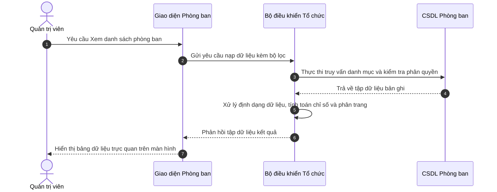

**Mô tả các bước tương tác trong biểu đồ tuần tự:**
- **Khởi đầu:** Chọn chức năng "Phòng ban" trong menu Cơ cấu Tổ chức.
- **Xử lý nghiệp vụ:** Lớp Điều khiển (Controller) xác thực thông tin và kiểm tra tính hợp lệ trước khi thao tác xuống Cơ sở dữ liệu.
- **Xử lý ngoại lệ / Rẽ nhánh:** Nếu vi phạm các ràng buộc nghiệp vụ (trùng mã, sai định dạng, thiếu điều kiện), hệ thống kích hoạt khối `else`, gửi thông báo cảnh báo và bảo toàn dữ liệu.
- **Kết thúc:** Hệ thống phản hồi trạng thái hoàn tất thành công lên giao diện người dùng.

---

### 2. Sơ đồ Tuần tự cho UC-ORG-01-02: Tìm kiếm và Lọc phòng ban
> **Mục tiêu ca sử dụng:** Tra cứu nhanh chóng phòng ban theo tên gọi, mã viết tắt hoặc trạng thái mà không phải tìm qua nhiều trang.  
> **Tác nhân tương tác:** Quản trị viên, Chuyên viên Nhân sự. | **Sự kiện kích hoạt:** Người dùng nhập từ khóa vào ô tìm kiếm hoặc chọn lọc trạng thái.


**Mô tả các bước tương tác trong biểu đồ tuần tự:**
- **Khởi đầu:** Người dùng nhập từ khóa vào ô tìm kiếm hoặc chọn lọc trạng thái.
- **Xử lý nghiệp vụ:** Lớp Điều khiển (Controller) xác thực thông tin và kiểm tra tính hợp lệ trước khi thao tác xuống Cơ sở dữ liệu.
- **Xử lý ngoại lệ / Rẽ nhánh:** Nếu vi phạm các ràng buộc nghiệp vụ (trùng mã, sai định dạng, thiếu điều kiện), hệ thống kích hoạt khối `else`, gửi thông báo cảnh báo và bảo toàn dữ liệu.
- **Kết thúc:** Hệ thống phản hồi trạng thái hoàn tất thành công lên giao diện người dùng.

---

### 3. Sơ đồ Tuần tự cho UC-ORG-01-03: Thêm mới phòng ban và Gán định biên
> **Mục tiêu ca sử dụng:** Khởi tạo đơn vị mới vào sơ đồ cây tổ chức và ấn định chỉ tiêu định biên nhân sự tối đa (quota).  
> **Tác nhân tương tác:** Quản trị viên, Giám đốc Nhân sự. | **Sự kiện kích hoạt:** Người dùng nhấn nút "+ Thêm phòng ban".

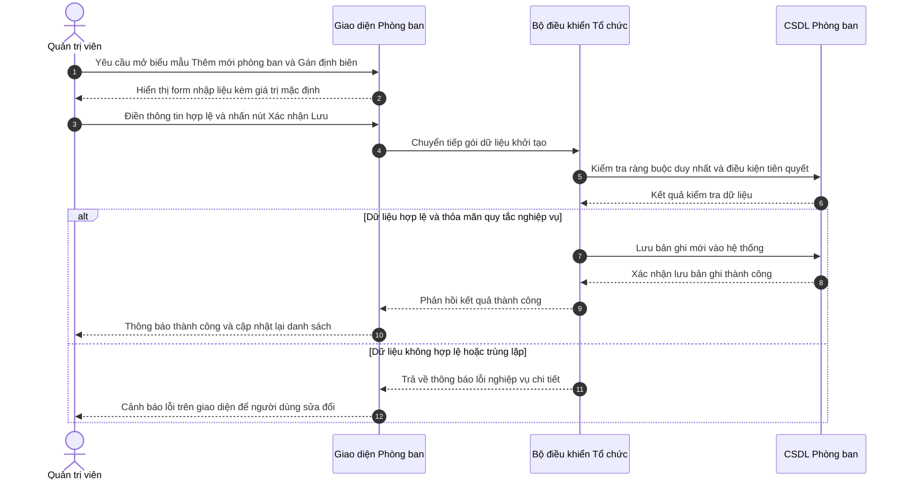

**Mô tả các bước tương tác trong biểu đồ tuần tự:**
- **Khởi đầu:** Người dùng nhấn nút "+ Thêm phòng ban".
- **Xử lý nghiệp vụ:** Lớp Điều khiển (Controller) xác thực thông tin và kiểm tra tính hợp lệ trước khi thao tác xuống Cơ sở dữ liệu.
- **Xử lý ngoại lệ / Rẽ nhánh:** Nếu vi phạm các ràng buộc nghiệp vụ (trùng mã, sai định dạng, thiếu điều kiện), hệ thống kích hoạt khối `else`, gửi thông báo cảnh báo và bảo toàn dữ liệu.
- **Kết thúc:** Hệ thống phản hồi trạng thái hoàn tất thành công lên giao diện người dùng.

---

### 4. Sơ đồ Tuần tự cho UC-ORG-01-04: Cập nhật thông tin phòng ban
> **Mục tiêu ca sử dụng:** Điều chỉnh tên đơn vị, Trưởng phòng, nâng hoặc hạ định biên hoặc luân chuyển đơn vị cấp trên trực tiếp.  
> **Tác nhân tương tác:** Quản trị viên, Giám đốc Nhân sự. | **Sự kiện kích hoạt:** Người dùng nhấn biểu tượng "Chỉnh sửa" tại dòng phòng ban.

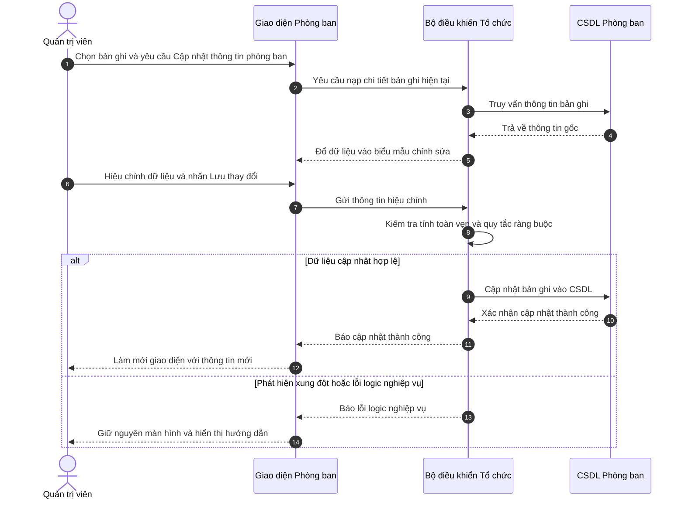

**Mô tả các bước tương tác trong biểu đồ tuần tự:**
- **Khởi đầu:** Người dùng nhấn biểu tượng "Chỉnh sửa" tại dòng phòng ban.
- **Xử lý nghiệp vụ:** Lớp Điều khiển (Controller) xác thực thông tin và kiểm tra tính hợp lệ trước khi thao tác xuống Cơ sở dữ liệu.
- **Xử lý ngoại lệ / Rẽ nhánh:** Nếu vi phạm các ràng buộc nghiệp vụ (trùng mã, sai định dạng, thiếu điều kiện), hệ thống kích hoạt khối `else`, gửi thông báo cảnh báo và bảo toàn dữ liệu.
- **Kết thúc:** Hệ thống phản hồi trạng thái hoàn tất thành công lên giao diện người dùng.

---

### 5. Sơ đồ Tuần tự cho UC-ORG-01-05: Khóa  hoặc  Đóng băng phòng ban (Block  hoặc  Inactive)
> **Mục tiêu ca sử dụng:** Tạm dừng hoạt động hoặc giải thể mềm phòng ban mà không xóa dữ liệu, bảo toàn 100% lịch sử nhân sự cũ.  
> **Tác nhân tương tác:** Quản trị viên, Giám đốc Nhân sự. | **Sự kiện kích hoạt:** Người dùng nhấn biểu tượng Ổ khóa tại cột thao tác.

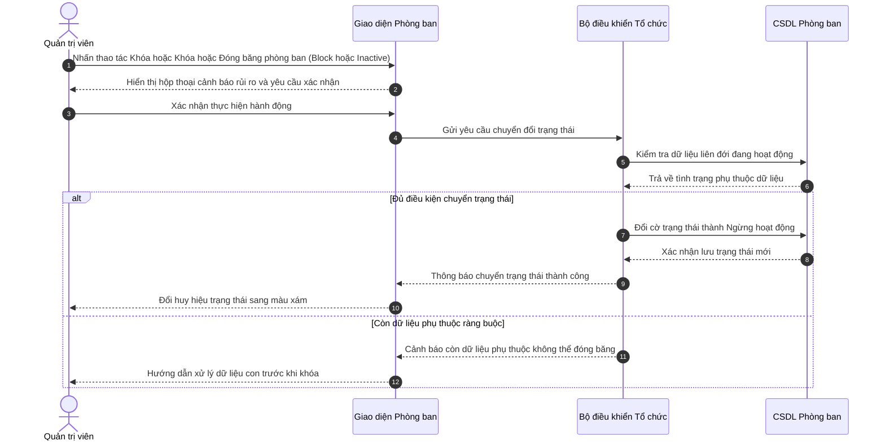

**Mô tả các bước tương tác trong biểu đồ tuần tự:**
- **Khởi đầu:** Người dùng nhấn biểu tượng Ổ khóa tại cột thao tác.
- **Xử lý nghiệp vụ:** Lớp Điều khiển (Controller) xác thực thông tin và kiểm tra tính hợp lệ trước khi thao tác xuống Cơ sở dữ liệu.
- **Xử lý ngoại lệ / Rẽ nhánh:** Nếu vi phạm các ràng buộc nghiệp vụ (trùng mã, sai định dạng, thiếu điều kiện), hệ thống kích hoạt khối `else`, gửi thông báo cảnh báo và bảo toàn dữ liệu.
- **Kết thúc:** Hệ thống phản hồi trạng thái hoàn tất thành công lên giao diện người dùng.

---

### 6. Sơ đồ Tuần tự cho UC-ORG-01-06: Xóa phòng ban (Hard Delete)
> **Mục tiêu ca sử dụng:** Xóa vĩnh viễn các phòng ban tạo nhầm hoặc phòng ban trống không còn nhu cầu sử dụng.  
> **Tác nhân tương tác:** Quản trị viên cấp cao (Admin). | **Sự kiện kích hoạt:** Người dùng nhấn biểu tượng Thùng rác đỏ.

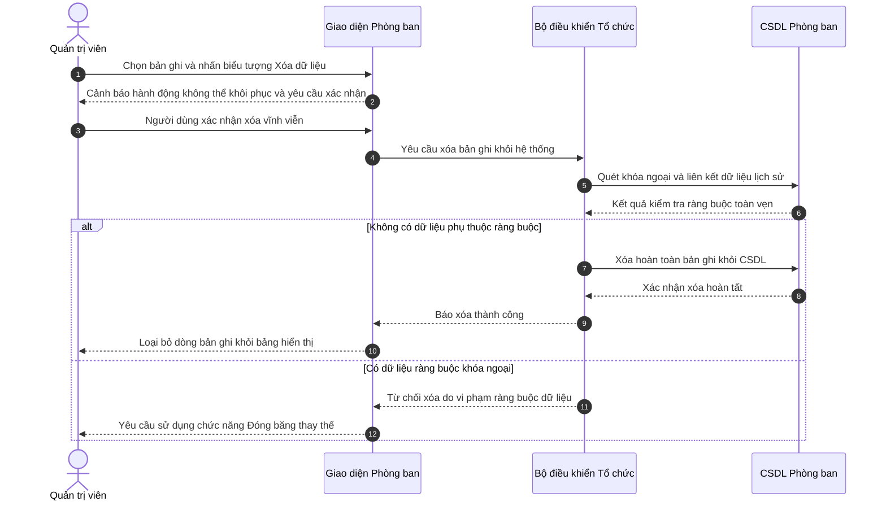

**Mô tả các bước tương tác trong biểu đồ tuần tự:**
- **Khởi đầu:** Người dùng nhấn biểu tượng Thùng rác đỏ.
- **Xử lý nghiệp vụ:** Lớp Điều khiển (Controller) xác thực thông tin và kiểm tra tính hợp lệ trước khi thao tác xuống Cơ sở dữ liệu.
- **Xử lý ngoại lệ / Rẽ nhánh:** Nếu vi phạm các ràng buộc nghiệp vụ (trùng mã, sai định dạng, thiếu điều kiện), hệ thống kích hoạt khối `else`, gửi thông báo cảnh báo và bảo toàn dữ liệu.
- **Kết thúc:** Hệ thống phản hồi trạng thái hoàn tất thành công lên giao diện người dùng.

---


## PHẦN 2: SƠ ĐỒ TUẦN TỰ PHÂN HỆ ORG-02
---

### 7. Sơ đồ Tuần tự cho UC-ORG-02-01: Xem danh mục vị trí chức danh
> **Mục tiêu ca sử dụng:** Theo dõi danh mục các vị trí công tác, cấp bậc chuyên môn và khung dải lương quy định.  
> **Tác nhân tương tác:** Quản trị viên, Chuyên viên Nhân sự. | **Sự kiện kích hoạt:** 

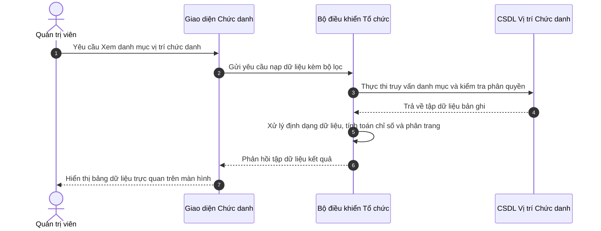

**Mô tả các bước tương tác trong biểu đồ tuần tự:**
- **Khởi đầu:** Người dùng thao tác trên màn hình.
- **Xử lý nghiệp vụ:** Lớp Điều khiển (Controller) xác thực thông tin và kiểm tra tính hợp lệ trước khi thao tác xuống Cơ sở dữ liệu.
- **Xử lý ngoại lệ / Rẽ nhánh:** Nếu vi phạm các ràng buộc nghiệp vụ (trùng mã, sai định dạng, thiếu điều kiện), hệ thống kích hoạt khối `else`, gửi thông báo cảnh báo và bảo toàn dữ liệu.
- **Kết thúc:** Hệ thống phản hồi trạng thái hoàn tất thành công lên giao diện người dùng.

---

### 8. Sơ đồ Tuần tự cho UC-ORG-02-02: Thêm mới vị trí và Khung dải lương
> **Mục tiêu ca sử dụng:** Thiết lập chức danh mới, cấp bậc và ấn định khung dải lương tuyển dụng (minSalary - maxSalary).  
> **Tác nhân tương tác:** Quản trị viên, Giám đốc Nhân sự, Chuyên viên CvàB. | **Sự kiện kích hoạt:** 

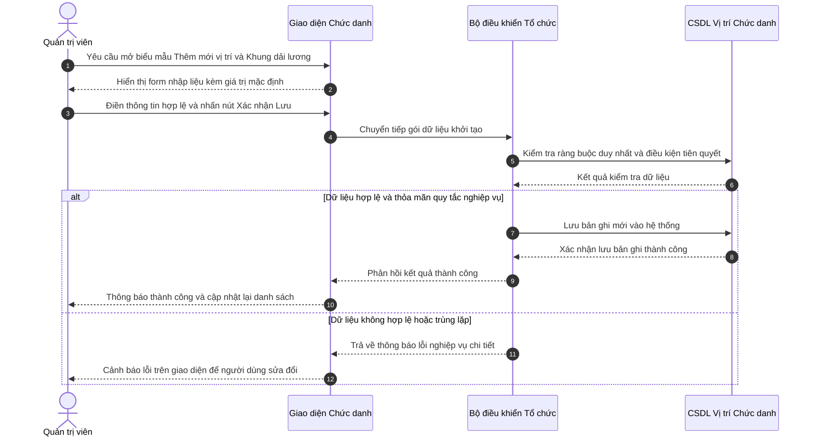

**Mô tả các bước tương tác trong biểu đồ tuần tự:**
- **Khởi đầu:** Người dùng thao tác trên màn hình.
- **Xử lý nghiệp vụ:** Lớp Điều khiển (Controller) xác thực thông tin và kiểm tra tính hợp lệ trước khi thao tác xuống Cơ sở dữ liệu.
- **Xử lý ngoại lệ / Rẽ nhánh:** Nếu vi phạm các ràng buộc nghiệp vụ (trùng mã, sai định dạng, thiếu điều kiện), hệ thống kích hoạt khối `else`, gửi thông báo cảnh báo và bảo toàn dữ liệu.
- **Kết thúc:** Hệ thống phản hồi trạng thái hoàn tất thành công lên giao diện người dùng.

---

### 9. Sơ đồ Tuần tự cho UC-ORG-02-03: Cập nhật vị trí chức danh
> **Mục tiêu ca sử dụng:** Điều chỉnh tên chức danh, sửa dải lương hoặc thay đổi cấp bậc chuyên môn.  
> **Tác nhân tương tác:** Quản trị viên, HR Manager. | **Sự kiện kích hoạt:** 

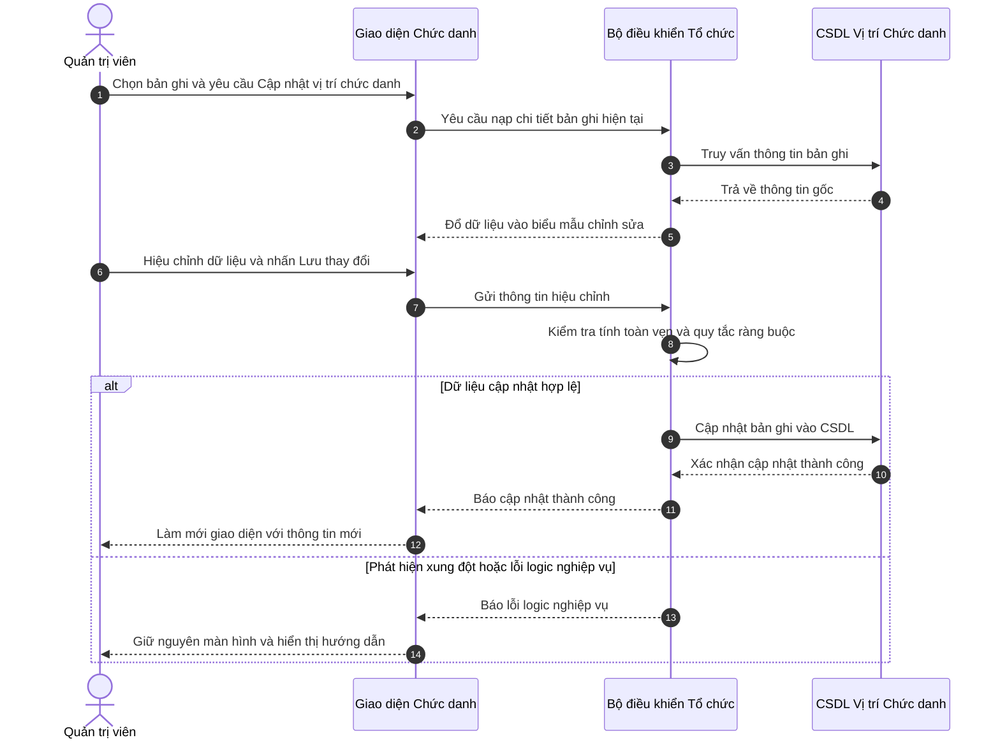

**Mô tả các bước tương tác trong biểu đồ tuần tự:**
- **Khởi đầu:** Người dùng thao tác trên màn hình.
- **Xử lý nghiệp vụ:** Lớp Điều khiển (Controller) xác thực thông tin và kiểm tra tính hợp lệ trước khi thao tác xuống Cơ sở dữ liệu.
- **Xử lý ngoại lệ / Rẽ nhánh:** Nếu vi phạm các ràng buộc nghiệp vụ (trùng mã, sai định dạng, thiếu điều kiện), hệ thống kích hoạt khối `else`, gửi thông báo cảnh báo và bảo toàn dữ liệu.
- **Kết thúc:** Hệ thống phản hồi trạng thái hoàn tất thành công lên giao diện người dùng.

---

### 10. Sơ đồ Tuần tự cho UC-ORG-02-04: Khóa  hoặc  Đóng băng vị trí chức danh
> **Mục tiêu ca sử dụng:** Ngừng mở tuyển dụng hoặc ngừng bổ nhiệm vào vị trí chức danh cũ mà vẫn giữ nguyên hợp đồng của nhân sự đang nắm giữ vị trí này.  
> **Tác nhân tương tác:** Quản trị viên, HR Manager. | **Sự kiện kích hoạt:** 

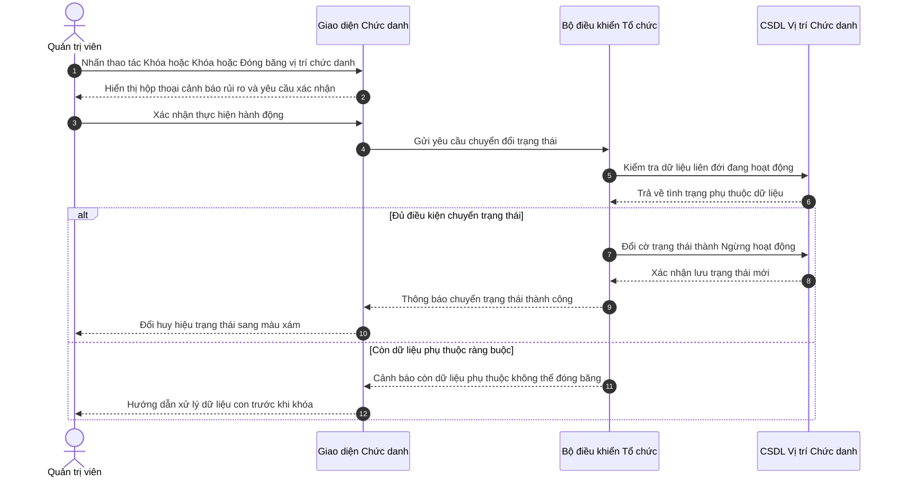

**Mô tả các bước tương tác trong biểu đồ tuần tự:**
- **Khởi đầu:** Người dùng thao tác trên màn hình.
- **Xử lý nghiệp vụ:** Lớp Điều khiển (Controller) xác thực thông tin và kiểm tra tính hợp lệ trước khi thao tác xuống Cơ sở dữ liệu.
- **Xử lý ngoại lệ / Rẽ nhánh:** Nếu vi phạm các ràng buộc nghiệp vụ (trùng mã, sai định dạng, thiếu điều kiện), hệ thống kích hoạt khối `else`, gửi thông báo cảnh báo và bảo toàn dữ liệu.
- **Kết thúc:** Hệ thống phản hồi trạng thái hoàn tất thành công lên giao diện người dùng.

---

### 11. Sơ đồ Tuần tự cho UC-ORG-02-05: Xóa vị trí chức danh
> **Mục tiêu ca sử dụng:** Xóa vị trí chức danh không còn tồn tại trong doanh nghiệp.  
> **Tác nhân tương tác:** Quản trị viên. | **Sự kiện kích hoạt:** 

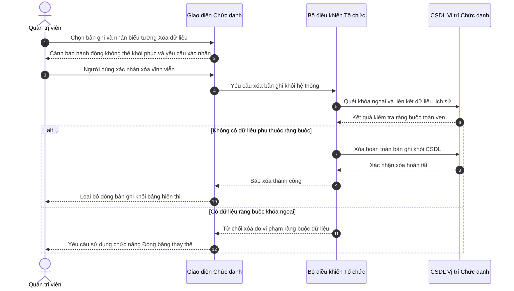

**Mô tả các bước tương tác trong biểu đồ tuần tự:**
- **Khởi đầu:** Người dùng thao tác trên màn hình.
- **Xử lý nghiệp vụ:** Lớp Điều khiển (Controller) xác thực thông tin và kiểm tra tính hợp lệ trước khi thao tác xuống Cơ sở dữ liệu.
- **Xử lý ngoại lệ / Rẽ nhánh:** Nếu vi phạm các ràng buộc nghiệp vụ (trùng mã, sai định dạng, thiếu điều kiện), hệ thống kích hoạt khối `else`, gửi thông báo cảnh báo và bảo toàn dữ liệu.
- **Kết thúc:** Hệ thống phản hồi trạng thái hoàn tất thành công lên giao diện người dùng.

---


## PHẦN 3: SƠ ĐỒ TUẦN TỰ PHÂN HỆ ORG-03
---

### 12. Sơ đồ Tuần tự cho UC-ORG-03-01: Xem biểu đồ phân cấp tổ chức hình cây
> **Mục tiêu ca sử dụng:** Trực quan hóa toàn bộ mô hình phân cấp tổ chức doanh nghiệp (Ban Giám Đốc  ->  Khối  ->  Phòng ban  ->  Bộ phận con).  
> **Tác nhân tương tác:** Quản trị viên,  Toàn thể nhân viên. | **Sự kiện kích hoạt:** 

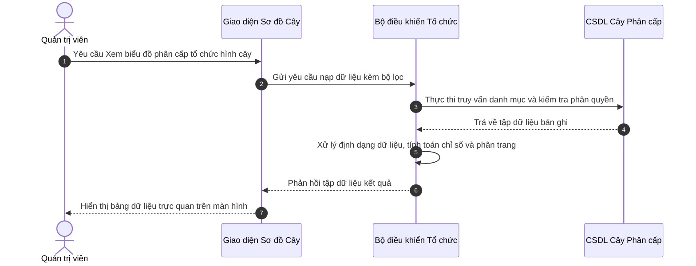

**Mô tả các bước tương tác trong biểu đồ tuần tự:**
- **Khởi đầu:** Người dùng thao tác trên màn hình.
- **Xử lý nghiệp vụ:** Lớp Điều khiển (Controller) xác thực thông tin và kiểm tra tính hợp lệ trước khi thao tác xuống Cơ sở dữ liệu.
- **Xử lý ngoại lệ / Rẽ nhánh:** Nếu vi phạm các ràng buộc nghiệp vụ (trùng mã, sai định dạng, thiếu điều kiện), hệ thống kích hoạt khối `else`, gửi thông báo cảnh báo và bảo toàn dữ liệu.
- **Kết thúc:** Hệ thống phản hồi trạng thái hoàn tất thành công lên giao diện người dùng.

---

### 13. Sơ đồ Tuần tự cho UC-ORG-03-02: Thu gọn  hoặc  Mở rộng nhánh cây tổ chức
> **Mục tiêu ca sử dụng:** Cho phép người dùng tùy biến tầm nhìn sơ đồ cây bằng cách thu gọn các phòng ban cấp dưới hoặc mở rộng toàn bộ cấu trúc.  
> **Tác nhân tương tác:** Quản trị viên,  Nhân viên. | **Sự kiện kích hoạt:** 

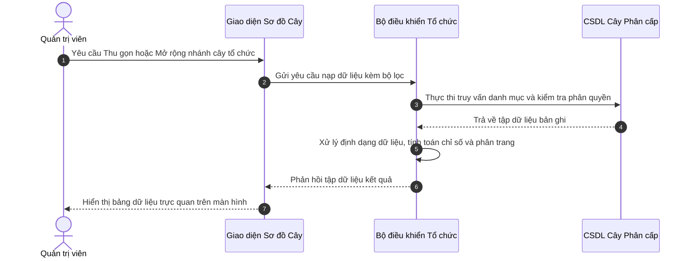

**Mô tả các bước tương tác trong biểu đồ tuần tự:**
- **Khởi đầu:** Người dùng thao tác trên màn hình.
- **Xử lý nghiệp vụ:** Lớp Điều khiển (Controller) xác thực thông tin và kiểm tra tính hợp lệ trước khi thao tác xuống Cơ sở dữ liệu.
- **Xử lý ngoại lệ / Rẽ nhánh:** Nếu vi phạm các ràng buộc nghiệp vụ (trùng mã, sai định dạng, thiếu điều kiện), hệ thống kích hoạt khối `else`, gửi thông báo cảnh báo và bảo toàn dữ liệu.
- **Kết thúc:** Hệ thống phản hồi trạng thái hoàn tất thành công lên giao diện người dùng.

---

### 14. Sơ đồ Tuần tự cho UC-ORG-03-03: Xem tỷ lệ lấp đầy định biên trên sơ đồ
> **Mục tiêu ca sử dụng:** Giúp lãnh đạo nhận diện nhanh các phòng ban đang thừa hoặc thiếu nhân sự so với chỉ tiêu được duyệt.  
> **Tác nhân tương tác:** Ban Giám đốc, HR Manager. | **Sự kiện kích hoạt:** 

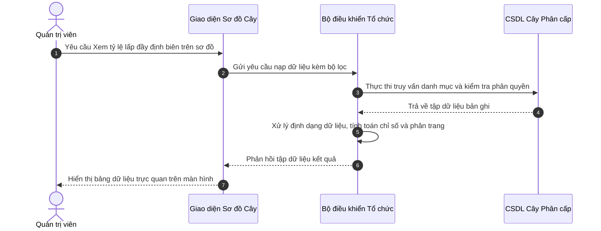

**Mô tả các bước tương tác trong biểu đồ tuần tự:**
- **Khởi đầu:** Người dùng thao tác trên màn hình.
- **Xử lý nghiệp vụ:** Lớp Điều khiển (Controller) xác thực thông tin và kiểm tra tính hợp lệ trước khi thao tác xuống Cơ sở dữ liệu.
- **Xử lý ngoại lệ / Rẽ nhánh:** Nếu vi phạm các ràng buộc nghiệp vụ (trùng mã, sai định dạng, thiếu điều kiện), hệ thống kích hoạt khối `else`, gửi thông báo cảnh báo và bảo toàn dữ liệu.
- **Kết thúc:** Hệ thống phản hồi trạng thái hoàn tất thành công lên giao diện người dùng.

---

### 15. Sơ đồ Tuần tự cho UC-ORG-03-04: Xem danh sách nhân sự trực thuộc phòng ban
> **Mục tiêu ca sử dụng:** Bấm vào một khối phòng ban để tra cứu nhanh danh sách các nhân viên đang làm việc tại đơn vị đó.  
> **Tác nhân tương tác:** Quản trị viên, HR. | **Sự kiện kích hoạt:** 

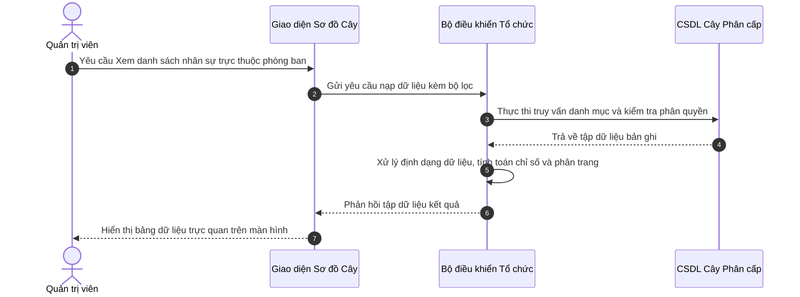

**Mô tả các bước tương tác trong biểu đồ tuần tự:**
- **Khởi đầu:** Người dùng thao tác trên màn hình.
- **Xử lý nghiệp vụ:** Lớp Điều khiển (Controller) xác thực thông tin và kiểm tra tính hợp lệ trước khi thao tác xuống Cơ sở dữ liệu.
- **Xử lý ngoại lệ / Rẽ nhánh:** Nếu vi phạm các ràng buộc nghiệp vụ (trùng mã, sai định dạng, thiếu điều kiện), hệ thống kích hoạt khối `else`, gửi thông báo cảnh báo và bảo toàn dữ liệu.
- **Kết thúc:** Hệ thống phản hồi trạng thái hoàn tất thành công lên giao diện người dùng.

---


## PHẦN 4: SƠ ĐỒ TUẦN TỰ PHÂN HỆ REC-01
---

### 16. Sơ đồ Tuần tự cho UC-REC-01-01: Xem danh sách yêu cầu tuyển dụng
> **Mục tiêu ca sử dụng:** Theo dõi tình trạng các vị trí đang cần tuyển dụng, số lượng chỉ tiêu và tiến độ tuyển thực tế.  
> **Tác nhân tương tác:** Chuyên viên Tuyển dụng, Trưởng bộ phận. | **Sự kiện kích hoạt:** 

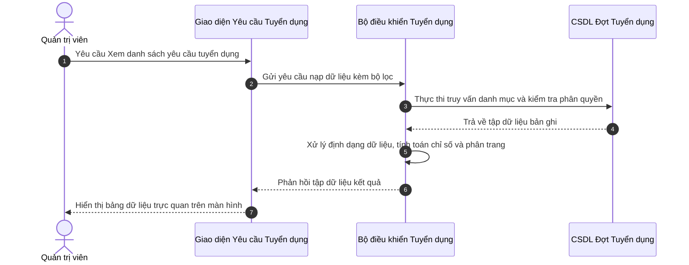

**Mô tả các bước tương tác trong biểu đồ tuần tự:**
- **Khởi đầu:** Người dùng thao tác trên màn hình.
- **Xử lý nghiệp vụ:** Lớp Điều khiển (Controller) xác thực thông tin và kiểm tra tính hợp lệ trước khi thao tác xuống Cơ sở dữ liệu.
- **Xử lý ngoại lệ / Rẽ nhánh:** Nếu vi phạm các ràng buộc nghiệp vụ (trùng mã, sai định dạng, thiếu điều kiện), hệ thống kích hoạt khối `else`, gửi thông báo cảnh báo và bảo toàn dữ liệu.
- **Kết thúc:** Hệ thống phản hồi trạng thái hoàn tất thành công lên giao diện người dùng.

---

### 17. Sơ đồ Tuần tự cho UC-REC-01-02: Lập yêu cầu tuyển dụng và Kiểm tra định biên
> **Mục tiêu ca sử dụng:** Tạo phiếu đề xuất bổ sung nhân sự, hệ thống tự động kiểm tra trần định biên để tránh tuyển vượt chỉ tiêu.  
> **Tác nhân tương tác:** Trưởng bộ phận, Chuyên viên Tuyển dụng. | **Sự kiện kích hoạt:** 

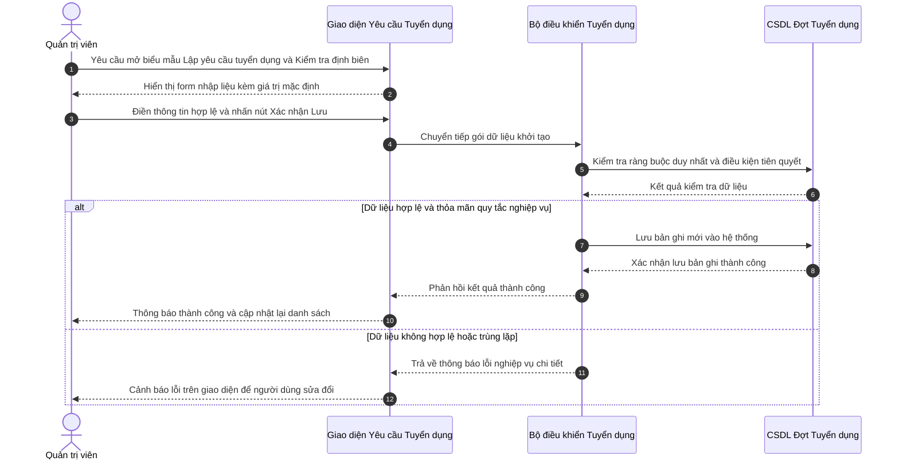

**Mô tả các bước tương tác trong biểu đồ tuần tự:**
- **Khởi đầu:** Người dùng thao tác trên màn hình.
- **Xử lý nghiệp vụ:** Lớp Điều khiển (Controller) xác thực thông tin và kiểm tra tính hợp lệ trước khi thao tác xuống Cơ sở dữ liệu.
- **Xử lý ngoại lệ / Rẽ nhánh:** Nếu vi phạm các ràng buộc nghiệp vụ (trùng mã, sai định dạng, thiếu điều kiện), hệ thống kích hoạt khối `else`, gửi thông báo cảnh báo và bảo toàn dữ liệu.
- **Kết thúc:** Hệ thống phản hồi trạng thái hoàn tất thành công lên giao diện người dùng.

---

### 18. Sơ đồ Tuần tự cho UC-REC-01-03: Chỉnh sửa yêu cầu tuyển dụng
> **Mục tiêu ca sử dụng:** Cập nhật lại yêu cầu kinh nghiệm, điều chỉnh dải lương hoặc gia hạn thời gian nộp hồ sơ.  
> **Tác nhân tương tác:** Chuyên viên Tuyển dụng. | **Sự kiện kích hoạt:** 

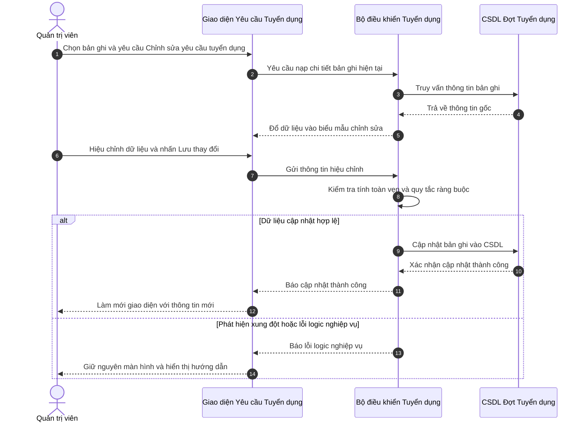

**Mô tả các bước tương tác trong biểu đồ tuần tự:**
- **Khởi đầu:** Người dùng thao tác trên màn hình.
- **Xử lý nghiệp vụ:** Lớp Điều khiển (Controller) xác thực thông tin và kiểm tra tính hợp lệ trước khi thao tác xuống Cơ sở dữ liệu.
- **Xử lý ngoại lệ / Rẽ nhánh:** Nếu vi phạm các ràng buộc nghiệp vụ (trùng mã, sai định dạng, thiếu điều kiện), hệ thống kích hoạt khối `else`, gửi thông báo cảnh báo và bảo toàn dữ liệu.
- **Kết thúc:** Hệ thống phản hồi trạng thái hoàn tất thành công lên giao diện người dùng.

---

### 19. Sơ đồ Tuần tự cho UC-REC-01-04: Xuất bản tin ra Cổng Tuyển dụng Công khai
> **Mục tiêu ca sử dụng:** Đưa tin tuyển dụng lên trang chủ việc làm để ứng viên bên ngoài tiếp cận và nộp hồ sơ.  
> **Tác nhân tương tác:** Chuyên viên Tuyển dụng. | **Sự kiện kích hoạt:** 

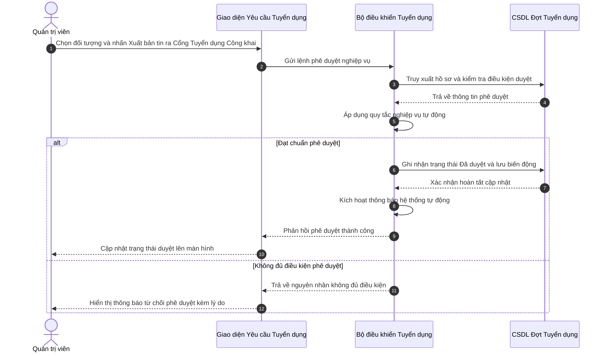

**Mô tả các bước tương tác trong biểu đồ tuần tự:**
- **Khởi đầu:** Người dùng thao tác trên màn hình.
- **Xử lý nghiệp vụ:** Lớp Điều khiển (Controller) xác thực thông tin và kiểm tra tính hợp lệ trước khi thao tác xuống Cơ sở dữ liệu.
- **Xử lý ngoại lệ / Rẽ nhánh:** Nếu vi phạm các ràng buộc nghiệp vụ (trùng mã, sai định dạng, thiếu điều kiện), hệ thống kích hoạt khối `else`, gửi thông báo cảnh báo và bảo toàn dữ liệu.
- **Kết thúc:** Hệ thống phản hồi trạng thái hoàn tất thành công lên giao diện người dùng.

---

### 20. Sơ đồ Tuần tự cho UC-REC-01-05: Đóng nhận hồ sơ tuyển dụng
> **Mục tiêu ca sử dụng:** Dừng nhận hồ sơ khi đã tuyển đủ chỉ tiêu hoặc hết thời hạn tuyển dụng.  
> **Tác nhân tương tác:** Chuyên viên Tuyển dụng. | **Sự kiện kích hoạt:** 

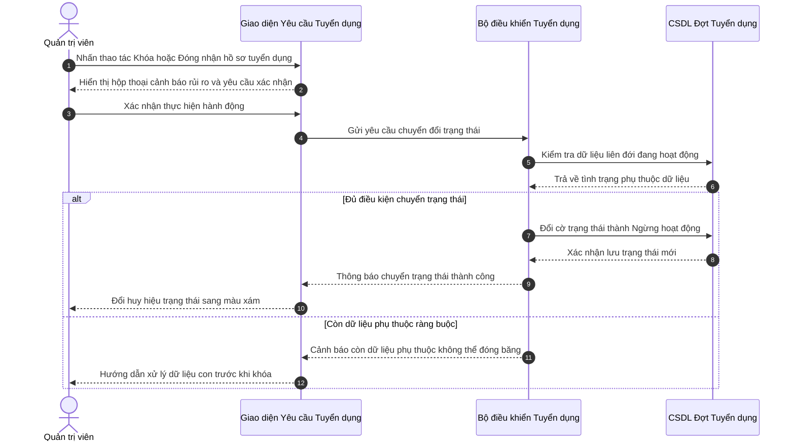

**Mô tả các bước tương tác trong biểu đồ tuần tự:**
- **Khởi đầu:** Người dùng thao tác trên màn hình.
- **Xử lý nghiệp vụ:** Lớp Điều khiển (Controller) xác thực thông tin và kiểm tra tính hợp lệ trước khi thao tác xuống Cơ sở dữ liệu.
- **Xử lý ngoại lệ / Rẽ nhánh:** Nếu vi phạm các ràng buộc nghiệp vụ (trùng mã, sai định dạng, thiếu điều kiện), hệ thống kích hoạt khối `else`, gửi thông báo cảnh báo và bảo toàn dữ liệu.
- **Kết thúc:** Hệ thống phản hồi trạng thái hoàn tất thành công lên giao diện người dùng.

---


## PHẦN 5: SƠ ĐỒ TUẦN TỰ PHÂN HỆ REC-02
---

### 21. Sơ đồ Tuần tự cho UC-REC-02-01: Xem bảng Kanban phân loại 7 bước
> **Mục tiêu ca sử dụng:** Theo dõi toàn bộ ứng viên theo 7 bước phễu: Tiếp cận  ->  Ứng tuyển  ->  Sơ loại  ->  Phỏng vấn  ->  Đề nghị việc  ->  Tiếp nhận  hoặc  Từ chối.  
> **Tác nhân tương tác:** Chuyên viên Tuyển dụng. | **Sự kiện kích hoạt:** 

```mermaid
sequenceDiagram
    autonumber
    actor User as Quản trị viên
    participant UI as Bảng ATS Kanban
    participant Ctrl as Bộ điều khiển Phễu Tuyển dụng
    participant DB as CSDL Hồ sơ Ứng viên

    User->>UI: Yêu cầu Xem bảng Kanban phân loại 7 bước
    UI->>Ctrl: Gửi yêu cầu nạp dữ liệu kèm bộ lọc
    Ctrl->>DB: Thực thi truy vấn danh mục và kiểm tra phân quyền
    DB-->>Ctrl: Trả về tập dữ liệu bản ghi
    Ctrl->>Ctrl: Xử lý định dạng dữ liệu, tính toán chỉ số và phân trang
    Ctrl-->>UI: Phản hồi tập dữ liệu kết quả
    UI-->>User: Hiển thị bảng dữ liệu trực quan trên màn hình
```

**Mô tả các bước tương tác trong biểu đồ tuần tự:**
- **Khởi đầu:** Người dùng thao tác trên màn hình.
- **Xử lý nghiệp vụ:** Lớp Điều khiển (Controller) xác thực thông tin và kiểm tra tính hợp lệ trước khi thao tác xuống Cơ sở dữ liệu.
- **Xử lý ngoại lệ / Rẽ nhánh:** Nếu vi phạm các ràng buộc nghiệp vụ (trùng mã, sai định dạng, thiếu điều kiện), hệ thống kích hoạt khối `else`, gửi thông báo cảnh báo và bảo toàn dữ liệu.
- **Kết thúc:** Hệ thống phản hồi trạng thái hoàn tất thành công lên giao diện người dùng.

---

### 22. Sơ đồ Tuần tự cho UC-REC-02-02: Kéo thả chuyển trạng thái ứng viên
> **Mục tiêu ca sử dụng:** Cập nhật tiến độ tuyển dụng nhanh chóng bằng thao tác kéo thả trực quan.  
> **Tác nhân tương tác:** Chuyên viên Tuyển dụng. | **Sự kiện kích hoạt:** 

```mermaid
sequenceDiagram
    autonumber
    actor User as Quản trị viên
    participant UI as Bảng ATS Kanban
    participant Ctrl as Bộ điều khiển Phễu Tuyển dụng
    participant DB as CSDL Hồ sơ Ứng viên

    User->>UI: Chọn bản ghi và yêu cầu Kéo thả chuyển trạng thái ứng viên
    UI->>Ctrl: Yêu cầu nạp chi tiết bản ghi hiện tại
    Ctrl->>DB: Truy vấn thông tin bản ghi
    DB-->>Ctrl: Trả về thông tin gốc
    Ctrl-->>UI: Đổ dữ liệu vào biểu mẫu chỉnh sửa
    User->>UI: Hiệu chỉnh dữ liệu và nhấn Lưu thay đổi
    UI->>Ctrl: Gửi thông tin hiệu chỉnh
    Ctrl->>Ctrl: Kiểm tra tính toàn vẹn và quy tắc ràng buộc
    alt Dữ liệu cập nhật hợp lệ
        Ctrl->>DB: Cập nhật bản ghi vào CSDL
        DB-->>Ctrl: Xác nhận cập nhật thành công
        Ctrl-->>UI: Báo cập nhật thành công
        UI-->>User: Làm mới giao diện với thông tin mới
    else Phát hiện xung đột hoặc lỗi logic nghiệp vụ
        Ctrl-->>UI: Báo lỗi logic nghiệp vụ
        UI-->>User: Giữ nguyên màn hình và hiển thị hướng dẫn
    end
```

**Mô tả các bước tương tác trong biểu đồ tuần tự:**
- **Khởi đầu:** Người dùng thao tác trên màn hình.
- **Xử lý nghiệp vụ:** Lớp Điều khiển (Controller) xác thực thông tin và kiểm tra tính hợp lệ trước khi thao tác xuống Cơ sở dữ liệu.
- **Xử lý ngoại lệ / Rẽ nhánh:** Nếu vi phạm các ràng buộc nghiệp vụ (trùng mã, sai định dạng, thiếu điều kiện), hệ thống kích hoạt khối `else`, gửi thông báo cảnh báo và bảo toàn dữ liệu.
- **Kết thúc:** Hệ thống phản hồi trạng thái hoàn tất thành công lên giao diện người dùng.

---

### 23. Sơ đồ Tuần tự cho UC-REC-02-03: Xem chi tiết CV và Đánh giá
> **Mục tiêu ca sử dụng:** Xem trực tiếp file hồ sơ CV của ứng viên và ghi chú nhận xét ban đầu.  
> **Tác nhân tương tác:** Chuyên viên Tuyển dụng. | **Sự kiện kích hoạt:** 

```mermaid
sequenceDiagram
    autonumber
    actor User as Quản trị viên
    participant UI as Bảng ATS Kanban
    participant Ctrl as Bộ điều khiển Phễu Tuyển dụng
    participant DB as CSDL Hồ sơ Ứng viên

    User->>UI: Yêu cầu Xem chi tiết CV và Đánh giá
    UI->>Ctrl: Gửi yêu cầu nạp dữ liệu kèm bộ lọc
    Ctrl->>DB: Thực thi truy vấn danh mục và kiểm tra phân quyền
    DB-->>Ctrl: Trả về tập dữ liệu bản ghi
    Ctrl->>Ctrl: Xử lý định dạng dữ liệu, tính toán chỉ số và phân trang
    Ctrl-->>UI: Phản hồi tập dữ liệu kết quả
    UI-->>User: Hiển thị bảng dữ liệu trực quan trên màn hình
```

**Mô tả các bước tương tác trong biểu đồ tuần tự:**
- **Khởi đầu:** Người dùng thao tác trên màn hình.
- **Xử lý nghiệp vụ:** Lớp Điều khiển (Controller) xác thực thông tin và kiểm tra tính hợp lệ trước khi thao tác xuống Cơ sở dữ liệu.
- **Xử lý ngoại lệ / Rẽ nhánh:** Nếu vi phạm các ràng buộc nghiệp vụ (trùng mã, sai định dạng, thiếu điều kiện), hệ thống kích hoạt khối `else`, gửi thông báo cảnh báo và bảo toàn dữ liệu.
- **Kết thúc:** Hệ thống phản hồi trạng thái hoàn tất thành công lên giao diện người dùng.

---

### 24. Sơ đồ Tuần tự cho UC-REC-02-04: Loại bỏ  hoặc  Từ chối hồ sơ (Reject)
> **Mục tiêu ca sử dụng:** Đánh dấu không phù hợp đối với các ứng viên không đạt yêu cầu.  
> **Tác nhân tương tác:** Chuyên viên Tuyển dụng. | **Sự kiện kích hoạt:** 

```mermaid
sequenceDiagram
    autonumber
    actor User as Quản trị viên
    participant UI as Bảng ATS Kanban
    participant Ctrl as Bộ điều khiển Phễu Tuyển dụng
    participant DB as CSDL Hồ sơ Ứng viên

    User->>UI: Nhấn thao tác Khóa hoặc Loại bỏ  hoặc  Từ chối hồ sơ (Reject)
    UI-->>User: Hiển thị hộp thoại cảnh báo rủi ro và yêu cầu xác nhận
    User->>UI: Xác nhận thực hiện hành động
    UI->>Ctrl: Gửi yêu cầu chuyển đổi trạng thái
    Ctrl->>DB: Kiểm tra dữ liệu liên đới đang hoạt động
    DB-->>Ctrl: Trả về tình trạng phụ thuộc dữ liệu
    alt Đủ điều kiện chuyển trạng thái
        Ctrl->>DB: Đổi cờ trạng thái thành Ngừng hoạt động
        DB-->>Ctrl: Xác nhận lưu trạng thái mới
        Ctrl-->>UI: Thông báo chuyển trạng thái thành công
        UI-->>User: Đổi huy hiệu trạng thái sang màu xám
    else Còn dữ liệu phụ thuộc ràng buộc
        Ctrl-->>UI: Cảnh báo còn dữ liệu phụ thuộc không thể đóng băng
        UI-->>User: Hướng dẫn xử lý dữ liệu con trước khi khóa
    end
```

**Mô tả các bước tương tác trong biểu đồ tuần tự:**
- **Khởi đầu:** Người dùng thao tác trên màn hình.
- **Xử lý nghiệp vụ:** Lớp Điều khiển (Controller) xác thực thông tin và kiểm tra tính hợp lệ trước khi thao tác xuống Cơ sở dữ liệu.
- **Xử lý ngoại lệ / Rẽ nhánh:** Nếu vi phạm các ràng buộc nghiệp vụ (trùng mã, sai định dạng, thiếu điều kiện), hệ thống kích hoạt khối `else`, gửi thông báo cảnh báo và bảo toàn dữ liệu.
- **Kết thúc:** Hệ thống phản hồi trạng thái hoàn tất thành công lên giao diện người dùng.

---


## PHẦN 6: SƠ ĐỒ TUẦN TỰ PHÂN HỆ REC-03
---

### 25. Sơ đồ Tuần tự cho UC-REC-03-01: Xem lịch phỏng vấn
> **Mục tiêu ca sử dụng:** Theo dõi danh sách các buổi phỏng vấn sắp diễn ra theo tuần hoặc tháng.  
> **Tác nhân tương tác:** Hội đồng phỏng vấn, Chuyên viên Tuyển dụng. | **Sự kiện kích hoạt:** 

```mermaid
sequenceDiagram
    autonumber
    actor User as Quản trị viên
    participant UI as Giao diện Lịch Phỏng vấn
    participant Ctrl as Bộ điều khiển Phỏng vấn
    participant DB as CSDL Lịch và Phiếu điểm

    User->>UI: Yêu cầu Xem lịch phỏng vấn
    UI->>Ctrl: Gửi yêu cầu nạp dữ liệu kèm bộ lọc
    Ctrl->>DB: Thực thi truy vấn danh mục và kiểm tra phân quyền
    DB-->>Ctrl: Trả về tập dữ liệu bản ghi
    Ctrl->>Ctrl: Xử lý định dạng dữ liệu, tính toán chỉ số và phân trang
    Ctrl-->>UI: Phản hồi tập dữ liệu kết quả
    UI-->>User: Hiển thị bảng dữ liệu trực quan trên màn hình
```

**Mô tả các bước tương tác trong biểu đồ tuần tự:**
- **Khởi đầu:** Người dùng thao tác trên màn hình.
- **Xử lý nghiệp vụ:** Lớp Điều khiển (Controller) xác thực thông tin và kiểm tra tính hợp lệ trước khi thao tác xuống Cơ sở dữ liệu.
- **Xử lý ngoại lệ / Rẽ nhánh:** Nếu vi phạm các ràng buộc nghiệp vụ (trùng mã, sai định dạng, thiếu điều kiện), hệ thống kích hoạt khối `else`, gửi thông báo cảnh báo và bảo toàn dữ liệu.
- **Kết thúc:** Hệ thống phản hồi trạng thái hoàn tất thành công lên giao diện người dùng.

---

### 26. Sơ đồ Tuần tự cho UC-REC-03-02: Tạo lịch và Gán người phỏng vấn
> **Mục tiêu ca sử dụng:** Xếp lịch phỏng vấn và phân công người chấm thi phù hợp.  
> **Tác nhân tương tác:** Chuyên viên Tuyển dụng. | **Sự kiện kích hoạt:** 

```mermaid
sequenceDiagram
    autonumber
    actor User as Quản trị viên
    participant UI as Giao diện Lịch Phỏng vấn
    participant Ctrl as Bộ điều khiển Phỏng vấn
    participant DB as CSDL Lịch và Phiếu điểm

    User->>UI: Yêu cầu mở biểu mẫu Tạo lịch và Gán người phỏng vấn
    UI-->>User: Hiển thị form nhập liệu kèm giá trị mặc định
    User->>UI: Điền thông tin hợp lệ và nhấn nút Xác nhận Lưu
    UI->>Ctrl: Chuyển tiếp gói dữ liệu khởi tạo
    Ctrl->>DB: Kiểm tra ràng buộc duy nhất và điều kiện tiên quyết
    DB-->>Ctrl: Kết quả kiểm tra dữ liệu
    alt Dữ liệu hợp lệ và thỏa mãn quy tắc nghiệp vụ
        Ctrl->>DB: Lưu bản ghi mới vào hệ thống
        DB-->>Ctrl: Xác nhận lưu bản ghi thành công
        Ctrl-->>UI: Phản hồi kết quả thành công
        UI-->>User: Thông báo thành công và cập nhật lại danh sách
    else Dữ liệu không hợp lệ hoặc trùng lặp
        Ctrl-->>UI: Trả về thông báo lỗi nghiệp vụ chi tiết
        UI-->>User: Cảnh báo lỗi trên giao diện để người dùng sửa đổi
    end
```

**Mô tả các bước tương tác trong biểu đồ tuần tự:**
- **Khởi đầu:** Người dùng thao tác trên màn hình.
- **Xử lý nghiệp vụ:** Lớp Điều khiển (Controller) xác thực thông tin và kiểm tra tính hợp lệ trước khi thao tác xuống Cơ sở dữ liệu.
- **Xử lý ngoại lệ / Rẽ nhánh:** Nếu vi phạm các ràng buộc nghiệp vụ (trùng mã, sai định dạng, thiếu điều kiện), hệ thống kích hoạt khối `else`, gửi thông báo cảnh báo và bảo toàn dữ liệu.
- **Kết thúc:** Hệ thống phản hồi trạng thái hoàn tất thành công lên giao diện người dùng.

---

### 27. Sơ đồ Tuần tự cho UC-REC-03-03: Gửi email mời phỏng vấn tự động
> **Mục tiêu ca sử dụng:** Tự động gửi thư mời phỏng vấn chuyên nghiệp đến hòm thư ứng viên kèm đường link xác nhận.  
> **Tác nhân tương tác:** Hệ thống tự động  hoặc   HR. | **Sự kiện kích hoạt:** 

```mermaid
sequenceDiagram
    autonumber
    actor User as Quản trị viên
    participant UI as Giao diện Lịch Phỏng vấn
    participant Ctrl as Bộ điều khiển Phỏng vấn
    participant DB as CSDL Lịch và Phiếu điểm

    User->>UI: Chọn đối tượng và nhấn Gửi email mời phỏng vấn tự động
    UI->>Ctrl: Gửi lệnh phê duyệt nghiệp vụ
    Ctrl->>DB: Truy xuất hồ sơ và kiểm tra điều kiện duyệt
    DB-->>Ctrl: Trả về thông tin phê duyệt
    Ctrl->>Ctrl: Áp dụng quy tắc nghiệp vụ tự động
    alt Đạt chuẩn phê duyệt
        Ctrl->>DB: Ghi nhận trạng thái Đã duyệt và lưu biến động
        DB-->>Ctrl: Xác nhận hoàn tất cập nhật
        Ctrl->>Ctrl: Kích hoạt thông báo hệ thống tự động
        Ctrl-->>UI: Phản hồi phê duyệt thành công
        UI-->>User: Cập nhật trạng thái duyệt lên màn hình
    else Không đủ điều kiện phê duyệt
        Ctrl-->>UI: Trả về nguyên nhân không đủ điều kiện
        UI-->>User: Hiển thị thông báo từ chối phê duyệt kèm lý do
    end
```

**Mô tả các bước tương tác trong biểu đồ tuần tự:**
- **Khởi đầu:** Người dùng thao tác trên màn hình.
- **Xử lý nghiệp vụ:** Lớp Điều khiển (Controller) xác thực thông tin và kiểm tra tính hợp lệ trước khi thao tác xuống Cơ sở dữ liệu.
- **Xử lý ngoại lệ / Rẽ nhánh:** Nếu vi phạm các ràng buộc nghiệp vụ (trùng mã, sai định dạng, thiếu điều kiện), hệ thống kích hoạt khối `else`, gửi thông báo cảnh báo và bảo toàn dữ liệu.
- **Kết thúc:** Hệ thống phản hồi trạng thái hoàn tất thành công lên giao diện người dùng.

---

### 28. Sơ đồ Tuần tự cho UC-REC-03-04: Nhập điểm và Nhận xét đánh giá
> **Mục tiêu ca sử dụng:** Cán bộ phỏng vấn ghi nhận kết quả đánh giá năng lực ứng viên làm căn cứ đề xuất phát hành Thư mời nhận việc.  
> **Tác nhân tương tác:** Cán bộ phỏng vấn. | **Sự kiện kích hoạt:** 

```mermaid
sequenceDiagram
    autonumber
    actor User as Quản trị viên
    participant UI as Giao diện Lịch Phỏng vấn
    participant Ctrl as Bộ điều khiển Phỏng vấn
    participant DB as CSDL Lịch và Phiếu điểm

    User->>UI: Chọn bản ghi và yêu cầu Nhập điểm và Nhận xét đánh giá
    UI->>Ctrl: Yêu cầu nạp chi tiết bản ghi hiện tại
    Ctrl->>DB: Truy vấn thông tin bản ghi
    DB-->>Ctrl: Trả về thông tin gốc
    Ctrl-->>UI: Đổ dữ liệu vào biểu mẫu chỉnh sửa
    User->>UI: Hiệu chỉnh dữ liệu và nhấn Lưu thay đổi
    UI->>Ctrl: Gửi thông tin hiệu chỉnh
    Ctrl->>Ctrl: Kiểm tra tính toàn vẹn và quy tắc ràng buộc
    alt Dữ liệu cập nhật hợp lệ
        Ctrl->>DB: Cập nhật bản ghi vào CSDL
        DB-->>Ctrl: Xác nhận cập nhật thành công
        Ctrl-->>UI: Báo cập nhật thành công
        UI-->>User: Làm mới giao diện với thông tin mới
    else Phát hiện xung đột hoặc lỗi logic nghiệp vụ
        Ctrl-->>UI: Báo lỗi logic nghiệp vụ
        UI-->>User: Giữ nguyên màn hình và hiển thị hướng dẫn
    end
```

**Mô tả các bước tương tác trong biểu đồ tuần tự:**
- **Khởi đầu:** Người dùng thao tác trên màn hình.
- **Xử lý nghiệp vụ:** Lớp Điều khiển (Controller) xác thực thông tin và kiểm tra tính hợp lệ trước khi thao tác xuống Cơ sở dữ liệu.
- **Xử lý ngoại lệ / Rẽ nhánh:** Nếu vi phạm các ràng buộc nghiệp vụ (trùng mã, sai định dạng, thiếu điều kiện), hệ thống kích hoạt khối `else`, gửi thông báo cảnh báo và bảo toàn dữ liệu.
- **Kết thúc:** Hệ thống phản hồi trạng thái hoàn tất thành công lên giao diện người dùng.

---

### 29. Sơ đồ Tuần tự cho UC-REC-03-05: Hủy  hoặc  Đổi thời gian phỏng vấn
> **Mục tiêu ca sử dụng:** Điều chỉnh thời gian khi có phát sinh từ phía ứng viên hoặc hội đồng phỏng vấn.  
> **Tác nhân tương tác:** Chuyên viên Tuyển dụng. | **Sự kiện kích hoạt:** 

```mermaid
sequenceDiagram
    autonumber
    actor User as Quản trị viên
    participant UI as Giao diện Lịch Phỏng vấn
    participant Ctrl as Bộ điều khiển Phỏng vấn
    participant DB as CSDL Lịch và Phiếu điểm

    User->>UI: Chọn bản ghi và yêu cầu Hủy  hoặc  Đổi thời gian phỏng vấn
    UI->>Ctrl: Yêu cầu nạp chi tiết bản ghi hiện tại
    Ctrl->>DB: Truy vấn thông tin bản ghi
    DB-->>Ctrl: Trả về thông tin gốc
    Ctrl-->>UI: Đổ dữ liệu vào biểu mẫu chỉnh sửa
    User->>UI: Hiệu chỉnh dữ liệu và nhấn Lưu thay đổi
    UI->>Ctrl: Gửi thông tin hiệu chỉnh
    Ctrl->>Ctrl: Kiểm tra tính toàn vẹn và quy tắc ràng buộc
    alt Dữ liệu cập nhật hợp lệ
        Ctrl->>DB: Cập nhật bản ghi vào CSDL
        DB-->>Ctrl: Xác nhận cập nhật thành công
        Ctrl-->>UI: Báo cập nhật thành công
        UI-->>User: Làm mới giao diện với thông tin mới
    else Phát hiện xung đột hoặc lỗi logic nghiệp vụ
        Ctrl-->>UI: Báo lỗi logic nghiệp vụ
        UI-->>User: Giữ nguyên màn hình và hiển thị hướng dẫn
    end
```

**Mô tả các bước tương tác trong biểu đồ tuần tự:**
- **Khởi đầu:** Người dùng thao tác trên màn hình.
- **Xử lý nghiệp vụ:** Lớp Điều khiển (Controller) xác thực thông tin và kiểm tra tính hợp lệ trước khi thao tác xuống Cơ sở dữ liệu.
- **Xử lý ngoại lệ / Rẽ nhánh:** Nếu vi phạm các ràng buộc nghiệp vụ (trùng mã, sai định dạng, thiếu điều kiện), hệ thống kích hoạt khối `else`, gửi thông báo cảnh báo và bảo toàn dữ liệu.
- **Kết thúc:** Hệ thống phản hồi trạng thái hoàn tất thành công lên giao diện người dùng.

---


## PHẦN 7: SƠ ĐỒ TUẦN TỰ PHÂN HỆ REC-04
---

### 30. Sơ đồ Tuần tự cho UC-REC-04-01: Xem danh sách Thư mời nhận việc
> **Mục tiêu ca sử dụng:** Theo dõi tình trạng các thư mời nhận việc đã phát hành và hạn phản hồi của ứng viên.  
> **Tác nhân tương tác:** HR Manager, Chuyên viên CvàB. | **Sự kiện kích hoạt:** 

```mermaid
sequenceDiagram
    autonumber
    actor User as Quản trị viên
    participant UI as Giao diện Thư mời Offer
    participant Ctrl as Bộ điều khiển Offer
    participant DB as CSDL Thư mời và Hạn 24h

    User->>UI: Yêu cầu Xem danh sách Thư mời nhận việc
    UI->>Ctrl: Gửi yêu cầu nạp dữ liệu kèm bộ lọc
    Ctrl->>DB: Thực thi truy vấn danh mục và kiểm tra phân quyền
    DB-->>Ctrl: Trả về tập dữ liệu bản ghi
    Ctrl->>Ctrl: Xử lý định dạng dữ liệu, tính toán chỉ số và phân trang
    Ctrl-->>UI: Phản hồi tập dữ liệu kết quả
    UI-->>User: Hiển thị bảng dữ liệu trực quan trên màn hình
```

**Mô tả các bước tương tác trong biểu đồ tuần tự:**
- **Khởi đầu:** Người dùng thao tác trên màn hình.
- **Xử lý nghiệp vụ:** Lớp Điều khiển (Controller) xác thực thông tin và kiểm tra tính hợp lệ trước khi thao tác xuống Cơ sở dữ liệu.
- **Xử lý ngoại lệ / Rẽ nhánh:** Nếu vi phạm các ràng buộc nghiệp vụ (trùng mã, sai định dạng, thiếu điều kiện), hệ thống kích hoạt khối `else`, gửi thông báo cảnh báo và bảo toàn dữ liệu.
- **Kết thúc:** Hệ thống phản hồi trạng thái hoàn tất thành công lên giao diện người dùng.

---

### 31. Sơ đồ Tuần tự cho UC-REC-04-02: Soạn thảo Thư mời Offer theo luật lao động
> **Mục tiêu ca sử dụng:** Soạn thảo thư mời nhận việc chính thức với tỷ lệ lương thử việc chuẩn 85% theo Bộ luật Lao động.  
> **Tác nhân tương tác:** HR Manager, Chuyên viên CvàB. | **Sự kiện kích hoạt:** 

```mermaid
sequenceDiagram
    autonumber
    actor User as Quản trị viên
    participant UI as Giao diện Thư mời Offer
    participant Ctrl as Bộ điều khiển Offer
    participant DB as CSDL Thư mời và Hạn 24h

    User->>UI: Yêu cầu mở biểu mẫu Soạn thảo Thư mời Offer theo luật lao động
    UI-->>User: Hiển thị form nhập liệu kèm giá trị mặc định
    User->>UI: Điền thông tin hợp lệ và nhấn nút Xác nhận Lưu
    UI->>Ctrl: Chuyển tiếp gói dữ liệu khởi tạo
    Ctrl->>DB: Kiểm tra ràng buộc duy nhất và điều kiện tiên quyết
    DB-->>Ctrl: Kết quả kiểm tra dữ liệu
    alt Dữ liệu hợp lệ và thỏa mãn quy tắc nghiệp vụ
        Ctrl->>DB: Lưu bản ghi mới vào hệ thống
        DB-->>Ctrl: Xác nhận lưu bản ghi thành công
        Ctrl-->>UI: Phản hồi kết quả thành công
        UI-->>User: Thông báo thành công và cập nhật lại danh sách
    else Dữ liệu không hợp lệ hoặc trùng lặp
        Ctrl-->>UI: Trả về thông báo lỗi nghiệp vụ chi tiết
        UI-->>User: Cảnh báo lỗi trên giao diện để người dùng sửa đổi
    end
```

**Mô tả các bước tương tác trong biểu đồ tuần tự:**
- **Khởi đầu:** Người dùng thao tác trên màn hình.
- **Xử lý nghiệp vụ:** Lớp Điều khiển (Controller) xác thực thông tin và kiểm tra tính hợp lệ trước khi thao tác xuống Cơ sở dữ liệu.
- **Xử lý ngoại lệ / Rẽ nhánh:** Nếu vi phạm các ràng buộc nghiệp vụ (trùng mã, sai định dạng, thiếu điều kiện), hệ thống kích hoạt khối `else`, gửi thông báo cảnh báo và bảo toàn dữ liệu.
- **Kết thúc:** Hệ thống phản hồi trạng thái hoàn tất thành công lên giao diện người dùng.

---

### 32. Sơ đồ Tuần tự cho UC-REC-04-03: Gửi email Offer điện tử cho ứng viên
> **Mục tiêu ca sử dụng:** Phát hành thư mời làm việc chính thức qua hòm thư điện tử của ứng viên.  
> **Tác nhân tương tác:** HR Manager. | **Sự kiện kích hoạt:** 

```mermaid
sequenceDiagram
    autonumber
    actor User as Quản trị viên
    participant UI as Giao diện Thư mời Offer
    participant Ctrl as Bộ điều khiển Offer
    participant DB as CSDL Thư mời và Hạn 24h

    User->>UI: Chọn đối tượng và nhấn Gửi email Offer điện tử cho ứng viên
    UI->>Ctrl: Gửi lệnh phê duyệt nghiệp vụ
    Ctrl->>DB: Truy xuất hồ sơ và kiểm tra điều kiện duyệt
    DB-->>Ctrl: Trả về thông tin phê duyệt
    Ctrl->>Ctrl: Áp dụng quy tắc nghiệp vụ tự động
    alt Đạt chuẩn phê duyệt
        Ctrl->>DB: Ghi nhận trạng thái Đã duyệt và lưu biến động
        DB-->>Ctrl: Xác nhận hoàn tất cập nhật
        Ctrl->>Ctrl: Kích hoạt thông báo hệ thống tự động
        Ctrl-->>UI: Phản hồi phê duyệt thành công
        UI-->>User: Cập nhật trạng thái duyệt lên màn hình
    else Không đủ điều kiện phê duyệt
        Ctrl-->>UI: Trả về nguyên nhân không đủ điều kiện
        UI-->>User: Hiển thị thông báo từ chối phê duyệt kèm lý do
    end
```

**Mô tả các bước tương tác trong biểu đồ tuần tự:**
- **Khởi đầu:** Người dùng thao tác trên màn hình.
- **Xử lý nghiệp vụ:** Lớp Điều khiển (Controller) xác thực thông tin và kiểm tra tính hợp lệ trước khi thao tác xuống Cơ sở dữ liệu.
- **Xử lý ngoại lệ / Rẽ nhánh:** Nếu vi phạm các ràng buộc nghiệp vụ (trùng mã, sai định dạng, thiếu điều kiện), hệ thống kích hoạt khối `else`, gửi thông báo cảnh báo và bảo toàn dữ liệu.
- **Kết thúc:** Hệ thống phản hồi trạng thái hoàn tất thành công lên giao diện người dùng.

---

### 33. Sơ đồ Tuần tự cho UC-REC-04-04: Theo dõi phản hồi Offer trong 24h
> **Mục tiêu ca sử dụng:** Giám sát thời gian phản hồi của ứng viên; tự động đánh dấu quá hạn nếu sau 24h không nhận được câu trả lời.  
> **Tác nhân tương tác:** Hệ thống tự động  hoặc   HR. | **Sự kiện kích hoạt:** 

```mermaid
sequenceDiagram
    autonumber
    actor User as Quản trị viên
    participant UI as Giao diện Thư mời Offer
    participant Ctrl as Bộ điều khiển Offer
    participant DB as CSDL Thư mời và Hạn 24h

    User->>UI: Chọn đối tượng và nhấn Theo dõi phản hồi Offer trong 24h
    UI->>Ctrl: Gửi lệnh phê duyệt nghiệp vụ
    Ctrl->>DB: Truy xuất hồ sơ và kiểm tra điều kiện duyệt
    DB-->>Ctrl: Trả về thông tin phê duyệt
    Ctrl->>Ctrl: Áp dụng quy tắc nghiệp vụ tự động
    alt Đạt chuẩn phê duyệt
        Ctrl->>DB: Ghi nhận trạng thái Đã duyệt và lưu biến động
        DB-->>Ctrl: Xác nhận hoàn tất cập nhật
        Ctrl->>Ctrl: Kích hoạt thông báo hệ thống tự động
        Ctrl-->>UI: Phản hồi phê duyệt thành công
        UI-->>User: Cập nhật trạng thái duyệt lên màn hình
    else Không đủ điều kiện phê duyệt
        Ctrl-->>UI: Trả về nguyên nhân không đủ điều kiện
        UI-->>User: Hiển thị thông báo từ chối phê duyệt kèm lý do
    end
```

**Mô tả các bước tương tác trong biểu đồ tuần tự:**
- **Khởi đầu:** Người dùng thao tác trên màn hình.
- **Xử lý nghiệp vụ:** Lớp Điều khiển (Controller) xác thực thông tin và kiểm tra tính hợp lệ trước khi thao tác xuống Cơ sở dữ liệu.
- **Xử lý ngoại lệ / Rẽ nhánh:** Nếu vi phạm các ràng buộc nghiệp vụ (trùng mã, sai định dạng, thiếu điều kiện), hệ thống kích hoạt khối `else`, gửi thông báo cảnh báo và bảo toàn dữ liệu.
- **Kết thúc:** Hệ thống phản hồi trạng thái hoàn tất thành công lên giao diện người dùng.

---

### 34. Sơ đồ Tuần tự cho UC-REC-04-05: Kích hoạt Cổng Khai báo Pre-Onboarding
> **Mục tiêu ca sử dụng:** Mở quyền để ứng viên trúng tuyển tự kê khai thông tin cá nhân trước ngày đi làm.  
> **Tác nhân tương tác:** Hệ thống tự động. | **Sự kiện kích hoạt:** 

```mermaid
sequenceDiagram
    autonumber
    actor User as Quản trị viên
    participant UI as Giao diện Thư mời Offer
    participant Ctrl as Bộ điều khiển Offer
    participant DB as CSDL Thư mời và Hạn 24h

    User->>UI: Chọn đối tượng và nhấn Kích hoạt Cổng Khai báo Pre-Onboarding
    UI->>Ctrl: Gửi lệnh phê duyệt nghiệp vụ
    Ctrl->>DB: Truy xuất hồ sơ và kiểm tra điều kiện duyệt
    DB-->>Ctrl: Trả về thông tin phê duyệt
    Ctrl->>Ctrl: Áp dụng quy tắc nghiệp vụ tự động
    alt Đạt chuẩn phê duyệt
        Ctrl->>DB: Ghi nhận trạng thái Đã duyệt và lưu biến động
        DB-->>Ctrl: Xác nhận hoàn tất cập nhật
        Ctrl->>Ctrl: Kích hoạt thông báo hệ thống tự động
        Ctrl-->>UI: Phản hồi phê duyệt thành công
        UI-->>User: Cập nhật trạng thái duyệt lên màn hình
    else Không đủ điều kiện phê duyệt
        Ctrl-->>UI: Trả về nguyên nhân không đủ điều kiện
        UI-->>User: Hiển thị thông báo từ chối phê duyệt kèm lý do
    end
```

**Mô tả các bước tương tác trong biểu đồ tuần tự:**
- **Khởi đầu:** Người dùng thao tác trên màn hình.
- **Xử lý nghiệp vụ:** Lớp Điều khiển (Controller) xác thực thông tin và kiểm tra tính hợp lệ trước khi thao tác xuống Cơ sở dữ liệu.
- **Xử lý ngoại lệ / Rẽ nhánh:** Nếu vi phạm các ràng buộc nghiệp vụ (trùng mã, sai định dạng, thiếu điều kiện), hệ thống kích hoạt khối `else`, gửi thông báo cảnh báo và bảo toàn dữ liệu.
- **Kết thúc:** Hệ thống phản hồi trạng thái hoàn tất thành công lên giao diện người dùng.

---


## PHẦN 8: SƠ ĐỒ TUẦN TỰ PHÂN HỆ ONB-01
---

### 35. Sơ đồ Tuần tự cho UC-ONB-01-01: Xem hồ sơ ứng viên tự kê khai
> **Mục tiêu ca sử dụng:** Kiểm tra các thông tin cá nhân, CCCD, số tài khoản ngân hàng và người thân do ứng viên trúng tuyển tự khai trực tuyến trước ngày đi làm.  
> **Tác nhân tương tác:** Chuyên viên Nhân sự. | **Sự kiện kích hoạt:** 

```mermaid
sequenceDiagram
    autonumber
    actor User as Quản trị viên
    participant UI as Giao diện Duyệt Pre-Onboarding
    participant Ctrl as Bộ điều khiển Hội nhập
    participant DB as CSDL Hồ sơ Tự kê khai

    User->>UI: Yêu cầu Xem hồ sơ ứng viên tự kê khai
    UI->>Ctrl: Gửi yêu cầu nạp dữ liệu kèm bộ lọc
    Ctrl->>DB: Thực thi truy vấn danh mục và kiểm tra phân quyền
    DB-->>Ctrl: Trả về tập dữ liệu bản ghi
    Ctrl->>Ctrl: Xử lý định dạng dữ liệu, tính toán chỉ số và phân trang
    Ctrl-->>UI: Phản hồi tập dữ liệu kết quả
    UI-->>User: Hiển thị bảng dữ liệu trực quan trên màn hình
```

**Mô tả các bước tương tác trong biểu đồ tuần tự:**
- **Khởi đầu:** Người dùng thao tác trên màn hình.
- **Xử lý nghiệp vụ:** Lớp Điều khiển (Controller) xác thực thông tin và kiểm tra tính hợp lệ trước khi thao tác xuống Cơ sở dữ liệu.
- **Xử lý ngoại lệ / Rẽ nhánh:** Nếu vi phạm các ràng buộc nghiệp vụ (trùng mã, sai định dạng, thiếu điều kiện), hệ thống kích hoạt khối `else`, gửi thông báo cảnh báo và bảo toàn dữ liệu.
- **Kết thúc:** Hệ thống phản hồi trạng thái hoàn tất thành công lên giao diện người dùng.

---

### 36. Sơ đồ Tuần tự cho UC-ONB-01-02: Đối soát thông tin CCCD và Tài khoản Ngân hàng
> **Mục tiêu ca sử dụng:** Đảm bảo thông tin số định danh cá nhân và số tài khoản ngân hàng chi trả lương là chính xác và khớp với chứng từ.  
> **Tác nhân tương tác:** Chuyên viên Nhân sự. | **Sự kiện kích hoạt:** 

```mermaid
sequenceDiagram
    autonumber
    actor User as Quản trị viên
    participant UI as Giao diện Duyệt Pre-Onboarding
    participant Ctrl as Bộ điều khiển Hội nhập
    participant DB as CSDL Hồ sơ Tự kê khai

    User->>UI: Chọn đối tượng và nhấn Đối soát thông tin CCCD và Tài khoản Ngân hàng
    UI->>Ctrl: Gửi lệnh phê duyệt nghiệp vụ
    Ctrl->>DB: Truy xuất hồ sơ và kiểm tra điều kiện duyệt
    DB-->>Ctrl: Trả về thông tin phê duyệt
    Ctrl->>Ctrl: Áp dụng quy tắc nghiệp vụ tự động
    alt Đạt chuẩn phê duyệt
        Ctrl->>DB: Ghi nhận trạng thái Đã duyệt và lưu biến động
        DB-->>Ctrl: Xác nhận hoàn tất cập nhật
        Ctrl->>Ctrl: Kích hoạt thông báo hệ thống tự động
        Ctrl-->>UI: Phản hồi phê duyệt thành công
        UI-->>User: Cập nhật trạng thái duyệt lên màn hình
    else Không đủ điều kiện phê duyệt
        Ctrl-->>UI: Trả về nguyên nhân không đủ điều kiện
        UI-->>User: Hiển thị thông báo từ chối phê duyệt kèm lý do
    end
```

**Mô tả các bước tương tác trong biểu đồ tuần tự:**
- **Khởi đầu:** Người dùng thao tác trên màn hình.
- **Xử lý nghiệp vụ:** Lớp Điều khiển (Controller) xác thực thông tin và kiểm tra tính hợp lệ trước khi thao tác xuống Cơ sở dữ liệu.
- **Xử lý ngoại lệ / Rẽ nhánh:** Nếu vi phạm các ràng buộc nghiệp vụ (trùng mã, sai định dạng, thiếu điều kiện), hệ thống kích hoạt khối `else`, gửi thông báo cảnh báo và bảo toàn dữ liệu.
- **Kết thúc:** Hệ thống phản hồi trạng thái hoàn tất thành công lên giao diện người dùng.

---

### 37. Sơ đồ Tuần tự cho UC-ONB-01-03: Phê duyệt 1-chạm: Tự động tạo Nhân viên, Cấp tài khoản và Hợp đồng
> **Mục tiêu ca sử dụng:** Chuyển đổi ứng viên thành nhân viên chính thức chỉ bằng 1 thao tác phê duyệt, xóa bỏ hoàn toàn việc nhập tay trùng lặp.  
> **Tác nhân tương tác:** Giám đốc Nhân sự  hoặc  Admin. | **Sự kiện kích hoạt:** 

```mermaid
sequenceDiagram
    autonumber
    actor User as Quản trị viên
    participant UI as Giao diện Duyệt Pre-Onboarding
    participant Ctrl as Bộ điều khiển Hội nhập
    participant DB as CSDL Hồ sơ Tự kê khai

    User->>UI: Yêu cầu mở biểu mẫu Phê duyệt 1-chạm: Tự động tạo Nhân viên, Cấp tài khoản và Hợp đồng
    UI-->>User: Hiển thị form nhập liệu kèm giá trị mặc định
    User->>UI: Điền thông tin hợp lệ và nhấn nút Xác nhận Lưu
    UI->>Ctrl: Chuyển tiếp gói dữ liệu khởi tạo
    Ctrl->>DB: Kiểm tra ràng buộc duy nhất và điều kiện tiên quyết
    DB-->>Ctrl: Kết quả kiểm tra dữ liệu
    alt Dữ liệu hợp lệ và thỏa mãn quy tắc nghiệp vụ
        Ctrl->>DB: Lưu bản ghi mới vào hệ thống
        DB-->>Ctrl: Xác nhận lưu bản ghi thành công
        Ctrl-->>UI: Phản hồi kết quả thành công
        UI-->>User: Thông báo thành công và cập nhật lại danh sách
    else Dữ liệu không hợp lệ hoặc trùng lặp
        Ctrl-->>UI: Trả về thông báo lỗi nghiệp vụ chi tiết
        UI-->>User: Cảnh báo lỗi trên giao diện để người dùng sửa đổi
    end
```

**Mô tả các bước tương tác trong biểu đồ tuần tự:**
- **Khởi đầu:** Người dùng thao tác trên màn hình.
- **Xử lý nghiệp vụ:** Lớp Điều khiển (Controller) xác thực thông tin và kiểm tra tính hợp lệ trước khi thao tác xuống Cơ sở dữ liệu.
- **Xử lý ngoại lệ / Rẽ nhánh:** Nếu vi phạm các ràng buộc nghiệp vụ (trùng mã, sai định dạng, thiếu điều kiện), hệ thống kích hoạt khối `else`, gửi thông báo cảnh báo và bảo toàn dữ liệu.
- **Kết thúc:** Hệ thống phản hồi trạng thái hoàn tất thành công lên giao diện người dùng.

---

### 38. Sơ đồ Tuần tự cho UC-ONB-01-04: Yêu cầu bổ sung  hoặc  chỉnh sửa thông tin
> **Mục tiêu ca sử dụng:** Trả lại hồ sơ yêu cầu ứng viên kê khai lại khi phát hiện sai sót (ví dụ mờ ảnh CCCD hoặc sai số tài khoản).  
> **Tác nhân tương tác:** Chuyên viên Nhân sự. | **Sự kiện kích hoạt:** 

```mermaid
sequenceDiagram
    autonumber
    actor User as Quản trị viên
    participant UI as Giao diện Duyệt Pre-Onboarding
    participant Ctrl as Bộ điều khiển Hội nhập
    participant DB as CSDL Hồ sơ Tự kê khai

    User->>UI: Chọn bản ghi và yêu cầu Yêu cầu bổ sung  hoặc  chỉnh sửa thông tin
    UI->>Ctrl: Yêu cầu nạp chi tiết bản ghi hiện tại
    Ctrl->>DB: Truy vấn thông tin bản ghi
    DB-->>Ctrl: Trả về thông tin gốc
    Ctrl-->>UI: Đổ dữ liệu vào biểu mẫu chỉnh sửa
    User->>UI: Hiệu chỉnh dữ liệu và nhấn Lưu thay đổi
    UI->>Ctrl: Gửi thông tin hiệu chỉnh
    Ctrl->>Ctrl: Kiểm tra tính toàn vẹn và quy tắc ràng buộc
    alt Dữ liệu cập nhật hợp lệ
        Ctrl->>DB: Cập nhật bản ghi vào CSDL
        DB-->>Ctrl: Xác nhận cập nhật thành công
        Ctrl-->>UI: Báo cập nhật thành công
        UI-->>User: Làm mới giao diện với thông tin mới
    else Phát hiện xung đột hoặc lỗi logic nghiệp vụ
        Ctrl-->>UI: Báo lỗi logic nghiệp vụ
        UI-->>User: Giữ nguyên màn hình và hiển thị hướng dẫn
    end
```

**Mô tả các bước tương tác trong biểu đồ tuần tự:**
- **Khởi đầu:** Người dùng thao tác trên màn hình.
- **Xử lý nghiệp vụ:** Lớp Điều khiển (Controller) xác thực thông tin và kiểm tra tính hợp lệ trước khi thao tác xuống Cơ sở dữ liệu.
- **Xử lý ngoại lệ / Rẽ nhánh:** Nếu vi phạm các ràng buộc nghiệp vụ (trùng mã, sai định dạng, thiếu điều kiện), hệ thống kích hoạt khối `else`, gửi thông báo cảnh báo và bảo toàn dữ liệu.
- **Kết thúc:** Hệ thống phản hồi trạng thái hoàn tất thành công lên giao diện người dùng.

---


## PHẦN 9: SƠ ĐỒ TUẦN TỰ PHÂN HỆ ONB-02
---

### 39. Sơ đồ Tuần tự cho UC-ONB-02-01: Giám sát tiến độ hội nhập qua 4 mốc thời gian
> **Mục tiêu ca sử dụng:** Đảm bảo nhân sự mới hòa nhập văn hóa doanh nghiệp đúng tiến độ qua 4 mốc: Ngày đầu tiên, Tuần đầu tiên, Tháng đầu tiên, và Đánh giá hết thử việc.  
> **Tác nhân tương tác:** HR Onboarding, Trưởng phòng ban. | **Sự kiện kích hoạt:** 

```mermaid
sequenceDiagram
    autonumber
    actor User as Quản trị viên
    participant UI as Giao diện Checklist Nhận việc
    participant Ctrl as Bộ điều khiển Hội nhập
    participant DB as CSDL Checklist 4 Mốc

    User->>UI: Chọn đối tượng và nhấn Giám sát tiến độ hội nhập qua 4 mốc thời gian
    UI->>Ctrl: Gửi lệnh phê duyệt nghiệp vụ
    Ctrl->>DB: Truy xuất hồ sơ và kiểm tra điều kiện duyệt
    DB-->>Ctrl: Trả về thông tin phê duyệt
    Ctrl->>Ctrl: Áp dụng quy tắc nghiệp vụ tự động
    alt Đạt chuẩn phê duyệt
        Ctrl->>DB: Ghi nhận trạng thái Đã duyệt và lưu biến động
        DB-->>Ctrl: Xác nhận hoàn tất cập nhật
        Ctrl->>Ctrl: Kích hoạt thông báo hệ thống tự động
        Ctrl-->>UI: Phản hồi phê duyệt thành công
        UI-->>User: Cập nhật trạng thái duyệt lên màn hình
    else Không đủ điều kiện phê duyệt
        Ctrl-->>UI: Trả về nguyên nhân không đủ điều kiện
        UI-->>User: Hiển thị thông báo từ chối phê duyệt kèm lý do
    end
```

**Mô tả các bước tương tác trong biểu đồ tuần tự:**
- **Khởi đầu:** Người dùng thao tác trên màn hình.
- **Xử lý nghiệp vụ:** Lớp Điều khiển (Controller) xác thực thông tin và kiểm tra tính hợp lệ trước khi thao tác xuống Cơ sở dữ liệu.
- **Xử lý ngoại lệ / Rẽ nhánh:** Nếu vi phạm các ràng buộc nghiệp vụ (trùng mã, sai định dạng, thiếu điều kiện), hệ thống kích hoạt khối `else`, gửi thông báo cảnh báo và bảo toàn dữ liệu.
- **Kết thúc:** Hệ thống phản hồi trạng thái hoàn tất thành công lên giao diện người dùng.

---

### 40. Sơ đồ Tuần tự cho UC-ONB-02-02: Đánh dấu hoàn thành các hạng mục nhận việc
> **Mục tiêu ca sử dụng:** Ghi nhận hoàn tất từng đầu việc hành chính và chuyên môn (Cấp máy tính, Cấp email, Đào tạo nội quy, Giới thiệu dự án).  
> **Tác nhân tương tác:** HR Onboarding, Nhân sự mới. | **Sự kiện kích hoạt:** 

```mermaid
sequenceDiagram
    autonumber
    actor User as Quản trị viên
    participant UI as Giao diện Checklist Nhận việc
    participant Ctrl as Bộ điều khiển Hội nhập
    participant DB as CSDL Checklist 4 Mốc

    User->>UI: Chọn đối tượng và nhấn Đánh dấu hoàn thành các hạng mục nhận việc
    UI->>Ctrl: Gửi lệnh phê duyệt nghiệp vụ
    Ctrl->>DB: Truy xuất hồ sơ và kiểm tra điều kiện duyệt
    DB-->>Ctrl: Trả về thông tin phê duyệt
    Ctrl->>Ctrl: Áp dụng quy tắc nghiệp vụ tự động
    alt Đạt chuẩn phê duyệt
        Ctrl->>DB: Ghi nhận trạng thái Đã duyệt và lưu biến động
        DB-->>Ctrl: Xác nhận hoàn tất cập nhật
        Ctrl->>Ctrl: Kích hoạt thông báo hệ thống tự động
        Ctrl-->>UI: Phản hồi phê duyệt thành công
        UI-->>User: Cập nhật trạng thái duyệt lên màn hình
    else Không đủ điều kiện phê duyệt
        Ctrl-->>UI: Trả về nguyên nhân không đủ điều kiện
        UI-->>User: Hiển thị thông báo từ chối phê duyệt kèm lý do
    end
```

**Mô tả các bước tương tác trong biểu đồ tuần tự:**
- **Khởi đầu:** Người dùng thao tác trên màn hình.
- **Xử lý nghiệp vụ:** Lớp Điều khiển (Controller) xác thực thông tin và kiểm tra tính hợp lệ trước khi thao tác xuống Cơ sở dữ liệu.
- **Xử lý ngoại lệ / Rẽ nhánh:** Nếu vi phạm các ràng buộc nghiệp vụ (trùng mã, sai định dạng, thiếu điều kiện), hệ thống kích hoạt khối `else`, gửi thông báo cảnh báo và bảo toàn dữ liệu.
- **Kết thúc:** Hệ thống phản hồi trạng thái hoàn tất thành công lên giao diện người dùng.

---

### 41. Sơ đồ Tuần tự cho UC-ONB-02-03: Gán Người hướng dẫn (Mentor) cho nhân sự mới
> **Mục tiêu ca sử dụng:** Phân công một nhân sự có kinh nghiệm kèm cặp, hướng dẫn nghiệp vụ cho nhân viên mới trong giai đoạn thử việc.  
> **Tác nhân tương tác:** Trưởng bộ phận. | **Sự kiện kích hoạt:** 

```mermaid
sequenceDiagram
    autonumber
    actor User as Quản trị viên
    participant UI as Giao diện Checklist Nhận việc
    participant Ctrl as Bộ điều khiển Hội nhập
    participant DB as CSDL Checklist 4 Mốc

    User->>UI: Chọn đối tượng và nhấn Gán Người hướng dẫn (Mentor) cho nhân sự mới
    UI->>Ctrl: Gửi lệnh phê duyệt nghiệp vụ
    Ctrl->>DB: Truy xuất hồ sơ và kiểm tra điều kiện duyệt
    DB-->>Ctrl: Trả về thông tin phê duyệt
    Ctrl->>Ctrl: Áp dụng quy tắc nghiệp vụ tự động
    alt Đạt chuẩn phê duyệt
        Ctrl->>DB: Ghi nhận trạng thái Đã duyệt và lưu biến động
        DB-->>Ctrl: Xác nhận hoàn tất cập nhật
        Ctrl->>Ctrl: Kích hoạt thông báo hệ thống tự động
        Ctrl-->>UI: Phản hồi phê duyệt thành công
        UI-->>User: Cập nhật trạng thái duyệt lên màn hình
    else Không đủ điều kiện phê duyệt
        Ctrl-->>UI: Trả về nguyên nhân không đủ điều kiện
        UI-->>User: Hiển thị thông báo từ chối phê duyệt kèm lý do
    end
```

**Mô tả các bước tương tác trong biểu đồ tuần tự:**
- **Khởi đầu:** Người dùng thao tác trên màn hình.
- **Xử lý nghiệp vụ:** Lớp Điều khiển (Controller) xác thực thông tin và kiểm tra tính hợp lệ trước khi thao tác xuống Cơ sở dữ liệu.
- **Xử lý ngoại lệ / Rẽ nhánh:** Nếu vi phạm các ràng buộc nghiệp vụ (trùng mã, sai định dạng, thiếu điều kiện), hệ thống kích hoạt khối `else`, gửi thông báo cảnh báo và bảo toàn dữ liệu.
- **Kết thúc:** Hệ thống phản hồi trạng thái hoàn tất thành công lên giao diện người dùng.

---


## PHẦN 10: SƠ ĐỒ TUẦN TỰ PHÂN HỆ CORE-01
---

### 42. Sơ đồ Tuần tự cho UC-CORE-01-01: Xem danh sách và Lọc nhân sự đa tiêu chí
> **Mục tiêu ca sử dụng:** Quản lý toàn bộ danh sách nhân viên trong công ty, lọc theo phòng ban, trạng thái (Chính thức, Thử việc, Đã thôi việc).  
> **Tác nhân tương tác:** Quản trị viên, HR. | **Sự kiện kích hoạt:** 

```mermaid
sequenceDiagram
    autonumber
    actor User as Quản trị viên
    participant UI as Giao diện Hồ sơ Nhân sự 360
    participant Ctrl as Bộ điều khiển Nhân sự Core
    participant DB as CSDL Hồ sơ và Thân nhân

    User->>UI: Yêu cầu Xem danh sách và Lọc nhân sự đa tiêu chí
    UI->>Ctrl: Gửi yêu cầu nạp dữ liệu kèm bộ lọc
    Ctrl->>DB: Thực thi truy vấn danh mục và kiểm tra phân quyền
    DB-->>Ctrl: Trả về tập dữ liệu bản ghi
    Ctrl->>Ctrl: Xử lý định dạng dữ liệu, tính toán chỉ số và phân trang
    Ctrl-->>UI: Phản hồi tập dữ liệu kết quả
    UI-->>User: Hiển thị bảng dữ liệu trực quan trên màn hình
```

**Mô tả các bước tương tác trong biểu đồ tuần tự:**
- **Khởi đầu:** Người dùng thao tác trên màn hình.
- **Xử lý nghiệp vụ:** Lớp Điều khiển (Controller) xác thực thông tin và kiểm tra tính hợp lệ trước khi thao tác xuống Cơ sở dữ liệu.
- **Xử lý ngoại lệ / Rẽ nhánh:** Nếu vi phạm các ràng buộc nghiệp vụ (trùng mã, sai định dạng, thiếu điều kiện), hệ thống kích hoạt khối `else`, gửi thông báo cảnh báo và bảo toàn dữ liệu.
- **Kết thúc:** Hệ thống phản hồi trạng thái hoàn tất thành công lên giao diện người dùng.

---

### 43. Sơ đồ Tuần tự cho UC-CORE-01-02: Xem chi tiết hồ sơ 14 Tab chuyên sâu
> **Mục tiêu ca sử dụng:** Nắm bắt trọn vẹn lý lịch 360° của người lao động qua 14 tab thông tin.  
> **Tác nhân tương tác:** Quản trị viên, HR. | **Sự kiện kích hoạt:** 

```mermaid
sequenceDiagram
    autonumber
    actor User as Quản trị viên
    participant UI as Giao diện Hồ sơ Nhân sự 360
    participant Ctrl as Bộ điều khiển Nhân sự Core
    participant DB as CSDL Hồ sơ và Thân nhân

    User->>UI: Yêu cầu Xem chi tiết hồ sơ 14 Tab chuyên sâu
    UI->>Ctrl: Gửi yêu cầu nạp dữ liệu kèm bộ lọc
    Ctrl->>DB: Thực thi truy vấn danh mục và kiểm tra phân quyền
    DB-->>Ctrl: Trả về tập dữ liệu bản ghi
    Ctrl->>Ctrl: Xử lý định dạng dữ liệu, tính toán chỉ số và phân trang
    Ctrl-->>UI: Phản hồi tập dữ liệu kết quả
    UI-->>User: Hiển thị bảng dữ liệu trực quan trên màn hình
```

**Mô tả các bước tương tác trong biểu đồ tuần tự:**
- **Khởi đầu:** Người dùng thao tác trên màn hình.
- **Xử lý nghiệp vụ:** Lớp Điều khiển (Controller) xác thực thông tin và kiểm tra tính hợp lệ trước khi thao tác xuống Cơ sở dữ liệu.
- **Xử lý ngoại lệ / Rẽ nhánh:** Nếu vi phạm các ràng buộc nghiệp vụ (trùng mã, sai định dạng, thiếu điều kiện), hệ thống kích hoạt khối `else`, gửi thông báo cảnh báo và bảo toàn dữ liệu.
- **Kết thúc:** Hệ thống phản hồi trạng thái hoàn tất thành công lên giao diện người dùng.

---

### 44. Sơ đồ Tuần tự cho UC-CORE-01-03: Cập nhật thông tin định danh cá nhân
> **Mục tiêu ca sử dụng:** Điều chỉnh số CCCD, địa chỉ thường trú, tạm trú, số tài khoản ngân hàng chi trả lương khi có biến động.  
> **Tác nhân tương tác:** HR. | **Sự kiện kích hoạt:** 

```mermaid
sequenceDiagram
    autonumber
    actor User as Quản trị viên
    participant UI as Giao diện Hồ sơ Nhân sự 360
    participant Ctrl as Bộ điều khiển Nhân sự Core
    participant DB as CSDL Hồ sơ và Thân nhân

    User->>UI: Chọn bản ghi và yêu cầu Cập nhật thông tin định danh cá nhân
    UI->>Ctrl: Yêu cầu nạp chi tiết bản ghi hiện tại
    Ctrl->>DB: Truy vấn thông tin bản ghi
    DB-->>Ctrl: Trả về thông tin gốc
    Ctrl-->>UI: Đổ dữ liệu vào biểu mẫu chỉnh sửa
    User->>UI: Hiệu chỉnh dữ liệu và nhấn Lưu thay đổi
    UI->>Ctrl: Gửi thông tin hiệu chỉnh
    Ctrl->>Ctrl: Kiểm tra tính toàn vẹn và quy tắc ràng buộc
    alt Dữ liệu cập nhật hợp lệ
        Ctrl->>DB: Cập nhật bản ghi vào CSDL
        DB-->>Ctrl: Xác nhận cập nhật thành công
        Ctrl-->>UI: Báo cập nhật thành công
        UI-->>User: Làm mới giao diện với thông tin mới
    else Phát hiện xung đột hoặc lỗi logic nghiệp vụ
        Ctrl-->>UI: Báo lỗi logic nghiệp vụ
        UI-->>User: Giữ nguyên màn hình và hiển thị hướng dẫn
    end
```

**Mô tả các bước tương tác trong biểu đồ tuần tự:**
- **Khởi đầu:** Người dùng thao tác trên màn hình.
- **Xử lý nghiệp vụ:** Lớp Điều khiển (Controller) xác thực thông tin và kiểm tra tính hợp lệ trước khi thao tác xuống Cơ sở dữ liệu.
- **Xử lý ngoại lệ / Rẽ nhánh:** Nếu vi phạm các ràng buộc nghiệp vụ (trùng mã, sai định dạng, thiếu điều kiện), hệ thống kích hoạt khối `else`, gửi thông báo cảnh báo và bảo toàn dữ liệu.
- **Kết thúc:** Hệ thống phản hồi trạng thái hoàn tất thành công lên giao diện người dùng.

---

### 45. Sơ đồ Tuần tự cho UC-CORE-01-04: Đăng ký Người thân và Giảm trừ gia cảnh thuế TNCN
> **Mục tiêu ca sử dụng:** Ghi nhận thông tin thân nhân (Bố, Mẹ, Vợ, Con) và đăng ký người phụ thuộc để giảm trừ 4.400.000 VNĐ hoặc tháng khi tính thuế TNCN.  
> **Tác nhân tương tác:** Chuyên viên CvàB, HR. | **Sự kiện kích hoạt:** 

```mermaid
sequenceDiagram
    autonumber
    actor User as Quản trị viên
    participant UI as Giao diện Hồ sơ Nhân sự 360
    participant Ctrl as Bộ điều khiển Nhân sự Core
    participant DB as CSDL Hồ sơ và Thân nhân

    User->>UI: Yêu cầu mở biểu mẫu Đăng ký Người thân và Giảm trừ gia cảnh thuế TNCN
    UI-->>User: Hiển thị form nhập liệu kèm giá trị mặc định
    User->>UI: Điền thông tin hợp lệ và nhấn nút Xác nhận Lưu
    UI->>Ctrl: Chuyển tiếp gói dữ liệu khởi tạo
    Ctrl->>DB: Kiểm tra ràng buộc duy nhất và điều kiện tiên quyết
    DB-->>Ctrl: Kết quả kiểm tra dữ liệu
    alt Dữ liệu hợp lệ và thỏa mãn quy tắc nghiệp vụ
        Ctrl->>DB: Lưu bản ghi mới vào hệ thống
        DB-->>Ctrl: Xác nhận lưu bản ghi thành công
        Ctrl-->>UI: Phản hồi kết quả thành công
        UI-->>User: Thông báo thành công và cập nhật lại danh sách
    else Dữ liệu không hợp lệ hoặc trùng lặp
        Ctrl-->>UI: Trả về thông báo lỗi nghiệp vụ chi tiết
        UI-->>User: Cảnh báo lỗi trên giao diện để người dùng sửa đổi
    end
```

**Mô tả các bước tương tác trong biểu đồ tuần tự:**
- **Khởi đầu:** Người dùng thao tác trên màn hình.
- **Xử lý nghiệp vụ:** Lớp Điều khiển (Controller) xác thực thông tin và kiểm tra tính hợp lệ trước khi thao tác xuống Cơ sở dữ liệu.
- **Xử lý ngoại lệ / Rẽ nhánh:** Nếu vi phạm các ràng buộc nghiệp vụ (trùng mã, sai định dạng, thiếu điều kiện), hệ thống kích hoạt khối `else`, gửi thông báo cảnh báo và bảo toàn dữ liệu.
- **Kết thúc:** Hệ thống phản hồi trạng thái hoàn tất thành công lên giao diện người dùng.

---

### 46. Sơ đồ Tuần tự cho UC-CORE-01-05: Quản lý Bằng cấp và Chứng chỉ chuyên môn
> **Mục tiêu ca sử dụng:** Lưu trữ trình độ học vấn (Đại học, Thạc sĩ) và các chứng chỉ nghề nghiệp quốc tế (AWS, PMP, CPA) phục vụ nâng lương và bổ nhiệm.  
> **Tác nhân tương tác:** HR. | **Sự kiện kích hoạt:** 

```mermaid
sequenceDiagram
    autonumber
    actor User as Quản trị viên
    participant UI as Giao diện Hồ sơ Nhân sự 360
    participant Ctrl as Bộ điều khiển Nhân sự Core
    participant DB as CSDL Hồ sơ và Thân nhân

    User->>UI: Chọn đối tượng và nhấn Quản lý Bằng cấp và Chứng chỉ chuyên môn
    UI->>Ctrl: Gửi lệnh phê duyệt nghiệp vụ
    Ctrl->>DB: Truy xuất hồ sơ và kiểm tra điều kiện duyệt
    DB-->>Ctrl: Trả về thông tin phê duyệt
    Ctrl->>Ctrl: Áp dụng quy tắc nghiệp vụ tự động
    alt Đạt chuẩn phê duyệt
        Ctrl->>DB: Ghi nhận trạng thái Đã duyệt và lưu biến động
        DB-->>Ctrl: Xác nhận hoàn tất cập nhật
        Ctrl->>Ctrl: Kích hoạt thông báo hệ thống tự động
        Ctrl-->>UI: Phản hồi phê duyệt thành công
        UI-->>User: Cập nhật trạng thái duyệt lên màn hình
    else Không đủ điều kiện phê duyệt
        Ctrl-->>UI: Trả về nguyên nhân không đủ điều kiện
        UI-->>User: Hiển thị thông báo từ chối phê duyệt kèm lý do
    end
```

**Mô tả các bước tương tác trong biểu đồ tuần tự:**
- **Khởi đầu:** Người dùng thao tác trên màn hình.
- **Xử lý nghiệp vụ:** Lớp Điều khiển (Controller) xác thực thông tin và kiểm tra tính hợp lệ trước khi thao tác xuống Cơ sở dữ liệu.
- **Xử lý ngoại lệ / Rẽ nhánh:** Nếu vi phạm các ràng buộc nghiệp vụ (trùng mã, sai định dạng, thiếu điều kiện), hệ thống kích hoạt khối `else`, gửi thông báo cảnh báo và bảo toàn dữ liệu.
- **Kết thúc:** Hệ thống phản hồi trạng thái hoàn tất thành công lên giao diện người dùng.

---

### 47. Sơ đồ Tuần tự cho UC-CORE-01-06: Đóng băng hồ sơ nhân sự (Inactive)
> **Mục tiêu ca sử dụng:** Tạm hoãn hợp đồng lao động hoặc chuyển nhân viên sang diện nghỉ không lương mà không xóa dữ liệu.  
> **Tác nhân tương tác:** Giám đốc Nhân sự. | **Sự kiện kích hoạt:** 

```mermaid
sequenceDiagram
    autonumber
    actor User as Quản trị viên
    participant UI as Giao diện Hồ sơ Nhân sự 360
    participant Ctrl as Bộ điều khiển Nhân sự Core
    participant DB as CSDL Hồ sơ và Thân nhân

    User->>UI: Nhấn thao tác Khóa hoặc Đóng băng hồ sơ nhân sự (Inactive)
    UI-->>User: Hiển thị hộp thoại cảnh báo rủi ro và yêu cầu xác nhận
    User->>UI: Xác nhận thực hiện hành động
    UI->>Ctrl: Gửi yêu cầu chuyển đổi trạng thái
    Ctrl->>DB: Kiểm tra dữ liệu liên đới đang hoạt động
    DB-->>Ctrl: Trả về tình trạng phụ thuộc dữ liệu
    alt Đủ điều kiện chuyển trạng thái
        Ctrl->>DB: Đổi cờ trạng thái thành Ngừng hoạt động
        DB-->>Ctrl: Xác nhận lưu trạng thái mới
        Ctrl-->>UI: Thông báo chuyển trạng thái thành công
        UI-->>User: Đổi huy hiệu trạng thái sang màu xám
    else Còn dữ liệu phụ thuộc ràng buộc
        Ctrl-->>UI: Cảnh báo còn dữ liệu phụ thuộc không thể đóng băng
        UI-->>User: Hướng dẫn xử lý dữ liệu con trước khi khóa
    end
```

**Mô tả các bước tương tác trong biểu đồ tuần tự:**
- **Khởi đầu:** Người dùng thao tác trên màn hình.
- **Xử lý nghiệp vụ:** Lớp Điều khiển (Controller) xác thực thông tin và kiểm tra tính hợp lệ trước khi thao tác xuống Cơ sở dữ liệu.
- **Xử lý ngoại lệ / Rẽ nhánh:** Nếu vi phạm các ràng buộc nghiệp vụ (trùng mã, sai định dạng, thiếu điều kiện), hệ thống kích hoạt khối `else`, gửi thông báo cảnh báo và bảo toàn dữ liệu.
- **Kết thúc:** Hệ thống phản hồi trạng thái hoàn tất thành công lên giao diện người dùng.

---


## PHẦN 11: SƠ ĐỒ TUẦN TỰ PHÂN HỆ CORE-02
---

### 48. Sơ đồ Tuần tự cho UC-CORE-02-01: Xem danh mục văn bản quyết định
> **Mục tiêu ca sử dụng:** Tra cứu toàn bộ các văn bản quyết định nhân sự đã ban hành trong doanh nghiệp.  
> **Tác nhân tương tác:** Ban Giám đốc, HR Manager. | **Sự kiện kích hoạt:** 

```mermaid
sequenceDiagram
    autonumber
    actor User as Quản trị viên
    participant UI as Giao diện Quyết định Nhân sự
    participant Ctrl as Bộ điều khiển Quyết định
    participant DB as CSDL Quyết định 11 Loại

    User->>UI: Yêu cầu Xem danh mục văn bản quyết định
    UI->>Ctrl: Gửi yêu cầu nạp dữ liệu kèm bộ lọc
    Ctrl->>DB: Thực thi truy vấn danh mục và kiểm tra phân quyền
    DB-->>Ctrl: Trả về tập dữ liệu bản ghi
    Ctrl->>Ctrl: Xử lý định dạng dữ liệu, tính toán chỉ số và phân trang
    Ctrl-->>UI: Phản hồi tập dữ liệu kết quả
    UI-->>User: Hiển thị bảng dữ liệu trực quan trên màn hình
```

**Mô tả các bước tương tác trong biểu đồ tuần tự:**
- **Khởi đầu:** Người dùng thao tác trên màn hình.
- **Xử lý nghiệp vụ:** Lớp Điều khiển (Controller) xác thực thông tin và kiểm tra tính hợp lệ trước khi thao tác xuống Cơ sở dữ liệu.
- **Xử lý ngoại lệ / Rẽ nhánh:** Nếu vi phạm các ràng buộc nghiệp vụ (trùng mã, sai định dạng, thiếu điều kiện), hệ thống kích hoạt khối `else`, gửi thông báo cảnh báo và bảo toàn dữ liệu.
- **Kết thúc:** Hệ thống phản hồi trạng thái hoàn tất thành công lên giao diện người dùng.

---

### 49. Sơ đồ Tuần tự cho UC-CORE-02-02: Khởi tạo dự thảo Quyết định (11 Loại chuẩn hóa)
> **Mục tiêu ca sử dụng:** Tuyệt đối không cho phép sửa trực tiếp lương và chức danh trên hồ sơ. Mọi thay đổi bắt buộc qua dự thảo Quyết định.  
> **Tác nhân tương tác:** HR Manager. | **Sự kiện kích hoạt:** 

```mermaid
sequenceDiagram
    autonumber
    actor User as Quản trị viên
    participant UI as Giao diện Quyết định Nhân sự
    participant Ctrl as Bộ điều khiển Quyết định
    participant DB as CSDL Quyết định 11 Loại

    User->>UI: Yêu cầu mở biểu mẫu Khởi tạo dự thảo Quyết định (11 Loại chuẩn hóa)
    UI-->>User: Hiển thị form nhập liệu kèm giá trị mặc định
    User->>UI: Điền thông tin hợp lệ và nhấn nút Xác nhận Lưu
    UI->>Ctrl: Chuyển tiếp gói dữ liệu khởi tạo
    Ctrl->>DB: Kiểm tra ràng buộc duy nhất và điều kiện tiên quyết
    DB-->>Ctrl: Kết quả kiểm tra dữ liệu
    alt Dữ liệu hợp lệ và thỏa mãn quy tắc nghiệp vụ
        Ctrl->>DB: Lưu bản ghi mới vào hệ thống
        DB-->>Ctrl: Xác nhận lưu bản ghi thành công
        Ctrl-->>UI: Phản hồi kết quả thành công
        UI-->>User: Thông báo thành công và cập nhật lại danh sách
    else Dữ liệu không hợp lệ hoặc trùng lặp
        Ctrl-->>UI: Trả về thông báo lỗi nghiệp vụ chi tiết
        UI-->>User: Cảnh báo lỗi trên giao diện để người dùng sửa đổi
    end
```

**Mô tả các bước tương tác trong biểu đồ tuần tự:**
- **Khởi đầu:** Người dùng thao tác trên màn hình.
- **Xử lý nghiệp vụ:** Lớp Điều khiển (Controller) xác thực thông tin và kiểm tra tính hợp lệ trước khi thao tác xuống Cơ sở dữ liệu.
- **Xử lý ngoại lệ / Rẽ nhánh:** Nếu vi phạm các ràng buộc nghiệp vụ (trùng mã, sai định dạng, thiếu điều kiện), hệ thống kích hoạt khối `else`, gửi thông báo cảnh báo và bảo toàn dữ liệu.
- **Kết thúc:** Hệ thống phản hồi trạng thái hoàn tất thành công lên giao diện người dùng.

---

### 50. Sơ đồ Tuần tự cho UC-CORE-02-03: Phê duyệt quyết định và Sinh số hiệu văn bản
> **Mục tiêu ca sử dụng:** Ban Giám đốc ký duyệt văn bản chính thức.  
> **Tác nhân tương tác:** Ban Giám đốc (CEO  hoặc  BOD). | **Sự kiện kích hoạt:** 

```mermaid
sequenceDiagram
    autonumber
    actor User as Quản trị viên
    participant UI as Giao diện Quyết định Nhân sự
    participant Ctrl as Bộ điều khiển Quyết định
    participant DB as CSDL Quyết định 11 Loại

    User->>UI: Chọn đối tượng và nhấn Phê duyệt quyết định và Sinh số hiệu văn bản
    UI->>Ctrl: Gửi lệnh phê duyệt nghiệp vụ
    Ctrl->>DB: Truy xuất hồ sơ và kiểm tra điều kiện duyệt
    DB-->>Ctrl: Trả về thông tin phê duyệt
    Ctrl->>Ctrl: Áp dụng quy tắc nghiệp vụ tự động
    alt Đạt chuẩn phê duyệt
        Ctrl->>DB: Ghi nhận trạng thái Đã duyệt và lưu biến động
        DB-->>Ctrl: Xác nhận hoàn tất cập nhật
        Ctrl->>Ctrl: Kích hoạt thông báo hệ thống tự động
        Ctrl-->>UI: Phản hồi phê duyệt thành công
        UI-->>User: Cập nhật trạng thái duyệt lên màn hình
    else Không đủ điều kiện phê duyệt
        Ctrl-->>UI: Trả về nguyên nhân không đủ điều kiện
        UI-->>User: Hiển thị thông báo từ chối phê duyệt kèm lý do
    end
```

**Mô tả các bước tương tác trong biểu đồ tuần tự:**
- **Khởi đầu:** Người dùng thao tác trên màn hình.
- **Xử lý nghiệp vụ:** Lớp Điều khiển (Controller) xác thực thông tin và kiểm tra tính hợp lệ trước khi thao tác xuống Cơ sở dữ liệu.
- **Xử lý ngoại lệ / Rẽ nhánh:** Nếu vi phạm các ràng buộc nghiệp vụ (trùng mã, sai định dạng, thiếu điều kiện), hệ thống kích hoạt khối `else`, gửi thông báo cảnh báo và bảo toàn dữ liệu.
- **Kết thúc:** Hệ thống phản hồi trạng thái hoàn tất thành công lên giao diện người dùng.

---

### 51. Sơ đồ Tuần tự cho UC-CORE-02-04: Tự động cập nhật Lương và Hồ sơ công tác
> **Mục tiêu ca sử dụng:** Tự động đồng bộ các thông số mới vào hồ sơ nhân viên ngay khi quyết định có hiệu lực.  
> **Tác nhân tương tác:** Hệ thống tự động. | **Sự kiện kích hoạt:** 

```mermaid
sequenceDiagram
    autonumber
    actor User as Quản trị viên
    participant UI as Giao diện Quyết định Nhân sự
    participant Ctrl as Bộ điều khiển Quyết định
    participant DB as CSDL Quyết định 11 Loại

    User->>UI: Chọn bản ghi và yêu cầu Tự động cập nhật Lương và Hồ sơ công tác
    UI->>Ctrl: Yêu cầu nạp chi tiết bản ghi hiện tại
    Ctrl->>DB: Truy vấn thông tin bản ghi
    DB-->>Ctrl: Trả về thông tin gốc
    Ctrl-->>UI: Đổ dữ liệu vào biểu mẫu chỉnh sửa
    User->>UI: Hiệu chỉnh dữ liệu và nhấn Lưu thay đổi
    UI->>Ctrl: Gửi thông tin hiệu chỉnh
    Ctrl->>Ctrl: Kiểm tra tính toàn vẹn và quy tắc ràng buộc
    alt Dữ liệu cập nhật hợp lệ
        Ctrl->>DB: Cập nhật bản ghi vào CSDL
        DB-->>Ctrl: Xác nhận cập nhật thành công
        Ctrl-->>UI: Báo cập nhật thành công
        UI-->>User: Làm mới giao diện với thông tin mới
    else Phát hiện xung đột hoặc lỗi logic nghiệp vụ
        Ctrl-->>UI: Báo lỗi logic nghiệp vụ
        UI-->>User: Giữ nguyên màn hình và hiển thị hướng dẫn
    end
```

**Mô tả các bước tương tác trong biểu đồ tuần tự:**
- **Khởi đầu:** Người dùng thao tác trên màn hình.
- **Xử lý nghiệp vụ:** Lớp Điều khiển (Controller) xác thực thông tin và kiểm tra tính hợp lệ trước khi thao tác xuống Cơ sở dữ liệu.
- **Xử lý ngoại lệ / Rẽ nhánh:** Nếu vi phạm các ràng buộc nghiệp vụ (trùng mã, sai định dạng, thiếu điều kiện), hệ thống kích hoạt khối `else`, gửi thông báo cảnh báo và bảo toàn dữ liệu.
- **Kết thúc:** Hệ thống phản hồi trạng thái hoàn tất thành công lên giao diện người dùng.

---

### 52. Sơ đồ Tuần tự cho UC-CORE-02-05: Tự động sinh Phụ lục Hợp đồng lao động
> **Mục tiêu ca sử dụng:** Tự động tạo văn bản Phụ lục HĐLĐ hợp pháp khi có quyết định nâng lương hoặc đổi chức danh mà không cần soạn thảo thủ công.  
> **Tác nhân tương tác:** Hệ thống tự động. | **Sự kiện kích hoạt:** 

```mermaid
sequenceDiagram
    autonumber
    actor User as Quản trị viên
    participant UI as Giao diện Quyết định Nhân sự
    participant Ctrl as Bộ điều khiển Quyết định
    participant DB as CSDL Quyết định 11 Loại

    User->>UI: Chọn đối tượng và nhấn Tự động sinh Phụ lục Hợp đồng lao động
    UI->>Ctrl: Gửi lệnh phê duyệt nghiệp vụ
    Ctrl->>DB: Truy xuất hồ sơ và kiểm tra điều kiện duyệt
    DB-->>Ctrl: Trả về thông tin phê duyệt
    Ctrl->>Ctrl: Áp dụng quy tắc nghiệp vụ tự động
    alt Đạt chuẩn phê duyệt
        Ctrl->>DB: Ghi nhận trạng thái Đã duyệt và lưu biến động
        DB-->>Ctrl: Xác nhận hoàn tất cập nhật
        Ctrl->>Ctrl: Kích hoạt thông báo hệ thống tự động
        Ctrl-->>UI: Phản hồi phê duyệt thành công
        UI-->>User: Cập nhật trạng thái duyệt lên màn hình
    else Không đủ điều kiện phê duyệt
        Ctrl-->>UI: Trả về nguyên nhân không đủ điều kiện
        UI-->>User: Hiển thị thông báo từ chối phê duyệt kèm lý do
    end
```

**Mô tả các bước tương tác trong biểu đồ tuần tự:**
- **Khởi đầu:** Người dùng thao tác trên màn hình.
- **Xử lý nghiệp vụ:** Lớp Điều khiển (Controller) xác thực thông tin và kiểm tra tính hợp lệ trước khi thao tác xuống Cơ sở dữ liệu.
- **Xử lý ngoại lệ / Rẽ nhánh:** Nếu vi phạm các ràng buộc nghiệp vụ (trùng mã, sai định dạng, thiếu điều kiện), hệ thống kích hoạt khối `else`, gửi thông báo cảnh báo và bảo toàn dữ liệu.
- **Kết thúc:** Hệ thống phản hồi trạng thái hoàn tất thành công lên giao diện người dùng.

---


## PHẦN 12: SƠ ĐỒ TUẦN TỰ PHÂN HỆ CORE-03
---

### 53. Sơ đồ Tuần tự cho UC-CORE-03-01: Xem danh sách hợp đồng
> **Mục tiêu ca sử dụng:** Theo dõi tình trạng các hợp đồng lao động của toàn bộ nhân sự trong công ty.  
> **Tác nhân tương tác:** Chuyên viên CvàB. | **Sự kiện kích hoạt:** 

```mermaid
sequenceDiagram
    autonumber
    actor User as Quản trị viên
    participant UI as Giao diện Hợp đồng Lao động
    participant Ctrl as Bộ điều khiển Hợp đồng
    participant DB as CSDL Hợp đồng và Phụ lục

    User->>UI: Yêu cầu Xem danh sách hợp đồng
    UI->>Ctrl: Gửi yêu cầu nạp dữ liệu kèm bộ lọc
    Ctrl->>DB: Thực thi truy vấn danh mục và kiểm tra phân quyền
    DB-->>Ctrl: Trả về tập dữ liệu bản ghi
    Ctrl->>Ctrl: Xử lý định dạng dữ liệu, tính toán chỉ số và phân trang
    Ctrl-->>UI: Phản hồi tập dữ liệu kết quả
    UI-->>User: Hiển thị bảng dữ liệu trực quan trên màn hình
```

**Mô tả các bước tương tác trong biểu đồ tuần tự:**
- **Khởi đầu:** Người dùng thao tác trên màn hình.
- **Xử lý nghiệp vụ:** Lớp Điều khiển (Controller) xác thực thông tin và kiểm tra tính hợp lệ trước khi thao tác xuống Cơ sở dữ liệu.
- **Xử lý ngoại lệ / Rẽ nhánh:** Nếu vi phạm các ràng buộc nghiệp vụ (trùng mã, sai định dạng, thiếu điều kiện), hệ thống kích hoạt khối `else`, gửi thông báo cảnh báo và bảo toàn dữ liệu.
- **Kết thúc:** Hệ thống phản hồi trạng thái hoàn tất thành công lên giao diện người dùng.

---

### 54. Sơ đồ Tuần tự cho UC-CORE-03-02: Ký mới Hợp đồng lao động
> **Mục tiêu ca sử dụng:** Thiết lập hợp đồng lao động chính thức cho nhân sự mới hoặc chuyển đổi sau thử việc.  
> **Tác nhân tương tác:** Chuyên viên CvàB. | **Sự kiện kích hoạt:** 

```mermaid
sequenceDiagram
    autonumber
    actor User as Quản trị viên
    participant UI as Giao diện Hợp đồng Lao động
    participant Ctrl as Bộ điều khiển Hợp đồng
    participant DB as CSDL Hợp đồng và Phụ lục

    User->>UI: Chọn đối tượng và nhấn Ký mới Hợp đồng lao động
    UI->>Ctrl: Gửi lệnh phê duyệt nghiệp vụ
    Ctrl->>DB: Truy xuất hồ sơ và kiểm tra điều kiện duyệt
    DB-->>Ctrl: Trả về thông tin phê duyệt
    Ctrl->>Ctrl: Áp dụng quy tắc nghiệp vụ tự động
    alt Đạt chuẩn phê duyệt
        Ctrl->>DB: Ghi nhận trạng thái Đã duyệt và lưu biến động
        DB-->>Ctrl: Xác nhận hoàn tất cập nhật
        Ctrl->>Ctrl: Kích hoạt thông báo hệ thống tự động
        Ctrl-->>UI: Phản hồi phê duyệt thành công
        UI-->>User: Cập nhật trạng thái duyệt lên màn hình
    else Không đủ điều kiện phê duyệt
        Ctrl-->>UI: Trả về nguyên nhân không đủ điều kiện
        UI-->>User: Hiển thị thông báo từ chối phê duyệt kèm lý do
    end
```

**Mô tả các bước tương tác trong biểu đồ tuần tự:**
- **Khởi đầu:** Người dùng thao tác trên màn hình.
- **Xử lý nghiệp vụ:** Lớp Điều khiển (Controller) xác thực thông tin và kiểm tra tính hợp lệ trước khi thao tác xuống Cơ sở dữ liệu.
- **Xử lý ngoại lệ / Rẽ nhánh:** Nếu vi phạm các ràng buộc nghiệp vụ (trùng mã, sai định dạng, thiếu điều kiện), hệ thống kích hoạt khối `else`, gửi thông báo cảnh báo và bảo toàn dữ liệu.
- **Kết thúc:** Hệ thống phản hồi trạng thái hoàn tất thành công lên giao diện người dùng.

---

### 55. Sơ đồ Tuần tự cho UC-CORE-03-03: Quản lý Phụ lục Hợp đồng lao động
> **Mục tiêu ca sử dụng:** Theo dõi danh sách các phụ lục điều chỉnh lương và điều khoản gắn liền với từng hợp đồng gốc.  
> **Tác nhân tương tác:** Chuyên viên CvàB. | **Sự kiện kích hoạt:** 

```mermaid
sequenceDiagram
    autonumber
    actor User as Quản trị viên
    participant UI as Giao diện Hợp đồng Lao động
    participant Ctrl as Bộ điều khiển Hợp đồng
    participant DB as CSDL Hợp đồng và Phụ lục

    User->>UI: Chọn đối tượng và nhấn Quản lý Phụ lục Hợp đồng lao động
    UI->>Ctrl: Gửi lệnh phê duyệt nghiệp vụ
    Ctrl->>DB: Truy xuất hồ sơ và kiểm tra điều kiện duyệt
    DB-->>Ctrl: Trả về thông tin phê duyệt
    Ctrl->>Ctrl: Áp dụng quy tắc nghiệp vụ tự động
    alt Đạt chuẩn phê duyệt
        Ctrl->>DB: Ghi nhận trạng thái Đã duyệt và lưu biến động
        DB-->>Ctrl: Xác nhận hoàn tất cập nhật
        Ctrl->>Ctrl: Kích hoạt thông báo hệ thống tự động
        Ctrl-->>UI: Phản hồi phê duyệt thành công
        UI-->>User: Cập nhật trạng thái duyệt lên màn hình
    else Không đủ điều kiện phê duyệt
        Ctrl-->>UI: Trả về nguyên nhân không đủ điều kiện
        UI-->>User: Hiển thị thông báo từ chối phê duyệt kèm lý do
    end
```

**Mô tả các bước tương tác trong biểu đồ tuần tự:**
- **Khởi đầu:** Người dùng thao tác trên màn hình.
- **Xử lý nghiệp vụ:** Lớp Điều khiển (Controller) xác thực thông tin và kiểm tra tính hợp lệ trước khi thao tác xuống Cơ sở dữ liệu.
- **Xử lý ngoại lệ / Rẽ nhánh:** Nếu vi phạm các ràng buộc nghiệp vụ (trùng mã, sai định dạng, thiếu điều kiện), hệ thống kích hoạt khối `else`, gửi thông báo cảnh báo và bảo toàn dữ liệu.
- **Kết thúc:** Hệ thống phản hồi trạng thái hoàn tất thành công lên giao diện người dùng.

---

### 56. Sơ đồ Tuần tự cho UC-CORE-03-04: Cảnh báo tự động Hợp đồng hết hạn trước 30 ngày
> **Mục tiêu ca sử dụng:** Giúp nhân sự chủ động thời gian làm thủ tục tái ký hoặc thanh lý theo luật lao động.  
> **Tác nhân tương tác:** Hệ thống tự động. | **Sự kiện kích hoạt:** 

```mermaid
sequenceDiagram
    autonumber
    actor User as Quản trị viên
    participant UI as Giao diện Hợp đồng Lao động
    participant Ctrl as Bộ điều khiển Hợp đồng
    participant DB as CSDL Hợp đồng và Phụ lục

    User->>UI: Chọn đối tượng và nhấn Cảnh báo tự động Hợp đồng hết hạn trước 30 ngày
    UI->>Ctrl: Gửi lệnh phê duyệt nghiệp vụ
    Ctrl->>DB: Truy xuất hồ sơ và kiểm tra điều kiện duyệt
    DB-->>Ctrl: Trả về thông tin phê duyệt
    Ctrl->>Ctrl: Áp dụng quy tắc nghiệp vụ tự động
    alt Đạt chuẩn phê duyệt
        Ctrl->>DB: Ghi nhận trạng thái Đã duyệt và lưu biến động
        DB-->>Ctrl: Xác nhận hoàn tất cập nhật
        Ctrl->>Ctrl: Kích hoạt thông báo hệ thống tự động
        Ctrl-->>UI: Phản hồi phê duyệt thành công
        UI-->>User: Cập nhật trạng thái duyệt lên màn hình
    else Không đủ điều kiện phê duyệt
        Ctrl-->>UI: Trả về nguyên nhân không đủ điều kiện
        UI-->>User: Hiển thị thông báo từ chối phê duyệt kèm lý do
    end
```

**Mô tả các bước tương tác trong biểu đồ tuần tự:**
- **Khởi đầu:** Người dùng thao tác trên màn hình.
- **Xử lý nghiệp vụ:** Lớp Điều khiển (Controller) xác thực thông tin và kiểm tra tính hợp lệ trước khi thao tác xuống Cơ sở dữ liệu.
- **Xử lý ngoại lệ / Rẽ nhánh:** Nếu vi phạm các ràng buộc nghiệp vụ (trùng mã, sai định dạng, thiếu điều kiện), hệ thống kích hoạt khối `else`, gửi thông báo cảnh báo và bảo toàn dữ liệu.
- **Kết thúc:** Hệ thống phản hồi trạng thái hoàn tất thành công lên giao diện người dùng.

---

### 57. Sơ đồ Tuần tự cho UC-CORE-03-05: Thanh lý  hoặc  Chấm dứt hợp đồng lao động
> **Mục tiêu ca sử dụng:** Chuyển trạng thái hợp đồng sang Đã chấm dứt khi nhân viên thôi việc hoặc không tái ký.  
> **Tác nhân tương tác:** HR Manager. | **Sự kiện kích hoạt:** 

```mermaid
sequenceDiagram
    autonumber
    actor User as Quản trị viên
    participant UI as Giao diện Hợp đồng Lao động
    participant Ctrl as Bộ điều khiển Hợp đồng
    participant DB as CSDL Hợp đồng và Phụ lục

    User->>UI: Chọn bản ghi và nhấn biểu tượng Xóa dữ liệu
    UI-->>User: Cảnh báo hành động không thể khôi phục và yêu cầu xác nhận
    User->>UI: Người dùng xác nhận xóa vĩnh viễn
    UI->>Ctrl: Yêu cầu xóa bản ghi khỏi hệ thống
    Ctrl->>DB: Quét khóa ngoại và liên kết dữ liệu lịch sử
    DB-->>Ctrl: Kết quả kiểm tra ràng buộc toàn vẹn
    alt Không có dữ liệu phụ thuộc ràng buộc
        Ctrl->>DB: Xóa hoàn toàn bản ghi khỏi CSDL
        DB-->>Ctrl: Xác nhận xóa hoàn tất
        Ctrl-->>UI: Báo xóa thành công
        UI-->>User: Loại bỏ dòng bản ghi khỏi bảng hiển thị
    else Có dữ liệu ràng buộc khóa ngoại
        Ctrl-->>UI: Từ chối xóa do vi phạm ràng buộc dữ liệu
        UI-->>User: Yêu cầu sử dụng chức năng Đóng băng thay thế
    end
```

**Mô tả các bước tương tác trong biểu đồ tuần tự:**
- **Khởi đầu:** Người dùng thao tác trên màn hình.
- **Xử lý nghiệp vụ:** Lớp Điều khiển (Controller) xác thực thông tin và kiểm tra tính hợp lệ trước khi thao tác xuống Cơ sở dữ liệu.
- **Xử lý ngoại lệ / Rẽ nhánh:** Nếu vi phạm các ràng buộc nghiệp vụ (trùng mã, sai định dạng, thiếu điều kiện), hệ thống kích hoạt khối `else`, gửi thông báo cảnh báo và bảo toàn dữ liệu.
- **Kết thúc:** Hệ thống phản hồi trạng thái hoàn tất thành công lên giao diện người dùng.

---

## PHẦN 12B: SƠ ĐỒ TUẦN TỰ PHÂN HỆ CORE-04 (ĐIỀU CHUYỂN CÔNG TÁC)
---

### 57A. Sơ đồ Tuần tự cho UC-CORE-04-01: Xem danh sách lệnh điều chuyển
> **Mục tiêu ca sử dụng:** Theo dõi toàn bộ lịch sử và kế hoạch luân chuyển nhân sự giữa các phòng ban hoặc vị trí chuyên môn.  
> **Tác nhân tương tác:** HR Manager, Giám đốc Nhân sự. | **Sự kiện kích hoạt:** Chọn chức năng "Điều chuyển công tác".

```mermaid
sequenceDiagram
    autonumber
    actor User as HR Manager
    participant UI as Giao diện Điều chuyển
    participant Ctrl as Bộ điều khiển Điều chuyển
    participant DB as CSDL Điều chuyển và Hồ sơ

    User->>UI: Yêu cầu Xem danh sách lệnh điều chuyển
    UI->>Ctrl: Gửi yêu cầu nạp dữ liệu danh sách điều chuyển
    Ctrl->>DB: Truy vấn danh sách quyết định điều chuyển và nhân sự liên quan
    DB-->>Ctrl: Trả về tập dữ liệu lệnh điều chuyển
    Ctrl->>Ctrl: Xử lý định dạng dữ liệu, phòng ban cũ/mới và phân trang
    Ctrl-->>UI: Phản hồi danh sách dữ liệu
    UI-->>User: Hiển thị bảng danh sách lệnh điều chuyển trên màn hình
```

**Mô tả các bước tương tác trong biểu đồ tuần tự:**
- **Khởi đầu:** Người dùng chọn chức năng Điều chuyển công tác.
- **Xử lý nghiệp vụ:** Bộ điều khiển truy vấn các quyết định luân chuyển nhân sự và thông tin phòng ban, vị trí công tác cũ/mới.
- **Kết thúc:** Hệ thống phản hồi bảng danh sách trực quan lên giao diện người dùng.

---

### 57B. Sơ đồ Tuần tự cho UC-CORE-04-02: Lập đề xuất điều chuyển phòng ban / vị trí
> **Mục tiêu ca sử dụng:** Khởi tạo đề xuất luân chuyển nhân sự, tự động kiểm tra định biên phòng ban tiếp nhận.  
> **Tác nhân tương tác:** HR Manager, Trưởng bộ phận. | **Sự kiện kích hoạt:** Nhấn nút "+ Lập lệnh điều chuyển".

```mermaid
sequenceDiagram
    autonumber
    actor User as HR Manager
    participant UI as Giao diện Điều chuyển
    participant Ctrl as Bộ điều khiển Điều chuyển
    participant DB as CSDL Định biên và Nhân sự

    User->>UI: Nhấn Lập lệnh điều chuyển mới
    UI-->>User: Hiển thị biểu mẫu chọn nhân sự, phòng ban và vị trí mới
    User->>UI: Điền thông tin nhân viên, phòng ban mới, vị trí mới, lý do và ngày hiệu lực
    UI->>Ctrl: Gửi gói dữ liệu đề xuất điều chuyển
    Ctrl->>DB: Kiểm tra trạng thái nhân sự và định biên quota phòng ban tiếp nhận
    DB-->>Ctrl: Kết quả kiểm tra nhân sự và định biên phòng ban
    alt Phòng ban tiếp nhận còn chỉ tiêu định biên (currentEmployees < quota)
        Ctrl->>DB: Lưu dự thảo quyết định điều chuyển (PENDING)
        DB-->>Ctrl: Xác nhận lưu dự thảo thành công
        Ctrl-->>UI: Phản hồi tạo đề xuất thành công
        UI-->>User: Thông báo thành công và cập nhật danh sách chờ duyệt
    else Vượt trần định biên phòng ban tiếp nhận
        Ctrl-->>UI: Cảnh báo phòng ban tiếp nhận đã vượt trần định biên
        UI-->>User: Hiển thị thông báo lỗi yêu cầu phê duyệt nâng định biên trước
    end
```

**Mô tả các bước tương tác trong biểu đồ tuần tự:**
- **Khởi đầu:** Người dùng nhập thông tin đề xuất luân chuyển đơn vị.
- **Xử lý nghiệp vụ:** Bộ điều khiển kiểm tra trần định biên của phòng ban tiếp nhận để tránh tình trạng nhận quá chỉ tiêu.
- **Xử lý ngoại lệ / Rẽ nhánh:** Nếu vượt trần quota, hệ thống từ chối tạo đề xuất và cảnh báo cho người dùng.
- **Kết thúc:** Bản ghi đề xuất ở trạng thái chờ duyệt được lưu trữ an toàn.

---

### 57C. Sơ đồ Tuần tự cho UC-CORE-04-03: Phê duyệt điều chuyển & Đồng bộ hồ sơ công tác
> **Mục tiêu ca sử dụng:** Ban Giám đốc phê duyệt chính thức lệnh điều chuyển, tự động cập nhật phòng ban và chức danh mới của nhân sự.  
> **Tác nhân tương tác:** Ban Giám đốc (CEO/BOD). | **Sự kiện kích hoạt:** Nhấn nút "Phê duyệt" lệnh điều chuyển.

```mermaid
sequenceDiagram
    autonumber
    actor User as Ban Giám đốc
    participant UI as Giao diện Điều chuyển
    participant Ctrl as Bộ điều khiển Điều chuyển
    participant DB as CSDL Nhân sự và Lịch sử

    User->>UI: Nhấn Phê duyệt lệnh điều chuyển
    UI->>Ctrl: Gửi yêu cầu phê duyệt quyết định điều chuyển
    Ctrl->>DB: Bắt đầu giao dịch nguyên tử (Atomic Transaction)
    Ctrl->>DB: Cập nhật trạng thái quyết định thành ĐÃ DUYỆT và sinh số hiệu chính thức
    Ctrl->>DB: Cập nhật phòng ban mới và vị trí mới vào hồ sơ nhân viên
    Ctrl->>DB: Ghi 01 dòng vào bảng Lịch sử công tác (EmploymentHistory)
    Ctrl->>DB: Tự động tạo Phụ lục Hợp đồng lao động mới
    DB-->>Ctrl: Xác nhận hoàn tất giao dịch
    Ctrl->>Ctrl: Ghi nhật ký kiểm toán (Audit Trail)
    Ctrl-->>UI: Phản hồi phê duyệt điều chuyển thành công
    UI-->>User: Cập nhật giao diện và thông báo điều chuyển hoàn tất
```

**Mô tả các bước tương tác trong biểu đồ tuần tự:**
- **Khởi đầu:** Lãnh đạo cấp cao nhấn phê duyệt lệnh điều chuyển.
- **Xử lý nghiệp vụ:** Thực thi giao dịch nguyên tử đồng bộ thông tin phòng ban, vị trí công tác mới, lịch sử công tác và phụ lục HĐLĐ.
- **Kết thúc:** Hồ sơ nhân viên cập nhật thông tin đơn vị mới ngay tức thì.

---

### 57D. Sơ đồ Tuần tự cho UC-CORE-04-04: Thu hồi lệnh điều chuyển & Hoàn tác (Rollback)
> **Mục tiêu ca sử dụng:** Hủy bỏ quyết định điều chuyển khi có phát sinh đột xuất, khôi phục nguyên trạng phòng ban và chức danh ban đầu của nhân viên.  
> **Tác nhân tương tác:** Ban Giám đốc. | **Sự kiện kích hoạt:** Nhấn "Thu hồi quyết định".

```mermaid
sequenceDiagram
    autonumber
    actor User as Ban Giám đốc
    participant UI as Giao diện Điều chuyển
    participant Ctrl as Bộ điều khiển Điều chuyển
    participant DB as CSDL Nhân sự và Quyết định

    User->>UI: Nhấn Thu hồi quyết định và nhập lý do thu hồi
    UI->>Ctrl: Gửi yêu cầu thu hồi quyết định điều chuyển
    Ctrl->>DB: Truy xuất thông tin đơn vị và chức danh cũ (oldDepartmentId, oldPositionId)
    DB-->>Ctrl: Dữ liệu đơn vị và vị trí ban đầu
    Ctrl->>DB: Cập nhật hoàn tác hồ sơ nhân viên về đơn vị và chức danh cũ
    Ctrl->>DB: Hủy bỏ phụ lục hợp đồng liên kết với quyết định này
    Ctrl->>DB: Chuyển trạng thái quyết định sang ĐÃ THU HỒI kèm lý do
    Ctrl->>DB: Ghi nhận biến động hoàn tác vào Lịch sử công tác
    DB-->>Ctrl: Xác nhận hoàn tất hoàn tác
    Ctrl-->>UI: Phản hồi thu hồi quyết định thành công
    UI-->>User: Cập nhật lại trạng thái trên giao diện
```

**Mô tả các bước tương tác trong biểu đồ tuần tự:**
- **Khởi đầu:** Người dùng chọn thu hồi quyết định điều chuyển đã duyệt.
- **Xử lý nghiệp vụ:** Khôi phục phòng ban và chức vụ cũ cho nhân viên, hủy phụ lục HĐLĐ phát sinh và ghi vết thu hồi.
- **Kết thúc:** Trạng thái nhân sự trở về nguyên trạng ban đầu an toàn.

---

## PHẦN 13: SƠ ĐỒ TUẦN TỰ PHÂN HỆ ATT-01
---

### 58. Sơ đồ Tuần tự cho UC-ATT-01-01: Xem bảng công toàn công ty theo tháng
> **Mục tiêu ca sử dụng:** Theo dõi tình hình đi làm thực tế của toàn bộ nhân viên trong tháng được chọn.  
> **Tác nhân tương tác:** Chuyên viên CvàB, Trưởng bộ phận. | **Sự kiện kích hoạt:** 

```mermaid
sequenceDiagram
    autonumber
    actor User as Quản trị viên
    participant UI as Bảng Chấm công Tổng hợp
    participant Ctrl as Bộ điều khiển Chấm công
    participant DB as CSDL Dữ liệu Điểm danh

    User->>UI: Yêu cầu Xem bảng công toàn công ty theo tháng
    UI->>Ctrl: Gửi yêu cầu nạp dữ liệu kèm bộ lọc
    Ctrl->>DB: Thực thi truy vấn danh mục và kiểm tra phân quyền
    DB-->>Ctrl: Trả về tập dữ liệu bản ghi
    Ctrl->>Ctrl: Xử lý định dạng dữ liệu, tính toán chỉ số và phân trang
    Ctrl-->>UI: Phản hồi tập dữ liệu kết quả
    UI-->>User: Hiển thị bảng dữ liệu trực quan trên màn hình
```

**Mô tả các bước tương tác trong biểu đồ tuần tự:**
- **Khởi đầu:** Người dùng thao tác trên màn hình.
- **Xử lý nghiệp vụ:** Lớp Điều khiển (Controller) xác thực thông tin và kiểm tra tính hợp lệ trước khi thao tác xuống Cơ sở dữ liệu.
- **Xử lý ngoại lệ / Rẽ nhánh:** Nếu vi phạm các ràng buộc nghiệp vụ (trùng mã, sai định dạng, thiếu điều kiện), hệ thống kích hoạt khối `else`, gửi thông báo cảnh báo và bảo toàn dữ liệu.
- **Kết thúc:** Hệ thống phản hồi trạng thái hoàn tất thành công lên giao diện người dùng.

---

### 59. Sơ đồ Tuần tự cho UC-ATT-01-02: Lọc bảng công theo phòng ban và Trạng thái
> **Mục tiêu ca sử dụng:** Giúp quản lý chỉ theo dõi bảng công thuộc phòng ban mình phụ trách hoặc lọc các nhân sự đi trễ hoặc vắng mặt.  
> **Tác nhân tương tác:** Trưởng bộ phận. | **Sự kiện kích hoạt:** 

```mermaid
sequenceDiagram
    autonumber
    actor User as Quản trị viên
    participant UI as Bảng Chấm công Tổng hợp
    participant Ctrl as Bộ điều khiển Chấm công
    participant DB as CSDL Dữ liệu Điểm danh

    User->>UI: Yêu cầu Lọc bảng công theo phòng ban và Trạng thái
    UI->>Ctrl: Gửi yêu cầu nạp dữ liệu kèm bộ lọc
    Ctrl->>DB: Thực thi truy vấn danh mục và kiểm tra phân quyền
    DB-->>Ctrl: Trả về tập dữ liệu bản ghi
    Ctrl->>Ctrl: Xử lý định dạng dữ liệu, tính toán chỉ số và phân trang
    Ctrl-->>UI: Phản hồi tập dữ liệu kết quả
    UI-->>User: Hiển thị bảng dữ liệu trực quan trên màn hình
```

**Mô tả các bước tương tác trong biểu đồ tuần tự:**
- **Khởi đầu:** Người dùng thao tác trên màn hình.
- **Xử lý nghiệp vụ:** Lớp Điều khiển (Controller) xác thực thông tin và kiểm tra tính hợp lệ trước khi thao tác xuống Cơ sở dữ liệu.
- **Xử lý ngoại lệ / Rẽ nhánh:** Nếu vi phạm các ràng buộc nghiệp vụ (trùng mã, sai định dạng, thiếu điều kiện), hệ thống kích hoạt khối `else`, gửi thông báo cảnh báo và bảo toàn dữ liệu.
- **Kết thúc:** Hệ thống phản hồi trạng thái hoàn tất thành công lên giao diện người dùng.

---

### 60. Sơ đồ Tuần tự cho UC-ATT-01-03: Quét chốt công và Tự động tính ngày công chuẩn
> **Mục tiêu ca sử dụng:** Tự động so khớp thời gian check-in hoặc out thực tế với ca làm việc để quy đổi thành số ngày công (1.0 công, 0.5 công).  
> **Tác nhân tương tác:** Hệ thống tự động  hoặc   CvàB. | **Sự kiện kích hoạt:** 

```mermaid
sequenceDiagram
    autonumber
    actor User as Quản trị viên
    participant UI as Bảng Chấm công Tổng hợp
    participant Ctrl as Bộ điều khiển Chấm công
    participant DB as CSDL Dữ liệu Điểm danh

    User->>UI: Chọn đối tượng và nhấn Quét chốt công và Tự động tính ngày công chuẩn
    UI->>Ctrl: Gửi lệnh phê duyệt nghiệp vụ
    Ctrl->>DB: Truy xuất hồ sơ và kiểm tra điều kiện duyệt
    DB-->>Ctrl: Trả về thông tin phê duyệt
    Ctrl->>Ctrl: Áp dụng quy tắc nghiệp vụ tự động
    alt Đạt chuẩn phê duyệt
        Ctrl->>DB: Ghi nhận trạng thái Đã duyệt và lưu biến động
        DB-->>Ctrl: Xác nhận hoàn tất cập nhật
        Ctrl->>Ctrl: Kích hoạt thông báo hệ thống tự động
        Ctrl-->>UI: Phản hồi phê duyệt thành công
        UI-->>User: Cập nhật trạng thái duyệt lên màn hình
    else Không đủ điều kiện phê duyệt
        Ctrl-->>UI: Trả về nguyên nhân không đủ điều kiện
        UI-->>User: Hiển thị thông báo từ chối phê duyệt kèm lý do
    end
```

**Mô tả các bước tương tác trong biểu đồ tuần tự:**
- **Khởi đầu:** Người dùng thao tác trên màn hình.
- **Xử lý nghiệp vụ:** Lớp Điều khiển (Controller) xác thực thông tin và kiểm tra tính hợp lệ trước khi thao tác xuống Cơ sở dữ liệu.
- **Xử lý ngoại lệ / Rẽ nhánh:** Nếu vi phạm các ràng buộc nghiệp vụ (trùng mã, sai định dạng, thiếu điều kiện), hệ thống kích hoạt khối `else`, gửi thông báo cảnh báo và bảo toàn dữ liệu.
- **Kết thúc:** Hệ thống phản hồi trạng thái hoàn tất thành công lên giao diện người dùng.

---

### 61. Sơ đồ Tuần tự cho UC-ATT-01-04: Tự động ghi nhận công Nghỉ Lễ theo Điều 112 BLLĐ
> **Mục tiêu ca sử dụng:** Đảm bảo quyền lợi hưởng nguyên lương ngày lễ tết theo đúng Bộ luật Lao động Việt Nam.  
> **Tác nhân tương tác:** Hệ thống tự động. | **Sự kiện kích hoạt:** 

```mermaid
sequenceDiagram
    autonumber
    actor User as Quản trị viên
    participant UI as Bảng Chấm công Tổng hợp
    participant Ctrl as Bộ điều khiển Chấm công
    participant DB as CSDL Dữ liệu Điểm danh

    User->>UI: Chọn đối tượng và nhấn Tự động ghi nhận công Nghỉ Lễ theo Điều 112 BLLĐ
    UI->>Ctrl: Gửi lệnh phê duyệt nghiệp vụ
    Ctrl->>DB: Truy xuất hồ sơ và kiểm tra điều kiện duyệt
    DB-->>Ctrl: Trả về thông tin phê duyệt
    Ctrl->>Ctrl: Áp dụng quy tắc nghiệp vụ tự động
    alt Đạt chuẩn phê duyệt
        Ctrl->>DB: Ghi nhận trạng thái Đã duyệt và lưu biến động
        DB-->>Ctrl: Xác nhận hoàn tất cập nhật
        Ctrl->>Ctrl: Kích hoạt thông báo hệ thống tự động
        Ctrl-->>UI: Phản hồi phê duyệt thành công
        UI-->>User: Cập nhật trạng thái duyệt lên màn hình
    else Không đủ điều kiện phê duyệt
        Ctrl-->>UI: Trả về nguyên nhân không đủ điều kiện
        UI-->>User: Hiển thị thông báo từ chối phê duyệt kèm lý do
    end
```

**Mô tả các bước tương tác trong biểu đồ tuần tự:**
- **Khởi đầu:** Người dùng thao tác trên màn hình.
- **Xử lý nghiệp vụ:** Lớp Điều khiển (Controller) xác thực thông tin và kiểm tra tính hợp lệ trước khi thao tác xuống Cơ sở dữ liệu.
- **Xử lý ngoại lệ / Rẽ nhánh:** Nếu vi phạm các ràng buộc nghiệp vụ (trùng mã, sai định dạng, thiếu điều kiện), hệ thống kích hoạt khối `else`, gửi thông báo cảnh báo và bảo toàn dữ liệu.
- **Kết thúc:** Hệ thống phản hồi trạng thái hoàn tất thành công lên giao diện người dùng.

---

### 62. Sơ đồ Tuần tự cho UC-ATT-01-05: Xuất bảng chấm công sang file Excel
> **Mục tiêu ca sử dụng:** Xuất bảng công dạng bảng tính để đối soát hoặc lưu trữ hồ sơ thanh tra lao động.  
> **Tác nhân tương tác:** Chuyên viên CvàB. | **Sự kiện kích hoạt:** 

```mermaid
sequenceDiagram
    autonumber
    actor User as Quản trị viên
    participant UI as Bảng Chấm công Tổng hợp
    participant Ctrl as Bộ điều khiển Chấm công
    participant DB as CSDL Dữ liệu Điểm danh

    User->>UI: Chọn đối tượng và nhấn Xuất bảng chấm công sang file Excel
    UI->>Ctrl: Gửi lệnh phê duyệt nghiệp vụ
    Ctrl->>DB: Truy xuất hồ sơ và kiểm tra điều kiện duyệt
    DB-->>Ctrl: Trả về thông tin phê duyệt
    Ctrl->>Ctrl: Áp dụng quy tắc nghiệp vụ tự động
    alt Đạt chuẩn phê duyệt
        Ctrl->>DB: Ghi nhận trạng thái Đã duyệt và lưu biến động
        DB-->>Ctrl: Xác nhận hoàn tất cập nhật
        Ctrl->>Ctrl: Kích hoạt thông báo hệ thống tự động
        Ctrl-->>UI: Phản hồi phê duyệt thành công
        UI-->>User: Cập nhật trạng thái duyệt lên màn hình
    else Không đủ điều kiện phê duyệt
        Ctrl-->>UI: Trả về nguyên nhân không đủ điều kiện
        UI-->>User: Hiển thị thông báo từ chối phê duyệt kèm lý do
    end
```

**Mô tả các bước tương tác trong biểu đồ tuần tự:**
- **Khởi đầu:** Người dùng thao tác trên màn hình.
- **Xử lý nghiệp vụ:** Lớp Điều khiển (Controller) xác thực thông tin và kiểm tra tính hợp lệ trước khi thao tác xuống Cơ sở dữ liệu.
- **Xử lý ngoại lệ / Rẽ nhánh:** Nếu vi phạm các ràng buộc nghiệp vụ (trùng mã, sai định dạng, thiếu điều kiện), hệ thống kích hoạt khối `else`, gửi thông báo cảnh báo và bảo toàn dữ liệu.
- **Kết thúc:** Hệ thống phản hồi trạng thái hoàn tất thành công lên giao diện người dùng.

---


## PHẦN 14: SƠ ĐỒ TUẦN TỰ PHÂN HỆ ATT-02
---

### 63. Sơ đồ Tuần tự cho UC-ATT-02-01: Xem danh sách đơn giải trình chấm công
> **Mục tiêu ca sử dụng:** Cấp quản lý xem các đề xuất bù giờ vào hoặc ra do nhân viên quên chấm công hoặc lỗi máy quét.  
> **Tác nhân tương tác:** Quản lý trực tiếp, HR. | **Sự kiện kích hoạt:** 

```mermaid
sequenceDiagram
    autonumber
    actor User as Quản trị viên
    participant UI as Giao diện Điều chỉnh Công
    participant Ctrl as Bộ điều khiển Chấm công
    participant DB as CSDL Đơn Giải trình

    User->>UI: Yêu cầu Xem danh sách đơn giải trình chấm công
    UI->>Ctrl: Gửi yêu cầu nạp dữ liệu kèm bộ lọc
    Ctrl->>DB: Thực thi truy vấn danh mục và kiểm tra phân quyền
    DB-->>Ctrl: Trả về tập dữ liệu bản ghi
    Ctrl->>Ctrl: Xử lý định dạng dữ liệu, tính toán chỉ số và phân trang
    Ctrl-->>UI: Phản hồi tập dữ liệu kết quả
    UI-->>User: Hiển thị bảng dữ liệu trực quan trên màn hình
```

**Mô tả các bước tương tác trong biểu đồ tuần tự:**
- **Khởi đầu:** Người dùng thao tác trên màn hình.
- **Xử lý nghiệp vụ:** Lớp Điều khiển (Controller) xác thực thông tin và kiểm tra tính hợp lệ trước khi thao tác xuống Cơ sở dữ liệu.
- **Xử lý ngoại lệ / Rẽ nhánh:** Nếu vi phạm các ràng buộc nghiệp vụ (trùng mã, sai định dạng, thiếu điều kiện), hệ thống kích hoạt khối `else`, gửi thông báo cảnh báo và bảo toàn dữ liệu.
- **Kết thúc:** Hệ thống phản hồi trạng thái hoàn tất thành công lên giao diện người dùng.

---

### 64. Sơ đồ Tuần tự cho UC-ATT-02-02: Phê duyệt đơn và Tự động bù ngày công
> **Mục tiêu ca sử dụng:** Chấp thuận lý do giải trình hợp lệ và tự động cập nhật lại ngày công trên bảng chấm công.  
> **Tác nhân tương tác:** Quản lý trực tiếp. | **Sự kiện kích hoạt:** 

```mermaid
sequenceDiagram
    autonumber
    actor User as Quản trị viên
    participant UI as Giao diện Điều chỉnh Công
    participant Ctrl as Bộ điều khiển Chấm công
    participant DB as CSDL Đơn Giải trình

    User->>UI: Chọn đối tượng và nhấn Phê duyệt đơn và Tự động bù ngày công
    UI->>Ctrl: Gửi lệnh phê duyệt nghiệp vụ
    Ctrl->>DB: Truy xuất hồ sơ và kiểm tra điều kiện duyệt
    DB-->>Ctrl: Trả về thông tin phê duyệt
    Ctrl->>Ctrl: Áp dụng quy tắc nghiệp vụ tự động
    alt Đạt chuẩn phê duyệt
        Ctrl->>DB: Ghi nhận trạng thái Đã duyệt và lưu biến động
        DB-->>Ctrl: Xác nhận hoàn tất cập nhật
        Ctrl->>Ctrl: Kích hoạt thông báo hệ thống tự động
        Ctrl-->>UI: Phản hồi phê duyệt thành công
        UI-->>User: Cập nhật trạng thái duyệt lên màn hình
    else Không đủ điều kiện phê duyệt
        Ctrl-->>UI: Trả về nguyên nhân không đủ điều kiện
        UI-->>User: Hiển thị thông báo từ chối phê duyệt kèm lý do
    end
```

**Mô tả các bước tương tác trong biểu đồ tuần tự:**
- **Khởi đầu:** Người dùng thao tác trên màn hình.
- **Xử lý nghiệp vụ:** Lớp Điều khiển (Controller) xác thực thông tin và kiểm tra tính hợp lệ trước khi thao tác xuống Cơ sở dữ liệu.
- **Xử lý ngoại lệ / Rẽ nhánh:** Nếu vi phạm các ràng buộc nghiệp vụ (trùng mã, sai định dạng, thiếu điều kiện), hệ thống kích hoạt khối `else`, gửi thông báo cảnh báo và bảo toàn dữ liệu.
- **Kết thúc:** Hệ thống phản hồi trạng thái hoàn tất thành công lên giao diện người dùng.

---

### 65. Sơ đồ Tuần tự cho UC-ATT-02-03: Từ chối đơn giải trình kèm lý do
> **Mục tiêu ca sử dụng:** Không chấp thuận các giải trình không có căn cứ hoặc vi phạm nội quy.  
> **Tác nhân tương tác:** Quản lý trực tiếp. | **Sự kiện kích hoạt:** 

```mermaid
sequenceDiagram
    autonumber
    actor User as Quản trị viên
    participant UI as Giao diện Điều chỉnh Công
    participant Ctrl as Bộ điều khiển Chấm công
    participant DB as CSDL Đơn Giải trình

    User->>UI: Nhấn thao tác Khóa hoặc Từ chối đơn giải trình kèm lý do
    UI-->>User: Hiển thị hộp thoại cảnh báo rủi ro và yêu cầu xác nhận
    User->>UI: Xác nhận thực hiện hành động
    UI->>Ctrl: Gửi yêu cầu chuyển đổi trạng thái
    Ctrl->>DB: Kiểm tra dữ liệu liên đới đang hoạt động
    DB-->>Ctrl: Trả về tình trạng phụ thuộc dữ liệu
    alt Đủ điều kiện chuyển trạng thái
        Ctrl->>DB: Đổi cờ trạng thái thành Ngừng hoạt động
        DB-->>Ctrl: Xác nhận lưu trạng thái mới
        Ctrl-->>UI: Thông báo chuyển trạng thái thành công
        UI-->>User: Đổi huy hiệu trạng thái sang màu xám
    else Còn dữ liệu phụ thuộc ràng buộc
        Ctrl-->>UI: Cảnh báo còn dữ liệu phụ thuộc không thể đóng băng
        UI-->>User: Hướng dẫn xử lý dữ liệu con trước khi khóa
    end
```

**Mô tả các bước tương tác trong biểu đồ tuần tự:**
- **Khởi đầu:** Người dùng thao tác trên màn hình.
- **Xử lý nghiệp vụ:** Lớp Điều khiển (Controller) xác thực thông tin và kiểm tra tính hợp lệ trước khi thao tác xuống Cơ sở dữ liệu.
- **Xử lý ngoại lệ / Rẽ nhánh:** Nếu vi phạm các ràng buộc nghiệp vụ (trùng mã, sai định dạng, thiếu điều kiện), hệ thống kích hoạt khối `else`, gửi thông báo cảnh báo và bảo toàn dữ liệu.
- **Kết thúc:** Hệ thống phản hồi trạng thái hoàn tất thành công lên giao diện người dùng.

---


## PHẦN 14B: SƠ ĐỒ TUẦN TỰ PHÂN HỆ ATT-03 (CA LÀM VIỆC - Shifts.jsx)
---

### 65A. Sơ đồ Tuần tự cho UC-ATT-03-01: Xem danh mục ca làm việc
> **Mục tiêu ca sử dụng:** Quản trị các ca làm việc đang áp dụng trong doanh nghiệp (Ca hành chính 08:00 - 17:30, Ca sáng, Ca chiều).  
> **Tác nhân tương tác:** Chuyên viên C&B, HR. | **Sự kiện kích hoạt:** Truy cập phân hệ Quản lý Ca làm việc.

```mermaid
sequenceDiagram
    autonumber
    actor User as Chuyên viên C&B
    participant UI as Giao diện Ca làm việc
    participant Ctrl as Bộ điều khiển Ca làm việc
    participant DB as CSDL Ca làm việc

    User->>UI: Truy cập danh mục ca làm việc
    UI->>Ctrl: Yêu cầu lấy danh sách ca làm việc và quy chế chấm công
    Ctrl->>DB: Truy vấn danh mục ca (Mã ca, Tên ca, Khung giờ, Thời gian nghỉ, Trạng thái)
    DB-->>Ctrl: Trả về danh sách ca làm việc hiện hành
    Ctrl-->>UI: Hiển thị danh mục ca, phân loại ca và hệ số công chuẩn
    UI-->>User: Hiển thị bảng danh mục ca với đầy đủ thông số cấu hình
```

**Mô tả các bước tương tác trong biểu đồ tuần tự:**
- **Khởi đầu:** Người dùng mở màn hình quản lý ca làm việc.
- **Xử lý nghiệp vụ:** Lớp Điều khiển truy vấn cơ sở dữ liệu để lấy danh sách các ca làm việc đã cấu hình trong hệ thống cùng các tham số tính công.
- **Xử lý ngoại lệ / Rẽ nhánh:** Nếu danh sách rỗng, giao diện hiển thị trạng thái chưa có ca làm việc và hướng dẫn thêm ca mới.
- **Kết thúc:** Danh mục ca được hiển thị chi tiết với mã ca, giờ bắt đầu/kết thúc, thời gian nghỉ và trạng thái hoạt động.

---

### 65B. Sơ đồ Tuần tự cho UC-ATT-03-02: Thiết lập khung giờ ca & Nghỉ giữa ca
> **Mục tiêu ca sử dụng:** Thêm mới hoặc điều chỉnh khung giờ làm việc theo quy chế công ty LLA.  
> **Tác nhân tương tác:** HR Manager, Quản trị viên. | **Sự kiện kích hoạt:** Nhấn nút "+ Thêm ca làm việc" hoặc Sửa ca.

```mermaid
sequenceDiagram
    autonumber
    actor User as Quản trị viên
    participant UI as Giao diện Ca làm việc
    participant Ctrl as Bộ điều khiển Ca làm việc
    participant DB as CSDL Ca làm việc

    User->>UI: Nhập thông tin ca (Tên ca, Giờ vào, Giờ ra, Giờ nghỉ trưa, Hệ số công)
    UI->>Ctrl: Gửi yêu cầu lưu thông tin cấu hình ca làm việc
    Ctrl->>Ctrl: Kiểm tra hợp lệ (Giờ ra > Giờ vào, Khung nghỉ nằm trong khung làm việc)
    alt Thông tin khung giờ hợp lệ
        Ctrl->>DB: Kiểm tra trùng lặp mã ca làm việc
        DB-->>Ctrl: Xác nhận mã ca chưa tồn tại
        Ctrl->>DB: Lưu bản ghi ca làm việc mới / cập nhật ca cũ
        DB-->>Ctrl: Xác nhận lưu ca làm việc thành công
        Ctrl-->>UI: Phản hồi thông báo lưu ca làm việc thành công
        UI-->>User: Cập nhật danh sách ca làm việc trên bảng hiển thị
    else Khung giờ không hợp lệ hoặc trùng mã ca
        Ctrl-->>UI: Cảnh báo lỗi thời gian hoặc mã ca đã tồn tại
        UI-->>User: Giữ lại biểu mẫu và thông báo lỗi chi tiết
    end
```

**Mô tả các bước tương tác trong biểu đồ tuần tự:**
- **Khởi đầu:** Quản trị viên mở biểu mẫu thêm/sửa ca và điền các thông số giờ làm việc, giờ nghỉ.
- **Xử lý nghiệp vụ:** Bộ điều khiển xác thực tính logic thời gian (giờ kết thúc phải sau giờ bắt đầu, thời lượng nghỉ trưa phải nằm trong khoảng làm việc) và kiểm tra tính duy nhất của mã ca.
- **Xử lý ngoại lệ / Rẽ nhánh:** Nếu vi phạm logic thời gian hoặc trùng mã, hệ thống giữ nguyên biểu mẫu và hiển thị thông báo lỗi tương ứng.
- **Kết thúc:** Bản ghi ca làm việc được lưu vào CSDL và bảng danh sách được làm mới.

---

### 65C. Sơ đồ Tuần tự cho UC-ATT-03-03: Cấu hình thời gian ân hạn đi muộn (Grace Period)
> **Mục tiêu ca sử dụng:** Thiết lập số phút châm chước đi muộn đầu ca làm việc (mặc định 5 hoặc 15 phút theo chính sách).  
> **Tác nhân tương tác:** HR Manager. | **Sự kiện kích hoạt:** Chỉnh sửa tham số ân hạn đi muộn trên ca làm việc.

```mermaid
sequenceDiagram
    autonumber
    actor User as HR Manager
    participant UI as Giao diện Ca làm việc
    participant Ctrl as Bộ điều khiển Ca làm việc
    participant DB as CSDL Ca làm việc

    User->>UI: Điều chỉnh số phút ân hạn đi muộn (Grace Period)
    UI->>Ctrl: Gửi tham số ân hạn mới (ví dụ: 15 phút)
    Ctrl->>Ctrl: Kiểm tra giá trị hợp lệ (0 <= số phút <= 60)
    alt Tham số hợp lệ
        Ctrl->>DB: Cập nhật cấu hình ân hạn đi muộn của ca
        DB-->>Ctrl: Xác nhận cập nhật quy tắc chấm công
        Ctrl-->>UI: Thông báo đã áp dụng thời gian ân hạn mới
        UI-->>User: Hiển thị mốc thời gian ân hạn trên chi tiết ca
    else Giá trị không hợp lệ
        Ctrl-->>UI: Cảnh báo giá trị ân hạn vượt quá giới hạn cho phép
        UI-->>User: Báo lỗi và hoàn nguyên về giá trị trước đó
    end
```

**Mô tả các bước tương tác trong biểu đồ tuần tự:**
- **Khởi đầu:** HR Manager thiết lập số phút ân hạn đi muộn cho ca làm việc.
- **Xử lý nghiệp vụ:** Bộ điều khiển xác thực giá trị số phút ân hạn nằm trong ngưỡng cho phép (0 - 60 phút).
- **Xử lý ngoại lệ / Rẽ nhánh:** Nếu giá trị âm hoặc quá lớn, hệ thống chặn lưu và yêu cầu nhập lại.
- **Kết thúc:** Thông số ân hạn được lưu vào CSDL, làm căn cứ cho động cơ tính công khi nhân viên chấm công muộn.

---

### 65D. Sơ đồ Tuần tự cho UC-ATT-03-04: Kích hoạt / Tạm dừng ca làm việc
> **Mục tiêu ca sử dụng:** Đóng mở ca làm việc theo mùa hoặc dự án mà không làm mất lịch sử chấm công cũ.  
> **Tác nhân tương tác:** HR Manager. | **Sự kiện kích hoạt:** Gạt công tắc chuyển trạng thái Active/Inactive của ca.

```mermaid
sequenceDiagram
    autonumber
    actor User as HR Manager
    participant UI as Giao diện Ca làm việc
    participant Ctrl as Bộ điều khiển Ca làm việc
    participant DB as CSDL Ca làm việc

    User->>UI: Bật/Tắt công tắc trạng thái ca làm việc
    UI-->>User: Hiển thị hộp thoại xác nhận thay đổi trạng thái ca
    User->>UI: Xác nhận thay đổi
    UI->>Ctrl: Gửi yêu cầu đổi trạng thái ca (Kích hoạt / Tạm dừng)
    Ctrl->>DB: Kiểm tra xem ca có đang được gán lịch làm việc trong chu kỳ hiện tại không
    DB-->>Ctrl: Trả về trạng thái phân bổ lịch của ca
    alt Đủ điều kiện chuyển đổi trạng thái
        Ctrl->>DB: Cập nhật trạng thái mới của ca trong CSDL
        DB-->>Ctrl: Xác nhận đổi trạng thái thành công
        Ctrl-->>UI: Thông báo cập nhật trạng thái ca thành công
        UI-->>User: Cập nhật màu sắc và trạng thái hiển thị của ca
    else Ca đang gắn với lịch làm việc thực tế
        Ctrl-->>UI: Cảnh báo ca đang được áp dụng cho nhân viên, không thể dừng đột ngột
        UI-->>User: Hiển thị thông báo hướng dẫn điều chuyển lịch trước khi tạm dừng ca
    end
```

**Mô tả các bước tương tác trong biểu đồ tuần tự:**
- **Khởi đầu:** HR Manager nhấn thay đổi trạng thái hoạt động của ca.
- **Xử lý nghiệp vụ:** Bộ điều khiển kiểm tra các ràng buộc phụ thuộc (ca có đang được phân bổ trong lịch làm việc hiện thời của nhân viên không).
- **Xử lý ngoại lệ / Rẽ nhánh:** Nếu ca đang được phân bổ thực tế, hệ thống cảnh báo để tránh xung đột dữ liệu chấm công.
- **Kết thúc:** Trạng thái ca được cập nhật an toàn và giao diện đổi màu hiển thị tương ứng.

---


## PHẦN 15: SƠ ĐỒ TUẦN TỰ PHÂN HỆ LEA-01
---

### 66. Sơ đồ Tuần tự cho UC-LEA-01-01: Xem danh sách đơn xin nghỉ phép
> **Mục tiêu ca sử dụng:** Quản lý tập trung toàn bộ các đơn xin nghỉ phép của nhân viên trong công ty.  
> **Tác nhân tương tác:** Quản lý trực tiếp, HR. | **Sự kiện kích hoạt:** 

```mermaid
sequenceDiagram
    autonumber
    actor User as Quản lý
    participant UI as Giao diện Quản lý Phép
    participant Ctrl as Bộ điều khiển Nghỉ phép
    participant DB as CSDL Quỹ phép Năm

    User->>UI: Yêu cầu Xem danh sách đơn xin nghỉ phép
    UI->>Ctrl: Gửi yêu cầu nạp dữ liệu kèm bộ lọc
    Ctrl->>DB: Thực thi truy vấn danh mục và kiểm tra phân quyền
    DB-->>Ctrl: Trả về tập dữ liệu bản ghi
    Ctrl->>Ctrl: Xử lý định dạng dữ liệu, tính toán chỉ số và phân trang
    Ctrl-->>UI: Phản hồi tập dữ liệu kết quả
    UI-->>User: Hiển thị bảng dữ liệu trực quan trên màn hình
```

**Mô tả các bước tương tác trong biểu đồ tuần tự:**
- **Khởi đầu:** Người dùng thao tác trên màn hình.
- **Xử lý nghiệp vụ:** Lớp Điều khiển (Controller) xác thực thông tin và kiểm tra tính hợp lệ trước khi thao tác xuống Cơ sở dữ liệu.
- **Xử lý ngoại lệ / Rẽ nhánh:** Nếu vi phạm các ràng buộc nghiệp vụ (trùng mã, sai định dạng, thiếu điều kiện), hệ thống kích hoạt khối `else`, gửi thông báo cảnh báo và bảo toàn dữ liệu.
- **Kết thúc:** Hệ thống phản hồi trạng thái hoàn tất thành công lên giao diện người dùng.

---

### 67. Sơ đồ Tuần tự cho UC-LEA-01-02: Kiểm tra số dư quỹ phép năm của nhân viên
> **Mục tiêu ca sử dụng:** Giúp người duyệt đối soát số ngày phép năm còn lại trước khi ra quyết định duyệt.  
> **Tác nhân tương tác:** Quản lý trực tiếp. | **Sự kiện kích hoạt:** 

```mermaid
sequenceDiagram
    autonumber
    actor User as Quản lý
    participant UI as Giao diện Quản lý Phép
    participant Ctrl as Bộ điều khiển Nghỉ phép
    participant DB as CSDL Quỹ phép Năm

    User->>UI: Chọn đối tượng và nhấn Kiểm tra số dư quỹ phép năm của nhân viên
    UI->>Ctrl: Gửi lệnh phê duyệt nghiệp vụ
    Ctrl->>DB: Truy xuất hồ sơ và kiểm tra điều kiện duyệt
    DB-->>Ctrl: Trả về thông tin phê duyệt
    Ctrl->>Ctrl: Áp dụng quy tắc nghiệp vụ tự động
    alt Đạt chuẩn phê duyệt
        Ctrl->>DB: Ghi nhận trạng thái Đã duyệt và lưu biến động
        DB-->>Ctrl: Xác nhận hoàn tất cập nhật
        Ctrl->>Ctrl: Kích hoạt thông báo hệ thống tự động
        Ctrl-->>UI: Phản hồi phê duyệt thành công
        UI-->>User: Cập nhật trạng thái duyệt lên màn hình
    else Không đủ điều kiện phê duyệt
        Ctrl-->>UI: Trả về nguyên nhân không đủ điều kiện
        UI-->>User: Hiển thị thông báo từ chối phê duyệt kèm lý do
    end
```

**Mô tả các bước tương tác trong biểu đồ tuần tự:**
- **Khởi đầu:** Người dùng thao tác trên màn hình.
- **Xử lý nghiệp vụ:** Lớp Điều khiển (Controller) xác thực thông tin và kiểm tra tính hợp lệ trước khi thao tác xuống Cơ sở dữ liệu.
- **Xử lý ngoại lệ / Rẽ nhánh:** Nếu vi phạm các ràng buộc nghiệp vụ (trùng mã, sai định dạng, thiếu điều kiện), hệ thống kích hoạt khối `else`, gửi thông báo cảnh báo và bảo toàn dữ liệu.
- **Kết thúc:** Hệ thống phản hồi trạng thái hoàn tất thành công lên giao diện người dùng.

---

### 68. Sơ đồ Tuần tự cho UC-LEA-01-03: Phê duyệt đơn và Tự động trừ quỹ phép năm
> **Mục tiêu ca sử dụng:** Chấp thuận cho nhân viên nghỉ phép và tự động khấu trừ số dư phép năm.  
> **Tác nhân tương tác:** Quản lý trực tiếp. | **Sự kiện kích hoạt:** 

```mermaid
sequenceDiagram
    autonumber
    actor User as Quản lý
    participant UI as Giao diện Quản lý Phép
    participant Ctrl as Bộ điều khiển Nghỉ phép
    participant DB as CSDL Quỹ phép Năm

    User->>UI: Chọn đối tượng và nhấn Phê duyệt đơn và Tự động trừ quỹ phép năm
    UI->>Ctrl: Gửi lệnh phê duyệt nghiệp vụ
    Ctrl->>DB: Truy xuất hồ sơ và kiểm tra điều kiện duyệt
    DB-->>Ctrl: Trả về thông tin phê duyệt
    Ctrl->>Ctrl: Áp dụng quy tắc nghiệp vụ tự động
    alt Đạt chuẩn phê duyệt
        Ctrl->>DB: Ghi nhận trạng thái Đã duyệt và lưu biến động
        DB-->>Ctrl: Xác nhận hoàn tất cập nhật
        Ctrl->>Ctrl: Kích hoạt thông báo hệ thống tự động
        Ctrl-->>UI: Phản hồi phê duyệt thành công
        UI-->>User: Cập nhật trạng thái duyệt lên màn hình
    else Không đủ điều kiện phê duyệt
        Ctrl-->>UI: Trả về nguyên nhân không đủ điều kiện
        UI-->>User: Hiển thị thông báo từ chối phê duyệt kèm lý do
    end
```

**Mô tả các bước tương tác trong biểu đồ tuần tự:**
- **Khởi đầu:** Người dùng thao tác trên màn hình.
- **Xử lý nghiệp vụ:** Lớp Điều khiển (Controller) xác thực thông tin và kiểm tra tính hợp lệ trước khi thao tác xuống Cơ sở dữ liệu.
- **Xử lý ngoại lệ / Rẽ nhánh:** Nếu vi phạm các ràng buộc nghiệp vụ (trùng mã, sai định dạng, thiếu điều kiện), hệ thống kích hoạt khối `else`, gửi thông báo cảnh báo và bảo toàn dữ liệu.
- **Kết thúc:** Hệ thống phản hồi trạng thái hoàn tất thành công lên giao diện người dùng.

---

### 69. Sơ đồ Tuần tự cho UC-LEA-01-04: Từ chối đơn xin nghỉ phép
> **Mục tiêu ca sử dụng:** Từ chối đơn xin nghỉ do công việc đột xuất hoặc trùng lịch trực.  
> **Tác nhân tương tác:** Quản lý trực tiếp. | **Sự kiện kích hoạt:** 

```mermaid
sequenceDiagram
    autonumber
    actor User as Quản lý
    participant UI as Giao diện Quản lý Phép
    participant Ctrl as Bộ điều khiển Nghỉ phép
    participant DB as CSDL Quỹ phép Năm

    User->>UI: Nhấn thao tác Khóa hoặc Từ chối đơn xin nghỉ phép
    UI-->>User: Hiển thị hộp thoại cảnh báo rủi ro và yêu cầu xác nhận
    User->>UI: Xác nhận thực hiện hành động
    UI->>Ctrl: Gửi yêu cầu chuyển đổi trạng thái
    Ctrl->>DB: Kiểm tra dữ liệu liên đới đang hoạt động
    DB-->>Ctrl: Trả về tình trạng phụ thuộc dữ liệu
    alt Đủ điều kiện chuyển trạng thái
        Ctrl->>DB: Đổi cờ trạng thái thành Ngừng hoạt động
        DB-->>Ctrl: Xác nhận lưu trạng thái mới
        Ctrl-->>UI: Thông báo chuyển trạng thái thành công
        UI-->>User: Đổi huy hiệu trạng thái sang màu xám
    else Còn dữ liệu phụ thuộc ràng buộc
        Ctrl-->>UI: Cảnh báo còn dữ liệu phụ thuộc không thể đóng băng
        UI-->>User: Hướng dẫn xử lý dữ liệu con trước khi khóa
    end
```

**Mô tả các bước tương tác trong biểu đồ tuần tự:**
- **Khởi đầu:** Người dùng thao tác trên màn hình.
- **Xử lý nghiệp vụ:** Lớp Điều khiển (Controller) xác thực thông tin và kiểm tra tính hợp lệ trước khi thao tác xuống Cơ sở dữ liệu.
- **Xử lý ngoại lệ / Rẽ nhánh:** Nếu vi phạm các ràng buộc nghiệp vụ (trùng mã, sai định dạng, thiếu điều kiện), hệ thống kích hoạt khối `else`, gửi thông báo cảnh báo và bảo toàn dữ liệu.
- **Kết thúc:** Hệ thống phản hồi trạng thái hoàn tất thành công lên giao diện người dùng.

---

### 70. Sơ đồ Tuần tự cho UC-LEA-01-05: Theo dõi lịch nghỉ của toàn bộ phòng ban
> **Mục tiêu ca sử dụng:** Nhìn tổng thể lịch vắng mặt của các nhân sự trong phòng ban để sắp xếp công việc và phân công người trực hợp lý.  
> **Tác nhân tương tác:** Trưởng bộ phận. | **Sự kiện kích hoạt:** 

```mermaid
sequenceDiagram
    autonumber
    actor User as Quản lý
    participant UI as Giao diện Quản lý Phép
    participant Ctrl as Bộ điều khiển Nghỉ phép
    participant DB as CSDL Quỹ phép Năm

    User->>UI: Chọn đối tượng và nhấn Theo dõi lịch nghỉ của toàn bộ phòng ban
    UI->>Ctrl: Gửi lệnh phê duyệt nghiệp vụ
    Ctrl->>DB: Truy xuất hồ sơ và kiểm tra điều kiện duyệt
    DB-->>Ctrl: Trả về thông tin phê duyệt
    Ctrl->>Ctrl: Áp dụng quy tắc nghiệp vụ tự động
    alt Đạt chuẩn phê duyệt
        Ctrl->>DB: Ghi nhận trạng thái Đã duyệt và lưu biến động
        DB-->>Ctrl: Xác nhận hoàn tất cập nhật
        Ctrl->>Ctrl: Kích hoạt thông báo hệ thống tự động
        Ctrl-->>UI: Phản hồi phê duyệt thành công
        UI-->>User: Cập nhật trạng thái duyệt lên màn hình
    else Không đủ điều kiện phê duyệt
        Ctrl-->>UI: Trả về nguyên nhân không đủ điều kiện
        UI-->>User: Hiển thị thông báo từ chối phê duyệt kèm lý do
    end
```

**Mô tả các bước tương tác trong biểu đồ tuần tự:**
- **Khởi đầu:** Người dùng thao tác trên màn hình.
- **Xử lý nghiệp vụ:** Lớp Điều khiển (Controller) xác thực thông tin và kiểm tra tính hợp lệ trước khi thao tác xuống Cơ sở dữ liệu.
- **Xử lý ngoại lệ / Rẽ nhánh:** Nếu vi phạm các ràng buộc nghiệp vụ (trùng mã, sai định dạng, thiếu điều kiện), hệ thống kích hoạt khối `else`, gửi thông báo cảnh báo và bảo toàn dữ liệu.
- **Kết thúc:** Hệ thống phản hồi trạng thái hoàn tất thành công lên giao diện người dùng.

---


## PHẦN 16: SƠ ĐỒ TUẦN TỰ PHÂN HỆ LEA-02
---

### 71. Sơ đồ Tuần tự cho UC-LEA-02-01: Xem danh sách đăng ký làm thêm giờ
> **Mục tiêu ca sử dụng:** Quản lý các đề xuất làm thêm giờ của nhân viên theo dự án hoặc khối lượng công việc.  
> **Tác nhân tương tác:** Quản lý dự án, Trưởng phòng. | **Sự kiện kích hoạt:** 

```mermaid
sequenceDiagram
    autonumber
    actor User as Quản lý
    participant UI as Giao diện Quản lý OT
    participant Ctrl as Bộ điều khiển Làm thêm giờ
    participant DB as CSDL Đăng ký Tăng ca

    User->>UI: Yêu cầu Xem danh sách đăng ký làm thêm giờ
    UI->>Ctrl: Gửi yêu cầu nạp dữ liệu kèm bộ lọc
    Ctrl->>DB: Thực thi truy vấn danh mục và kiểm tra phân quyền
    DB-->>Ctrl: Trả về tập dữ liệu bản ghi
    Ctrl->>Ctrl: Xử lý định dạng dữ liệu, tính toán chỉ số và phân trang
    Ctrl-->>UI: Phản hồi tập dữ liệu kết quả
    UI-->>User: Hiển thị bảng dữ liệu trực quan trên màn hình
```

**Mô tả các bước tương tác trong biểu đồ tuần tự:**
- **Khởi đầu:** Người dùng thao tác trên màn hình.
- **Xử lý nghiệp vụ:** Lớp Điều khiển (Controller) xác thực thông tin và kiểm tra tính hợp lệ trước khi thao tác xuống Cơ sở dữ liệu.
- **Xử lý ngoại lệ / Rẽ nhánh:** Nếu vi phạm các ràng buộc nghiệp vụ (trùng mã, sai định dạng, thiếu điều kiện), hệ thống kích hoạt khối `else`, gửi thông báo cảnh báo và bảo toàn dữ liệu.
- **Kết thúc:** Hệ thống phản hồi trạng thái hoàn tất thành công lên giao diện người dùng.

---

### 72. Sơ đồ Tuần tự cho UC-LEA-02-02: Phê duyệt OT theo hệ số quy định của Điều 98 BLLĐ
> **Mục tiêu ca sử dụng:** Duyệt số giờ làm thêm thực tế và tự động phân loại hệ số nhân lương theo đúng luật lao động.  
> **Tác nhân tương tác:** Quản lý trực tiếp. | **Sự kiện kích hoạt:** 

```mermaid
sequenceDiagram
    autonumber
    actor User as Quản lý
    participant UI as Giao diện Quản lý OT
    participant Ctrl as Bộ điều khiển Làm thêm giờ
    participant DB as CSDL Đăng ký Tăng ca

    User->>UI: Chọn đối tượng và nhấn Phê duyệt OT theo hệ số quy định của Điều 98 BLLĐ
    UI->>Ctrl: Gửi lệnh phê duyệt nghiệp vụ
    Ctrl->>DB: Truy xuất hồ sơ và kiểm tra điều kiện duyệt
    DB-->>Ctrl: Trả về thông tin phê duyệt
    Ctrl->>Ctrl: Áp dụng quy tắc nghiệp vụ tự động
    alt Đạt chuẩn phê duyệt
        Ctrl->>DB: Ghi nhận trạng thái Đã duyệt và lưu biến động
        DB-->>Ctrl: Xác nhận hoàn tất cập nhật
        Ctrl->>Ctrl: Kích hoạt thông báo hệ thống tự động
        Ctrl-->>UI: Phản hồi phê duyệt thành công
        UI-->>User: Cập nhật trạng thái duyệt lên màn hình
    else Không đủ điều kiện phê duyệt
        Ctrl-->>UI: Trả về nguyên nhân không đủ điều kiện
        UI-->>User: Hiển thị thông báo từ chối phê duyệt kèm lý do
    end
```

**Mô tả các bước tương tác trong biểu đồ tuần tự:**
- **Khởi đầu:** Người dùng thao tác trên màn hình.
- **Xử lý nghiệp vụ:** Lớp Điều khiển (Controller) xác thực thông tin và kiểm tra tính hợp lệ trước khi thao tác xuống Cơ sở dữ liệu.
- **Xử lý ngoại lệ / Rẽ nhánh:** Nếu vi phạm các ràng buộc nghiệp vụ (trùng mã, sai định dạng, thiếu điều kiện), hệ thống kích hoạt khối `else`, gửi thông báo cảnh báo và bảo toàn dữ liệu.
- **Kết thúc:** Hệ thống phản hồi trạng thái hoàn tất thành công lên giao diện người dùng.

---

### 73. Sơ đồ Tuần tự cho UC-LEA-02-03: Từ chối đăng ký làm thêm giờ
> **Mục tiêu ca sử dụng:** Không duyệt OT khi công việc không cấp thiết hoặc vượt trần ngân sách làm thêm.  
> **Tác nhân tương tác:** Quản lý. | **Sự kiện kích hoạt:** 

```mermaid
sequenceDiagram
    autonumber
    actor User as Quản lý
    participant UI as Giao diện Quản lý OT
    participant Ctrl as Bộ điều khiển Làm thêm giờ
    participant DB as CSDL Đăng ký Tăng ca

    User->>UI: Yêu cầu mở biểu mẫu Từ chối đăng ký làm thêm giờ
    UI-->>User: Hiển thị form nhập liệu kèm giá trị mặc định
    User->>UI: Điền thông tin hợp lệ và nhấn nút Xác nhận Lưu
    UI->>Ctrl: Chuyển tiếp gói dữ liệu khởi tạo
    Ctrl->>DB: Kiểm tra ràng buộc duy nhất và điều kiện tiên quyết
    DB-->>Ctrl: Kết quả kiểm tra dữ liệu
    alt Dữ liệu hợp lệ và thỏa mãn quy tắc nghiệp vụ
        Ctrl->>DB: Lưu bản ghi mới vào hệ thống
        DB-->>Ctrl: Xác nhận lưu bản ghi thành công
        Ctrl-->>UI: Phản hồi kết quả thành công
        UI-->>User: Thông báo thành công và cập nhật lại danh sách
    else Dữ liệu không hợp lệ hoặc trùng lặp
        Ctrl-->>UI: Trả về thông báo lỗi nghiệp vụ chi tiết
        UI-->>User: Cảnh báo lỗi trên giao diện để người dùng sửa đổi
    end
```

**Mô tả các bước tương tác trong biểu đồ tuần tự:**
- **Khởi đầu:** Người dùng thao tác trên màn hình.
- **Xử lý nghiệp vụ:** Lớp Điều khiển (Controller) xác thực thông tin và kiểm tra tính hợp lệ trước khi thao tác xuống Cơ sở dữ liệu.
- **Xử lý ngoại lệ / Rẽ nhánh:** Nếu vi phạm các ràng buộc nghiệp vụ (trùng mã, sai định dạng, thiếu điều kiện), hệ thống kích hoạt khối `else`, gửi thông báo cảnh báo và bảo toàn dữ liệu.
- **Kết thúc:** Hệ thống phản hồi trạng thái hoàn tất thành công lên giao diện người dùng.

---


## PHẦN 17: SƠ ĐỒ TUẦN TỰ PHÂN HỆ KPI-01
---

### 74. Sơ đồ Tuần tự cho UC-KPI-01-01: Xem danh sách đánh giá theo chu kỳ
> **Mục tiêu ca sử dụng:** Theo dõi tiến độ chấm điểm hiệu suất của toàn thể nhân sự theo từng chu kỳ (Quý 1, Quý 2, Cả năm).  
> **Tác nhân tương tác:** HR Manager, Trưởng bộ phận. | **Sự kiện kích hoạt:** 

```mermaid
sequenceDiagram
    autonumber
    actor User as Quản lý
    participant UI as Giao diện Đánh giá KPI
    participant Ctrl as Bộ điều khiển Đánh giá Hiệu suất
    participant DB as CSDL Tiêu chí và Bell Curve

    User->>UI: Yêu cầu Xem danh sách đánh giá theo chu kỳ
    UI->>Ctrl: Gửi yêu cầu nạp dữ liệu kèm bộ lọc
    Ctrl->>DB: Thực thi truy vấn danh mục và kiểm tra phân quyền
    DB-->>Ctrl: Trả về tập dữ liệu bản ghi
    Ctrl->>Ctrl: Xử lý định dạng dữ liệu, tính toán chỉ số và phân trang
    Ctrl-->>UI: Phản hồi tập dữ liệu kết quả
    UI-->>User: Hiển thị bảng dữ liệu trực quan trên màn hình
```

**Mô tả các bước tương tác trong biểu đồ tuần tự:**
- **Khởi đầu:** Người dùng thao tác trên màn hình.
- **Xử lý nghiệp vụ:** Lớp Điều khiển (Controller) xác thực thông tin và kiểm tra tính hợp lệ trước khi thao tác xuống Cơ sở dữ liệu.
- **Xử lý ngoại lệ / Rẽ nhánh:** Nếu vi phạm các ràng buộc nghiệp vụ (trùng mã, sai định dạng, thiếu điều kiện), hệ thống kích hoạt khối `else`, gửi thông báo cảnh báo và bảo toàn dữ liệu.
- **Kết thúc:** Hệ thống phản hồi trạng thái hoàn tất thành công lên giao diện người dùng.

---

### 75. Sơ đồ Tuần tự cho UC-KPI-01-02: Xem điểm tự đánh giá của nhân viên
> **Mục tiêu ca sử dụng:** Tham khảo kết quả tự nhận xét và tự chấm điểm của cấp dưới đối với các mục tiêu công việc được giao.  
> **Tác nhân tương tác:** Quản lý trực tiếp. | **Sự kiện kích hoạt:** 

```mermaid
sequenceDiagram
    autonumber
    actor User as Quản lý
    participant UI as Giao diện Đánh giá KPI
    participant Ctrl as Bộ điều khiển Đánh giá Hiệu suất
    participant DB as CSDL Tiêu chí và Bell Curve

    User->>UI: Yêu cầu Xem điểm tự đánh giá của nhân viên
    UI->>Ctrl: Gửi yêu cầu nạp dữ liệu kèm bộ lọc
    Ctrl->>DB: Thực thi truy vấn danh mục và kiểm tra phân quyền
    DB-->>Ctrl: Trả về tập dữ liệu bản ghi
    Ctrl->>Ctrl: Xử lý định dạng dữ liệu, tính toán chỉ số và phân trang
    Ctrl-->>UI: Phản hồi tập dữ liệu kết quả
    UI-->>User: Hiển thị bảng dữ liệu trực quan trên màn hình
```

**Mô tả các bước tương tác trong biểu đồ tuần tự:**
- **Khởi đầu:** Người dùng thao tác trên màn hình.
- **Xử lý nghiệp vụ:** Lớp Điều khiển (Controller) xác thực thông tin và kiểm tra tính hợp lệ trước khi thao tác xuống Cơ sở dữ liệu.
- **Xử lý ngoại lệ / Rẽ nhánh:** Nếu vi phạm các ràng buộc nghiệp vụ (trùng mã, sai định dạng, thiếu điều kiện), hệ thống kích hoạt khối `else`, gửi thông báo cảnh báo và bảo toàn dữ liệu.
- **Kết thúc:** Hệ thống phản hồi trạng thái hoàn tất thành công lên giao diện người dùng.

---

### 76. Sơ đồ Tuần tự cho UC-KPI-01-03: Quản lý chấm điểm và Nhận xét hiệu suất
> **Mục tiêu ca sử dụng:** Cấp quản lý trực tiếp đưa ra điểm đánh giá chính thức và phản hồi định hướng phát triển cho nhân viên.  
> **Tác nhân tương tác:** Quản lý trực tiếp. | **Sự kiện kích hoạt:** 

```mermaid
sequenceDiagram
    autonumber
    actor User as Quản lý
    participant UI as Giao diện Đánh giá KPI
    participant Ctrl as Bộ điều khiển Đánh giá Hiệu suất
    participant DB as CSDL Tiêu chí và Bell Curve

    User->>UI: Chọn đối tượng và nhấn Quản lý chấm điểm và Nhận xét hiệu suất
    UI->>Ctrl: Gửi lệnh phê duyệt nghiệp vụ
    Ctrl->>DB: Truy xuất hồ sơ và kiểm tra điều kiện duyệt
    DB-->>Ctrl: Trả về thông tin phê duyệt
    Ctrl->>Ctrl: Áp dụng quy tắc nghiệp vụ tự động
    alt Đạt chuẩn phê duyệt
        Ctrl->>DB: Ghi nhận trạng thái Đã duyệt và lưu biến động
        DB-->>Ctrl: Xác nhận hoàn tất cập nhật
        Ctrl->>Ctrl: Kích hoạt thông báo hệ thống tự động
        Ctrl-->>UI: Phản hồi phê duyệt thành công
        UI-->>User: Cập nhật trạng thái duyệt lên màn hình
    else Không đủ điều kiện phê duyệt
        Ctrl-->>UI: Trả về nguyên nhân không đủ điều kiện
        UI-->>User: Hiển thị thông báo từ chối phê duyệt kèm lý do
    end
```

**Mô tả các bước tương tác trong biểu đồ tuần tự:**
- **Khởi đầu:** Người dùng thao tác trên màn hình.
- **Xử lý nghiệp vụ:** Lớp Điều khiển (Controller) xác thực thông tin và kiểm tra tính hợp lệ trước khi thao tác xuống Cơ sở dữ liệu.
- **Xử lý ngoại lệ / Rẽ nhánh:** Nếu vi phạm các ràng buộc nghiệp vụ (trùng mã, sai định dạng, thiếu điều kiện), hệ thống kích hoạt khối `else`, gửi thông báo cảnh báo và bảo toàn dữ liệu.
- **Kết thúc:** Hệ thống phản hồi trạng thái hoàn tất thành công lên giao diện người dùng.

---

### 77. Sơ đồ Tuần tự cho UC-KPI-01-04: Tự động phân bổ xếp loại Force Ranking (20% - 60% - 20%)
> **Mục tiêu ca sử dụng:** Tránh tình trạng cào bằng điểm số hoặc chấm điểm theo cảm tính, chuẩn hóa theo mô hình phân loại hiệu suất doanh nghiệp.  
> **Tác nhân tương tác:** Hệ thống tự động  hoặc   Ban Giám đốc. | **Sự kiện kích hoạt:** 

```mermaid
sequenceDiagram
    autonumber
    actor User as Quản lý
    participant UI as Giao diện Đánh giá KPI
    participant Ctrl as Bộ điều khiển Đánh giá Hiệu suất
    participant DB as CSDL Tiêu chí và Bell Curve

    User->>UI: Nhấn thao tác Khóa hoặc Tự động phân bổ xếp loại Force Ranking (20% - 60% - 20%)
    UI-->>User: Hiển thị hộp thoại cảnh báo rủi ro và yêu cầu xác nhận
    User->>UI: Xác nhận thực hiện hành động
    UI->>Ctrl: Gửi yêu cầu chuyển đổi trạng thái
    Ctrl->>DB: Kiểm tra dữ liệu liên đới đang hoạt động
    DB-->>Ctrl: Trả về tình trạng phụ thuộc dữ liệu
    alt Đủ điều kiện chuyển trạng thái
        Ctrl->>DB: Đổi cờ trạng thái thành Ngừng hoạt động
        DB-->>Ctrl: Xác nhận lưu trạng thái mới
        Ctrl-->>UI: Thông báo chuyển trạng thái thành công
        UI-->>User: Đổi huy hiệu trạng thái sang màu xám
    else Còn dữ liệu phụ thuộc ràng buộc
        Ctrl-->>UI: Cảnh báo còn dữ liệu phụ thuộc không thể đóng băng
        UI-->>User: Hướng dẫn xử lý dữ liệu con trước khi khóa
    end
```

**Mô tả các bước tương tác trong biểu đồ tuần tự:**
- **Khởi đầu:** Người dùng thao tác trên màn hình.
- **Xử lý nghiệp vụ:** Lớp Điều khiển (Controller) xác thực thông tin và kiểm tra tính hợp lệ trước khi thao tác xuống Cơ sở dữ liệu.
- **Xử lý ngoại lệ / Rẽ nhánh:** Nếu vi phạm các ràng buộc nghiệp vụ (trùng mã, sai định dạng, thiếu điều kiện), hệ thống kích hoạt khối `else`, gửi thông báo cảnh báo và bảo toàn dữ liệu.
- **Kết thúc:** Hệ thống phản hồi trạng thái hoàn tất thành công lên giao diện người dùng.

---

### 78. Sơ đồ Tuần tự cho UC-KPI-01-05: Chốt duyệt kỳ đánh giá hiệu suất
> **Mục tiêu ca sử dụng:** Ban Giám đốc phê duyệt kết quả cuối cùng làm căn cứ xét thưởng Tết và xét tăng lương định kỳ.  
> **Tác nhân tương tác:** Ban Giám đốc. | **Sự kiện kích hoạt:** 

```mermaid
sequenceDiagram
    autonumber
    actor User as Quản lý
    participant UI as Giao diện Đánh giá KPI
    participant Ctrl as Bộ điều khiển Đánh giá Hiệu suất
    participant DB as CSDL Tiêu chí và Bell Curve

    User->>UI: Chọn đối tượng và nhấn Chốt duyệt kỳ đánh giá hiệu suất
    UI->>Ctrl: Gửi lệnh phê duyệt nghiệp vụ
    Ctrl->>DB: Truy xuất hồ sơ và kiểm tra điều kiện duyệt
    DB-->>Ctrl: Trả về thông tin phê duyệt
    Ctrl->>Ctrl: Áp dụng quy tắc nghiệp vụ tự động
    alt Đạt chuẩn phê duyệt
        Ctrl->>DB: Ghi nhận trạng thái Đã duyệt và lưu biến động
        DB-->>Ctrl: Xác nhận hoàn tất cập nhật
        Ctrl->>Ctrl: Kích hoạt thông báo hệ thống tự động
        Ctrl-->>UI: Phản hồi phê duyệt thành công
        UI-->>User: Cập nhật trạng thái duyệt lên màn hình
    else Không đủ điều kiện phê duyệt
        Ctrl-->>UI: Trả về nguyên nhân không đủ điều kiện
        UI-->>User: Hiển thị thông báo từ chối phê duyệt kèm lý do
    end
```

**Mô tả các bước tương tác trong biểu đồ tuần tự:**
- **Khởi đầu:** Người dùng thao tác trên màn hình.
- **Xử lý nghiệp vụ:** Lớp Điều khiển (Controller) xác thực thông tin và kiểm tra tính hợp lệ trước khi thao tác xuống Cơ sở dữ liệu.
- **Xử lý ngoại lệ / Rẽ nhánh:** Nếu vi phạm các ràng buộc nghiệp vụ (trùng mã, sai định dạng, thiếu điều kiện), hệ thống kích hoạt khối `else`, gửi thông báo cảnh báo và bảo toàn dữ liệu.
- **Kết thúc:** Hệ thống phản hồi trạng thái hoàn tất thành công lên giao diện người dùng.

---


## PHẦN 17B: SƠ ĐỒ TUẦN TỰ PHÂN HỆ KPI-02 (MẪU TIÊU CHÍ KPI - KPITemplates.jsx)
---

### 78A. Sơ đồ Tuần tự cho UC-KPI-02-01: Xem thư viện mẫu tiêu chí theo phòng ban
> **Mục tiêu ca sử dụng:** Quản lý kho biểu mẫu KPI được thiết lập sẵn cho từng bộ phận (Kỹ thuật, Kinh doanh, Nhân sự, Vận hành).  
> **Tác nhân tương tác:** HR Manager, Trưởng bộ phận. | **Sự kiện kích hoạt:** Truy cập phân hệ Mẫu KPI.

```mermaid
sequenceDiagram
    autonumber
    actor User as HR Manager
    participant UI as Giao diện Mẫu KPI
    participant Ctrl as Bộ điều khiển Mẫu KPI
    participant DB as CSDL Mẫu KPI

    User->>UI: Truy cập danh mục thư viện mẫu KPI
    UI->>Ctrl: Yêu cầu tải danh sách mẫu KPI theo phòng ban và trang hiện tại
    Ctrl->>DB: Truy vấn bảng mẫu KPI (Tên mẫu, Phòng ban, Số lượng tiêu chí, Tổng trọng số, Ngày cập nhật)
    DB-->>Ctrl: Trả về danh sách mẫu tiêu chí kèm chi tiết trọng số
    Ctrl-->>UI: Hiển thị danh mục mẫu KPI phân theo thẻ hoặc bảng danh sách
    UI-->>User: Trình bày danh sách mẫu KPI với thông tin tổng quan rõ ràng
```

**Mô tả các bước tương tác trong biểu đồ tuần tự:**
- **Khởi đầu:** Người dùng mở màn hình Mẫu KPI trong phân hệ Đánh giá hiệu suất.
- **Xử lý nghiệp vụ:** Lớp Điều khiển truy vấn cơ sở dữ liệu để lấy danh sách các bộ mẫu KPI đã cấu hình theo phòng ban.
- **Xử lý ngoại lệ / Rẽ nhánh:** Nếu phòng ban chưa có bộ mẫu nào, giao diện hiển thị trạng thái trống và gợi ý tạo mẫu mới.
- **Kết thúc:** Danh sách các bộ mẫu tiêu chí được kết xuất đầy đủ lên giao diện.

---

### 78B. Sơ đồ Tuần tự cho UC-KPI-02-02: Tạo bộ mẫu tiêu chí & Ràng buộc tổng trọng số 100%
> **Mục tiêu ca sử dụng:** Thiết lập bộ khung KPI chuẩn cho một vị trí/phòng ban với yêu cầu nghiệp vụ bắt buộc tổng trọng số các tiêu chí phải đạt đúng 100%.  
> **Tác nhân tương tác:** HR Manager, Trưởng bộ phận. | **Sự kiện kích hoạt:** Nhấn "+ Tạo mẫu mới" và điền các tiêu chí.

```mermaid
sequenceDiagram
    autonumber
    actor User as HR Manager
    participant UI as Giao diện Mẫu KPI
    participant Ctrl as Bộ điều khiển Mẫu KPI
    participant DB as CSDL Mẫu KPI

    User->>UI: Nhập Tên mẫu, Chọn phòng ban, Thêm các chỉ tiêu và nhập % Trọng số
    UI->>Ctrl: Gửi dữ liệu bộ mẫu KPI để tạo mới
    Ctrl->>Ctrl: Tính tổng tỷ lệ trọng số = SUM(Weight_i)
    alt Tổng trọng số = 100%
        Ctrl->>DB: Kiểm tra trùng tên mẫu trong cùng phòng ban
        DB-->>Ctrl: Xác nhận tên mẫu hợp lệ
        Ctrl->>DB: Lưu bản ghi Mẫu KPI và các tiêu chí chi tiết
        DB-->>Ctrl: Xác nhận lưu thành công
        Ctrl-->>UI: Thông báo tạo bộ mẫu KPI thành công
        UI-->>User: Đóng hộp thoại và làm mới danh sách mẫu KPI
    else Tổng trọng số khác 100% (ví dụ: 90% hoặc 110%)
        Ctrl-->>UI: Cảnh báo lỗi: Tổng trọng số các tiêu chí phải đạt chính xác 100%
        UI-->>User: Đánh dấu đỏ trường trọng số và yêu cầu điều chỉnh lại
    end
```

**Mô tả các bước tương tác trong biểu đồ tuần tự:**
- **Khởi đầu:** Người dùng nhập các tiêu chí, đơn vị đo và trọng số phần trăm cho từng tiêu chí.
- **Xử lý nghiệp vụ:** Bộ điều khiển tính tổng trọng số và kiểm tra điều kiện tiên quyết: tổng các trọng số phải bằng 100%.
- **Xử lý ngoại lệ / Rẽ nhánh:** Nếu tổng trọng số lớn hơn hoặc nhỏ hơn 100%, hệ thống lập tức từ chối lưu và cảnh báo để người dùng cân đối lại.
- **Kết thúc:** Bộ mẫu hợp lệ được lưu vào CSDL và sẵn sàng để giao cho nhân viên.

---

### 78C. Sơ đồ Tuần tự cho UC-KPI-02-03: Chỉnh sửa cơ cấu trọng số & tiêu chí
> **Mục tiêu ca sử dụng:** Cập nhật lại chỉ tiêu hoặc điều chỉnh tỷ trọng giữa các đầu việc cho phù hợp với định hướng mới của doanh nghiệp.  
> **Tác nhân tương tác:** HR Manager. | **Sự kiện kích hoạt:** Nhấn biểu tượng "Sửa" trên thẻ mẫu KPI.

```mermaid
sequenceDiagram
    autonumber
    actor User as HR Manager
    participant UI as Giao diện Mẫu KPI
    participant Ctrl as Bộ điều khiển Mẫu KPI
    participant DB as CSDL Mẫu KPI

    User->>UI: Chọn Mẫu KPI cần chỉnh sửa và điều chỉnh tiêu chí/trọng số
    UI->>Ctrl: Gửi yêu cầu cập nhật bộ mẫu
    Ctrl->>Ctrl: Kiểm tra hợp lệ dữ liệu và điều kiện tổng trọng số = 100%
    alt Dữ liệu hợp lệ và tổng trọng số = 100%
        Ctrl->>DB: Cập nhật thông tin mẫu và danh sách tiêu chí con
        DB-->>Ctrl: Xác nhận hoàn tất cập nhật
        Ctrl-->>UI: Thông báo cập nhật bộ mẫu KPI thành công
        UI-->>User: Hiển thị dữ liệu mới trên giao diện
    else Dữ liệu vi phạm hoặc tổng trọng số khác 100%
        Ctrl-->>UI: Báo lỗi điều chỉnh trọng số không cân bằng
        UI-->>User: Giữ nguyên biểu mẫu và hiển thị thông báo lỗi
    end
```

**Mô tả các bước tương tác trong biểu đồ tuần tự:**
- **Khởi đầu:** Người dùng mở chế độ chỉnh sửa của bộ mẫu hiện hữu.
- **Xử lý nghiệp vụ:** Lớp Điều khiển kiểm tra lại tổng trọng số sau khi chỉnh sửa có duy trì đúng 100% hay không.
- **Xử lý ngoại lệ / Rẽ nhánh:** Nếu mất cân bằng trọng số, giao diện hiển thị cảnh báo số phần trăm chênh lệch để người dùng hoàn thiện.
- **Kết thúc:** Dữ liệu mới của bộ mẫu được ghi đè an toàn vào cơ sở dữ liệu.

---

### 78D. Sơ đồ Tuần tự cho UC-KPI-02-04: Xóa mẫu tiêu chí & Phân trang danh sách (8 mẫu/trang)
> **Mục tiêu ca sử dụng:** Loại bỏ mẫu không còn sử dụng và chuyển trang linh hoạt trong thư viện mẫu.  
> **Tác nhân tương tác:** HR Manager. | **Sự kiện kích hoạt:** Nhấn icon Thùng rác để Xóa hoặc nhấn nút Chuyển trang.

```mermaid
sequenceDiagram
    autonumber
    actor User as HR Manager
    participant UI as Giao diện Mẫu KPI
    participant Ctrl as Bộ điều khiển Mẫu KPI
    participant DB as CSDL Mẫu KPI

    User->>UI: Nhấn Xóa mẫu KPI (hoặc chọn Trang kế tiếp)
    alt Thao tác Chuyển trang
        UI->>Ctrl: Yêu cầu tải dữ liệu trang N (Kích thước: 8 mẫu/trang)
        Ctrl->>DB: Truy vấn dữ liệu có giới hạn phân trang (Limit = 8, Offset = (N-1)*8)
        DB-->>Ctrl: Trả về 8 bản ghi mẫu KPI và tổng số lượng
        Ctrl-->>UI: Cập nhật giao diện trang N
        UI-->>User: Hiển thị danh sách trang N
    else Thao tác Xóa mẫu
        UI-->>User: Hiển thị hộp thoại xác nhận xóa mẫu
        User->>UI: Xác nhận xóa
        UI->>Ctrl: Gửi yêu cầu xóa mẫu KPI
        Ctrl->>DB: Kiểm tra xem mẫu đã được gán cho nhân sự nào chưa
        DB-->>Ctrl: Trả về trạng thái liên kết
        alt Mẫu chưa được sử dụng
            Ctrl->>DB: Xóa bản ghi mẫu KPI khỏi CSDL
            DB-->>Ctrl: Xác nhận đã xóa thành công
            Ctrl-->>UI: Thông báo xóa mẫu thành công và tính toán lại phân trang
            UI-->>User: Làm mới bảng danh sách mẫu
        else Mẫu đang được áp dụng cho nhân sự
            Ctrl-->>UI: Cảnh báo mẫu đang được tham chiếu, không thể xóa trực tiếp
            UI-->>User: Khuyến nghị chuyển trạng thái lưu trữ thay vì xóa
        end
    end
```

**Mô tả các bước tương tác trong biểu đồ tuần tự:**
- **Khởi đầu:** Người dùng thực hiện xóa mẫu hoặc điều hướng phân trang (8 mẫu/trang).
- **Xử lý nghiệp vụ:** Nếu chuyển trang, hệ thống truy vấn trang tương ứng; nếu xóa, hệ thống kiểm tra ràng buộc toàn vẹn dữ liệu.
- **Xử lý ngoại lệ / Rẽ nhánh:** Không cho phép xóa vật lý nếu mẫu đang được gán trong các kỳ đánh giá thực tế.
- **Kết thúc:** Dữ liệu được xóa an toàn hoặc chuyển trang mượt mà.

---


## PHẦN 17C: SƠ ĐỒ TUẦN TỰ PHÂN HỆ KPI-03 (GIAO MỤC TIÊU KPI - KPIAssignments.jsx)
---

### 78E. Sơ đồ Tuần tự cho UC-KPI-03-01: Xem danh sách KPI đã giao theo chu kỳ
> **Mục tiêu ca sử dụng:** Theo dõi tình hình giao chỉ tiêu công việc cho từng cán bộ nhân viên trong từng chu kỳ đánh giá (Tháng, Quý, Năm).  
> **Tác nhân tương tác:** Trưởng bộ phận, HR. | **Sự kiện kích hoạt:** Truy cập màn hình Giao KPI.

```mermaid
sequenceDiagram
    autonumber
    actor User as Trưởng bộ phận
    participant UI as Giao diện Giao KPI
    participant Ctrl as Bộ điều khiển Giao KPI
    participant DB as CSDL Giao KPI

    User->>UI: Truy cập màn hình Giao KPI và chọn Chu kỳ đánh giá
    UI->>Ctrl: Gửi yêu cầu lấy danh sách chỉ tiêu đã giao theo chu kỳ
    Ctrl->>DB: Truy vấn danh sách KPI (Mã NV, Họ tên, Phòng ban, Chỉ tiêu giao, Kết quả thực tế, Trọng số, Trạng thái)
    DB-->>Ctrl: Trả về danh sách phân bổ KPI
    Ctrl-->>UI: Hiển thị bảng tổng hợp giao KPI kèm số liệu thống kê
    UI-->>User: Trình bày danh sách nhân sự và tiến độ giao chỉ tiêu
```

**Mô tả các bước tương tác trong biểu đồ tuần tự:**
- **Khởi đầu:** Trưởng bộ phận truy cập màn hình Giao KPI và lựa chọn chu kỳ làm việc.
- **Xử lý nghiệp vụ:** Lớp Điều khiển truy vấn toàn bộ danh sách KPI đã được phân bổ cho nhân viên trong chu kỳ đó.
- **Xử lý ngoại lệ / Rẽ nhánh:** Nếu chu kỳ chưa có nhân viên nào được giao, hệ thống hiển thị thông báo chưa có dữ liệu và kích hoạt nút giao nhanh.
- **Kết thúc:** Bảng phân bổ KPI hiển thị đầy đủ thông tin chi tiết từng nhân sự.

---

### 78F. Sơ đồ Tuần tự cho UC-KPI-03-02: Giao mục tiêu theo mẫu chuẩn phòng ban 1-chạm
> **Mục tiêu ca sử dụng:** Giao trọn bộ 4-5 tiêu chí KPI cho nhân viên mới vào đơn vị chỉ bằng một thao tác chọn mẫu chuẩn.  
> **Tác nhân tương tác:** Trưởng bộ phận. | **Sự kiện kích hoạt:** Nhấn "+ Giao KPI mới" và chọn Mẫu KPI phòng ban.

```mermaid
sequenceDiagram
    autonumber
    actor User as Trưởng bộ phận
    participant UI as Giao diện Giao KPI
    participant Ctrl as Bộ điều khiển Giao KPI
    participant DB as CSDL Giao KPI

    User->>UI: Chọn Nhân viên, Chọn Mẫu KPI phòng ban, Chọn Chu kỳ
    UI->>Ctrl: Yêu cầu áp dụng trọn bộ tiêu chí từ mẫu vào nhân viên
    Ctrl->>DB: Kiểm tra xem nhân viên đã được giao KPI trong chu kỳ này chưa
    DB-->>Ctrl: Trả về trạng thái giao KPI của nhân viên
    alt Chưa được giao chỉ tiêu trong chu kỳ
        Ctrl->>DB: Lấy chi tiết toàn bộ các tiêu chí từ Mẫu KPI đã chọn
        DB-->>Ctrl: Trả về danh sách tiêu chí, đơn vị đo, tỷ lệ trọng số
        Ctrl->>DB: Tạo mới các bản ghi phân bổ KPI cho nhân viên
        DB-->>Ctrl: Xác nhận khởi tạo thành công
        Ctrl-->>UI: Thông báo giao KPI theo mẫu thành công
        UI-->>User: Đóng biểu mẫu và cập nhật các dòng KPI mới lên bảng
    else Nhân viên đã được giao KPI chu kỳ này
        Ctrl-->>UI: Cảnh báo nhân viên đã có mục tiêu trong chu kỳ, không thể giao đè
        UI-->>User: Hướng dẫn vào màn hình chỉnh sửa thay vì tạo mới
    end
```

**Mô tả các bước tương tác trong biểu đồ tuần tự:**
- **Khởi đầu:** Quản lý chọn nhân viên cần giao và áp dụng mẫu chuẩn của phòng ban tương ứng.
- **Xử lý nghiệp vụ:** Bộ điều khiển sao chép toàn bộ tiêu chuẩn từ mẫu sang hồ sơ KPI chu kỳ của nhân sự.
- **Xử lý ngoại lệ / Rẽ nhánh:** Nếu nhân viên đã được giao KPI cho chu kỳ này, hệ thống chặn tạo trùng và đề xuất chỉnh sửa trực tiếp.
- **Kết thúc:** Toàn bộ tiêu chí được thiết lập nhanh chóng chỉ với 1 thao tác chọn mẫu.

---

### 78G. Sơ đồ Tuần tự cho UC-KPI-03-03: Thiết lập Target & Khóa cứng Weight bảo vệ dữ liệu
> **Mục tiêu ca sử dụng:** Tùy biến chỉ tiêu phù hợp năng lực nhân sự nhưng khóa cứng trọng số để đảm bảo tính công bằng toàn công ty.  
> **Tác nhân tương tác:** Trưởng bộ phận. | **Sự kiện kích hoạt:** Điều chỉnh chỉ tiêu Target và kích hoạt chế độ Khóa trọng số.

```mermaid
sequenceDiagram
    autonumber
    actor User as Trưởng bộ phận
    participant UI as Giao diện Giao KPI
    participant Ctrl as Bộ điều khiển Giao KPI
    participant DB as CSDL Giao KPI

    User->>UI: Nhập chỉ tiêu công việc cụ thể (Target) và kiểm tra tỷ lệ trọng số
    UI->>Ctrl: Gửi yêu cầu lưu chỉ tiêu kèm cờ khóa cứng trọng số (Locked Weight)
    Ctrl->>Ctrl: Kiểm tra chỉ tiêu Target có giá trị hợp lệ (> 0)
    alt Target hợp lệ
        Ctrl->>DB: Lưu giá trị Target và thiết lập trạng thái Khóa trọng số
        DB-->>Ctrl: Xác nhận cập nhật an toàn
        Ctrl-->>UI: Thông báo lưu chỉ tiêu và khóa trọng số thành công
        UI-->>User: Hiển thị biểu tượng ổ khóa cạnh trường Weight, vô hiệu hóa chỉnh sửa cho nhân viên
    else Target không hợp lệ (để trống hoặc <= 0)
        Ctrl-->>UI: Cảnh báo giá trị chỉ tiêu Target không hợp lệ
        UI-->>User: Đánh dấu đỏ ô nhập liệu và yêu cầu điều chỉnh
    end
```

**Mô tả các bước tương tác trong biểu đồ tuần tự:**
- **Khởi đầu:** Trưởng bộ phận gán số liệu Target cụ thể cho nhân viên.
- **Xử lý nghiệp vụ:** Hệ thống tự động khóa cứng trường trọng số (Weight) nhằm ngăn chặn nhân viên tự ý thay đổi khi tự chấm điểm.
- **Xử lý ngoại lệ / Rẽ nhánh:** Nếu Target chưa được nhập hoặc bằng 0, hệ thống cảnh báo yêu cầu bổ sung.
- **Kết thúc:** Chỉ tiêu Target được thiết lập và cơ chế bảo vệ trọng số được kích hoạt.

---

### 78H. Sơ đồ Tuần tự cho UC-KPI-03-04: Lọc & Phân trang bảng giao KPI
> **Mục tiêu ca sử dụng:** Tìm kiếm nhanh nhân sự theo tên/mã, lọc theo phòng ban và duyệt danh sách theo từng trang (8 bản ghi/trang).  
> **Tác nhân tương tác:** Quản lý, HR. | **Sự kiện kích hoạt:** Nhập từ khóa tìm kiếm hoặc bấm chọn trang phân trang.

```mermaid
sequenceDiagram
    autonumber
    actor User as Quản lý / HR
    participant UI as Giao diện Giao KPI
    participant Ctrl as Bộ điều khiển Giao KPI
    participant DB as CSDL Giao KPI

    User->>UI: Nhập từ khóa (Tên / Mã NV) hoặc chọn Bộ lọc phòng ban, số trang
    UI->>Ctrl: Gửi tiêu chí lọc kèm thông số phân trang (Page, PageSize = 8)
    Ctrl->>DB: Thực hiện truy vấn danh sách kèm bộ lọc và phân trang dữ liệu
    DB-->>Ctrl: Trả về danh sách kết quả phù hợp và tổng số bản ghi khớp
    Ctrl-->>UI: Trả về dữ liệu trang và thông tin điều hướng phân trang
    UI-->>User: Cập nhật bảng kết quả tìm kiếm và thanh điều hướng phân trang
```

**Mô tả các bước tương tác trong biểu đồ tuần tự:**
- **Khởi đầu:** Người dùng nhập thông tin tìm kiếm hoặc chọn phòng ban và chọn trang dữ liệu.
- **Xử lý nghiệp vụ:** Bộ điều khiển thực hiện lọc dữ liệu trên CSDL và trả về đúng 8 dòng cho trang hiện hành.
- **Xử lý ngoại lệ / Rẽ nhánh:** Nếu không tìm thấy kết quả phù hợp, hiển thị thông báo không có bản ghi nào khớp với điều kiện lọc.
- **Kết thúc:** Bảng dữ liệu được lọc chuẩn xác và thanh phân trang hiển thị số lượng bản ghi tương ứng.

---


## PHẦN 18: SƠ ĐỒ TUẦN TỰ PHÂN HỆ PAY-01
---

### 79. Sơ đồ Tuần tự cho UC-PAY-01-01: Xem bảng lương tổng hợp nhân viên
> **Mục tiêu ca sử dụng:** Theo dõi chi tiết thu nhập, các khoản khấu trừ và số tiền thực lĩnh của toàn công ty theo từng kỳ lương.  
> **Tác nhân tương tác:** Kế toán trưởng, Giám đốc Nhân sự. | **Sự kiện kích hoạt:** 

```mermaid
sequenceDiagram
    autonumber
    actor User as Kế toán Lương
    participant UI as Giao diện Bảng lương Tổng hợp
    participant Ctrl as Động cơ Tính lương Gross-Net
    participant DB as CSDL Kỳ lương và Thuế TNCN

    User->>UI: Yêu cầu Xem bảng lương tổng hợp nhân viên
    UI->>Ctrl: Gửi yêu cầu nạp dữ liệu kèm bộ lọc
    Ctrl->>DB: Thực thi truy vấn danh mục và kiểm tra phân quyền
    DB-->>Ctrl: Trả về tập dữ liệu bản ghi
    Ctrl->>Ctrl: Xử lý định dạng dữ liệu, tính toán chỉ số và phân trang
    Ctrl-->>UI: Phản hồi tập dữ liệu kết quả
    UI-->>User: Hiển thị bảng dữ liệu trực quan trên màn hình
```

**Mô tả các bước tương tác trong biểu đồ tuần tự:**
- **Khởi đầu:** Người dùng thao tác trên màn hình.
- **Xử lý nghiệp vụ:** Lớp Điều khiển (Controller) xác thực thông tin và kiểm tra tính hợp lệ trước khi thao tác xuống Cơ sở dữ liệu.
- **Xử lý ngoại lệ / Rẽ nhánh:** Nếu vi phạm các ràng buộc nghiệp vụ (trùng mã, sai định dạng, thiếu điều kiện), hệ thống kích hoạt khối `else`, gửi thông báo cảnh báo và bảo toàn dữ liệu.
- **Kết thúc:** Hệ thống phản hồi trạng thái hoàn tất thành công lên giao diện người dùng.

---

### 80. Sơ đồ Tuần tự cho UC-PAY-01-02: Chạy tính toán lương tự động Gross-to-Net
> **Mục tiêu ca sử dụng:** Tự động tính toán lương Net bằng cách tích hợp ngày công thực tế, tiền làm thêm giờ (OT), trích bảo hiểm bắt buộc 10.5%, giảm trừ gia cảnh và tính thuế TNCN 7 bậc.  
> **Tác nhân tương tác:** Kế toán Lương, Chuyên viên CvàB. | **Sự kiện kích hoạt:** 

```mermaid
sequenceDiagram
    autonumber
    actor User as Kế toán Lương
    participant UI as Giao diện Bảng lương Tổng hợp
    participant Ctrl as Động cơ Tính lương Gross-Net
    participant DB as CSDL Kỳ lương và Thuế TNCN

    User->>UI: Chọn đối tượng và nhấn Chạy tính toán lương tự động Gross-to-Net
    UI->>Ctrl: Gửi lệnh phê duyệt nghiệp vụ
    Ctrl->>DB: Truy xuất hồ sơ và kiểm tra điều kiện duyệt
    DB-->>Ctrl: Trả về thông tin phê duyệt
    Ctrl->>Ctrl: Áp dụng quy tắc nghiệp vụ tự động
    alt Đạt chuẩn phê duyệt
        Ctrl->>DB: Ghi nhận trạng thái Đã duyệt và lưu biến động
        DB-->>Ctrl: Xác nhận hoàn tất cập nhật
        Ctrl->>Ctrl: Kích hoạt thông báo hệ thống tự động
        Ctrl-->>UI: Phản hồi phê duyệt thành công
        UI-->>User: Cập nhật trạng thái duyệt lên màn hình
    else Không đủ điều kiện phê duyệt
        Ctrl-->>UI: Trả về nguyên nhân không đủ điều kiện
        UI-->>User: Hiển thị thông báo từ chối phê duyệt kèm lý do
    end
```

**Mô tả các bước tương tác trong biểu đồ tuần tự:**
- **Khởi đầu:** Người dùng thao tác trên màn hình.
- **Xử lý nghiệp vụ:** Lớp Điều khiển (Controller) xác thực thông tin và kiểm tra tính hợp lệ trước khi thao tác xuống Cơ sở dữ liệu.
- **Xử lý ngoại lệ / Rẽ nhánh:** Nếu vi phạm các ràng buộc nghiệp vụ (trùng mã, sai định dạng, thiếu điều kiện), hệ thống kích hoạt khối `else`, gửi thông báo cảnh báo và bảo toàn dữ liệu.
- **Kết thúc:** Hệ thống phản hồi trạng thái hoàn tất thành công lên giao diện người dùng.

---

### 81. Sơ đồ Tuần tự cho UC-PAY-01-03: Khóa  hoặc  Mở khóa sổ kỳ lương (Strict Lockout Rule)
> **Mục tiêu ca sử dụng:** Đóng băng bảng lương sang trạng thái Chỉ đọc (Read-Only) sau khi Ban Giám đốc duyệt, ngăn chặn tuyệt đối mọi hành vi sửa đổi dữ liệu hồi tố.  
> **Tác nhân tương tác:** Kế toán trưởng, Ban Giám đốc. | **Sự kiện kích hoạt:** 

```mermaid
sequenceDiagram
    autonumber
    actor User as Kế toán Lương
    participant UI as Giao diện Bảng lương Tổng hợp
    participant Ctrl as Động cơ Tính lương Gross-Net
    participant DB as CSDL Kỳ lương và Thuế TNCN

    User->>UI: Nhấn thao tác Khóa hoặc Khóa  hoặc  Mở khóa sổ kỳ lương (Strict Lockout Rule)
    UI-->>User: Hiển thị hộp thoại cảnh báo rủi ro và yêu cầu xác nhận
    User->>UI: Xác nhận thực hiện hành động
    UI->>Ctrl: Gửi yêu cầu chuyển đổi trạng thái
    Ctrl->>DB: Kiểm tra dữ liệu liên đới đang hoạt động
    DB-->>Ctrl: Trả về tình trạng phụ thuộc dữ liệu
    alt Đủ điều kiện chuyển trạng thái
        Ctrl->>DB: Đổi cờ trạng thái thành Ngừng hoạt động
        DB-->>Ctrl: Xác nhận lưu trạng thái mới
        Ctrl-->>UI: Thông báo chuyển trạng thái thành công
        UI-->>User: Đổi huy hiệu trạng thái sang màu xám
    else Còn dữ liệu phụ thuộc ràng buộc
        Ctrl-->>UI: Cảnh báo còn dữ liệu phụ thuộc không thể đóng băng
        UI-->>User: Hướng dẫn xử lý dữ liệu con trước khi khóa
    end
```

**Mô tả các bước tương tác trong biểu đồ tuần tự:**
- **Khởi đầu:** Người dùng thao tác trên màn hình.
- **Xử lý nghiệp vụ:** Lớp Điều khiển (Controller) xác thực thông tin và kiểm tra tính hợp lệ trước khi thao tác xuống Cơ sở dữ liệu.
- **Xử lý ngoại lệ / Rẽ nhánh:** Nếu vi phạm các ràng buộc nghiệp vụ (trùng mã, sai định dạng, thiếu điều kiện), hệ thống kích hoạt khối `else`, gửi thông báo cảnh báo và bảo toàn dữ liệu.
- **Kết thúc:** Hệ thống phản hồi trạng thái hoàn tất thành công lên giao diện người dùng.

---

### 82. Sơ đồ Tuần tự cho UC-PAY-01-04: Tạm khóa chi trả lương do chậm nộp hồ sơ cứng
> **Mục tiêu ca sử dụng:** Chế tài hành chính tự động giữ lệnh chi trả lương tháng đầu tiên đối với nhân viên mới quá 7 ngày làm việc chưa nộp đủ hồ sơ gốc bản cứng (CCCD sao y, Giấy khám sức khỏe, Bằng cấp công chứng).  
> **Tác nhân tương tác:** Hệ thống tự động  hoặc   HR (mở khóa khi đã nộp đủ). | **Sự kiện kích hoạt:** 

```mermaid
sequenceDiagram
    autonumber
    actor User as Kế toán Lương
    participant UI as Giao diện Bảng lương Tổng hợp
    participant Ctrl as Động cơ Tính lương Gross-Net
    participant DB as CSDL Kỳ lương và Thuế TNCN

    User->>UI: Yêu cầu mở biểu mẫu Tạm khóa chi trả lương do chậm nộp hồ sơ cứng
    UI-->>User: Hiển thị form nhập liệu kèm giá trị mặc định
    User->>UI: Điền thông tin hợp lệ và nhấn nút Xác nhận Lưu
    UI->>Ctrl: Chuyển tiếp gói dữ liệu khởi tạo
    Ctrl->>DB: Kiểm tra ràng buộc duy nhất và điều kiện tiên quyết
    DB-->>Ctrl: Kết quả kiểm tra dữ liệu
    alt Dữ liệu hợp lệ và thỏa mãn quy tắc nghiệp vụ
        Ctrl->>DB: Lưu bản ghi mới vào hệ thống
        DB-->>Ctrl: Xác nhận lưu bản ghi thành công
        Ctrl-->>UI: Phản hồi kết quả thành công
        UI-->>User: Thông báo thành công và cập nhật lại danh sách
    else Dữ liệu không hợp lệ hoặc trùng lặp
        Ctrl-->>UI: Trả về thông báo lỗi nghiệp vụ chi tiết
        UI-->>User: Cảnh báo lỗi trên giao diện để người dùng sửa đổi
    end
```

**Mô tả các bước tương tác trong biểu đồ tuần tự:**
- **Khởi đầu:** Người dùng thao tác trên màn hình.
- **Xử lý nghiệp vụ:** Lớp Điều khiển (Controller) xác thực thông tin và kiểm tra tính hợp lệ trước khi thao tác xuống Cơ sở dữ liệu.
- **Xử lý ngoại lệ / Rẽ nhánh:** Nếu vi phạm các ràng buộc nghiệp vụ (trùng mã, sai định dạng, thiếu điều kiện), hệ thống kích hoạt khối `else`, gửi thông báo cảnh báo và bảo toàn dữ liệu.
- **Kết thúc:** Hệ thống phản hồi trạng thái hoàn tất thành công lên giao diện người dùng.

---

### 83. Sơ đồ Tuần tự cho UC-PAY-01-05: Xem chi tiết phiếu lương điện tử
> **Mục tiêu ca sử dụng:** Mở phiếu lương dạng phiếu chi tiết của từng nhân viên để đối soát hoặc in ấn.  
> **Tác nhân tương tác:** Kế toán, HR. | **Sự kiện kích hoạt:** 

```mermaid
sequenceDiagram
    autonumber
    actor User as Kế toán Lương
    participant UI as Giao diện Bảng lương Tổng hợp
    participant Ctrl as Động cơ Tính lương Gross-Net
    participant DB as CSDL Kỳ lương và Thuế TNCN

    User->>UI: Yêu cầu Xem chi tiết phiếu lương điện tử
    UI->>Ctrl: Gửi yêu cầu nạp dữ liệu kèm bộ lọc
    Ctrl->>DB: Thực thi truy vấn danh mục và kiểm tra phân quyền
    DB-->>Ctrl: Trả về tập dữ liệu bản ghi
    Ctrl->>Ctrl: Xử lý định dạng dữ liệu, tính toán chỉ số và phân trang
    Ctrl-->>UI: Phản hồi tập dữ liệu kết quả
    UI-->>User: Hiển thị bảng dữ liệu trực quan trên màn hình
```

**Mô tả các bước tương tác trong biểu đồ tuần tự:**
- **Khởi đầu:** Người dùng thao tác trên màn hình.
- **Xử lý nghiệp vụ:** Lớp Điều khiển (Controller) xác thực thông tin và kiểm tra tính hợp lệ trước khi thao tác xuống Cơ sở dữ liệu.
- **Xử lý ngoại lệ / Rẽ nhánh:** Nếu vi phạm các ràng buộc nghiệp vụ (trùng mã, sai định dạng, thiếu điều kiện), hệ thống kích hoạt khối `else`, gửi thông báo cảnh báo và bảo toàn dữ liệu.
- **Kết thúc:** Hệ thống phản hồi trạng thái hoàn tất thành công lên giao diện người dùng.

---

### 84. Sơ đồ Tuần tự cho UC-PAY-01-06: Xuất file chi trả ngân hàng (CSV  hoặc  Excel)
> **Mục tiêu ca sử dụng:** Xuất danh sách chi trả gồm Số tài khoản, Tên chủ tài khoản, Ngân hàng và Số tiền Net để chuyển sang hệ thống Ngân hàng điện tử.  
> **Tác nhân tương tác:** Kế toán thanh toán. | **Sự kiện kích hoạt:** 

```mermaid
sequenceDiagram
    autonumber
    actor User as Kế toán Lương
    participant UI as Giao diện Bảng lương Tổng hợp
    participant Ctrl as Động cơ Tính lương Gross-Net
    participant DB as CSDL Kỳ lương và Thuế TNCN

    User->>UI: Chọn đối tượng và nhấn Xuất file chi trả ngân hàng (CSV  hoặc  Excel)
    UI->>Ctrl: Gửi lệnh phê duyệt nghiệp vụ
    Ctrl->>DB: Truy xuất hồ sơ và kiểm tra điều kiện duyệt
    DB-->>Ctrl: Trả về thông tin phê duyệt
    Ctrl->>Ctrl: Áp dụng quy tắc nghiệp vụ tự động
    alt Đạt chuẩn phê duyệt
        Ctrl->>DB: Ghi nhận trạng thái Đã duyệt và lưu biến động
        DB-->>Ctrl: Xác nhận hoàn tất cập nhật
        Ctrl->>Ctrl: Kích hoạt thông báo hệ thống tự động
        Ctrl-->>UI: Phản hồi phê duyệt thành công
        UI-->>User: Cập nhật trạng thái duyệt lên màn hình
    else Không đủ điều kiện phê duyệt
        Ctrl-->>UI: Trả về nguyên nhân không đủ điều kiện
        UI-->>User: Hiển thị thông báo từ chối phê duyệt kèm lý do
    end
```

**Mô tả các bước tương tác trong biểu đồ tuần tự:**
- **Khởi đầu:** Người dùng thao tác trên màn hình.
- **Xử lý nghiệp vụ:** Lớp Điều khiển (Controller) xác thực thông tin và kiểm tra tính hợp lệ trước khi thao tác xuống Cơ sở dữ liệu.
- **Xử lý ngoại lệ / Rẽ nhánh:** Nếu vi phạm các ràng buộc nghiệp vụ (trùng mã, sai định dạng, thiếu điều kiện), hệ thống kích hoạt khối `else`, gửi thông báo cảnh báo và bảo toàn dữ liệu.
- **Kết thúc:** Hệ thống phản hồi trạng thái hoàn tất thành công lên giao diện người dùng.

---


## PHẦN 19: SƠ ĐỒ TUẦN TỰ PHÂN HỆ AST-01
---

### 85. Sơ đồ Tuần tự cho UC-AST-01-01: Xem lịch sử cấp phát tài sản theo nhân viên
> **Mục tiêu ca sử dụng:** Theo dõi các thiết bị mà mỗi nhân viên đang trực tiếp quản lý và sử dụng.  
> **Tác nhân tương tác:** Cán bộ IT, Quản trị viên. | **Sự kiện kích hoạt:** 

```mermaid
sequenceDiagram
    autonumber
    actor User as Quản lý Tài sản
    participant UI as Giao diện Quản lý Tài sản
    participant Ctrl as Bộ điều khiển Tài sản IT
    participant DB as CSDL Thiết bị và Biên bản

    User->>UI: Yêu cầu Xem lịch sử cấp phát tài sản theo nhân viên
    UI->>Ctrl: Gửi yêu cầu nạp dữ liệu kèm bộ lọc
    Ctrl->>DB: Thực thi truy vấn danh mục và kiểm tra phân quyền
    DB-->>Ctrl: Trả về tập dữ liệu bản ghi
    Ctrl->>Ctrl: Xử lý định dạng dữ liệu, tính toán chỉ số và phân trang
    Ctrl-->>UI: Phản hồi tập dữ liệu kết quả
    UI-->>User: Hiển thị bảng dữ liệu trực quan trên màn hình
```

**Mô tả các bước tương tác trong biểu đồ tuần tự:**
- **Khởi đầu:** Người dùng thao tác trên màn hình.
- **Xử lý nghiệp vụ:** Lớp Điều khiển (Controller) xác thực thông tin và kiểm tra tính hợp lệ trước khi thao tác xuống Cơ sở dữ liệu.
- **Xử lý ngoại lệ / Rẽ nhánh:** Nếu vi phạm các ràng buộc nghiệp vụ (trùng mã, sai định dạng, thiếu điều kiện), hệ thống kích hoạt khối `else`, gửi thông báo cảnh báo và bảo toàn dữ liệu.
- **Kết thúc:** Hệ thống phản hồi trạng thái hoàn tất thành công lên giao diện người dùng.

---

### 86. Sơ đồ Tuần tự cho UC-AST-01-02: Lập Biên bản Bàn giao Onboarding (Biểu mẫu BM-01)
> **Mục tiêu ca sử dụng:** Cấp phát trọn bộ thiết bị làm việc cho nhân viên mới và xuất biên bản bàn giao pháp lý mẫu BM-01 (BBBG-LLA).  
> **Tác nhân tương tác:** Cán bộ Hành chính - IT, Nhân viên mới. | **Sự kiện kích hoạt:** 

```mermaid
sequenceDiagram
    autonumber
    actor User as Quản lý Tài sản
    participant UI as Giao diện Quản lý Tài sản
    participant Ctrl as Bộ điều khiển Tài sản IT
    participant DB as CSDL Thiết bị và Biên bản

    User->>UI: Yêu cầu mở biểu mẫu Lập Biên bản Bàn giao Onboarding (Biểu mẫu BM-01)
    UI-->>User: Hiển thị form nhập liệu kèm giá trị mặc định
    User->>UI: Điền thông tin hợp lệ và nhấn nút Xác nhận Lưu
    UI->>Ctrl: Chuyển tiếp gói dữ liệu khởi tạo
    Ctrl->>DB: Kiểm tra ràng buộc duy nhất và điều kiện tiên quyết
    DB-->>Ctrl: Kết quả kiểm tra dữ liệu
    alt Dữ liệu hợp lệ và thỏa mãn quy tắc nghiệp vụ
        Ctrl->>DB: Lưu bản ghi mới vào hệ thống
        DB-->>Ctrl: Xác nhận lưu bản ghi thành công
        Ctrl-->>UI: Phản hồi kết quả thành công
        UI-->>User: Thông báo thành công và cập nhật lại danh sách
    else Dữ liệu không hợp lệ hoặc trùng lặp
        Ctrl-->>UI: Trả về thông báo lỗi nghiệp vụ chi tiết
        UI-->>User: Cảnh báo lỗi trên giao diện để người dùng sửa đổi
    end
```

**Mô tả các bước tương tác trong biểu đồ tuần tự:**
- **Khởi đầu:** Người dùng thao tác trên màn hình.
- **Xử lý nghiệp vụ:** Lớp Điều khiển (Controller) xác thực thông tin và kiểm tra tính hợp lệ trước khi thao tác xuống Cơ sở dữ liệu.
- **Xử lý ngoại lệ / Rẽ nhánh:** Nếu vi phạm các ràng buộc nghiệp vụ (trùng mã, sai định dạng, thiếu điều kiện), hệ thống kích hoạt khối `else`, gửi thông báo cảnh báo và bảo toàn dữ liệu.
- **Kết thúc:** Hệ thống phản hồi trạng thái hoàn tất thành công lên giao diện người dùng.

---

### 87. Sơ đồ Tuần tự cho UC-AST-01-03: Thu hồi Thiết bị khi Thôi việc (Biểu mẫu BM-02)
> **Mục tiêu ca sử dụng:** Thu hồi lại toàn bộ trang thiết bị khi nhân sự rời công ty để nhập lại kho.  
> **Tác nhân tương tác:** Cán bộ IT, Nhân sự thôi việc. | **Sự kiện kích hoạt:** 

```mermaid
sequenceDiagram
    autonumber
    actor User as Quản lý Tài sản
    participant UI as Giao diện Quản lý Tài sản
    participant Ctrl as Bộ điều khiển Tài sản IT
    participant DB as CSDL Thiết bị và Biên bản

    User->>UI: Chọn đối tượng và nhấn Thu hồi Thiết bị khi Thôi việc (Biểu mẫu BM-02)
    UI->>Ctrl: Gửi lệnh phê duyệt nghiệp vụ
    Ctrl->>DB: Truy xuất hồ sơ và kiểm tra điều kiện duyệt
    DB-->>Ctrl: Trả về thông tin phê duyệt
    Ctrl->>Ctrl: Áp dụng quy tắc nghiệp vụ tự động
    alt Đạt chuẩn phê duyệt
        Ctrl->>DB: Ghi nhận trạng thái Đã duyệt và lưu biến động
        DB-->>Ctrl: Xác nhận hoàn tất cập nhật
        Ctrl->>Ctrl: Kích hoạt thông báo hệ thống tự động
        Ctrl-->>UI: Phản hồi phê duyệt thành công
        UI-->>User: Cập nhật trạng thái duyệt lên màn hình
    else Không đủ điều kiện phê duyệt
        Ctrl-->>UI: Trả về nguyên nhân không đủ điều kiện
        UI-->>User: Hiển thị thông báo từ chối phê duyệt kèm lý do
    end
```

**Mô tả các bước tương tác trong biểu đồ tuần tự:**
- **Khởi đầu:** Người dùng thao tác trên màn hình.
- **Xử lý nghiệp vụ:** Lớp Điều khiển (Controller) xác thực thông tin và kiểm tra tính hợp lệ trước khi thao tác xuống Cơ sở dữ liệu.
- **Xử lý ngoại lệ / Rẽ nhánh:** Nếu vi phạm các ràng buộc nghiệp vụ (trùng mã, sai định dạng, thiếu điều kiện), hệ thống kích hoạt khối `else`, gửi thông báo cảnh báo và bảo toàn dữ liệu.
- **Kết thúc:** Hệ thống phản hồi trạng thái hoàn tất thành công lên giao diện người dùng.

---

### 88. Sơ đồ Tuần tự cho UC-AST-01-04: Xử lý Bồi thường thiệt hại tài sản (Điều 129 BLLĐ)
> **Mục tiêu ca sử dụng:** Ghi nhận trách nhiệm vật chất đối với các thiết bị bị làm mất mát hoặc hư hỏng do lỗi chủ quan.  
> **Tác nhân tương tác:** Cán bộ IT, Kế toán. | **Sự kiện kích hoạt:** 

```mermaid
sequenceDiagram
    autonumber
    actor User as Quản lý Tài sản
    participant UI as Giao diện Quản lý Tài sản
    participant Ctrl as Bộ điều khiển Tài sản IT
    participant DB as CSDL Thiết bị và Biên bản

    User->>UI: Chọn đối tượng và nhấn Xử lý Bồi thường thiệt hại tài sản (Điều 129 BLLĐ)
    UI->>Ctrl: Gửi lệnh phê duyệt nghiệp vụ
    Ctrl->>DB: Truy xuất hồ sơ và kiểm tra điều kiện duyệt
    DB-->>Ctrl: Trả về thông tin phê duyệt
    Ctrl->>Ctrl: Áp dụng quy tắc nghiệp vụ tự động
    alt Đạt chuẩn phê duyệt
        Ctrl->>DB: Ghi nhận trạng thái Đã duyệt và lưu biến động
        DB-->>Ctrl: Xác nhận hoàn tất cập nhật
        Ctrl->>Ctrl: Kích hoạt thông báo hệ thống tự động
        Ctrl-->>UI: Phản hồi phê duyệt thành công
        UI-->>User: Cập nhật trạng thái duyệt lên màn hình
    else Không đủ điều kiện phê duyệt
        Ctrl-->>UI: Trả về nguyên nhân không đủ điều kiện
        UI-->>User: Hiển thị thông báo từ chối phê duyệt kèm lý do
    end
```

**Mô tả các bước tương tác trong biểu đồ tuần tự:**
- **Khởi đầu:** Người dùng thao tác trên màn hình.
- **Xử lý nghiệp vụ:** Lớp Điều khiển (Controller) xác thực thông tin và kiểm tra tính hợp lệ trước khi thao tác xuống Cơ sở dữ liệu.
- **Xử lý ngoại lệ / Rẽ nhánh:** Nếu vi phạm các ràng buộc nghiệp vụ (trùng mã, sai định dạng, thiếu điều kiện), hệ thống kích hoạt khối `else`, gửi thông báo cảnh báo và bảo toàn dữ liệu.
- **Kết thúc:** Hệ thống phản hồi trạng thái hoàn tất thành công lên giao diện người dùng.

---

### 89. Sơ đồ Tuần tự cho UC-AST-01-05: Xác nhận Xóa an toàn dữ liệu công vụ (Security Wipe)
> **Mục tiêu ca sử dụng:** Tuân thủ an toàn thông tin và bảo vệ dữ liệu cá nhân theo Nghị định 13 hoặc 2023 hoặc NĐ-CP trước khi bàn giao máy cho người khác.  
> **Tác nhân tương tác:** Cán bộ Kỹ thuật IT. | **Sự kiện kích hoạt:** 

```mermaid
sequenceDiagram
    autonumber
    actor User as Quản lý Tài sản
    participant UI as Giao diện Quản lý Tài sản
    participant Ctrl as Bộ điều khiển Tài sản IT
    participant DB as CSDL Thiết bị và Biên bản

    User->>UI: Chọn bản ghi và nhấn biểu tượng Xóa dữ liệu
    UI-->>User: Cảnh báo hành động không thể khôi phục và yêu cầu xác nhận
    User->>UI: Người dùng xác nhận xóa vĩnh viễn
    UI->>Ctrl: Yêu cầu xóa bản ghi khỏi hệ thống
    Ctrl->>DB: Quét khóa ngoại và liên kết dữ liệu lịch sử
    DB-->>Ctrl: Kết quả kiểm tra ràng buộc toàn vẹn
    alt Không có dữ liệu phụ thuộc ràng buộc
        Ctrl->>DB: Xóa hoàn toàn bản ghi khỏi CSDL
        DB-->>Ctrl: Xác nhận xóa hoàn tất
        Ctrl-->>UI: Báo xóa thành công
        UI-->>User: Loại bỏ dòng bản ghi khỏi bảng hiển thị
    else Có dữ liệu ràng buộc khóa ngoại
        Ctrl-->>UI: Từ chối xóa do vi phạm ràng buộc dữ liệu
        UI-->>User: Yêu cầu sử dụng chức năng Đóng băng thay thế
    end
```

**Mô tả các bước tương tác trong biểu đồ tuần tự:**
- **Khởi đầu:** Người dùng thao tác trên màn hình.
- **Xử lý nghiệp vụ:** Lớp Điều khiển (Controller) xác thực thông tin và kiểm tra tính hợp lệ trước khi thao tác xuống Cơ sở dữ liệu.
- **Xử lý ngoại lệ / Rẽ nhánh:** Nếu vi phạm các ràng buộc nghiệp vụ (trùng mã, sai định dạng, thiếu điều kiện), hệ thống kích hoạt khối `else`, gửi thông báo cảnh báo và bảo toàn dữ liệu.
- **Kết thúc:** Hệ thống phản hồi trạng thái hoàn tất thành công lên giao diện người dùng.

---


## PHẦN 19B: SƠ ĐỒ TUẦN TỰ PHÂN HỆ AST-02 (KHO THIẾT BỊ SERIAL - AssetInventory.jsx)
---

### 89A. Sơ đồ Tuần tự cho UC-AST-02-01: Xem danh mục kho thiết bị & Tình trạng sử dụng
> **Mục tiêu ca sử dụng:** Theo dõi toàn bộ số lượng trang thiết bị công nghệ hiện có trong kho công ty và tình trạng cấp phát.  
> **Tác nhân tương tác:** Cán bộ Quản trị IT. | **Sự kiện kích hoạt:** Truy cập phân hệ Kho Thiết bị.

```mermaid
sequenceDiagram
    autonumber
    actor User as Cán bộ IT
    participant UI as Giao diện Kho thiết bị
    participant Ctrl as Bộ điều khiển Kho thiết bị
    participant DB as CSDL Kho thiết bị

    User->>UI: Truy cập danh mục kho thiết bị
    UI->>Ctrl: Gửi yêu cầu lấy danh sách thiết bị và hiện trạng sử dụng
    Ctrl->>DB: Truy vấn bảng thiết bị (Mã tài sản, Tên máy, Serial, Loại, Giá trị, Tình trạng, Người giữ)
    DB-->>Ctrl: Trả về danh sách trang thiết bị trong kho
    Ctrl-->>UI: Hiển thị bảng kho tài sản cùng bộ lọc tình trạng (Mới, Sẵn sàng, Đang dùng, Hỏng)
    UI-->>User: Trình bày chi tiết danh mục trang thiết bị định danh theo Serial
```

**Mô tả các bước tương tác trong biểu đồ tuần tự:**
- **Khởi đầu:** Cán bộ IT truy cập giao diện Kho thiết bị.
- **Xử lý nghiệp vụ:** Lớp Điều khiển truy vấn cơ sở dữ liệu để lấy danh sách máy móc kèm thông tin số Serial duy nhất và trạng thái cấp phát.
- **Xử lý ngoại lệ / Rẽ nhánh:** Nếu kho chưa có thiết bị, hiển thị trạng thái kho trống và nút thêm thiết bị mới.
- **Kết thúc:** Bảng danh mục thiết bị hiển thị rõ ràng thông tin chi tiết từng tài sản và người đang sử dụng.

---

### 89B. Sơ đồ Tuần tự cho UC-AST-02-02: Nhập mới thiết bị định danh theo Serial/Model
> **Mục tiêu ca sử dụng:** Nhập kho các lô máy móc thiết bị mới mua sắm, kiểm soát nghiêm ngặt theo số Serial duy nhất.  
> **Tác nhân tương tác:** Cán bộ IT. | **Sự kiện kích hoạt:** Nhấn "+ Thêm tài sản" và điền thông số kỹ thuật.

```mermaid
sequenceDiagram
    autonumber
    actor User as Cán bộ IT
    participant UI as Giao diện Kho thiết bị
    participant Ctrl as Bộ điều khiển Kho thiết bị
    participant DB as CSDL Kho thiết bị

    User->>UI: Nhập Tên thiết bị, Hãng, Model, Số Serial, Ngày mua, Thời hạn bảo hành, Giá mua
    UI->>Ctrl: Gửi thông tin nhập kho thiết bị mới
    Ctrl->>DB: Kiểm tra số Serial có bị trùng lặp trong hệ thống không
    DB-->>Ctrl: Kết quả kiểm tra số Serial
    alt Số Serial là duy nhất (Chưa từng tồn tại)
        Ctrl->>DB: Lưu bản ghi tài sản mới với trạng thái "Sẵn sàng cấp phát"
        DB-->>Ctrl: Xác nhận lưu thiết bị thành công
        Ctrl-->>UI: Thông báo nhập kho thiết bị mới thành công
        UI-->>User: Đóng hộp thoại và cập nhật thiết bị mới lên bảng kho
    else Số Serial đã tồn tại trong CSDL
        Ctrl-->>UI: Cảnh báo số Serial bị trùng lặp với thiết bị đã có
        UI-->>User: Đánh dấu đỏ trường Serial và yêu cầu kiểm tra lại tem nhãn máy
    end
```

**Mô tả các bước tương tác trong biểu đồ tuần tự:**
- **Khởi đầu:** Cán bộ IT điền thông tin chi tiết của thiết bị mới cần nhập kho, trong đó số Serial là trường định danh quan trọng.
- **Xử lý nghiệp vụ:** Bộ điều khiển xác thực tính duy nhất của số Serial trên toàn bộ hệ thống.
- **Xử lý ngoại lệ / Rẽ nhánh:** Nếu số Serial đã có trong CSDL, hệ thống ngăn chặn lưu bản ghi để chống trùng lặp tài sản vật lý.
- **Kết thúc:** Thiết bị mới được nhập kho ở trạng thái "Sẵn sàng cấp phát".

---

### 89C. Sơ đồ Tuần tự cho UC-AST-02-03: Cập nhật tình trạng kỹ thuật & Ghi nhận bảo dưỡng
> **Mục tiêu ca sử dụng:** Theo dõi lịch sử bảo trì, nâng cấp linh kiện (RAM, SSD) hoặc sửa chữa hỏng hóc.  
> **Tác nhân tương tác:** Cán bộ Kỹ thuật IT. | **Sự kiện kích hoạt:** Chọn thiết bị và nhấn Cập nhật bảo dưỡng.

```mermaid
sequenceDiagram
    autonumber
    actor User as Cán bộ IT
    participant UI as Giao diện Kho thiết bị
    participant Ctrl as Bộ điều khiển Kho thiết bị
    participant DB as CSDL Kho thiết bị

    User->>UI: Chọn thiết bị, chuyển trạng thái sang "Đang bảo dưỡng/sửa chữa", nhập mô tả kỹ thuật
    UI->>Ctrl: Gửi yêu cầu cập nhật hiện trạng và ghi nhật ký bảo trì
    Ctrl->>DB: Lưu lịch sử bảo dưỡng và cập nhật trạng thái thiết bị
    DB-->>Ctrl: Xác nhận cập nhật bản ghi thành công
    Ctrl-->>UI: Phản hồi thông báo đã ghi nhận bảo dưỡng
    UI-->>User: Đổi nhãn trạng thái thiết bị sang màu cam (Đang bảo dưỡng)
```

**Mô tả các bước tương tác trong biểu đồ tuần tự:**
- **Khởi đầu:** Cán bộ kỹ thuật IT chọn thiết bị cần sửa chữa/bảo trì và điền thông tin nội dung xử lý.
- **Xử lý nghiệp vụ:** Lớp Điều khiển cập nhật trạng thái máy và ghi nhật ký bảo trì vào bảng lịch sử kỹ thuật.
- **Xử lý ngoại lệ / Rẽ nhánh:** Nếu thiết bị đang trong trạng thái "Đang cấp phát", hệ thống yêu cầu xác nhận trước khi đưa vào bảo dưỡng.
- **Kết thúc:** Bản ghi bảo trì được lưu trữ đầy đủ để phục vụ tra cứu khấu hao và lịch sử máy móc.

---

### 89D. Sơ đồ Tuần tự cho UC-AST-02-04: Thanh lý / Loại bỏ thiết bị hư hỏng khỏi kho
> **Mục tiêu ca sử dụng:** Xóa sổ hoặc thanh lý các thiết bị đã hết khấu hao hoặc hư hỏng nặng không thể khắc phục.  
> **Tác nhân tương tác:** Cán bộ IT, Kế toán trưởng. | **Sự kiện kích hoạt:** Chọn thiết bị hỏng và nhấn "Thanh lý tài sản".

```mermaid
sequenceDiagram
    autonumber
    actor User as Cán bộ IT / Kế toán
    participant UI as Giao diện Kho thiết bị
    participant Ctrl as Bộ điều khiển Kho thiết bị
    participant DB as CSDL Kho thiết bị

    User->>UI: Nhấn "Thanh lý tài sản", nhập biên bản lý do và số tiền thu hồi (nếu có)
    UI-->>User: Hiển thị cảnh báo: Thao tác thanh lý sẽ loại bỏ thiết bị khỏi danh mục sử dụng
    User->>UI: Xác nhận thanh lý
    UI->>Ctrl: Gửi lệnh thanh lý tài sản
    Ctrl->>DB: Kiểm tra xem thiết bị có đang bị giữ bởi nhân viên nào không
    DB-->>Ctrl: Trả về trạng thái bàn giao của thiết bị
    alt Thiết bị đã được thu hồi về kho (Không có nhân viên giữ)
        Ctrl->>DB: Đổi trạng thái thiết bị sang "Đã thanh lý" và ghi nhận thông tin thu hồi
        DB-->>Ctrl: Xác nhận hoàn tất thanh lý
        Ctrl-->>UI: Thông báo thanh lý thiết bị thành công
        UI-->>User: Cập nhật danh sách kho, ẩn khỏi danh mục cấp phát thông thường
    else Thiết bị vẫn đang thuộc quyền nhân viên
        Ctrl-->>UI: Từ chối thanh lý: Phải làm thủ tục thu hồi tài sản từ nhân viên trước
        UI-->>User: Hiển thị thông báo yêu cầu thực hiện thu hồi tài sản trước khi thanh lý
    end
```

**Mô tả các bước tương tác trong biểu đồ tuần tự:**
- **Khởi đầu:** Cán bộ quản lý thực hiện thanh lý thiết bị cũ hoặc hỏng không thể phục hồi.
- **Xử lý nghiệp vụ:** Bộ điều khiển xác thực tài sản đã được thu hồi về kho, không còn người lao động nào đang đứng tên sử dụng.
- **Xử lý ngoại lệ / Rẽ nhánh:** Nếu tài sản chưa được thu hồi, hệ thống từ chối thanh lý để tránh thất thoát tài sản doanh nghiệp.
- **Kết thúc:** Trạng thái thiết bị chuyển sang "Đã thanh lý", khóa tính năng cấp phát.

---


## PHẦN 20: SƠ ĐỒ TUẦN TỰ PHÂN HỆ OFFB-01
---

### 90. Sơ đồ Tuần tự cho UC-OFFB-01-01: Khởi tạo hồ sơ thôi việc
> **Mục tiêu ca sử dụng:** Tiếp nhận đơn xin nghỉ việc hoặc ban hành quyết định chấm dứt hợp đồng, ấn định ngày làm việc cuối cùng.  
> **Tác nhân tương tác:** Trưởng bộ phận, Giám đốc Nhân sự. | **Sự kiện kích hoạt:** 

```mermaid
sequenceDiagram
    autonumber
    actor User as Quản lý
    participant UI as Giao diện Quy trình Thôi việc
    participant Ctrl as Bộ điều khiển Thôi việc
    participant DB as CSDL Bàn giao và Khóa 18h

    User->>UI: Yêu cầu mở biểu mẫu Khởi tạo hồ sơ thôi việc
    UI-->>User: Hiển thị form nhập liệu kèm giá trị mặc định
    User->>UI: Điền thông tin hợp lệ và nhấn nút Xác nhận Lưu
    UI->>Ctrl: Chuyển tiếp gói dữ liệu khởi tạo
    Ctrl->>DB: Kiểm tra ràng buộc duy nhất và điều kiện tiên quyết
    DB-->>Ctrl: Kết quả kiểm tra dữ liệu
    alt Dữ liệu hợp lệ và thỏa mãn quy tắc nghiệp vụ
        Ctrl->>DB: Lưu bản ghi mới vào hệ thống
        DB-->>Ctrl: Xác nhận lưu bản ghi thành công
        Ctrl-->>UI: Phản hồi kết quả thành công
        UI-->>User: Thông báo thành công và cập nhật lại danh sách
    else Dữ liệu không hợp lệ hoặc trùng lặp
        Ctrl-->>UI: Trả về thông báo lỗi nghiệp vụ chi tiết
        UI-->>User: Cảnh báo lỗi trên giao diện để người dùng sửa đổi
    end
```

**Mô tả các bước tương tác trong biểu đồ tuần tự:**
- **Khởi đầu:** Người dùng thao tác trên màn hình.
- **Xử lý nghiệp vụ:** Lớp Điều khiển (Controller) xác thực thông tin và kiểm tra tính hợp lệ trước khi thao tác xuống Cơ sở dữ liệu.
- **Xử lý ngoại lệ / Rẽ nhánh:** Nếu vi phạm các ràng buộc nghiệp vụ (trùng mã, sai định dạng, thiếu điều kiện), hệ thống kích hoạt khối `else`, gửi thông báo cảnh báo và bảo toàn dữ liệu.
- **Kết thúc:** Hệ thống phản hồi trạng thái hoàn tất thành công lên giao diện người dùng.

---

### 91. Sơ đồ Tuần tự cho UC-OFFB-01-02: Chốt chặn 2 Chiều Bàn giao Công việc và Tài sản
> **Mục tiêu ca sử dụng:** Ngăn chặn thất thoát thiết bị hoặc bỏ dở công việc dự án trước khi thanh toán tiền lương thôi việc.  
> **Tác nhân tương tác:** Trưởng phòng, Cán bộ IT, Kế toán. | **Sự kiện kích hoạt:** 

```mermaid
sequenceDiagram
    autonumber
    actor User as Quản lý
    participant UI as Giao diện Quy trình Thôi việc
    participant Ctrl as Bộ điều khiển Thôi việc
    participant DB as CSDL Bàn giao và Khóa 18h

    User->>UI: Chọn đối tượng và nhấn Chốt chặn 2 Chiều Bàn giao Công việc và Tài sản
    UI->>Ctrl: Gửi lệnh phê duyệt nghiệp vụ
    Ctrl->>DB: Truy xuất hồ sơ và kiểm tra điều kiện duyệt
    DB-->>Ctrl: Trả về thông tin phê duyệt
    Ctrl->>Ctrl: Áp dụng quy tắc nghiệp vụ tự động
    alt Đạt chuẩn phê duyệt
        Ctrl->>DB: Ghi nhận trạng thái Đã duyệt và lưu biến động
        DB-->>Ctrl: Xác nhận hoàn tất cập nhật
        Ctrl->>Ctrl: Kích hoạt thông báo hệ thống tự động
        Ctrl-->>UI: Phản hồi phê duyệt thành công
        UI-->>User: Cập nhật trạng thái duyệt lên màn hình
    else Không đủ điều kiện phê duyệt
        Ctrl-->>UI: Trả về nguyên nhân không đủ điều kiện
        UI-->>User: Hiển thị thông báo từ chối phê duyệt kèm lý do
    end
```

**Mô tả các bước tương tác trong biểu đồ tuần tự:**
- **Khởi đầu:** Người dùng thao tác trên màn hình.
- **Xử lý nghiệp vụ:** Lớp Điều khiển (Controller) xác thực thông tin và kiểm tra tính hợp lệ trước khi thao tác xuống Cơ sở dữ liệu.
- **Xử lý ngoại lệ / Rẽ nhánh:** Nếu vi phạm các ràng buộc nghiệp vụ (trùng mã, sai định dạng, thiếu điều kiện), hệ thống kích hoạt khối `else`, gửi thông báo cảnh báo và bảo toàn dữ liệu.
- **Kết thúc:** Hệ thống phản hồi trạng thái hoàn tất thành công lên giao diện người dùng.

---

### 92. Sơ đồ Tuần tự cho UC-OFFB-01-03: Kích hoạt Khóa An ninh Tự động lúc 18:00
> **Mục tiêu ca sử dụng:** Tự động thu hồi toàn bộ quyền truy cập hệ thống đúng thời điểm kết thúc ngày làm việc cuối cùng.  
> **Tác nhân tương tác:** Hệ thống tự động. | **Sự kiện kích hoạt:** 

```mermaid
sequenceDiagram
    autonumber
    actor User as Quản lý
    participant UI as Giao diện Quy trình Thôi việc
    participant Ctrl as Bộ điều khiển Thôi việc
    participant DB as CSDL Bàn giao và Khóa 18h

    User->>UI: Nhấn thao tác Khóa hoặc Kích hoạt Khóa An ninh Tự động lúc 18:00
    UI-->>User: Hiển thị hộp thoại cảnh báo rủi ro và yêu cầu xác nhận
    User->>UI: Xác nhận thực hiện hành động
    UI->>Ctrl: Gửi yêu cầu chuyển đổi trạng thái
    Ctrl->>DB: Kiểm tra dữ liệu liên đới đang hoạt động
    DB-->>Ctrl: Trả về tình trạng phụ thuộc dữ liệu
    alt Đủ điều kiện chuyển trạng thái
        Ctrl->>DB: Đổi cờ trạng thái thành Ngừng hoạt động
        DB-->>Ctrl: Xác nhận lưu trạng thái mới
        Ctrl-->>UI: Thông báo chuyển trạng thái thành công
        UI-->>User: Đổi huy hiệu trạng thái sang màu xám
    else Còn dữ liệu phụ thuộc ràng buộc
        Ctrl-->>UI: Cảnh báo còn dữ liệu phụ thuộc không thể đóng băng
        UI-->>User: Hướng dẫn xử lý dữ liệu con trước khi khóa
    end
```

**Mô tả các bước tương tác trong biểu đồ tuần tự:**
- **Khởi đầu:** Người dùng thao tác trên màn hình.
- **Xử lý nghiệp vụ:** Lớp Điều khiển (Controller) xác thực thông tin và kiểm tra tính hợp lệ trước khi thao tác xuống Cơ sở dữ liệu.
- **Xử lý ngoại lệ / Rẽ nhánh:** Nếu vi phạm các ràng buộc nghiệp vụ (trùng mã, sai định dạng, thiếu điều kiện), hệ thống kích hoạt khối `else`, gửi thông báo cảnh báo và bảo toàn dữ liệu.
- **Kết thúc:** Hệ thống phản hồi trạng thái hoàn tất thành công lên giao diện người dùng.

---

### 93. Sơ đồ Tuần tự cho UC-OFFB-01-04: Quyết toán Thôi việc theo Điều 48 BLLĐ trong 14 ngày
> **Mục tiêu ca sử dụng:** Chốt ngày công tháng cuối, thanh toán tiền phép năm chưa nghỉ hết, cấn trừ bồi thường tài sản và hoàn tất chi trả trong vòng 14 ngày làm việc theo luật lao động.  
> **Tác nhân tương tác:** Kế toán trưởng, Giám đốc Nhân sự. | **Sự kiện kích hoạt:** 

```mermaid
sequenceDiagram
    autonumber
    actor User as Quản lý
    participant UI as Giao diện Quy trình Thôi việc
    participant Ctrl as Bộ điều khiển Thôi việc
    participant DB as CSDL Bàn giao và Khóa 18h

    User->>UI: Chọn đối tượng và nhấn Quyết toán Thôi việc theo Điều 48 BLLĐ trong 14 ngày
    UI->>Ctrl: Gửi lệnh phê duyệt nghiệp vụ
    Ctrl->>DB: Truy xuất hồ sơ và kiểm tra điều kiện duyệt
    DB-->>Ctrl: Trả về thông tin phê duyệt
    Ctrl->>Ctrl: Áp dụng quy tắc nghiệp vụ tự động
    alt Đạt chuẩn phê duyệt
        Ctrl->>DB: Ghi nhận trạng thái Đã duyệt và lưu biến động
        DB-->>Ctrl: Xác nhận hoàn tất cập nhật
        Ctrl->>Ctrl: Kích hoạt thông báo hệ thống tự động
        Ctrl-->>UI: Phản hồi phê duyệt thành công
        UI-->>User: Cập nhật trạng thái duyệt lên màn hình
    else Không đủ điều kiện phê duyệt
        Ctrl-->>UI: Trả về nguyên nhân không đủ điều kiện
        UI-->>User: Hiển thị thông báo từ chối phê duyệt kèm lý do
    end
```

**Mô tả các bước tương tác trong biểu đồ tuần tự:**
- **Khởi đầu:** Người dùng thao tác trên màn hình.
- **Xử lý nghiệp vụ:** Lớp Điều khiển (Controller) xác thực thông tin và kiểm tra tính hợp lệ trước khi thao tác xuống Cơ sở dữ liệu.
- **Xử lý ngoại lệ / Rẽ nhánh:** Nếu vi phạm các ràng buộc nghiệp vụ (trùng mã, sai định dạng, thiếu điều kiện), hệ thống kích hoạt khối `else`, gửi thông báo cảnh báo và bảo toàn dữ liệu.
- **Kết thúc:** Hệ thống phản hồi trạng thái hoàn tất thành công lên giao diện người dùng.

---


## PHẦN 21: SƠ ĐỒ TUẦN TỰ PHÂN HỆ SYS-01
---

### 94. Sơ đồ Tuần tự cho UC-SYS-01-01: Xem Dashboard Phân tích Nhân sự (HR Analytics)
> **Mục tiêu ca sử dụng:** Cung cấp các biểu đồ thống kê trực quan về tổng quân số, tỷ lệ biến động nhân sự, cơ cấu theo phòng ban, độ tuổi, giới tính và thâm niên.  
> **Tác nhân tương tác:** Ban Giám đốc, Giám đốc Nhân sự. | **Sự kiện kích hoạt:** 

```mermaid
sequenceDiagram
    autonumber
    actor User as Quản trị viên
    participant UI as Dashboard và Tham số
    participant Ctrl as Bộ điều khiển Quản trị Hệ thống
    participant DB as CSDL Tham số và Audit Log

    User->>UI: Yêu cầu Xem Dashboard Phân tích Nhân sự (HR Analytics)
    UI->>Ctrl: Gửi yêu cầu nạp dữ liệu kèm bộ lọc
    Ctrl->>DB: Thực thi truy vấn danh mục và kiểm tra phân quyền
    DB-->>Ctrl: Trả về tập dữ liệu bản ghi
    Ctrl->>Ctrl: Xử lý định dạng dữ liệu, tính toán chỉ số và phân trang
    Ctrl-->>UI: Phản hồi tập dữ liệu kết quả
    UI-->>User: Hiển thị bảng dữ liệu trực quan trên màn hình
```

**Mô tả các bước tương tác trong biểu đồ tuần tự:**
- **Khởi đầu:** Người dùng thao tác trên màn hình.
- **Xử lý nghiệp vụ:** Lớp Điều khiển (Controller) xác thực thông tin và kiểm tra tính hợp lệ trước khi thao tác xuống Cơ sở dữ liệu.
- **Xử lý ngoại lệ / Rẽ nhánh:** Nếu vi phạm các ràng buộc nghiệp vụ (trùng mã, sai định dạng, thiếu điều kiện), hệ thống kích hoạt khối `else`, gửi thông báo cảnh báo và bảo toàn dữ liệu.
- **Kết thúc:** Hệ thống phản hồi trạng thái hoàn tất thành công lên giao diện người dùng.

---

### 95. Sơ đồ Tuần tự cho UC-SYS-01-02: Điều chỉnh Tham số Nghiệp vụ Động (SystemSetting)
> **Mục tiêu ca sử dụng:** Cho phép quản trị viên điều chỉnh các tỷ lệ luật định (Tỷ lệ BHXH, Mức giảm trừ gia cảnh, Số công chuẩn) trực tiếp từ giao diện mà không phải sửa mã nguồn khi chính sách thay đổi.  
> **Tác nhân tương tác:** Quản trị viên cấp cao. | **Sự kiện kích hoạt:** 

```mermaid
sequenceDiagram
    autonumber
    actor User as Quản trị viên
    participant UI as Dashboard và Tham số
    participant Ctrl as Bộ điều khiển Quản trị Hệ thống
    participant DB as CSDL Tham số và Audit Log

    User->>UI: Chọn bản ghi và yêu cầu Điều chỉnh Tham số Nghiệp vụ Động (SystemSetting)
    UI->>Ctrl: Yêu cầu nạp chi tiết bản ghi hiện tại
    Ctrl->>DB: Truy vấn thông tin bản ghi
    DB-->>Ctrl: Trả về thông tin gốc
    Ctrl-->>UI: Đổ dữ liệu vào biểu mẫu chỉnh sửa
    User->>UI: Hiệu chỉnh dữ liệu và nhấn Lưu thay đổi
    UI->>Ctrl: Gửi thông tin hiệu chỉnh
    Ctrl->>Ctrl: Kiểm tra tính toàn vẹn và quy tắc ràng buộc
    alt Dữ liệu cập nhật hợp lệ
        Ctrl->>DB: Cập nhật bản ghi vào CSDL
        DB-->>Ctrl: Xác nhận cập nhật thành công
        Ctrl-->>UI: Báo cập nhật thành công
        UI-->>User: Làm mới giao diện với thông tin mới
    else Phát hiện xung đột hoặc lỗi logic nghiệp vụ
        Ctrl-->>UI: Báo lỗi logic nghiệp vụ
        UI-->>User: Giữ nguyên màn hình và hiển thị hướng dẫn
    end
```

**Mô tả các bước tương tác trong biểu đồ tuần tự:**
- **Khởi đầu:** Người dùng thao tác trên màn hình.
- **Xử lý nghiệp vụ:** Lớp Điều khiển (Controller) xác thực thông tin và kiểm tra tính hợp lệ trước khi thao tác xuống Cơ sở dữ liệu.
- **Xử lý ngoại lệ / Rẽ nhánh:** Nếu vi phạm các ràng buộc nghiệp vụ (trùng mã, sai định dạng, thiếu điều kiện), hệ thống kích hoạt khối `else`, gửi thông báo cảnh báo và bảo toàn dữ liệu.
- **Kết thúc:** Hệ thống phản hồi trạng thái hoàn tất thành công lên giao diện người dùng.

---

### 96. Sơ đồ Tuần tự cho UC-SYS-01-03: Tra cứu Nhật ký Kiểm toán Hệ thống (Audit Logs)
> **Mục tiêu ca sử dụng:** Giám sát và truy cứu trách nhiệm mọi hành vi nhạy cảm trên hệ thống (Thêm nhân viên, Sửa lương, Phê duyệt đơn, Xóa phòng ban, Khóa kỳ lương).  
> **Tác nhân tương tác:** Quản trị viên An ninh hệ thống, Ban Kiểm soát. | **Sự kiện kích hoạt:** 

```mermaid
sequenceDiagram
    autonumber
    actor User as Quản trị viên
    participant UI as Dashboard và Tham số
    participant Ctrl as Bộ điều khiển Quản trị Hệ thống
    participant DB as CSDL Tham số và Audit Log

    User->>UI: Yêu cầu Tra cứu Nhật ký Kiểm toán Hệ thống (Audit Logs)
    UI->>Ctrl: Gửi yêu cầu nạp dữ liệu kèm bộ lọc
    Ctrl->>DB: Thực thi truy vấn danh mục và kiểm tra phân quyền
    DB-->>Ctrl: Trả về tập dữ liệu bản ghi
    Ctrl->>Ctrl: Xử lý định dạng dữ liệu, tính toán chỉ số và phân trang
    Ctrl-->>UI: Phản hồi tập dữ liệu kết quả
    UI-->>User: Hiển thị bảng dữ liệu trực quan trên màn hình
```

**Mô tả các bước tương tác trong biểu đồ tuần tự:**
- **Khởi đầu:** Người dùng thao tác trên màn hình.
- **Xử lý nghiệp vụ:** Lớp Điều khiển (Controller) xác thực thông tin và kiểm tra tính hợp lệ trước khi thao tác xuống Cơ sở dữ liệu.
- **Xử lý ngoại lệ / Rẽ nhánh:** Nếu vi phạm các ràng buộc nghiệp vụ (trùng mã, sai định dạng, thiếu điều kiện), hệ thống kích hoạt khối `else`, gửi thông báo cảnh báo và bảo toàn dữ liệu.
- **Kết thúc:** Hệ thống phản hồi trạng thái hoàn tất thành công lên giao diện người dùng.

---


## PHẦN 22A: SƠ ĐỒ TUẦN TỰ PHÂN HỆ ESS-01 (CHẤM CÔNG TRỰC TUYẾN - Attendance.jsx)
---

### 96A. Sơ đồ Tuần tự cho UC-ESS-01-01: Điểm danh vào ca (Check-in) & Ra ca (Check-out)
> **Mục tiêu ca sử dụng:** Nhân viên thực hiện bấm giờ điểm danh vào/ra ca làm việc trực tuyến đồng bộ thời gian thực vào cơ sở dữ liệu.  
> **Tác nhân tương tác:** Nhân viên. | **Sự kiện kích hoạt:** Nhấn nút Check-in hoặc Check-out trên cổng nhân viên.

```mermaid
sequenceDiagram
    autonumber
    actor User as Nhân viên
    participant UI as Cổng ESS Chấm công
    participant Ctrl as Bộ điều khiển Chấm công ESS
    participant DB as CSDL Chấm công

    User->>UI: Nhấn nút "Điểm danh vào ca (Check-in)"
    UI->>Ctrl: Gửi yêu cầu ghi nhận thời gian chấm công (Mã NV, Timestamp, Tọa độ GPS/IP)
    Ctrl->>DB: Kiểm tra bản ghi điểm danh trong ngày của nhân viên
    DB-->>Ctrl: Trả về trạng thái điểm danh hiện tại
    alt Chưa Check-in trong ngày
        Ctrl->>DB: Tạo bản ghi chấm công mới (Check-in time = Now)
        DB-->>Ctrl: Xác nhận lưu bản ghi thành công
        Ctrl-->>UI: Thông báo điểm danh vào ca thành công kèm giờ ghi nhận
        UI-->>User: Đổi trạng thái nút sang "Điểm danh ra ca (Check-out)" và hiển thị đồng hồ đếm giờ
    else Đã Check-in và bấm Check-out
        Ctrl->>DB: Cập nhật giờ Check-out time = Now, tính số giờ làm việc trong ngày
        DB-->>Ctrl: Xác nhận cập nhật giờ ra ca
        Ctrl-->>UI: Thông báo hoàn tất điểm danh ca làm việc
        UI-->>User: Cập nhật tổng số giờ làm việc thực tế trong ngày
    end
```

**Mô tả các bước tương tác trong biểu đồ tuần tự:**
- **Khởi đầu:** Nhân viên thao tác bấm Check-in hoặc Check-out trên màn hình chấm công cá nhân.
- **Xử lý nghiệp vụ:** Lớp Điều khiển ghi nhận thời gian chuẩn của máy chủ, kiểm tra tính hợp lệ và lưu vết lịch sử.
- **Xử lý ngoại lệ / Rẽ nhánh:** Nếu đã Check-in, hệ thống chuyển sang chế độ Check-out; nếu đã hoàn tất cả 2 lượt, hệ thống khóa lượt bấm tiếp theo để bảo toàn dữ liệu.
- **Kết thúc:** Dữ liệu chấm công đồng bộ tức thì lên bảng công cá nhân.

---

### 96B. Sơ đồ Tuần tự cho UC-ESS-01-02: Tra cứu Log vân tay & Lịch sử ngày công cá nhân
> **Mục tiêu ca sử dụng:** Tự kiểm tra lịch sử quẹt vân tay, giờ In/Out và số ngày công tích lũy theo từng tháng.  
> **Tác nhân tương tác:** Nhân viên. | **Sự kiện kích hoạt:** Chọn Tháng/Năm trên màn hình Chấm công cá nhân.

```mermaid
sequenceDiagram
    autonumber
    actor User as Nhân viên
    participant UI as Cổng ESS Chấm công
    participant Ctrl as Bộ điều khiển Chấm công ESS
    participant DB as CSDL Chấm công

    User->>UI: Chọn chu kỳ Tháng/Năm cần tra cứu lịch sử chấm công
    UI->>Ctrl: Gửi yêu cầu lấy log chấm công cá nhân (Mã NV từ phiên đăng nhập, Tháng, Năm)
    Ctrl->>DB: Truy vấn dữ liệu chấm công và log máy quét của nhân viên
    DB-->>Ctrl: Trả về danh sách chi tiết các ngày làm việc (Giờ vào, Giờ ra, Phút trễ, Phút sớm, Trạng thái)
    Ctrl->>Ctrl: Tổng hợp số công chuẩn, số giờ làm thêm và số lần đi muộn
    Ctrl-->>UI: Trả về bảng nhật ký công kèm tóm tắt thống kê tháng
    UI-->>User: Trình bày lịch sử chấm công chi tiết theo dạng lịch và bảng
```

**Mô tả các bước tương tác trong biểu đồ tuần tự:**
- **Khởi đầu:** Nhân viên lựa chọn tháng cần tra cứu lịch sử chấm công.
- **Xử lý nghiệp vụ:** Hệ thống thực thi cơ chế Anti-IDOR, chỉ truy vấn dữ liệu thuộc sở hữu của tài khoản đang đăng nhập.
- **Xử lý ngoại lệ / Rẽ nhánh:** Nếu tháng được chọn chưa có dữ liệu chấm công, hiển thị thông báo chu kỳ chưa phát sinh công.
- **Kết thúc:** Bảng lịch sử ngày công và log vân tay hiển thị minh bạch.

---

### 96C. Sơ đồ Tuần tự cho UC-ESS-01-03: Lập Đơn xin xác nhận chấm công & In biên bản A4
> **Mục tiêu ca sử dụng:** Lập văn bản giải trình khi quên quẹt vân tay hoặc chưa làm dấu vân tay để trình Trưởng bộ phận ký xác nhận và nộp về phòng HCNS.  
> **Tác nhân tương tác:** Nhân viên. | **Sự kiện kích hoạt:** Nhấn "Làm đơn giải trình quên chấm công" và chọn "In biên bản A4".

```mermaid
sequenceDiagram
    autonumber
    actor User as Nhân viên
    participant UI as Cổng ESS Chấm công
    participant Ctrl as Bộ điều khiển Chấm công ESS
    participant DB as CSDL Đơn Từ Chấm Công

    User->>UI: Nhập thông tin đơn xác nhận (Ngày quên quẹt, Giờ vào thực tế, Giờ ra thực tế, Lý do)
    UI->>Ctrl: Gửi đơn xin xác nhận chấm công lên hệ thống
    Ctrl->>DB: Lưu đơn giải trình ở trạng thái PENDING
    DB-->>Ctrl: Xác nhận lưu đơn thành công kèm Mã đơn
    Ctrl-->>UI: Thông báo nộp đơn thành công và tạo liên kết xuất file in
    UI-->>User: Hiển thị tùy chọn "In biên bản giải trình A4"
    User->>UI: Nhấn "In biên bản A4"
    UI->>Ctrl: Yêu cầu kết xuất biểu mẫu A4 chuẩn theo quy định LLA
    Ctrl->>Ctrl: Điền thông tin nhân viên, lý do và chữ ký số vào mẫu chuẩn A4
    Ctrl-->>UI: Trả về bản in xem trước (A4 Preview)
    UI-->>User: Hiển thị hộp thoại in tài liệu / lưu PDF
```

**Mô tả các bước tương tác trong biểu đồ tuần tự:**
- **Khởi đầu:** Nhân viên lập đơn giải trình bổ sung ngày công do quên chấm công.
- **Xử lý nghiệp vụ:** Đơn được lưu vào hệ thống đồng thời tạo file in A4 theo mẫu chuẩn quy định của công ty.
- **Xử lý ngoại lệ / Rẽ nhánh:** Nếu ngày giải trình đã được chốt kỳ lương, hệ thống chặn gửi đơn và thông báo kỳ đã đóng.
- **Kết thúc:** Biên bản A4 sẵn sàng để in ra giấy trình ký hoặc lưu trữ điện tử.

---

### 96D. Sơ đồ Tuần tự cho UC-ESS-01-04: Lập Đơn xin phép đi muộn (Hạn mức 3 lần/tháng miễn phạt)
> **Mục tiêu ca sử dụng:** Xin phép đến muộn từ 5 phút đến 1 tiếng theo đúng quy chuẩn Sổ tay vận hành LLA để được tính đủ ngày công và miễn phạt.  
> **Tác nhân tương tác:** Nhân viên. | **Sự kiện kích hoạt:** Nhấn "Làm Đơn xin đi muộn" và chọn ngày, số phút muộn.

```mermaid
sequenceDiagram
    autonumber
    actor User as Nhân viên
    participant UI as Cổng ESS Chấm công
    participant Ctrl as Bộ điều khiển Chấm công ESS
    participant DB as CSDL Đơn Từ Chấm Công

    User->>UI: Nhập ngày xin muộn, số phút dự kiến muộn (<= 60 phút) và lý do cá nhân
    UI->>Ctrl: Gửi đơn xin đi muộn
    Ctrl->>DB: Đếm số lần nhân viên đã xin phép đi muộn trong tháng hiện tại
    DB-->>Ctrl: Trả về số lượt đã dùng (ví dụ: N lần)
    alt N < 3 (Còn trong hạn mức 3 lần/tháng miễn phạt)
        Ctrl->>DB: Lưu đơn xin đi muộn với trạng thái Hợp lệ trong hạn mức
        DB-->>Ctrl: Xác nhận lưu đơn thành công
        Ctrl-->>UI: Thông báo gửi đơn thành công (Đã dùng N+1/3 lượt miễn phạt)
        UI-->>User: Cập nhật thẻ theo dõi hạn mức đi muộn cá nhân
    else N >= 3 (Đã hết hạn mức 3 lần miễn phạt)
        Ctrl->>DB: Ghi nhận đơn kèm cảnh báo: Vượt hạn mức tháng (Sẽ áp dụng trừ thưởng/phạt theo quy chế)
        DB-->>Ctrl: Xác nhận lưu đơn có gắn cờ cảnh báo
        Ctrl-->>UI: Cảnh báo đã dùng hết 3 lượt miễn phạt trong tháng
        UI-->>User: Hiển thị xác nhận đồng ý trừ theo quy chế trước khi gửi
    end
```

**Mô tả các bước tương tác trong biểu đồ tuần tự:**
- **Khởi đầu:** Nhân viên xin phép đến muộn do lý do đột xuất.
- **Xử lý nghiệp vụ:** Bộ điều khiển kiểm tra hạn mức 3 lần/tháng theo Sổ tay nhân sự LLA.
- **Xử lý ngoại lệ / Rẽ nhánh:** Nếu vượt quá 3 lần, hệ thống cảnh báo rõ ràng về chế tài áp dụng trước khi cho phép nộp đơn.
- **Kết thúc:** Đơn được ghi nhận chính xác và cập nhật vào hạn mức tháng.

---

### 96E. Sơ đồ Tuần tự cho UC-ESS-01-05: Đăng ký Làm thêm giờ OT (Tuân thủ Điều 107 BLLĐ)
> **Mục tiêu ca sử dụng:** Đăng ký làm thêm giờ phục vụ tiến độ dự án có phê duyệt trước, tránh tình trạng OT tự do.  
> **Tác nhân tương tác:** Nhân viên. | **Sự kiện kích hoạt:** Nhấn "Đăng ký làm thêm (OT)" và điền số giờ làm.

```mermaid
sequenceDiagram
    autonumber
    actor User as Nhân viên
    participant UI as Cổng ESS Chấm công
    participant Ctrl as Bộ điều khiển Chấm công ESS
    participant DB as CSDL Đơn Từ Chấm Công

    User->>UI: Nhập Ngày làm thêm, Số giờ OT (ví dụ: 2.5h), Nội dung công việc OT
    UI->>Ctrl: Gửi đơn đăng ký OT
    Ctrl->>Ctrl: Kiểm tra giới hạn Điều 107 BLLĐ (Số giờ OT <= 4h/ngày)
    alt Số giờ OT hợp lệ (<= 4h/ngày)
        Ctrl->>DB: Kiểm tra tổng số giờ OT trong tháng của nhân viên (< 40h/tháng)
        DB-->>Ctrl: Trả về tổng giờ OT tích lũy trong tháng
        alt Tổng giờ OT tháng hợp lệ (< 40h/tháng)
            Ctrl->>DB: Lưu đơn đăng ký OT ở trạng thái PENDING chờ Trưởng bộ phận duyệt
            DB-->>Ctrl: Xác nhận lưu đơn thành công
            Ctrl-->>UI: Thông báo đăng ký OT thành công
            UI-->>User: Đóng hộp thoại và hiển thị đơn trên bảng theo dõi OT
        else Vượt quá 40h OT trong tháng
            Ctrl-->>UI: Cảnh báo vượt quá ngưỡng 40h làm thêm trong tháng theo Luật Lao động
            UI-->>User: Yêu cầu liên hệ Trưởng bộ phận và HR để được phê duyệt ngoại lệ
        end
    else Số giờ OT ngày > 4h
        Ctrl-->>UI: Báo lỗi: Số giờ làm thêm trong ngày không được vượt quá 4 giờ
        UI-->>User: Đánh dấu đỏ trường số giờ và yêu cầu điều chỉnh lại
    end
```

**Mô tả các bước tương tác trong biểu đồ tuần tự:**
- **Khởi đầu:** Nhân viên nộp kế hoạch làm thêm giờ cho dự án.
- **Xử lý nghiệp vụ:** Hệ thống tự động kiểm soát điều kiện pháp lý theo Điều 107 Bộ luật Lao động 2019 (không quá 4 giờ/ngày và 40 giờ/tháng).
- **Xử lý ngoại lệ / Rẽ nhánh:** Chặn đăng ký nếu vượt trần giờ làm thêm theo luật định.
- **Kết thúc:** Đơn OT hợp lệ được chuyển đến hòm thư phê duyệt của Trưởng bộ phận.

---


## PHẦN 22B: SƠ ĐỒ TUẦN TỰ PHÂN HỆ ESS-02 (NGHỈ PHÉP CÁ NHÂN - Leave.jsx)
---

### 96F. Sơ đồ Tuần tự cho UC-ESS-02-01: Tra cứu quỹ phép năm & Ngày phép thâm niên
> **Mục tiêu ca sử dụng:** Nắm rõ số ngày nghỉ phép năm được hưởng theo luật, số ngày đã sử dụng và số dư phép năm khả dụng.  
> **Tác nhân tương tác:** Nhân viên. | **Sự kiện kích hoạt:** Truy cập màn hình Nghỉ phép cá nhân.

```mermaid
sequenceDiagram
    autonumber
    actor User as Nhân viên
    participant UI as Cổng ESS Nghỉ phép
    participant Ctrl as Bộ điều khiển Nghỉ phép ESS
    participant DB as CSDL Quỹ Phép Cá Nhân

    User->>UI: Truy cập phân hệ Nghỉ phép cá nhân
    UI->>Ctrl: Yêu cầu thông tin quỹ phép (Mã NV từ token đăng nhập)
    Ctrl->>DB: Truy vấn quỹ phép năm (Phép chuẩn 12 ngày + Thâm niên + Phép tồn năm trước)
    DB-->>Ctrl: Trả về số ngày phép tổng, số ngày đã nghỉ, số ngày đang tạm giữ (Soft-lock)
    Ctrl->>Ctrl: Tính toán số dư khả dụng = Tổng quỹ - (Đã nghỉ + Đang tạm giữ)
    Ctrl-->>UI: Trả về thông số quỹ phép chi tiết
    UI-->>User: Hiển thị các thẻ chỉ số: Tổng quỹ, Đã dùng, Tạm giữ và Số dư khả dụng
```

**Mô tả các bước tương tác trong biểu đồ tuần tự:**
- **Khởi đầu:** Nhân viên mở trang Quản lý nghỉ phép trên cổng ESS.
- **Xử lý nghiệp vụ:** Hệ thống tính toán chính xác số dư phép năm khả dụng dựa trên số ngày phép chuẩn, thâm niên và các đơn đang chờ duyệt.
- **Xử lý ngoại lệ / Rẽ nhánh:** Nếu nhân viên chưa đủ 12 tháng làm việc, hệ thống tính tỷ lệ phép theo số tháng thực tế.
- **Kết thúc:** Giao diện hiển thị trực quan các thẻ quỹ phép để nhân viên chủ động kế hoạch nghỉ ngơi.

---

### 96G. Sơ đồ Tuần tự cho UC-ESS-02-02: Nộp đơn xin nghỉ phép (Cả ngày / Nửa ngày)
> **Mục tiêu ca sử dụng:** Gửi yêu cầu xin nghỉ làm việc theo quy định công ty (Nghỉ phép năm, ốm đau, chế độ, không lương).  
> **Tác nhân tương tác:** Nhân viên. | **Sự kiện kích hoạt:** Nhấn "+ Tạo đơn xin nghỉ" và điền thông tin.

```mermaid
sequenceDiagram
    autonumber
    actor User as Nhân viên
    participant UI as Cổng ESS Nghỉ phép
    participant Ctrl as Bộ điều khiển Nghỉ phép ESS
    participant DB as CSDL Quỹ Phép Cá Nhân

    User->>UI: Chọn Loại nghỉ, Từ ngày, Đến ngày, Ca nghỉ (Cả ngày / Buổi sáng / Buổi chiều), Lý do
    UI->>Ctrl: Gửi yêu cầu tạo đơn xin nghỉ phép
    Ctrl->>Ctrl: Tính toán số ngày nghỉ thực tế (trừ Thứ 7, Chủ Nhật và ngày Lễ)
    Ctrl->>DB: Kiểm tra số dư phép khả dụng của loại nghỉ tương ứng
    DB-->>Ctrl: Trả về số dư khả dụng
    alt Đủ số dư phép khả dụng
        Ctrl->>DB: Tạo bản ghi đơn nghỉ phép ở trạng thái PENDING và Soft-lock số ngày phép tương ứng
        DB-->>Ctrl: Xác nhận lưu đơn và khóa số dư thành công
        Ctrl-->>UI: Thông báo nộp đơn xin nghỉ phép thành công
        UI-->>User: Đóng biểu mẫu và hiển thị dòng đơn mới vào bảng theo dõi
    else Không đủ số dư phép năm
        Ctrl-->>UI: Cảnh báo số dư phép không đủ để nộp đơn
        UI-->>User: Đề xuất chuyển sang loại nghỉ Không lương (UNPAID)
    end
```

**Mô tả các bước tương tác trong biểu đồ tuần tự:**
- **Khởi đầu:** Nhân viên điền thông tin đơn xin nghỉ và thời gian nghỉ cụ thể.
- **Xử lý nghiệp vụ:** Lớp Điều khiển tự động loại trừ các ngày cuối tuần/ngày lễ và kiểm tra số dư ngày phép khả dụng.
- **Xử lý ngoại lệ / Rẽ nhánh:** Cơ chế Soft-lock lập tức tạm giữ số ngày phép để ngăn chặn tình trạng nộp nhiều đơn vượt quá quỹ phép khả dụng.
- **Kết thúc:** Đơn được đưa vào hàng đợi phê duyệt của cấp trên.

---

### 96H. Sơ đồ Tuần tự cho UC-ESS-02-03: Ràng buộc tồn quỹ phép & Đăng ký nghỉ không lương
> **Mục tiêu ca sử dụng:** Đảm bảo nhân viên không nộp đơn vượt quá số ngày phép năm còn tồn, hướng dẫn chuyển sang nghỉ không lương.  
> **Tác nhân tương tác:** Nhân viên. | **Sự kiện kích hoạt:** Chọn loại nghỉ Phép năm khi số dư bằng 0.

```mermaid
sequenceDiagram
    autonumber
    actor User as Nhân viên
    participant UI as Cổng ESS Nghỉ phép
    participant Ctrl as Bộ điều khiển Nghỉ phép ESS
    participant DB as CSDL Quỹ Phép Cá Nhân

    User->>UI: Chọn loại "Nghỉ phép năm" khi số dư khả dụng = 0 (hoặc nhỏ hơn số ngày xin nghỉ)
    UI->>Ctrl: Kiểm tra quỹ phép cho khoảng thời gian yêu cầu
    Ctrl->>DB: Truy vấn số dư phép năm hiện hành
    DB-->>Ctrl: Trả về số dư = 0 ngày
    Ctrl-->>UI: Trả về cảnh báo cạn quỹ phép kèm gợi ý nghỉ không lương
    UI-->>User: Hiển thị cảnh báo: "Quỹ phép năm đã hết! Bạn có muốn chuyển sang Nghỉ không lương (UNPAID)?"
    alt Nhân viên đồng ý chuyển sang Nghỉ không lương
        User->>UI: Chọn xác nhận "Chuyển sang Nghỉ không lương"
        UI->>Ctrl: Gửi đơn với loại nghỉ UNPAID (Không trừ quỹ phép năm)
        Ctrl->>DB: Lưu đơn nghỉ không lương ở trạng thái PENDING
        DB-->>Ctrl: Xác nhận lưu đơn thành công
        Ctrl-->>UI: Thông báo nộp đơn nghỉ không lương thành công
        UI-->>User: Đóng hộp thoại và ghi nhận vào bảng theo dõi
    else Nhân viên hủy thao tác
        User->>UI: Nhấn "Hủy bỏ"
        UI-->>User: Đóng cảnh báo và giữ nguyên trạng thái biểu mẫu
    end
```

**Mô tả các bước tương tác trong biểu đồ tuần tự:**
- **Khởi đầu:** Nhân viên đăng ký nghỉ phép năm khi số dư phép không còn.
- **Xử lý nghiệp vụ:** Hệ thống phát hiện vi phạm quỹ phép và chủ động đề xuất chuyển loại nghỉ sang Nghỉ không lương.
- **Xử lý ngoại lệ / Rẽ nhánh:** Nếu nhân viên đồng ý, hệ thống đổi phân loại nghỉ và không trừ vào quỹ phép có lương.
- **Kết thúc:** Đảm bảo tính minh bạch giữa nghỉ có lương và nghỉ không lương phục vụ tính công cuối tháng.

---

### 96I. Sơ đồ Tuần tự cho UC-ESS-02-04: Theo dõi tiến trình phê duyệt & Tự hủy đơn PENDING
> **Mục tiêu ca sử dụng:** Nắm bắt phản hồi từ cấp trên; chủ động thu hồi đơn khi kế hoạch cá nhân thay đổi.  
> **Tác nhân tương tác:** Nhân viên. | **Sự kiện kích hoạt:** Nhấn nút "Hủy đơn" trên dòng đơn đang ở trạng thái Chờ duyệt.

```mermaid
sequenceDiagram
    autonumber
    actor User as Nhân viên
    participant UI as Cổng ESS Nghỉ phép
    participant Ctrl as Bộ điều khiển Nghỉ phép ESS
    participant DB as CSDL Quỹ Phép Cá Nhân

    User->>UI: Nhấn nút "Hủy đơn" trên đơn xin nghỉ đang ở trạng thái PENDING
    UI-->>User: Hiển thị hộp thoại xác nhận hủy đơn
    User->>UI: Xác nhận hủy đơn
    UI->>Ctrl: Gửi yêu cầu hủy đơn xin nghỉ phép (Mã đơn, Mã NV)
    Ctrl->>DB: Kiểm tra trạng thái hiện tại của đơn
    DB-->>Ctrl: Trả về trạng thái đơn
    alt Đơn vẫn đang ở trạng thái PENDING
        Ctrl->>DB: Cập nhật trạng thái đơn thành CANCELLED
        Ctrl->>DB: Giải phóng số ngày phép đang bị tạm giữ (Release Soft-lock)
        DB-->>Ctrl: Xác nhận hoàn trả số dư phép thành công
        Ctrl-->>UI: Thông báo hủy đơn thành công và quỹ phép đã được hoàn trả
        UI-->>User: Cập nhật trạng thái đơn thành Đã hủy và làm mới số dư phép
    else Đơn đã được duyệt hoặc từ chối trước đó
        Ctrl-->>UI: Cảnh báo đơn đã được xử lý bởi Quản lý, không thể tự hủy
        UI-->>User: Thông báo yêu cầu liên hệ HR/Quản lý nếu muốn hủy đơn đã duyệt
    end
```

**Mô tả các bước tương tác trong biểu đồ tuần tự:**
- **Khởi đầu:** Nhân viên chủ động thu hồi đơn xin nghỉ phép chưa được duyệt.
- **Xử lý nghiệp vụ:** Lớp Điều khiển xác thực đơn vẫn còn trạng thái `PENDING` và lập tức giải phóng số ngày phép tạm giữ.
- **Xử lý ngoại lệ / Rẽ nhánh:** Nếu đơn đã được duyệt hoặc từ chối trước khi nhân viên bấm hủy, hệ thống chặn thao tác để đảm bảo quy trình.
- **Kết thúc:** Số dư ngày phép được hoàn trả ngay lập tức vào quỹ phép khả dụng.

---


## PHẦN 22C: SƠ ĐỒ TUẦN TỰ PHÂN HỆ ESS-03 (PHIẾU LƯƠNG ĐIỆN TỬ - Payslip.jsx)
---

### 97. Sơ đồ Tuần tự cho UC-ESS-03-01: Xem danh sách phiếu lương các tháng
> **Mục tiêu ca sử dụng:** Người lao động theo dõi lịch sử thu nhập hàng tháng của bản thân.  
> **Tác nhân tương tác:** Nhân viên. | **Sự kiện kích hoạt:** 

```mermaid
sequenceDiagram
    autonumber
    actor User as Nhân viên
    participant UI as Cổng ESS Phiếu lương
    participant Ctrl as Bộ điều khiển ESS Anti-IDOR
    participant DB as CSDL Phiếu lương Cá nhân

    User->>UI: Yêu cầu Xem danh sách phiếu lương các tháng
    UI->>Ctrl: Gửi yêu cầu nạp dữ liệu kèm bộ lọc
    Ctrl->>DB: Thực thi truy vấn danh mục và kiểm tra phân quyền
    DB-->>Ctrl: Trả về tập dữ liệu bản ghi
    Ctrl->>Ctrl: Xử lý định dạng dữ liệu, tính toán chỉ số và phân trang
    Ctrl-->>UI: Phản hồi tập dữ liệu kết quả
    UI-->>User: Hiển thị bảng dữ liệu trực quan trên màn hình
```

**Mô tả các bước tương tác trong biểu đồ tuần tự:**
- **Khởi đầu:** Người dùng thao tác trên màn hình.
- **Xử lý nghiệp vụ:** Lớp Điều khiển (Controller) xác thực thông tin và kiểm tra tính hợp lệ trước khi thao tác xuống Cơ sở dữ liệu.
- **Xử lý ngoại lệ / Rẽ nhánh:** Nếu vi phạm các ràng buộc nghiệp vụ (trùng mã, sai định dạng, thiếu điều kiện), hệ thống kích hoạt khối `else`, gửi thông báo cảnh báo và bảo toàn dữ liệu.
- **Kết thúc:** Hệ thống phản hồi trạng thái hoàn tất thành công lên giao diện người dùng.

---

### 98. Sơ đồ Tuần tự cho UC-ESS-03-02: Xác thực quyền riêng tư (Chống xem trộm dữ liệu)
> **Mục tiêu ca sử dụng:** Bảo vệ tính bí mật tiền lương trong doanh nghiệp, đảm bảo mỗi nhân viên chỉ nhìn thấy duy nhất phiếu lương của chính mình, tuyệt đối không thể xem trộm phiếu lương của người khác.  
> **Tác nhân tương tác:** Nhân viên. | **Sự kiện kích hoạt:** 

```mermaid
sequenceDiagram
    autonumber
    actor User as Nhân viên
    participant UI as Cổng ESS Phiếu lương
    participant Ctrl as Bộ điều khiển ESS Anti-IDOR
    participant DB as CSDL Phiếu lương Cá nhân

    User->>UI: Yêu cầu Xác thực quyền riêng tư (Chống xem trộm dữ liệu)
    UI->>Ctrl: Gửi yêu cầu nạp dữ liệu kèm bộ lọc
    Ctrl->>DB: Thực thi truy vấn danh mục và kiểm tra phân quyền
    DB-->>Ctrl: Trả về tập dữ liệu bản ghi
    Ctrl->>Ctrl: Xử lý định dạng dữ liệu, tính toán chỉ số và phân trang
    Ctrl-->>UI: Phản hồi tập dữ liệu kết quả
    UI-->>User: Hiển thị bảng dữ liệu trực quan trên màn hình
```

**Mô tả các bước tương tác trong biểu đồ tuần tự:**
- **Khởi đầu:** Người dùng thao tác trên màn hình.
- **Xử lý nghiệp vụ:** Lớp Điều khiển (Controller) xác thực thông tin và kiểm tra tính hợp lệ trước khi thao tác xuống Cơ sở dữ liệu.
- **Xử lý ngoại lệ / Rẽ nhánh:** Nếu vi phạm các ràng buộc nghiệp vụ (trùng mã, sai định dạng, thiếu điều kiện), hệ thống kích hoạt khối `else`, gửi thông báo cảnh báo và bảo toàn dữ liệu.
- **Kết thúc:** Hệ thống phản hồi trạng thái hoàn tất thành công lên giao diện người dùng.

---

### 99. Sơ đồ Tuần tự cho UC-ESS-03-03: Xem chi tiết thu nhập và Ngày công thực tế
> **Mục tiêu ca sử dụng:** Minh bạch số ngày công thực tế và các khoản tiền làm thêm giờ.  
> **Tác nhân tương tác:** Nhân viên. | **Sự kiện kích hoạt:** 

```mermaid
sequenceDiagram
    autonumber
    actor User as Nhân viên
    participant UI as Cổng ESS Phiếu lương
    participant Ctrl as Bộ điều khiển ESS Anti-IDOR
    participant DB as CSDL Phiếu lương Cá nhân

    User->>UI: Yêu cầu Xem chi tiết thu nhập và Ngày công thực tế
    UI->>Ctrl: Gửi yêu cầu nạp dữ liệu kèm bộ lọc
    Ctrl->>DB: Thực thi truy vấn danh mục và kiểm tra phân quyền
    DB-->>Ctrl: Trả về tập dữ liệu bản ghi
    Ctrl->>Ctrl: Xử lý định dạng dữ liệu, tính toán chỉ số và phân trang
    Ctrl-->>UI: Phản hồi tập dữ liệu kết quả
    UI-->>User: Hiển thị bảng dữ liệu trực quan trên màn hình
```

**Mô tả các bước tương tác trong biểu đồ tuần tự:**
- **Khởi đầu:** Người dùng thao tác trên màn hình.
- **Xử lý nghiệp vụ:** Lớp Điều khiển (Controller) xác thực thông tin và kiểm tra tính hợp lệ trước khi thao tác xuống Cơ sở dữ liệu.
- **Xử lý ngoại lệ / Rẽ nhánh:** Nếu vi phạm các ràng buộc nghiệp vụ (trùng mã, sai định dạng, thiếu điều kiện), hệ thống kích hoạt khối `else`, gửi thông báo cảnh báo và bảo toàn dữ liệu.
- **Kết thúc:** Hệ thống phản hồi trạng thái hoàn tất thành công lên giao diện người dùng.

---

### 100. Sơ đồ Tuần tự cho UC-ESS-03-04: Xem chi tiết trích đóng Bảo hiểm 10.5%
> **Mục tiêu ca sử dụng:** Người lao động nắm rõ các khoản bảo hiểm bắt buộc trích nộp theo luật.  
> **Tác nhân tương tác:** Nhân viên. | **Sự kiện kích hoạt:** 

```mermaid
sequenceDiagram
    autonumber
    actor User as Nhân viên
    participant UI as Cổng ESS Phiếu lương
    participant Ctrl as Bộ điều khiển ESS Anti-IDOR
    participant DB as CSDL Phiếu lương Cá nhân

    User->>UI: Yêu cầu Xem chi tiết trích đóng Bảo hiểm 10.5%
    UI->>Ctrl: Gửi yêu cầu nạp dữ liệu kèm bộ lọc
    Ctrl->>DB: Thực thi truy vấn danh mục và kiểm tra phân quyền
    DB-->>Ctrl: Trả về tập dữ liệu bản ghi
    Ctrl->>Ctrl: Xử lý định dạng dữ liệu, tính toán chỉ số và phân trang
    Ctrl-->>UI: Phản hồi tập dữ liệu kết quả
    UI-->>User: Hiển thị bảng dữ liệu trực quan trên màn hình
```

**Mô tả các bước tương tác trong biểu đồ tuần tự:**
- **Khởi đầu:** Người dùng thao tác trên màn hình.
- **Xử lý nghiệp vụ:** Lớp Điều khiển (Controller) xác thực thông tin và kiểm tra tính hợp lệ trước khi thao tác xuống Cơ sở dữ liệu.
- **Xử lý ngoại lệ / Rẽ nhánh:** Nếu vi phạm các ràng buộc nghiệp vụ (trùng mã, sai định dạng, thiếu điều kiện), hệ thống kích hoạt khối `else`, gửi thông báo cảnh báo và bảo toàn dữ liệu.
- **Kết thúc:** Hệ thống phản hồi trạng thái hoàn tất thành công lên giao diện người dùng.

---

### 101. Sơ đồ Tuần tự cho UC-ESS-03-05: Xem chi tiết thuế TNCN đã khấu trừ
> **Mục tiêu ca sử dụng:** Hiểu rõ cách tính thuế thu nhập cá nhân của bản thân.  
> **Tác nhân tương tác:** Nhân viên. | **Sự kiện kích hoạt:** 

```mermaid
sequenceDiagram
    autonumber
    actor User as Nhân viên
    participant UI as Cổng ESS Phiếu lương
    participant Ctrl as Bộ điều khiển ESS Anti-IDOR
    participant DB as CSDL Phiếu lương Cá nhân

    User->>UI: Yêu cầu Xem chi tiết thuế TNCN đã khấu trừ
    UI->>Ctrl: Gửi yêu cầu nạp dữ liệu kèm bộ lọc
    Ctrl->>DB: Thực thi truy vấn danh mục và kiểm tra phân quyền
    DB-->>Ctrl: Trả về tập dữ liệu bản ghi
    Ctrl->>Ctrl: Xử lý định dạng dữ liệu, tính toán chỉ số và phân trang
    Ctrl-->>UI: Phản hồi tập dữ liệu kết quả
    UI-->>User: Hiển thị bảng dữ liệu trực quan trên màn hình
```

**Mô tả các bước tương tác trong biểu đồ tuần tự:**
- **Khởi đầu:** Người dùng thao tác trên màn hình.
- **Xử lý nghiệp vụ:** Lớp Điều khiển (Controller) xác thực thông tin và kiểm tra tính hợp lệ trước khi thao tác xuống Cơ sở dữ liệu.
- **Xử lý ngoại lệ / Rẽ nhánh:** Nếu vi phạm các ràng buộc nghiệp vụ (trùng mã, sai định dạng, thiếu điều kiện), hệ thống kích hoạt khối `else`, gửi thông báo cảnh báo và bảo toàn dữ liệu.
- **Kết thúc:** Hệ thống phản hồi trạng thái hoàn tất thành công lên giao diện người dùng.

---

### 102. Sơ đồ Tuần tự cho UC-ESS-03-06: Xem số tiền thực nhận (Net Salary)
> **Mục tiêu ca sử dụng:** Xác nhận số tiền thực nhận chuyển về tài khoản ngân hàng.  
> **Tác nhân tương tác:** Nhân viên. | **Sự kiện kích hoạt:** 

```mermaid
sequenceDiagram
    autonumber
    actor User as Nhân viên
    participant UI as Cổng ESS Phiếu lương
    participant Ctrl as Bộ điều khiển ESS Anti-IDOR
    participant DB as CSDL Phiếu lương Cá nhân

    User->>UI: Yêu cầu Xem số tiền thực nhận (Net Salary)
    UI->>Ctrl: Gửi yêu cầu nạp dữ liệu kèm bộ lọc
    Ctrl->>DB: Thực thi truy vấn danh mục và kiểm tra phân quyền
    DB-->>Ctrl: Trả về tập dữ liệu bản ghi
    Ctrl->>Ctrl: Xử lý định dạng dữ liệu, tính toán chỉ số và phân trang
    Ctrl-->>UI: Phản hồi tập dữ liệu kết quả
    UI-->>User: Hiển thị bảng dữ liệu trực quan trên màn hình
```

**Mô tả các bước tương tác trong biểu đồ tuần tự:**
- **Khởi đầu:** Người dùng thao tác trên màn hình.
- **Xử lý nghiệp vụ:** Lớp Điều khiển (Controller) xác thực thông tin và kiểm tra tính hợp lệ trước khi thao tác xuống Cơ sở dữ liệu.
- **Xử lý ngoại lệ / Rẽ nhánh:** Nếu vi phạm các ràng buộc nghiệp vụ (trùng mã, sai định dạng, thiếu điều kiện), hệ thống kích hoạt khối `else`, gửi thông báo cảnh báo và bảo toàn dữ liệu.
- **Kết thúc:** Hệ thống phản hồi trạng thái hoàn tất thành công lên giao diện người dùng.

---


## PHẦN 22D: SƠ ĐỒ TUẦN TỰ PHÂN HỆ ESS-04 (TỰ ĐÁNH GIÁ KPI - KPI.jsx)
---

### 102A. Sơ đồ Tuần tự cho UC-ESS-04-01: Xem danh mục mục tiêu KPI được giao theo chu kỳ
> **Mục tiêu ca sử dụng:** Người lao động nắm rõ các chỉ tiêu công việc và tỷ lệ trọng số chịu trách nhiệm trong kỳ.  
> **Tác nhân tương tác:** Nhân viên. | **Sự kiện kích hoạt:** Truy cập phân hệ Mục tiêu & Đánh giá KPI.

```mermaid
sequenceDiagram
    autonumber
    actor User as Nhân viên
    participant UI as Cổng ESS KPI
    participant Ctrl as Bộ điều khiển KPI ESS
    participant DB as CSDL KPI Cá Nhân

    User->>UI: Truy cập phân hệ Đánh giá KPI cá nhân và chọn Chu kỳ
    UI->>Ctrl: Gửi yêu cầu lấy danh sách tiêu chí KPI của nhân viên theo chu kỳ
    Ctrl->>DB: Truy vấn bảng phân bổ KPI (Mã NV từ phiên đăng nhập, Tiêu chí, Chỉ tiêu, Trọng số, Thực tế, Điểm)
    DB-->>Ctrl: Trả về danh sách tiêu chí KPI của nhân viên
    Ctrl->>Ctrl: Tính tổng tỷ lệ hoàn thành tạm tính
    Ctrl-->>UI: Hiển thị bảng mục tiêu KPI kèm thanh tiến độ hoàn thành
    UI-->>User: Trình bày chi tiết từng chỉ tiêu: Target, Trọng số %, Đơn vị tính và Kết quả
```

**Mô tả các bước tương tác trong biểu đồ tuần tự:**
- **Khởi đầu:** Nhân viên mở trang KPI trên cổng cá nhân và chọn chu kỳ đánh giá (Tháng/Quý).
- **Xử lý nghiệp vụ:** Lớp Điều khiển truy vấn cơ sở dữ liệu để lấy các chỉ tiêu do Quản lý giao cho nhân viên đó.
- **Xử lý ngoại lệ / Rẽ nhánh:** Nếu chu kỳ chưa được giao KPI, hiển thị thông báo "Chưa có mục tiêu nào được phân bổ trong chu kỳ này".
- **Kết thúc:** Danh mục tiêu chí được hiển thị rõ ràng cùng tỷ trọng tương ứng.

---

### 102B. Sơ đồ Tuần tự cho UC-ESS-04-02: Cập nhật kết quả thực tế đạt được (Achieved)
> **Mục tiêu ca sử dụng:** Ghi nhận sản lượng hoặc tiến độ thực tế hoàn thành định kỳ.  
> **Tác nhân tương tác:** Nhân viên. | **Sự kiện kích hoạt:** Nhập giá trị vào cột Thực tế (Achieved) và bấm "Cập nhật tiến độ".

```mermaid
sequenceDiagram
    autonumber
    actor User as Nhân viên
    participant UI as Cổng ESS KPI
    participant Ctrl as Bộ điều khiển KPI ESS
    participant DB as CSDL KPI Cá Nhân

    User->>UI: Nhập kết quả thực tế (Achieved) và ghi chú minh chứng công việc
    UI->>Ctrl: Gửi số liệu cập nhật tiến độ
    Ctrl->>Ctrl: Kiểm tra định dạng số liệu (Achieved >= 0)
    alt Số liệu hợp lệ
        Ctrl->>DB: Lưu giá trị thực tế đạt được vào hồ sơ KPI cá nhân
        DB-->>Ctrl: Xác nhận lưu kết quả thành công
        Ctrl-->>UI: Thông báo cập nhật tiến độ công việc thành công
        UI-->>User: Cập nhật thanh tiến độ và hiển thị kết quả mới
    else Số liệu không hợp lệ (Số âm hoặc sai kiểu dữ liệu)
        Ctrl-->>UI: Báo lỗi số liệu kết quả thực tế không hợp lệ
        UI-->>User: Đánh dấu đỏ ô nhập liệu và yêu cầu điều chỉnh
    end
```

**Mô tả các bước tương tác trong biểu đồ tuần tự:**
- **Khởi đầu:** Nhân viên nhập số lượng đầu việc thực tế hoàn thành cùng liên kết/ghi chú minh chứng.
- **Xử lý nghiệp vụ:** Bộ điều khiển xác thực tính hợp lệ của dữ liệu số học trước khi cập nhật.
- **Xử lý ngoại lệ / Rẽ nhánh:** Nếu nhập số âm hoặc định dạng không hợp lệ, hệ thống từ chối cập nhật và cảnh báo ngay.
- **Kết thúc:** Dữ liệu hoàn thành thực tế được ghi nhận vào cơ sở dữ liệu.

---

### 102C. Sơ đồ Tuần tự cho UC-ESS-04-03: Tự động tính điểm tự đánh giá theo trọng số (Self Score)
> **Mục tiêu ca sử dụng:** Minh bạch hóa điểm số năng lực cá nhân thời gian thực và đồng bộ sang màn hình chấm điểm của Quản lý.  
> **Tác nhân tương tác:** Hệ thống tự động. | **Sự kiện kích hoạt:** Sau khi cập nhật giá trị Achieved thành công.

```mermaid
sequenceDiagram
    autonumber
    actor Sys as Động cơ Tính Điểm KPI
    participant Ctrl as Bộ điều khiển KPI ESS
    participant DB as CSDL KPI Cá Nhân
    participant UI as Cổng ESS KPI

    Sys->>Ctrl: Kích hoạt quy tắc tự động tính Điểm tự chấm (Self Score)
    Ctrl->>DB: Lấy danh sách toàn bộ tiêu chí của nhân viên trong chu kỳ (Target_i, Achieved_i, Weight_i)
    DB-->>Ctrl: Trả về tập dữ liệu các chỉ tiêu
    Ctrl->>Ctrl: Tính Tỷ lệ hoàn thành từng tiêu chí = (Achieved_i / Target_i)
    Ctrl->>Ctrl: Tính Điểm thành phần = Tỷ lệ * Weight_i
    Ctrl->>Ctrl: Tính Điểm tự chấm tổng hợp = SUM(Điểm thành phần) (Thang 100)
    Ctrl->>DB: Lưu điểm tự đánh giá vào bảng đánh giá hiệu suất nhân sự
    DB-->>Ctrl: Xác nhận đồng bộ dữ liệu điểm thành công
    Ctrl-->>UI: Cập nhật điểm tự chấm thời gian thực
    UI-->>Sys: Hiển thị điểm số tự chấm trên màn hình nhân viên và đồng bộ sang Quản lý
```

**Mô tả các bước tương tác trong biểu đồ tuần tự:**
- **Khởi đầu:** Động cơ tính điểm tự động kích hoạt ngay khi kết quả thực tế được ghi nhận.
- **Xử lý nghiệp vụ:** Hệ thống áp dụng công thức: Tổng điểm = Tổng các (Kết quả / Chỉ tiêu * Trọng số).
- **Xử lý ngoại lệ / Rẽ nhánh:** Nếu điểm vượt trần hoặc trường hợp chia cho 0, hệ thống áp dụng giá trị mặc định an toàn.
- **Kết thúc:** Điểm tự chấm được đồng bộ tức thì sang màn hình chấm điểm của Quản lý trực tiếp (`/internal/performance/reviews`).

---

### 102D. Sơ đồ Tuần tự cho UC-ESS-04-04: Khóa cứng Target & Trọng số chống gian lận
> **Mục tiêu ca sử dụng:** Bảo toàn tính liêm chính dữ liệu đánh giá hiệu suất, ngăn chặn nhân viên tự ý thay đổi chỉ tiêu và tỷ lệ phân bổ.  
> **Tác nhân tương tác:** Hệ thống tự động / Nhân viên. | **Sự kiện kích hoạt:** Mở giao diện Đánh giá KPI hoặc gửi yêu cầu can thiệp Target/Weight.

```mermaid
sequenceDiagram
    autonumber
    actor User as Nhân viên
    participant UI as Cổng ESS KPI
    participant Ctrl as Bộ điều khiển KPI ESS
    participant DB as CSDL KPI Cá Nhân

    User->>UI: Thao tác nhấp chuột vào ô Target (Chỉ tiêu) hoặc Weight (Trọng số)
    UI->>UI: Kiểm tra quyền hạn vai trò người dùng (Vai trò: Nhân viên)
    alt Giao diện người dùng
        UI-->>User: Vô hiệu hóa (Disable / Read-only) các ô Target và Weight, hiển thị biểu tượng khóa
    end
    opt Cố ý gửi yêu cầu can thiệp qua giao diện lập trình (API Request)
        User->>Ctrl: Gửi yêu cầu cập nhật trường Target hoặc Weight
        Ctrl->>Ctrl: Kiểm tra cờ phân quyền chống can thiệp (Data Tampering Guard)
        Ctrl-->>UI: Từ chối yêu cầu (403 Forbidden: Không có quyền sửa chỉ tiêu và trọng số)
        UI-->>User: Cảnh báo vi phạm bảo mật dữ liệu đánh giá hiệu suất
    end
```

**Mô tả các bước tương tác trong biểu đồ tuần tự:**
- **Khởi đầu:** Nhân viên tương tác trên bảng tiêu chí KPI cá nhân.
- **Xử lý nghiệp vụ:** Giao diện đặt thuộc tính chỉ đọc (Read-only) cho cột Chỉ tiêu (Target) và Trọng số (Weight).
- **Xử lý ngoại lệ / Rẽ nhánh:** Nếu phát hiện yêu cầu sửa đổi trái phép ở tầng điều khiển (bypass giao diện), hệ thống kích hoạt cơ chế bảo vệ, từ chối và ghi log cảnh báo.
- **Kết thúc:** Chỉ tiêu Target và Trọng số Weight được bảo vệ nguyên vẹn 100%.

---


## PHẦN 22E: SƠ ĐỒ TUẦN TỰ PHÂN HỆ ESS-05 (HỒ SƠ CÁ NHÂN & BẢO MẬT - Profile.jsx)
---

### 102E. Sơ đồ Tuần tự cho UC-ESS-05-01: Xem chi tiết lý lịch 8 Tab thông tin
> **Mục tiêu ca sử dụng:** Người lao động tra cứu hồ sơ 360° của chính mình trong doanh nghiệp.  
> **Tác nhân tương tác:** Nhân viên. | **Sự kiện kích hoạt:** Truy cập phân hệ Hồ sơ cá nhân.

```mermaid
sequenceDiagram
    autonumber
    actor User as Nhân viên
    participant UI as Cổng ESS Hồ sơ cá nhân
    participant Ctrl as Bộ điều khiển Hồ sơ ESS
    participant DB as CSDL Hồ sơ Nhân viên

    User->>UI: Truy cập màn hình Hồ sơ cá nhân
    UI->>Ctrl: Gửi yêu cầu lấy hồ sơ 360 độ (Mã NV từ token xác thực)
    Ctrl->>DB: Truy vấn dữ liệu từ 8 phân khu hồ sơ (Chung, Công việc, Hợp đồng, Tài chính/Thuế, Người thân, Học vấn, Tài sản, Quyết định)
    DB-->>Ctrl: Trả về toàn bộ gói dữ liệu hồ sơ cá nhân
    Ctrl-->>UI: Phản hồi cấu trúc hồ sơ phân theo 8 Tab thông tin
    UI-->>User: Trình bày trực quan hồ sơ 360 độ kèm trạng thái xác thực
```

**Mô tả các bước tương tác trong biểu đồ tuần tự:**
- **Khởi đầu:** Nhân viên mở trang Hồ sơ cá nhân trên cổng ESS.
- **Xử lý nghiệp vụ:** Lớp Điều khiển áp dụng cơ chế xác thực danh tính để đảm bảo nhân viên chỉ đọc đúng hồ sơ của chính mình.
- **Xử lý ngoại lệ / Rẽ nhánh:** Nếu token phiên hết hạn, hệ thống chuyển hướng về trang đăng nhập.
- **Kết thúc:** 8 tab dữ liệu (Thông tin chung, Hợp đồng, Lương/Thuế, Bằng cấp, v.v.) hiển thị trọn vẹn và bảo mật.

---

### 102F. Sơ đồ Tuần tự cho UC-ESS-05-02: Chỉnh sửa thông tin liên lạc & STK ngân hàng
> **Mục tiêu ca sử dụng:** Cập nhật thông tin khi thay đổi chỗ ở, số điện thoại hoặc tài khoản nhận lương.  
> **Tác nhân tương tác:** Nhân viên. | **Sự kiện kích hoạt:** Nhấn "Chỉnh sửa hồ sơ" và lưu thay đổi.

```mermaid
sequenceDiagram
    autonumber
    actor User as Nhân viên
    participant UI as Cổng ESS Hồ sơ cá nhân
    participant Ctrl as Bộ điều khiển Hồ sơ ESS
    participant DB as CSDL Hồ sơ Nhân viên

    User->>UI: Nhập thông tin mới (Số điện thoại, Email, Địa chỉ tạm trú, Tên ngân hàng, STK)
    UI->>Ctrl: Gửi yêu cầu cập nhật thông tin liên hệ và tài chính
    Ctrl->>Ctrl: Kiểm tra định dạng (Số điện thoại 10 chữ số, Email hợp lệ, STK ngân hàng)
    alt Dữ liệu hợp lệ
        Ctrl->>DB: Cập nhật thông tin liên hệ và STK ngân hàng vào hồ sơ
        DB-->>Ctrl: Xác nhận cập nhật CSDL thành công
        Ctrl-->>UI: Thông báo cập nhật thông tin cá nhân thành công
        UI-->>User: Khóa biểu mẫu và hiển thị thông tin mới cập nhật
    else Dữ liệu định dạng sai (SĐT không hợp lệ hoặc để trống STK)
        Ctrl-->>UI: Cảnh báo sai quy chuẩn định dạng số điện thoại hoặc số tài khoản
        UI-->>User: Báo lỗi và giữ nguyên trường nhập liệu để nhân viên sửa
    end
```

**Mô tả các bước tương tác trong biểu đồ tuần tự:**
- **Khởi đầu:** Nhân viên chủ động cập nhật số điện thoại hoặc tài khoản nhận lương.
- **Xử lý nghiệp vụ:** Bộ điều khiển xác thực định dạng số điện thoại, email và số tài khoản ngân hàng.
- **Xử lý ngoại lệ / Rẽ nhánh:** Nếu dữ liệu sai định dạng chuẩn, hệ thống chặn lưu và thông báo lỗi tương ứng.
- **Kết thúc:** Hồ sơ được cập nhật mới nhất, đảm bảo tính chuẩn xác cho kỳ trả lương tiếp theo.

---

### 102G. Sơ đồ Tuần tự cho UC-ESS-05-03: Đăng ký Người phụ thuộc giảm trừ gia cảnh thuế TNCN
> **Mục tiêu ca sử dụng:** Đăng ký người thân (con nhỏ, cha mẹ già) để được giảm trừ 4.400.000 đ/người/tháng vào thu nhập tính thuế TNCN trên Bảng lương.  
> **Tác nhân tương tác:** Nhân viên. | **Sự kiện kích hoạt:** Vào Tab "Người thân & Phụ thuộc" và nhấn "+ Thêm người thân".

```mermaid
sequenceDiagram
    autonumber
    actor User as Nhân viên
    participant UI as Cổng ESS Hồ sơ cá nhân
    participant Ctrl as Bộ điều khiển Hồ sơ ESS
    participant DB as CSDL Hồ sơ Nhân viên

    User->>UI: Nhập thông tin người thân (Họ tên, Quan hệ, Ngày sinh, Số CCCD/Định danh, MST, Tháng áp dụng)
    UI->>Ctrl: Gửi hồ sơ đăng ký người phụ thuộc giảm trừ gia cảnh
    Ctrl->>Ctrl: Kiểm tra tính hợp lệ của số định danh cá nhân và ngày sinh
    alt Thông tin người phụ thuộc hợp lệ
        Ctrl->>DB: Lưu bản ghi người phụ thuộc kèm cờ Giảm trừ gia cảnh thuế TNCN
        DB-->>Ctrl: Xác nhận lưu bản ghi thành công
        Ctrl-->>UI: Thông báo đăng ký người phụ thuộc thành công
        UI-->>User: Bổ sung dòng người thân vào danh sách và cập nhật mức giảm trừ dự kiến
    else Thông tin không đầy đủ hoặc thiếu mã số định danh
        Ctrl-->>UI: Cảnh báo thiếu mã định danh hoặc ngày sinh không hợp lệ
        UI-->>User: Hiển thị thông báo yêu cầu cung cấp đầy đủ căn cứ pháp lý
    end
```

**Mô tả các bước tương tác trong biểu đồ tuần tự:**
- **Khởi đầu:** Nhân viên khai báo thông tin người phụ thuộc để hưởng chính sách thuế.
- **Xử lý nghiệp vụ:** Lớp Điều khiển xác thực các trường thông tin pháp lý bắt buộc (CCCD/Mã định danh cá nhân, ngày sinh).
- **Xử lý ngoại lệ / Rẽ nhánh:** Nếu thiếu thông tin định danh, hệ thống từ chối ghi nhận người phụ thuộc giảm trừ gia cảnh.
- **Kết thúc:** Bản ghi người phụ thuộc được đồng bộ vào động cơ tính thuế TNCN trên bảng lương hàng tháng (giảm trừ 4.400.000 đ/người).

---

### 102H. Sơ đồ Tuần tự cho UC-ESS-05-04: Tải lên & Quản lý file scan Bằng cấp, Chứng chỉ
> **Mục tiêu ca sử dụng:** Lưu trữ và cập nhật các văn bằng tốt nghiệp, chứng chỉ nghề nghiệp mới hoàn thành.  
> **Tác nhân tương tác:** Nhân viên. | **Sự kiện kích hoạt:** Vào Tab "Học vấn & Bằng cấp", tải tệp scan văn bằng lên hệ thống.

```mermaid
sequenceDiagram
    autonumber
    actor User as Nhân viên
    participant UI as Cổng ESS Hồ sơ cá nhân
    participant Ctrl as Bộ điều khiển Hồ sơ ESS
    participant DB as CSDL Hồ sơ Nhân viên

    User->>UI: Chọn tệp scan bằng cấp/chứng chỉ (PDF/JPG/PNG) và nhập Tên bằng, Đơn vị cấp
    UI->>Ctrl: Tải tệp lên hệ thống và gửi thông tin văn bằng
    Ctrl->>Ctrl: Kiểm tra định dạng tệp và dung lượng (< 10MB, định dạng an toàn)
    alt Tệp hợp lệ
        Ctrl->>Ctrl: Lưu tệp vào kho lưu trữ tài liệu bảo mật
        Ctrl->>DB: Lưu đường dẫn tệp và thông tin chứng chỉ vào CSDL
        DB-->>Ctrl: Xác nhận lưu trữ thành công
        Ctrl-->>UI: Thông báo tải lên văn bằng thành công
        UI-->>User: Hiển thị chứng chỉ mới trong danh mục kèm nút xem trước phóng to (Preview)
    else Tệp không hợp lệ (Vượt 10MB hoặc sai định dạng)
        Ctrl-->>UI: Cảnh báo tệp không hợp lệ hoặc dung lượng vượt quá giới hạn
        UI-->>User: Hiển thị thông báo yêu cầu chọn lại tệp tài liệu
    end
```

**Mô tả các bước tương tác trong biểu đồ tuần tự:**
- **Khởi đầu:** Nhân viên đính kèm file scan văn bằng hoặc chứng chỉ nghề nghiệp mới.
- **Xử lý nghiệp vụ:** Hệ thống quét kiểm tra định dạng và dung lượng tệp trước khi lưu trữ.
- **Xử lý ngoại lệ / Rẽ nhánh:** Nếu phát hiện tệp có dung lượng quá lớn hoặc sai định dạng, hệ thống chặn tải lên.
- **Kết thúc:** Bằng cấp được lưu trữ an toàn, hỗ trợ xem trước trực tiếp trên giao diện hồ sơ.

---


## PHẦN 23: SƠ ĐỒ TUẦN TỰ PHÂN HỆ CAN-01
---

### 103. Sơ đồ Tuần tự cho UC-CAN-01-01: Xem việc làm và Nộp CV trực tuyến
> **Mục tiêu ca sử dụng:** Ứng viên tìm kiếm việc làm và nộp hồ sơ trực tuyến thuận tiện mà không cần tạo tài khoản rườm rà.  
> **Tác nhân tương tác:** Ứng viên. | **Sự kiện kích hoạt:** 

```mermaid
sequenceDiagram
    autonumber
    actor User as Ứng viên
    participant UI as Cổng Tuyển dụng Công khai
    participant Ctrl as Bộ điều khiển Cổng Ứng viên
    participant DB as CSDL Hồ sơ Đăng ký và OTP

    User->>UI: Yêu cầu Xem việc làm và Nộp CV trực tuyến
    UI->>Ctrl: Gửi yêu cầu nạp dữ liệu kèm bộ lọc
    Ctrl->>DB: Thực thi truy vấn danh mục và kiểm tra phân quyền
    DB-->>Ctrl: Trả về tập dữ liệu bản ghi
    Ctrl->>Ctrl: Xử lý định dạng dữ liệu, tính toán chỉ số và phân trang
    Ctrl-->>UI: Phản hồi tập dữ liệu kết quả
    UI-->>User: Hiển thị bảng dữ liệu trực quan trên màn hình
```

**Mô tả các bước tương tác trong biểu đồ tuần tự:**
- **Khởi đầu:** Người dùng thao tác trên màn hình.
- **Xử lý nghiệp vụ:** Lớp Điều khiển (Controller) xác thực thông tin và kiểm tra tính hợp lệ trước khi thao tác xuống Cơ sở dữ liệu.
- **Xử lý ngoại lệ / Rẽ nhánh:** Nếu vi phạm các ràng buộc nghiệp vụ (trùng mã, sai định dạng, thiếu điều kiện), hệ thống kích hoạt khối `else`, gửi thông báo cảnh báo và bảo toàn dữ liệu.
- **Kết thúc:** Hệ thống phản hồi trạng thái hoàn tất thành công lên giao diện người dùng.

---

### 104. Sơ đồ Tuần tự cho UC-CAN-01-02: Nhận mã xác thực OTP qua Email
> **Mục tiêu ca sử dụng:** Xác minh email chính chủ của ứng viên, ngăn chặn hồ sơ rác hoặc nộp hộ.  
> **Tác nhân tương tác:** Ứng viên. | **Sự kiện kích hoạt:** 

```mermaid
sequenceDiagram
    autonumber
    actor User as Ứng viên
    participant UI as Cổng Tuyển dụng Công khai
    participant Ctrl as Bộ điều khiển Cổng Ứng viên
    participant DB as CSDL Hồ sơ Đăng ký và OTP

    User->>UI: Chọn đối tượng và nhấn Nhận mã xác thực OTP qua Email
    UI->>Ctrl: Gửi lệnh phê duyệt nghiệp vụ
    Ctrl->>DB: Truy xuất hồ sơ và kiểm tra điều kiện duyệt
    DB-->>Ctrl: Trả về thông tin phê duyệt
    Ctrl->>Ctrl: Áp dụng quy tắc nghiệp vụ tự động
    alt Đạt chuẩn phê duyệt
        Ctrl->>DB: Ghi nhận trạng thái Đã duyệt và lưu biến động
        DB-->>Ctrl: Xác nhận hoàn tất cập nhật
        Ctrl->>Ctrl: Kích hoạt thông báo hệ thống tự động
        Ctrl-->>UI: Phản hồi phê duyệt thành công
        UI-->>User: Cập nhật trạng thái duyệt lên màn hình
    else Không đủ điều kiện phê duyệt
        Ctrl-->>UI: Trả về nguyên nhân không đủ điều kiện
        UI-->>User: Hiển thị thông báo từ chối phê duyệt kèm lý do
    end
```

**Mô tả các bước tương tác trong biểu đồ tuần tự:**
- **Khởi đầu:** Người dùng thao tác trên màn hình.
- **Xử lý nghiệp vụ:** Lớp Điều khiển (Controller) xác thực thông tin và kiểm tra tính hợp lệ trước khi thao tác xuống Cơ sở dữ liệu.
- **Xử lý ngoại lệ / Rẽ nhánh:** Nếu vi phạm các ràng buộc nghiệp vụ (trùng mã, sai định dạng, thiếu điều kiện), hệ thống kích hoạt khối `else`, gửi thông báo cảnh báo và bảo toàn dữ liệu.
- **Kết thúc:** Hệ thống phản hồi trạng thái hoàn tất thành công lên giao diện người dùng.

---

### 105. Sơ đồ Tuần tự cho UC-CAN-01-03: Tra cứu tiến độ hồ sơ 2 lớp bảo mật
> **Mục tiêu ca sử dụng:** Ứng viên tự tra cứu kết quả duyệt hồ sơ và lịch phỏng vấn một cách chủ động.  
> **Tác nhân tương tác:** Ứng viên. | **Sự kiện kích hoạt:** 

```mermaid
sequenceDiagram
    autonumber
    actor User as Ứng viên
    participant UI as Cổng Tuyển dụng Công khai
    participant Ctrl as Bộ điều khiển Cổng Ứng viên
    participant DB as CSDL Hồ sơ Đăng ký và OTP

    User->>UI: Yêu cầu Tra cứu tiến độ hồ sơ 2 lớp bảo mật
    UI->>Ctrl: Gửi yêu cầu nạp dữ liệu kèm bộ lọc
    Ctrl->>DB: Thực thi truy vấn danh mục và kiểm tra phân quyền
    DB-->>Ctrl: Trả về tập dữ liệu bản ghi
    Ctrl->>Ctrl: Xử lý định dạng dữ liệu, tính toán chỉ số và phân trang
    Ctrl-->>UI: Phản hồi tập dữ liệu kết quả
    UI-->>User: Hiển thị bảng dữ liệu trực quan trên màn hình
```

**Mô tả các bước tương tác trong biểu đồ tuần tự:**
- **Khởi đầu:** Người dùng thao tác trên màn hình.
- **Xử lý nghiệp vụ:** Lớp Điều khiển (Controller) xác thực thông tin và kiểm tra tính hợp lệ trước khi thao tác xuống Cơ sở dữ liệu.
- **Xử lý ngoại lệ / Rẽ nhánh:** Nếu vi phạm các ràng buộc nghiệp vụ (trùng mã, sai định dạng, thiếu điều kiện), hệ thống kích hoạt khối `else`, gửi thông báo cảnh báo và bảo toàn dữ liệu.
- **Kết thúc:** Hệ thống phản hồi trạng thái hoàn tất thành công lên giao diện người dùng.

---

### 106. Sơ đồ Tuần tự cho UC-CAN-01-04: Phản hồi Thư mời nhận việc (Đồng ý  hoặc  Từ chối)
> **Mục tiêu ca sử dụng:** Ứng viên xác nhận đồng ý gia nhập công ty hoặc từ chối thư mời nhận việc.  
> **Tác nhân tương tác:** Ứng viên. | **Sự kiện kích hoạt:** 

```mermaid
sequenceDiagram
    autonumber
    actor User as Ứng viên
    participant UI as Cổng Tuyển dụng Công khai
    participant Ctrl as Bộ điều khiển Cổng Ứng viên
    participant DB as CSDL Hồ sơ Đăng ký và OTP

    User->>UI: Nhấn thao tác Khóa hoặc Phản hồi Thư mời nhận việc (Đồng ý  hoặc  Từ chối)
    UI-->>User: Hiển thị hộp thoại cảnh báo rủi ro và yêu cầu xác nhận
    User->>UI: Xác nhận thực hiện hành động
    UI->>Ctrl: Gửi yêu cầu chuyển đổi trạng thái
    Ctrl->>DB: Kiểm tra dữ liệu liên đới đang hoạt động
    DB-->>Ctrl: Trả về tình trạng phụ thuộc dữ liệu
    alt Đủ điều kiện chuyển trạng thái
        Ctrl->>DB: Đổi cờ trạng thái thành Ngừng hoạt động
        DB-->>Ctrl: Xác nhận lưu trạng thái mới
        Ctrl-->>UI: Thông báo chuyển trạng thái thành công
        UI-->>User: Đổi huy hiệu trạng thái sang màu xám
    else Còn dữ liệu phụ thuộc ràng buộc
        Ctrl-->>UI: Cảnh báo còn dữ liệu phụ thuộc không thể đóng băng
        UI-->>User: Hướng dẫn xử lý dữ liệu con trước khi khóa
    end
```

**Mô tả các bước tương tác trong biểu đồ tuần tự:**
- **Khởi đầu:** Người dùng thao tác trên màn hình.
- **Xử lý nghiệp vụ:** Lớp Điều khiển (Controller) xác thực thông tin và kiểm tra tính hợp lệ trước khi thao tác xuống Cơ sở dữ liệu.
- **Xử lý ngoại lệ / Rẽ nhánh:** Nếu vi phạm các ràng buộc nghiệp vụ (trùng mã, sai định dạng, thiếu điều kiện), hệ thống kích hoạt khối `else`, gửi thông báo cảnh báo và bảo toàn dữ liệu.
- **Kết thúc:** Hệ thống phản hồi trạng thái hoàn tất thành công lên giao diện người dùng.

---

### 107. Sơ đồ Tuần tự cho UC-CAN-01-05: Khai báo Pre-Onboarding trước ngày nhận việc
> **Mục tiêu ca sử dụng:** Ứng viên tự kê khai thông tin cá nhân và tài khoản ngân hàng trước ngày đầu tiên đến công ty làm việc.  
> **Tác nhân tương tác:** Ứng viên trúng tuyển. | **Sự kiện kích hoạt:** 

```mermaid
sequenceDiagram
    autonumber
    actor User as Ứng viên
    participant UI as Cổng Tuyển dụng Công khai
    participant Ctrl as Bộ điều khiển Cổng Ứng viên
    participant DB as CSDL Hồ sơ Đăng ký và OTP

    User->>UI: Chọn đối tượng và nhấn Khai báo Pre-Onboarding trước ngày nhận việc
    UI->>Ctrl: Gửi lệnh phê duyệt nghiệp vụ
    Ctrl->>DB: Truy xuất hồ sơ và kiểm tra điều kiện duyệt
    DB-->>Ctrl: Trả về thông tin phê duyệt
    Ctrl->>Ctrl: Áp dụng quy tắc nghiệp vụ tự động
    alt Đạt chuẩn phê duyệt
        Ctrl->>DB: Ghi nhận trạng thái Đã duyệt và lưu biến động
        DB-->>Ctrl: Xác nhận hoàn tất cập nhật
        Ctrl->>Ctrl: Kích hoạt thông báo hệ thống tự động
        Ctrl-->>UI: Phản hồi phê duyệt thành công
        UI-->>User: Cập nhật trạng thái duyệt lên màn hình
    else Không đủ điều kiện phê duyệt
        Ctrl-->>UI: Trả về nguyên nhân không đủ điều kiện
        UI-->>User: Hiển thị thông báo từ chối phê duyệt kèm lý do
    end
```

**Mô tả các bước tương tác trong biểu đồ tuần tự:**
- **Khởi đầu:** Người dùng thao tác trên màn hình.
- **Xử lý nghiệp vụ:** Lớp Điều khiển (Controller) xác thực thông tin và kiểm tra tính hợp lệ trước khi thao tác xuống Cơ sở dữ liệu.
- **Xử lý ngoại lệ / Rẽ nhánh:** Nếu vi phạm các ràng buộc nghiệp vụ (trùng mã, sai định dạng, thiếu điều kiện), hệ thống kích hoạt khối `else`, gửi thông báo cảnh báo và bảo toàn dữ liệu.
- **Kết thúc:** Hệ thống phản hồi trạng thái hoàn tất thành công lên giao diện người dùng.

---
