# BỘ HỒ SƠ SƠ ĐỒ USE CASE 3 CẤP ĐỘ & ĐẶC TẢ CHI TIẾT TOÀN DIỆN HỆ THỐNG HRM
## TỔ CHỨC THEO MÔ HÌNH: SƠ ĐỒ CẤP 1 -> SƠ ĐỒ CẤP 2 -> SƠ ĐỒ CẤP 3 -> ĐẶC TẢ NGHIỆP VỤ CHI TIẾT NGAY DƯỚI SƠ ĐỒ CẤP 3

> **Dự án ĐATN:** Hệ Thống Quản Trị Nguồn Nhân Lực Doanh Nghiệp (Enterprise HRM SaaS)  
> **Sinh viên thực hiện:** Lê Hoàng Trúc | **Lớp:** 66PM1 | **Khoa:** CNTT - ĐHXDHN  
> **Quy chuẩn bố cục tài liệu:**  
> 1. **Cấp 1 (System Level):** Sơ đồ Use Case Tổng quát toàn hệ thống (3 Actor -> Phân hệ lớn).  
> 2. **Cấp 2 (Module Level):** Sơ đồ Use Case Phân rã từng Phân hệ lớn (Actor -> Cụm màn hình/chức năng).  
> 3. **Cấp 3 (Detailed Level):** Sơ đồ Use Case Chi tiết cho từng màn hình (Actor -> Hành động con cụ thể: Thêm, Sửa, Xóa, Khóa, Tìm kiếm...).  
> 4. **Đặc tả nghiệp vụ chi tiết:** Được đặt **ngay dưới Sơ đồ Cấp 3 tương ứng**, bóc tách đầy đủ từng ca sử dụng con bằng ngôn ngữ nghiệp vụ thuần túy.

---

# PHẦN 1: MÔ HÌNH 3 TÁC NHÂN CHÍNH (PRIMARY ACTORS)

| STT | Tác nhân (Actor) | Biểu tượng | Phạm vi truy cập | Vai trò & Trách nhiệm nghiệp vụ |
| :-: | :--- | :---: | :--- | :--- |
| **1** | **Ứng viên** *(Candidate)* | 👤 | Cổng Tuyển dụng Công khai | Tra cứu vị trí việc làm, nộp hồ sơ CV, nhận mã OTP, theo dõi tiến độ phỏng vấn, phản hồi Thư mời nhận việc (Offer) và khai báo hồ sơ nhận việc trực tuyến (Pre-Onboarding). |
| **2** | **Nhân viên** *(Employee)* | 👤 | Cổng Tự phục vụ (ESS) | Điểm danh vào/ra ca làm việc, gửi đơn giải trình công, quản lý thông tin cá nhân, nộp đơn xin nghỉ phép, đăng ký làm thêm giờ (OT), tra cứu phiếu lương cá nhân và tự đánh giá KPI. |
| **3** | **Quản trị viên** *(Admin / HR / Manager)* | 👔 | Cổng Quản trị Doanh nghiệp | Vận hành toàn diện các phân hệ: Cơ cấu tổ chức, Phễu tuyển dụng ATS, Tiếp nhận hội nhập, Quản lý hồ sơ & Hợp đồng, Chấm công, Nghỉ phép, Đánh giá KPI, Chạy lương Gross-to-Net, Tài sản thiết bị, Thôi việc và Cấu hình tham số hệ thống. |

---

# PHẦN 2: SƠ ĐỒ USE CASE CẤP 1 - TỔNG QUÁT TOÀN HỆ THỐNG (SYSTEM LEVEL)

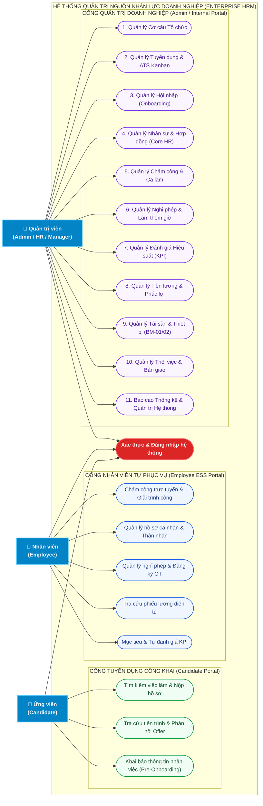

---

# PHẦN 3: SƠ ĐỒ CẤP 2, SƠ ĐỒ CẤP 3 & ĐẶC TẢ CHI TIẾT TỪNG PHÂN HỆ

---

## 3.1. PHÂN HỆ 1: CƠ CẤU TỔ CHỨC (ORGANIZATION MANAGEMENT)

### 3.1.0. Sơ đồ Use Case Cấp 2: Phân hệ Cơ cấu Tổ chức
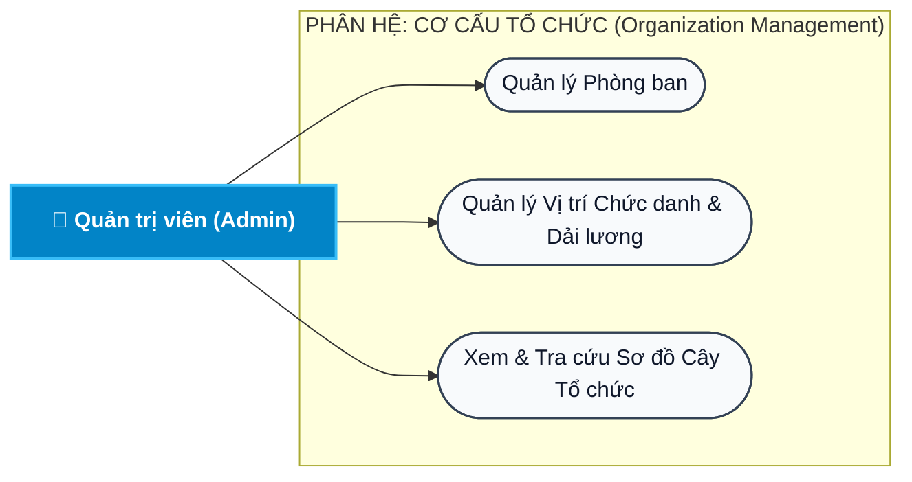

---

### 3.1.1. Chức năng Quản lý Phòng ban (`Departments.jsx`)

#### A. Sơ đồ Use Case Cấp 3: Quản lý Phòng ban
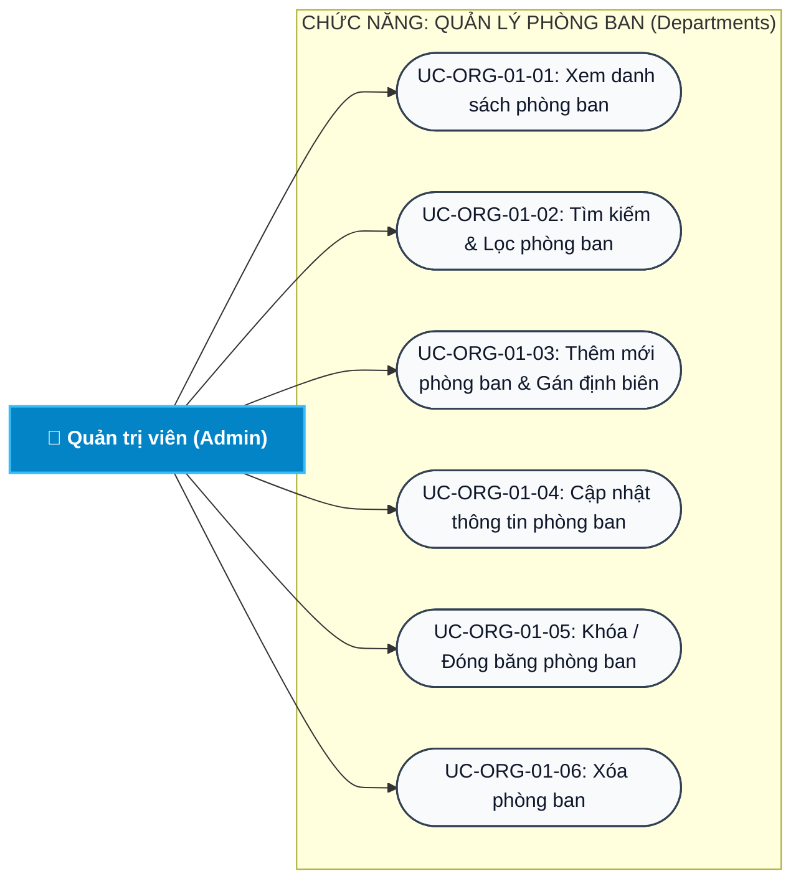

#### B. Bản đặc tả chi tiết nghiệp vụ từng Use Case con:

##### 📋 UC-ORG-01-01: Xem danh sách phòng ban
- **Mã Use Case**: `UC-ORG-01-01`
- **Mục tiêu**: Theo dõi toàn bộ cơ cấu các phòng ban hiện hữu, người đứng đầu phụ trách và tỷ lệ lấp đầy định biên nhân sự.
- **Tác nhân**: 👔 Quản trị viên (Admin), Chuyên viên Nhân sự.
- **Tiền điều kiện**: Người dùng đã đăng nhập hệ thống và có quyền quản lý tổ chức.
- **Kích hoạt (Trigger)**: Chọn chức năng "Phòng ban" trong menu Cơ cấu Tổ chức.
- **Luồng chính (Basic Flow)**:
  1. Người dùng chọn chức năng "Phòng ban" trên menu điều hướng.
  2. Hệ thống tải và hiển thị danh mục phòng ban: Mã phòng ban, Tên phòng ban, Người quản lý, Tiến độ Định biên (% nhân sự thực tế / định biên tối đa được duyệt kèm thanh tiến độ), Trạng thái hoạt động.
  3. Hệ thống sắp xếp danh sách theo thứ tự mã phòng ban và tự động phân trang (10 phòng ban/trang).
- **Luồng thay thế**: Nếu chưa có dữ liệu, hiển thị thông báo: *"Chưa có dữ liệu phòng ban. Bấm '+ Thêm phòng ban' để khởi tạo."*.
- **Luồng ngoại lệ**: Người dùng không có quyền truy cập $\rightarrow$ Hệ thống thông báo từ chối quyền.
- **Hậu điều kiện**: Người dùng nắm bắt được cơ cấu phòng ban và tình trạng định biên nhân sự toàn công ty.

##### 📋 UC-ORG-01-02: Tìm kiếm & Lọc phòng ban
- **Mã Use Case**: `UC-ORG-01-02`
- **Mục tiêu**: Tra cứu nhanh chóng phòng ban theo tên gọi, mã viết tắt hoặc trạng thái mà không phải tìm qua nhiều trang.
- **Tác nhân**: 👔 Quản trị viên, Chuyên viên Nhân sự.
- **Tiền điều kiện**: Danh sách phòng ban đã hiển thị trên màn hình.
- **Kích hoạt (Trigger)**: Người dùng nhập từ khóa vào ô tìm kiếm hoặc chọn lọc trạng thái.
- **Luồng chính (Basic Flow)**:
  1. Người dùng nhập từ khóa tìm kiếm (theo tên phòng ban hoặc mã viết tắt, ví dụ: *"Kỹ thuật"*, *"DEV"*).
  2. Hệ thống so khớp từ khóa không phân biệt hoa thường và lọc tức thì các phòng ban phù hợp.
  3. Hệ thống tự động chuyển số trang hiển thị về trang 1 và hiển thị tổng số kết quả tìm thấy.
- **Luồng thay thế**: Kết hợp lọc theo trạng thái "Đang hoạt động" hoặc "Ngừng hoạt động" $\rightarrow$ Hệ thống lọc đồng thời cả 2 điều kiện.
- **Luồng ngoại lệ**: Không có phòng ban khớp từ khóa $\rightarrow$ Thông báo: *"Không tìm thấy phòng ban nào phù hợp."*.
- **Hậu điều kiện**: Bảng danh sách hiển thị đúng tập phòng ban người dùng cần tra cứu.

##### 📋 UC-ORG-01-03: Thêm mới phòng ban & Gán định biên
- **Mã Use Case**: `UC-ORG-01-03`
- **Mục tiêu**: Khởi tạo đơn vị mới vào sơ đồ cây tổ chức và ấn định chỉ tiêu định biên nhân sự tối đa (`quota`).
- **Tác nhân**: 👔 Quản trị viên, Giám đốc Nhân sự.
- **Tiền điều kiện**: Người dùng có quyền thêm mới tổ chức.
- **Kích hoạt (Trigger)**: Người dùng nhấn nút **"+ Thêm phòng ban"**.
- **Luồng chính (Basic Flow)**:
  1. Người dùng nhấn nút "+ Thêm phòng ban".
  2. Hệ thống hiển thị biểu mẫu, tự động điền sẵn Định mức nhân sự mặc định = 15 người và Trạng thái = Đang hoạt động.
  3. Người dùng nhập Tên phòng ban (ví dụ: *"Phòng Truyền thông & Thương hiệu"*).
  4. Hệ thống tự động gợi ý Mã phòng ban viết tắt (ví dụ: `MKT`), kiểm tra trùng lặp thời gian thực.
  5. Người dùng kiểm tra mã, chọn Người quản lý, điều chỉnh Định biên và chọn Phòng ban cha (nếu trực thuộc).
  6. Người dùng nhấn "Lưu thông tin".
  7. Hệ thống kiểm tra hợp lệ: Mã và Tên không được để trống, Mã chưa từng tồn tại, Định biên là số nguyên dương $\ge 1$.
  8. Hệ thống lưu phòng ban mới, thông báo thành công: *"Thêm mới phòng ban thành công!"* và cập nhật lên bảng danh sách.
- **Luồng thay thế**: Không chọn phòng ban cha $\rightarrow$ Hệ thống ghi nhận phòng ban này là nhánh cây độc lập cao nhất.
- **Luồng ngoại lệ**: 
  - Trùng mã phòng ban $\rightarrow$ Báo lỗi: *"Mã phòng ban đã tồn tại trong hệ thống, vui lòng nhập mã khác."*.
  - Định biên $\le 0$ $\rightarrow$ Báo lỗi: *"Định mức nhân sự phải là số nguyên dương từ 1 trở lên."*.
- **Hậu điều kiện**: Phòng ban mới xuất hiện trong cơ cấu tổ chức, sẵn sàng tiếp nhận nhân sự và tuyển dụng.

##### 📋 UC-ORG-01-04: Cập nhật thông tin phòng ban
- **Mã Use Case**: `UC-ORG-01-04`
- **Mục tiêu**: Điều chỉnh tên đơn vị, Trưởng phòng, nâng/hạ định biên hoặc luân chuyển đơn vị cấp trên trực tiếp.
- **Tác nhân**: 👔 Quản trị viên, Giám đốc Nhân sự.
- **Tiền điều kiện**: Phòng ban cần chỉnh sửa đang tồn tại.
- **Kích hoạt (Trigger)**: Người dùng nhấn biểu tượng "Chỉnh sửa" tại dòng phòng ban.
- **Luồng chính (Basic Flow)**:
  1. Người dùng chọn biểu tượng "Chỉnh sửa" tại phòng ban tương ứng.
  2. Hệ thống nạp toàn bộ thông tin hiện tại vào biểu mẫu.
  3. Người dùng thay đổi thông tin (Quota, Người quản lý, Đơn vị cấp trên) và nhấn "Lưu thay đổi".
  4. Hệ thống kiểm tra quy tắc cấu trúc cây: không tự chọn chính mình làm cha; không chọn phòng ban cấp dưới trực thuộc làm cha (chống vòng lặp tổ chức).
  5. Hệ thống lưu thay đổi và thông báo: *"Cập nhật thông tin phòng ban thành công!"*.
- **Luồng ngoại lệ**:
  - Tự chọn chính mình làm cha $\rightarrow$ Báo lỗi: *"Phòng ban không thể làm phòng ban cha của chính nó."*.
  - Chọn phòng con làm phòng cha $\rightarrow$ Báo lỗi: *"Không thể thiết lập phòng ban cấp dưới làm phòng ban cha (phát hiện vòng lặp phân cấp tổ chức)."*.
- **Hậu điều kiện**: Cơ cấu tổ chức cập nhật thông tin mới, sơ đồ cây tự động điều chỉnh nhánh phân cấp.

##### 📋 UC-ORG-01-05: Khóa / Đóng băng phòng ban (Block / Inactive)
- **Mã Use Case**: `UC-ORG-01-05`
- **Mục tiêu**: Tạm dừng hoạt động hoặc giải thể mềm phòng ban mà không xóa dữ liệu, bảo toàn 100% lịch sử nhân sự cũ.
- **Tác nhân**: 👔 Quản trị viên, Giám đốc Nhân sự.
- **Tiền điều kiện**: Phòng ban đang ở trạng thái hoạt động.
- **Kích hoạt (Trigger)**: Người dùng nhấn biểu tượng Ổ khóa tại cột thao tác.
- **Luồng chính (Basic Flow)**:
  1. Người dùng nhấn biểu tượng Ổ khóa tại phòng ban đang hoạt động.
  2. Hệ thống hiển thị hộp thoại xác nhận cảnh báo: *"Bạn có chắc muốn chuyển phòng ban [Tên] sang trạng thái NGỪNG HOẠT ĐỘNG? Sau khi khóa, hệ thống sẽ tạm dừng mở tuyển dụng mới vào đơn vị này."*.
  3. Người dùng nhấn "Xác nhận khóa".
  4. Hệ thống cập nhật trạng thái phòng ban sang "Ngừng hoạt động", chuyển huy hiệu sang màu xám và thông báo: *"Đã đóng băng phòng ban thành công!"*.
- **Luồng thay thế**: Nhấn biểu tượng Mở khóa tại phòng ban đang đóng băng $\rightarrow$ Xác nhận $\rightarrow$ Chuyển lại trạng thái "Đang hoạt động", mở lại quyền tuyển dụng.
- **Hậu điều kiện**: Phòng ban bị khóa sẽ ẩn khỏi các danh sách lựa chọn khi tạo nhân sự/tuyển dụng mới.

##### 📋 UC-ORG-01-06: Xóa phòng ban (Hard Delete)
- **Mã Use Case**: `UC-ORG-01-06`
- **Mục tiêu**: Xóa vĩnh viễn các phòng ban tạo nhầm hoặc phòng ban trống không còn nhu cầu sử dụng.
- **Tác nhân**: 👔 Quản trị viên cấp cao (Admin).
- **Tiền điều kiện**: Người dùng có quyền Quản trị viên cấp cao.
- **Kích hoạt (Trigger)**: Người dùng nhấn biểu tượng Thùng rác đỏ.
- **Luồng chính (Basic Flow)**:
  1. Người dùng nhấn biểu tượng Thùng rác tại dòng phòng ban cần xóa.
  2. Hệ thống hiển thị cảnh báo nghiêm trọng: *"Hành động này sẽ xóa vĩnh viễn phòng ban khỏi hệ thống và không thể hoàn tác. Bạn có chắc chắn muốn tiếp tục?"*.
  3. Người dùng nhấn "Xác nhận xóa".
  4. Hệ thống kiểm tra an toàn 4 chốt chặn nghiệp vụ: không có nhân viên đang làm việc; không có phòng ban con; không có chức danh công tác gắn liền; không có tin tuyển dụng đang mở.
  5. Khi thỏa mãn đầy đủ, hệ thống xóa phòng ban và thông báo: *"Đã xóa phòng ban thành công!"*.
- **Luồng ngoại lệ**:
  - Đang có nhân sự làm việc $\rightarrow$ Báo lỗi: *"Không thể xóa phòng ban đang có [X] nhân viên làm việc! Vui lòng chuyển nhân sự hoặc dùng tính năng Khóa phòng ban."*.
  - Đang có phòng ban con $\rightarrow$ Báo lỗi: *"Không thể xóa phòng ban đang có đơn vị con trực thuộc!"*.
- **Hậu điều kiện**: Phòng ban bị loại bỏ hoàn toàn khỏi hệ thống.

---

### 3.1.2. Chức năng Quản lý Vị trí Chức danh (`Positions.jsx`)

#### A. Sơ đồ Use Case Cấp 3: Quản lý Vị trí Chức danh
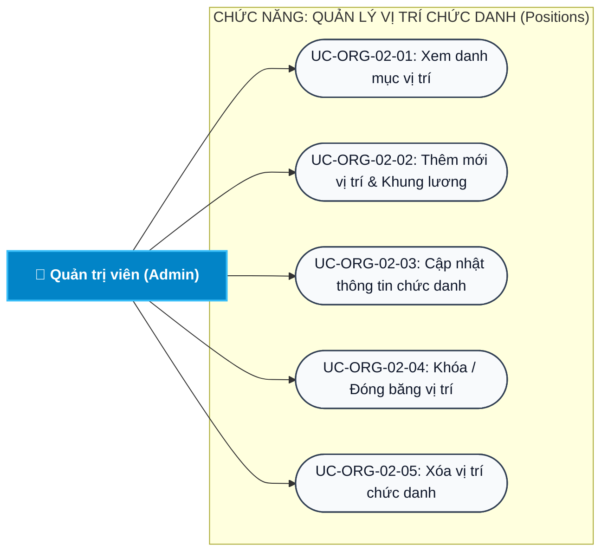

#### B. Bản đặc tả chi tiết nghiệp vụ từng Use Case con:

##### 📋 UC-ORG-02-01: Xem danh mục vị trí chức danh
- **Mã Use Case**: `UC-ORG-02-01`
- **Mục tiêu**: Theo dõi danh mục các vị trí công tác, cấp bậc chuyên môn và khung dải lương quy định.
- **Tác nhân**: 👔 Quản trị viên, Chuyên viên Nhân sự.
- **Luồng chính**: Người dùng truy cập "Vị trí" $\rightarrow$ Hệ thống hiển thị bảng danh mục vị trí gồm: Mã vị trí, Tên chức danh, Phòng ban trực thuộc, Cấp bậc chuyên môn (Staff, Leader, Manager), Khung lương tối thiểu - tối đa, Trạng thái hoạt động.

##### 📋 UC-ORG-02-02: Thêm mới vị trí & Khung dải lương
- **Mã Use Case**: `UC-ORG-02-02`
- **Mục tiêu**: Thiết lập chức danh mới, cấp bậc và ấn định khung dải lương tuyển dụng (`minSalary` - `maxSalary`).
- **Tác nhân**: 👔 Quản trị viên, Giám đốc Nhân sự, Chuyên viên C&B.
- **Luồng chính**:
  1. Người dùng nhấn "+ Thêm vị trí", chọn phòng ban trực thuộc (ví dụ: `Phòng Kỹ thuật`).
  2. Nhập Tên chức danh (ví dụ: *"Lập trình viên Frontend"*).
  3. Hệ thống tự động gợi ý mã chuẩn kết hợp: `[MÃ_PB]-[VỊ_TRÍ]` (ví dụ: `DEV-FE`).
  4. Chọn Cấp bậc chuyên môn, nhập Mức lương tối thiểu và Mức lương tối đa, nhập mô tả công việc.
  5. Nhấn "Lưu thông tin". Hệ thống kiểm tra: Mức lương tối đa phải $\ge$ Mức lương tối thiểu; Mã vị trí duy nhất.
  6. Hệ thống lưu vị trí mới và thông báo: *"Thêm vị trí chức danh thành công!"*.
- **Luồng ngoại lệ**: Lương tối đa nhỏ hơn tối thiểu $\rightarrow$ Báo lỗi: *"Mức lương tối đa không được nhỏ hơn mức lương tối thiểu!"*.

##### 📋 UC-ORG-02-03: Cập nhật vị trí chức danh
- **Mã Use Case**: `UC-ORG-02-03`
- **Mục tiêu**: Điều chỉnh tên chức danh, sửa dải lương hoặc thay đổi cấp bậc chuyên môn.
- **Tác nhân**: 👔 Quản trị viên, HR Manager.
- **Luồng chính**: Chọn icon "Sửa" $\rightarrow$ Thay đổi thông tin $\rightarrow$ Nhấn "Lưu thay đổi" $\rightarrow$ Hệ thống cập nhật và thông báo thành công.

##### 📋 UC-ORG-02-04: Khóa / Đóng băng vị trí chức danh
- **Mã Use Case**: `UC-ORG-02-04`
- **Mục tiêu**: Ngừng mở tuyển dụng hoặc ngừng bổ nhiệm vào vị trí chức danh cũ mà vẫn giữ nguyên hợp đồng của nhân sự đang nắm giữ vị trí này.
- **Tác nhân**: 👔 Quản trị viên, HR Manager.
- **Luồng chính**: Nhấn icon Khóa $\rightarrow$ Xác nhận $\rightarrow$ Chuyển trạng thái sang "Ngừng hoạt động", ẩn khỏi danh sách mở tuyển dụng.

##### 📋 UC-ORG-02-05: Xóa vị trí chức danh
- **Mã Use Case**: `UC-ORG-02-05`
- **Mục tiêu**: Xóa vị trí chức danh không còn tồn tại trong doanh nghiệp.
- **Tác nhân**: 👔 Quản trị viên.
- **Luồng chính**: Nhấn biểu tượng Xóa $\rightarrow$ Xác nhận $\rightarrow$ Hệ thống kiểm tra nếu không có nhân viên nào đang giữ vị trí này và không có tin tuyển dụng nào đang mở thì cho phép xóa.
- **Luồng ngoại lệ**: Nếu đang có nhân sự giữ vị trí $\rightarrow$ Từ chối xóa và báo lỗi: *"Không thể xóa vị trí đang có nhân viên đảm nhiệm!"*.

---

### 3.1.3. Chức năng Xem Sơ đồ Cây Tổ chức (`OrgChart.jsx`)

#### A. Sơ đồ Use Case Cấp 3: Sơ đồ Cây Tổ chức
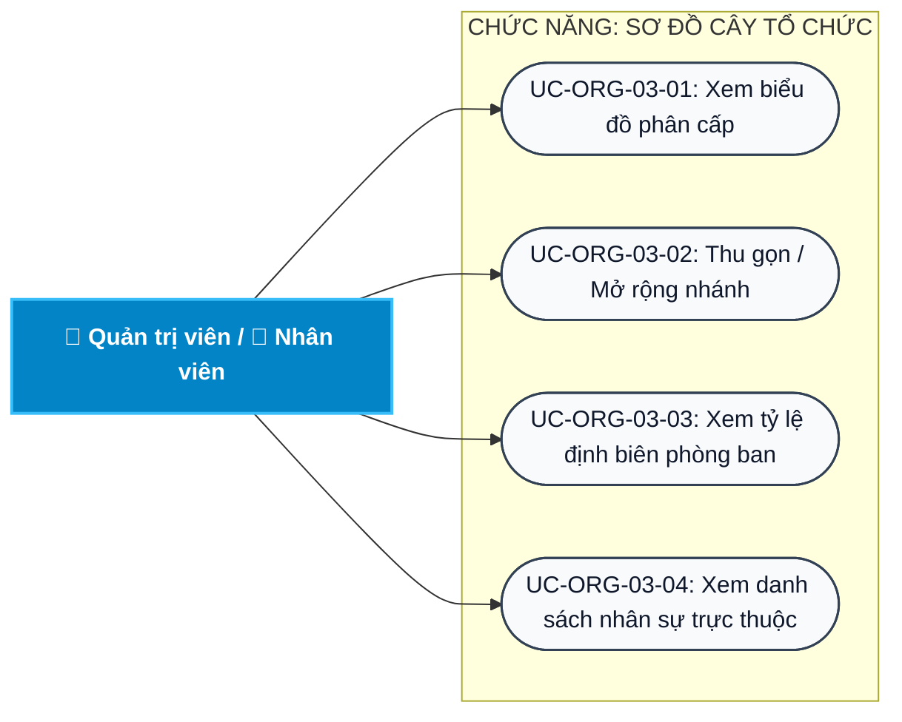

#### B. Bản đặc tả chi tiết nghiệp vụ từng Use Case con:

##### 📋 UC-ORG-03-01: Xem biểu đồ phân cấp tổ chức hình cây
- **Mã Use Case**: `UC-ORG-03-01`
- **Mục tiêu**: Trực quan hóa toàn bộ mô hình phân cấp tổ chức doanh nghiệp (Ban Giám Đốc $\rightarrow$ Khối $\rightarrow$ Phòng ban $\rightarrow$ Bộ phận con).
- **Tác nhân**: 👔 Quản trị viên, 👤 Toàn thể nhân viên.
- **Luồng chính**: Người dùng truy cập "Sơ đồ tổ chức" $\rightarrow$ Hệ thống dựng sơ đồ hình cây phân cấp nhiều tầng; mỗi nút hiển thị: Tên phòng ban, Họ tên trưởng bộ phận, Số lượng nhân sự thực tế và Chỉ tiêu định biên.

##### 📋 UC-ORG-03-02: Thu gọn / Mở rộng nhánh cây tổ chức
- **Mã Use Case**: `UC-ORG-03-02`
- **Mục tiêu**: Cho phép người dùng tùy biến tầm nhìn sơ đồ cây bằng cách thu gọn các phòng ban cấp dưới hoặc mở rộng toàn bộ cấu trúc.
- **Tác nhân**: 👔 Quản trị viên, 👤 Nhân viên.
- **Luồng chính**: Nhấp vào nút mở rộng/thu gọn trên từng khối phòng ban cha $\rightarrow$ Hệ thống ẩn/hiện nhánh con tương ứng mượt mà.

##### 📋 UC-ORG-03-03: Xem tỷ lệ lấp đầy định biên trên sơ đồ
- **Mã Use Case**: `UC-ORG-03-03`
- **Mục tiêu**: Giúp lãnh đạo nhận diện nhanh các phòng ban đang thừa hoặc thiếu nhân sự so với chỉ tiêu được duyệt.
- **Tác nhân**: 👔 Ban Giám đốc, HR Manager.
- **Luồng chính**: Hệ thống hiển thị thanh tiến độ phần trăm % lấp đầy ngay trên từng khối phòng ban: Màu xanh (đủ định biên), Màu vàng (đang thiếu người), Màu đỏ (vượt định biên).

##### 📋 UC-ORG-03-04: Xem danh sách nhân sự trực thuộc phòng ban
- **Mã Use Case**: `UC-ORG-03-04`
- **Mục tiêu**: Bấm vào một khối phòng ban để tra cứu nhanh danh sách các nhân viên đang làm việc tại đơn vị đó.
- **Tác nhân**: 👔 Quản trị viên, HR.
- **Luồng chính**: Nhấp vào khối phòng ban $\rightarrow$ Hệ thống mở danh sách nhân sự trực thuộc gồm: Mã nhân viên, Họ tên, Chức vụ và Email liên hệ.

---

## 3.2. PHÂN HỆ 2: TUYỂN DỤNG & ATS KANBAN (RECRUITMENT)

### 3.2.0. Sơ đồ Use Case Cấp 2: Tuyển dụng & ATS
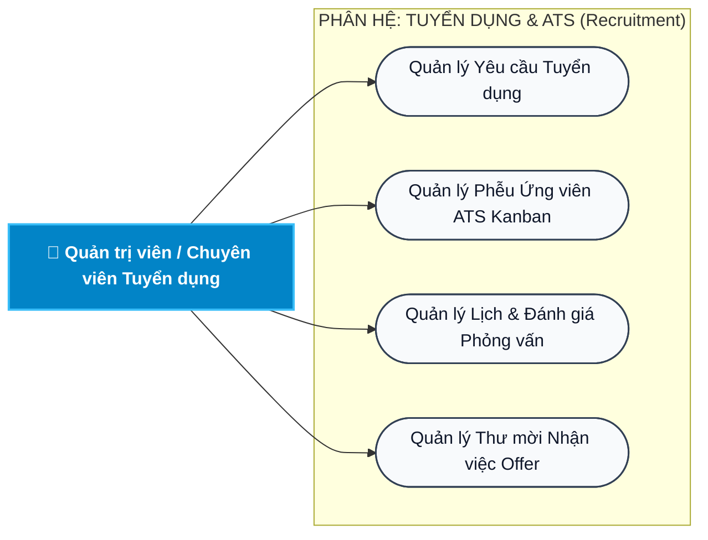

---

### 3.2.1. Chức năng Yêu cầu Tuyển dụng (`Requisitions.jsx`)

#### A. Sơ đồ Use Case Cấp 3: Yêu cầu Tuyển dụng
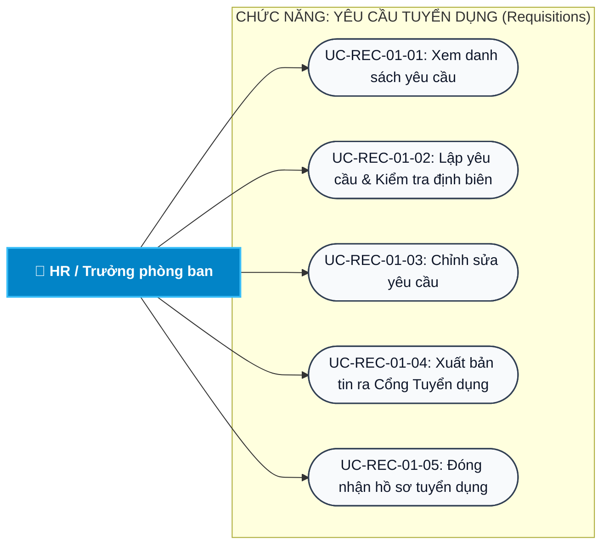

#### B. Bản đặc tả chi tiết nghiệp vụ từng Use Case con:

##### 📋 UC-REC-01-01: Xem danh sách yêu cầu tuyển dụng
- **Mã Use Case**: `UC-REC-01-01`
- **Mục tiêu**: Theo dõi tình trạng các vị trí đang cần tuyển dụng, số lượng chỉ tiêu và tiến độ tuyển thực tế.
- **Tác nhân**: 👔 Chuyên viên Tuyển dụng, Trưởng bộ phận.
- **Luồng chính**: Mở "Yêu cầu tuyển dụng" $\rightarrow$ Xem bảng danh sách các tin: Tiêu đề vị trí, Phòng ban, Số lượng cần tuyển, Đã tuyển được, Hạn nộp hồ sơ, Trạng thái (Bản nháp, Đang đăng, Đã đóng).

##### 📋 UC-REC-01-02: Lập yêu cầu tuyển dụng & Kiểm tra định biên
- **Mã Use Case**: `UC-REC-01-02`
- **Mục tiêu**: Tạo phiếu đề xuất bổ sung nhân sự, hệ thống tự động kiểm tra trần định biên để tránh tuyển vượt chỉ tiêu.
- **Tác nhân**: 👔 Trưởng bộ phận, Chuyên viên Tuyển dụng.
- **Luồng chính**:
  1. Nhấn nút "+ Tạo yêu cầu tuyển dụng".
  2. Chọn phòng ban, chức danh và nhập số lượng nhân sự cần tuyển.
  3. Hệ thống kiểm tra: Số nhân sự hiện có + Số lượng cần tuyển $\le$ Chỉ tiêu định biên quota.
  4. Nhập dải lương dự kiến, hạn chót nhận hồ sơ, mô tả công việc (JD) và lý do tuyển dụng (mở rộng, thay thế, dự án).
  5. Nhấn "Lưu yêu cầu". Phiếu tuyển dụng được lưu ở trạng thái Bản nháp hoặc Xuất bản.
- **Luồng ngoại lệ**: Vượt quá hạn ngạch định biên $\rightarrow$ Hệ thống cảnh báo màu vàng và yêu cầu có phê duyệt ngoại lệ từ Ban Giám đốc.

##### 📋 UC-REC-01-03: Chỉnh sửa yêu cầu tuyển dụng
- **Mã Use Case**: `UC-REC-01-03`
- **Mục tiêu**: Cập nhật lại yêu cầu kinh nghiệm, điều chỉnh dải lương hoặc gia hạn thời gian nộp hồ sơ.
- **Tác nhân**: 👔 Chuyên viên Tuyển dụng.
- **Luồng chính**: Chọn icon "Sửa" tại phiếu tuyển dụng $\rightarrow$ Cập nhật thông tin $\rightarrow$ Lưu thay đổi.

##### 📋 UC-REC-01-04: Xuất bản tin ra Cổng Tuyển dụng Công khai
- **Mã Use Case**: `UC-REC-01-04`
- **Mục tiêu**: Đưa tin tuyển dụng lên trang chủ việc làm để ứng viên bên ngoài tiếp cận và nộp hồ sơ.
- **Tác nhân**: 👔 Chuyên viên Tuyển dụng.
- **Luồng chính**: Nhấn "Xuất bản tin" $\rightarrow$ Trạng thái chuyển sang "Đang mở nhận hồ sơ", tin tự động xuất hiện trên Cổng Tuyển dụng.

##### 📋 UC-REC-01-05: Đóng nhận hồ sơ tuyển dụng
- **Mã Use Case**: `UC-REC-01-05`
- **Mục tiêu**: Dừng nhận hồ sơ khi đã tuyển đủ chỉ tiêu hoặc hết thời hạn tuyển dụng.
- **Tác nhân**: 👔 Chuyên viên Tuyển dụng.
- **Luồng chính**: Nhấn "Đóng tin" $\rightarrow$ Chuyển trạng thái sang "Đã đóng", Cổng Tuyển dụng ẩn nút nộp hồ sơ cho vị trí này.

---

### 3.2.2. Chức năng Phễu Ứng viên ATS Kanban (`RecruitmentATS.jsx`)

#### A. Sơ đồ Use Case Cấp 3: Phễu ATS Kanban
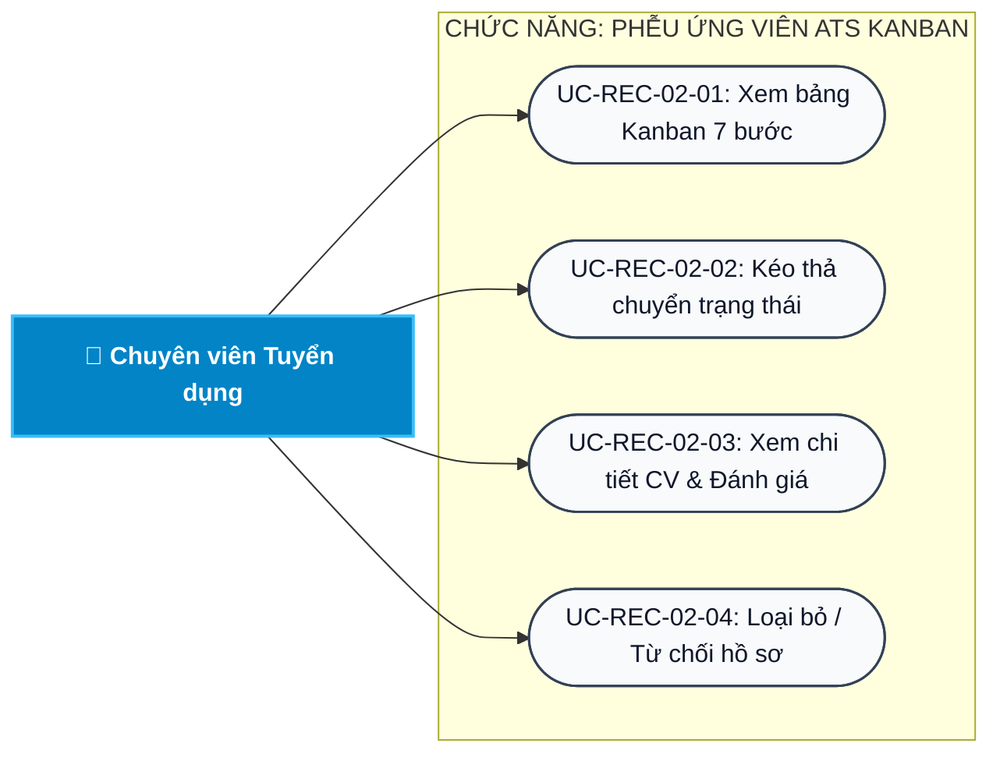

#### B. Bản đặc tả chi tiết nghiệp vụ từng Use Case con:

##### 📋 UC-REC-02-01: Xem bảng Kanban phân loại 7 bước
- **Mã Use Case**: `UC-REC-02-01`
- **Mục tiêu**: Theo dõi toàn bộ ứng viên theo 7 bước phễu: *Tiếp cận $\rightarrow$ Ứng tuyển $\rightarrow$ Sơ loại $\rightarrow$ Phỏng vấn $\rightarrow$ Đề nghị việc $\rightarrow$ Tiếp nhận / Từ chối*.
- **Tác nhân**: 👔 Chuyên viên Tuyển dụng.
- **Luồng chính**: Mở màn hình ATS $\rightarrow$ Xem bảng 7 cột, mỗi ứng viên hiển thị dạng thẻ card tóm tắt (Họ tên, Email, SĐT, Điểm số).

##### 📋 UC-REC-02-02: Kéo thả chuyển trạng thái ứng viên
- **Mã Use Case**: `UC-REC-02-02`
- **Mục tiêu**: Cập nhật tiến độ tuyển dụng nhanh chóng bằng thao tác kéo thả trực quan.
- **Tác nhân**: 👔 Chuyên viên Tuyển dụng.
- **Luồng chính**: Kéo thẻ ứng viên từ cột này thả sang cột tiếp theo $\rightarrow$ Hệ thống cập nhật trạng thái mới ngay lập tức và ghi vết lịch sử phễu.

##### 📋 UC-REC-02-03: Xem chi tiết CV & Đánh giá
- **Mã Use Case**: `UC-REC-02-03`
- **Mục tiêu**: Xem trực tiếp file hồ sơ CV của ứng viên và ghi chú nhận xét ban đầu.
- **Tác nhân**: 👔 Chuyên viên Tuyển dụng.
- **Luồng chính**: Nhấp vào thẻ ứng viên $\rightarrow$ Hệ thống mở Modal xem file CV, thông tin liên lạc và ghi chú đánh giá sơ loại.

##### 📋 UC-REC-02-04: Loại bỏ / Từ chối hồ sơ (Reject)
- **Mã Use Case**: `UC-REC-02-04`
- **Mục tiêu**: Đánh dấu không phù hợp đối với các ứng viên không đạt yêu cầu.
- **Tác nhân**: 👔 Chuyên viên Tuyển dụng.
- **Luồng chính**: Kéo ứng viên vào cột "Từ chối" hoặc nhấn nút "Loại hồ sơ" $\rightarrow$ Chọn lý do từ chối (Kinh nghiệm chưa đủ, Lương không khớp...) $\rightarrow$ Hệ thống cập nhật trạng thái và sẵn sàng gửi email thông báo từ chối lịch sự.

---

### 3.2.3. Chức năng Lịch Phỏng vấn & Chấm điểm (`Interviews.jsx`)

#### A. Sơ đồ Use Case Cấp 3: Lịch Phỏng vấn & Chấm điểm
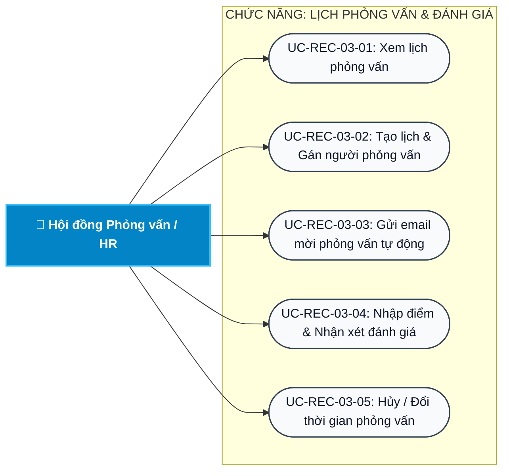

#### B. Bản đặc tả chi tiết nghiệp vụ từng Use Case con:

##### 📋 UC-REC-03-01: Xem lịch phỏng vấn
- **Mã Use Case**: `UC-REC-03-01`
- **Mục tiêu**: Theo dõi danh sách các buổi phỏng vấn sắp diễn ra theo tuần hoặc tháng.
- **Tác nhân**: 👔 Hội đồng phỏng vấn, Chuyên viên Tuyển dụng.
- **Luồng chính**: Mở "Lịch phỏng vấn" $\rightarrow$ Xem danh sách gồm: Tên ứng viên, Vị trí ứng tuyển, Vòng phỏng vấn, Thời gian, Hình thức (Trực tiếp hoặc Link họp online), Cán bộ phỏng vấn phụ trách.

##### 📋 UC-REC-03-02: Tạo lịch & Gán người phỏng vấn
- **Mã Use Case**: `UC-REC-03-02`
- **Mục tiêu**: Xếp lịch phỏng vấn và phân công người chấm thi phù hợp.
- **Tác nhân**: 👔 Chuyên viên Tuyển dụng.
- **Luồng chính**: Chọn ứng viên $\rightarrow$ Chọn Vòng phỏng vấn (Vòng 1 - HR Sơ loại, Vòng 2 - Chuyên môn Kỹ thuật, Vòng 3 - Phỏng vấn Giám đốc) $\rightarrow$ Chọn Ngày giờ, Địa điểm hoặc đính kèm đường link họp online $\rightarrow$ Chọn Cán bộ phỏng vấn phụ trách $\rightarrow$ Nhấn "Lưu lịch phỏng vấn".

##### 📋 UC-REC-03-03: Gửi email mời phỏng vấn tự động
- **Mã Use Case**: `UC-REC-03-03`
- **Mục tiêu**: Tự động gửi thư mời phỏng vấn chuyên nghiệp đến hòm thư ứng viên kèm đường link xác nhận.
- **Tác nhân**: ⚙️ Hệ thống tự động / 👔 HR.
- **Luồng chính**: Sau khi tạo lịch phỏng vấn, hệ thống gửi email tự động chứa đầy đủ thông tin thời gian, địa điểm, người đón tiếp và link xác nhận tham gia đến email của ứng viên.

##### 📋 UC-REC-03-04: Nhập điểm & Nhận xét đánh giá
- **Mã Use Case**: `UC-REC-03-04`
- **Mục tiêu**: Cán bộ phỏng vấn ghi nhận kết quả đánh giá năng lực ứng viên làm căn cứ đề xuất phát hành Thư mời nhận việc.
- **Tác nhân**: 👔 Cán bộ phỏng vấn.
- **Luồng chính**: Mở lịch phỏng vấn $\rightarrow$ Nhập điểm số theo thang điểm 100 $\rightarrow$ Ghi nhận xét chi tiết về điểm mạnh, điểm yếu $\rightarrow$ Đánh giá Đạt hoặc Không đạt $\rightarrow$ Nhấn "Lưu kết quả".

##### 📋 UC-REC-03-05: Hủy / Đổi thời gian phỏng vấn
- **Mã Use Case**: `UC-REC-03-05`
- **Mục tiêu**: Điều chỉnh thời gian khi có phát sinh từ phía ứng viên hoặc hội đồng phỏng vấn.
- **Tác nhân**: 👔 Chuyên viên Tuyển dụng.
- **Luồng chính**: Chọn lịch cần dời $\rightarrow$ Cập nhật thời gian mới $\rightarrow$ Hệ thống tự động gửi email thông báo đổi lịch cho cả ứng viên và người phỏng vấn.

---

### 3.2.4. Chức năng Quản lý Thư mời Nhận việc (`Offers.jsx`)

#### A. Sơ đồ Use Case Cấp 3: Quản lý Thư mời Nhận việc (Offer)
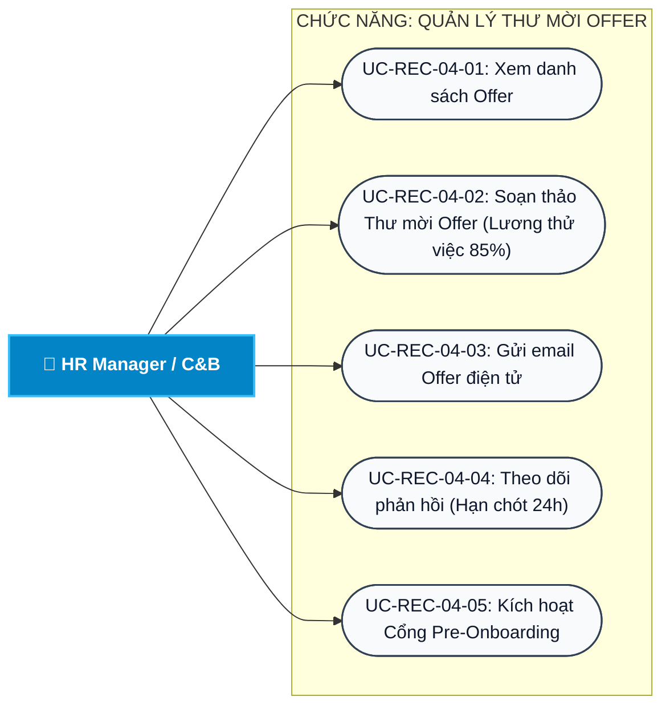

#### B. Bản đặc tả chi tiết nghiệp vụ từng Use Case con:

##### 📋 UC-REC-04-01: Xem danh sách Thư mời nhận việc
- **Mã Use Case**: `UC-REC-04-01`
- **Mục tiêu**: Theo dõi tình trạng các thư mời nhận việc đã phát hành và hạn phản hồi của ứng viên.
- **Tác nhân**: 👔 HR Manager, Chuyên viên C&B.
- **Luồng chính**: Mở "Quản lý Offer" $\rightarrow$ Xem danh sách: Tên ứng viên, Vị trí tuyển dụng, Lương cơ bản, Lương thử việc, Ngày đi làm dự kiến, Hạn phản hồi, Trạng thái (Chờ phản hồi, Đã đồng ý, Đã từ chối).

##### 📋 UC-REC-04-02: Soạn thảo Thư mời Offer theo luật lao động
- **Mã Use Case**: `UC-REC-04-02`
- **Mục tiêu**: Soạn thảo thư mời nhận việc chính thức với tỷ lệ lương thử việc chuẩn 85% theo Bộ luật Lao động.
- **Tác nhân**: 👔 HR Manager, Chuyên viên C&B.
- **Luồng chính**:
  1. Chọn ứng viên trúng tuyển và nhấn "Tạo Offer".
  2. Nhập Mức lương cơ bản thỏa thuận.
  3. Hệ thống tự động áp dụng Tỷ lệ lương thử việc = 85% lương chính thức theo đúng Điều 26 BLLĐ 2019.
  4. Chọn Ngày bắt đầu đi làm và Loại hợp đồng thử việc (02 tháng).
  5. Thiết lập Thời hạn hiệu lực phản hồi (mặc định 24 giờ).
  6. Nhấn "Lưu dự thảo Offer".

##### 📋 UC-REC-04-03: Gửi email Offer điện tử cho ứng viên
- **Mã Use Case**: `UC-REC-04-03`
- **Mục tiêu**: Phát hành thư mời làm việc chính thức qua hòm thư điện tử của ứng viên.
- **Tác nhân**: 👔 HR Manager.
- **Luồng chính**: Nhấn "Gửi Thư mời" $\rightarrow$ Hệ thống tự động gửi Email chính thức đính kèm nội dung thư mời và đường dẫn bảo mật để ứng viên phản hồi.

##### 📋 UC-REC-04-04: Theo dõi phản hồi Offer trong 24h
- **Mã Use Case**: `UC-REC-04-04`
- **Mục tiêu**: Giám sát thời gian phản hồi của ứng viên; tự động đánh dấu quá hạn nếu sau 24h không nhận được câu trả lời.
- **Tác nhân**: ⚙️ Hệ thống tự động / 👔 HR.
- **Luồng chính**: Hệ thống đếm ngược thời gian hiệu lực 24h. Nếu ứng viên bấm Chấp nhận hoặc Từ chối, hệ thống cập nhật trạng thái ngay lập tức. Nếu quá hạn 24h chưa phản hồi, hệ thống chuyển sang trạng thái "Đã hết hạn".

##### 📋 UC-REC-04-05: Kích hoạt Cổng Khai báo Pre-Onboarding
- **Mã Use Case**: `UC-REC-04-05`
- **Mục tiêu**: Mở quyền để ứng viên trúng tuyển tự kê khai thông tin cá nhân trước ngày đi làm.
- **Tác nhân**: ⚙️ Hệ thống tự động.
- **Luồng chính**: Khi ứng viên nhấn "Đồng ý nhận việc", hệ thống tự động kích hoạt tài khoản Cổng Pre-Onboarding và gửi đường link khai báo thông tin đến email ứng viên.

---

## 3.3. PHÂN HỆ 3: HỘI NHẬP NHÂN SỰ MỚI (ONBOARDING)

### 3.3.0. Sơ đồ Use Case Cấp 2: Hội nhập Onboarding
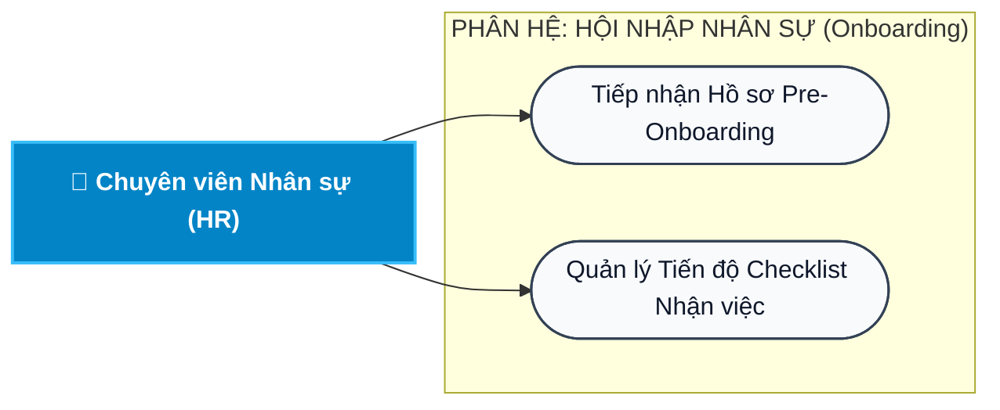

---

### 3.3.1. Chức năng Tiếp nhận Pre-Onboarding (`PreOnboardingHub.jsx`)

#### A. Sơ đồ Use Case Cấp 3: Tiếp nhận Pre-Onboarding
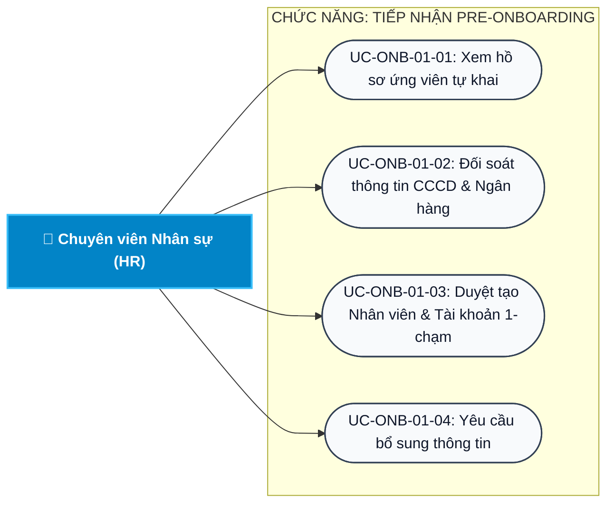

#### B. Bản đặc tả chi tiết nghiệp vụ từng Use Case con:

##### 📋 UC-ONB-01-01: Xem hồ sơ ứng viên tự kê khai
- **Mã Use Case**: `UC-ONB-01-01`
- **Mục tiêu**: Kiểm tra các thông tin cá nhân, CCCD, số tài khoản ngân hàng và người thân do ứng viên trúng tuyển tự khai trực tuyến trước ngày đi làm.
- **Tác nhân**: 👔 Chuyên viên Nhân sự.
- **Luồng chính**: Mở "Trung tâm Tiếp nhận Pre-Onboarding" $\rightarrow$ Xem danh sách ứng viên đã nộp hồ sơ nhận việc $\rightarrow$ Bấm xem chi tiết từng bản khai.

##### 📋 UC-ONB-01-02: Đối soát thông tin CCCD & Tài khoản Ngân hàng
- **Mã Use Case**: `UC-ONB-01-02`
- **Mục tiêu**: Đảm bảo thông tin số định danh cá nhân và số tài khoản ngân hàng chi trả lương là chính xác và khớp với chứng từ.
- **Tác nhân**: 👔 Chuyên viên Nhân sự.
- **Luồng chính**: Kiểm tra ảnh chụp 2 mặt CCCD, đối chiếu số CCCD, ngày cấp, nơi cấp và số tài khoản ngân hàng chi trả lương.

##### 📋 UC-ONB-01-03: Phê duyệt 1-chạm: Tự động tạo Nhân viên, Cấp tài khoản & Hợp đồng
- **Mã Use Case**: `UC-ONB-01-03`
- **Mục tiêu**: Chuyển đổi ứng viên thành nhân viên chính thức chỉ bằng 1 thao tác phê duyệt, xóa bỏ hoàn toàn việc nhập tay trùng lặp.
- **Tác nhân**: 👔 Giám đốc Nhân sự / Admin.
- **Luồng chính**:
  1. Người dùng nhấn nút "Phê duyệt tiếp nhận nhân sự".
  2. Hệ thống tự động thực hiện chuỗi giao dịch nguyên tử:
     - Tự động cấp Mã nhân viên mới (ví dụ: `NV0145`).
     - Chuyển toàn bộ dữ liệu cá nhân sang hồ sơ nhân viên chính thức.
     - Khởi tạo tài khoản đăng nhập Cổng Tự phục vụ ESS với mật khẩu mặc định an toàn.
     - Tự động lập Hợp đồng thử việc theo đúng mức lương đã chốt trên Offer.
     - Gửi email chào mừng kèm thông tin đăng nhập đến hòm thư nhân viên mới.
  3. Hệ thống thông báo thành công: *"Đã tiếp nhận nhân viên mới và khởi tạo tài khoản thành công!"*.

##### 📋 UC-ONB-01-04: Yêu cầu bổ sung / chỉnh sửa thông tin
- **Mã Use Case**: `UC-ONB-01-04`
- **Mục tiêu**: Trả lại hồ sơ yêu cầu ứng viên kê khai lại khi phát hiện sai sót (ví dụ mờ ảnh CCCD hoặc sai số tài khoản).
- **Tác nhân**: 👔 Chuyên viên Nhân sự.
- **Luồng chính**: Nhập lý do yêu cầu sửa đổi $\rightarrow$ Nhấn "Yêu cầu khai báo lại" $\rightarrow$ Hệ thống gửi email thông báo cho ứng viên mở lại form để chỉnh sửa.

---

### 3.3.2. Chức năng Checklist Nhận việc (`OnboardingMgmt.jsx`)

#### A. Sơ đồ Use Case Cấp 3: Checklist Nhận việc 4 Mốc
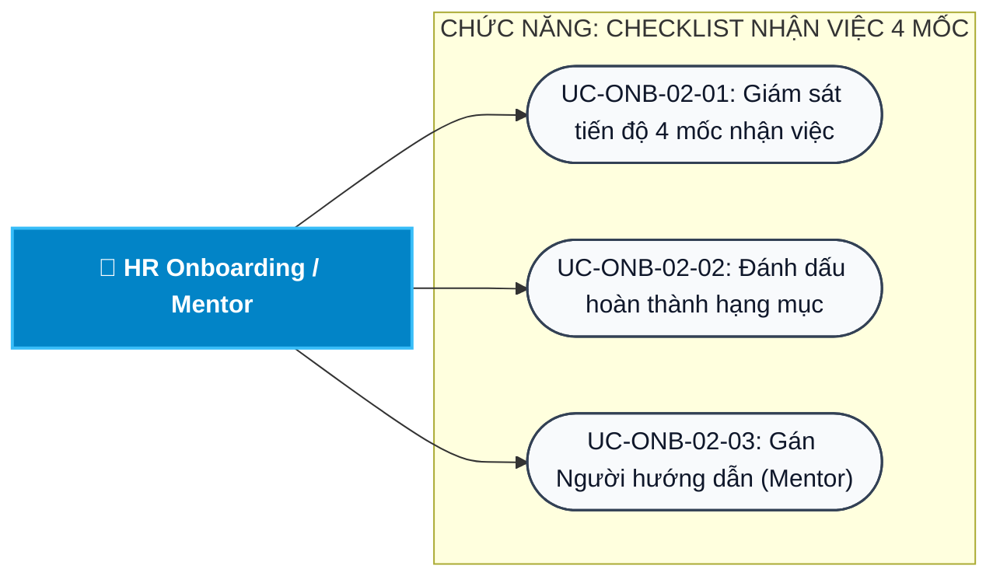

#### B. Bản đặc tả chi tiết nghiệp vụ từng Use Case con:

##### 📋 UC-ONB-02-01: Giám sát tiến độ hội nhập qua 4 mốc thời gian
- **Mã Use Case**: `UC-ONB-02-01`
- **Mục tiêu**: Đảm bảo nhân sự mới hòa nhập văn hóa doanh nghiệp đúng tiến độ qua 4 mốc: *Ngày đầu tiên, Tuần đầu tiên, Tháng đầu tiên, và Đánh giá hết thử việc*.
- **Tác nhân**: 👔 HR Onboarding, Trưởng phòng ban.
- **Luồng chính**: Mở màn hình Checklist Onboarding $\rightarrow$ Theo dõi thanh tiến độ % hoàn thành các đầu việc của từng nhân sự mới theo từng mốc thời gian.

##### 📋 UC-ONB-02-02: Đánh dấu hoàn thành các hạng mục nhận việc
- **Mã Use Case**: `UC-ONB-02-02`
- **Mục tiêu**: Ghi nhận hoàn tất từng đầu việc hành chính và chuyên môn (Cấp máy tính, Cấp email, Đào tạo nội quy, Giới thiệu dự án).
- **Tác nhân**: 👔 HR Onboarding, Nhân sự mới.
- **Luồng chính**: Người phụ trách tích chọn hoàn thành đầu việc $\rightarrow$ Hệ thống ghi nhận thời gian và người xác nhận, cập nhật tăng phần trăm tiến độ hội nhập.

##### 📋 UC-ONB-02-03: Gán Người hướng dẫn (Mentor) cho nhân sự mới
- **Mã Use Case**: `UC-ONB-02-03`
- **Mục tiêu**: Phân công một nhân sự có kinh nghiệm kèm cặp, hướng dẫn nghiệp vụ cho nhân viên mới trong giai đoạn thử việc.
- **Tác nhân**: 👔 Trưởng bộ phận.
- **Luồng chính**: Chọn nhân viên mới $\rightarrow$ Chọn đồng nghiệp giàu kinh nghiệm làm Mentor $\rightarrow$ Lưu thông tin. Mentor sẽ nhận thông báo phân công và theo dõi tiến độ của học viên.

---

## 3.4. PHÂN HỆ 4: HỒ SƠ NHÂN SỰ 360°, HỢP ĐỒNG & QUYẾT ĐỊNH (CORE HR)

### 3.4.0. Sơ đồ Use Case Cấp 2: Core HR
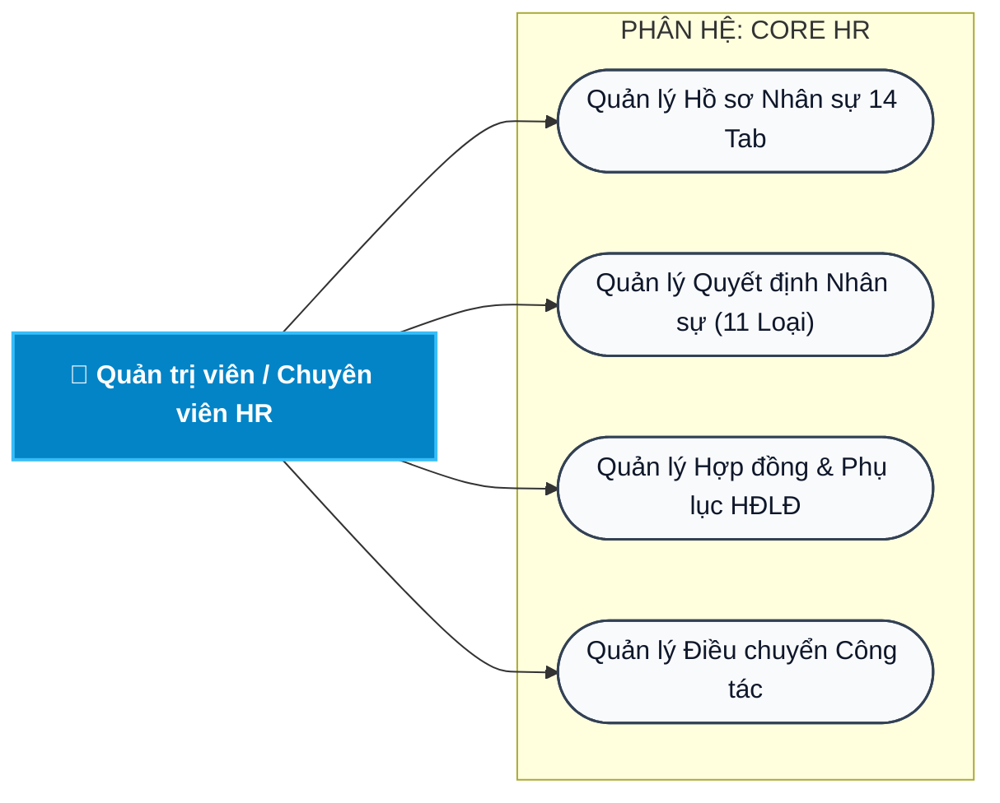

---

### 3.4.1. Chức năng Hồ sơ Nhân sự 360° (`EmployeeDetail.jsx`)

#### A. Sơ đồ Use Case Cấp 3: Hồ sơ Nhân sự 360°
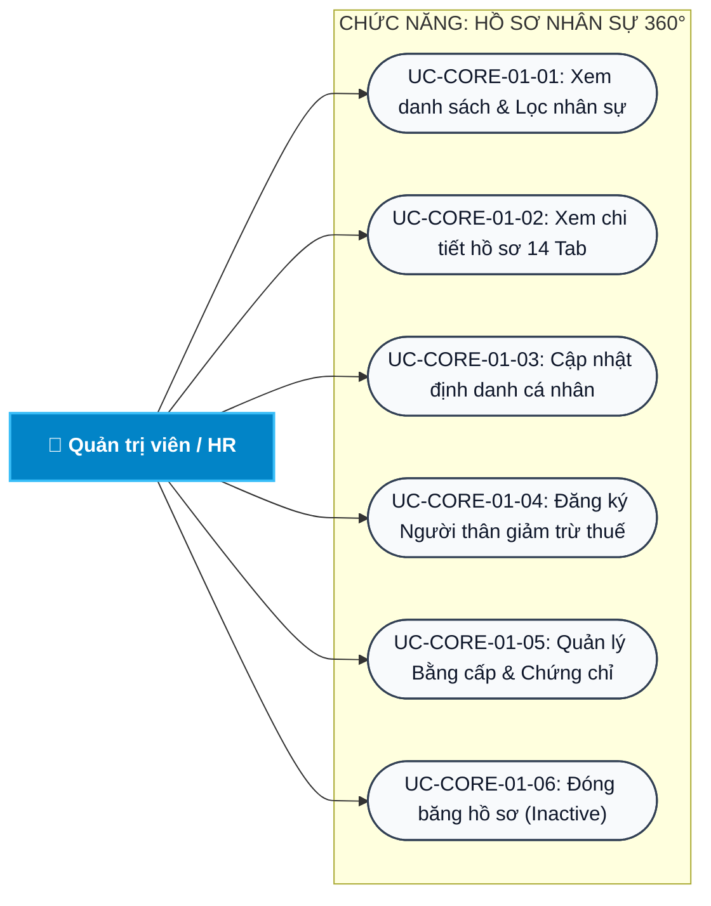

#### B. Bản đặc tả chi tiết nghiệp vụ từng Use Case con:

##### 📋 UC-CORE-01-01: Xem danh sách & Lọc nhân sự đa tiêu chí
- **Mã Use Case**: `UC-CORE-01-01`
- **Mục tiêu**: Quản lý toàn bộ danh sách nhân viên trong công ty, lọc theo phòng ban, trạng thái (Chính thức, Thử việc, Đã thôi việc).
- **Tác nhân**: 👔 Quản trị viên, HR.
- **Luồng chính**: Mở "Hồ sơ nhân sự" $\rightarrow$ Xem bảng nhân sự: Mã NV, Họ tên, Phòng ban, Chức danh, Email, Số điện thoại, Trạng thái $\rightarrow$ Tìm kiếm theo tên hoặc lọc theo phòng ban.

##### 📋 UC-CORE-01-02: Xem chi tiết hồ sơ 14 Tab chuyên sâu
- **Mã Use Case**: `UC-CORE-01-02`
- **Mục tiêu**: Nắm bắt trọn vẹn lý lịch 360° của người lao động qua 14 tab thông tin.
- **Tác nhân**: 👔 Quản trị viên, HR.
- **Luồng chính**: Bấm vào tên nhân viên $\rightarrow$ Xem chi tiết 14 nhóm thông tin: *Định danh cá nhân, Công tác, Hợp đồng & Lương, Người thân giảm trừ thuế, Học vấn, Chứng chỉ, Lịch sử đào tạo, Khen thưởng, Kỷ luật, Quá trình bổ nhiệm, Quá trình điều chuyển, Tài sản đang giữ và Hồ sơ đính kèm*.

##### 📋 UC-CORE-01-03: Cập nhật thông tin định danh cá nhân
- **Mã Use Case**: `UC-CORE-01-03`
- **Mục tiêu**: Điều chỉnh số CCCD, địa chỉ thường trú, tạm trú, số tài khoản ngân hàng chi trả lương khi có biến động.
- **Tác nhân**: 👔 HR.
- **Luồng chính**: Vào tab "Cá nhân & Định danh" $\rightarrow$ Nhập thông tin mới $\rightarrow$ Lưu thông tin.

##### 📋 UC-CORE-01-04: Đăng ký Người thân & Giảm trừ gia cảnh thuế TNCN
- **Mã Use Case**: `UC-CORE-01-04`
- **Mục tiêu**: Ghi nhận thông tin thân nhân (Bố, Mẹ, Vợ, Con) và đăng ký người phụ thuộc để giảm trừ 4.400.000 VNĐ/tháng khi tính thuế TNCN.
- **Tác nhân**: 👔 Chuyên viên C&B, HR.
- **Luồng chính**: Vào tab "Người thân & Phụ thuộc" $\rightarrow$ Nhấn "+ Thêm thân nhân" $\rightarrow$ Nhập Họ tên, Quan hệ, Ngày sinh, Mã số thuế thân nhân $\rightarrow$ Tích chọn "Người phụ thuộc giảm trừ gia cảnh" $\rightarrow$ Chọn Ngày bắt đầu giảm trừ $\rightarrow$ Lưu thông tin.

##### 📋 UC-CORE-01-05: Quản lý Bằng cấp & Chứng chỉ chuyên môn
- **Mã Use Case**: `UC-CORE-01-05`
- **Mục tiêu**: Lưu trữ trình độ học vấn (Đại học, Thạc sĩ) và các chứng chỉ nghề nghiệp quốc tế (AWS, PMP, CPA) phục vụ nâng lương và bổ nhiệm.
- **Tác nhân**: 👔 HR.
- **Luồng chính**: Mở tab "Học vấn & Bằng cấp" $\rightarrow$ Nhập Tên bằng cấp, Chuyên ngành, Nơi đào tạo, Năm tốt nghiệp, Tải ảnh scan bằng gốc $\rightarrow$ Lưu vào hồ sơ.

##### 📋 UC-CORE-01-06: Đóng băng hồ sơ nhân sự (Inactive)
- **Mã Use Case**: `UC-CORE-01-06`
- **Mục tiêu**: Tạm hoãn hợp đồng lao động hoặc chuyển nhân viên sang diện nghỉ không lương mà không xóa dữ liệu.
- **Tác nhân**: 👔 Giám đốc Nhân sự.
- **Luồng chính**: Chọn trạng thái "Tạm hoãn HĐLĐ" hoặc "Nghỉ thai sản" $\rightarrow$ Hệ thống chuyển trạng thái nhân viên, tạm ngừng chấm công và tính lương trong giai đoạn này.

---

### 3.4.2. Chức năng Quyết định Nhân sự (`Decisions.jsx` / `DecisionCreate.jsx`)

#### A. Sơ đồ Use Case Cấp 3: Quyết định Nhân sự (11 Loại)
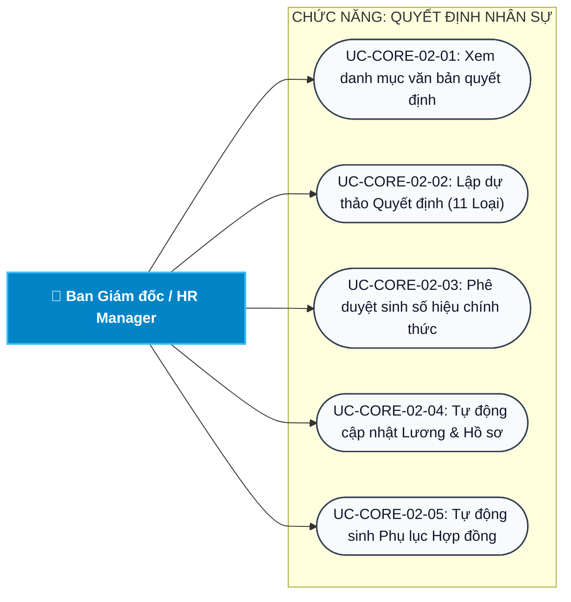

#### B. Bản đặc tả chi tiết nghiệp vụ từng Use Case con:

##### 📋 UC-CORE-02-01: Xem danh mục văn bản quyết định
- **Mã Use Case**: `UC-CORE-02-01`
- **Mục tiêu**: Tra cứu toàn bộ các văn bản quyết định nhân sự đã ban hành trong doanh nghiệp.
- **Tác nhân**: 👔 Ban Giám đốc, HR Manager.
- **Luồng chính**: Mở "Quyết định nhân sự" $\rightarrow$ Xem danh sách: Số hiệu quyết định, Tiêu đề văn bản, Loại quyết định, Nhân viên thụ hưởng, Ngày có hiệu lực, Cấp ký duyệt và Trạng thái (Bản nháp, Đã duyệt, Đã thu hồi).

##### 📋 UC-CORE-02-02: Khởi tạo dự thảo Quyết định (11 Loại chuẩn hóa)
- **Mã Use Case**: `UC-CORE-02-02`
- **Mục tiêu**: Tuyệt đối không cho phép sửa trực tiếp lương và chức danh trên hồ sơ. Mọi thay đổi bắt buộc qua dự thảo Quyết định.
- **Tác nhân**: 👔 HR Manager.
- **Luồng chính**:
  1. Nhấn nút "+ Tạo quyết định mới".
  2. Chọn 1 trong 11 loại Quyết định: *Tiếp nhận thử việc, Bổ nhiệm chính thức, Tăng lương định kỳ, Thăng chức, Miễn nhiệm, Điều chuyển nội bộ, Khen thưởng, Kỷ luật lao động, Cử đi đào tạo, Chấm dứt HĐLĐ, Nghỉ hưu*.
  3. Chọn nhân viên thụ hưởng. Hệ thống tự động nạp mức lương và vị trí hiện tại.
  4. Nhập mức lương mới, vị trí mới, lý do ban hành và ngày có hiệu lực.
  5. Nhấn "Lưu dự thảo quyết định".

##### 📋 UC-CORE-02-03: Phê duyệt quyết định & Sinh số hiệu văn bản
- **Mã Use Case**: `UC-CORE-02-03`
- **Mục tiêu**: Ban Giám đốc ký duyệt văn bản chính thức.
- **Tác nhân**: 👔 Ban Giám đốc (CEO / BOD).
- **Luồng chính**: Người có thẩm quyền kiểm tra nội dung dự thảo $\rightarrow$ Bấm nút "Phê duyệt Quyết định" $\rightarrow$ Hệ thống tự động sinh Số hiệu chính thức: `QĐ-YYYY/Số/ĐơnVị` (ví dụ: `QĐ-2026/015/LLA`) và đóng dấu ban hành.

##### 📋 UC-CORE-02-04: Tự động cập nhật Lương & Hồ sơ công tác
- **Mã Use Case**: `UC-CORE-02-04`
- **Mục tiêu**: Tự động đồng bộ các thông số mới vào hồ sơ nhân viên ngay khi quyết định có hiệu lực.
- **Tác nhân**: ⚙️ Hệ thống tự động.
- **Luồng chính**: Khi quyết định được phê duyệt, hệ thống tự động ghi đè thông tin mức lương mới, phòng ban mới vào hồ sơ nhân viên, đồng thời ghi 01 dòng nhật ký vào bảng Lịch sử công tác để lưu vết biến động.

##### 📋 UC-CORE-02-05: Tự động sinh Phụ lục Hợp đồng lao động
- **Mã Use Case**: `UC-CORE-02-05`
- **Mục tiêu**: Tự động tạo văn bản Phụ lục HĐLĐ hợp pháp khi có quyết định nâng lương hoặc đổi chức danh mà không cần soạn thảo thủ công.
- **Tác nhân**: ⚙️ Hệ thống tự động.
- **Luồng chính**: Đối với các quyết định tăng lương hoặc điều chuyển chức danh, hệ thống tự động sinh ra một bản Phụ lục Hợp đồng mới kế thừa từ hợp đồng lao động đang có hiệu lực, lưu trữ vào tab Hợp đồng của nhân viên đó.

---

### 3.4.3. Chức năng Hợp đồng Lao động (`Contracts.jsx`)

#### A. Sơ đồ Use Case Cấp 3: Hợp đồng Lao động & Phụ lục
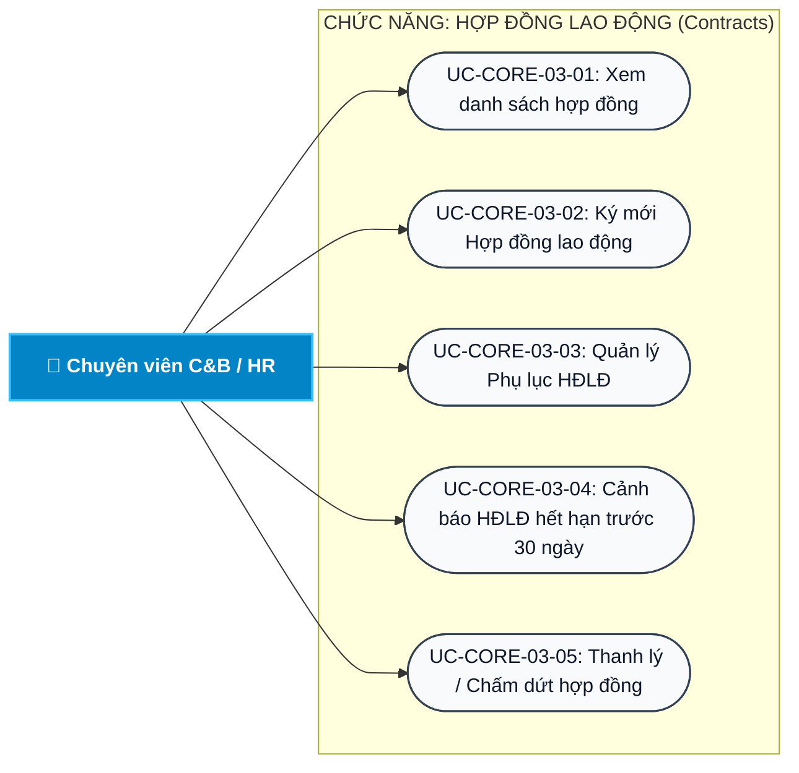

#### B. Bản đặc tả chi tiết nghiệp vụ từng Use Case con:

##### 📋 UC-CORE-03-01: Xem danh sách hợp đồng
- **Mã Use Case**: `UC-CORE-03-01`
- **Mục tiêu**: Theo dõi tình trạng các hợp đồng lao động của toàn bộ nhân sự trong công ty.
- **Tác nhân**: 👔 Chuyên viên C&B.
- **Luồng chính**: Mở "Hợp đồng lao động" $\rightarrow$ Xem bảng: Số hợp đồng, Nhân viên, Loại hợp đồng (Thử việc, 1 năm, Vô thời hạn), Lương cơ bản, Lương đóng bảo hiểm, Ngày bắt đầu, Ngày kết thúc, Trạng thái hiệu lực.

##### 📋 UC-CORE-03-02: Ký mới Hợp đồng lao động
- **Mã Use Case**: `UC-CORE-03-02`
- **Mục tiêu**: Thiết lập hợp đồng lao động chính thức cho nhân sự mới hoặc chuyển đổi sau thử việc.
- **Tác nhân**: 👔 Chuyên viên C&B.
- **Luồng chính**: Nhấn "+ Thêm hợp đồng" $\rightarrow$ Chọn nhân viên $\rightarrow$ Chọn Loại hợp đồng (Thử việc, Chính thức 1 năm, Không xác định thời hạn) $\rightarrow$ Nhập Lương cơ bản, Phụ cấp, Lương đóng bảo hiểm $\rightarrow$ Nhập Ngày bắt đầu và Ngày kết thúc $\rightarrow$ Lưu hợp đồng.

##### 📋 UC-CORE-03-03: Quản lý Phụ lục Hợp đồng lao động
- **Mã Use Case**: `UC-CORE-03-03`
- **Mục tiêu**: Theo dõi danh sách các phụ lục điều chỉnh lương và điều khoản gắn liền với từng hợp đồng gốc.
- **Tác nhân**: 👔 Chuyên viên C&B.
- **Luồng chính**: Mở chi tiết hợp đồng $\rightarrow$ Xem danh sách các phụ lục hợp đồng đã phát sinh theo thời gian (Số phụ lục, Ngày ký, Mức lương điều chỉnh mới).

##### 📋 UC-CORE-03-04: Cảnh báo tự động Hợp đồng hết hạn trước 30 ngày
- **Mã Use Case**: `UC-CORE-03-04`
- **Mục tiêu**: Giúp nhân sự chủ động thời gian làm thủ tục tái ký hoặc thanh lý theo luật lao động.
- **Tác nhân**: ⚙️ Hệ thống tự động.
- **Luồng chính**: Hệ thống tự động tính khoảng cách giữa ngày kết thúc hợp đồng với ngày hiện tại. Nếu còn $\le 30$ ngày, tự động gắn huy hiệu màu cam **"Sắp hết hạn"** và gửi thông báo nhắc nhở lên màn hình làm việc của HR.

##### 📋 UC-CORE-03-05: Thanh lý / Chấm dứt hợp đồng lao động
- **Mã Use Case**: `UC-CORE-03-05`
- **Mục tiêu**: Chuyển trạng thái hợp đồng sang Đã chấm dứt khi nhân viên thôi việc hoặc không tái ký.
- **Tác nhân**: 👔 HR Manager.
- **Luồng chính**: Chọn hợp đồng $\rightarrow$ Nhấn "Chấm dứt hợp đồng" $\rightarrow$ Nhập lý do thanh lý $\rightarrow$ Hợp đồng chuyển sang trạng thái "Đã chấm dứt".

---

## 3.5. PHÂN HỆ 5: CA LÀM VIỆC & CHẤM CÔNG (TIME & ATTENDANCE)

### 3.5.0. Sơ đồ Use Case Cấp 2: Chấm công & Ca làm việc
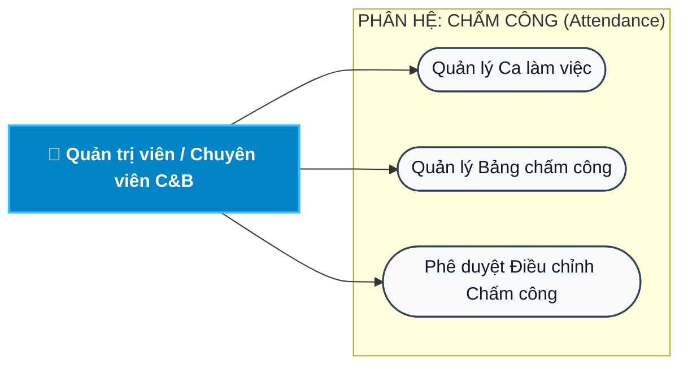

---

### 3.5.1. Chức năng Bảng Chấm công Tổng hợp (`Attendance.jsx`)

#### A. Sơ đồ Use Case Cấp 3: Bảng Chấm công
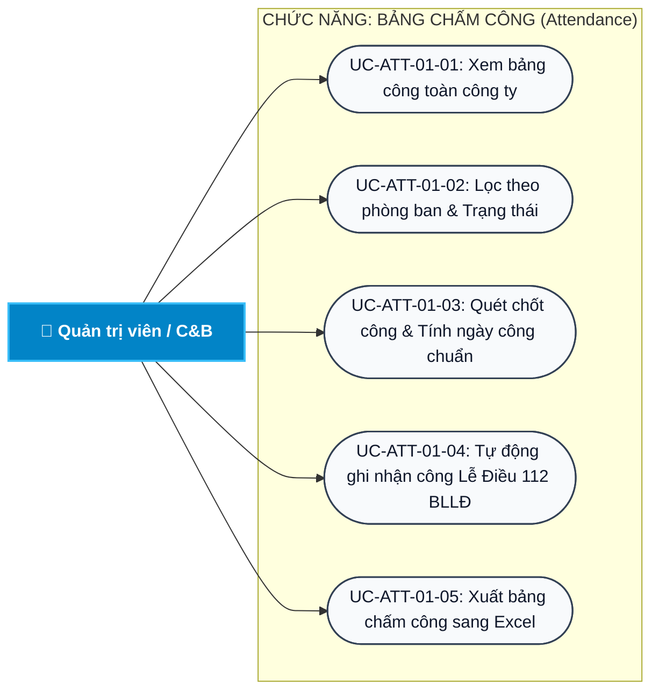

#### B. Bản đặc tả chi tiết nghiệp vụ từng Use Case con:

##### 📋 UC-ATT-01-01: Xem bảng công toàn công ty theo tháng
- **Mã Use Case**: `UC-ATT-01-01`
- **Mục tiêu**: Theo dõi tình hình đi làm thực tế của toàn bộ nhân viên trong tháng được chọn.
- **Tác nhân**: 👔 Chuyên viên C&B, Trưởng bộ phận.
- **Luồng chính**: Mở "Bảng công" $\rightarrow$ Chọn Tháng/Năm $\rightarrow$ Hệ thống hiển thị ma trận chấm công gồm: Mã NV, Họ tên, Phòng ban, các cột ngày từ mùng 1 đến ngày cuối tháng (hiển thị giờ vào/ra, ký hiệu công: Đ đủ công, N nghỉ phép, M đi muộn, V vắng mặt) và cột Tổng công thực tế.

##### 📋 UC-ATT-01-02: Lọc bảng công theo phòng ban & Trạng thái
- **Mã Use Case**: `UC-ATT-01-02`
- **Mục tiêu**: Giúp quản lý chỉ theo dõi bảng công thuộc phòng ban mình phụ trách hoặc lọc các nhân sự đi trễ/vắng mặt.
- **Tác nhân**: 👔 Trưởng bộ phận.
- **Luồng chính**: Chọn phòng ban trong dropdown hoặc lọc trạng thái "Đi muộn", "Vắng mặt" $\rightarrow$ Hệ thống lọc nhanh danh sách hiển thị tương ứng.

##### 📋 UC-ATT-01-03: Quét chốt công & Tự động tính ngày công chuẩn
- **Mã Use Case**: `UC-ATT-01-03`
- **Mục tiêu**: Tự động so khớp thời gian check-in/out thực tế với ca làm việc để quy đổi thành số ngày công (1.0 công, 0.5 công).
- **Tác nhân**: ⚙️ Hệ thống tự động / 👔 C&B.
- **Luồng chính**: Hệ thống quét dữ liệu điểm danh: Đi làm đủ 8 tiếng quy đổi thành 1.0 công; Đi làm từ 4 đến dưới 8 tiếng quy đổi thành 0.5 công; Vắng không lý do tính 0 công.

##### 📋 UC-ATT-01-04: Tự động ghi nhận công Nghỉ Lễ theo Điều 112 BLLĐ
- **Mã Use Case**: `UC-ATT-01-04`
- **Mục tiêu**: Đảm bảo quyền lợi hưởng nguyên lương ngày lễ tết theo đúng Bộ luật Lao động Việt Nam.
- **Tác nhân**: ⚙️ Hệ thống tự động.
- **Luồng chính**: Vào các ngày nghỉ lễ quốc gia theo lịch luật định (Tết Dương lịch, Tết Âm lịch, 30/4 - 1/5, Quốc khánh, Giỗ Tổ Hùng Vương), hệ thống tự động ghi nhận 1.0 ngày công chuẩn cho toàn thể nhân sự đang làm việc mà không bắt buộc nhân viên phải điểm danh.

##### 📋 UC-ATT-01-05: Xuất bảng chấm công sang file Excel
- **Mã Use Case**: `UC-ATT-01-05`
- **Mục tiêu**: Xuất bảng công dạng bảng tính để đối soát hoặc lưu trữ hồ sơ thanh tra lao động.
- **Tác nhân**: 👔 Chuyên viên C&B.
- **Luồng chính**: Nhấn nút "Xuất Excel" $\rightarrow$ Hệ thống tạo file bảng tính chi tiết ngày công từng ngày và tải về máy tính.

---

### 3.5.2. Chức năng Điều chỉnh Chấm công (`Adjustments.jsx`)

#### A. Sơ đồ Use Case Cấp 3: Điều chỉnh Chấm công
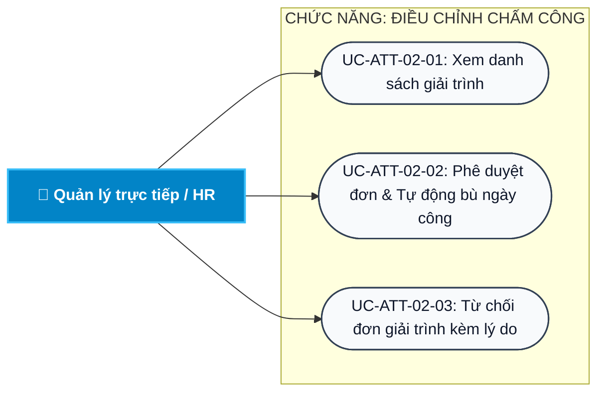

#### B. Bản đặc tả chi tiết nghiệp vụ từng Use Case con:

##### 📋 UC-ATT-02-01: Xem danh sách đơn giải trình chấm công
- **Mã Use Case**: `UC-ATT-02-01`
- **Mục tiêu**: Cấp quản lý xem các đề xuất bù giờ vào/ra do nhân viên quên chấm công hoặc lỗi máy quét.
- **Tác nhân**: 👔 Quản lý trực tiếp, HR.
- **Luồng chính**: Mở "Điều chỉnh công" $\rightarrow$ Xem danh sách: Nhân viên làm đơn, Ngày cần giải trình, Giờ vào/ra đề xuất bổ sung, Lý do giải trình (đi gặp khách hàng, quên quẹt thẻ) và Trạng thái (Chờ duyệt, Đã duyệt, Đã từ chối).

##### 📋 UC-ATT-02-02: Phê duyệt đơn & Tự động bù ngày công
- **Mã Use Case**: `UC-ATT-02-02`
- **Mục tiêu**: Chấp thuận lý do giải trình hợp lệ và tự động cập nhật lại ngày công trên bảng chấm công.
- **Tác nhân**: 👔 Quản lý trực tiếp.
- **Luồng chính**: Nhấn nút "Phê duyệt" $\rightarrow$ Hệ thống cập nhật trạng thái đơn thành "Đã duyệt", đồng thời tự động cập nhật lại giờ công hợp lệ và cộng bù ngày công tương ứng trên bảng chấm công tháng của nhân viên.

##### 📋 UC-ATT-02-03: Từ chối đơn giải trình kèm lý do
- **Mã Use Case**: `UC-ATT-02-03`
- **Mục tiêu**: Không chấp thuận các giải trình không có căn cứ hoặc vi phạm nội quy.
- **Tác nhân**: 👔 Quản lý trực tiếp.
- **Luồng chính**: Nhấn "Từ chối" $\rightarrow$ Nhập lý do từ chối (Không có xác nhận đi khách, giải trình quá hạn...) $\rightarrow$ Hệ thống chuyển trạng thái "Đã từ chối" và gửi thông báo phản hồi cho nhân viên.

---

## 3.6. PHÂN HỆ 6: NGHỈ PHÉP & LÀM THÊM GIỜ (LEAVE & OVERTIME)

### 3.6.0. Sơ đồ Use Case Cấp 2: Nghỉ phép & OT
```mermaid
flowchart LR
    ADMIN["👔 Quản lý / Chuyên viên HR"]

    subgraph MOD_LEA ["PHÂN HỆ: NGHỈ PHÉP & OT"]
        UC_SUB_LRQ(["Phê duyệt Đơn xin Nghỉ phép"])
        UC_SUB_LPOL(["Quản lý Quỹ phép năm & Thâm niên"])
        UC_SUB_OTM(["Phê duyệt Đăng ký Làm thêm giờ OT"])
    end

    ADMIN --> UC_SUB_LRQ
    ADMIN --> UC_SUB_LPOL
    ADMIN --> UC_SUB_OTM

    classDef actor fill:#0284c7,stroke:#38bdf8,stroke-width:2px,color:#ffffff,font-weight:bold;
    classDef uc fill:#f8fafc,stroke:#334155,stroke-width:1.5px,color:#0f172a;
    class ADMIN actor;
    class UC_SUB_LRQ,UC_SUB_LPOL,UC_SUB_OTM uc;
```

---

### 3.6.1. Chức năng Phê duyệt Nghỉ phép (`LeaveMgmt.jsx`)

#### A. Sơ đồ Use Case Cấp 3: Phê duyệt Nghỉ phép
```mermaid
flowchart LR
    ADMIN["👔 Quản lý trực tiếp / HR"]

    subgraph FUNC_LEA ["CHỨC NĂNG: QUẢN LÝ NGHỈ PHÉP"]
        UC1(["UC-LEA-01-01: Xem danh sách đơn nghỉ toàn công ty"])
        UC2(["UC-LEA-01-02: Kiểm tra số dư quỹ phép năm"])
        UC3(["UC-LEA-01-03: Phê duyệt đơn & Trừ quỹ phép năm"])
        UC4(["UC-LEA-01-04: Từ chối đơn xin nghỉ phép"])
        UC5(["UC-LEA-01-05: Theo dõi lịch nghỉ phòng ban"])
    end

    ADMIN --> UC1
    ADMIN --> UC2
    ADMIN --> UC3
    ADMIN --> UC4
    ADMIN --> UC5

    classDef actor fill:#0284c7,stroke:#38bdf8,stroke-width:2px,color:#ffffff,font-weight:bold;
    classDef uc fill:#f8fafc,stroke:#334155,stroke-width:1.5px,color:#0f172a;
    class ADMIN actor;
    class UC1,UC2,UC3,UC4,UC5 uc;
```

#### B. Bản đặc tả chi tiết nghiệp vụ từng Use Case con:

##### 📋 UC-LEA-01-01: Xem danh sách đơn xin nghỉ phép
- **Mã Use Case**: `UC-LEA-01-01`
- **Mục tiêu**: Quản lý tập trung toàn bộ các đơn xin nghỉ phép của nhân viên trong công ty.
- **Tác nhân**: 👔 Quản lý trực tiếp, HR.
- **Luồng chính**: Mở "Nghỉ phép" $\rightarrow$ Xem bảng danh sách đơn: Nhân viên, Loại nghỉ (Phép năm, Ốm đau, Nghỉ không lương), Buổi nghỉ (Sáng, Chiều, Cả ngày), Ngày bắt đầu, Ngày kết thúc, Số ngày nghỉ, Lý do và Trạng thái phê duyệt.

##### 📋 UC-LEA-01-02: Kiểm tra số dư quỹ phép năm của nhân viên
- **Mã Use Case**: `UC-LEA-01-02`
- **Mục tiêu**: Giúp người duyệt đối soát số ngày phép năm còn lại trước khi ra quyết định duyệt.
- **Tác nhân**: 👔 Quản lý trực tiếp.
- **Luồng chính**: Khi mở xem đơn nghỉ phép năm, hệ thống hiển thị kèm: Tổng quỹ phép năm được cấp, Số ngày phép đã sử dụng, Số ngày phép đang chờ duyệt và Số dư phép năm khả dụng.

##### 📋 UC-LEA-01-03: Phê duyệt đơn & Tự động trừ quỹ phép năm
- **Mã Use Case**: `UC-LEA-01-03`
- **Mục tiêu**: Chấp thuận cho nhân viên nghỉ phép và tự động khấu trừ số dư phép năm.
- **Tác nhân**: 👔 Quản lý trực tiếp.
- **Luồng chính**: Nhấn "Phê duyệt" $\rightarrow$ Hệ thống chuyển trạng thái đơn thành "Đã duyệt", chính thức trừ số ngày nghỉ vào Quỹ phép năm của nhân viên và đánh dấu nghỉ phép trên bảng chấm công.

##### 📋 UC-LEA-01-04: Từ chối đơn xin nghỉ phép
- **Mã Use Case**: `UC-LEA-01-04`
- **Mục tiêu**: Từ chối đơn xin nghỉ do công việc đột xuất hoặc trùng lịch trực.
- **Tác nhân**: 👔 Quản lý trực tiếp.
- **Luồng chính**: Nhấn "Từ chối" $\rightarrow$ Nhập lý do $\rightarrow$ Hệ thống hoàn trả số ngày phép đã bị tạm giữ (gỡ Soft-lock) về lại quỹ phép khả dụng của nhân viên.

##### 📋 UC-LEA-01-05: Theo dõi lịch nghỉ của toàn bộ phòng ban
- **Mã Use Case**: `UC-LEA-01-05`
- **Mục tiêu**: Nhìn tổng thể lịch vắng mặt của các nhân sự trong phòng ban để sắp xếp công việc và phân công người trực hợp lý.
- **Tác nhân**: 👔 Trưởng bộ phận.
- **Luồng chính**: Mở xem "Lịch nghỉ phòng ban" $\rightarrow$ Hệ thống hiển thị dạng lịch trực quan các ngày nhân viên vắng mặt.

---

### 3.6.2. Chức năng Làm thêm giờ OT (`OT.jsx` / `ot.routes.ts`)

#### A. Sơ đồ Use Case Cấp 3: Phê duyệt Làm thêm giờ OT
```mermaid
flowchart LR
    ADMIN["👔 Quản lý trực tiếp / HR"]

    subgraph FUNC_OT ["CHỨC NĂNG: PHÊ DUYỆT TĂNG CA (Overtime)"]
        UC1(["UC-LEA-02-01: Xem danh sách đăng ký OT"])
        UC2(["UC-LEA-02-02: Phê duyệt OT áp dụng hệ số BLLĐ (150%, 200%, 300%)"])
        UC3(["UC-LEA-02-03: Từ chối đăng ký OT"])
    end

    ADMIN --> UC1
    ADMIN --> UC2
    ADMIN --> UC3

    classDef actor fill:#0284c7,stroke:#38bdf8,stroke-width:2px,color:#ffffff,font-weight:bold;
    classDef uc fill:#f8fafc,stroke:#334155,stroke-width:1.5px,color:#0f172a;
    class ADMIN actor;
    class UC1,UC2,UC3 uc;
```

#### B. Bản đặc tả chi tiết nghiệp vụ từng Use Case con:

##### 📋 UC-LEA-02-01: Xem danh sách đăng ký làm thêm giờ
- **Mã Use Case**: `UC-LEA-02-01`
- **Mục tiêu**: Quản lý các đề xuất làm thêm giờ của nhân viên theo dự án hoặc khối lượng công việc.
- **Tác nhân**: 👔 Quản lý dự án, Trưởng phòng.
- **Luồng chính**: Mở danh sách đăng ký OT $\rightarrow$ Xem: Tên nhân viên, Ngày làm thêm, Khung giờ dự kiến, Số giờ đăng ký, Nội dung công việc cần làm thêm.

##### 📋 UC-LEA-02-02: Phê duyệt OT theo hệ số quy định của Điều 98 BLLĐ
- **Mã Use Case**: `UC-LEA-02-02`
- **Mục tiêu**: Duyệt số giờ làm thêm thực tế và tự động phân loại hệ số nhân lương theo đúng luật lao động.
- **Tác nhân**: 👔 Quản lý trực tiếp.
- **Luồng chính**: 
  1. Quản lý kiểm tra kết quả công việc và xác nhận số giờ OT thực tế.
  2. Bấm "Phê duyệt".
  3. Hệ thống tự động xác định ngày làm thêm và gán hệ số lương chuẩn:
     - Ngày làm việc bình thường: Nhân hệ số **150%**.
     - Ngày nghỉ hàng tuần (Thứ 7, CN): Nhân hệ số **200%**.
     - Ngày nghỉ lễ, Tết hưởng lương: Nhân hệ số **300%**.
  4. Số tiền OT được chuyển tự động vào bảng tính lương tháng.

##### 📋 UC-LEA-02-03: Từ chối đăng ký làm thêm giờ
- **Mã Use Case**: `UC-LEA-02-03`
- **Mục tiêu**: Không duyệt OT khi công việc không cấp thiết hoặc vượt trần ngân sách làm thêm.
- **Tác nhân**: 👔 Quản lý.
- **Luồng chính**: Nhấn "Từ chối" kèm lý do $\rightarrow$ Hệ thống thông báo cho nhân viên và không ghi nhận tính tiền OT.

---

## 3.7. PHÂN HỆ 7: ĐÁNH GIÁ HIỆU SUẤT KPI (PERFORMANCE MANAGEMENT)

### 3.7.0. Sơ đồ Use Case Cấp 2: Đánh giá Hiệu suất KPI
```mermaid
flowchart LR
    ADMIN["👔 HR / Trưởng bộ phận"]

    subgraph MOD_KPI ["PHÂN HỆ: ĐÁNH GIÁ HIỆU SUẤT (KPI)"]
        UC_SUB_TPL(["Quản lý Mẫu tiêu chí KPI"])
        UC_SUB_ASG(["Giao Mục tiêu KPI theo Chu kỳ"])
        UC_SUB_REV(["Chấm điểm & Xếp loại Force Ranking"])
    end

    ADMIN --> UC_SUB_TPL
    ADMIN --> UC_SUB_ASG
    ADMIN --> UC_SUB_REV

    classDef actor fill:#0284c7,stroke:#38bdf8,stroke-width:2px,color:#ffffff,font-weight:bold;
    classDef uc fill:#f8fafc,stroke:#334155,stroke-width:1.5px,color:#0f172a;
    class ADMIN actor;
    class UC_SUB_TPL,UC_SUB_ASG,UC_SUB_REV uc;
```

---

### 3.7.1. Chức năng Chấm điểm & Xếp loại Force Ranking (`Performance.jsx`)

#### A. Sơ đồ Use Case Cấp 3: Chấm điểm & Xếp loại Force Ranking
```mermaid
flowchart LR
    ADMIN["👔 Quản lý trực tiếp / Ban Giám đốc"]

    subgraph FUNC_KPI ["CHỨC NĂNG: CHẤM ĐIỂM & PHÂN BỔ XẾP HẠNG"]
        UC1(["UC-KPI-01-01: Xem danh sách đánh giá chu kỳ"])
        UC2(["UC-KPI-01-02: Xem điểm tự chấm của nhân viên"])
        UC3(["UC-KPI-01-03: Quản lý chấm điểm & Ghi nhận xét"])
        UC4(["UC-KPI-01-04: Phân bổ xếp loại Force Ranking (20-60-20)"])
        UC5(["UC-KPI-01-05: Chốt duyệt kỳ đánh giá hiệu suất"])
    end

    ADMIN --> UC1
    ADMIN --> UC2
    ADMIN --> UC3
    ADMIN --> UC4
    ADMIN --> UC5

    classDef actor fill:#0284c7,stroke:#38bdf8,stroke-width:2px,color:#ffffff,font-weight:bold;
    classDef uc fill:#f8fafc,stroke:#334155,stroke-width:1.5px,color:#0f172a;
    class ADMIN actor;
    class UC1,UC2,UC3,UC4,UC5 uc;
```

#### B. Bản đặc tả chi tiết nghiệp vụ từng Use Case con:

##### 📋 UC-KPI-01-01: Xem danh sách đánh giá theo chu kỳ
- **Mã Use Case**: `UC-KPI-01-01`
- **Mục tiêu**: Theo dõi tiến độ chấm điểm hiệu suất của toàn thể nhân sự theo từng chu kỳ (Quý 1, Quý 2, Cả năm).
- **Tác nhân**: 👔 HR Manager, Trưởng bộ phận.
- **Luồng chính**: Mở "Đánh giá KPI" $\rightarrow$ Chọn chu kỳ $\rightarrow$ Xem bảng tổng hợp: Tên nhân viên, Phòng ban, Điểm nhân viên tự chấm, Điểm quản lý chấm, Điểm tổng kết, Xếp loại hiệu suất.

##### 📋 UC-KPI-01-02: Xem điểm tự đánh giá của nhân viên
- **Mã Use Case**: `UC-KPI-01-02`
- **Mục tiêu**: Tham khảo kết quả tự nhận xét và tự chấm điểm của cấp dưới đối với các mục tiêu công việc được giao.
- **Tác nhân**: 👔 Quản lý trực tiếp.
- **Luồng chính**: Nhấp vào hồ sơ đánh giá của nhân viên $\rightarrow$ Xem số liệu tự khai (Mục tiêu giao, Thực tế đạt được, Tỷ lệ hoàn thành %, Điểm tự chấm).

##### 📋 UC-KPI-01-03: Quản lý chấm điểm & Nhận xét hiệu suất
- **Mã Use Case**: `UC-KPI-01-03`
- **Mục tiêu**: Cấp quản lý trực tiếp đưa ra điểm đánh giá chính thức và phản hồi định hướng phát triển cho nhân viên.
- **Tác nhân**: 👔 Quản lý trực tiếp.
- **Luồng chính**: Nhập điểm số của quản lý cho từng tiêu chí $\rightarrow$ Nhập nhận xét cụ thể về đóng góp, thái độ và kỹ năng $\rightarrow$ Nhấn "Lưu kết quả chấm điểm".

##### 📋 UC-KPI-01-04: Tự động phân bổ xếp loại Force Ranking (20% - 60% - 20%)
- **Mã Use Case**: `UC-KPI-01-04`
- **Mục tiêu**: Tránh tình trạng cào bằng điểm số hoặc chấm điểm theo cảm tính, chuẩn hóa theo mô hình phân loại hiệu suất doanh nghiệp.
- **Tác nhân**: ⚙️ Hệ thống tự động / 👔 Ban Giám đốc.
- **Luồng chính**: Hệ thống sắp xếp bảng điểm từ cao xuống thấp và hỗ trợ gợi ý phân bổ tỷ lệ:
  - **20% Xuất sắc (Loại A)**: Dành cho các nhân sự hoàn thành vượt mức chỉ tiêu.
  - **60% Đạt yêu cầu (Loại B)**: Dành cho nhân sự hoàn thành đúng tiến độ và chất lượng.
  - **20% Cần cải thiện (Loại C)**: Dành cho nhân sự chưa đạt chỉ tiêu, cần lập kế hoạch cải thiện.

##### 📋 UC-KPI-01-05: Chốt duyệt kỳ đánh giá hiệu suất
- **Mã Use Case**: `UC-KPI-01-05`
- **Mục tiêu**: Ban Giám đốc phê duyệt kết quả cuối cùng làm căn cứ xét thưởng Tết và xét tăng lương định kỳ.
- **Tác nhân**: 👔 Ban Giám đốc.
- **Luồng chính**: Bấm "Chốt kỳ đánh giá" $\rightarrow$ Kết quả được khóa lại, gửi thông báo xếp loại về Cổng ESS của nhân viên và chuyển sang hồ sơ nhân sự.

---

## 3.8. PHÂN HỆ 8: TIỀN LƯƠNG & GROSS-TO-NET (PAYROLL ENGINE)

### 3.8.0. Sơ đồ Use Case Cấp 2: Tiền lương & Phúc lợi
```mermaid
flowchart LR
    ADMIN["👔 Kế toán Lương / HR / Admin"]

    subgraph MOD_PAY ["PHÂN HỆ: TIỀN LƯƠNG (Payroll)"]
        UC_SUB_PER(["Quản lý & Thiết lập Kỳ lương"])
        UC_SUB_CALC(["Chạy Động cơ Lương Gross-to-Net"])
        UC_SUB_SLIP(["Xuất Bảng lương & Phiếu lương"])
        UC_SUB_LOCK(["Phê duyệt & Khóa sổ Kỳ lương"])
    end

    ADMIN --> UC_SUB_PER
    ADMIN --> UC_SUB_CALC
    ADMIN --> UC_SUB_SLIP
    ADMIN --> UC_SUB_LOCK

    classDef actor fill:#0284c7,stroke:#38bdf8,stroke-width:2px,color:#ffffff,font-weight:bold;
    classDef uc fill:#f8fafc,stroke:#334155,stroke-width:1.5px,color:#0f172a;
    class ADMIN actor;
    class UC_SUB_PER,UC_SUB_CALC,UC_SUB_SLIP,UC_SUB_LOCK uc;
```

---

### 3.8.1. Chức năng Chạy Bảng lương Gross-to-Net (`Payroll.jsx`)

#### A. Sơ đồ Use Case Cấp 3: Bảng lương Gross-to-Net
```mermaid
flowchart LR
    ADMIN["👔 Kế toán trưởng / HR Admin"]

    subgraph FUNC_PAY ["CHỨC NĂNG: BẢNG LƯƠNG GROSS-TO-NET"]
        UC1(["UC-PAY-01-01: Xem bảng lương tổng hợp"])
        UC2(["UC-PAY-01-02: Chạy tính toán lương tự động"])
        UC3(["UC-PAY-01-03: Khóa / Mở khóa sổ kỳ lương"])
        UC4(["UC-PAY-01-04: Tạm khóa chi trả do thiếu hồ sơ cứng"])
        UC5(["UC-PAY-01-05: Xem chi tiết phiếu lương điện tử"])
        UC6(["UC-PAY-01-06: Xuất file chi trả ngân hàng"])
    end

    ADMIN --> UC1
    ADMIN --> UC2
    ADMIN --> UC3
    ADMIN --> UC4
    ADMIN --> UC5
    ADMIN --> UC6

    classDef actor fill:#0284c7,stroke:#38bdf8,stroke-width:2px,color:#ffffff,font-weight:bold;
    classDef uc fill:#f8fafc,stroke:#334155,stroke-width:1.5px,color:#0f172a;
    class ADMIN actor;
    class UC1,UC2,UC3,UC4,UC5,UC6 uc;
```

#### B. Bản đặc tả chi tiết nghiệp vụ từng Use Case con:

##### 📋 UC-PAY-01-01: Xem bảng lương tổng hợp nhân viên
- **Mã Use Case**: `UC-PAY-01-01`
- **Mục tiêu**: Theo dõi chi tiết thu nhập, các khoản khấu trừ và số tiền thực lĩnh của toàn công ty theo từng kỳ lương.
- **Tác nhân**: 👔 Kế toán trưởng, Giám đốc Nhân sự.
- **Luồng chính**: Mở "Bảng lương" $\rightarrow$ Chọn Tháng/Năm $\rightarrow$ Xem bảng: Mã NV, Họ tên, Phòng ban, Lương cơ bản, Số ngày công thực tế, Tổng thu nhập Gross, Trừ bảo hiểm 10.5%, Giảm trừ gia cảnh, Thuế TNCN lũy tiến, Thực lĩnh Net, Trạng thái chi trả.

##### 📋 UC-PAY-01-02: Chạy tính toán lương tự động Gross-to-Net
- **Mã Use Case**: `UC-PAY-01-02`
- **Mục tiêu**: Tự động tính toán lương Net bằng cách tích hợp ngày công thực tế, tiền làm thêm giờ (OT), trích bảo hiểm bắt buộc 10.5%, giảm trừ gia cảnh và tính thuế TNCN 7 bậc.
- **Tác nhân**: 👔 Kế toán Lương, Chuyên viên C&B.
- **Tiền điều kiện**: Kỳ lương đang ở trạng thái Bản nháp (`DRAFT`).
- **Luồng chính**:
  1. Người dùng chọn kỳ lương và nhấn **"⚡ Tính toán bảng lương"**.
  2. Xác nhận tính toán $\rightarrow$ Hệ thống tự động thực hiện:
     - Tính lương thời gian theo tỷ lệ ngày công thực tế đi làm / ngày công chuẩn 22 ngày.
     - Cộng tiền làm thêm giờ (OT hệ số 1.5, 2.0, 3.0) và phụ cấp cố định $\rightarrow$ Tổng thu nhập Gross.
     - Trích nộp 10.5% bảo hiểm người lao động đóng (BHXH 8%, BHYT 1.5%, BHTN 1%).
     - Trừ giảm trừ gia cảnh: 11 triệu đồng bản thân + 4.4 triệu đồng cho mỗi người phụ thuộc hợp lệ.
     - Áp dụng Biểu thuế lũy tiến từng phần 7 bậc (5% đến 35%) để tính Thuế TNCN.
     - Xác định tiền lương thực nhận Net = Gross - Bảo hiểm - Thuế TNCN.
     - Quét chế tài hồ sơ cứng: Nếu nhân sự mới quá 7 ngày chưa nộp đủ giấy tờ gốc $\rightarrow$ Tự động gắn cờ tạm giữ lương.
  3. Hệ thống thông báo thành công và hiển thị bảng lương chi tiết.
- **Luồng ngoại lệ**: Nếu kỳ lương đã bị khóa sổ $\rightarrow$ Hệ thống từ chối tính lại và báo lỗi: *"Kỳ lương đã bị KHÓA SỔ. Cần mở khóa trước khi chạy lại!"*.

##### 📋 UC-PAY-01-03: Khóa / Mở khóa sổ kỳ lương (Strict Lockout Rule)
- **Mã Use Case**: `UC-PAY-01-03`
- **Mục tiêu**: Đóng băng bảng lương sang trạng thái Chỉ đọc (Read-Only) sau khi Ban Giám đốc duyệt, ngăn chặn tuyệt đối mọi hành vi sửa đổi dữ liệu hồi tố.
- **Tác nhân**: 👔 Kế toán trưởng, Ban Giám đốc.
- **Luồng chính**: Nhấn "🔒 Khóa Sổ" $\rightarrow$ Xác nhận $\rightarrow$ Kỳ lương chuyển sang trạng thái **`ĐÃ KHÓA SỔ`**, nút tính toán bị vô hiệu hóa, toàn bộ chứng từ được bảo toàn bất biến phục vụ kế toán chi trả ngân hàng.

##### 📋 UC-PAY-01-04: Tạm khóa chi trả lương do chậm nộp hồ sơ cứng
- **Mã Use Case**: `UC-PAY-01-04`
- **Mục tiêu**: Chế tài hành chính tự động giữ lệnh chi trả lương tháng đầu tiên đối với nhân viên mới quá 7 ngày làm việc chưa nộp đủ hồ sơ gốc bản cứng (CCCD sao y, Giấy khám sức khỏe, Bằng cấp công chứng).
- **Tác nhân**: ⚙️ Hệ thống tự động / 👔 HR (mở khóa khi đã nộp đủ).
- **Luồng chính**: Khi chạy lương, hệ thống gắn cờ "Tạm khóa chi trả" đối với nhân sự nộp thiếu hồ sơ. Khi nhân viên nộp đủ bản cứng, HR nhấn nút "Mở khóa chi trả" $\rightarrow$ Kế toán mới được phép xuất lệnh chuyển tiền.

##### 📋 UC-PAY-01-05: Xem chi tiết phiếu lương điện tử
- **Mã Use Case**: `UC-PAY-01-05`
- **Mục tiêu**: Mở phiếu lương dạng phiếu chi tiết của từng nhân viên để đối soát hoặc in ấn.
- **Tác nhân**: 👔 Kế toán, HR.
- **Luồng chính**: Nhấn vào dòng nhân viên $\rightarrow$ Xem phiếu lương gồm 3 phần: Thu nhập Gross, Các khoản khấu trừ (BHXH 10.5%, Thuế TNCN), và Lương thực nhận Net.

##### 📋 UC-PAY-01-06: Xuất file chi trả ngân hàng (CSV / Excel)
- **Mã Use Case**: `UC-PAY-01-06`
- **Mục tiêu**: Xuất danh sách chi trả gồm Số tài khoản, Tên chủ tài khoản, Ngân hàng và Số tiền Net để chuyển sang hệ thống Ngân hàng điện tử.
- **Tác nhân**: 👔 Kế toán thanh toán.
- **Luồng chính**: Nhấn "Xuất file ngân hàng" $\rightarrow$ Hệ thống tạo file theo đúng định dạng chi trả lương ngân hàng.

---

## 3.9. PHÂN HỆ 9: QUẢN LÝ TÀI SẢN & THIẾT BỊ IT (ASSET MANAGEMENT)

### 3.9.0. Sơ đồ Use Case Cấp 2: Quản lý Tài sản
```mermaid
flowchart LR
    ADMIN["👔 Cán bộ Hành chính - IT"]

    subgraph MOD_AST ["PHÂN HỆ: QUẢN LÝ TÀI SẢN (Assets)"]
        UC_SUB_INV(["Quản lý Kho Thiết bị Định danh Serial"])
        UC_SUB_ASN(["Bàn giao Onboarding Combo (BM-01)"])
        UC_SUB_RET(["Thu hồi Thôi việc & Bồi thường (BM-02)"])
    end

    ADMIN --> UC_SUB_INV
    ADMIN --> UC_SUB_ASN
    ADMIN --> UC_SUB_RET

    classDef actor fill:#0284c7,stroke:#38bdf8,stroke-width:2px,color:#ffffff,font-weight:bold;
    classDef uc fill:#f8fafc,stroke:#334155,stroke-width:1.5px,color:#0f172a;
    class ADMIN actor;
    class UC_SUB_INV,UC_SUB_ASN,UC_SUB_RET uc;
```

---

### 3.9.1. Chức năng Bàn giao BM-01 & Thu hồi BM-02 (`AssetAssignments.jsx`)

#### A. Sơ đồ Use Case Cấp 3: Bàn giao & Thu hồi Tài sản
```mermaid
flowchart LR
    ADMIN["👔 Cán bộ Hành chính - IT"]

    subgraph FUNC_ASN ["CHỨC NĂNG: BÀN GIAO & THU HỒI TÀI SẢN"]
        UC1(["UC-AST-01-01: Xem lịch sử cấp phát theo nhân viên"])
        UC2(["UC-AST-01-02: Bàn giao Combo Onboarding & In BM-01"])
        UC3(["UC-AST-01-03: Thu hồi Thôi việc & Xuất BM-02"])
        UC4(["UC-AST-01-04: Xử lý Bồi thường hư hỏng (Điều 129 BLLĐ)"])
        UC5(["UC-AST-01-05: Xác nhận Xóa an toàn dữ liệu (Security Wipe)"])
    end

    ADMIN --> UC1
    ADMIN --> UC2
    ADMIN --> UC3
    ADMIN --> UC4
    ADMIN --> UC5

    classDef actor fill:#0284c7,stroke:#38bdf8,stroke-width:2px,color:#ffffff,font-weight:bold;
    classDef uc fill:#f8fafc,stroke:#334155,stroke-width:1.5px,color:#0f172a;
    class ADMIN actor;
    class UC1,UC2,UC3,UC4,UC5 uc;
```

#### B. Bản đặc tả chi tiết nghiệp vụ từng Use Case con:

##### 📋 UC-AST-01-01: Xem lịch sử cấp phát tài sản theo nhân viên
- **Mã Use Case**: `UC-AST-01-01`
- **Mục tiêu**: Theo dõi các thiết bị mà mỗi nhân viên đang trực tiếp quản lý và sử dụng.
- **Tác nhân**: 👔 Cán bộ IT, Quản trị viên.
- **Luồng chính**: Mở "Bàn giao & Thu hồi" $\rightarrow$ Xem danh sách: Tên nhân viên, Phòng ban, Danh mục thiết bị đang giữ, Số biên bản bàn giao, Ngày nhận, Trạng thái (Đang sử dụng, Đã thu hồi).

##### 📋 UC-AST-01-02: Lập Biên bản Bàn giao Onboarding (Biểu mẫu BM-01)
- **Mã Use Case**: `UC-AST-01-02`
- **Mục tiêu**: Cấp phát trọn bộ thiết bị làm việc cho nhân viên mới và xuất biên bản bàn giao pháp lý mẫu **BM-01 (BBBG-LLA)**.
- **Tác nhân**: 👔 Cán bộ Hành chính - IT, Nhân viên mới.
- **Luồng chính**:
  1. Chọn nhân viên mới và chọn gói combo thiết bị (Thân máy PC/Laptop, 02 Màn hình làm việc, Bàn phím chuột, Thẻ ra vào).
  2. Hệ thống tự động sinh số biên bản: `Số/YYYY/BBBG-LLA`.
  3. Nhấn "Xác nhận cấp phát & In biên bản".
  4. Hệ thống chuyển trạng thái các thiết bị sang "Đang sử dụng", gắn trách nhiệm vật chất vào hồ sơ nhân viên và xuất mẫu in biên bản bàn giao có đầy đủ chữ ký 3 bên (Người giao, Người nhận, Trưởng bộ phận).

##### 📋 UC-AST-01-03: Thu hồi Thiết bị khi Thôi việc (Biểu mẫu BM-02)
- **Mã Use Case**: `UC-AST-01-03`
- **Mục tiêu**: Thu hồi lại toàn bộ trang thiết bị khi nhân sự rời công ty để nhập lại kho.
- **Tác nhân**: 👔 Cán bộ IT, Nhân sự thôi việc.
- **Luồng chính**: Chọn nhân sự thôi việc $\rightarrow$ Kiểm tra hiện trạng từng món thiết bị $\rightarrow$ Nhấn "Hoàn tất thu hồi" $\rightarrow$ Hệ thống nhập lại thiết bị vào kho ở trạng thái "Sẵn sàng cấp phát" và xuất biên bản thu hồi BM-02.

##### 📋 UC-AST-01-04: Xử lý Bồi thường thiệt hại tài sản (Điều 129 BLLĐ)
- **Mã Use Case**: `UC-AST-01-04`
- **Mục tiêu**: Ghi nhận trách nhiệm vật chất đối với các thiết bị bị làm mất mát hoặc hư hỏng do lỗi chủ quan.
- **Tác nhân**: 👔 Cán bộ IT, Kế toán.
- **Luồng chính**: Khi thu hồi, nếu phát hiện máy vỡ màn hình hoặc mất phụ kiện $\rightarrow$ Nhập số tiền bồi thường thiệt hại và lý do $\rightarrow$ Số tiền này được kẹp vào biên bản BM-02 làm căn cứ khấu trừ vào lương tháng cuối (khấu trừ không quá 30% lương theo Điều 102 BLLĐ).

##### 📋 UC-AST-01-05: Xác nhận Xóa an toàn dữ liệu công vụ (Security Wipe)
- **Mã Use Case**: `UC-AST-01-05`
- **Mục tiêu**: Tuân thủ an toàn thông tin và bảo vệ dữ liệu cá nhân theo Nghị định 13/2023/NĐ-CP trước khi bàn giao máy cho người khác.
- **Tác nhân**: 👔 Cán bộ Kỹ thuật IT.
- **Luồng chính**: Kỹ thuật viên IT cài lại hệ điều hành, xóa sạch dữ liệu bí mật công ty trên máy tính $\rightarrow$ Tích chọn xác nhận **"Đã xóa an toàn dữ liệu (Security Wipe)"** trên biên bản BM-02.

---

## 3.10. PHÂN HỆ 10: THÔI VIỆC & BÀN GIAO (OFFBOARDING)

### 3.10.0. Sơ đồ Use Case Cấp 2: Thôi việc & Bàn giao
```mermaid
flowchart LR
    ADMIN["👔 Quản trị viên / HR Manager"]

    subgraph MOD_OFFB ["PHÂN HỆ: THÔI VIỆC & BÀN GIAO (Offboarding)"]
        UC_SUB_INIT(["Khởi tạo Quy trình Thôi việc"])
        UC_SUB_OGC(["Kiểm soát Checklist Bàn giao Đa phòng ban"])
        UC_SUB_HIST(["Sổ Lịch sử Thôi việc & Quyết toán"])
    end

    ADMIN --> UC_SUB_INIT
    ADMIN --> UC_SUB_OGC
    ADMIN --> UC_SUB_HIST

    classDef actor fill:#0284c7,stroke:#38bdf8,stroke-width:2px,color:#ffffff,font-weight:bold;
    classDef uc fill:#f8fafc,stroke:#334155,stroke-width:1.5px,color:#0f172a;
    class ADMIN actor;
    class UC_SUB_INIT,UC_SUB_OGC,UC_SUB_HIST uc;
```

---

### 3.10.1. Chức năng Quy trình Thôi việc (`OffboardingInitiate.jsx` / `OffboardingChecklist.jsx`)

#### A. Sơ đồ Use Case Cấp 3: Quy trình Thôi việc & Khóa 18:00
```mermaid
flowchart LR
    ADMIN["👔 HR Manager / Ban Giám đốc"]

    subgraph FUNC_OFFB ["CHỨC NĂNG: QUY TRÌNH THÔI VIỆC"]
        UC1(["UC-OFFB-01-01: Khởi tạo hồ sơ thôi việc"])
        UC2(["UC-OFFB-01-02: Chốt chặn 2 Chiều Bàn giao Tài sản & Việc"])
        UC3(["UC-OFFB-01-03: Kích hoạt Khóa An ninh Tự động lúc 18:00"])
        UC4(["UC-OFFB-01-04: Quyết toán Thôi việc theo Điều 48 BLLĐ"])
    end

    ADMIN --> UC1
    ADMIN --> UC2
    ADMIN --> UC3
    ADMIN --> UC4

    classDef actor fill:#0284c7,stroke:#38bdf8,stroke-width:2px,color:#ffffff,font-weight:bold;
    classDef uc fill:#f8fafc,stroke:#334155,stroke-width:1.5px,color:#0f172a;
    class ADMIN actor;
    class UC1,UC2,UC3,UC4 uc;
```

#### B. Bản đặc tả chi tiết nghiệp vụ từng Use Case con:

##### 📋 UC-OFFB-01-01: Khởi tạo hồ sơ thôi việc
- **Mã Use Case**: `UC-OFFB-01-01`
- **Mục tiêu**: Tiếp nhận đơn xin nghỉ việc hoặc ban hành quyết định chấm dứt hợp đồng, ấn định ngày làm việc cuối cùng.
- **Tác nhân**: 👔 Trưởng bộ phận, Giám đốc Nhân sự.
- **Luồng chính**: Nhập thông tin nhân sự nghỉ việc, Lý do thôi việc, Ngày làm việc cuối cùng được duyệt $\rightarrow$ Khởi tạo quy trình bàn giao.

##### 📋 UC-OFFB-01-02: Chốt chặn 2 Chiều Bàn giao Công việc & Tài sản
- **Mã Use Case**: `UC-OFFB-01-02`
- **Mục tiêu**: Ngăn chặn thất thoát thiết bị hoặc bỏ dở công việc dự án trước khi thanh toán tiền lương thôi việc.
- **Tác nhân**: 👔 Trưởng phòng, Cán bộ IT, Kế toán.
- **Luồng chính**: Hệ thống kiểm tra 2 điều kiện cứng: Hoàn thành 100% checklist bàn giao công việc cho đồng nghiệp + Thu hồi 100% tài sản qua biên bản BM-02. Nếu chưa hoàn tất, nút duyệt quyết toán lương thôi việc bị khóa hoàn toàn.

##### 📋 UC-OFFB-01-03: Kích hoạt Khóa An ninh Tự động lúc 18:00
- **Mã Use Case**: `UC-OFFB-01-03`
- **Mục tiêu**: Tự động thu hồi toàn bộ quyền truy cập hệ thống đúng thời điểm kết thúc ngày làm việc cuối cùng.
- **Tác nhân**: ⚙️ Hệ thống tự động.
- **Luồng chính**: Đúng **18:00 ngày làm việc cuối cùng** đã được phê duyệt của nhân viên, hệ thống tự động khóa tài khoản đăng nhập Cổng ESS, cắt mọi phiên truy cập dữ liệu nội bộ.

##### 📋 UC-OFFB-01-04: Quyết toán Thôi việc theo Điều 48 BLLĐ trong 14 ngày
- **Mã Use Case**: `UC-OFFB-01-04`
- **Mục tiêu**: Chốt ngày công tháng cuối, thanh toán tiền phép năm chưa nghỉ hết, cấn trừ bồi thường tài sản và hoàn tất chi trả trong vòng 14 ngày làm việc theo luật lao động.
- **Tác nhân**: 👔 Kế toán trưởng, Giám đốc Nhân sự.
- **Luồng chính**: Tổng hợp ngày công thực tế tháng cuối + Tiền lương của các ngày phép năm còn tồn - Khoản bồi thường tài sản hư hỏng $\rightarrow$ Phê duyệt bảng quyết toán chi trả thôi việc và chuyển trạng thái nhân sự sang `ĐÃ THÔI VIỆC (RESIGNED)`.

---

## 3.11. PHÂN HỆ 11: BÁO CÁO PHÂN TÍCH & QUẢN TRỊ HỆ THỐNG

### 3.11.0. Sơ đồ Use Case Cấp 2: Báo cáo & Hệ thống
```mermaid
flowchart LR
    ADMIN["👔 Quản trị viên Cấp cao"]

    subgraph MOD_SYS ["PHÂN HỆ: BÁO CÁO & HỆ THỐNG (System & Analytics)"]
        UC_SUB_REP(["Dashboard Báo cáo Nhân sự"])
        UC_SUB_PAR(["Quản trị Tham số Nghiệp vụ Động"])
        UC_SUB_AUD(["Tra cứu Nhật ký Kiểm toán (Audit Log)"])
    end

    ADMIN --> UC_SUB_REP
    ADMIN --> UC_SUB_PAR
    ADMIN --> UC_SUB_AUD

    classDef actor fill:#0284c7,stroke:#38bdf8,stroke-width:2px,color:#ffffff,font-weight:bold;
    classDef uc fill:#f8fafc,stroke:#334155,stroke-width:1.5px,color:#0f172a;
    class ADMIN actor;
    class UC_SUB_REP,UC_SUB_PAR,UC_SUB_AUD uc;
```

---

### 3.11.1. Chức năng Báo cáo & Quản trị Hệ thống (`ReportsDashboard.jsx` / `SystemParameters.jsx`)

#### A. Sơ đồ Use Case Cấp 3: Báo cáo & Hệ thống
```mermaid
flowchart LR
    ADMIN["👔 Quản trị viên Cấp cao / Ban Giám đốc"]

    subgraph FUNC_SYS ["CHỨC NĂNG: BÁO CÁO & HỆ THỐNG"]
        UC1(["UC-SYS-01-01: Xem Dashboard Phân tích Nhân sự"])
        UC2(["UC-SYS-01-02: Điều chỉnh Tham số Nghiệp vụ Động"])
        UC3(["UC-SYS-01-03: Tra cứu Nhật ký Kiểm toán Audit Log"])
    end

    ADMIN --> UC1
    ADMIN --> UC2
    ADMIN --> UC3

    classDef actor fill:#0284c7,stroke:#38bdf8,stroke-width:2px,color:#ffffff,font-weight:bold;
    classDef uc fill:#f8fafc,stroke:#334155,stroke-width:1.5px,color:#0f172a;
    class ADMIN actor;
    class UC1,UC2,UC3 uc;
```

#### B. Bản đặc tả chi tiết nghiệp vụ từng Use Case con:

##### 📋 UC-SYS-01-01: Xem Dashboard Phân tích Nhân sự (HR Analytics)
- **Mã Use Case**: `UC-SYS-01-01`
- **Mục tiêu**: Cung cấp các biểu đồ thống kê trực quan về tổng quân số, tỷ lệ biến động nhân sự, cơ cấu theo phòng ban, độ tuổi, giới tính và thâm niên.
- **Tác nhân**: 👔 Ban Giám đốc, Giám đốc Nhân sự.
- **Luồng chính**: Mở "Báo cáo" $\rightarrow$ Xem các thẻ chỉ số đo lường hiệu quả (KPIs), biểu đồ tròn phân bổ nhân sự theo phòng ban, biểu đồ cột biến động nhân sự các tháng trong năm.

##### 📋 UC-SYS-01-02: Điều chỉnh Tham số Nghiệp vụ Động (`SystemSetting`)
- **Mã Use Case**: `UC-SYS-01-02`
- **Mục tiêu**: Cho phép quản trị viên điều chỉnh các tỷ lệ luật định (Tỷ lệ BHXH, Mức giảm trừ gia cảnh, Số công chuẩn) trực tiếp từ giao diện mà không phải sửa mã nguồn khi chính sách thay đổi.
- **Tác nhân**: 👔 Quản trị viên cấp cao.
- **Luồng chính**: Mở "Tham số hệ thống" $\rightarrow$ Điều chỉnh mức giảm trừ bản thân (11M) hoặc tỷ lệ đóng bảo hiểm (10.5%) $\rightarrow$ Nhấn "Lưu cấu hình". Động cơ tính lương sẽ tự động áp dụng giá trị mới ngay trong kỳ tiếp theo.

##### 📋 UC-SYS-01-03: Tra cứu Nhật ký Kiểm toán Hệ thống (Audit Logs)
- **Mã Use Case**: `UC-SYS-01-03`
- **Mục tiêu**: Giám sát và truy cứu trách nhiệm mọi hành vi nhạy cảm trên hệ thống (Thêm nhân viên, Sửa lương, Phê duyệt đơn, Xóa phòng ban, Khóa kỳ lương).
- **Tác nhân**: 👔 Quản trị viên An ninh hệ thống, Ban Kiểm soát.
- **Luồng chính**: Mở "Nhật ký hệ thống" $\rightarrow$ Lọc theo Thời gian, Người thực hiện, Hành vi hoặc Bảng dữ liệu $\rightarrow$ Xem chi tiết dữ liệu trước và sau khi thay đổi được ghi vết bất biến.

---

## 3.12. CỔNG TỰ PHỤC VỤ NHÂN VIÊN (EMPLOYEE ESS PORTAL)

### 3.12.0. Sơ đồ Use Case Cấp 2: Cổng Nhân viên ESS
```mermaid
flowchart LR
    EMP["👤 Nhân viên (Employee)"]

    subgraph MOD_ESS ["CỔNG NHÂN VIÊN TỰ PHỤC VỤ (ESS)"]
        UC_SUB_ATT(["Chấm công & Giải trình công"])
        UC_SUB_LEA(["Quản lý Nghỉ phép Cá nhân"])
        UC_SUB_PAY(["Tra cứu Phiếu lương Bảo mật"])
        UC_SUB_KPI(["Mục tiêu & Tự đánh giá KPI"])
    end

    EMP --> UC_SUB_ATT
    EMP --> UC_SUB_LEA
    EMP --> UC_SUB_PAY
    EMP --> UC_SUB_KPI

    classDef actor fill:#0284c7,stroke:#38bdf8,stroke-width:2px,color:#ffffff,font-weight:bold;
    classDef uc fill:#f8fafc,stroke:#334155,stroke-width:1.5px,color:#0f172a;
    class EMP actor;
    class UC_SUB_ATT,UC_SUB_LEA,UC_SUB_PAY,UC_SUB_KPI uc;
```

---

### 3.12.1. Chức năng Phiếu lương Cá nhân Bảo mật (`EmployeePayslip.jsx`)

#### A. Sơ đồ Use Case Cấp 3: Phiếu lương Cá nhân ESS
```mermaid
flowchart LR
    EMP["👤 Nhân viên (Employee)"]

    subgraph FUNC_ESS_PAY ["CỔNG ESS: PHIẾU LƯƠNG CÁ NHÂN"]
        UC1(["UC-ESS-03-01: Xem danh sách phiếu lương các tháng"])
        UC2(["UC-ESS-03-02: Xác thực quyền riêng tư (Chống xem trộm)"])
        UC3(["UC-ESS-03-03: Xem chi tiết thu nhập & Ngày công"])
        UC4(["UC-ESS-03-04: Xem chi tiết trích đóng Bảo hiểm 10.5%"])
        UC5(["UC-ESS-03-05: Xem chi tiết thuế TNCN đã khấu trừ"])
        UC6(["UC-ESS-03-06: Xem số tiền thực nhận (Net Salary)"])
    end

    EMP --> UC1
    EMP --> UC2
    EMP --> UC3
    EMP --> UC4
    EMP --> UC5
    EMP --> UC6

    classDef actor fill:#0284c7,stroke:#38bdf8,stroke-width:2px,color:#ffffff,font-weight:bold;
    classDef uc fill:#f8fafc,stroke:#334155,stroke-width:1.5px,color:#0f172a;
    class EMP actor;
    class UC1,UC2,UC3,UC4,UC5,UC6 uc;
```

#### B. Bản đặc tả chi tiết nghiệp vụ từng Use Case con:

##### 📋 UC-ESS-03-01: Xem danh sách phiếu lương các tháng
- **Mã Use Case**: `UC-ESS-03-01`
- **Mục tiêu**: Người lao động theo dõi lịch sử thu nhập hàng tháng của bản thân.
- **Tác nhân**: 👤 Nhân viên.
- **Luồng chính**: Mở "Phiếu lương" $\rightarrow$ Xem danh sách các tháng đã được quyết toán lương.

##### 📋 UC-ESS-03-02: Xác thực quyền riêng tư (Chống xem trộm dữ liệu)
- **Mã Use Case**: `UC-ESS-03-02`
- **Mục tiêu**: Bảo vệ tính bí mật tiền lương trong doanh nghiệp, đảm bảo mỗi nhân viên **chỉ nhìn thấy duy nhất phiếu lương của chính mình**, tuyệt đối không thể xem trộm phiếu lương của người khác.
- **Tác nhân**: 👤 Nhân viên.
- **Luồng chính**: Nhân viên chọn tháng cần tra cứu $\rightarrow$ Hệ thống tự động nhận diện danh tính của tài khoản đang đăng nhập và chỉ truy xuất đúng phiếu lương thuộc sở hữu của nhân viên này.
- **Luồng ngoại lệ**: Nếu cố tình thay đổi tham số để truy vấn lương của đồng nghiệp $\rightarrow$ Hệ thống phát hiện vi phạm quyền riêng tư, từ chối và cảnh báo: *"Bạn không có quyền xem thông tin thu nhập của nhân sự khác!"*.

##### 📋 UC-ESS-03-03: Xem chi tiết thu nhập & Ngày công thực tế
- **Mã Use Case**: `UC-ESS-03-03`
- **Mục tiêu**: Minh bạch số ngày công thực tế và các khoản tiền làm thêm giờ.
- **Tác nhân**: 👤 Nhân viên.
- **Luồng chính**: Hiển thị Phần I của phiếu lương: Lương cơ bản theo hợp đồng, Số ngày công thực tế đi làm, Tiền làm thêm giờ (OT), Các khoản phụ cấp cố định $\rightarrow$ Tổng thu nhập Gross.

##### 📋 UC-ESS-03-04: Xem chi tiết trích đóng Bảo hiểm 10.5%
- **Mã Use Case**: `UC-ESS-03-04`
- **Mục tiêu**: Người lao động nắm rõ các khoản bảo hiểm bắt buộc trích nộp theo luật.
- **Tác nhân**: 👤 Nhân viên.
- **Luồng chính**: Hiển thị Phần II: Chi tiết trích nộp BHXH 8%, BHYT 1.5%, BHTN 1%.

##### 📋 UC-ESS-03-05: Xem chi tiết thuế TNCN đã khấu trừ
- **Mã Use Case**: `UC-ESS-03-05`
- **Mục tiêu**: Hiểu rõ cách tính thuế thu nhập cá nhân của bản thân.
- **Tác nhân**: 👤 Nhân viên.
- **Luồng chính**: Hiển thị số người phụ thuộc được tính giảm trừ và số tiền thuế TNCN đã khấu trừ theo biểu lũy tiến.

##### 📋 UC-ESS-03-06: Xem số tiền thực nhận (Net Salary)
- **Mã Use Case**: `UC-ESS-03-06`
- **Mục tiêu**: Xác nhận số tiền thực nhận chuyển về tài khoản ngân hàng.
- **Tác nhân**: 👤 Nhân viên.
- **Luồng chính**: Hiển thị Phần III: Số tiền thực nhận nổi bật màu xanh lá cây kèm thông tin tài khoản ngân hàng thụ hưởng.

---

## 3.13. CỔNG TUYỂN DỤNG ỨNG VIÊN CÔNG KHAI (CANDIDATE CAREER PORTAL)

### 3.13.0. Sơ đồ Use Case Cấp 2: Cổng Tuyển dụng Ứng viên
```mermaid
flowchart LR
    CAND["👤 Ứng viên (Candidate)"]

    subgraph MOD_CAND ["CỔNG TUYỂN DỤNG CÔNG KHAI"]
        UC_SUB_JOB(["Tìm kiếm & Xem Việc làm"])
        UC_SUB_APP(["Nộp Hồ sơ CV & Xác thực OTP"])
        UC_SUB_TRK(["Tra cứu Lộ trình Tuyển dụng"])
        UC_SUB_PRE(["Khai báo Thông tin Pre-Onboarding"])
    end

    CAND --> UC_SUB_JOB
    CAND --> UC_SUB_APP
    CAND --> UC_SUB_TRK
    CAND --> UC_SUB_PRE

    classDef actor fill:#0284c7,stroke:#38bdf8,stroke-width:2px,color:#ffffff,font-weight:bold;
    classDef uc fill:#f8fafc,stroke:#334155,stroke-width:1.5px,color:#0f172a;
    class CAND actor;
    class UC_SUB_JOB,UC_SUB_APP,UC_SUB_TRK,UC_SUB_PRE uc;
```

---

### 3.13.1. Chức năng Nộp hồ sơ & Pre-Onboarding (`LandingPage.jsx`)

#### A. Sơ đồ Use Case Cấp 3: Nộp hồ sơ & Pre-Onboarding
```mermaid
flowchart LR
    CAND["👤 Ứng viên (Candidate)"]

    subgraph FUNC_CAND ["CỔNG ỨNG VIÊN: NỘP HỒ SƠ & PRE-ONBOARDING"]
        UC1(["UC-CAN-01-01: Xem việc làm & Nộp CV trực tuyến"])
        UC2(["UC-CAN-01-02: Nhận mã xác thực OTP qua Email"])
        UC3(["UC-CAN-01-03: Tra cứu tiến độ hồ sơ 2 lớp bảo mật"])
        UC4(["UC-CAN-01-04: Phản hồi Offer (Đồng ý / Từ chối)"])
        UC5(["UC-CAN-01-05: Khai báo Pre-Onboarding trước ngày nhận việc"])
    end

    CAND --> UC1
    CAND --> UC2
    CAND --> UC3
    CAND --> UC4
    CAND --> UC5

    classDef actor fill:#0284c7,stroke:#38bdf8,stroke-width:2px,color:#ffffff,font-weight:bold;
    classDef uc fill:#f8fafc,stroke:#334155,stroke-width:1.5px,color:#0f172a;
    class CAND actor;
    class UC1,UC2,UC3,UC4,UC5 uc;
```

#### B. Bản đặc tả chi tiết nghiệp vụ từng Use Case con:

##### 📋 UC-CAN-01-01: Xem việc làm & Nộp CV trực tuyến
- **Mã Use Case**: `UC-CAN-01-01`
- **Mục tiêu**: Ứng viên tìm kiếm việc làm và nộp hồ sơ trực tuyến thuận tiện mà không cần tạo tài khoản rườm rà.
- **Tác nhân**: 👤 Ứng viên.
- **Luồng chính**:
  1. Ứng viên tra cứu danh sách việc làm, lọc theo địa điểm, phòng ban hoặc dải lương.
  2. Xem bản mô tả công việc (JD) và nhấn "Ứng tuyển ngay".
  3. Điền Họ tên, Địa chỉ Email, Số điện thoại và Tải lên tệp CV (định dạng PDF).
  4. Nhấn "Gửi hồ sơ".

##### 📋 UC-CAN-01-02: Nhận mã xác thực OTP qua Email
- **Mã Use Case**: `UC-CAN-01-02`
- **Mục tiêu**: Xác minh email chính chủ của ứng viên, ngăn chặn hồ sơ rác hoặc nộp hộ.
- **Tác nhân**: 👤 Ứng viên.
- **Luồng chính**: Hệ thống gửi mã OTP 6 chữ số về email ứng viên $\rightarrow$ Ứng viên nhập mã xác thực $\rightarrow$ Hệ thống lưu hồ sơ ứng tuyển vào phễu ATS Kanban và gửi email xác nhận kèm Mã hồ sơ tra cứu.

##### 📋 UC-CAN-01-03: Tra cứu tiến độ hồ sơ 2 lớp bảo mật
- **Mã Use Case**: `UC-CAN-01-03`
- **Mục tiêu**: Ứng viên tự tra cứu kết quả duyệt hồ sơ và lịch phỏng vấn một cách chủ động.
- **Tác nhân**: 👤 Ứng viên.
- **Luồng chính**: Ứng viên nhập đồng thời 2 thông tin: Email đã đăng ký + Mã hồ sơ (hoặc Số điện thoại) $\rightarrow$ Hệ thống hiển thị tiến độ hồ sơ: Đang duyệt CV, Đã xếp lịch phỏng vấn, Đã phát hành Offer hoặc Đã trúng tuyển.

##### 📋 UC-CAN-01-04: Phản hồi Thư mời nhận việc (Đồng ý / Từ chối)
- **Mã Use Case**: `UC-CAN-01-04`
- **Mục tiêu**: Ứng viên xác nhận đồng ý gia nhập công ty hoặc từ chối thư mời nhận việc.
- **Tác nhân**: 👤 Ứng viên.
- **Luồng chính**: Ứng viên mở Thư mời nhận việc trực tuyến $\rightarrow$ Đọc mức lương, ngày đi làm $\rightarrow$ Nhấn "Đồng ý nhận việc" (hệ thống kích hoạt Cổng Pre-Onboarding) HOẶC nhấn "Từ chối" kèm lý do.

##### 📋 UC-CAN-01-05: Khai báo Pre-Onboarding trước ngày nhận việc
- **Mã Use Case**: `UC-CAN-01-05`
- **Mục tiêu**: Ứng viên tự kê khai thông tin cá nhân và tài khoản ngân hàng trước ngày đầu tiên đến công ty làm việc.
- **Tác nhân**: 👤 Ứng viên trúng tuyển.
- **Luồng chính**: Sau khi chấp nhận Offer, ứng viên vào mục "Hồ sơ nhận việc" $\rightarrow$ Điền số CCCD, ngày cấp, nơi cấp, thông tin tài khoản ngân hàng chi trả lương, mã số thuế và thông tin liên hệ khẩn cấp của người thân $\rightarrow$ Gửi lên bộ phận nhân sự để làm thủ tục tiếp nhận.

---

# PHẦN 4: BẢNG TỔNG KẾT QUY TẮC NGHIỆP VỤ BẮT BUỘC (BUSINESS RULES)

| Mã Quy Tắc | Phân Hệ | Tên Quy Tắc | Tóm Tắt Luật Nghiệp Vụ Bắt Buộc |
|:---:|:---:|---|---|
| **BR-ORG-01** | Tổ chức | Duy nhất mã phòng | Mã phòng ban là duy nhất trên toàn doanh nghiệp (không phân biệt hoa/thường). |
| **BR-ORG-02** | Tổ chức | Chống vòng lặp cây | Phòng ban không được tự làm cha của chính mình và không chọn phòng con làm cha. |
| **BR-ORG-03** | Tổ chức | An toàn khi xóa | Tuyệt đối không xóa phòng ban nếu đơn vị đó đang có nhân sự hoặc phòng con trực thuộc. |
| **BR-REC-01** | Tuyển dụng | Trần định biên quota | Mở tuyển dụng mới bắt buộc phải nằm trong giới hạn chỉ tiêu định biên còn trống của phòng. |
| **BR-REC-02** | Tuyển dụng | Lương thử việc 85% | Lương thử việc trên Offer mặc định bằng đúng 85% lương chính thức theo Điều 26 BLLĐ. |
| **BR-CORE-01** | Core HR | Trục quyết định | Lương và vị trí thay đổi bắt buộc qua Quyết định chính thức, tự sinh Phụ lục HĐLĐ. |
| **BR-ATT-01** | Chấm công | Công lễ Điều 112 | Các ngày nghỉ lễ tết quốc gia tự động tính nguyên 1.0 công hưởng lương theo luật lao động. |
| **BR-LEA-01** | Nghỉ phép | Phép năm thâm niên | Đủ 12 tháng được 12 ngày phép; Cứ mỗi 5 năm làm việc được cộng thêm 1 ngày phép năm. |
| **BR-LEA-02** | Nghỉ phép | Hệ số làm thêm OT | Làm thêm ngày thường tính 150%, ngày nghỉ tuần tính 200%, ngày nghỉ lễ tết tính 300%. |
| **BR-PAY-01** | Tiền lương | Khấu trừ bảo hiểm | Trích nộp đúng 10.5% lương đóng bảo hiểm của người lao động (BHXH 8%, BHYT 1.5%, BHTN 1%). |
| **BR-PAY-02** | Tiền lương | Giảm trừ thuế TNCN | Giảm trừ bản thân 11.000.000 VNĐ/tháng và 4.400.000 VNĐ/tháng cho mỗi người phụ thuộc. |
| **BR-PAY-03** | Tiền lương | Khóa sổ kỳ lương | Kỳ lương đã khóa sổ sẽ đóng băng chứng từ kế toán, cấm tuyệt đối việc tính toán lại. |
| **BR-PAY-04** | Tiền lương | Chế tài hồ sơ cứng | Quá 7 ngày chưa nộp đủ hồ sơ gốc bản cứng sẽ tự động bị tạm khóa lệnh chuyển tiền lương. |
| **BR-AST-01** | Tài sản | Bồi thường Điều 129 | Hư hỏng mất mát tài sản xử lý bồi thường theo Điều 129, khấu trừ không quá 30% lương. |
| **BR-OFFB-01** | Thôi việc | Chốt chặn 2 chiều | Thu hồi đủ 100% tài sản và công việc mới mở nút duyệt quyết toán lương thôi việc Điều 48. |
| **BR-OFFB-02** | Thôi việc | Khóa an ninh 18:00 | Đúng 18:00 ngày làm việc cuối cùng đã duyệt, hệ thống tự động khóa tài khoản truy cập. |
| **BR-ESS-01** | Cổng ESS | Riêng tư phiếu lương | Người lao động chỉ được xem duy nhất phiếu lương của mình, cấm xem trộm lương người khác. |
