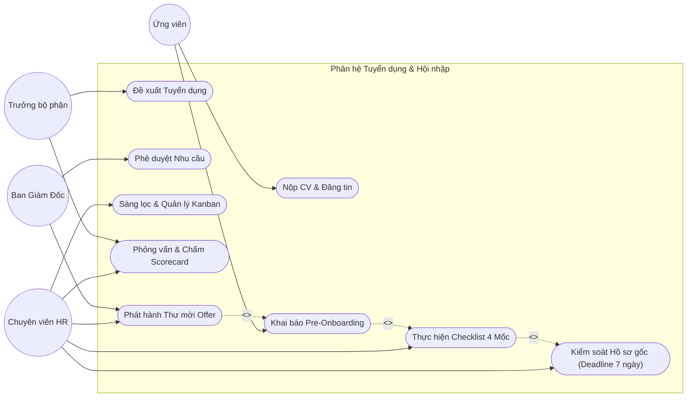
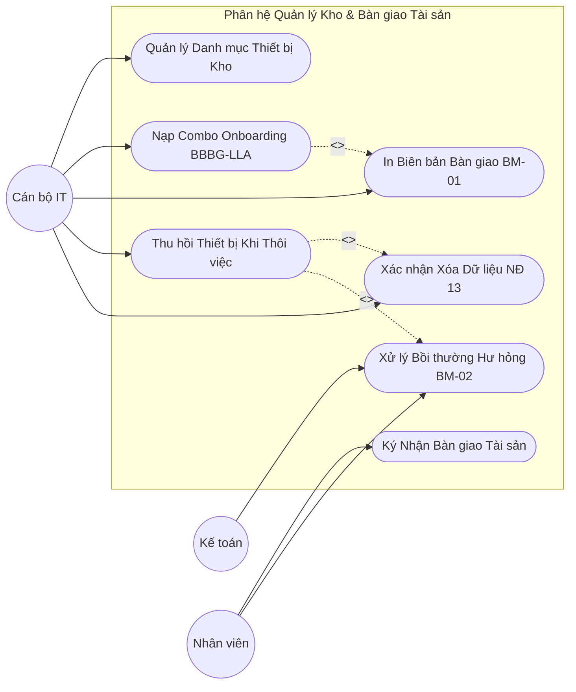
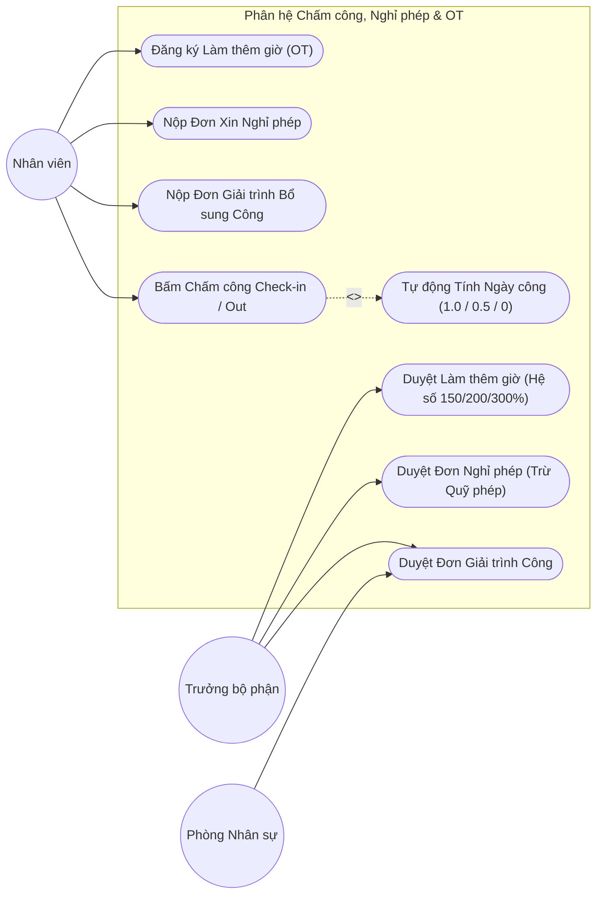
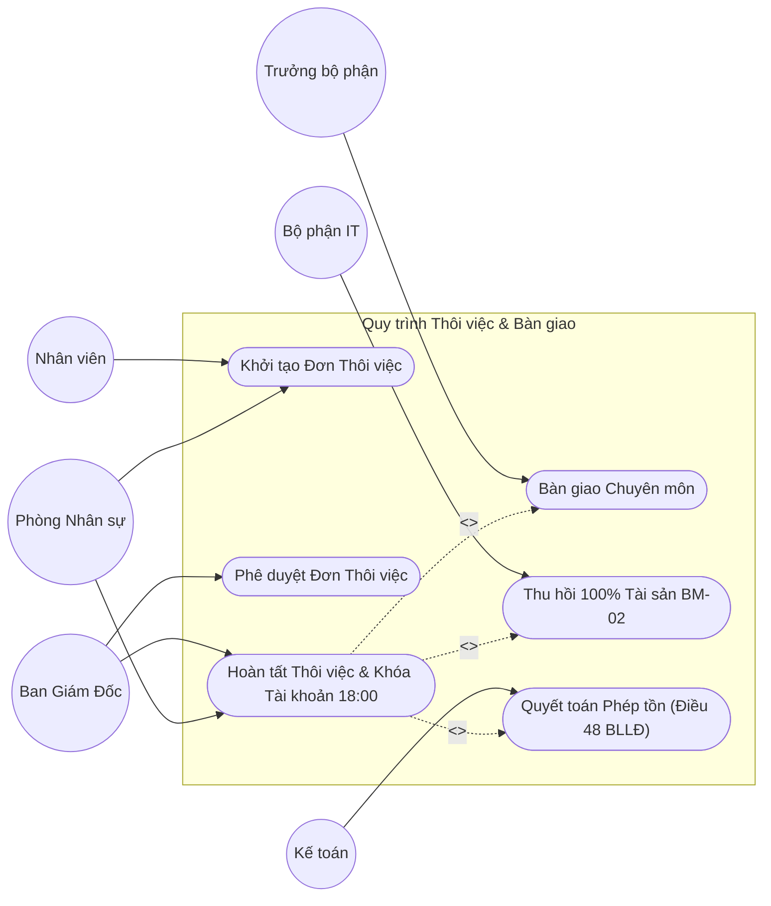
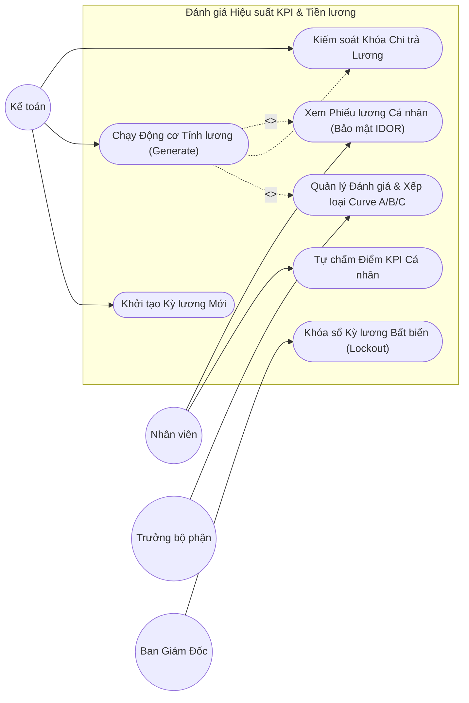

# TÀI LIỆU ĐẶC TẢ & SƠ ĐỒ USE CASE TỔNG QUÁT HỆ THỐNG HRM
## HỆ THỐNG QUẢN TRỊ NGUỒN NHÂN LỰC DOANH NGHIỆP (ENTERPRISE HRM)

---

### THÔNG TIN TÀI LIỆU
* **Tên tài liệu:** Master Use Case Specification & Diagram Document
* **Mã tài liệu:** `UCD-HRM-SYS-01`
* **Phiên bản:** 1.0 (Chuẩn hóa Kiến trúc Thực tế Vận hành & Pháp chế)
* **Ngày cập nhật:** 28/10/2026
* **Tác giả:** Ban Dự án Hệ thống HRM & Chuyên gia Phân tích Nghiệp vụ (BA)
* **Tình trạng:** Bản hoàn thiện chính thức

---

### MỤC LỤC
1. [Tổng quan Mô hình Use Case Hệ thống HRM](#1-tổng-quan-mô-hình-use-case-hệ-thống-hrm)
2. [Sơ đồ Use Case Tổng quát Toàn Hệ thống (Master Mermaid Diagram)](#2-sơ-đồ-use-case-tổng-quát-toàn-hệ-thống-master-mermaid-diagram)
3. [Đặc tả Danh mục Tác nhân (Actors Specification)](#3-đặc-tả-danh-mục-tác-nhân-actors-specification)
4. [Phân rã 9 Khối Chức năng Use Case Chi tiết (Packages Breakdown)](#4-phân-rã-9-khối-chức-năng-use-case-chi-tiết-packages-breakdown)
5. [Sơ đồ Use Case Phân hệ Chuyên sâu (Subsystem Use Case Diagrams)](#5-sơ-đồ-use-case-phân-hệ-chuyên-sâu-subsystem-use-case-diagrams)
   * 5.1 Phân hệ Tuyển dụng ATS & Hội nhập Onboarding
   * 5.2 Phân hệ Quản lý Kho & Bàn giao Tài sản (BM-01 & BM-02)
   * 5.3 Phân hệ Chấm công, Giải trình, Nghỉ phép & Làm thêm giờ OT
   * 5.4 Phân hệ Thôi việc & Bàn giao Chuẩn 4 Khối
   * 5.5 Phân hệ Đánh giá KPI & Động cơ Tiền lương
   * 5.6 Phân hệ Quản trị Hệ thống, RBAC & Audit Log
6. [Ma trận Quan hệ Phụ thuộc Đặc biệt (`<<include>>` & `<<extend>>`)](#6-ma-trận-quan-hệ-phụ-thuộc-đặc-biệt-include--extend)

---

### 1. TỔNG QUAN MÔ HÌNH USE CASE HỆ THỐNG HRM

Mô hình Use Case của Hệ thống Quản trị Nguồn nhân lực Doanh nghiệp (Enterprise HRM) mô tả ranh giới tương tác giữa **3 Nhóm Tác nhân Chính (Primary Actors)** và **9 Phân hệ Nghiệp vụ Chuyên sâu (Use Case Packages)** xuyên suốt toàn bộ vòng đời nhân sự (Employee Lifecycle):
* **👤 Ứng viên (Candidate):** Tác nhân bên ngoài doanh nghiệp, tương tác qua **Cổng Tuyển dụng Công khai** (Public Career Portal).
* **👤 Nhân viên (Employee - ESS):** Người lao động nội bộ doanh nghiệp, tương tác qua **Cổng Tự phục vụ Nhân viên** (Employee Self-Service - ESS).
* **👔 Quản trị viên (Admin - Quản trị nội bộ):** Tác nhân bao trùm toàn bộ các hoạt động quản trị, vận hành và giám sát doanh nghiệp trên **Cổng Quản trị Nội bộ** (Internal Management Portal). Thông qua cơ chế **Phân quyền dựa trên Vai trò (RBAC)** linh hoạt, tài khoản Admin có thể phân quyền tùy ý cho các vai trò chuyên môn tương ứng (HR, Kế toán, Trưởng bộ phận, IT, Ban Giám đốc) để quản trị từng phân hệ nghiệp vụ cụ thể.

---

### 2. SƠ ĐỒ USE CASE TỔNG QUÁT TOÀN HỆ THỐNG (MASTER MERMAID DIAGRAM)

```mermaid
flowchart TB
    %% ==========================================
    %% DANH SÁCH 3 TÁC NHÂN CHÍNH (PRIMARY ACTORS)
    %% ==========================================
    subgraph ACTORS ["👥 3 TÁC NHÂN CHÍNH (PRIMARY ACTORS)"]
        A_CAND["👤 Ứng viên\n(Candidate)\n[Cổng Tuyển dụng]"]
        A_EMP["👤 Nhân viên\n(Employee - ESS)\n[Cổng Tự phục vụ ESS]"]
        A_ADMIN["👔 Quản trị viên\n(Admin - Quản trị nội bộ)\n[Cổng Quản trị & Phân quyền RBAC]"]
    end

    %% ==========================================
    %% GÓI 1: CƠ CẤU TỔ CHỨC & HỒ SƠ 360
    %% ==========================================
    subgraph PKG_CORE ["🏢 PHÂN HỆ: TỔ CHỨC & HỒ SƠ 360°"]
        UC_ORG_VIEW(["Xem Sơ đồ Tổ chức (Org Chart)"])
        UC_ORG_MANAGE(["Quản lý Phòng ban & Định biên (Quota)"])
        UC_EMP_VIEW360(["Xem Hồ sơ Nhân sự 360°"])
        UC_EMP_UPDATE(["Đề xuất Cập nhật Hồ sơ Cá nhân"])
        UC_CONTRACT_MANAGE(["Quản lý HĐLĐ (Điều 20) & Cảnh báo Hết hạn"])
        UC_DECISION_ISSUE(["Ban hành Quyết định Nhân sự Pháp quy"])
    end

    %% ==========================================
    %% GÓI 2: TUYỂN DỤNG & HỘI NHẬP ONBOARDING
    %% ==========================================
    subgraph PKG_REC_ONB ["🎯 PHÂN HỆ: TUYỂN DỤNG & ONBOARDING"]
        UC_JOB_REQ(["Đề xuất & Duyệt Chỉ tiêu Tuyển dụng"])
        UC_CV_APPLY(["Nộp CV Ứng tuyển & Theo dõi Trạng thái"])
        UC_KANBAN(["Quản trị Phễu Ứng viên Kanban"])
        UC_INTERVIEW(["Lên lịch & Chấm Điểm Phỏng vấn (Scorecard)"])
        UC_OFFER(["Phát hành & Duyệt Thư mời Nhận việc (Offer)"])
        UC_PRE_ONB(["Khai báo Hồ sơ Pre-Onboarding"])
        UC_CHECKLIST(["Giám sát Checklist Hội nhập 4 Mốc"])
        UC_DOC_CHECK(["Kiểm soát Hồ sơ gốc (Hạn 7 ngày)"])
    end

    %% ==========================================
    %% GÓI 3: KHO TÀI SẢN & BÀN GIAO THIẾT BỊ
    %% ==========================================
    subgraph PKG_ASSET ["📦 PHÂN HỆ: KHO & BÀN GIAO TÀI SẢN"]
        UC_AST_INVENTORY(["Quản lý Kho Thiết bị Định danh Serial"])
        UC_AST_ASSIGN(["Bàn giao Combo Onboarding (BM-01 BBBG-LLA)"])
        UC_AST_RECOVER(["Thu hồi Thiết bị & Lập Biên bản BM-02"])
        UC_AST_WIPE(["Xác nhận An toàn Dữ liệu (Nghị định 13)"])
        UC_AST_COMPENSATE(["Xử lý Bồi thường Thiệt hại (Điều 129 BLLĐ)"])
    end

    %% ==========================================
    %% GÓI 4: CHẤM CÔNG, PHÉP & THÔI VIỆC
    %% ==========================================
    subgraph PKG_TIME_OFF ["⏰ PHÂN HỆ: CHẤM CÔNG, PHÉP & THÔI VIỆC"]
        UC_TIME_PUNCH(["Chấm công Check-in / Check-out (Ân hạn 15p)"])
        UC_TIME_ADJUST(["Gửi & Duyệt Đơn Giải trình Chấm công"])
        UC_LEAVE_REQ(["Gửi & Duyệt Đơn Nghỉ phép (Trừ T7/CN/Lễ)"])
        UC_OT_REQ(["Đề xuất & Phê duyệt Làm thêm giờ (OT)"])
        UC_OFFB_INIT(["Khởi tạo Tiến trình Thôi việc & Bàn giao"])
        UC_OFFB_CHECKLIST(["Hoàn tất Bàn giao 4 Khối"])
        UC_OFFB_FINALIZE(["Quyết toán Thôi việc & Khóa Tài khoản 18:00"])
    end

    %% ==========================================
    %% GÓI 5: KPI, TIỀN LƯƠNG & BÁO CÁO HỆ THỐNG
    %% ==========================================
    subgraph PKG_PAY_SYS ["💵 PHÂN HỆ: LƯƠNG, KPI & QUẢN TRỊ"]
        UC_KPI_REVIEW(["Đánh giá Hiệu suất KPI (Tự chấm & Duyệt)"])
        UC_PAY_GEN(["Chạy Động cơ Tính lương Tự động (Payroll Engine)"])
        UC_PAY_LOCK(["Khóa / Mở khóa Chi trả do Chậm Hồ sơ"])
        UC_PAY_PAYSLIP(["Xem & Tra cứu Phiếu lương Cá nhân Bảo mật"])
        UC_PAY_LOCK_PERIOD(["Phê duyệt & Khóa sổ Kỳ lương (Lockout)"])
        UC_RPT_DASHBOARD(["Xem Dashboard Báo cáo HR Analytics"])
        UC_SYS_SETTINGS(["Cấu hình Tham số Động (Thuế, Bảo hiểm)"])
        UC_SYS_AUDIT(["Tra cứu Sổ cái Nhật ký Kiểm toán (Audit Log)"])
    end

    %% ==========================================
    %% LIÊN KẾT 3 TÁC NHÂN -> CÁC USE CASES
    %% ==========================================
    
    %% 1. Tác nhân Ứng viên (Candidate)
    A_CAND --> UC_CV_APPLY
    A_CAND --> UC_PRE_ONB

    %% 2. Tác nhân Nhân viên (Employee - ESS)
    A_EMP --> UC_ORG_VIEW
    A_EMP --> UC_EMP_UPDATE
    A_EMP --> UC_TIME_PUNCH
    A_EMP --> UC_TIME_ADJUST
    A_EMP --> UC_LEAVE_REQ
    A_EMP --> UC_OT_REQ
    A_EMP --> UC_KPI_REVIEW
    A_EMP --> UC_PAY_PAYSLIP
    A_EMP --> UC_CHECKLIST

    %% 3. Tác nhân Quản trị viên (Admin - Quản trị nội bộ)
    %% Quản trị Tổ chức & Hồ sơ
    A_ADMIN --> UC_ORG_MANAGE
    A_ADMIN --> UC_EMP_VIEW360
    A_ADMIN --> UC_CONTRACT_MANAGE
    A_ADMIN --> UC_DECISION_ISSUE
    
    %% Quản trị Tuyển dụng & Onboarding
    A_ADMIN --> UC_JOB_REQ
    A_ADMIN --> UC_KANBAN
    A_ADMIN --> UC_INTERVIEW
    A_ADMIN --> UC_OFFER
    A_ADMIN --> UC_CHECKLIST
    A_ADMIN --> UC_DOC_CHECK

    %% Quản lý Kho & Bàn giao Tài sản
    A_ADMIN --> UC_AST_INVENTORY
    A_ADMIN --> UC_AST_ASSIGN
    A_ADMIN --> UC_AST_RECOVER
    A_ADMIN --> UC_AST_WIPE
    A_ADMIN --> UC_AST_COMPENSATE

    %% Phê duyệt Đơn từ, Công & Thôi việc
    A_ADMIN --> UC_TIME_ADJUST
    A_ADMIN --> UC_LEAVE_REQ
    A_ADMIN --> UC_OT_REQ
    A_ADMIN --> UC_OFFB_INIT
    A_ADMIN --> UC_OFFB_CHECKLIST
    A_ADMIN --> UC_OFFB_FINALIZE

    %% Quản lý Lương, KPI & Tham số Hệ thống
    A_ADMIN --> UC_KPI_REVIEW
    A_ADMIN --> UC_PAY_GEN
    A_ADMIN --> UC_PAY_LOCK
    A_ADMIN --> UC_PAY_LOCK_PERIOD
    A_ADMIN --> UC_RPT_DASHBOARD
    A_ADMIN --> UC_SYS_SETTINGS
    A_ADMIN --> UC_SYS_AUDIT
```

---

### 3. ĐẶC TẢ 3 TÁC NHÂN CHÍNH (PRIMARY ACTORS SPECIFICATION)

#### 3.1. Bảng phân loại 3 Tác nhân Cốt lõi của Hệ thống

| STT | Tác nhân (Actor) | Cổng truy cập (Portal) | Mô tả Vai trò & Phạm vi Tương tác |
| :---: | :--- | :--- | :--- |
| **1** | **Ứng viên (Candidate)** | **Cổng Tuyển dụng Công khai** (`/`) | Tác nhân bên ngoài doanh nghiệp: Tra cứu vị trí việc làm, nộp hồ sơ CV trực tuyến, theo dõi tiến độ ứng tuyển, nhận thư mời phỏng vấn, chấp nhận thư mời nhận việc (Offer), và hoàn thiện khai báo hồ sơ cá nhân trước nhận việc (Pre-Onboarding). |
| **2** | **Nhân viên (Employee)** | **Cổng Nhân viên Tự phục vụ ESS** (`/employee`) | Người lao động nội bộ doanh nghiệp: Điểm danh chấm công hàng ngày (Check-in / Check-out), nộp đơn xin nghỉ phép/giải trình công/làm thêm giờ OT, theo dõi checklist hội nhập/nộp hồ sơ, tự chấm điểm đánh giá KPI định kỳ, và tra cứu phiếu lương cá nhân bảo mật chống IDOR. |
| **3** | **Quản trị viên (Admin)** | **Cổng Quản trị Nội bộ** (`/internal`) | Người dùng thuộc bộ máy quản trị, vận hành và lãnh đạo doanh nghiệp: Quản trị cơ cấu tổ chức, phễu tuyển dụng ATS, hồ sơ nhân sự, hợp đồng lao động, phê duyệt đơn từ, kiểm soát kho tài sản bàn giao (BM-01 & BM-02), vận hành động cơ tính lương, cấu hình tham số hệ thống và phân quyền truy cập. |

#### 3.2. Cơ chế Phân quyền Tùy biến (Dynamic RBAC) trên Cổng Quản trị của Admin

Trên giao diện Cổng Quản trị Nội bộ, hệ thống áp dụng cơ chế **Phân quyền linh hoạt theo Vai trò (Dynamic Role-Based Access Control - RBAC)** do tài khoản Admin toàn quyền quản lý. Tùy thuộc vào thiết lập phân quyền của Admin, các tài khoản quản trị nội bộ sẽ được phân bổ các phạm vi nghiệp vụ chuyên trách như sau:

| Vai trò phân quyền bởi Admin | Mã quyền (Role Code) | Phạm vi Nghiệp vụ được phân quyền quản trị |
| :--- | :--- | :--- |
| **Ban Giám Đốc (BOD / CEO)** | `ADMIN` / `SUPER_ADMIN` | Xem Dashboard tổng quan HR Analytics, phê duyệt định biên nhân sự, duyệt Offer lương cao, ký quyết định nhân sự, phê duyệt khóa sổ kỳ lương (`LOCKED`). |
| **Trưởng phòng Nhân sự (HR Manager)** | `HR_MANAGER` | Quản lý toàn diện nhân sự: Duyệt đề xuất tuyển dụng, quản lý hợp đồng lao động, ban hành quyết định bổ nhiệm/tăng lương, phê duyệt thôi việc và mở khóa thanh toán lương. |
| **Chuyên viên Tuyển dụng & HR (HR Staff)** | `HR_STAFF` | Quản trị phễu tuyển dụng Kanban ATS, lên lịch phỏng vấn, phát hành Offer, hướng dẫn checklist Onboarding, kiểm soát thời hạn 7 ngày nộp hồ sơ gốc. |
| **Trưởng bộ phận (Department Manager)** | `MANAGER` / `DEPARTMENT_HEAD` | Tạo yêu cầu tuyển dụng cho phòng ban, phỏng vấn ứng viên chuyên môn, duyệt đơn chấm công/nghỉ phép/OT của cấp dưới, đánh giá KPI nhân viên và xác nhận bàn giao công việc khi thôi việc. |
| **Kế toán Tiền lương (Accountant)** | `ACCOUNTANT` | Chạy động cơ tính lương tự động (`Payroll Engine`), kiểm tra danh sách khóa chi trả lương, đối soát khấu trừ bồi thường tài sản BM-02, xuất lệnh chi trả lương. |
| **Cán bộ Quản lý Tài sản & IT (IT Support)** | `IT_SUPPORT` | Quản lý kho trang thiết bị theo số Serial định danh, bàn giao Combo Onboarding Day 1 (BM-01 BBBG-LLA), thu hồi thiết bị khi nghỉ việc (BM-02) và xác nhận an toàn dữ liệu công vụ. |
| **Quản trị viên Hệ thống (System Admin)** | `SUPER_ADMIN` | Cấu hình tham số nghiệp vụ động (mức giảm trừ thuế TNCN, tỷ lệ trích nộp bảo hiểm, ngày công chuẩn), phân quyền tài khoản (RBAC Matrix) và giám sát Sổ cái Nhật ký Kiểm toán (`AuditLog`). |

---

---

### 4. PHÂN RÃ 9 KHỐI CHỨC NĂNG USE CASE CHI TIẾT (PACKAGES BREAKDOWN)

#### 4.1 Khối 1: Cơ cấu Tổ chức & Định biên (Organization Management)
* **UC-ORG-01 (Xem Sơ đồ Tổ chức):** Hiển thị Org Chart tương tác dạng cây phả hệ đa cấp, xem Avatar, Tên Trưởng phòng và tỷ lệ lấp đầy quân số thời gian thực.
* **UC-ORG-02 (Quản lý Phòng ban & Định biên Quota):** Khởi tạo phòng ban, thiết lập phòng ban cha, gán Trưởng phòng, cấu hình chỉ tiêu định biên (`quota`). Chống lỗi vòng lặp đệ quy (`BR-ORG-02`) và Hard Deletion Lock chặn xóa phòng ban có nhân sự (`BR-ORG-03`).
* **UC-ORG-03 (Quản lý Chức danh Công việc):** Thiết lập danh mục chức vụ, mô tả công việc (JD), cấp bậc chuyên môn và dải lương chuẩn (Min - Max).

#### 4.2 Khối 2: Tuyển dụng Nhân tài (Recruitment ATS)
* **UC-REC-01 (Đề xuất & Phê duyệt Nhu cầu Tuyển dụng):** Trưởng phòng tạo đề xuất `JobPosting`; hệ thống tự động kiểm tra định biên còn trống (`BR-REC-01`); trình BOD duyệt.
* **UC-REC-02 (Nộp CV & Quản trị Phễu Kanban):** Tiếp nhận CV ứng viên; HR kéo thả thẻ ứng viên qua các cột: `Applied` $\rightarrow$ `Screening` $\rightarrow$ `Interviewing` $\rightarrow$ `Offer` $\rightarrow$ `Hired`.
* **UC-REC-03 (Lên lịch & Chấm điểm Phỏng vấn Scorecard):** Lên lịch phỏng vấn, gửi email tự động kèm link họp; hội đồng chấm điểm đa tiêu chí (chuyên môn, thái độ, văn hóa) trên thang điểm 5 sao.
* **UC-REC-04 (Phát hành Thư mời Offer & Kích hoạt Onboarding):** Soạn thảo mức lương, phụ cấp, ngày nhận việc; trình duyệt Offer; khi ứng viên bấm `ACCEPTED`, hệ thống tự động chuyển dữ liệu sang phân hệ Hội nhập.

#### 4.3 Khối 3: Hội nhập Onboarding & Kiểm soát Hồ sơ
* **UC-ONB-01 (Khai báo Hồ sơ Pre-Onboarding):** Ứng viên tự khai báo số CCCD, tài khoản ngân hàng, mã số thuế và thông tin liên hệ khẩn cấp trước ngày nhận việc Day 0.
* **UC-ONB-02 (Giám sát Tiến độ Checklist 4 Mốc):** Tự động sinh danh mục nhiệm vụ: Day 0, Day 1, Week 1, Month 2; phân công Buddy/Mentor kèm cặp bắt buộc (`BR-ONB-02`).
* **UC-ONB-03 (Kiểm soát Nộp Hồ sơ gốc):** Tự động đếm ngược 7 ngày làm việc kể từ ngày vào làm (`joinDate`). Nếu quá 7 ngày chưa nộp đủ bản công chứng bằng cấp/CCCD, hệ thống tự động gắn cờ đỏ khóa chi trả lương (`isPaymentLocked = true`).
* **UC-ONB-04 (Mở khóa Thanh toán Lương):** HR sau khi kiểm tra đủ hồ sơ gốc bản cứng sẽ bấm nút mở khóa (`toggle-payment-hold: lock = false`) để giải phóng lệnh chi lương.

#### 4.4 Khối 4: Hồ sơ Nhân sự 360° & Hợp đồng Lao động
* **UC-EMP-01 (Xem Hồ sơ 360° Đa Phân hệ):** Tra cứu toàn diện hồ sơ cá nhân, học vấn, quá trình công tác, lịch sử hợp đồng và danh mục tài sản đang giữ tại Tab `Asset`.
* **UC-EMP-02 (Đề xuất Cập nhật Thông tin Cá nhân):** Nhân viên gửi yêu cầu sửa thông tin CCCD, tài khoản ngân hàng kèm ảnh minh chứng qua cổng ESS; HR kiểm duyệt trước khi cập nhật.
* **UC-EMP-03 (Quản trị Hợp đồng theo Điều 20 BLLĐ 2019):** Soạn thảo HĐ thử việc (tối đa 60 ngày), HĐ xác định thời hạn (tối đa ký 2 lần), HĐ không xác định thời hạn (`BR-EMP-02`).
* **UC-EMP-04 (Cảnh báo Hết hạn Hợp đồng Tự động):** Cron job tự động quét và gửi cảnh báo hết hạn trước 30 ngày (vàng), 15 ngày và 7 ngày (đỏ) để tiến hành tái ký.
* **UC-EMP-05 (Ban hành Quyết định Nhân sự):** Soạn thảo và lưu trữ văn bản pháp quy: Bổ nhiệm, tăng lương, điều chuyển, khen thưởng, kỷ luật; tự động ghi lịch sử công tác (`EmploymentHistory`).

#### 4.5 Khối 5: Kho Tài sản & Bàn giao Thiết bị (BM-01 & BM-02)
* **UC-AST-01 (Quản lý Kho Thiết bị Định danh):** Nhập kho máy tính, màn hình theo số Serial phần cứng; quản lý trạng thái khả dụng (`AVAILABLE`, `ASSIGNED`, `MAINTENANCE`, `DISPOSED`).
* **UC-AST-02 (Bàn giao Combo Onboarding BBBG-LLA BM-01):** Bấm tiện ích `✨ Nạp Combo Onboarding chuẩn LLA` (Bộ PC + 2 màn hình + Arm + Phím chuột + Email), in biên bản chuẩn thực tế bên giao Đỗ Thị Nguyệt.
* **UC-AST-03 (Thu hồi Thiết bị & Lập Biên bản BM-02):** Kiểm tra hiện trạng thiết bị khi nhân sự thôi việc; xác nhận ký biên bản thu hồi 3 bên.
* **UC-AST-04 (Xác nhận An toàn Dữ liệu Nghị định 13/2023/NĐ-CP):** Kỹ thuật viên IT xác nhận đã thu hồi toàn bộ tài khoản công vụ và xóa sạch dữ liệu trên máy tính trước khi chuyển về kho.
* **UC-AST-05 (Xử lý Bồi thường Thiệt hại Vật chất):** Ghi nhận chi phí bồi thường hư hỏng theo Điều 129 BLLĐ; tự động chuyển sang Phân hệ Lương để khấu trừ (tối đa không quá 30% lương Net theo Điều 102).

#### 4.6 Khối 6: Quản lý Thôi việc Chuẩn 4 Khối
* **UC-OFF-01 (Khởi tạo Tiến trình Thôi việc):** Tiếp nhận đơn thôi việc hoặc quyết định chấm dứt HĐLĐ; hệ thống tự động nạp bộ checklist bàn giao 4 khối (`DEFAULT_OFFBOARDING_TASKS`).
* **UC-OFF-02 (Thực hiện Checklist Bàn giao 4 Khối):**
  * Khối 1: Bàn giao Chuyên môn (Tài liệu, mã nguồn, đầu mối đối tác).
  * Khối 2: Khối IT Support (Thu hồi Laptop, sạc, tài khoản công vụ BM-02).
  * Khối 3: Khối Hành chính (Thu hồi thẻ từ, chìa khóa tủ).
  * Khối 4: Khối Nhân sự & Kế toán (Quyết toán công, phép tồn và chốt sổ BHXH).
* **UC-OFF-03 (Chốt chặn Cứng Thu hồi Tài sản - Hard Lock):** Chặn tuyệt đối nút bấm hoàn tất thôi việc nếu nhân sự còn bất kỳ thiết bị nào chưa hoàn trả (`activeAssets > 0`).
* **UC-OFF-04 (Quyết toán Thôi việc & Khóa An ninh 18:00):** Tự động tính tiền thanh toán ngày phép tồn theo Điều 48 BLLĐ: `(Lương cơ sở / 26) * Phép tồn`; tự động chuyển `Employee.status = RESIGNED`, đóng hợp đồng sang `TERMINATED` và vô hiệu hóa tài khoản hệ thống đúng 18:00.

#### 4.7 Khối 7: Ca kíp, Chấm công, Nghỉ phép & Làm thêm giờ OT
* **UC-ATT-01 (Chấm công Check-in / Check-out):** Điểm danh giờ vào/ra; tự động áp dụng khung ân hạn 15 phút (08:30 - 08:45 không bị tính muộn); tự động gán `EARLY_LEAVE` nếu về trước 17:00.
* **UC-ATT-02 (Tính Ngày công Tự động):** Động cơ quy đổi giờ làm việc thực tế: $\ge 7.5\text{h} \rightarrow 1.0$ công; từ $3.5\text{h}$ đến $<7.5\text{h} \rightarrow 0.5$ công; $<3.5\text{h} \rightarrow 0$ công.
* **UC-ATT-03 (Gửi & Duyệt Đơn Giải trình Công):** Nhân viên nộp giải trình quên quẹt thẻ hoặc đi công tác; Quản lý trực tiếp và HR phê duyệt để cập nhật lại ngày công.
* **UC-ATT-04 (Gửi & Duyệt Đơn Nghỉ phép):** Nhân viên nộp đơn online; hệ thống tự tính số ngày nghỉ bằng cách loại trừ Thứ 7, Chủ Nhật và ngày nghỉ Lễ/Tết; tự động trừ quỹ phép năm (`LeaveBalance.usedDays`).
* **UC-ATT-05 (Đề xuất & Duyệt Làm thêm giờ OT):** Đăng ký giờ OT theo Điều 98 BLLĐ 2019 (Hệ số ngày thường 150%, cuối tuần 200%, nghỉ lễ 300%).

#### 4.8 Khối 8: Đánh giá Hiệu suất KPI & Tiền lương (Payroll Engine)
* **UC-KPI-01 (Đánh giá Hiệu suất Định kỳ):** Nhân viên tự đánh giá điểm số (`selfScore`); Quản lý trực tiếp chấm điểm (`managerScore`); tự động phân hạng A ($\ge 90$), B ($\ge 70$), C ($< 70$).
* **UC-PAY-01 (Khởi tạo Kỳ lương & Chạy Tính toán Tự động):** Động cơ tính lương tự động tổng hợp ngày công thực tế, giờ OT, phụ cấp, thưởng KPI, trần BHXH 46.8 triệu (10.5%), Biểu thuế TNCN lũy tiến 7 bậc và trừ tiền bồi thường tài sản BM-02.
* **UC-PAY-02 (Khóa Chi trả Do Chậm Hồ sơ):** Tự động phát hiện và khóa thanh toán lương đối với nhân sự nợ hồ sơ gốc quá hạn 7 ngày.
* **UC-PAY-03 (Xem & Tra cứu Phiếu lương Cá nhân):** Nhân viên đăng nhập tài khoản riêng để xem phiếu lương điện tử chi tiết (Chặn IDOR rò rỉ thu nhập PII).
* **UC-PAY-04 (Khóa sổ Kỳ lương - Strict Lockout Rule):** Ban Giám đốc phê duyệt chuyển trạng thái sang `LOCKED`; hệ thống đóng băng 100% dữ liệu, cấm sửa và cấm tính lại bảng lương.

#### 4.9 Khối 9: Báo cáo HR Analytics & Quản trị Hệ thống
* **UC-SYS-01 (Dashboard Báo cáo Phân tích Nhân sự):** Thống kê biến động nhân sự, tỷ lệ lấp đầy định biên phòng ban (`OPEN`, `FULL`, `OVER_QUOTA`), cơ cấu giới tính, hợp đồng và xu hướng quỹ lương 6 kỳ.
* **UC-SYS-02 (Cấu hình Tham số Nghiệp vụ Động):** Cho phép Quản trị viên điều chỉnh tỷ lệ bảo hiểm 10.5%, mức giảm trừ bản thân 11M, giảm trừ người phụ thuộc 4.4M, ngày công chuẩn 22 ngày mà không cần sửa code.
* **UC-SYS-03 (Quản trị Tài khoản & Phân quyền RBAC):** Quản lý tài khoản đăng nhập, gán vai trò theo ma trận 8 nhóm quyền.
* **UC-SYS-04 (Tra cứu Nhật ký Kiểm toán Audit Log):** Xem lịch sử thao tác bất biến (Ai làm gì, vào thời điểm nào, bản ghi nào bị thay đổi).

---

### 5. SƠ ĐỒ USE CASE PHÂN HỆ CHUYÊN SÂU (SUBSYSTEM USE CASE DIAGRAMS)

#### 5.1 Phân hệ Tuyển dụng ATS & Hội nhập Onboarding

---

#### 5.2 Phân hệ Quản lý Kho & Bàn giao Tài sản (BM-01 & BM-02)

---

#### 5.3 Phân hệ Chấm công, Giải trình, Nghỉ phép & Làm thêm giờ OT

---

#### 5.4 Phân hệ Thôi việc & Bàn giao Chuẩn 4 Khối

---

#### 5.5 Phân hệ Đánh giá KPI & Động cơ Tiền lương

---

### 6. MA TRẬN QUAN HỆ PHỤ THUỘC ĐẶC BIỆT (`<<include>>` & `<<extend>>`)

| Use Case Cơ sở (Base UC) | Quan hệ | Use Case Phụ thuộc (Target UC) | Điều kiện Kích hoạt & Ý nghĩa Nghiệp vụ |
| :--- | :---: | :--- | :--- |
| **Hoàn tất Thôi việc** | `<<include>>` | **Thu hồi 100% Tài sản BM-02** | Bắt buộc phải hoàn thành thu hồi toàn bộ tài sản mới mở khóa nút Hoàn tất thôi việc (Hard Lock). |
| **Hoàn tất Thôi việc** | `<<include>>` | **Quyết toán Phép tồn (Điều 48)** | Tự động tính tiền thanh toán những ngày phép năm chưa sử dụng theo công thức luật định. |
| **Thu hồi Thiết bị BM-02** | `<<include>>` | **Xác nhận Xóa Dữ liệu (NĐ 13)** | Kỹ thuật viên IT bắt buộc phải xác nhận đã thu hồi tài khoản công vụ và xóa dữ liệu máy tính trước khi nhập kho. |
| **Thu hồi Thiết bị BM-02** | `<<extend>>` | **Xử lý Bồi thường Hư hỏng** | Kích hoạt khi thiết bị kiểm tra phát hiện hư hỏng do lỗi người dùng theo Điều 129 BLLĐ 2019. |
| **Chạy Động cơ Tính lương** | `<<extend>>` | **Khóa Chi trả do Chậm Hồ sơ** | Tự động bật cờ `isPaymentLocked = true` nếu nhân sự nợ hồ sơ gốc bản cứng quá 7 ngày làm việc. |
| **Bấm Chấm công Check-in/out** | `<<include>>` | **Tính Ngày công Tự động** | Tự động so sánh số giờ làm thực tế với mốc 7.5h và 3.5h để gán ngày công 1.0, 0.5 hoặc 0. |
| **Chấp thuận Offer (ACCEPTED)** | `<<include>>` | **Khởi tạo Hồ sơ Pre-Onboarding** | Tự động sinh bản ghi tiếp nhận và thông báo cho IT cài đặt máy tính trước ngày làm việc Day 0. |
