# BỘ HỒ SƠ SƠ ĐỒ USE CASE 3 CẤP ĐỘ & ĐẶC TẢ CHI TIẾT TOÀN DIỆN HỆ THỐNG HRM
## TỔ CHỨC THEO MÔ HÌNH: SƠ ĐỒ CẤP 1 -> SƠ ĐỒ CẤP 2 -> SƠ ĐỒ CẤP 3 -> ĐẶC TẢ NGHIỆP VỤ CHI TIẾT NGAY DƯỚI SƠ ĐỒ CẤP 3

> **Dự án ĐATN:** Hệ Thống Quản Trị Nguồn Nhân Lực Doanh Nghiệp (Enterprise HRM SaaS)  
> **Sinh viên thực hiện:** Lê Hoàng Trúc | **Lớp:** 66PM1 | **Khoa:** CNTT - ĐHXDHN  
> **Quy chuẩn bố cục tài liệu:**  
> 1. **Cấp 1 (System Level):** Sơ đồ Use Case Tổng quát toàn hệ thống (3 Actor -> Phân hệ lớn).  
> 2. **Cấp 2 (Module Level):** Sơ đồ Use Case Phân rã từng Phân hệ lớn (Actor -> Cụm màn hình/chức năng).  
> 3. **Cấp 3 (Detailed Level):** Sơ đồ Use Case Chi tiết cho từng màn hình (Actor -> Hành động con cụ thể: Thêm, Sửa, Xóa, Khóa, Tìm kiếm...).  
> 4. **Đặc tả nghiệp vụ chi tiết:** Được đặt **ngay dưới Sơ đồ Cấp 3 tương ứng**, bóc tách đầy đủ từng ca sử dụng con bằng ngôn ngữ nghiệp vụ thuần túy.

---

# PHẦN 1: MÔ HÌNH 3 TÁC NHÂN CHÍNH (PRIMARY ACTORS)

| STT | Tác nhân (Actor) | Biểu tượng | Phạm vi truy cập | Vai trò & Trách nhiệm nghiệp vụ |
| :-: | :--- | :---: | :--- | :--- |
| **1** | **Ứng viên** *(Candidate)* | | Cổng Tuyển dụng Công khai | Tra cứu vị trí việc làm, nộp hồ sơ CV (không cần OTP), đăng ký tài khoản bằng OTP 6 số, theo dõi tiến độ phỏng vấn, phản hồi qua Magic Link và khai báo hồ sơ Pre-Onboarding. |
| **2** | **Nhân viên** *(Employee)* | | Cổng Tự phục vụ (ESS) | Theo dõi công đồng bộ từ máy chấm công, gửi đơn giải trình công/đi muộn, quản lý hồ sơ 9 Tab & gửi yêu cầu chỉnh sửa, nộp đơn nghỉ phép, đăng ký OT, tra cứu phiếu lương và tự đánh giá KPI. |
| **3** | **Quản trị viên** *(Admin)* | | Cổng Quản trị Doanh nghiệp | Vận hành toàn diện các phân hệ: Cơ cấu tổ chức (kèm Bulk Import Excel), Phễu tuyển dụng ATS 6 cột, Hội nhập 4 nhóm & Đánh giá thử việc, Hồ sơ 14 Tab & Quyết định/Hợp đồng, Chấm công/Ca/Lễ, Nghỉ phép & OT, KPI, Bảng lương 16 cột, Tài sản BM-01/02, Thôi việc và Tham số hệ thống. |

---

# PHẦN 2: SƠ ĐỒ USE CASE CẤP 1 - TỔNG QUÁT TOÀN HỆ THỐNG (SYSTEM LEVEL)

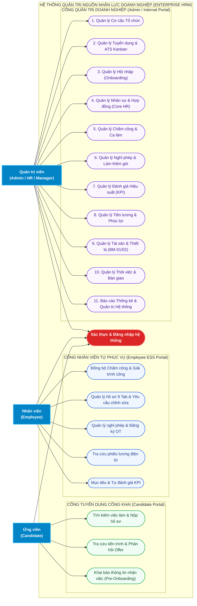

---

# PHẦN 3: SƠ ĐỒ CẤP 2, SƠ ĐỒ CẤP 3 & ĐẶC TẢ CHI TIẾT TỪNG PHÂN HỆ

---

## 3.1. PHÂN HỆ 1: CƠ CẤU TỔ CHỨC (ORGANIZATION MANAGEMENT)

### 3.1.0. Sơ đồ Use Case Cấp 2: Phân hệ Cơ cấu Tổ chức
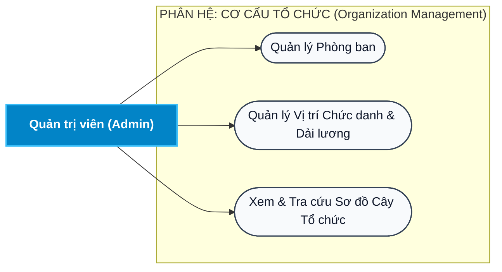

---

### 3.1.1. Chức năng Quản lý Phòng ban (`Departments.jsx`)

#### A. Sơ đồ Use Case Cấp 3: Quản lý Phòng ban
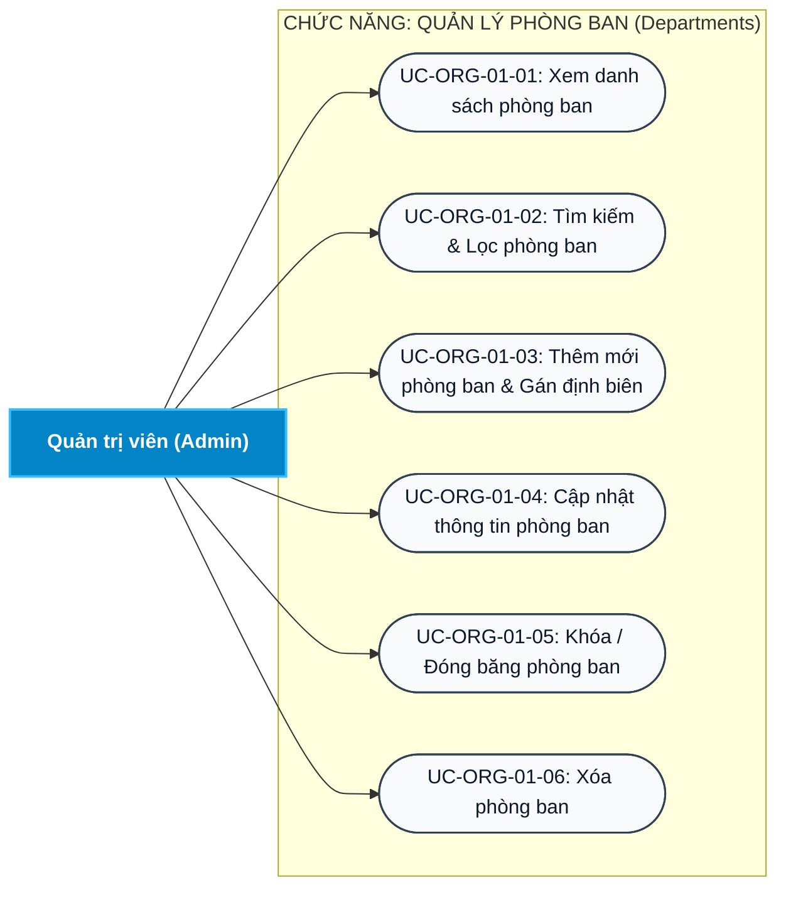

#### B. Bản đặc tả chi tiết nghiệp vụ từng Use Case con:

##### UC-ORG-01-01: Xem danh sách phòng ban

| Thành phần | Nội dung chi tiết |
| :--- | :--- |
| **Mã Use Case** | `UC-ORG-01-01` |
| **Tên Use Case** | Xem danh sách phòng ban |
| **Mục tiêu** | Theo dõi toàn bộ cơ cấu các phòng ban hiện hữu, người đứng đầu phụ trách và tỷ lệ lấp đầy định biên nhân sự. |
| **Tác nhân chính** | Quản trị viên (Admin). |
| **Tiền điều kiện** | Người dùng đã đăng nhập hệ thống và có quyền quản lý tổ chức. |
| **Kích hoạt (Trigger)** | Chọn chức năng "Phòng ban" trong menu Cơ cấu Tổ chức. |
| **Luồng chính (Basic Flow)** | 1. Người dùng chọn chức năng "Phòng ban" trên menu điều hướng.<br>2. Hệ thống tải và hiển thị danh mục phòng ban: Mã phòng ban, Tên phòng ban, Người quản lý, Tiến độ Định biên (% nhân sự thực tế / định biên tối đa được duyệt kèm thanh tiến độ), Trạng thái hoạt động.<br>3. Hệ thống sắp xếp danh sách theo thứ tự mã phòng ban và tự động phân trang (10 phòng ban/trang). |
| **Luồng thay thế** | Nếu chưa có dữ liệu, hiển thị thông báo: *"Chưa có dữ liệu phòng ban. Bấm '+ Thêm phòng ban' để khởi tạo."*. |
| **Luồng ngoại lệ** | Người dùng không có quyền truy cập $\rightarrow$ Hệ thống thông báo từ chối quyền. |
| **Hậu điều kiện** | Người dùng nắm bắt được cơ cấu phòng ban và tình trạng định biên nhân sự toàn công ty. |

##### UC-ORG-01-02: Tìm kiếm & Lọc phòng ban

| Thành phần | Nội dung chi tiết |
| :--- | :--- |
| **Mã Use Case** | `UC-ORG-01-02` |
| **Tên Use Case** | Tìm kiếm & Lọc phòng ban |
| **Mục tiêu** | Tra cứu nhanh chóng phòng ban theo tên gọi, mã viết tắt hoặc trạng thái mà không phải tìm qua nhiều trang. |
| **Tác nhân chính** | Quản trị viên (Admin). |
| **Tiền điều kiện** | Danh sách phòng ban đã hiển thị trên màn hình. |
| **Kích hoạt (Trigger)** | Người dùng nhập từ khóa vào ô tìm kiếm hoặc chọn lọc trạng thái. |
| **Luồng chính (Basic Flow)** | 1. Người dùng nhập từ khóa tìm kiếm (theo tên phòng ban hoặc mã viết tắt, ví dụ: *"Kỹ thuật"*, *"DEV"*).<br>2. Hệ thống so khớp từ khóa không phân biệt hoa thường và lọc tức thì các phòng ban phù hợp.<br>3. Hệ thống tự động chuyển số trang hiển thị về trang 1 và hiển thị tổng số kết quả tìm thấy. |
| **Luồng thay thế** | Kết hợp lọc theo trạng thái "Đang hoạt động" hoặc "Ngừng hoạt động" $\rightarrow$ Hệ thống lọc đồng thời cả 2 điều kiện. |
| **Luồng ngoại lệ** | Không có phòng ban khớp từ khóa $\rightarrow$ Thông báo: *"Không tìm thấy phòng ban nào phù hợp."*. |
| **Hậu điều kiện** | Bảng danh sách hiển thị đúng tập phòng ban người dùng cần tra cứu. |

##### UC-ORG-01-03: Thêm mới phòng ban & Gán định biên

| Thành phần | Nội dung chi tiết |
| :--- | :--- |
| **Mã Use Case** | `UC-ORG-01-03` |
| **Tên Use Case** | Thêm mới phòng ban & Gán định biên |
| **Mục tiêu** | Khởi tạo đơn vị mới vào sơ đồ cây tổ chức và ấn định chỉ tiêu định biên nhân sự tối đa (`quota`). |
| **Tác nhân chính** | Quản trị viên (Admin). |
| **Tiền điều kiện** | Người dùng có quyền thêm mới tổ chức. |
| **Kích hoạt (Trigger)** | Người dùng nhấn nút **"+ Thêm phòng ban"**. |
| **Luồng chính (Basic Flow)** | 1. Người dùng nhấn nút "+ Thêm phòng ban".<br>2. Hệ thống hiển thị biểu mẫu, tự động điền sẵn Định mức nhân sự mặc định = 15 người và Trạng thái = Đang hoạt động.<br>3. Người dùng nhập Tên phòng ban (ví dụ: *"Phòng Truyền thông & Thương hiệu"*).<br>4. Hệ thống tự động gợi ý Mã phòng ban viết tắt (ví dụ: `MKT`), kiểm tra trùng lặp thời gian thực.<br>5. Người dùng kiểm tra mã, chọn Người quản lý, điều chỉnh Định biên và chọn Phòng ban cha (nếu trực thuộc).<br>6. Người dùng nhấn "Lưu thông tin".<br>7. Hệ thống kiểm tra hợp lệ: Mã và Tên không được để trống, Mã chưa từng tồn tại, Định biên là số nguyên dương $\ge 1$.<br>8. Hệ thống lưu phòng ban mới, thông báo thành công: *"Thêm mới phòng ban thành công!"* và cập nhật lên bảng danh sách. |
| **Luồng thay thế** | Không chọn phòng ban cha $\rightarrow$ Hệ thống ghi nhận phòng ban này là nhánh cây độc lập cao nhất. |
| **Luồng ngoại lệ** | - Trùng mã phòng ban $\rightarrow$ Báo lỗi: *"Mã phòng ban đã tồn tại trong hệ thống, vui lòng nhập mã khác."*.<br>- Định biên $\le 0$ $\rightarrow$ Báo lỗi: *"Định mức nhân sự phải là số nguyên dương từ 1 trở lên."*. |
| **Hậu điều kiện** | Phòng ban mới xuất hiện trong cơ cấu tổ chức, sẵn sàng tiếp nhận nhân sự và tuyển dụng. |

##### UC-ORG-01-04: Cập nhật thông tin phòng ban

| Thành phần | Nội dung chi tiết |
| :--- | :--- |
| **Mã Use Case** | `UC-ORG-01-04` |
| **Tên Use Case** | Cập nhật thông tin phòng ban |
| **Mục tiêu** | Điều chỉnh tên đơn vị, Trưởng phòng, nâng/hạ định biên hoặc luân chuyển đơn vị cấp trên trực tiếp. |
| **Tác nhân chính** | Quản trị viên (Admin). |
| **Tiền điều kiện** | Phòng ban cần chỉnh sửa đang tồn tại. |
| **Kích hoạt (Trigger)** | Người dùng nhấn biểu tượng "Chỉnh sửa" tại dòng phòng ban. |
| **Luồng chính (Basic Flow)** | 1. Người dùng chọn biểu tượng "Chỉnh sửa" tại phòng ban tương ứng.<br>2. Hệ thống nạp toàn bộ thông tin hiện tại vào biểu mẫu.<br>3. Người dùng thay đổi thông tin (Quota, Người quản lý, Đơn vị cấp trên) và nhấn "Lưu thay đổi".<br>4. Hệ thống kiểm tra quy tắc cấu trúc cây: không tự chọn chính mình làm cha; không chọn phòng ban cấp dưới trực thuộc làm cha (chống vòng lặp tổ chức).<br>5. Hệ thống lưu thay đổi và thông báo: *"Cập nhật thông tin phòng ban thành công!"*. |
| **Luồng ngoại lệ** | - Tự chọn chính mình làm cha $\rightarrow$ Báo lỗi: *"Phòng ban không thể làm phòng ban cha của chính nó."*.<br>- Chọn phòng con làm phòng cha $\rightarrow$ Báo lỗi: *"Không thể thiết lập phòng ban cấp dưới làm phòng ban cha (phát hiện vòng lặp phân cấp tổ chức)."*. |
| **Hậu điều kiện** | Cơ cấu tổ chức cập nhật thông tin mới, sơ đồ cây tự động điều chỉnh nhánh phân cấp. |

##### UC-ORG-01-05: Khóa / Mở khóa phòng ban (ACTIVE <-> INACTIVE)

| Thành phần | Nội dung chi tiết |
| :--- | :--- |
| **Mã Use Case** | `UC-ORG-01-05` |
| **Tên Use Case** | Khóa / Mở khóa phòng ban (ACTIVE <-> INACTIVE) |
| **Mục tiêu** | Chuyển đổi qua lại trạng thái hoạt động (`ACTIVE` <-> `INACTIVE`) của phòng ban mà không làm mất dữ liệu lịch sử nhân sự cũ. |
| **Tác nhân chính** | Quản trị viên (Admin). |
| **Tiền điều kiện** | Phòng ban đang tồn tại trong hệ thống. |
| **Kích hoạt (Trigger)** | Người dùng nhấn biểu tượng Khóa / Mở khóa tại cột thao tác. |
| **Luồng chính (Basic Flow)** | 1. Người dùng nhấn biểu tượng Khóa / Mở khóa tại dòng phòng ban.<br>2. Hệ thống hiển thị hộp thoại xác nhận chuyển đổi trạng thái hoạt động.<br>3. Người dùng nhấn "Xác nhận".<br>4. Hệ thống đảo cờ trạng thái phòng ban (`ACTIVE <-> INACTIVE`) trực tiếp (không chặn theo dữ liệu phụ thuộc), cập nhật huy hiệu màu sắc và thông báo thành công. |
| **Luồng ngoại lệ** | Không tìm thấy phòng ban hợp lệ $\rightarrow$ Hệ thống báo lỗi và giữ nguyên trạng thái cũ. |
| **Hậu điều kiện** | Phòng ban chuyển sang trạng thái mới; nếu `INACTIVE`, đơn vị sẽ ẩn khỏi danh sách chọn khi mở tuyển dụng mới. |

##### UC-ORG-01-06: Xóa phòng ban (Hard Delete)

| Thành phần | Nội dung chi tiết |
| :--- | :--- |
| **Mã Use Case** | `UC-ORG-01-06` |
| **Tên Use Case** | Xóa phòng ban (Hard Delete) |
| **Mục tiêu** | Xóa vĩnh viễn các phòng ban tạo nhầm hoặc phòng ban trống không còn nhu cầu sử dụng. |
| **Tác nhân chính** | Quản trị viên (Admin). |
| **Tiền điều kiện** | Người dùng có quyền Quản trị viên cấp cao. |
| **Kích hoạt (Trigger)** | Người dùng nhấn biểu tượng Thùng rác đỏ. |
| **Luồng chính (Basic Flow)** | 1. Người dùng nhấn biểu tượng Thùng rác tại dòng phòng ban cần xóa.<br>2. Hệ thống hiển thị cảnh báo nghiêm trọng: *"Hành động này sẽ xóa vĩnh viễn phòng ban khỏi hệ thống và không thể hoàn tác. Bạn có chắc chắn muốn tiếp tục?"*.<br>3. Người dùng nhấn "Xác nhận xóa".<br>4. Hệ thống kiểm tra an toàn 4 chốt chặn nghiệp vụ: không có nhân viên đang làm việc; không có phòng ban con; không có chức danh công tác gắn liền; không có tin tuyển dụng đang mở.<br>5. Khi thỏa mãn đầy đủ, hệ thống xóa phòng ban và thông báo: *"Đã xóa phòng ban thành công!"*. |
| **Luồng ngoại lệ** | - Đang có nhân sự làm việc $\rightarrow$ Báo lỗi: *"Không thể xóa phòng ban đang có [X] nhân viên làm việc! Vui lòng chuyển nhân sự hoặc dùng tính năng Khóa phòng ban."*.<br>- Đang có phòng ban con $\rightarrow$ Báo lỗi: *"Không thể xóa phòng ban đang có đơn vị con trực thuộc!"*. |
| **Hậu điều kiện** | Phòng ban bị loại bỏ hoàn toàn khỏi hệ thống. |

---

### 3.1.2. Chức năng Quản lý Vị trí Chức danh (`Positions.jsx`)

#### A. Sơ đồ Use Case Cấp 3: Quản lý Vị trí Chức danh
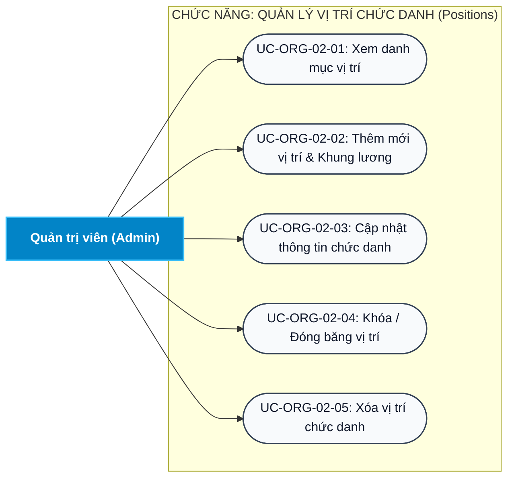

#### B. Bản đặc tả chi tiết nghiệp vụ từng Use Case con:

##### UC-ORG-02-01: Xem danh mục vị trí chức danh

| Thành phần | Nội dung chi tiết |
| :--- | :--- |
| **Mã Use Case** | `UC-ORG-02-01` |
| **Tên Use Case** | Xem danh mục vị trí chức danh |
| **Mục tiêu** | Theo dõi danh mục các vị trí công tác, cấp bậc chuyên môn và khung dải lương quy định. |
| **Tác nhân chính** | Quản trị viên (Admin). |
| **Tiền điều kiện** | Quản trị viên đã đăng nhập Cổng Quản trị hệ thống (/internal). |
| **Kích hoạt (Trigger)** | Người dùng thao tác tại chức năng "Xem danh mục vị trí chức danh". |
| **Luồng chính (Basic Flow)** | Người dùng truy cập "Vị trí" $\rightarrow$ Hệ thống hiển thị bảng danh mục vị trí gồm: Mã vị trí, Tên chức danh, Phòng ban trực thuộc, Cấp bậc chuyên môn (Staff, Leader, Manager), Khung lương tối thiểu - tối đa, Trạng thái hoạt động. |
| **Luồng ngoại lệ** | Dữ liệu nhập không hợp lệ hoặc vi phạm ràng buộc nghiệp vụ $\rightarrow$ Hệ thống từ chối thực hiện và hiển thị thông báo lỗi. |
| **Hậu điều kiện** | Hệ thống hoàn tất xử lý nghiệp vụ "Xem danh mục vị trí chức danh" và cập nhật trạng thái hiển thị. |

##### UC-ORG-02-02: Thêm mới vị trí & Khung dải lương

| Thành phần | Nội dung chi tiết |
| :--- | :--- |
| **Mã Use Case** | `UC-ORG-02-02` |
| **Tên Use Case** | Thêm mới vị trí & Khung dải lương |
| **Mục tiêu** | Thiết lập chức danh mới, cấp bậc và ấn định khung dải lương tuyển dụng (`minSalary` - `maxSalary`). |
| **Tác nhân chính** | Quản trị viên (Admin). |
| **Tiền điều kiện** | Quản trị viên đã đăng nhập Cổng Quản trị hệ thống (/internal). |
| **Kích hoạt (Trigger)** | Người dùng thao tác tại chức năng "Thêm mới vị trí & Khung dải lương". |
| **Luồng chính (Basic Flow)** | 1. Người dùng nhấn "+ Thêm vị trí", chọn phòng ban trực thuộc (ví dụ: `Phòng Kỹ thuật`).<br>2. Nhập Tên chức danh (ví dụ: *"Lập trình viên Frontend"*).<br>3. Hệ thống tự động gợi ý mã chuẩn kết hợp: `[MÃ_PB]-[VỊ_TRÍ]` (ví dụ: `DEV-FE`).<br>4. Chọn Cấp bậc chuyên môn, nhập Mức lương tối thiểu và Mức lương tối đa, nhập mô tả công việc.<br>5. Nhấn "Lưu thông tin". Hệ thống kiểm tra: Mức lương tối đa phải $\ge$ Mức lương tối thiểu; Mã vị trí duy nhất.<br>6. Hệ thống lưu vị trí mới và thông báo: *"Thêm vị trí chức danh thành công!"*. |
| **Luồng ngoại lệ** | Lương tối đa nhỏ hơn tối thiểu $\rightarrow$ Báo lỗi: *"Mức lương tối đa không được nhỏ hơn mức lương tối thiểu!"*. |
| **Hậu điều kiện** | Hệ thống hoàn tất xử lý nghiệp vụ "Thêm mới vị trí & Khung dải lương" và cập nhật trạng thái hiển thị. |

##### UC-ORG-02-03: Cập nhật vị trí chức danh

| Thành phần | Nội dung chi tiết |
| :--- | :--- |
| **Mã Use Case** | `UC-ORG-02-03` |
| **Tên Use Case** | Cập nhật vị trí chức danh |
| **Mục tiêu** | Điều chỉnh tên chức danh, sửa dải lương hoặc thay đổi cấp bậc chuyên môn. |
| **Tác nhân chính** | Quản trị viên (Admin). |
| **Tiền điều kiện** | Quản trị viên đã đăng nhập Cổng Quản trị hệ thống (/internal). |
| **Kích hoạt (Trigger)** | Người dùng thao tác tại chức năng "Cập nhật vị trí chức danh". |
| **Luồng chính (Basic Flow)** | Chọn icon "Sửa" $\rightarrow$ Thay đổi thông tin $\rightarrow$ Nhấn "Lưu thay đổi" $\rightarrow$ Hệ thống cập nhật và thông báo thành công. |
| **Luồng ngoại lệ** | Dữ liệu nhập không hợp lệ hoặc vi phạm ràng buộc nghiệp vụ $\rightarrow$ Hệ thống từ chối thực hiện và hiển thị thông báo lỗi. |
| **Hậu điều kiện** | Hệ thống hoàn tất xử lý nghiệp vụ "Cập nhật vị trí chức danh" và cập nhật trạng thái hiển thị. |

##### UC-ORG-02-04: Khóa / Đóng băng vị trí chức danh

| Thành phần | Nội dung chi tiết |
| :--- | :--- |
| **Mã Use Case** | `UC-ORG-02-04` |
| **Tên Use Case** | Khóa / Đóng băng vị trí chức danh |
| **Mục tiêu** | Ngừng mở tuyển dụng hoặc ngừng bổ nhiệm vào vị trí chức danh cũ mà vẫn giữ nguyên hợp đồng của nhân sự đang nắm giữ vị trí này. |
| **Tác nhân chính** | Quản trị viên (Admin). |
| **Tiền điều kiện** | Quản trị viên đã đăng nhập Cổng Quản trị hệ thống (/internal). |
| **Kích hoạt (Trigger)** | Người dùng thao tác tại chức năng "Khóa / Đóng băng vị trí chức danh". |
| **Luồng chính (Basic Flow)** | Nhấn icon Khóa $\rightarrow$ Xác nhận $\rightarrow$ Chuyển trạng thái sang "Ngừng hoạt động", ẩn khỏi danh sách mở tuyển dụng. |
| **Luồng ngoại lệ** | Dữ liệu nhập không hợp lệ hoặc vi phạm ràng buộc nghiệp vụ $\rightarrow$ Hệ thống từ chối thực hiện và hiển thị thông báo lỗi. |
| **Hậu điều kiện** | Hệ thống hoàn tất xử lý nghiệp vụ "Khóa / Đóng băng vị trí chức danh" và cập nhật trạng thái hiển thị. |

##### UC-ORG-02-05: Xóa vị trí chức danh

| Thành phần | Nội dung chi tiết |
| :--- | :--- |
| **Mã Use Case** | `UC-ORG-02-05` |
| **Tên Use Case** | Xóa vị trí chức danh |
| **Mục tiêu** | Xóa vị trí chức danh không còn tồn tại trong doanh nghiệp. |
| **Tác nhân chính** | Quản trị viên (Admin). |
| **Tiền điều kiện** | Quản trị viên đã đăng nhập Cổng Quản trị hệ thống (/internal). |
| **Kích hoạt (Trigger)** | Người dùng thao tác tại chức năng "Xóa vị trí chức danh". |
| **Luồng chính (Basic Flow)** | Nhấn biểu tượng Xóa $\rightarrow$ Xác nhận $\rightarrow$ Hệ thống kiểm tra nếu không có nhân viên nào đang giữ vị trí này và không có tin tuyển dụng nào đang mở thì cho phép xóa. |
| **Luồng ngoại lệ** | Nếu đang có nhân sự giữ vị trí $\rightarrow$ Từ chối xóa và báo lỗi: *"Không thể xóa vị trí đang có nhân viên đảm nhiệm!"*. |
| **Hậu điều kiện** | Hệ thống hoàn tất xử lý nghiệp vụ "Xóa vị trí chức danh" và cập nhật trạng thái hiển thị. |

---

### 3.1.3. Chức năng Xem Sơ đồ Cây Tổ chức (`OrgChart.jsx`)

#### A. Sơ đồ Use Case Cấp 3: Sơ đồ Cây Tổ chức
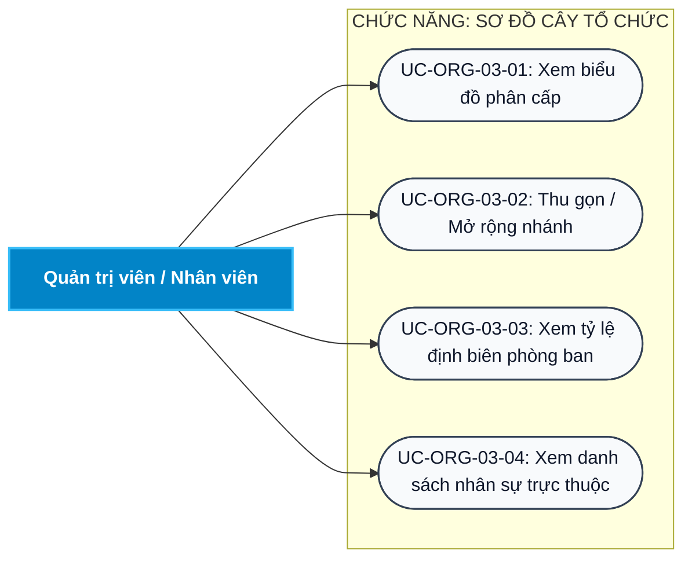

#### B. Bản đặc tả chi tiết nghiệp vụ từng Use Case con:

##### UC-ORG-03-01: Xem biểu đồ phân cấp tổ chức hình cây

| Thành phần | Nội dung chi tiết |
| :--- | :--- |
| **Mã Use Case** | `UC-ORG-03-01` |
| **Tên Use Case** | Xem biểu đồ phân cấp tổ chức hình cây |
| **Mục tiêu** | Trực quan hóa toàn bộ mô hình phân cấp tổ chức doanh nghiệp (Ban Giám Đốc $\rightarrow$ Khối $\rightarrow$ Phòng ban $\rightarrow$ Bộ phận con). |
| **Tác nhân chính** | Quản trị viên (Admin). |
| **Tiền điều kiện** | Quản trị viên đã đăng nhập Cổng Quản trị hệ thống (/internal). |
| **Kích hoạt (Trigger)** | Người dùng thao tác tại chức năng "Xem biểu đồ phân cấp tổ chức hình cây". |
| **Luồng chính (Basic Flow)** | Người dùng truy cập "Sơ đồ tổ chức" $\rightarrow$ Hệ thống dựng sơ đồ hình cây phân cấp nhiều tầng; mỗi nút hiển thị: Tên phòng ban, Họ tên trưởng bộ phận, Số lượng nhân sự thực tế và Chỉ tiêu định biên. |
| **Luồng ngoại lệ** | Dữ liệu nhập không hợp lệ hoặc vi phạm ràng buộc nghiệp vụ $\rightarrow$ Hệ thống từ chối thực hiện và hiển thị thông báo lỗi. |
| **Hậu điều kiện** | Hệ thống hoàn tất xử lý nghiệp vụ "Xem biểu đồ phân cấp tổ chức hình cây" và cập nhật trạng thái hiển thị. |

##### UC-ORG-03-02: Thu gọn / Mở rộng nhánh cây tổ chức

| Thành phần | Nội dung chi tiết |
| :--- | :--- |
| **Mã Use Case** | `UC-ORG-03-02` |
| **Tên Use Case** | Thu gọn / Mở rộng nhánh cây tổ chức |
| **Mục tiêu** | Cho phép người dùng tùy biến tầm nhìn sơ đồ cây bằng cách thu gọn các phòng ban cấp dưới hoặc mở rộng toàn bộ cấu trúc. |
| **Tác nhân chính** | Quản trị viên (Admin). |
| **Tiền điều kiện** | Quản trị viên đã đăng nhập Cổng Quản trị hệ thống (/internal). |
| **Kích hoạt (Trigger)** | Người dùng thao tác tại chức năng "Thu gọn / Mở rộng nhánh cây tổ chức". |
| **Luồng chính (Basic Flow)** | Nhấp vào nút mở rộng/thu gọn trên từng khối phòng ban cha $\rightarrow$ Hệ thống ẩn/hiện nhánh con tương ứng mượt mà. |
| **Luồng ngoại lệ** | Dữ liệu nhập không hợp lệ hoặc vi phạm ràng buộc nghiệp vụ $\rightarrow$ Hệ thống từ chối thực hiện và hiển thị thông báo lỗi. |
| **Hậu điều kiện** | Hệ thống hoàn tất xử lý nghiệp vụ "Thu gọn / Mở rộng nhánh cây tổ chức" và cập nhật trạng thái hiển thị. |

##### UC-ORG-03-03: Xem tỷ lệ lấp đầy định biên trên sơ đồ

| Thành phần | Nội dung chi tiết |
| :--- | :--- |
| **Mã Use Case** | `UC-ORG-03-03` |
| **Tên Use Case** | Xem tỷ lệ lấp đầy định biên trên sơ đồ |
| **Mục tiêu** | Giúp lãnh đạo nhận diện nhanh các phòng ban đang thừa hoặc thiếu nhân sự so với chỉ tiêu được duyệt. |
| **Tác nhân chính** | Quản trị viên (Admin). |
| **Tiền điều kiện** | Quản trị viên đã đăng nhập Cổng Quản trị hệ thống (/internal). |
| **Kích hoạt (Trigger)** | Người dùng thao tác tại chức năng "Xem tỷ lệ lấp đầy định biên trên sơ đồ". |
| **Luồng chính (Basic Flow)** | Hệ thống hiển thị thanh tiến độ phần trăm % lấp đầy ngay trên từng khối phòng ban: Màu xanh (đủ định biên), Màu vàng (đang thiếu người), Màu đỏ (vượt định biên). |
| **Luồng ngoại lệ** | Dữ liệu nhập không hợp lệ hoặc vi phạm ràng buộc nghiệp vụ $\rightarrow$ Hệ thống từ chối thực hiện và hiển thị thông báo lỗi. |
| **Hậu điều kiện** | Hệ thống hoàn tất xử lý nghiệp vụ "Xem tỷ lệ lấp đầy định biên trên sơ đồ" và cập nhật trạng thái hiển thị. |

##### UC-ORG-03-04: Xem danh sách nhân sự trực thuộc phòng ban

| Thành phần | Nội dung chi tiết |
| :--- | :--- |
| **Mã Use Case** | `UC-ORG-03-04` |
| **Tên Use Case** | Xem danh sách nhân sự trực thuộc phòng ban |
| **Mục tiêu** | Bấm vào một khối phòng ban để tra cứu nhanh danh sách các nhân viên đang làm việc tại đơn vị đó. |
| **Tác nhân chính** | Quản trị viên (Admin). |
| **Tiền điều kiện** | Quản trị viên đã đăng nhập Cổng Quản trị hệ thống (/internal). |
| **Kích hoạt (Trigger)** | Người dùng thao tác tại chức năng "Xem danh sách nhân sự trực thuộc phòng ban". |
| **Luồng chính (Basic Flow)** | Nhấp vào khối phòng ban $\rightarrow$ Hệ thống mở danh sách nhân sự trực thuộc gồm: Mã nhân viên, Họ tên, Chức vụ và Email liên hệ. |
| **Luồng ngoại lệ** | Dữ liệu nhập không hợp lệ hoặc vi phạm ràng buộc nghiệp vụ $\rightarrow$ Hệ thống từ chối thực hiện và hiển thị thông báo lỗi. |
| **Hậu điều kiện** | Hệ thống hoàn tất xử lý nghiệp vụ "Xem danh sách nhân sự trực thuộc phòng ban" và cập nhật trạng thái hiển thị. |

---

## 3.2. PHÂN HỆ 2: TUYỂN DỤNG & ATS KANBAN (RECRUITMENT)

### 3.2.0. Sơ đồ Use Case Cấp 2: Tuyển dụng & ATS
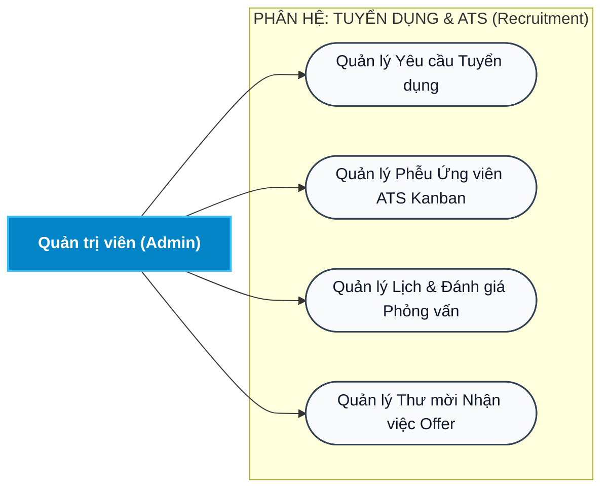

---

### 3.2.1. Chức năng Yêu cầu Tuyển dụng (`Requisitions.jsx`)

#### A. Sơ đồ Use Case Cấp 3: Yêu cầu Tuyển dụng


#### B. Bản đặc tả chi tiết nghiệp vụ từng Use Case con:

##### UC-REC-01-01: Xem danh sách yêu cầu tuyển dụng

| Thành phần | Nội dung chi tiết |
| :--- | :--- |
| **Mã Use Case** | `UC-REC-01-01` |
| **Tên Use Case** | Xem danh sách yêu cầu tuyển dụng |
| **Mục tiêu** | Theo dõi tình trạng các vị trí đang cần tuyển dụng, số lượng chỉ tiêu và tiến độ tuyển thực tế. |
| **Tác nhân chính** | Quản trị viên (Admin). |
| **Tiền điều kiện** | Quản trị viên đã đăng nhập Cổng Quản trị hệ thống (/internal). |
| **Kích hoạt (Trigger)** | Người dùng thao tác tại chức năng "Xem danh sách yêu cầu tuyển dụng". |
| **Luồng chính (Basic Flow)** | Mở "Yêu cầu tuyển dụng" $\rightarrow$ Xem bảng danh sách các tin: Tiêu đề vị trí, Phòng ban, Số lượng cần tuyển, Đã tuyển được, Hạn nộp hồ sơ, Trạng thái (Bản nháp, Đang đăng, Đã đóng). |
| **Luồng ngoại lệ** | Dữ liệu nhập không hợp lệ hoặc vi phạm ràng buộc nghiệp vụ $\rightarrow$ Hệ thống từ chối thực hiện và hiển thị thông báo lỗi. |
| **Hậu điều kiện** | Hệ thống hoàn tất xử lý nghiệp vụ "Xem danh sách yêu cầu tuyển dụng" và cập nhật trạng thái hiển thị. |

##### UC-REC-01-02: Lập yêu cầu tuyển dụng & Kiểm tra định biên

| Thành phần | Nội dung chi tiết |
| :--- | :--- |
| **Mã Use Case** | `UC-REC-01-02` |
| **Tên Use Case** | Lập yêu cầu tuyển dụng & Kiểm tra định biên |
| **Mục tiêu** | Tạo phiếu đề xuất bổ sung nhân sự, hệ thống tự động kiểm tra trần định biên để tránh tuyển vượt chỉ tiêu. |
| **Tác nhân chính** | Quản trị viên (Admin). |
| **Tiền điều kiện** | Quản trị viên đã đăng nhập Cổng Quản trị hệ thống (/internal). |
| **Kích hoạt (Trigger)** | Người dùng thao tác tại chức năng "Lập yêu cầu tuyển dụng & Kiểm tra định biên". |
| **Luồng chính (Basic Flow)** | 1. Nhấn nút "+ Tạo yêu cầu tuyển dụng".<br>2. Chọn phòng ban, chức danh và nhập số lượng nhân sự cần tuyển.<br>3. Hệ thống kiểm tra: Số nhân sự hiện có + Số lượng cần tuyển $\le$ Chỉ tiêu định biên quota.<br>4. Nhập dải lương dự kiến, hạn chót nhận hồ sơ, mô tả công việc (JD) và lý do tuyển dụng (mở rộng, thay thế, dự án).<br>5. Nhấn "Lưu yêu cầu". Phiếu tuyển dụng được lưu ở trạng thái Bản nháp hoặc Xuất bản. |
| **Luồng ngoại lệ** | Vượt quá hạn ngạch định biên (`nhân sự hiện có + đang tuyển + đề xuất > quota`) $\rightarrow$ Hệ thống chặn tạo mới và yêu cầu nâng định biên phòng ban trước. |
| **Hậu điều kiện** | Hệ thống hoàn tất xử lý nghiệp vụ "Lập yêu cầu tuyển dụng & Kiểm tra định biên" và cập nhật trạng thái hiển thị. |

##### UC-REC-01-03: Chỉnh sửa yêu cầu tuyển dụng

| Thành phần | Nội dung chi tiết |
| :--- | :--- |
| **Mã Use Case** | `UC-REC-01-03` |
| **Tên Use Case** | Chỉnh sửa yêu cầu tuyển dụng |
| **Mục tiêu** | Cập nhật lại yêu cầu kinh nghiệm, dải lương hoặc thời gian nộp hồ sơ khi tin còn ở trạng thái Bản nháp (`DRAFT`). |
| **Tác nhân chính** | Quản trị viên (Admin). |
| **Tiền điều kiện** | Quản trị viên đã đăng nhập Cổng Quản trị hệ thống (/internal). |
| **Kích hoạt (Trigger)** | Người dùng thao tác tại chức năng "Chỉnh sửa yêu cầu tuyển dụng". |
| **Luồng chính (Basic Flow)** | Chọn icon "Sửa" tại phiếu tuyển dụng ở trạng thái `DRAFT` $\rightarrow$ Cập nhật thông tin $\rightarrow$ Lưu thay đổi. |
| **Luồng ngoại lệ** | Tin đã xuất bản (`PUBLISHED`) bị khóa chỉnh sửa trực tiếp $\rightarrow$ Hệ thống thông báo không thể sửa tin đang công khai. |
| **Hậu điều kiện** | Hệ thống hoàn tất xử lý nghiệp vụ "Chỉnh sửa yêu cầu tuyển dụng" và cập nhật trạng thái hiển thị. |

##### UC-REC-01-04: Xuất bản tin ra Cổng Tuyển dụng Công khai

| Thành phần | Nội dung chi tiết |
| :--- | :--- |
| **Mã Use Case** | `UC-REC-01-04` |
| **Tên Use Case** | Xuất bản tin ra Cổng Tuyển dụng Công khai |
| **Mục tiêu** | Đưa tin tuyển dụng lên trang chủ việc làm để ứng viên bên ngoài tiếp cận và nộp hồ sơ. |
| **Tác nhân chính** | Quản trị viên (Admin). |
| **Tiền điều kiện** | Quản trị viên đã đăng nhập Cổng Quản trị hệ thống (/internal). |
| **Kích hoạt (Trigger)** | Người dùng thao tác tại chức năng "Xuất bản tin ra Cổng Tuyển dụng Công khai". |
| **Luồng chính (Basic Flow)** | Nhấn "Xuất bản tin" $\rightarrow$ Trạng thái chuyển sang `PUBLISHED`, tin tự động xuất hiện trên Cổng Tuyển dụng Công khai. |
| **Luồng ngoại lệ** | Dữ liệu nhập không hợp lệ hoặc vi phạm ràng buộc nghiệp vụ $\rightarrow$ Hệ thống từ chối thực hiện và hiển thị thông báo lỗi. |
| **Hậu điều kiện** | Hệ thống hoàn tất xử lý nghiệp vụ "Xuất bản tin ra Cổng Tuyển dụng Công khai" và cập nhật trạng thái hiển thị. |

##### UC-REC-01-05: Đóng nhận hồ sơ tuyển dụng (Thủ công & Tự động)

| Thành phần | Nội dung chi tiết |
| :--- | :--- |
| **Mã Use Case** | `UC-REC-01-05` |
| **Tên Use Case** | Đóng nhận hồ sơ tuyển dụng (Thủ công & Tự động) |
| **Mục tiêu** | Dừng nhận hồ sơ khi đã tuyển đủ chỉ tiêu (hệ thống tự đóng) hoặc khi Admin đóng thủ công. |
| **Tác nhân chính** | Quản trị viên (Admin). |
| **Tiền điều kiện** | Quản trị viên đã đăng nhập Cổng Quản trị hệ thống (/internal). |
| **Kích hoạt (Trigger)** | Người dùng thao tác tại chức năng "Đóng nhận hồ sơ tuyển dụng (Thủ công & Tự động)". |
| **Luồng chính (Basic Flow)** | Nhấn "Đóng tin" (hoặc khi số lượng ứng viên `HIRED` đạt đủ chỉ tiêu) $\rightarrow$ Trạng thái chuyển sang `CLOSED`, Cổng Tuyển dụng ẩn nút nộp hồ sơ cho vị trí này. |
| **Luồng ngoại lệ** | Dữ liệu nhập không hợp lệ hoặc vi phạm ràng buộc nghiệp vụ $\rightarrow$ Hệ thống từ chối thực hiện và hiển thị thông báo lỗi. |
| **Hậu điều kiện** | Hệ thống hoàn tất xử lý nghiệp vụ "Đóng nhận hồ sơ tuyển dụng (Thủ công & Tự động)" và cập nhật trạng thái hiển thị. |

---

### 3.2.2. Chức năng Phễu Ứng viên ATS Kanban (`RecruitmentATS.jsx`)

#### A. Sơ đồ Use Case Cấp 3: Phễu ATS Kanban
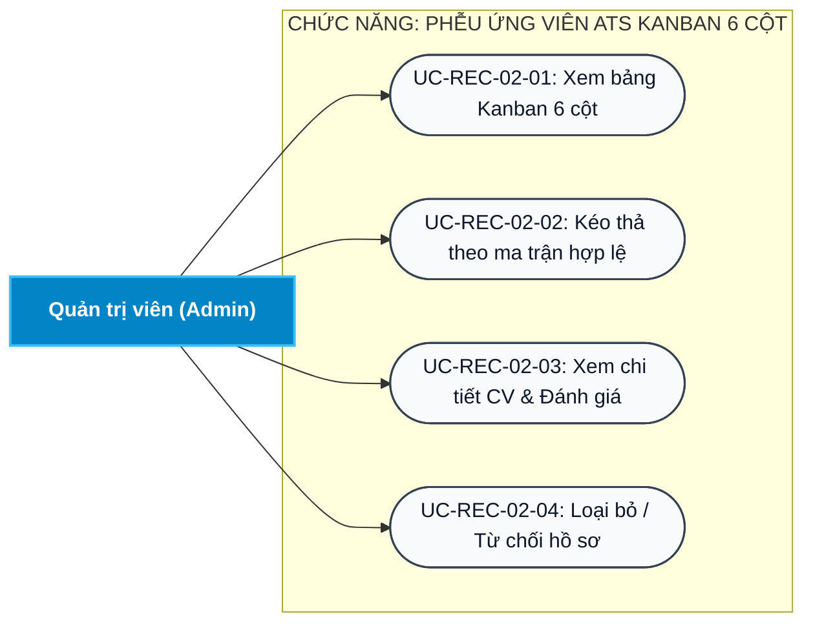

#### B. Bản đặc tả chi tiết nghiệp vụ từng Use Case con:

##### UC-REC-02-01: Xem bảng Kanban phân loại 6 cột

| Thành phần | Nội dung chi tiết |
| :--- | :--- |
| **Mã Use Case** | `UC-REC-02-01` |
| **Tên Use Case** | Xem bảng Kanban phân loại 6 cột |
| **Mục tiêu** | Theo dõi toàn bộ ứng viên theo đúng 6 cột trạng thái: *Mới ứng tuyển (`APPLIED`) $\rightarrow$ Sơ loại (`SCREENING`) $\rightarrow$ Phỏng vấn (`INTERVIEW`) $\rightarrow$ Đề nghị nhận việc (`OFFER`) $\rightarrow$ Đã tuyển (`HIRED`) / Từ chối (`REJECTED`)*. |
| **Tác nhân chính** | Quản trị viên (Admin). |
| **Tiền điều kiện** | Quản trị viên đã đăng nhập Cổng Quản trị hệ thống (/internal). |
| **Kích hoạt (Trigger)** | Người dùng thao tác tại chức năng "Xem bảng Kanban phân loại 6 cột". |
| **Luồng chính (Basic Flow)** | Mở màn hình ATS $\rightarrow$ Xem bảng 6 cột, mỗi ứng viên hiển thị dạng thẻ card tóm tắt (Họ tên, Mã tra cứu `LLA-APP-...`, Email, SĐT, Điểm phỏng vấn). |
| **Luồng ngoại lệ** | Dữ liệu nhập không hợp lệ hoặc vi phạm ràng buộc nghiệp vụ $\rightarrow$ Hệ thống từ chối thực hiện và hiển thị thông báo lỗi. |
| **Hậu điều kiện** | Hệ thống hoàn tất xử lý nghiệp vụ "Xem bảng Kanban phân loại 6 cột" và cập nhật trạng thái hiển thị. |

##### UC-REC-02-02: Kéo thả chuyển trạng thái ứng viên (Theo ma trận hợp lệ)

| Thành phần | Nội dung chi tiết |
| :--- | :--- |
| **Mã Use Case** | `UC-REC-02-02` |
| **Tên Use Case** | Kéo thả chuyển trạng thái ứng viên (Theo ma trận hợp lệ) |
| **Mục tiêu** | Cập nhật tiến độ tuyển dụng trực quan nhưng vẫn kiểm soát chặt bước chuyển theo ma trận trạng thái hợp lệ (`validTransitions`). |
| **Tác nhân chính** | Quản trị viên (Admin). |
| **Tiền điều kiện** | Quản trị viên đã đăng nhập Cổng Quản trị hệ thống (/internal). |
| **Kích hoạt (Trigger)** | Người dùng thao tác tại chức năng "Kéo thả chuyển trạng thái ứng viên (Theo ma trận hợp lệ)". |
| **Luồng chính (Basic Flow)** | Kéo thẻ ứng viên thả sang cột kế tiếp hợp lệ $\rightarrow$ Hệ thống kiểm tra ma trận chuyển trạng thái $\rightarrow$ Cập nhật trạng thái mới và ghi vết lịch sử. |
| **Luồng ngoại lệ** | Kéo nhảy cóc sai quy trình (không nằm trong `validTransitions`) $\rightarrow$ Hệ thống từ chối chuyển trạng thái và hoàn nguyên vị trí thẻ. |
| **Hậu điều kiện** | Hệ thống hoàn tất xử lý nghiệp vụ "Kéo thả chuyển trạng thái ứng viên (Theo ma trận hợp lệ)" và cập nhật trạng thái hiển thị. |

##### UC-REC-02-03: Xem chi tiết CV & Đánh giá

| Thành phần | Nội dung chi tiết |
| :--- | :--- |
| **Mã Use Case** | `UC-REC-02-03` |
| **Tên Use Case** | Xem chi tiết CV & Đánh giá |
| **Mục tiêu** | Xem trực tiếp file hồ sơ CV của ứng viên và ghi chú nhận xét ban đầu. |
| **Tác nhân chính** | Quản trị viên (Admin). |
| **Tiền điều kiện** | Quản trị viên đã đăng nhập Cổng Quản trị hệ thống (/internal). |
| **Kích hoạt (Trigger)** | Người dùng thao tác tại chức năng "Xem chi tiết CV & Đánh giá". |
| **Luồng chính (Basic Flow)** | Nhấp vào thẻ ứng viên $\rightarrow$ Hệ thống mở Modal xem file CV, thông tin liên lạc và lịch sử đánh giá. |
| **Luồng ngoại lệ** | Dữ liệu nhập không hợp lệ hoặc vi phạm ràng buộc nghiệp vụ $\rightarrow$ Hệ thống từ chối thực hiện và hiển thị thông báo lỗi. |
| **Hậu điều kiện** | Hệ thống hoàn tất xử lý nghiệp vụ "Xem chi tiết CV & Đánh giá" và cập nhật trạng thái hiển thị. |

##### UC-REC-02-04: Loại bỏ / Từ chối hồ sơ (Reject)

| Thành phần | Nội dung chi tiết |
| :--- | :--- |
| **Mã Use Case** | `UC-REC-02-04` |
| **Tên Use Case** | Loại bỏ / Từ chối hồ sơ (Reject) |
| **Mục tiêu** | Đánh dấu không phù hợp đối với các ứng viên không đạt yêu cầu. |
| **Tác nhân chính** | Quản trị viên (Admin). |
| **Tiền điều kiện** | Quản trị viên đã đăng nhập Cổng Quản trị hệ thống (/internal). |
| **Kích hoạt (Trigger)** | Người dùng thao tác tại chức năng "Loại bỏ / Từ chối hồ sơ (Reject)". |
| **Luồng chính (Basic Flow)** | Kéo ứng viên vào cột "Từ chối (`REJECTED`)" hoặc nhấn "Loại hồ sơ" $\rightarrow$ Nhập lý do từ chối $\rightarrow$ Hệ thống cập nhật trạng thái và gửi email thông báo từ chối (nếu chọn). |
| **Luồng ngoại lệ** | Dữ liệu nhập không hợp lệ hoặc vi phạm ràng buộc nghiệp vụ $\rightarrow$ Hệ thống từ chối thực hiện và hiển thị thông báo lỗi. |
| **Hậu điều kiện** | Hệ thống hoàn tất xử lý nghiệp vụ "Loại bỏ / Từ chối hồ sơ (Reject)" và cập nhật trạng thái hiển thị. |

---

### 3.2.3. Chức năng Lịch Phỏng vấn & Chấm điểm (`Interviews.jsx`)

#### A. Sơ đồ Use Case Cấp 3: Lịch Phỏng vấn & Chấm điểm
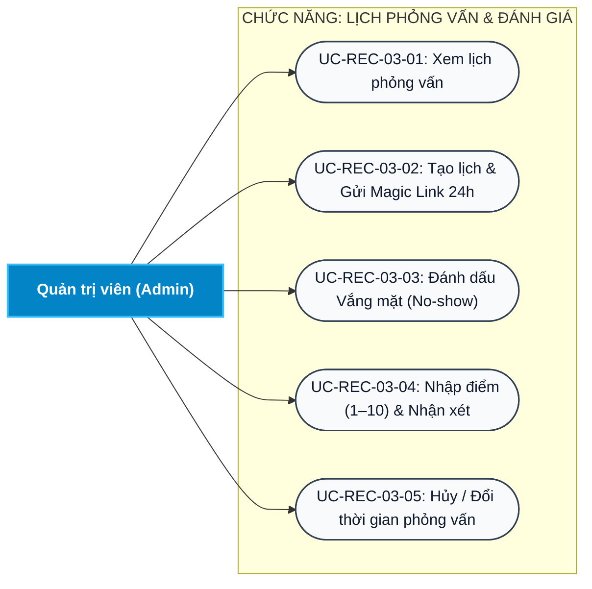

#### B. Bản đặc tả chi tiết nghiệp vụ từng Use Case con:

##### UC-REC-03-01: Xem lịch phỏng vấn

| Thành phần | Nội dung chi tiết |
| :--- | :--- |
| **Mã Use Case** | `UC-REC-03-01` |
| **Tên Use Case** | Xem lịch phỏng vấn |
| **Mục tiêu** | Theo dõi danh sách các buổi phỏng vấn sắp diễn ra và trạng thái xác nhận Magic Link từ ứng viên. |
| **Tác nhân chính** | Quản trị viên (Admin). |
| **Tiền điều kiện** | Quản trị viên đã đăng nhập Cổng Quản trị hệ thống (/internal). |
| **Kích hoạt (Trigger)** | Người dùng thao tác tại chức năng "Xem lịch phỏng vấn". |
| **Luồng chính (Basic Flow)** | Mở "Lịch phỏng vấn" $\rightarrow$ Xem danh sách gồm: Tên ứng viên, Vị trí ứng tuyển, Vòng phỏng vấn, Thời gian, Hình thức, Người phỏng vấn và trạng thái phản hồi của ứng viên. |
| **Luồng ngoại lệ** | Dữ liệu nhập không hợp lệ hoặc vi phạm ràng buộc nghiệp vụ $\rightarrow$ Hệ thống từ chối thực hiện và hiển thị thông báo lỗi. |
| **Hậu điều kiện** | Hệ thống hoàn tất xử lý nghiệp vụ "Xem lịch phỏng vấn" và cập nhật trạng thái hiển thị. |

##### UC-REC-03-02: Tạo lịch phỏng vấn & Gửi Magic Link xác nhận tự động (24h)

| Thành phần | Nội dung chi tiết |
| :--- | :--- |
| **Mã Use Case** | `UC-REC-03-02` |
| **Tên Use Case** | Tạo lịch phỏng vấn & Gửi Magic Link xác nhận tự động (24h) |
| **Mục tiêu** | Xếp lịch phỏng vấn, phân công người phỏng vấn và tự động gửi email kèm Magic Link hiệu lực 24h cho ứng viên xác nhận 1-chạm. |
| **Tác nhân chính** | Quản trị viên (Admin). |
| **Tiền điều kiện** | Quản trị viên đã đăng nhập Cổng Quản trị hệ thống (/internal). |
| **Kích hoạt (Trigger)** | Người dùng thao tác tại chức năng "Tạo lịch phỏng vấn & Gửi Magic Link xác nhận tự động (24h)". |
| **Luồng chính (Basic Flow)** | Chọn ứng viên $\rightarrow$ Chọn Vòng phỏng vấn, Ngày giờ, Địa điểm/Link họp, Người phỏng vấn $\rightarrow$ Lưu lịch $\rightarrow$ Hệ thống sinh Magic Link 24h và tự động gửi email mời phỏng vấn đến ứng viên. |
| **Luồng ngoại lệ** | Thời gian phỏng vấn không hợp lệ hoặc thiếu người phỏng vấn $\rightarrow$ Hệ thống báo lỗi và yêu cầu bổ sung. |
| **Hậu điều kiện** | Hệ thống hoàn tất xử lý nghiệp vụ "Tạo lịch phỏng vấn & Gửi Magic Link xác nhận tự động (24h)" và cập nhật trạng thái hiển thị. |

##### UC-REC-03-03: Đánh dấu Ứng viên Vắng mặt không lý do (No-show)

| Thành phần | Nội dung chi tiết |
| :--- | :--- |
| **Mã Use Case** | `UC-REC-03-03` |
| **Tên Use Case** | Đánh dấu Ứng viên Vắng mặt không lý do (No-show) |
| **Mục tiêu** | Ghi nhận tình trạng ứng viên không tham gia buổi phỏng vấn đã hẹn để làm căn cứ loại hồ sơ hoặc xử lý lại. |
| **Tác nhân chính** | Quản trị viên (Admin). |
| **Tiền điều kiện** | Quản trị viên đã đăng nhập Cổng Quản trị hệ thống (/internal). |
| **Kích hoạt (Trigger)** | Người dùng thao tác tại chức năng "Đánh dấu Ứng viên Vắng mặt không lý do (No-show)". |
| **Luồng chính (Basic Flow)** | Chọn buổi phỏng vấn $\rightarrow$ Nhấn "Đánh dấu Vắng mặt (`NO_SHOW`)" và ghi chú $\rightarrow$ Hệ thống cập nhật trạng thái vòng phỏng vấn sang `NO_SHOW`. |
| **Luồng ngoại lệ** | Dữ liệu nhập không hợp lệ hoặc vi phạm ràng buộc nghiệp vụ $\rightarrow$ Hệ thống từ chối thực hiện và hiển thị thông báo lỗi. |
| **Hậu điều kiện** | Hệ thống hoàn tất xử lý nghiệp vụ "Đánh dấu Ứng viên Vắng mặt không lý do (No-show)" và cập nhật trạng thái hiển thị. |

##### UC-REC-03-04: Nhập điểm và Nhận xét đánh giá (Thang 1–10)

| Thành phần | Nội dung chi tiết |
| :--- | :--- |
| **Mã Use Case** | `UC-REC-03-04` |
| **Tên Use Case** | Nhập điểm và Nhận xét đánh giá (Thang 1–10) |
| **Mục tiêu** | Ghi nhận kết quả đánh giá năng lực ứng viên theo thang điểm 1–10 làm căn cứ đề xuất phát hành Thư mời nhận việc. |
| **Tác nhân chính** | Quản trị viên (Admin). |
| **Tiền điều kiện** | Quản trị viên đã đăng nhập Cổng Quản trị hệ thống (/internal). |
| **Kích hoạt (Trigger)** | Người dùng thao tác tại chức năng "Nhập điểm và Nhận xét đánh giá (Thang 1–10)". |
| **Luồng chính (Basic Flow)** | Mở lịch phỏng vấn $\rightarrow$ Nhập điểm số theo thang **1–10** $\rightarrow$ Ghi nhận xét chi tiết và chọn kết luận (Đạt / Không đạt) $\rightarrow$ Nhấn "Lưu kết quả". |
| **Luồng ngoại lệ** | Điểm nhập ngoài khoảng 1–10 $\rightarrow$ Hệ thống từ chối lưu và yêu cầu nhập lại đúng thang điểm. |
| **Hậu điều kiện** | Hệ thống hoàn tất xử lý nghiệp vụ "Nhập điểm và Nhận xét đánh giá (Thang 1–10)" và cập nhật trạng thái hiển thị. |

##### UC-REC-03-05: Hủy / Đổi thời gian phỏng vấn

| Thành phần | Nội dung chi tiết |
| :--- | :--- |
| **Mã Use Case** | `UC-REC-03-05` |
| **Tên Use Case** | Hủy / Đổi thời gian phỏng vấn |
| **Mục tiêu** | Hủy lịch hoặc điều chỉnh thời gian phỏng vấn khi có phát sinh từ ứng viên hoặc hội đồng phỏng vấn. |
| **Tác nhân chính** | Quản trị viên (Admin). |
| **Tiền điều kiện** | Quản trị viên đã đăng nhập Cổng Quản trị hệ thống (/internal). |
| **Kích hoạt (Trigger)** | Người dùng thao tác tại chức năng "Hủy / Đổi thời gian phỏng vấn". |
| **Luồng chính (Basic Flow)** | Chọn lịch cần đổi/hủy $\rightarrow$ Cập nhật thời gian mới (kèm tùy chọn phát hành lại Magic Link 24h) hoặc chuyển trạng thái `CANCELLED` $\rightarrow$ Gửi email thông báo cho ứng viên. |
| **Luồng ngoại lệ** | Dữ liệu nhập không hợp lệ hoặc vi phạm ràng buộc nghiệp vụ $\rightarrow$ Hệ thống từ chối thực hiện và hiển thị thông báo lỗi. |
| **Hậu điều kiện** | Hệ thống hoàn tất xử lý nghiệp vụ "Hủy / Đổi thời gian phỏng vấn" và cập nhật trạng thái hiển thị. |

---

### 3.2.4. Chức năng Quản lý Thư mời Nhận việc (`Offers.jsx`)

#### A. Sơ đồ Use Case Cấp 3: Quản lý Thư mời Nhận việc (Offer)
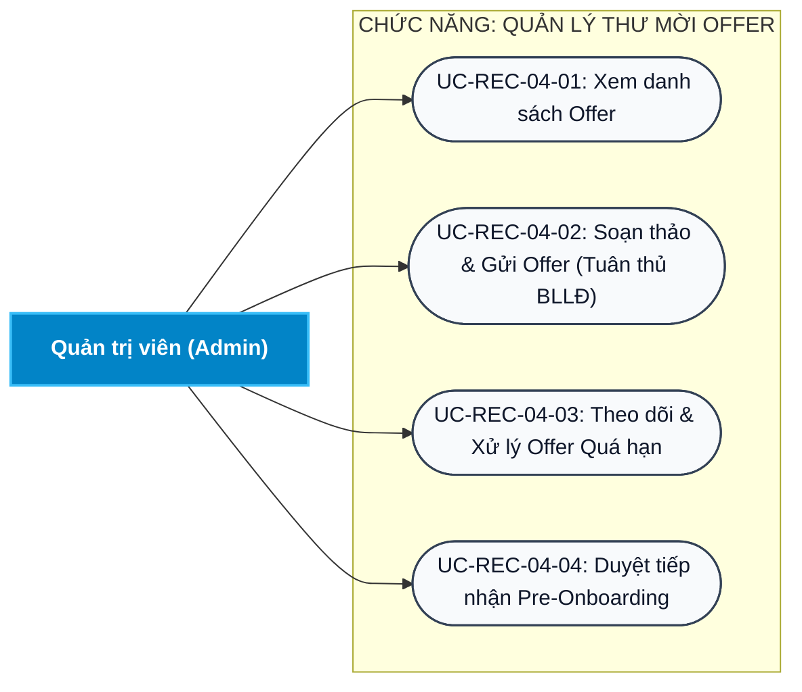

#### B. Bản đặc tả chi tiết nghiệp vụ từng Use Case con:

##### UC-REC-04-01: Xem danh sách Thư mời nhận việc

| Thành phần | Nội dung chi tiết |
| :--- | :--- |
| **Mã Use Case** | `UC-REC-04-01` |
| **Tên Use Case** | Xem danh sách Thư mời nhận việc |
| **Mục tiêu** | Theo dõi tình trạng các thư mời nhận việc đã phát hành, mức lương đề nghị và hạn phản hồi của ứng viên. |
| **Tác nhân chính** | Quản trị viên (Admin). |
| **Tiền điều kiện** | Quản trị viên đã đăng nhập Cổng Quản trị hệ thống (/internal). |
| **Kích hoạt (Trigger)** | Người dùng thao tác tại chức năng "Xem danh sách Thư mời nhận việc". |
| **Luồng chính (Basic Flow)** | Mở "Quản lý Offer" $\rightarrow$ Xem danh sách: Tên ứng viên, Vị trí tuyển dụng, Lương cơ bản, Lương thử việc, Ngày đi làm dự kiến, Hạn phản hồi, Trạng thái (`PENDING`, `ACCEPTED`, `REJECTED`, `EXPIRED`). |
| **Luồng ngoại lệ** | Dữ liệu nhập không hợp lệ hoặc vi phạm ràng buộc nghiệp vụ $\rightarrow$ Hệ thống từ chối thực hiện và hiển thị thông báo lỗi. |
| **Hậu điều kiện** | Hệ thống hoàn tất xử lý nghiệp vụ "Xem danh sách Thư mời nhận việc" và cập nhật trạng thái hiển thị. |

##### UC-REC-04-02: Soạn thảo và Gửi Thư mời Offer (Tuân thủ BLLĐ)

| Thành phần | Nội dung chi tiết |
| :--- | :--- |
| **Mã Use Case** | `UC-REC-04-02` |
| **Tên Use Case** | Soạn thảo và Gửi Thư mời Offer (Tuân thủ BLLĐ) |
| **Mục tiêu** | Soạn thảo và gửi thư mời nhận việc qua email kèm Magic Link, đảm bảo lương thử việc tối thiểu bằng 85% lương chính thức theo Điều 26 BLLĐ 2019. |
| **Tác nhân chính** | Quản trị viên (Admin). |
| **Tiền điều kiện** | Quản trị viên đã đăng nhập Cổng Quản trị hệ thống (/internal). |
| **Kích hoạt (Trigger)** | Người dùng thao tác tại chức năng "Soạn thảo và Gửi Thư mời Offer (Tuân thủ BLLĐ)". |
| **Luồng chính (Basic Flow)** | 1. Chọn ứng viên đã đạt phỏng vấn và nhấn "Tạo Offer".<br>2. Nhập Mức lương chính thức và Mức lương thử việc (hệ thống kiểm tra lương thử việc $\ge$ 85% lương chính thức).<br>3. Chọn Ngày nhận việc dự kiến và thiết lập thời hạn phản hồi theo cấu hình `OFFER_EXPIRY_DAYS` (mặc định 3 ngày).<br>4. Nhấn "Gửi Offer" $\rightarrow$ Hệ thống lưu Offer và gửi email đính kèm Magic Link bảo mật tới ứng viên. |
| **Luồng ngoại lệ** | Lương thử việc $< 85\%$ lương chính thức $\rightarrow$ Hệ thống báo lỗi vi phạm Điều 26 BLLĐ và chặn gửi Offer. |
| **Hậu điều kiện** | Hệ thống hoàn tất xử lý nghiệp vụ "Soạn thảo và Gửi Thư mời Offer (Tuân thủ BLLĐ)" và cập nhật trạng thái hiển thị. |

##### UC-REC-04-03: Theo dõi & Xử lý Offer Quá hạn

| Thành phần | Nội dung chi tiết |
| :--- | :--- |
| **Mã Use Case** | `UC-REC-04-03` |
| **Tên Use Case** | Theo dõi & Xử lý Offer Quá hạn |
| **Mục tiêu** | Giám sát thời hạn phản hồi `OFFER_EXPIRY_DAYS`; tự động đánh dấu quá hạn (`EXPIRED`) hoặc cho phép gia hạn khi hết hạn mà ứng viên chưa trả lời. |
| **Tác nhân chính** | Quản trị viên (Admin). |
| **Tiền điều kiện** | Quản trị viên đã đăng nhập Cổng Quản trị hệ thống (/internal). |
| **Kích hoạt (Trigger)** | Người dùng thao tác tại chức năng "Theo dõi & Xử lý Offer Quá hạn". |
| **Luồng chính (Basic Flow)** | Hệ thống đối chiếu thời hạn Offer. Nếu quá hạn `OFFER_EXPIRY_DAYS` mà chưa phản hồi $\rightarrow$ Chuyển trạng thái Offer sang `EXPIRED` (không cho phép ứng viên phản hồi qua Magic Link cũ nữa trừ khi được gia hạn). |
| **Luồng ngoại lệ** | Dữ liệu nhập không hợp lệ hoặc vi phạm ràng buộc nghiệp vụ $\rightarrow$ Hệ thống từ chối thực hiện và hiển thị thông báo lỗi. |
| **Hậu điều kiện** | Hệ thống hoàn tất xử lý nghiệp vụ "Theo dõi & Xử lý Offer Quá hạn" và cập nhật trạng thái hiển thị. |

##### UC-REC-04-04: Duyệt tiếp nhận Pre-Onboarding & Chuyển đổi thành Nhân viên

| Thành phần | Nội dung chi tiết |
| :--- | :--- |
| **Mã Use Case** | `UC-REC-04-04` |
| **Tên Use Case** | Duyệt tiếp nhận Pre-Onboarding & Chuyển đổi thành Nhân viên |
| **Mục tiêu** | Tiếp nhận ứng viên đã đồng ý Offer và khai báo xong hồ sơ Pre-Onboarding để chuyển đổi 1-chạm thành Nhân viên chính thức. |
| **Tác nhân chính** | Quản trị viên (Admin). |
| **Tiền điều kiện** | Quản trị viên đã đăng nhập Cổng Quản trị hệ thống (/internal). |
| **Kích hoạt (Trigger)** | Người dùng thao tác tại chức năng "Duyệt tiếp nhận Pre-Onboarding & Chuyển đổi thành Nhân viên". |
| **Luồng chính (Basic Flow)** | Sau khi ứng viên `ACCEPT` Offer và nộp hồ sơ Pre-Onboarding $\rightarrow$ Quản trị viên kiểm tra và nhấn "Accept & Onboard" $\rightarrow$ Hệ thống tự động tạo Hồ sơ Nhân viên, Tài khoản đăng nhập, Hợp đồng, Checklist Hội nhập và tăng quân số phòng ban trong cùng một giao dịch. |
| **Luồng ngoại lệ** | Dữ liệu nhập không hợp lệ hoặc vi phạm ràng buộc nghiệp vụ $\rightarrow$ Hệ thống từ chối thực hiện và hiển thị thông báo lỗi. |
| **Hậu điều kiện** | Hệ thống hoàn tất xử lý nghiệp vụ "Duyệt tiếp nhận Pre-Onboarding & Chuyển đổi thành Nhân viên" và cập nhật trạng thái hiển thị. |

---

## 3.3. PHÂN HỆ 3: HỘI NHẬP NHÂN SỰ MỚI (ONBOARDING)

### 3.3.0. Sơ đồ Use Case Cấp 2: Hội nhập Onboarding
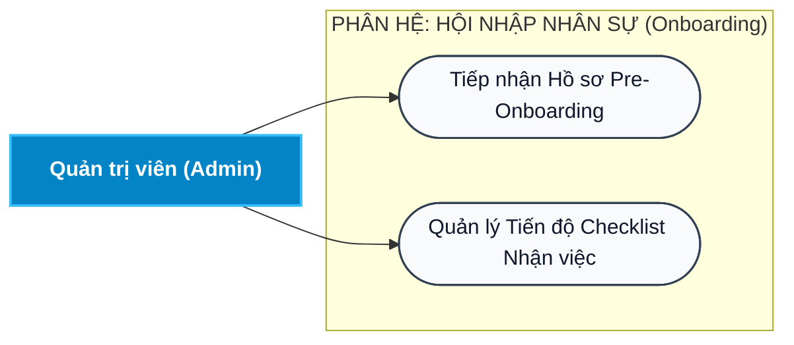

---

### 3.3.1. Chức năng Tiếp nhận Pre-Onboarding (`PreOnboardingHub.jsx`)

#### A. Sơ đồ Use Case Cấp 3: Tiếp nhận Pre-Onboarding
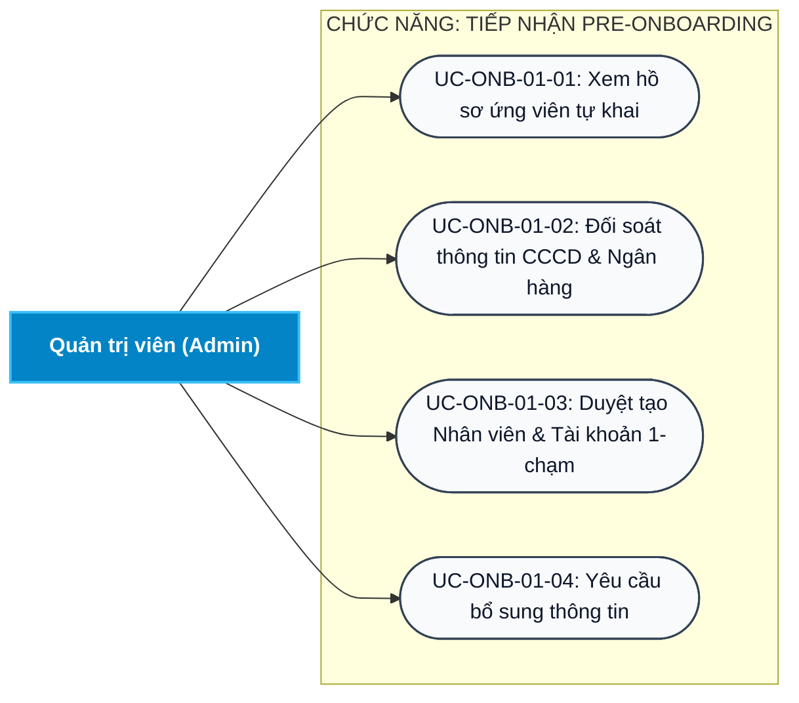

#### B. Bản đặc tả chi tiết nghiệp vụ từng Use Case con:

##### UC-ONB-01-01: Xem hồ sơ ứng viên tự kê khai

| Thành phần | Nội dung chi tiết |
| :--- | :--- |
| **Mã Use Case** | `UC-ONB-01-01` |
| **Tên Use Case** | Xem hồ sơ ứng viên tự kê khai |
| **Mục tiêu** | Kiểm tra các thông tin cá nhân, CCCD, số tài khoản ngân hàng và người thân do ứng viên trúng tuyển tự khai trực tuyến trước ngày đi làm. |
| **Tác nhân chính** | Quản trị viên (Admin). |
| **Tiền điều kiện** | Quản trị viên đã đăng nhập Cổng Quản trị hệ thống (/internal). |
| **Kích hoạt (Trigger)** | Người dùng thao tác tại chức năng "Xem hồ sơ ứng viên tự kê khai". |
| **Luồng chính (Basic Flow)** | Mở "Trung tâm Tiếp nhận Pre-Onboarding" $\rightarrow$ Xem danh sách ứng viên đã nộp hồ sơ nhận việc $\rightarrow$ Bấm xem chi tiết từng bản khai. |
| **Luồng ngoại lệ** | Dữ liệu nhập không hợp lệ hoặc vi phạm ràng buộc nghiệp vụ $\rightarrow$ Hệ thống từ chối thực hiện và hiển thị thông báo lỗi. |
| **Hậu điều kiện** | Hệ thống hoàn tất xử lý nghiệp vụ "Xem hồ sơ ứng viên tự kê khai" và cập nhật trạng thái hiển thị. |

##### UC-ONB-01-02: Đối soát thông tin CCCD & Tài khoản Ngân hàng

| Thành phần | Nội dung chi tiết |
| :--- | :--- |
| **Mã Use Case** | `UC-ONB-01-02` |
| **Tên Use Case** | Đối soát thông tin CCCD & Tài khoản Ngân hàng |
| **Mục tiêu** | Đảm bảo thông tin số định danh cá nhân và số tài khoản ngân hàng chi trả lương là chính xác và khớp với chứng từ. |
| **Tác nhân chính** | Quản trị viên (Admin). |
| **Tiền điều kiện** | Quản trị viên đã đăng nhập Cổng Quản trị hệ thống (/internal). |
| **Kích hoạt (Trigger)** | Người dùng thao tác tại chức năng "Đối soát thông tin CCCD & Tài khoản Ngân hàng". |
| **Luồng chính (Basic Flow)** | Kiểm tra ảnh chụp 2 mặt CCCD, đối chiếu số CCCD, ngày cấp, nơi cấp và số tài khoản ngân hàng chi trả lương. |
| **Luồng ngoại lệ** | Dữ liệu nhập không hợp lệ hoặc vi phạm ràng buộc nghiệp vụ $\rightarrow$ Hệ thống từ chối thực hiện và hiển thị thông báo lỗi. |
| **Hậu điều kiện** | Hệ thống hoàn tất xử lý nghiệp vụ "Đối soát thông tin CCCD & Tài khoản Ngân hàng" và cập nhật trạng thái hiển thị. |

##### UC-ONB-01-03: Phê duyệt 1-chạm: Tự động tạo Nhân viên, Cấp tài khoản & Hợp đồng

| Thành phần | Nội dung chi tiết |
| :--- | :--- |
| **Mã Use Case** | `UC-ONB-01-03` |
| **Tên Use Case** | Phê duyệt 1-chạm: Tự động tạo Nhân viên, Cấp tài khoản & Hợp đồng |
| **Mục tiêu** | Chuyển đổi ứng viên thành nhân viên chính thức chỉ bằng 1 thao tác phê duyệt, xóa bỏ hoàn toàn việc nhập tay trùng lặp. |
| **Tác nhân chính** | Quản trị viên (Admin). |
| **Tiền điều kiện** | Quản trị viên đã đăng nhập Cổng Quản trị hệ thống (/internal). |
| **Kích hoạt (Trigger)** | Người dùng thao tác tại chức năng "Phê duyệt 1-chạm: Tự động tạo Nhân viên, Cấp tài khoản & Hợp đồng". |
| **Luồng chính (Basic Flow)** | 1. Người dùng nhấn nút "Phê duyệt tiếp nhận nhân sự".<br>2. Hệ thống tự động thực hiện chuỗi giao dịch nguyên tử:<br>- Tự động cấp Mã nhân viên mới (ví dụ: `NV0145`).<br>- Chuyển toàn bộ dữ liệu cá nhân sang hồ sơ nhân viên chính thức.<br>- Khởi tạo tài khoản đăng nhập Cổng Tự phục vụ ESS với mật khẩu mặc định an toàn.<br>- Tự động lập Hợp đồng thử việc theo đúng mức lương đã chốt trên Offer.<br>- Gửi email chào mừng kèm thông tin đăng nhập đến hòm thư nhân viên mới.<br>3. Hệ thống thông báo thành công: *"Đã tiếp nhận nhân viên mới và khởi tạo tài khoản thành công!"*. |
| **Luồng ngoại lệ** | Dữ liệu nhập không hợp lệ hoặc vi phạm ràng buộc nghiệp vụ $\rightarrow$ Hệ thống từ chối thực hiện và hiển thị thông báo lỗi. |
| **Hậu điều kiện** | Hệ thống hoàn tất xử lý nghiệp vụ "Phê duyệt 1-chạm: Tự động tạo Nhân viên, Cấp tài khoản & Hợp đồng" và cập nhật trạng thái hiển thị. |

##### UC-ONB-01-04: Yêu cầu bổ sung / chỉnh sửa thông tin

| Thành phần | Nội dung chi tiết |
| :--- | :--- |
| **Mã Use Case** | `UC-ONB-01-04` |
| **Tên Use Case** | Yêu cầu bổ sung / chỉnh sửa thông tin |
| **Mục tiêu** | Trả lại hồ sơ yêu cầu ứng viên kê khai lại khi phát hiện sai sót (ví dụ mờ ảnh CCCD hoặc sai số tài khoản). |
| **Tác nhân chính** | Quản trị viên (Admin). |
| **Tiền điều kiện** | Quản trị viên đã đăng nhập Cổng Quản trị hệ thống (/internal). |
| **Kích hoạt (Trigger)** | Người dùng thao tác tại chức năng "Yêu cầu bổ sung / chỉnh sửa thông tin". |
| **Luồng chính (Basic Flow)** | Nhập lý do yêu cầu sửa đổi $\rightarrow$ Nhấn "Yêu cầu khai báo lại" $\rightarrow$ Hệ thống gửi email thông báo cho ứng viên mở lại form để chỉnh sửa. |
| **Luồng ngoại lệ** | Dữ liệu nhập không hợp lệ hoặc vi phạm ràng buộc nghiệp vụ $\rightarrow$ Hệ thống từ chối thực hiện và hiển thị thông báo lỗi. |
| **Hậu điều kiện** | Hệ thống hoàn tất xử lý nghiệp vụ "Yêu cầu bổ sung / chỉnh sửa thông tin" và cập nhật trạng thái hiển thị. |

---

### 3.3.2. Chức năng Checklist Hội nhập & Đánh giá Thử việc (`OnboardingMgmt.jsx`)

#### A. Sơ đồ Use Case Cấp 3: Checklist Hội nhập 4 Nhóm & Đánh giá Thử việc
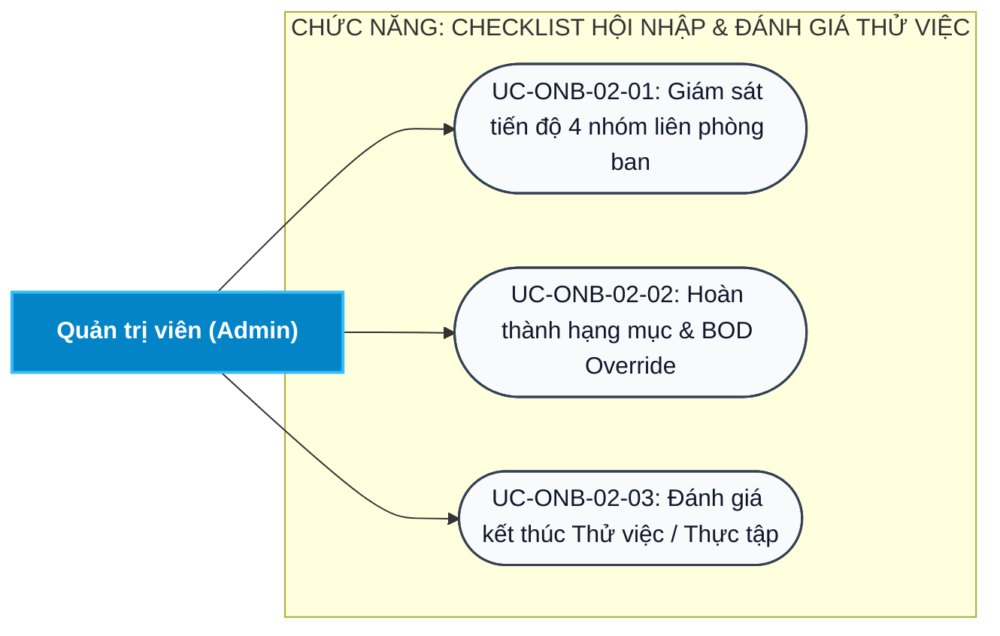

#### B. Bản đặc tả chi tiết nghiệp vụ từng Use Case con:

##### UC-ONB-02-01: Giám sát tiến độ hội nhập qua 4 giai đoạn liên phòng ban

| Thành phần | Nội dung chi tiết |
| :--- | :--- |
| **Mã Use Case** | `UC-ONB-02-01` |
| **Tên Use Case** | Giám sát tiến độ hội nhập qua 4 giai đoạn liên phòng ban |
| **Mục tiêu** | Theo dõi tiến độ hoàn thành checklist hội nhập theo 4 nhóm trách nhiệm liên phòng ban (`IT`, `Hành chính`, `Nhân sự`, `Quản lý trực tiếp`) và 4 mốc thời gian. |
| **Tác nhân chính** | Quản trị viên (Admin). |
| **Tiền điều kiện** | Quản trị viên đã đăng nhập Cổng Quản trị hệ thống (/internal). |
| **Kích hoạt (Trigger)** | Người dùng thao tác tại chức năng "Giám sát tiến độ hội nhập qua 4 giai đoạn liên phòng ban". |
| **Luồng chính (Basic Flow)** | Mở màn hình Quản lý Hội nhập $\rightarrow$ Theo dõi thanh tiến độ % hoàn thành các đầu việc theo 4 nhóm và cảnh báo quá hạn nộp hồ sơ (> 7 ngày làm việc). |
| **Luồng ngoại lệ** | Dữ liệu nhập không hợp lệ hoặc vi phạm ràng buộc nghiệp vụ $\rightarrow$ Hệ thống từ chối thực hiện và hiển thị thông báo lỗi. |
| **Hậu điều kiện** | Hệ thống hoàn tất xử lý nghiệp vụ "Giám sát tiến độ hội nhập qua 4 giai đoạn liên phòng ban" và cập nhật trạng thái hiển thị. |

##### UC-ONB-02-02: Đánh dấu hoàn thành các hạng mục nhận việc & BOD Override

| Thành phần | Nội dung chi tiết |
| :--- | :--- |
| **Mã Use Case** | `UC-ONB-02-02` |
| **Tên Use Case** | Đánh dấu hoàn thành các hạng mục nhận việc & BOD Override |
| **Mục tiêu** | Ghi nhận hoàn tất từng đầu việc hội nhập hoặc thực hiện ngoại lệ mở khóa giữ lương (BOD Override) cho nhân sự quá hạn bổ sung hồ sơ. |
| **Tác nhân chính** | Quản trị viên (Admin). |
| **Tiền điều kiện** | Quản trị viên đã đăng nhập Cổng Quản trị hệ thống (/internal). |
| **Kích hoạt (Trigger)** | Người dùng thao tác tại chức năng "Đánh dấu hoàn thành các hạng mục nhận việc & BOD Override". |
| **Luồng chính (Basic Flow)** | Tích chọn hoàn thành hạng mục $\rightarrow$ Hệ thống cập nhật phần trăm tiến độ. Nếu nhân sự bị tạm giữ lương do thiếu hồ sơ > 7 ngày, Quản trị viên có thể thực hiện `BOD Override` kèm lý do để mở khóa chi trả lương. |
| **Luồng ngoại lệ** | Dữ liệu nhập không hợp lệ hoặc vi phạm ràng buộc nghiệp vụ $\rightarrow$ Hệ thống từ chối thực hiện và hiển thị thông báo lỗi. |
| **Hậu điều kiện** | Hệ thống hoàn tất xử lý nghiệp vụ "Đánh dấu hoàn thành các hạng mục nhận việc & BOD Override" và cập nhật trạng thái hiển thị. |

##### UC-ONB-02-03: Đánh giá kết thúc Thử việc / Thực tập (Đạt hoặc Không đạt)

| Thành phần | Nội dung chi tiết |
| :--- | :--- |
| **Mã Use Case** | `UC-ONB-02-03` |
| **Tên Use Case** | Đánh giá kết thúc Thử việc / Thực tập (Đạt hoặc Không đạt) |
| **Mục tiêu** | Chốt kết quả cuối kỳ thử việc/thực tập (`PASSED` hoặc `FAILED`) và tự động xử lý trạng thái hợp đồng, nhân sự, tài khoản tương ứng. |
| **Tác nhân chính** | Quản trị viên (Admin). |
| **Tiền điều kiện** | Quản trị viên đã đăng nhập Cổng Quản trị hệ thống (/internal). |
| **Kích hoạt (Trigger)** | Người dùng thao tác tại chức năng "Đánh giá kết thúc Thử việc / Thực tập (Đạt hoặc Không đạt)". |
| **Luồng chính (Basic Flow)** | Chọn nhân sự $\rightarrow$ Nhập nhận xét và chọn kết quả:<br>- Nếu **Đạt (`PASSED`)**: Lưu đánh giá Đạt, sẵn sàng ký hợp đồng chính thức.<br>- Nếu **Không đạt (`FAILED`)**: Hệ thống tự động thanh lý hợp đồng đang hiệu lực, chuyển trạng thái nhân viên sang `RESIGNED` và vô hiệu hóa tài khoản (`isActive = false`). |
| **Luồng ngoại lệ** | Dữ liệu nhập không hợp lệ hoặc vi phạm ràng buộc nghiệp vụ $\rightarrow$ Hệ thống từ chối thực hiện và hiển thị thông báo lỗi. |
| **Hậu điều kiện** | Hệ thống hoàn tất xử lý nghiệp vụ "Đánh giá kết thúc Thử việc / Thực tập (Đạt hoặc Không đạt)" và cập nhật trạng thái hiển thị. |

---

## 3.4. PHÂN HỆ 4: HỒ SƠ NHÂN SỰ 360°, HỢP ĐỒNG & QUYẾT ĐỊNH (CORE HR)

### 3.4.0. Sơ đồ Use Case Cấp 2: Core HR
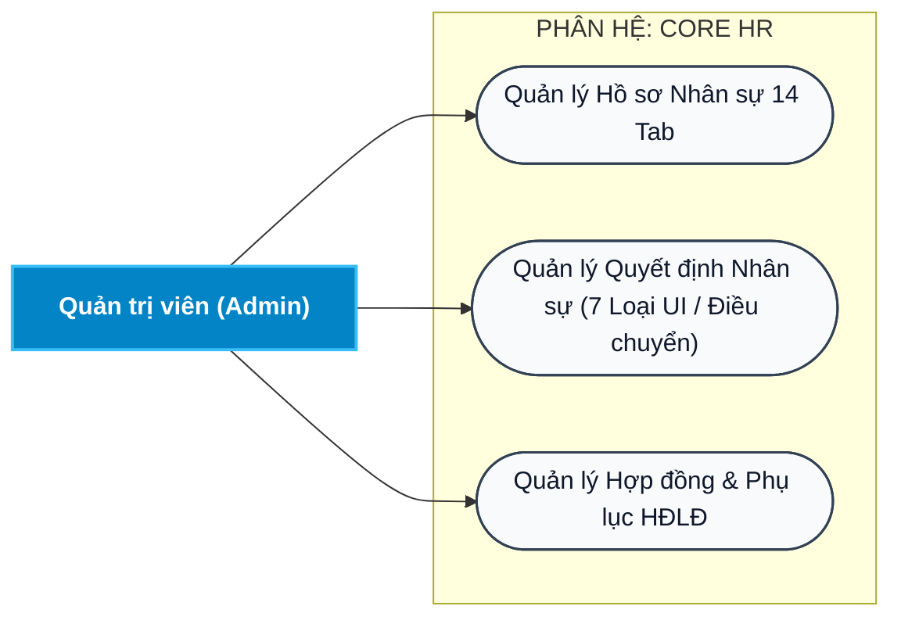

---

### 3.4.1. Chức năng Hồ sơ Nhân sự 360° (`EmployeeDetail.jsx`)

#### A. Sơ đồ Use Case Cấp 3: Hồ sơ Nhân sự 360°
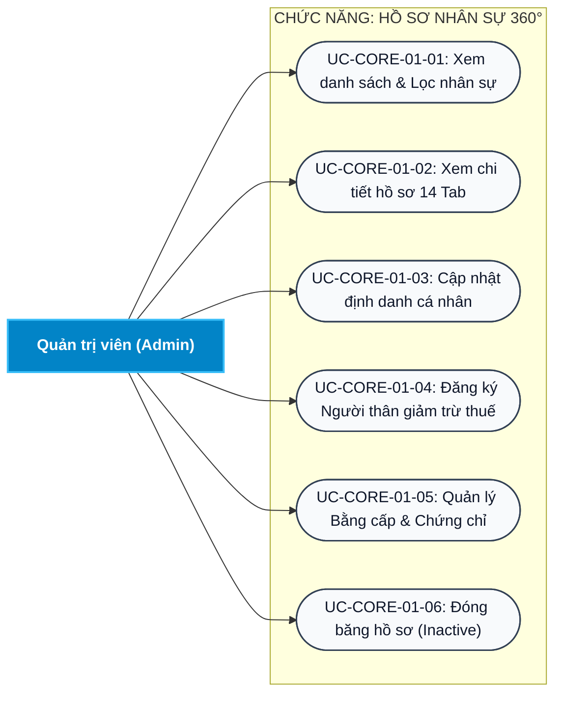

#### B. Bản đặc tả chi tiết nghiệp vụ từng Use Case con:

##### UC-CORE-01-01: Xem danh sách & Lọc nhân sự đa tiêu chí

| Thành phần | Nội dung chi tiết |
| :--- | :--- |
| **Mã Use Case** | `UC-CORE-01-01` |
| **Tên Use Case** | Xem danh sách & Lọc nhân sự đa tiêu chí |
| **Mục tiêu** | Quản lý toàn bộ danh sách nhân viên trong công ty, lọc theo phòng ban, trạng thái (Chính thức, Thử việc, Đã thôi việc). |
| **Tác nhân chính** | Quản trị viên (Admin). |
| **Tiền điều kiện** | Quản trị viên đã đăng nhập Cổng Quản trị hệ thống (/internal). |
| **Kích hoạt (Trigger)** | Người dùng thao tác tại chức năng "Xem danh sách & Lọc nhân sự đa tiêu chí". |
| **Luồng chính (Basic Flow)** | Mở "Hồ sơ nhân sự" $\rightarrow$ Xem bảng nhân sự: Mã NV, Họ tên, Phòng ban, Chức danh, Email, Số điện thoại, Trạng thái $\rightarrow$ Tìm kiếm theo tên hoặc lọc theo phòng ban. |
| **Luồng ngoại lệ** | Dữ liệu nhập không hợp lệ hoặc vi phạm ràng buộc nghiệp vụ $\rightarrow$ Hệ thống từ chối thực hiện và hiển thị thông báo lỗi. |
| **Hậu điều kiện** | Hệ thống hoàn tất xử lý nghiệp vụ "Xem danh sách & Lọc nhân sự đa tiêu chí" và cập nhật trạng thái hiển thị. |

##### UC-CORE-01-02: Xem chi tiết hồ sơ 14 Tab chuyên sâu

| Thành phần | Nội dung chi tiết |
| :--- | :--- |
| **Mã Use Case** | `UC-CORE-01-02` |
| **Tên Use Case** | Xem chi tiết hồ sơ 14 Tab chuyên sâu |
| **Mục tiêu** | Nắm bắt trọn vẹn lý lịch 360° của người lao động qua 14 tab thông tin. |
| **Tác nhân chính** | Quản trị viên (Admin). |
| **Tiền điều kiện** | Quản trị viên đã đăng nhập Cổng Quản trị hệ thống (/internal). |
| **Kích hoạt (Trigger)** | Người dùng thao tác tại chức năng "Xem chi tiết hồ sơ 14 Tab chuyên sâu". |
| **Luồng chính (Basic Flow)** | Bấm vào tên nhân viên $\rightarrow$ Xem chi tiết 14 nhóm thông tin: *Định danh cá nhân, Công tác, Hợp đồng & Lương, Người thân giảm trừ thuế, Học vấn, Chứng chỉ, Lịch sử đào tạo, Khen thưởng, Kỷ luật, Quá trình bổ nhiệm, Quá trình điều chuyển, Tài sản đang giữ và Hồ sơ đính kèm*. |
| **Luồng ngoại lệ** | Dữ liệu nhập không hợp lệ hoặc vi phạm ràng buộc nghiệp vụ $\rightarrow$ Hệ thống từ chối thực hiện và hiển thị thông báo lỗi. |
| **Hậu điều kiện** | Hệ thống hoàn tất xử lý nghiệp vụ "Xem chi tiết hồ sơ 14 Tab chuyên sâu" và cập nhật trạng thái hiển thị. |

##### UC-CORE-01-03: Cập nhật thông tin định danh cá nhân

| Thành phần | Nội dung chi tiết |
| :--- | :--- |
| **Mã Use Case** | `UC-CORE-01-03` |
| **Tên Use Case** | Cập nhật thông tin định danh cá nhân |
| **Mục tiêu** | Điều chỉnh số CCCD, địa chỉ thường trú, tạm trú, số tài khoản ngân hàng chi trả lương khi có biến động. |
| **Tác nhân chính** | Quản trị viên (Admin). |
| **Tiền điều kiện** | Quản trị viên đã đăng nhập Cổng Quản trị hệ thống (/internal). |
| **Kích hoạt (Trigger)** | Người dùng thao tác tại chức năng "Cập nhật thông tin định danh cá nhân". |
| **Luồng chính (Basic Flow)** | Vào tab "Cá nhân & Định danh" $\rightarrow$ Nhập thông tin mới $\rightarrow$ Lưu thông tin. |
| **Luồng ngoại lệ** | Dữ liệu nhập không hợp lệ hoặc vi phạm ràng buộc nghiệp vụ $\rightarrow$ Hệ thống từ chối thực hiện và hiển thị thông báo lỗi. |
| **Hậu điều kiện** | Hệ thống hoàn tất xử lý nghiệp vụ "Cập nhật thông tin định danh cá nhân" và cập nhật trạng thái hiển thị. |

##### UC-CORE-01-04: Đăng ký Người thân & Giảm trừ gia cảnh thuế TNCN

| Thành phần | Nội dung chi tiết |
| :--- | :--- |
| **Mã Use Case** | `UC-CORE-01-04` |
| **Tên Use Case** | Đăng ký Người thân & Giảm trừ gia cảnh thuế TNCN |
| **Mục tiêu** | Ghi nhận thông tin thân nhân (Bố, Mẹ, Vợ, Con) và đăng ký người phụ thuộc để giảm trừ 4.400.000 VNĐ/tháng khi tính thuế TNCN. |
| **Tác nhân chính** | Quản trị viên (Admin). |
| **Tiền điều kiện** | Quản trị viên đã đăng nhập Cổng Quản trị hệ thống (/internal). |
| **Kích hoạt (Trigger)** | Người dùng thao tác tại chức năng "Đăng ký Người thân & Giảm trừ gia cảnh thuế TNCN". |
| **Luồng chính (Basic Flow)** | Vào tab "Người thân & Phụ thuộc" $\rightarrow$ Nhấn "+ Thêm thân nhân" $\rightarrow$ Nhập Họ tên, Quan hệ, Ngày sinh, Mã số thuế thân nhân $\rightarrow$ Tích chọn "Người phụ thuộc giảm trừ gia cảnh" $\rightarrow$ Chọn Ngày bắt đầu giảm trừ $\rightarrow$ Lưu thông tin. |
| **Luồng ngoại lệ** | Dữ liệu nhập không hợp lệ hoặc vi phạm ràng buộc nghiệp vụ $\rightarrow$ Hệ thống từ chối thực hiện và hiển thị thông báo lỗi. |
| **Hậu điều kiện** | Hệ thống hoàn tất xử lý nghiệp vụ "Đăng ký Người thân & Giảm trừ gia cảnh thuế TNCN" và cập nhật trạng thái hiển thị. |

##### UC-CORE-01-05: Quản lý Bằng cấp & Chứng chỉ chuyên môn

| Thành phần | Nội dung chi tiết |
| :--- | :--- |
| **Mã Use Case** | `UC-CORE-01-05` |
| **Tên Use Case** | Quản lý Bằng cấp & Chứng chỉ chuyên môn |
| **Mục tiêu** | Lưu trữ trình độ học vấn (Đại học, Thạc sĩ) và các chứng chỉ nghề nghiệp quốc tế (AWS, PMP, CPA) phục vụ nâng lương và bổ nhiệm. |
| **Tác nhân chính** | Quản trị viên (Admin). |
| **Tiền điều kiện** | Quản trị viên đã đăng nhập Cổng Quản trị hệ thống (/internal). |
| **Kích hoạt (Trigger)** | Người dùng thao tác tại chức năng "Quản lý Bằng cấp & Chứng chỉ chuyên môn". |
| **Luồng chính (Basic Flow)** | Mở tab "Học vấn & Bằng cấp" $\rightarrow$ Nhập Tên bằng cấp, Chuyên ngành, Nơi đào tạo, Năm tốt nghiệp, Tải ảnh scan bằng gốc $\rightarrow$ Lưu vào hồ sơ. |
| **Luồng ngoại lệ** | Dữ liệu nhập không hợp lệ hoặc vi phạm ràng buộc nghiệp vụ $\rightarrow$ Hệ thống từ chối thực hiện và hiển thị thông báo lỗi. |
| **Hậu điều kiện** | Hệ thống hoàn tất xử lý nghiệp vụ "Quản lý Bằng cấp & Chứng chỉ chuyên môn" và cập nhật trạng thái hiển thị. |

##### UC-CORE-01-06: Đóng băng hồ sơ nhân sự (Inactive)

| Thành phần | Nội dung chi tiết |
| :--- | :--- |
| **Mã Use Case** | `UC-CORE-01-06` |
| **Tên Use Case** | Đóng băng hồ sơ nhân sự (Inactive) |
| **Mục tiêu** | Tạm hoãn hợp đồng lao động hoặc chuyển nhân viên sang diện nghỉ không lương mà không xóa dữ liệu. |
| **Tác nhân chính** | Quản trị viên (Admin). |
| **Tiền điều kiện** | Quản trị viên đã đăng nhập Cổng Quản trị hệ thống (/internal). |
| **Kích hoạt (Trigger)** | Người dùng thao tác tại chức năng "Đóng băng hồ sơ nhân sự (Inactive)". |
| **Luồng chính (Basic Flow)** | Chọn trạng thái "Tạm hoãn HĐLĐ" hoặc "Nghỉ thai sản" $\rightarrow$ Hệ thống chuyển trạng thái nhân viên, tạm ngừng chấm công và tính lương trong giai đoạn này. |
| **Luồng ngoại lệ** | Dữ liệu nhập không hợp lệ hoặc vi phạm ràng buộc nghiệp vụ $\rightarrow$ Hệ thống từ chối thực hiện và hiển thị thông báo lỗi. |
| **Hậu điều kiện** | Hệ thống hoàn tất xử lý nghiệp vụ "Đóng băng hồ sơ nhân sự (Inactive)" và cập nhật trạng thái hiển thị. |

---

### 3.4.2. Chức năng Quyết định Nhân sự (`Decisions.jsx` / `DecisionCreate.jsx`)

#### A. Sơ đồ Use Case Cấp 3: Quyết định Nhân sự (Bao gồm Điều chuyển)
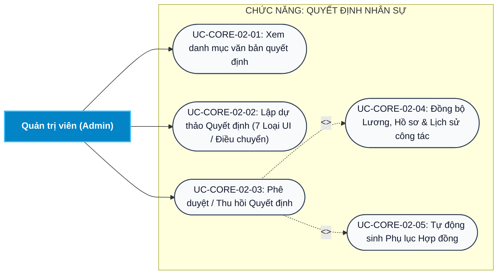

#### B. Bản đặc tả chi tiết nghiệp vụ từng Use Case con:

##### UC-CORE-02-01: Xem danh mục văn bản quyết định

| Thành phần | Nội dung chi tiết |
| :--- | :--- |
| **Mã Use Case** | `UC-CORE-02-01` |
| **Tên Use Case** | Xem danh mục văn bản quyết định |
| **Mục tiêu** | Tra cứu toàn bộ các văn bản quyết định nhân sự (bao gồm Điều chuyển công tác) đã ban hành trong doanh nghiệp. |
| **Tác nhân chính** | Quản trị viên (Admin). |
| **Tiền điều kiện** | Quản trị viên đã đăng nhập Cổng Quản trị hệ thống (/internal). |
| **Kích hoạt (Trigger)** | Người dùng thao tác tại chức năng "Xem danh mục văn bản quyết định". |
| **Luồng chính (Basic Flow)** | Mở "Quyết định nhân sự" $\rightarrow$ Xem danh sách: Số hiệu quyết định, Tiêu đề văn bản, Loại quyết định, Nhân viên thụ hưởng, Ngày có hiệu lực và Trạng thái (`PENDING`, `APPROVED`, `REVOKED`). |
| **Luồng ngoại lệ** | Dữ liệu nhập không hợp lệ hoặc vi phạm ràng buộc nghiệp vụ $\rightarrow$ Hệ thống từ chối thực hiện và hiển thị thông báo lỗi. |
| **Hậu điều kiện** | Hệ thống hoàn tất xử lý nghiệp vụ "Xem danh mục văn bản quyết định" và cập nhật trạng thái hiển thị. |

##### UC-CORE-02-02: Khởi tạo dự thảo Quyết định (Bao gồm Điều chuyển & 7 loại trên giao diện)

| Thành phần | Nội dung chi tiết |
| :--- | :--- |
| **Mã Use Case** | `UC-CORE-02-02` |
| **Tên Use Case** | Khởi tạo dự thảo Quyết định (Bao gồm Điều chuyển & 7 loại trên giao diện) |
| **Mục tiêu** | Tuyệt đối không cho phép sửa trực tiếp lương hay đơn vị trên hồ sơ; mọi thay đổi bắt buộc qua dự thảo Quyết định (7 loại nghiệp vụ trên giao diện, bao gồm Điều chuyển `TRANSFER`). |
| **Tác nhân chính** | Quản trị viên (Admin). |
| **Tiền điều kiện** | Quản trị viên đã đăng nhập Cổng Quản trị hệ thống (/internal). |
| **Kích hoạt (Trigger)** | Người dùng thao tác tại chức năng "Khởi tạo dự thảo Quyết định (Bao gồm Điều chuyển & 7 loại trên giao diện)". |
| **Luồng chính (Basic Flow)** | 1. Nhấn "+ Tạo quyết định mới" (hoặc "+ Lập lệnh điều chuyển").<br>2. Chọn loại Quyết định, chọn nhân viên và nhập thông số mới (Lương mới, Phòng ban mới, Chức danh mới, Ngày hiệu lực, Lý do).<br>3. Nếu là **Điều chuyển (`TRANSFER`)**, hệ thống kiểm tra trần định biên của phòng ban tiếp nhận (`currentEmployees < quota`).<br>4. Nhấn "Lưu dự thảo". |
| **Luồng ngoại lệ** | Phòng ban tiếp nhận hết định biên hoặc thiếu thông tin bắt buộc $\rightarrow$ Hệ thống từ chối lưu dự thảo và cảnh báo. |
| **Hậu điều kiện** | Hệ thống hoàn tất xử lý nghiệp vụ "Khởi tạo dự thảo Quyết định (Bao gồm Điều chuyển & 7 loại trên giao diện)" và cập nhật trạng thái hiển thị. |

##### UC-CORE-02-03 & 02-04 & 02-05: Phê duyệt / Thu hồi Quyết định & Đồng bộ Hồ sơ - Phụ lục HĐ

| Thành phần | Nội dung chi tiết |
| :--- | :--- |
| **Mã Use Case** | `UC-CORE-02-03` (bao gồm `UC-CORE-02-04`, `UC-CORE-02-05`) |
| **Tên Use Case** | Phê duyệt / Thu hồi Quyết định & Đồng bộ Hồ sơ - Phụ lục HĐ |
| **Mục tiêu** | Thực thi giao dịch nguyên tử khi duyệt quyết định (sinh số hiệu văn bản, cập nhật Lương/Phòng ban/Chức danh, ghi `EmploymentHistory` và tự động sinh Phụ lục HĐLĐ), hoặc Thu hồi quyết định để hoàn tác nguyên trạng. |
| **Tác nhân chính** | Quản trị viên (Admin) |
| **Tiền điều kiện** | Quản trị viên đã đăng nhập Cổng Quản trị hệ thống (/internal) và tồn tại dự thảo quyết định. |
| **Kích hoạt (Trigger)** | Nhấn "Phê duyệt" hoặc "Thu hồi" tại chi tiết quyết định nhân sự. |
| **Luồng chính (Basic Flow)** | 1. Chọn quyết định `PENDING` và nhấn "Phê duyệt" $\rightarrow$ Hệ thống sinh số hiệu văn bản, cập nhật đồng bộ Lương/Đơn vị/Chức danh vào Hồ sơ nhân viên, ghi 01 dòng `EmploymentHistory` và tự động sinh Phụ lục HĐLĐ (nếu thay đổi lương/chức danh).<br>2. Nếu nhấn "Thu hồi (`REVOKED`)" trên quyết định đã duyệt $\rightarrow$ Hệ thống hoàn tác nguyên trạng Lương, Phòng ban và Chức danh cũ cho nhân viên, đồng thời hủy Phụ lục HĐLĐ liên kết. |
| **Luồng ngoại lệ** | Quyết định không ở trạng thái hợp lệ để duyệt/thu hồi $\rightarrow$ Hệ thống từ chối thao tác và thông báo lỗi. |
| **Hậu điều kiện** | Hồ sơ nhân sự, lịch sử công tác và phụ lục hợp đồng được đồng bộ hoặc hoàn tác nhất quán. |

---

### 3.4.3. Chức năng Hợp đồng Lao động (`Contracts.jsx`)

#### A. Sơ đồ Use Case Cấp 3: Hợp đồng Lao động & Phụ lục
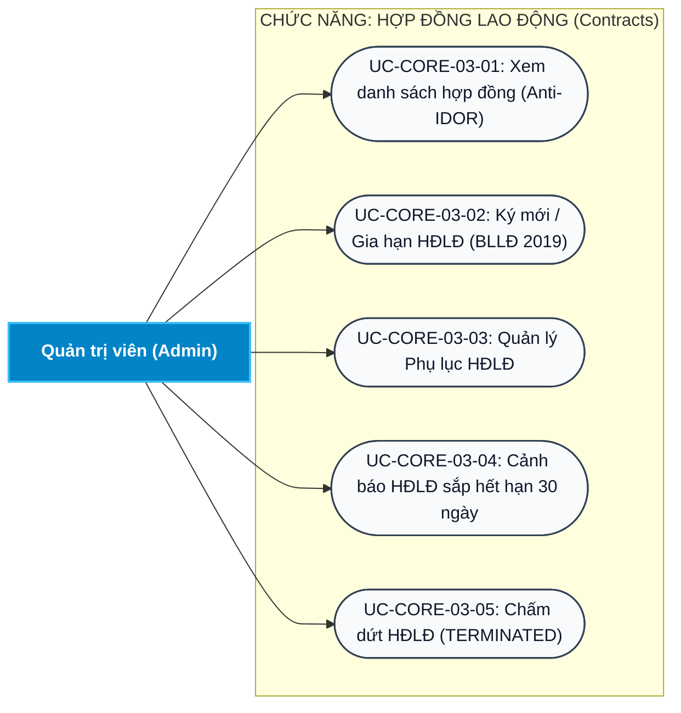

#### B. Bản đặc tả chi tiết nghiệp vụ từng Use Case con:

##### UC-CORE-03-01: Xem danh sách hợp đồng (Có kiểm soát Anti-IDOR)

| Thành phần | Nội dung chi tiết |
| :--- | :--- |
| **Mã Use Case** | `UC-CORE-03-01` |
| **Tên Use Case** | Xem danh sách hợp đồng (Có kiểm soát Anti-IDOR) |
| **Mục tiêu** | Theo dõi tình trạng hợp đồng lao động với cơ chế Anti-IDOR bảo vệ quyền riêng tư khi nhân viên truy cập hợp đồng cá nhân. |
| **Tác nhân chính** | Quản trị viên (Admin). |
| **Tiền điều kiện** | Quản trị viên đã đăng nhập Cổng Quản trị hệ thống (/internal). |
| **Kích hoạt (Trigger)** | Người dùng thao tác tại chức năng "Xem danh sách hợp đồng (Có kiểm soát Anti-IDOR)". |
| **Luồng chính (Basic Flow)** | Mở "Hợp đồng lao động" $\rightarrow$ Hệ thống kiểm tra quyền truy cập Anti-IDOR và hiển thị bảng: Số hợp đồng, Nhân viên, Loại hợp đồng, Lương cơ bản, Lương đóng bảo hiểm, Ngày bắt đầu, Ngày kết thúc, Trạng thái. |
| **Luồng ngoại lệ** | Dữ liệu nhập không hợp lệ hoặc vi phạm ràng buộc nghiệp vụ $\rightarrow$ Hệ thống từ chối thực hiện và hiển thị thông báo lỗi. |
| **Hậu điều kiện** | Hệ thống hoàn tất xử lý nghiệp vụ "Xem danh sách hợp đồng (Có kiểm soát Anti-IDOR)" và cập nhật trạng thái hiển thị. |

##### UC-CORE-03-02: Ký mới / Gia hạn Hợp đồng lao động (Tuân thủ BLLĐ 2019)

| Thành phần | Nội dung chi tiết |
| :--- | :--- |
| **Mã Use Case** | `UC-CORE-03-02` |
| **Tên Use Case** | Ký mới / Gia hạn Hợp đồng lao động (Tuân thủ BLLĐ 2019) |
| **Mục tiêu** | Thiết lập hợp đồng lao động tuân thủ giới hạn thực tập tối đa **93 ngày** và **Điều 20 BLLĐ 2019** (tối đa 2 lần hợp đồng xác định thời hạn liên tiếp). |
| **Tác nhân chính** | Quản trị viên (Admin). |
| **Tiền điều kiện** | Quản trị viên đã đăng nhập Cổng Quản trị hệ thống (/internal). |
| **Kích hoạt (Trigger)** | Người dùng thao tác tại chức năng "Ký mới / Gia hạn Hợp đồng lao động (Tuân thủ BLLĐ 2019)". |
| **Luồng chính (Basic Flow)** | Nhấn "+ Thêm hợp đồng" $\rightarrow$ Chọn nhân viên, Loại hợp đồng, Lương cơ bản, Phụ cấp, Lương đóng BHXH, Ngày bắt đầu/kết thúc $\rightarrow$ Hệ thống kiểm tra thời hạn thực tập ($\le 93$ ngày) và số lần ký HĐ xác định thời hạn ($\le 2$ lần liên tiếp) $\rightarrow$ Lưu hợp đồng. |
| **Luồng ngoại lệ** | Vượt quá 93 ngày thực tập hoặc ký lần thứ 3 hợp đồng xác định thời hạn liên tiếp $\rightarrow$ Hệ thống từ chối và yêu cầu chuyển sang hợp đồng không xác định thời hạn. |
| **Hậu điều kiện** | Hệ thống hoàn tất xử lý nghiệp vụ "Ký mới / Gia hạn Hợp đồng lao động (Tuân thủ BLLĐ 2019)" và cập nhật trạng thái hiển thị. |

##### UC-CORE-03-03 & 03-04: Quản lý Phụ lục & Cảnh báo Hợp đồng sắp hết hạn (30 ngày)

| Thành phần | Nội dung chi tiết |
| :--- | :--- |
| **Mã Use Case** | `UC-CORE-03-03`, `UC-CORE-03-04` |
| **Tên Use Case** | Quản lý Phụ lục & Cảnh báo Hợp đồng sắp hết hạn (30 ngày) |
| **Mục tiêu** | Theo dõi phụ lục điều chỉnh gắn liền hợp đồng gốc và cảnh báo chủ động các hợp đồng còn $\le 30$ ngày trước khi hết hạn. |
| **Tác nhân chính** | Quản trị viên (Admin). |
| **Tiền điều kiện** | Quản trị viên đã đăng nhập Cổng Quản trị hệ thống (/internal). |
| **Kích hoạt (Trigger)** | Người dùng thao tác tại chức năng "Quản lý Phụ lục & Cảnh báo Hợp đồng sắp hết hạn (30 ngày)". |
| **Luồng chính (Basic Flow)** | Xem tab Phụ lục trong chi tiết hợp đồng và lọc/theo dõi huy hiệu cảnh báo **"Sắp hết hạn ($\le 30$ ngày)"** để kịp thời tái ký hoặc thanh lý. |
| **Luồng ngoại lệ** | Dữ liệu nhập không hợp lệ hoặc vi phạm ràng buộc nghiệp vụ $\rightarrow$ Hệ thống từ chối thực hiện và hiển thị thông báo lỗi. |
| **Hậu điều kiện** | Hệ thống hoàn tất xử lý nghiệp vụ "Quản lý Phụ lục & Cảnh báo Hợp đồng sắp hết hạn (30 ngày)" và cập nhật trạng thái hiển thị. |

##### UC-CORE-03-05: Thanh lý / Chấm dứt hợp đồng lao động (Chuyển trạng thái, Không xóa cứng)

| Thành phần | Nội dung chi tiết |
| :--- | :--- |
| **Mã Use Case** | `UC-CORE-03-05` |
| **Tên Use Case** | Thanh lý / Chấm dứt hợp đồng lao động (Chuyển trạng thái, Không xóa cứng) |
| **Mục tiêu** | Chấm dứt hiệu lực hợp đồng bằng cách cập nhật trạng thái `TERMINATED`, tuyệt đối không xóa cứng bản ghi khỏi CSDL. |
| **Tác nhân chính** | Quản trị viên (Admin). |
| **Tiền điều kiện** | Quản trị viên đã đăng nhập Cổng Quản trị hệ thống (/internal). |
| **Kích hoạt (Trigger)** | Người dùng thao tác tại chức năng "Thanh lý / Chấm dứt hợp đồng lao động (Chuyển trạng thái, Không xóa cứng)". |
| **Luồng chính (Basic Flow)** | Chọn hợp đồng đang hiệu lực $\rightarrow$ Nhấn "Chấm dứt hợp đồng" và nhập lý do $\rightarrow$ Hệ thống chuyển trạng thái sang `TERMINATED` và bảo toàn toàn bộ dữ liệu lịch sử. |
| **Luồng ngoại lệ** | Dữ liệu nhập không hợp lệ hoặc vi phạm ràng buộc nghiệp vụ $\rightarrow$ Hệ thống từ chối thực hiện và hiển thị thông báo lỗi. |
| **Hậu điều kiện** | Hệ thống hoàn tất xử lý nghiệp vụ "Thanh lý / Chấm dứt hợp đồng lao động (Chuyển trạng thái, Không xóa cứng)" và cập nhật trạng thái hiển thị. |

---

## 3.5. PHÂN HỆ 5: CA LÀM VIỆC & CHẤM CÔNG (TIME & ATTENDANCE)

### 3.5.0. Sơ đồ Use Case Cấp 2: Chấm công & Ca làm việc
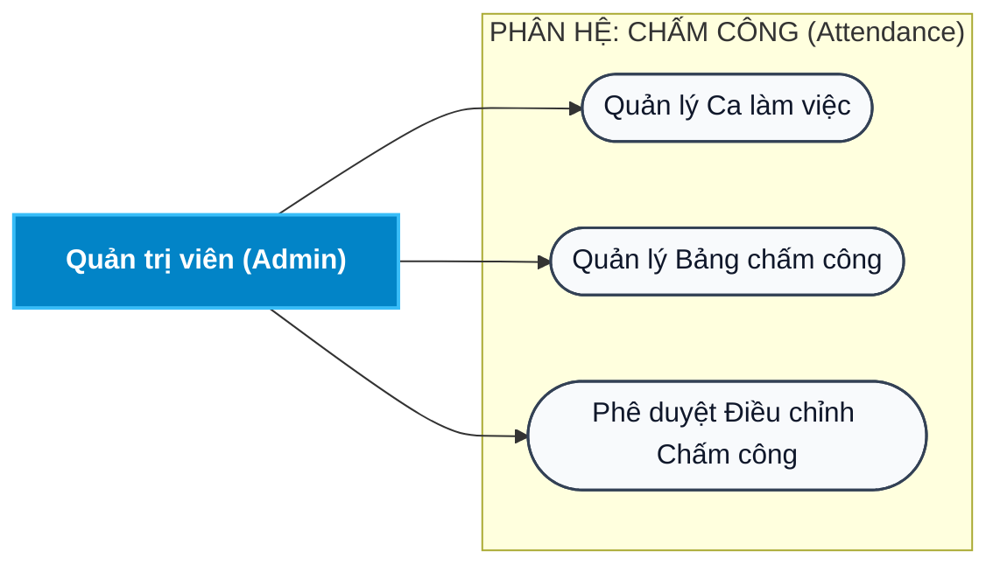

---

### 3.5.1. Chức năng Bảng Chấm công Tổng hợp (`Attendance.jsx`)

#### A. Sơ đồ Use Case Cấp 3: Bảng Chấm công
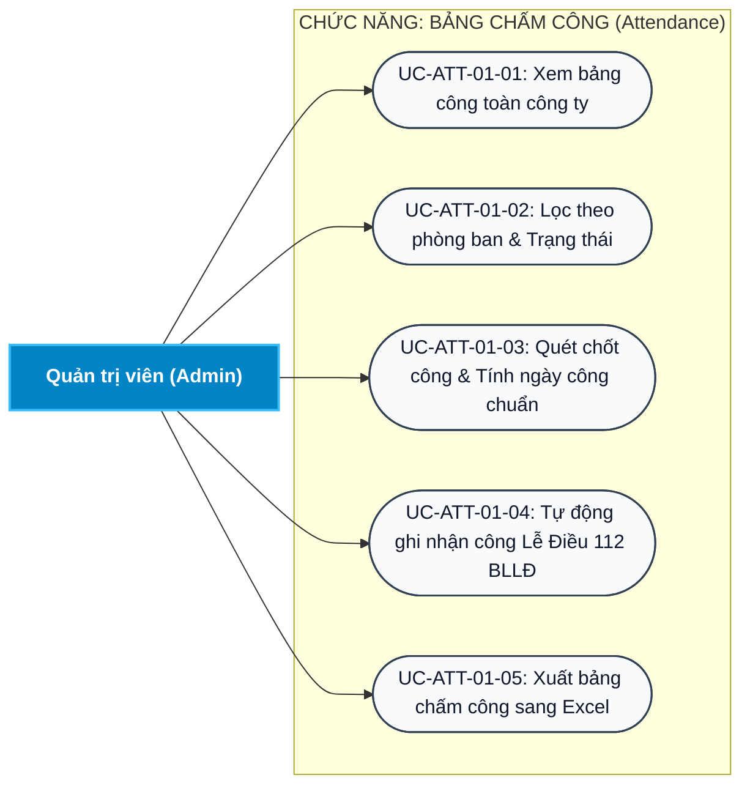

#### B. Bản đặc tả chi tiết nghiệp vụ từng Use Case con:

##### UC-ATT-01-01: Xem bảng công toàn công ty theo tháng

| Thành phần | Nội dung chi tiết |
| :--- | :--- |
| **Mã Use Case** | `UC-ATT-01-01` |
| **Tên Use Case** | Xem bảng công toàn công ty theo tháng |
| **Mục tiêu** | Theo dõi tình hình đi làm thực tế của toàn bộ nhân viên trong tháng được chọn. |
| **Tác nhân chính** | Quản trị viên (Admin). |
| **Tiền điều kiện** | Quản trị viên đã đăng nhập Cổng Quản trị hệ thống (/internal). |
| **Kích hoạt (Trigger)** | Người dùng thao tác tại chức năng "Xem bảng công toàn công ty theo tháng". |
| **Luồng chính (Basic Flow)** | Mở "Bảng công" $\rightarrow$ Chọn Tháng/Năm $\rightarrow$ Hệ thống hiển thị ma trận chấm công gồm: Mã NV, Họ tên, Phòng ban, các cột ngày từ mùng 1 đến ngày cuối tháng (hiển thị giờ vào/ra, ký hiệu công: Đ đủ công, N nghỉ phép, M đi muộn, V vắng mặt) và cột Tổng công thực tế. |
| **Luồng ngoại lệ** | Dữ liệu nhập không hợp lệ hoặc vi phạm ràng buộc nghiệp vụ $\rightarrow$ Hệ thống từ chối thực hiện và hiển thị thông báo lỗi. |
| **Hậu điều kiện** | Hệ thống hoàn tất xử lý nghiệp vụ "Xem bảng công toàn công ty theo tháng" và cập nhật trạng thái hiển thị. |

##### UC-ATT-01-02: Lọc bảng công theo phòng ban & Trạng thái

| Thành phần | Nội dung chi tiết |
| :--- | :--- |
| **Mã Use Case** | `UC-ATT-01-02` |
| **Tên Use Case** | Lọc bảng công theo phòng ban & Trạng thái |
| **Mục tiêu** | Giúp quản lý chỉ theo dõi bảng công thuộc phòng ban mình phụ trách hoặc lọc các nhân sự đi trễ/vắng mặt. |
| **Tác nhân chính** | Quản trị viên (Admin). |
| **Tiền điều kiện** | Quản trị viên đã đăng nhập Cổng Quản trị hệ thống (/internal). |
| **Kích hoạt (Trigger)** | Người dùng thao tác tại chức năng "Lọc bảng công theo phòng ban & Trạng thái". |
| **Luồng chính (Basic Flow)** | Chọn phòng ban trong dropdown hoặc lọc trạng thái "Đi muộn", "Vắng mặt" $\rightarrow$ Hệ thống lọc nhanh danh sách hiển thị tương ứng. |
| **Luồng ngoại lệ** | Dữ liệu nhập không hợp lệ hoặc vi phạm ràng buộc nghiệp vụ $\rightarrow$ Hệ thống từ chối thực hiện và hiển thị thông báo lỗi. |
| **Hậu điều kiện** | Hệ thống hoàn tất xử lý nghiệp vụ "Lọc bảng công theo phòng ban & Trạng thái" và cập nhật trạng thái hiển thị. |

##### UC-ATT-01-03: Quét chốt công & Tự động tính ngày công chuẩn

| Thành phần | Nội dung chi tiết |
| :--- | :--- |
| **Mã Use Case** | `UC-ATT-01-03` |
| **Tên Use Case** | Quét chốt công & Tự động tính ngày công chuẩn |
| **Mục tiêu** | Tự động so khớp thời gian check-in/out thực tế với ca làm việc để quy đổi thành số ngày công (1.0 công, 0.5 công). |
| **Tác nhân chính** | Quản trị viên (Admin). |
| **Tiền điều kiện** | Quản trị viên đã đăng nhập Cổng Quản trị hệ thống (/internal). |
| **Kích hoạt (Trigger)** | Người dùng thao tác tại chức năng "Quét chốt công & Tự động tính ngày công chuẩn". |
| **Luồng chính (Basic Flow)** | Hệ thống quét dữ liệu điểm danh: Đi làm đủ 8 tiếng quy đổi thành 1.0 công; Đi làm từ 4 đến dưới 8 tiếng quy đổi thành 0.5 công; Vắng không lý do tính 0 công. |
| **Luồng ngoại lệ** | Dữ liệu nhập không hợp lệ hoặc vi phạm ràng buộc nghiệp vụ $\rightarrow$ Hệ thống từ chối thực hiện và hiển thị thông báo lỗi. |
| **Hậu điều kiện** | Hệ thống hoàn tất xử lý nghiệp vụ "Quét chốt công & Tự động tính ngày công chuẩn" và cập nhật trạng thái hiển thị. |

##### UC-ATT-01-04: Tự động ghi nhận công Nghỉ Lễ theo Điều 112 BLLĐ

| Thành phần | Nội dung chi tiết |
| :--- | :--- |
| **Mã Use Case** | `UC-ATT-01-04` |
| **Tên Use Case** | Tự động ghi nhận công Nghỉ Lễ theo Điều 112 BLLĐ |
| **Mục tiêu** | Đảm bảo quyền lợi hưởng nguyên lương ngày lễ tết theo đúng Bộ luật Lao động Việt Nam. |
| **Tác nhân chính** | Quản trị viên (Admin). |
| **Tiền điều kiện** | Quản trị viên đã đăng nhập Cổng Quản trị hệ thống (/internal). |
| **Kích hoạt (Trigger)** | Người dùng thao tác tại chức năng "Tự động ghi nhận công Nghỉ Lễ theo Điều 112 BLLĐ". |
| **Luồng chính (Basic Flow)** | Vào các ngày nghỉ lễ quốc gia theo lịch luật định (Tết Dương lịch, Tết Âm lịch, 30/4 - 1/5, Quốc khánh, Giỗ Tổ Hùng Vương), hệ thống tự động ghi nhận 1.0 ngày công chuẩn cho toàn thể nhân sự đang làm việc mà không bắt buộc nhân viên phải điểm danh. |
| **Luồng ngoại lệ** | Dữ liệu nhập không hợp lệ hoặc vi phạm ràng buộc nghiệp vụ $\rightarrow$ Hệ thống từ chối thực hiện và hiển thị thông báo lỗi. |
| **Hậu điều kiện** | Hệ thống hoàn tất xử lý nghiệp vụ "Tự động ghi nhận công Nghỉ Lễ theo Điều 112 BLLĐ" và cập nhật trạng thái hiển thị. |

##### UC-ATT-01-05: Xuất bảng chấm công sang file Excel

| Thành phần | Nội dung chi tiết |
| :--- | :--- |
| **Mã Use Case** | `UC-ATT-01-05` |
| **Tên Use Case** | Xuất bảng chấm công sang file Excel |
| **Mục tiêu** | Xuất bảng công dạng bảng tính để đối soát hoặc lưu trữ hồ sơ thanh tra lao động. |
| **Tác nhân chính** | Quản trị viên (Admin). |
| **Tiền điều kiện** | Quản trị viên đã đăng nhập Cổng Quản trị hệ thống (/internal). |
| **Kích hoạt (Trigger)** | Người dùng thao tác tại chức năng "Xuất bảng chấm công sang file Excel". |
| **Luồng chính (Basic Flow)** | Nhấn nút "Xuất Excel" $\rightarrow$ Hệ thống tạo file bảng tính chi tiết ngày công từng ngày và tải về máy tính. |
| **Luồng ngoại lệ** | Dữ liệu nhập không hợp lệ hoặc vi phạm ràng buộc nghiệp vụ $\rightarrow$ Hệ thống từ chối thực hiện và hiển thị thông báo lỗi. |
| **Hậu điều kiện** | Hệ thống hoàn tất xử lý nghiệp vụ "Xuất bảng chấm công sang file Excel" và cập nhật trạng thái hiển thị. |

---

### 3.5.2. Chức năng Điều chỉnh Chấm công (`Adjustments.jsx`)

#### A. Sơ đồ Use Case Cấp 3: Điều chỉnh Chấm công
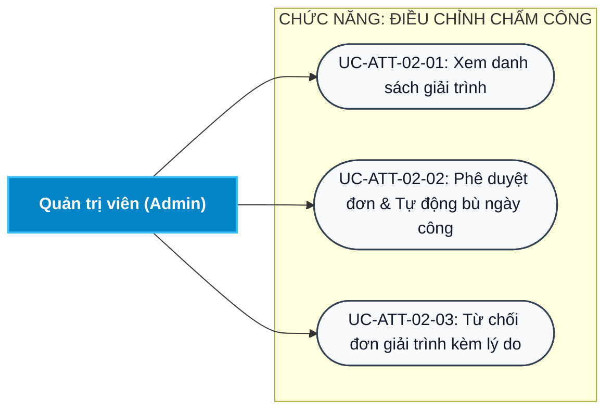

#### B. Bản đặc tả chi tiết nghiệp vụ từng Use Case con:

##### UC-ATT-02-01: Xem danh sách đơn giải trình chấm công

| Thành phần | Nội dung chi tiết |
| :--- | :--- |
| **Mã Use Case** | `UC-ATT-02-01` |
| **Tên Use Case** | Xem danh sách đơn giải trình chấm công |
| **Mục tiêu** | Cấp quản lý xem các đề xuất bù giờ vào/ra do nhân viên quên chấm công hoặc lỗi máy quét. |
| **Tác nhân chính** | Quản trị viên (Admin). |
| **Tiền điều kiện** | Quản trị viên đã đăng nhập Cổng Quản trị hệ thống (/internal). |
| **Kích hoạt (Trigger)** | Người dùng thao tác tại chức năng "Xem danh sách đơn giải trình chấm công". |
| **Luồng chính (Basic Flow)** | Mở "Điều chỉnh công" $\rightarrow$ Xem danh sách: Nhân viên làm đơn, Ngày cần giải trình, Giờ vào/ra đề xuất bổ sung, Lý do giải trình (đi gặp khách hàng, quên quẹt thẻ) và Trạng thái (Chờ duyệt, Đã duyệt, Đã từ chối). |
| **Luồng ngoại lệ** | Dữ liệu nhập không hợp lệ hoặc vi phạm ràng buộc nghiệp vụ $\rightarrow$ Hệ thống từ chối thực hiện và hiển thị thông báo lỗi. |
| **Hậu điều kiện** | Hệ thống hoàn tất xử lý nghiệp vụ "Xem danh sách đơn giải trình chấm công" và cập nhật trạng thái hiển thị. |

##### UC-ATT-02-02: Phê duyệt đơn & Tự động bù ngày công

| Thành phần | Nội dung chi tiết |
| :--- | :--- |
| **Mã Use Case** | `UC-ATT-02-02` |
| **Tên Use Case** | Phê duyệt đơn & Tự động bù ngày công |
| **Mục tiêu** | Chấp thuận lý do giải trình hợp lệ và tự động cập nhật lại ngày công trên bảng chấm công. |
| **Tác nhân chính** | Quản trị viên (Admin). |
| **Tiền điều kiện** | Quản trị viên đã đăng nhập Cổng Quản trị hệ thống (/internal). |
| **Kích hoạt (Trigger)** | Người dùng thao tác tại chức năng "Phê duyệt đơn & Tự động bù ngày công". |
| **Luồng chính (Basic Flow)** | Nhấn nút "Phê duyệt" $\rightarrow$ Hệ thống cập nhật trạng thái đơn thành "Đã duyệt", đồng thời tự động cập nhật lại giờ công hợp lệ và cộng bù ngày công tương ứng trên bảng chấm công tháng của nhân viên. |
| **Luồng ngoại lệ** | Dữ liệu nhập không hợp lệ hoặc vi phạm ràng buộc nghiệp vụ $\rightarrow$ Hệ thống từ chối thực hiện và hiển thị thông báo lỗi. |
| **Hậu điều kiện** | Hệ thống hoàn tất xử lý nghiệp vụ "Phê duyệt đơn & Tự động bù ngày công" và cập nhật trạng thái hiển thị. |

##### UC-ATT-02-03: Từ chối đơn giải trình kèm lý do

| Thành phần | Nội dung chi tiết |
| :--- | :--- |
| **Mã Use Case** | `UC-ATT-02-03` |
| **Tên Use Case** | Từ chối đơn giải trình kèm lý do |
| **Mục tiêu** | Không chấp thuận các giải trình không có căn cứ hoặc vi phạm nội quy. |
| **Tác nhân chính** | Quản trị viên (Admin). |
| **Tiền điều kiện** | Quản trị viên đã đăng nhập Cổng Quản trị hệ thống (/internal). |
| **Kích hoạt (Trigger)** | Người dùng thao tác tại chức năng "Từ chối đơn giải trình kèm lý do". |
| **Luồng chính (Basic Flow)** | Nhấn "Từ chối" $\rightarrow$ Nhập lý do từ chối (Không có xác nhận đi khách, giải trình quá hạn...) $\rightarrow$ Hệ thống chuyển trạng thái "Đã từ chối" và gửi thông báo phản hồi cho nhân viên. |
| **Luồng ngoại lệ** | Dữ liệu nhập không hợp lệ hoặc vi phạm ràng buộc nghiệp vụ $\rightarrow$ Hệ thống từ chối thực hiện và hiển thị thông báo lỗi. |
| **Hậu điều kiện** | Hệ thống hoàn tất xử lý nghiệp vụ "Từ chối đơn giải trình kèm lý do" và cập nhật trạng thái hiển thị. |

---

### 3.5.3. Chức năng Quản lý Ca làm việc (`Shifts.jsx`)

#### A. Sơ đồ Use Case Cấp 3: Quản lý Ca làm việc
```mermaid
flowchart LR
    ADMIN["Quản trị viên (Admin)"]

    subgraph FUNC_SHF ["CHỨC NĂNG: QUẢN LÝ CA LÀM VIỆC (Shifts)"]
        UC1(["UC-ATT-03-01: Xem danh mục ca làm việc"])
        UC2(["UC-ATT-03-02: Thiết lập khung giờ ca & Nghỉ giữa giờ"])
        UC3(["UC-ATT-03-03: Cấu hình thời gian ân hạn đi muộn"])
        UC4(["UC-ATT-03-04: Kích hoạt / Tạm dừng ca làm việc"])
    end

    ADMIN --> UC1
    ADMIN --> UC2
    ADMIN --> UC3
    ADMIN --> UC4

    classDef actor fill:#0284c7,stroke:#38bdf8,stroke-width:2px,color:#ffffff,font-weight:bold;
    classDef uc fill:#f8fafc,stroke:#334155,stroke-width:1.5px,color:#0f172a;
    class ADMIN actor;
    class UC1,UC2,UC3,UC4 uc;
```

#### B. Bản đặc tả chi tiết nghiệp vụ từng Use Case con:

##### UC-ATT-03-01: Xem danh mục ca làm việc

| Thành phần | Nội dung chi tiết |
| :--- | :--- |
| **Mã Use Case** | `UC-ATT-03-01` |
| **Tên Use Case** | Xem danh mục ca làm việc |
| **Mục tiêu** | Quản trị các ca làm việc đang áp dụng trong doanh nghiệp (Ca hành chính 08:00 - 17:30, Ca sáng, Ca chiều). |
| **Tác nhân chính** | Quản trị viên (Admin). |
| **Tiền điều kiện** | Quản trị viên đã đăng nhập Cổng Quản trị hệ thống (/internal). |
| **Kích hoạt (Trigger)** | Người dùng thao tác tại chức năng "Xem danh mục ca làm việc". |
| **Luồng chính (Basic Flow)** | Mở "Ca làm việc" $\rightarrow$ Xem danh sách: Tên ca, Giờ bắt đầu, Giờ kết thúc, Thời gian nghỉ giữa ca (phút) và Trạng thái kích hoạt. |
| **Luồng ngoại lệ** | Dữ liệu nhập không hợp lệ hoặc vi phạm ràng buộc nghiệp vụ $\rightarrow$ Hệ thống từ chối thực hiện và hiển thị thông báo lỗi. |
| **Hậu điều kiện** | Hệ thống hoàn tất xử lý nghiệp vụ "Xem danh mục ca làm việc" và cập nhật trạng thái hiển thị. |

##### UC-ATT-03-02: Thiết lập khung giờ ca & Nghỉ giữa ca

| Thành phần | Nội dung chi tiết |
| :--- | :--- |
| **Mã Use Case** | `UC-ATT-03-02` |
| **Tên Use Case** | Thiết lập khung giờ ca & Nghỉ giữa ca |
| **Mục tiêu** | Thêm mới hoặc điều chỉnh khung giờ làm việc và thời lượng nghỉ giữa ca theo quy chế công ty. |
| **Tác nhân chính** | Quản trị viên (Admin). |
| **Tiền điều kiện** | Quản trị viên đã đăng nhập Cổng Quản trị hệ thống (/internal). |
| **Kích hoạt (Trigger)** | Người dùng thao tác tại chức năng "Thiết lập khung giờ ca & Nghỉ giữa ca". |
| **Luồng chính (Basic Flow)** | Nhấn "+ Thêm ca làm việc" $\rightarrow$ Nhập Tên ca, Giờ bắt đầu, Giờ kết thúc, Thời gian nghỉ giữa ca $\rightarrow$ Lưu thông tin. |
| **Luồng ngoại lệ** | Khung giờ không hợp lệ hoặc thiếu tên ca $\rightarrow$ Hệ thống báo lỗi và giữ lại biểu mẫu. |
| **Hậu điều kiện** | Hệ thống hoàn tất xử lý nghiệp vụ "Thiết lập khung giờ ca & Nghỉ giữa ca" và cập nhật trạng thái hiển thị. |

##### UC-ATT-03-03: Cấu hình thời gian ân hạn đi muộn toàn cục (Grace Period)

| Thành phần | Nội dung chi tiết |
| :--- | :--- |
| **Mã Use Case** | `UC-ATT-03-03` |
| **Tên Use Case** | Cấu hình thời gian ân hạn đi muộn toàn cục (Grace Period) |
| **Mục tiêu** | Thiết lập tham số số phút ân hạn đi muộn toàn cục (`LATE_GRACE_PERIOD_MINUTES`) áp dụng chung cho toàn hệ thống. |
| **Tác nhân chính** | Quản trị viên (Admin). |
| **Tiền điều kiện** | Quản trị viên đã đăng nhập Cổng Quản trị hệ thống (/internal). |
| **Kích hoạt (Trigger)** | Người dùng thao tác tại chức năng "Cấu hình thời gian ân hạn đi muộn toàn cục (Grace Period)". |
| **Luồng chính (Basic Flow)** | Cấu hình thời gian ân hạn toàn cục vào bảng `SystemSetting` $\rightarrow$ Động cơ tính công tự động áp dụng ngưỡng này khi chấm công muộn. |
| **Luồng ngoại lệ** | Dữ liệu nhập không hợp lệ hoặc vi phạm ràng buộc nghiệp vụ $\rightarrow$ Hệ thống từ chối thực hiện và hiển thị thông báo lỗi. |
| **Hậu điều kiện** | Hệ thống hoàn tất xử lý nghiệp vụ "Cấu hình thời gian ân hạn đi muộn toàn cục (Grace Period)" và cập nhật trạng thái hiển thị. |

##### UC-ATT-03-04: Kích hoạt / Tạm dừng ca làm việc

| Thành phần | Nội dung chi tiết |
| :--- | :--- |
| **Mã Use Case** | `UC-ATT-03-04` |
| **Tên Use Case** | Kích hoạt / Tạm dừng ca làm việc |
| **Mục tiêu** | Chuyển đổi trạng thái hoạt động (`Active`/`Inactive`) của ca làm việc mà không làm mất lịch sử chấm công cũ. |
| **Tác nhân chính** | Quản trị viên (Admin). |
| **Tiền điều kiện** | Quản trị viên đã đăng nhập Cổng Quản trị hệ thống (/internal). |
| **Kích hoạt (Trigger)** | Người dùng thao tác tại chức năng "Kích hoạt / Tạm dừng ca làm việc". |
| **Luồng chính (Basic Flow)** | Bật/tắt công tắc trạng thái ca $\rightarrow$ Hệ thống cập nhật trực tiếp cờ trạng thái trong CSDL. |
| **Luồng ngoại lệ** | Dữ liệu nhập không hợp lệ hoặc vi phạm ràng buộc nghiệp vụ $\rightarrow$ Hệ thống từ chối thực hiện và hiển thị thông báo lỗi. |
| **Hậu điều kiện** | Hệ thống hoàn tất xử lý nghiệp vụ "Kích hoạt / Tạm dừng ca làm việc" và cập nhật trạng thái hiển thị. |

---

## 3.6. PHÂN HỆ 6: NGHỈ PHÉP & LÀM THÊM GIỜ (LEAVE & OVERTIME)

### 3.6.0. Sơ đồ Use Case Cấp 2: Nghỉ phép & OT
```mermaid
flowchart LR
    ADMIN["Quản trị viên (Admin)"]

    subgraph MOD_LEA ["PHÂN HỆ: NGHỈ PHÉP & OT"]
        UC_SUB_LRQ(["Phê duyệt Đơn xin Nghỉ phép"])
        UC_SUB_LPOL(["Quản lý Quỹ phép năm & Thâm niên"])
        UC_SUB_OTM(["Phê duyệt Đăng ký Làm thêm giờ OT"])
    end

    ADMIN --> UC_SUB_LRQ
    ADMIN --> UC_SUB_LPOL
    ADMIN --> UC_SUB_OTM

    classDef actor fill:#0284c7,stroke:#38bdf8,stroke-width:2px,color:#ffffff,font-weight:bold;
    classDef uc fill:#f8fafc,stroke:#334155,stroke-width:1.5px,color:#0f172a;
    class ADMIN actor;
    class UC_SUB_LRQ,UC_SUB_LPOL,UC_SUB_OTM uc;
```

---

### 3.6.1. Chức năng Phê duyệt Nghỉ phép (`LeaveMgmt.jsx`)

#### A. Sơ đồ Use Case Cấp 3: Phê duyệt Nghỉ phép
```mermaid
flowchart LR
    ADMIN["Quản trị viên (Admin)"]

    subgraph FUNC_LEA ["CHỨC NĂNG: QUẢN LÝ NGHỈ PHÉP"]
        UC1(["UC-LEA-01-01: Xem danh sách đơn nghỉ toàn công ty"])
        UC2(["UC-LEA-01-02: Kiểm tra số dư quỹ phép năm"])
        UC3(["UC-LEA-01-03: Phê duyệt đơn & Trừ quỹ phép năm"])
        UC4(["UC-LEA-01-04: Từ chối đơn xin nghỉ phép"])
        UC5(["UC-LEA-01-05: Theo dõi lịch nghỉ phòng ban"])
    end

    ADMIN --> UC1
    ADMIN --> UC2
    ADMIN --> UC3
    ADMIN --> UC4
    ADMIN --> UC5

    classDef actor fill:#0284c7,stroke:#38bdf8,stroke-width:2px,color:#ffffff,font-weight:bold;
    classDef uc fill:#f8fafc,stroke:#334155,stroke-width:1.5px,color:#0f172a;
    class ADMIN actor;
    class UC1,UC2,UC3,UC4,UC5 uc;
```

#### B. Bản đặc tả chi tiết nghiệp vụ từng Use Case con:

##### UC-LEA-01-01: Xem danh sách đơn xin nghỉ phép

| Thành phần | Nội dung chi tiết |
| :--- | :--- |
| **Mã Use Case** | `UC-LEA-01-01` |
| **Tên Use Case** | Xem danh sách đơn xin nghỉ phép |
| **Mục tiêu** | Quản lý tập trung toàn bộ các đơn xin nghỉ phép của nhân viên trong công ty. |
| **Tác nhân chính** | Quản trị viên (Admin). |
| **Tiền điều kiện** | Quản trị viên đã đăng nhập Cổng Quản trị hệ thống (/internal). |
| **Kích hoạt (Trigger)** | Người dùng thao tác tại chức năng "Xem danh sách đơn xin nghỉ phép". |
| **Luồng chính (Basic Flow)** | Mở "Nghỉ phép" $\rightarrow$ Xem bảng danh sách đơn: Nhân viên, Loại nghỉ (Phép năm, Ốm đau, Nghỉ không lương), Buổi nghỉ (Sáng, Chiều, Cả ngày), Ngày bắt đầu, Ngày kết thúc, Số ngày nghỉ, Lý do và Trạng thái phê duyệt. |
| **Luồng ngoại lệ** | Dữ liệu nhập không hợp lệ hoặc vi phạm ràng buộc nghiệp vụ $\rightarrow$ Hệ thống từ chối thực hiện và hiển thị thông báo lỗi. |
| **Hậu điều kiện** | Hệ thống hoàn tất xử lý nghiệp vụ "Xem danh sách đơn xin nghỉ phép" và cập nhật trạng thái hiển thị. |

##### UC-LEA-01-02: Quản lý Danh mục Loại nghỉ phép (Tự sinh mã) & Lịch nghỉ lễ

| Thành phần | Nội dung chi tiết |
| :--- | :--- |
| **Mã Use Case** | `UC-LEA-01-02` |
| **Tên Use Case** | Quản lý Danh mục Loại nghỉ phép (Tự sinh mã) & Lịch nghỉ lễ |
| **Mục tiêu** | Cấu hình danh mục Loại nghỉ phép (tự động sinh mã `LP01`, `LP02`...) và quản lý Lịch nghỉ Lễ, Tết theo Điều 112 BLLĐ để loại trừ khi trừ phép. |
| **Tác nhân chính** | Quản trị viên (Admin). |
| **Tiền điều kiện** | Quản trị viên đã đăng nhập Cổng Quản trị hệ thống (/internal). |
| **Kích hoạt (Trigger)** | Người dùng thao tác tại chức năng "Quản lý Danh mục Loại nghỉ phép (Tự sinh mã) & Lịch nghỉ lễ". |
| **Luồng chính (Basic Flow)** | Mở Cấu hình Loại nghỉ phép / Lịch nghỉ lễ $\rightarrow$ Thêm mới (hệ thống tự sinh mã `LPxx`) hoặc chỉnh sửa chính sách từng loại nghỉ và ngày nghỉ lễ trong năm. |
| **Luồng ngoại lệ** | Dữ liệu nhập không hợp lệ hoặc vi phạm ràng buộc nghiệp vụ $\rightarrow$ Hệ thống từ chối thực hiện và hiển thị thông báo lỗi. |
| **Hậu điều kiện** | Hệ thống hoàn tất xử lý nghiệp vụ "Quản lý Danh mục Loại nghỉ phép (Tự sinh mã) & Lịch nghỉ lễ" và cập nhật trạng thái hiển thị. |

##### UC-LEA-01-03: Phê duyệt đơn nghỉ phép & Đồng bộ Bảng công

| Thành phần | Nội dung chi tiết |
| :--- | :--- |
| **Mã Use Case** | `UC-LEA-01-03` |
| **Tên Use Case** | Phê duyệt đơn nghỉ phép & Đồng bộ Bảng công |
| **Mục tiêu** | Phê duyệt đơn nghỉ phép sau khi kiểm tra khóa sổ kỳ lương và chặn tự duyệt, trừ quỹ phép và đồng bộ trạng thái `ON_LEAVE` sang Bảng chấm công. |
| **Tác nhân chính** | Quản trị viên (Admin). |
| **Tiền điều kiện** | Quản trị viên đã đăng nhập Cổng Quản trị hệ thống (/internal). |
| **Kích hoạt (Trigger)** | Người dùng thao tác tại chức năng "Phê duyệt đơn nghỉ phép & Đồng bộ Bảng công". |
| **Luồng chính (Basic Flow)** | Nhấn "Phê duyệt" $\rightarrow$ Hệ thống kiểm tra kỳ lương chưa khóa sổ và người duyệt khác người nộp đơn $\rightarrow$ Chuyển trạng thái `APPROVED`, trừ quỹ phép năm chính thức và ghi nhận `ON_LEAVE` lên Bảng chấm công. |
| **Luồng ngoại lệ** | Kỳ lương đã khóa sổ hoặc tự duyệt đơn của chính mình $\rightarrow$ Hệ thống từ chối phê duyệt và cảnh báo. |
| **Hậu điều kiện** | Hệ thống hoàn tất xử lý nghiệp vụ "Phê duyệt đơn nghỉ phép & Đồng bộ Bảng công" và cập nhật trạng thái hiển thị. |

##### UC-LEA-01-04: Từ chối hoặc Thu hồi đơn nghỉ phép (Hoàn phép & Rollback công)

| Thành phần | Nội dung chi tiết |
| :--- | :--- |
| **Mã Use Case** | `UC-LEA-01-04` |
| **Tên Use Case** | Từ chối hoặc Thu hồi đơn nghỉ phép (Hoàn phép & Rollback công) |
| **Mục tiêu** | Từ chối đơn đang chờ duyệt hoặc thu hồi đơn đã duyệt (`APPROVED -> REJECTED`) kèm hoàn trả quỹ phép và hoàn tác bản ghi `ON_LEAVE` trên Bảng công. |
| **Tác nhân chính** | Quản trị viên (Admin). |
| **Tiền điều kiện** | Quản trị viên đã đăng nhập Cổng Quản trị hệ thống (/internal). |
| **Kích hoạt (Trigger)** | Người dùng thao tác tại chức năng "Từ chối hoặc Thu hồi đơn nghỉ phép (Hoàn phép & Rollback công)". |
| **Luồng chính (Basic Flow)** | Nhấn "Từ chối" (nếu `PENDING`) hoặc "Thu hồi" (nếu `APPROVED`) kèm lý do $\rightarrow$ Hệ thống kiểm tra kỳ lương chưa khóa $\rightarrow$ Giải phóng Soft-lock hoặc hoàn trả quỹ phép đã trừ và hoàn tác bản ghi chấm công `ON_LEAVE`. |
| **Luồng ngoại lệ** | Kỳ lương đã khóa sổ $\rightarrow$ Chặn thao tác từ chối/thu hồi. |
| **Hậu điều kiện** | Hệ thống hoàn tất xử lý nghiệp vụ "Từ chối hoặc Thu hồi đơn nghỉ phép (Hoàn phép & Rollback công)" và cập nhật trạng thái hiển thị. |

##### UC-LEA-01-05: Theo dõi lịch nghỉ của toàn bộ phòng ban

| Thành phần | Nội dung chi tiết |
| :--- | :--- |
| **Mã Use Case** | `UC-LEA-01-05` |
| **Tên Use Case** | Theo dõi lịch nghỉ của toàn bộ phòng ban |
| **Mục tiêu** | Nhìn tổng thể lịch vắng mặt của các nhân sự trong phòng ban để sắp xếp công việc và phân công người trực hợp lý. |
| **Tác nhân chính** | Quản trị viên (Admin). |
| **Tiền điều kiện** | Quản trị viên đã đăng nhập Cổng Quản trị hệ thống (/internal). |
| **Kích hoạt (Trigger)** | Người dùng thao tác tại chức năng "Theo dõi lịch nghỉ của toàn bộ phòng ban". |
| **Luồng chính (Basic Flow)** | Mở xem "Lịch nghỉ phòng ban" $\rightarrow$ Hệ thống hiển thị dạng lịch trực quan các ngày nhân viên vắng mặt. |
| **Luồng ngoại lệ** | Dữ liệu nhập không hợp lệ hoặc vi phạm ràng buộc nghiệp vụ $\rightarrow$ Hệ thống từ chối thực hiện và hiển thị thông báo lỗi. |
| **Hậu điều kiện** | Hệ thống hoàn tất xử lý nghiệp vụ "Theo dõi lịch nghỉ của toàn bộ phòng ban" và cập nhật trạng thái hiển thị. |

---

### 3.6.2. Chức năng Làm thêm giờ OT (`OT.jsx` / `ot.routes.ts`)

#### A. Sơ đồ Use Case Cấp 3: Phê duyệt Làm thêm giờ OT
```mermaid
flowchart LR
    ADMIN["Quản trị viên (Admin)"]

    subgraph FUNC_OT ["CHỨC NĂNG: PHÊ DUYỆT TĂNG CA (Overtime)"]
        UC1(["UC-LEA-02-01: Xem danh sách đăng ký OT"])
        UC2(["UC-LEA-02-02: Phê duyệt OT áp dụng hệ số BLLĐ (150%, 200%, 300%)"])
        UC3(["UC-LEA-02-03: Từ chối đăng ký OT"])
    end

    ADMIN --> UC1
    ADMIN --> UC2
    ADMIN --> UC3

    classDef actor fill:#0284c7,stroke:#38bdf8,stroke-width:2px,color:#ffffff,font-weight:bold;
    classDef uc fill:#f8fafc,stroke:#334155,stroke-width:1.5px,color:#0f172a;
    class ADMIN actor;
    class UC1,UC2,UC3 uc;
```

#### B. Bản đặc tả chi tiết nghiệp vụ từng Use Case con:

##### UC-LEA-02-01: Xem danh sách đăng ký làm thêm giờ

| Thành phần | Nội dung chi tiết |
| :--- | :--- |
| **Mã Use Case** | `UC-LEA-02-01` |
| **Tên Use Case** | Xem danh sách đăng ký làm thêm giờ |
| **Mục tiêu** | Quản lý các đề xuất làm thêm giờ của nhân viên theo dự án hoặc khối lượng công việc. |
| **Tác nhân chính** | Quản trị viên (Admin). |
| **Tiền điều kiện** | Quản trị viên đã đăng nhập Cổng Quản trị hệ thống (/internal). |
| **Kích hoạt (Trigger)** | Người dùng thao tác tại chức năng "Xem danh sách đăng ký làm thêm giờ". |
| **Luồng chính (Basic Flow)** | Mở danh sách đăng ký OT $\rightarrow$ Xem: Tên nhân viên, Ngày làm thêm, Khung giờ dự kiến, Số giờ đăng ký, Nội dung công việc cần làm thêm. |
| **Luồng ngoại lệ** | Dữ liệu nhập không hợp lệ hoặc vi phạm ràng buộc nghiệp vụ $\rightarrow$ Hệ thống từ chối thực hiện và hiển thị thông báo lỗi. |
| **Hậu điều kiện** | Hệ thống hoàn tất xử lý nghiệp vụ "Xem danh sách đăng ký làm thêm giờ" và cập nhật trạng thái hiển thị. |

##### UC-LEA-02-02: Đối soát Log chấm công & Phê duyệt OT theo Điều 98 BLLĐ

| Thành phần | Nội dung chi tiết |
| :--- | :--- |
| **Mã Use Case** | `UC-LEA-02-02` |
| **Tên Use Case** | Đối soát Log chấm công & Phê duyệt OT theo Điều 98 BLLĐ |
| **Mục tiêu** | Đối soát giờ ra thực tế trên máy chấm công với giờ OT đăng ký (phân loại `QUALIFIED` / `UNDER_HOURS` / `ZERO_OT` / `NO_CHECKOUT`) và phê duyệt theo hệ số Điều 98 BLLĐ. |
| **Tác nhân chính** | Quản trị viên (Admin). |
| **Tiền điều kiện** | Quản trị viên đã đăng nhập Cổng Quản trị hệ thống (/internal). |
| **Kích hoạt (Trigger)** | Người dùng thao tác tại chức năng "Đối soát Log chấm công & Phê duyệt OT theo Điều 98 BLLĐ". |
| **Luồng chính (Basic Flow)** | 1. Kiểm tra kết quả đối soát giờ Check-out thực tế từ máy chấm công và xác nhận số giờ OT thực nhận.<br>2. Kiểm tra kỳ lương chưa khóa và chặn tự duyệt.<br>3. Bấm "Phê duyệt" $\rightarrow$ Hệ thống tự động áp dụng hệ số lương chuẩn: Ngày thường **150%**, Cuối tuần **200%**, Ngày lễ/Tết **300%**. |
| **Luồng ngoại lệ** | Kỳ lương đã khóa sổ hoặc vi phạm tự duyệt $\rightarrow$ Chặn phê duyệt và thông báo lỗi. |
| **Hậu điều kiện** | Hệ thống hoàn tất xử lý nghiệp vụ "Đối soát Log chấm công & Phê duyệt OT theo Điều 98 BLLĐ" và cập nhật trạng thái hiển thị. |

##### UC-LEA-02-03: Từ chối đăng ký làm thêm giờ

| Thành phần | Nội dung chi tiết |
| :--- | :--- |
| **Mã Use Case** | `UC-LEA-02-03` |
| **Tên Use Case** | Từ chối đăng ký làm thêm giờ |
| **Mục tiêu** | Không duyệt OT khi công việc không cấp thiết hoặc vượt trần ngân sách làm thêm. |
| **Tác nhân chính** | Quản trị viên (Admin). |
| **Tiền điều kiện** | Quản trị viên đã đăng nhập Cổng Quản trị hệ thống (/internal). |
| **Kích hoạt (Trigger)** | Người dùng thao tác tại chức năng "Từ chối đăng ký làm thêm giờ". |
| **Luồng chính (Basic Flow)** | Nhấn "Từ chối" kèm lý do $\rightarrow$ Hệ thống thông báo cho nhân viên và không ghi nhận tính tiền OT. |
| **Luồng ngoại lệ** | Dữ liệu nhập không hợp lệ hoặc vi phạm ràng buộc nghiệp vụ $\rightarrow$ Hệ thống từ chối thực hiện và hiển thị thông báo lỗi. |
| **Hậu điều kiện** | Hệ thống hoàn tất xử lý nghiệp vụ "Từ chối đăng ký làm thêm giờ" và cập nhật trạng thái hiển thị. |

---

## 3.7. PHÂN HỆ 7: ĐÁNH GIÁ HIỆU SUẤT KPI (PERFORMANCE MANAGEMENT)

### 3.7.0. Sơ đồ Use Case Cấp 2: Đánh giá Hiệu suất KPI
```mermaid
flowchart LR
    ADMIN["Quản trị viên (Admin)"]

    subgraph MOD_KPI ["PHÂN HỆ: ĐÁNH GIÁ HIỆU SUẤT (KPI)"]
        UC_SUB_TPL(["Quản lý Mẫu tiêu chí KPI"])
        UC_SUB_ASG(["Giao Mục tiêu KPI theo Chu kỳ"])
        UC_SUB_REV(["Chấm điểm & Xếp loại Ngưỡng A/B/C/D"])
    end

    ADMIN --> UC_SUB_TPL
    ADMIN --> UC_SUB_ASG
    ADMIN --> UC_SUB_REV

    classDef actor fill:#0284c7,stroke:#38bdf8,stroke-width:2px,color:#ffffff,font-weight:bold;
    classDef uc fill:#f8fafc,stroke:#334155,stroke-width:1.5px,color:#0f172a;
    class ADMIN actor;
    class UC_SUB_TPL,UC_SUB_ASG,UC_SUB_REV uc;
```

---

### 3.7.1. Chức năng Chấm điểm & Xếp loại Hiệu suất (`Performance.jsx`)

#### A. Sơ đồ Use Case Cấp 3: Chấm điểm & Xếp loại Hiệu suất
```mermaid
flowchart LR
    ADMIN["Quản trị viên (Admin)"]

    subgraph FUNC_KPI ["CHỨC NĂNG: CHẤM ĐIỂM & XẾP LOẠI HIỆU SUẤT"]
        UC1(["UC-KPI-01-01: Xem danh sách đánh giá chu kỳ"])
        UC2(["UC-KPI-01-02: Xem điểm tự chấm của nhân viên"])
        UC3(["UC-KPI-01-03: Quản lý chấm điểm & Ghi nhận xét"])
        UC4(["UC-KPI-01-04: Xếp loại A/B/C/D theo ngưỡng điểm"])
        UC5(["UC-KPI-01-05: Chốt duyệt kỳ đánh giá hiệu suất"])
    end

    ADMIN --> UC1
    ADMIN --> UC2
    ADMIN --> UC3
    ADMIN --> UC4
    ADMIN --> UC5

    classDef actor fill:#0284c7,stroke:#38bdf8,stroke-width:2px,color:#ffffff,font-weight:bold;
    classDef uc fill:#f8fafc,stroke:#334155,stroke-width:1.5px,color:#0f172a;
    class ADMIN actor;
    class UC1,UC2,UC3,UC4,UC5 uc;
```

#### B. Bản đặc tả chi tiết nghiệp vụ từng Use Case con:

##### UC-KPI-01-01: Xem danh sách đánh giá theo chu kỳ

| Thành phần | Nội dung chi tiết |
| :--- | :--- |
| **Mã Use Case** | `UC-KPI-01-01` |
| **Tên Use Case** | Xem danh sách đánh giá theo chu kỳ |
| **Mục tiêu** | Theo dõi tiến độ chấm điểm hiệu suất của toàn thể nhân sự theo từng chu kỳ (Quý 1, Quý 2, Cả năm). |
| **Tác nhân chính** | Quản trị viên (Admin). |
| **Tiền điều kiện** | Quản trị viên đã đăng nhập Cổng Quản trị hệ thống (/internal). |
| **Kích hoạt (Trigger)** | Người dùng thao tác tại chức năng "Xem danh sách đánh giá theo chu kỳ". |
| **Luồng chính (Basic Flow)** | Mở "Đánh giá KPI" $\rightarrow$ Chọn chu kỳ $\rightarrow$ Xem bảng tổng hợp: Tên nhân viên, Phòng ban, Điểm nhân viên tự chấm, Điểm quản lý chấm, Điểm tổng kết, Xếp loại hiệu suất. |
| **Luồng ngoại lệ** | Dữ liệu nhập không hợp lệ hoặc vi phạm ràng buộc nghiệp vụ $\rightarrow$ Hệ thống từ chối thực hiện và hiển thị thông báo lỗi. |
| **Hậu điều kiện** | Hệ thống hoàn tất xử lý nghiệp vụ "Xem danh sách đánh giá theo chu kỳ" và cập nhật trạng thái hiển thị. |

##### UC-KPI-01-02: Xem điểm tự đánh giá của nhân viên

| Thành phần | Nội dung chi tiết |
| :--- | :--- |
| **Mã Use Case** | `UC-KPI-01-02` |
| **Tên Use Case** | Xem điểm tự đánh giá của nhân viên |
| **Mục tiêu** | Tham khảo kết quả tự nhận xét và tự chấm điểm của cấp dưới đối với các mục tiêu công việc được giao. |
| **Tác nhân chính** | Quản trị viên (Admin). |
| **Tiền điều kiện** | Quản trị viên đã đăng nhập Cổng Quản trị hệ thống (/internal). |
| **Kích hoạt (Trigger)** | Người dùng thao tác tại chức năng "Xem điểm tự đánh giá của nhân viên". |
| **Luồng chính (Basic Flow)** | Nhấp vào hồ sơ đánh giá của nhân viên $\rightarrow$ Xem số liệu tự khai (Mục tiêu giao, Thực tế đạt được, Tỷ lệ hoàn thành %, Điểm tự chấm). |
| **Luồng ngoại lệ** | Dữ liệu nhập không hợp lệ hoặc vi phạm ràng buộc nghiệp vụ $\rightarrow$ Hệ thống từ chối thực hiện và hiển thị thông báo lỗi. |
| **Hậu điều kiện** | Hệ thống hoàn tất xử lý nghiệp vụ "Xem điểm tự đánh giá của nhân viên" và cập nhật trạng thái hiển thị. |

##### UC-KPI-01-03: Quản lý chấm điểm & Nhận xét hiệu suất

| Thành phần | Nội dung chi tiết |
| :--- | :--- |
| **Mã Use Case** | `UC-KPI-01-03` |
| **Tên Use Case** | Quản lý chấm điểm & Nhận xét hiệu suất |
| **Mục tiêu** | Quản trị viên đưa ra điểm đánh giá chính thức và phản hồi định hướng phát triển cho nhân viên. |
| **Tác nhân chính** | Quản trị viên (Admin). |
| **Tiền điều kiện** | Quản trị viên đã đăng nhập Cổng Quản trị hệ thống (/internal). |
| **Kích hoạt (Trigger)** | Người dùng thao tác tại chức năng "Quản lý chấm điểm & Nhận xét hiệu suất". |
| **Luồng chính (Basic Flow)** | Nhập điểm số cho từng tiêu chí $\rightarrow$ Nhập nhận xét cụ thể $\rightarrow$ Nhấn "Lưu kết quả chấm điểm". |
| **Luồng ngoại lệ** | Dữ liệu nhập không hợp lệ hoặc vi phạm ràng buộc nghiệp vụ $\rightarrow$ Hệ thống từ chối thực hiện và hiển thị thông báo lỗi. |
| **Hậu điều kiện** | Hệ thống hoàn tất xử lý nghiệp vụ "Quản lý chấm điểm & Nhận xét hiệu suất" và cập nhật trạng thái hiển thị. |

##### UC-KPI-01-04: Xếp loại hiệu suất A/B/C/D theo ngưỡng điểm

| Thành phần | Nội dung chi tiết |
| :--- | :--- |
| **Mã Use Case** | `UC-KPI-01-04` |
| **Tên Use Case** | Xếp loại hiệu suất A/B/C/D theo ngưỡng điểm |
| **Mục tiêu** | Tự động phân loại hạng hiệu suất nhân viên dựa trên tổng điểm có trọng số đạt được. |
| **Tác nhân chính** | Quản trị viên (Admin). |
| **Tiền điều kiện** | Quản trị viên đã đăng nhập Cổng Quản trị hệ thống (/internal). |
| **Kích hoạt (Trigger)** | Người dùng thao tác tại chức năng "Xếp loại hiệu suất A/B/C/D theo ngưỡng điểm". |
| **Luồng chính (Basic Flow)** | Khi tổng hợp điểm đánh giá, hệ thống tự động xếp loại theo 4 ngưỡng cố định:<br>- **Loại A (Xuất sắc):** Tổng điểm $\ge 90$.<br>- **Loại B (Tốt):** Tổng điểm $\ge 75$.<br>- **Loại C (Đạt):** Tổng điểm $\ge 60$.<br>- **Loại D (Cần cải thiện):** Tổng điểm $< 60$. |
| **Luồng ngoại lệ** | Dữ liệu nhập không hợp lệ hoặc vi phạm ràng buộc nghiệp vụ $\rightarrow$ Hệ thống từ chối thực hiện và hiển thị thông báo lỗi. |
| **Hậu điều kiện** | Hệ thống hoàn tất xử lý nghiệp vụ "Xếp loại hiệu suất A/B/C/D theo ngưỡng điểm" và cập nhật trạng thái hiển thị. |

##### UC-KPI-01-05: Chốt duyệt kỳ đánh giá hiệu suất

| Thành phần | Nội dung chi tiết |
| :--- | :--- |
| **Mã Use Case** | `UC-KPI-01-05` |
| **Tên Use Case** | Chốt duyệt kỳ đánh giá hiệu suất |
| **Mục tiêu** | Khóa kết quả đánh giá cuối kỳ làm căn cứ xét thưởng và tăng lương định kỳ. |
| **Tác nhân chính** | Quản trị viên (Admin). |
| **Tiền điều kiện** | Quản trị viên đã đăng nhập Cổng Quản trị hệ thống (/internal). |
| **Kích hoạt (Trigger)** | Người dùng thao tác tại chức năng "Chốt duyệt kỳ đánh giá hiệu suất". |
| **Luồng chính (Basic Flow)** | Bấm "Chốt kỳ đánh giá" $\rightarrow$ Kết quả được khóa lại và hiển thị trên Cổng ESS của nhân viên. |
| **Luồng ngoại lệ** | Dữ liệu nhập không hợp lệ hoặc vi phạm ràng buộc nghiệp vụ $\rightarrow$ Hệ thống từ chối thực hiện và hiển thị thông báo lỗi. |
| **Hậu điều kiện** | Hệ thống hoàn tất xử lý nghiệp vụ "Chốt duyệt kỳ đánh giá hiệu suất" và cập nhật trạng thái hiển thị. |

---

### 3.7.2. Chức năng Quản lý Mẫu tiêu chí KPI (`KPITemplates.jsx`)

#### A. Sơ đồ Use Case Cấp 3: Mẫu tiêu chí KPI
```mermaid
flowchart LR
    ADMIN["Quản trị viên (Admin)"]

    subgraph FUNC_TPL ["CHỨC NĂNG: MẪU TIÊU CHÍ KPI (KPITemplates)"]
        UC1(["UC-KPI-02-01: Xem thư viện mẫu tiêu chí chuẩn"])
        UC2(["UC-KPI-02-02: Tạo bộ mẫu tiêu chí & Ràng buộc 100% trọng số"])
        UC3(["UC-KPI-02-03: Chỉnh sửa bộ tiêu chuẩn phòng ban"])
        UC4(["UC-KPI-02-04: Xóa mẫu tiêu chí & Phân trang"])
    end

    ADMIN --> UC1
    ADMIN --> UC2
    ADMIN --> UC3
    ADMIN --> UC4

    classDef actor fill:#0284c7,stroke:#38bdf8,stroke-width:2px,color:#ffffff,font-weight:bold;
    classDef uc fill:#f8fafc,stroke:#334155,stroke-width:1.5px,color:#0f172a;
    class ADMIN actor;
    class UC1,UC2,UC3,UC4 uc;
```

#### B. Bản đặc tả chi tiết nghiệp vụ từng Use Case con:

##### UC-KPI-02-01: Xem thư viện mẫu tiêu chí chuẩn hóa

| Thành phần | Nội dung chi tiết |
| :--- | :--- |
| **Mã Use Case** | `UC-KPI-02-01` |
| **Tên Use Case** | Xem thư viện mẫu tiêu chí chuẩn hóa |
| **Mục tiêu** | Quản trị danh mục các bộ tiêu chí đánh giá KPI chuẩn hóa theo từng phòng ban và vị trí chức danh. |
| **Tác nhân chính** | Quản trị viên (Admin). |
| **Tiền điều kiện** | Quản trị viên đã đăng nhập Cổng Quản trị hệ thống (/internal). |
| **Kích hoạt (Trigger)** | Người dùng thao tác tại chức năng "Xem thư viện mẫu tiêu chí chuẩn hóa". |
| **Luồng chính (Basic Flow)** | Mở "Mẫu KPI" $\rightarrow$ Xem bảng danh mục: Tên mẫu đánh giá, Phòng ban áp dụng, Số tiêu chí, Tổng trọng số (100%), Trạng thái hoạt động, Cột thao tác tối giản icon (Xem, Sửa, Xóa). Hệ thống hỗ trợ phân trang chuẩn hóa (10 mẫu/trang). |
| **Luồng ngoại lệ** | Dữ liệu nhập không hợp lệ hoặc vi phạm ràng buộc nghiệp vụ $\rightarrow$ Hệ thống từ chối thực hiện và hiển thị thông báo lỗi. |
| **Hậu điều kiện** | Hệ thống hoàn tất xử lý nghiệp vụ "Xem thư viện mẫu tiêu chí chuẩn hóa" và cập nhật trạng thái hiển thị. |

##### UC-KPI-02-02: Tạo bộ mẫu tiêu chí mới & Ràng buộc 100% trọng số

| Thành phần | Nội dung chi tiết |
| :--- | :--- |
| **Mã Use Case** | `UC-KPI-02-02` |
| **Tên Use Case** | Tạo bộ mẫu tiêu chí mới & Ràng buộc 100% trọng số |
| **Mục tiêu** | Xây dựng khung đánh giá hiệu suất định kỳ chuẩn hóa theo Sổ tay LLA (ví dụ DEV: 40% Tiến độ UCP, 30% Review, 20% Git/Wiki, 10% Teamwork). |
| **Tác nhân chính** | Quản trị viên (Admin). |
| **Tiền điều kiện** | Quản trị viên đã đăng nhập Cổng Quản trị hệ thống (/internal). |
| **Kích hoạt (Trigger)** | Người dùng thao tác tại chức năng "Tạo bộ mẫu tiêu chí mới & Ràng buộc 100% trọng số". |
| **Luồng chính (Basic Flow)** | 1. Nhấn nút "+ Tạo Mẫu KPI mới".<br>2. Nhập Tên mẫu, chọn Phòng ban áp dụng, nhập Mô tả chuẩn hóa.<br>3. Thêm các tiêu chí thành phần: Tên tiêu chí, Mô tả, Chỉ tiêu mục tiêu (Target), Đơn vị đo, Trọng số (Weight %).<br>4. Hệ thống kiểm tra: Tổng trọng số các tiêu chí bắt buộc phải vừa đúng $100\%$.<br>5. Nhấn "Lưu mẫu KPI". Hệ thống lưu trữ và kích hoạt mẫu chuẩn. |
| **Luồng ngoại lệ** | Tổng trọng số khác 100% $\rightarrow$ Hệ thống cảnh báo màu đỏ và chặn lưu: *"Tổng trọng số của các tiêu chí phải đạt chính xác 100% (Hiện tại: X%)"*. |
| **Hậu điều kiện** | Hệ thống hoàn tất xử lý nghiệp vụ "Tạo bộ mẫu tiêu chí mới & Ràng buộc 100% trọng số" và cập nhật trạng thái hiển thị. |

##### UC-KPI-02-03: Chỉnh sửa bộ tiêu chuẩn phòng ban

| Thành phần | Nội dung chi tiết |
| :--- | :--- |
| **Mã Use Case** | `UC-KPI-02-03` |
| **Tên Use Case** | Chỉnh sửa bộ tiêu chuẩn phòng ban |
| **Mục tiêu** | Điều chỉnh nội dung tiêu chí hoặc phân bổ lại trọng số theo yêu cầu vận hành mới. |
| **Tác nhân chính** | Quản trị viên (Admin). |
| **Tiền điều kiện** | Quản trị viên đã đăng nhập Cổng Quản trị hệ thống (/internal). |
| **Kích hoạt (Trigger)** | Người dùng thao tác tại chức năng "Chỉnh sửa bộ tiêu chuẩn phòng ban". |
| **Luồng chính (Basic Flow)** | Nhấn icon "Sửa" $\rightarrow$ Modal hiển thị qua `createPortal` $\rightarrow$ Điều chỉnh chỉ tiêu/trọng số $\rightarrow$ Kiểm tra cân bằng 100% $\rightarrow$ Lưu thay đổi thành công. |
| **Luồng ngoại lệ** | Dữ liệu nhập không hợp lệ hoặc vi phạm ràng buộc nghiệp vụ $\rightarrow$ Hệ thống từ chối thực hiện và hiển thị thông báo lỗi. |
| **Hậu điều kiện** | Hệ thống hoàn tất xử lý nghiệp vụ "Chỉnh sửa bộ tiêu chuẩn phòng ban" và cập nhật trạng thái hiển thị. |

##### UC-KPI-02-04: Xóa mẫu tiêu chí & Phân trang quản trị

| Thành phần | Nội dung chi tiết |
| :--- | :--- |
| **Mã Use Case** | `UC-KPI-02-04` |
| **Tên Use Case** | Xóa mẫu tiêu chí & Phân trang quản trị |
| **Mục tiêu** | Loại bỏ các mẫu cũ không còn sử dụng khi chưa có nhân sự nào được giao chỉ tiêu theo mẫu này. |
| **Tác nhân chính** | Quản trị viên (Admin). |
| **Tiền điều kiện** | Quản trị viên đã đăng nhập Cổng Quản trị hệ thống (/internal). |
| **Kích hoạt (Trigger)** | Người dùng thao tác tại chức năng "Xóa mẫu tiêu chí & Phân trang quản trị". |
| **Luồng chính (Basic Flow)** | Nhấn icon "Xóa" $\rightarrow$ Xác nhận $\rightarrow$ Hệ thống xóa mẫu và tự động cập nhật lại danh sách phân trang. |
| **Luồng ngoại lệ** | Dữ liệu nhập không hợp lệ hoặc vi phạm ràng buộc nghiệp vụ $\rightarrow$ Hệ thống từ chối thực hiện và hiển thị thông báo lỗi. |
| **Hậu điều kiện** | Hệ thống hoàn tất xử lý nghiệp vụ "Xóa mẫu tiêu chí & Phân trang quản trị" và cập nhật trạng thái hiển thị. |

---

### 3.7.3. Chức năng Giao Mục tiêu KPI theo Chu kỳ (`KPIAssignments.jsx`)

#### A. Sơ đồ Use Case Cấp 3: Giao Mục tiêu KPI
```mermaid
flowchart LR
    ADMIN["Quản trị viên (Admin)"]

    subgraph FUNC_ASG ["CHỨC NĂNG: GIAO MỤC TIÊU KPI (KPIAssignments)"]
        UC1(["UC-KPI-03-01: Xem danh sách KPI đã giao"])
        UC2(["UC-KPI-03-02: Giao KPI 1-chạm từ Mẫu chuẩn"])
        UC3(["UC-KPI-03-03: Thiết lập Target & Khóa cứng Weight"])
        UC4(["UC-KPI-03-04: Lọc & Phân trang bảng giao KPI"])
    end

    ADMIN --> UC1
    ADMIN --> UC2
    ADMIN --> UC3
    ADMIN --> UC4

    classDef actor fill:#0284c7,stroke:#38bdf8,stroke-width:2px,color:#ffffff,font-weight:bold;
    classDef uc fill:#f8fafc,stroke:#334155,stroke-width:1.5px,color:#0f172a;
    class ADMIN actor;
    class UC1,UC2,UC3,UC4 uc;
```

#### B. Bản đặc tả chi tiết nghiệp vụ từng Use Case con:

##### UC-KPI-03-01: Xem danh sách KPI đã giao theo chu kỳ

| Thành phần | Nội dung chi tiết |
| :--- | :--- |
| **Mã Use Case** | `UC-KPI-03-01` |
| **Tên Use Case** | Xem danh sách KPI đã giao theo chu kỳ |
| **Mục tiêu** | Theo dõi tình hình giao chỉ tiêu công việc cho từng cán bộ nhân viên trong từng chu kỳ đánh giá (Tháng, Quý, Năm). |
| **Tác nhân chính** | Quản trị viên (Admin). |
| **Tiền điều kiện** | Quản trị viên đã đăng nhập Cổng Quản trị hệ thống (/internal). |
| **Kích hoạt (Trigger)** | Người dùng thao tác tại chức năng "Xem danh sách KPI đã giao theo chu kỳ". |
| **Luồng chính (Basic Flow)** | Mở "Giao KPI" $\rightarrow$ Xem bảng: Mã NV, Họ tên, Phòng ban, Tiêu chí KPI, Chỉ tiêu giao (Target), Kết quả thực tế (Achieved), Trọng số %, Điểm tự chấm, Điểm quản lý chấm, Trạng thái (Đang thực hiện, Hoàn thành). |
| **Luồng ngoại lệ** | Dữ liệu nhập không hợp lệ hoặc vi phạm ràng buộc nghiệp vụ $\rightarrow$ Hệ thống từ chối thực hiện và hiển thị thông báo lỗi. |
| **Hậu điều kiện** | Hệ thống hoàn tất xử lý nghiệp vụ "Xem danh sách KPI đã giao theo chu kỳ" và cập nhật trạng thái hiển thị. |

##### UC-KPI-03-02: Giao mục tiêu theo mẫu chuẩn phòng ban 1-chạm

| Thành phần | Nội dung chi tiết |
| :--- | :--- |
| **Mã Use Case** | `UC-KPI-03-02` |
| **Tên Use Case** | Giao mục tiêu theo mẫu chuẩn phòng ban 1-chạm |
| **Mục tiêu** | Giao trọn bộ 4-5 tiêu chí KPI cho nhân viên mới vào đơn vị chỉ bằng một thao tác chọn mẫu chuẩn. |
| **Tác nhân chính** | Quản trị viên (Admin). |
| **Tiền điều kiện** | Quản trị viên đã đăng nhập Cổng Quản trị hệ thống (/internal). |
| **Kích hoạt (Trigger)** | Người dùng thao tác tại chức năng "Giao mục tiêu theo mẫu chuẩn phòng ban 1-chạm". |
| **Luồng chính (Basic Flow)** | Nhấn "+ Giao KPI mới" $\rightarrow$ Chọn nhân viên $\rightarrow$ Chọn Mẫu KPI của phòng ban $\rightarrow$ Hệ thống tự động điền sẵn tên các tiêu chí, đơn vị đo và tỷ lệ trọng số chuẩn $\rightarrow$ Chọn Chu kỳ đánh giá $\rightarrow$ Nhấn "Xác nhận giao". |
| **Luồng ngoại lệ** | Dữ liệu nhập không hợp lệ hoặc vi phạm ràng buộc nghiệp vụ $\rightarrow$ Hệ thống từ chối thực hiện và hiển thị thông báo lỗi. |
| **Hậu điều kiện** | Hệ thống hoàn tất xử lý nghiệp vụ "Giao mục tiêu theo mẫu chuẩn phòng ban 1-chạm" và cập nhật trạng thái hiển thị. |

##### UC-KPI-03-03: Thiết lập Target & Khóa cứng Weight bảo vệ dữ liệu

| Thành phần | Nội dung chi tiết |
| :--- | :--- |
| **Mã Use Case** | `UC-KPI-03-03` |
| **Tên Use Case** | Thiết lập Target & Khóa cứng Weight bảo vệ dữ liệu |
| **Mục tiêu** | Tùy biến chỉ tiêu phù hợp năng lực nhân sự nhưng khóa cứng trọng số để đảm bảo tính công bằng toàn công ty. |
| **Tác nhân chính** | Quản trị viên (Admin). |
| **Tiền điều kiện** | Quản trị viên đã đăng nhập Cổng Quản trị hệ thống (/internal). |
| **Kích hoạt (Trigger)** | Người dùng thao tác tại chức năng "Thiết lập Target & Khóa cứng Weight bảo vệ dữ liệu". |
| **Luồng chính (Basic Flow)** | Nhập số lượng chỉ tiêu cần đạt (ví dụ: `Target: 100 UCP`) $\rightarrow$ Khóa cứng trường Weight để nhân viên khi tự đánh giá không can thiệp làm sai lệch điểm số $\rightarrow$ Lưu thông tin. |
| **Luồng ngoại lệ** | Dữ liệu nhập không hợp lệ hoặc vi phạm ràng buộc nghiệp vụ $\rightarrow$ Hệ thống từ chối thực hiện và hiển thị thông báo lỗi. |
| **Hậu điều kiện** | Hệ thống hoàn tất xử lý nghiệp vụ "Thiết lập Target & Khóa cứng Weight bảo vệ dữ liệu" và cập nhật trạng thái hiển thị. |

##### UC-KPI-03-04: Lọc & Phân trang bảng giao KPI

| Thành phần | Nội dung chi tiết |
| :--- | :--- |
| **Mã Use Case** | `UC-KPI-03-04` |
| **Tên Use Case** | Lọc & Phân trang bảng giao KPI |
| **Mục tiêu** | Tìm kiếm nhanh nhân sự theo tên/mã, lọc theo phòng ban và duyệt danh sách theo từng trang (10 bản ghi/trang). |
| **Tác nhân chính** | Quản trị viên (Admin). |
| **Tiền điều kiện** | Quản trị viên đã đăng nhập Cổng Quản trị hệ thống (/internal). |
| **Kích hoạt (Trigger)** | Người dùng thao tác tại chức năng "Lọc & Phân trang bảng giao KPI". |
| **Luồng chính (Basic Flow)** | Nhập từ khóa hoặc chọn phòng ban $\rightarrow$ Bảng tự động lọc kết quả và hiển thị chân trang phân trang đầy đủ số lượng bản ghi. |
| **Luồng ngoại lệ** | Dữ liệu nhập không hợp lệ hoặc vi phạm ràng buộc nghiệp vụ $\rightarrow$ Hệ thống từ chối thực hiện và hiển thị thông báo lỗi. |
| **Hậu điều kiện** | Hệ thống hoàn tất xử lý nghiệp vụ "Lọc & Phân trang bảng giao KPI" và cập nhật trạng thái hiển thị. |

---

## 3.8. PHÂN HỆ 8: TIỀN LƯƠNG & GROSS-TO-NET (PAYROLL ENGINE)

### 3.8.0. Sơ đồ Use Case Cấp 2: Tiền lương & Phúc lợi
```mermaid
flowchart LR
    ADMIN["Quản trị viên (Admin)"]

    subgraph MOD_PAY ["PHÂN HỆ: TIỀN LƯƠNG (Payroll)"]
        UC_SUB_PER(["Quản lý & Thiết lập Kỳ lương"])
        UC_SUB_CALC(["Chạy Động cơ Lương Gross-to-Net"])
        UC_SUB_SLIP(["Xuất Bảng lương & Phiếu lương"])
        UC_SUB_LOCK(["Phê duyệt & Khóa sổ Kỳ lương"])
    end

    ADMIN --> UC_SUB_PER
    ADMIN --> UC_SUB_CALC
    ADMIN --> UC_SUB_SLIP
    ADMIN --> UC_SUB_LOCK

    classDef actor fill:#0284c7,stroke:#38bdf8,stroke-width:2px,color:#ffffff,font-weight:bold;
    classDef uc fill:#f8fafc,stroke:#334155,stroke-width:1.5px,color:#0f172a;
    class ADMIN actor;
    class UC_SUB_PER,UC_SUB_CALC,UC_SUB_SLIP,UC_SUB_LOCK uc;
```

---

### 3.8.1. Chức năng Chạy Bảng lương Gross-to-Net (`Payroll.jsx`)

#### A. Sơ đồ Use Case Cấp 3: Bảng lương Gross-to-Net
```mermaid
flowchart LR
    ADMIN["Quản trị viên (Admin)"]

    subgraph FUNC_PAY ["CHỨC NĂNG: BẢNG LƯƠNG GROSS-TO-NET"]
        UC1(["UC-PAY-01-01: Xem bảng lương tổng hợp"])
        UC2(["UC-PAY-01-02: Chạy tính toán lương tự động"])
        UC3(["UC-PAY-01-03: Khóa / Mở khóa sổ kỳ lương"])
        UC4(["UC-PAY-01-04: Tạm khóa chi trả do thiếu hồ sơ cứng"])
        UC5(["UC-PAY-01-05: Xem chi tiết phiếu lương điện tử"])
        UC6(["UC-PAY-01-06: Xuất file chi trả ngân hàng"])
    end

    ADMIN --> UC1
    ADMIN --> UC2
    ADMIN --> UC3
    ADMIN --> UC4
    ADMIN --> UC5
    ADMIN --> UC6

    classDef actor fill:#0284c7,stroke:#38bdf8,stroke-width:2px,color:#ffffff,font-weight:bold;
    classDef uc fill:#f8fafc,stroke:#334155,stroke-width:1.5px,color:#0f172a;
    class ADMIN actor;
    class UC1,UC2,UC3,UC4,UC5,UC6 uc;
```

#### B. Bản đặc tả chi tiết nghiệp vụ từng Use Case con:

##### UC-PAY-01-01: Xem bảng lương tổng hợp nhân viên

| Thành phần | Nội dung chi tiết |
| :--- | :--- |
| **Mã Use Case** | `UC-PAY-01-01` |
| **Tên Use Case** | Xem bảng lương tổng hợp nhân viên |
| **Mục tiêu** | Theo dõi chi tiết thu nhập, các khoản khấu trừ và số tiền thực lĩnh của toàn công ty theo từng kỳ lương. |
| **Tác nhân chính** | Quản trị viên (Admin). |
| **Tiền điều kiện** | Quản trị viên đã đăng nhập Cổng Quản trị hệ thống (/internal). |
| **Kích hoạt (Trigger)** | Người dùng thao tác tại chức năng "Xem bảng lương tổng hợp nhân viên". |
| **Luồng chính (Basic Flow)** | Mở "Bảng lương" $\rightarrow$ Chọn Tháng/Năm $\rightarrow$ Xem bảng: Mã NV, Họ tên, Phòng ban, Lương cơ bản, Số ngày công thực tế, Tổng thu nhập Gross, Trừ bảo hiểm 10.5%, Giảm trừ gia cảnh, Thuế TNCN lũy tiến, Thực lĩnh Net, Trạng thái chi trả. |
| **Luồng ngoại lệ** | Dữ liệu nhập không hợp lệ hoặc vi phạm ràng buộc nghiệp vụ $\rightarrow$ Hệ thống từ chối thực hiện và hiển thị thông báo lỗi. |
| **Hậu điều kiện** | Hệ thống hoàn tất xử lý nghiệp vụ "Xem bảng lương tổng hợp nhân viên" và cập nhật trạng thái hiển thị. |

##### UC-PAY-01-02: Chạy tính toán lương tự động Gross-to-Net (Chuẩn 16 cột & Tách chặng)

| Thành phần | Nội dung chi tiết |
| :--- | :--- |
| **Mã Use Case** | `UC-PAY-01-02` |
| **Tên Use Case** | Chạy tính toán lương tự động Gross-to-Net (Chuẩn 16 cột & Tách chặng) |
| **Mục tiêu** | Tính bảng lương chuẩn 16 cột theo ngày công chuẩn động của tháng, tách chặng lương/hợp đồng (Thực tập tháng 1: 800k, tháng 2–3: 1.5tr, Thử việc 85%, Chính thức 100%, mốc ngày 15 BHXH), trích bảo hiểm 10.5% và tính thuế TNCN 7 bậc. |
| **Tác nhân chính** | Quản trị viên (Admin). |
| **Tiền điều kiện** | Kỳ lương chưa ở trạng thái Khóa sổ (`LOCKED`). |
| **Kích hoạt (Trigger)** | Người dùng thao tác tại chức năng "Chạy tính toán lương tự động Gross-to-Net (Chuẩn 16 cột & Tách chặng)". |
| **Luồng chính (Basic Flow)** | 1. Người dùng chọn Tháng/Năm và nhấn **"Tính toán bảng lương"**.<br>2. Hệ thống tự động tính toán:<br>- Xác định số ngày công chuẩn động của tháng và tách chặng hợp đồng (nếu có chuyển giai đoạn trong tháng).<br>- Tính phụ cấp theo quy tắc 0 công = 0 phụ cấp; cộng tiền OT (hệ số 150%/200%/300%).<br>- Trích nộp 10.5% bảo hiểm (miễn đóng nếu nghỉ không lương $\ge 14$ ngày hoặc qua mốc ngày 15).<br>- Áp dụng miễn thuế ăn trưa 730.000 VNĐ + phần OT vượt khung, trừ giảm trừ gia cảnh (11 triệu bản thân + 4.4 triệu/người phụ thuộc) và tính Thuế TNCN 7 bậc.<br>- Quét chế tài hồ sơ cứng: Nếu nhân sự mới quá 7 ngày chưa đủ hồ sơ và chưa có `BOD Override` $\rightarrow$ Gắn cờ tạm giữ lương.<br>3. Hệ thống lưu bảng lương chuẩn 16 cột và hiển thị lên màn hình. |
| **Luồng ngoại lệ** | Nếu kỳ lương đã bị khóa sổ (`LOCKED`) $\rightarrow$ Hệ thống từ chối tính lại. |
| **Hậu điều kiện** | Hệ thống hoàn tất xử lý nghiệp vụ "Chạy tính toán lương tự động Gross-to-Net (Chuẩn 16 cột & Tách chặng)" và cập nhật trạng thái hiển thị. |

##### UC-PAY-01-03: Khóa / Mở khóa sổ kỳ lương (Strict Lockout Rule)

| Thành phần | Nội dung chi tiết |
| :--- | :--- |
| **Mã Use Case** | `UC-PAY-01-03` |
| **Tên Use Case** | Khóa / Mở khóa sổ kỳ lương (Strict Lockout Rule) |
| **Mục tiêu** | Đóng băng bảng lương sang trạng thái Chỉ đọc (Read-Only) sau khi Ban Giám đốc duyệt, ngăn chặn tuyệt đối mọi hành vi sửa đổi dữ liệu hồi tố. |
| **Tác nhân chính** | Quản trị viên (Admin). |
| **Tiền điều kiện** | Quản trị viên đã đăng nhập Cổng Quản trị hệ thống (/internal). |
| **Kích hoạt (Trigger)** | Người dùng thao tác tại chức năng "Khóa / Mở khóa sổ kỳ lương (Strict Lockout Rule)". |
| **Luồng chính (Basic Flow)** | Nhấn "Khóa Sổ" $\rightarrow$ Xác nhận $\rightarrow$ Kỳ lương chuyển sang trạng thái **`ĐÃ KHÓA SỔ`**, nút tính toán bị vô hiệu hóa, toàn bộ chứng từ được bảo toàn bất biến phục vụ kế toán chi trả ngân hàng. |
| **Luồng ngoại lệ** | Dữ liệu nhập không hợp lệ hoặc vi phạm ràng buộc nghiệp vụ $\rightarrow$ Hệ thống từ chối thực hiện và hiển thị thông báo lỗi. |
| **Hậu điều kiện** | Hệ thống hoàn tất xử lý nghiệp vụ "Khóa / Mở khóa sổ kỳ lương (Strict Lockout Rule)" và cập nhật trạng thái hiển thị. |

##### UC-PAY-01-04: Tạm khóa chi trả lương do chậm nộp hồ sơ cứng

| Thành phần | Nội dung chi tiết |
| :--- | :--- |
| **Mã Use Case** | `UC-PAY-01-04` |
| **Tên Use Case** | Tạm khóa chi trả lương do chậm nộp hồ sơ cứng |
| **Mục tiêu** | Chế tài hành chính tự động giữ lệnh chi trả lương tháng đầu tiên đối với nhân viên mới quá 7 ngày làm việc chưa nộp đủ hồ sơ gốc bản cứng (CCCD sao y, Giấy khám sức khỏe, Bằng cấp công chứng). |
| **Tác nhân chính** | Quản trị viên (Admin). |
| **Tiền điều kiện** | Quản trị viên đã đăng nhập Cổng Quản trị hệ thống (/internal). |
| **Kích hoạt (Trigger)** | Người dùng thao tác tại chức năng "Tạm khóa chi trả lương do chậm nộp hồ sơ cứng". |
| **Luồng chính (Basic Flow)** | Khi chạy lương, hệ thống gắn cờ "Tạm khóa chi trả" đối với nhân sự nộp thiếu hồ sơ. Khi nhân viên nộp đủ bản cứng, HR nhấn nút "Mở khóa chi trả" $\rightarrow$ Kế toán mới được phép xuất lệnh chuyển tiền. |
| **Luồng ngoại lệ** | Dữ liệu nhập không hợp lệ hoặc vi phạm ràng buộc nghiệp vụ $\rightarrow$ Hệ thống từ chối thực hiện và hiển thị thông báo lỗi. |
| **Hậu điều kiện** | Hệ thống hoàn tất xử lý nghiệp vụ "Tạm khóa chi trả lương do chậm nộp hồ sơ cứng" và cập nhật trạng thái hiển thị. |

##### UC-PAY-01-05: Xem chi tiết phiếu lương điện tử

| Thành phần | Nội dung chi tiết |
| :--- | :--- |
| **Mã Use Case** | `UC-PAY-01-05` |
| **Tên Use Case** | Xem chi tiết phiếu lương điện tử |
| **Mục tiêu** | Mở phiếu lương dạng phiếu chi tiết của từng nhân viên để đối soát hoặc in ấn. |
| **Tác nhân chính** | Quản trị viên (Admin). |
| **Tiền điều kiện** | Quản trị viên đã đăng nhập Cổng Quản trị hệ thống (/internal). |
| **Kích hoạt (Trigger)** | Người dùng thao tác tại chức năng "Xem chi tiết phiếu lương điện tử". |
| **Luồng chính (Basic Flow)** | Nhấn vào dòng nhân viên $\rightarrow$ Xem phiếu lương gồm 3 phần: Thu nhập Gross, Các khoản khấu trừ (BHXH 10.5%, Thuế TNCN), và Lương thực nhận Net. |
| **Luồng ngoại lệ** | Dữ liệu nhập không hợp lệ hoặc vi phạm ràng buộc nghiệp vụ $\rightarrow$ Hệ thống từ chối thực hiện và hiển thị thông báo lỗi. |
| **Hậu điều kiện** | Hệ thống hoàn tất xử lý nghiệp vụ "Xem chi tiết phiếu lương điện tử" và cập nhật trạng thái hiển thị. |

##### UC-PAY-01-06: Xuất file chi trả ngân hàng (CSV / Excel)

| Thành phần | Nội dung chi tiết |
| :--- | :--- |
| **Mã Use Case** | `UC-PAY-01-06` |
| **Tên Use Case** | Xuất file chi trả ngân hàng (CSV / Excel) |
| **Mục tiêu** | Xuất danh sách chi trả gồm Số tài khoản, Tên chủ tài khoản, Ngân hàng và Số tiền Net để chuyển sang hệ thống Ngân hàng điện tử. |
| **Tác nhân chính** | Quản trị viên (Admin). |
| **Tiền điều kiện** | Quản trị viên đã đăng nhập Cổng Quản trị hệ thống (/internal). |
| **Kích hoạt (Trigger)** | Người dùng thao tác tại chức năng "Xuất file chi trả ngân hàng (CSV / Excel)". |
| **Luồng chính (Basic Flow)** | Nhấn "Xuất file ngân hàng" $\rightarrow$ Hệ thống tạo file theo đúng định dạng chi trả lương ngân hàng. |
| **Luồng ngoại lệ** | Dữ liệu nhập không hợp lệ hoặc vi phạm ràng buộc nghiệp vụ $\rightarrow$ Hệ thống từ chối thực hiện và hiển thị thông báo lỗi. |
| **Hậu điều kiện** | Hệ thống hoàn tất xử lý nghiệp vụ "Xuất file chi trả ngân hàng (CSV / Excel)" và cập nhật trạng thái hiển thị. |

---

## 3.9. PHÂN HỆ 9: QUẢN LÝ TÀI SẢN & THIẾT BỊ IT (ASSET MANAGEMENT)

### 3.9.0. Sơ đồ Use Case Cấp 2: Quản lý Tài sản
```mermaid
flowchart LR
    ADMIN["Quản trị viên (Admin)"]

    subgraph MOD_AST ["PHÂN HỆ: QUẢN LÝ TÀI SẢN (Assets)"]
        UC_SUB_INV(["Quản lý Kho Thiết bị Định danh Serial"])
        UC_SUB_ASN(["Bàn giao Onboarding Combo (BM-01)"])
        UC_SUB_RET(["Thu hồi Thôi việc & Bồi thường (BM-02)"])
    end

    ADMIN --> UC_SUB_INV
    ADMIN --> UC_SUB_ASN
    ADMIN --> UC_SUB_RET

    classDef actor fill:#0284c7,stroke:#38bdf8,stroke-width:2px,color:#ffffff,font-weight:bold;
    classDef uc fill:#f8fafc,stroke:#334155,stroke-width:1.5px,color:#0f172a;
    class ADMIN actor;
    class UC_SUB_INV,UC_SUB_ASN,UC_SUB_RET uc;
```

---

### 3.9.1. Chức năng Bàn giao BM-01 & Thu hồi BM-02 (`AssetAssignments.jsx`)

#### A. Sơ đồ Use Case Cấp 3: Bàn giao & Thu hồi Tài sản
```mermaid
flowchart LR
    ADMIN["Quản trị viên (Admin)"]

    subgraph FUNC_ASN ["CHỨC NĂNG: BÀN GIAO & THU HỒI TÀI SẢN"]
        UC1(["UC-AST-01-01: Xem lịch sử cấp phát theo nhân viên"])
        UC2(["UC-AST-01-02: Bàn giao Combo Onboarding & In BM-01"])
        UC3(["UC-AST-01-03: Thu hồi Thôi việc & Xuất BM-02"])
        UC4(["UC-AST-01-04: Xử lý Bồi thường hư hỏng (Điều 129 BLLĐ)"])
        UC5(["UC-AST-01-05: Xác nhận Xóa an toàn dữ liệu (Security Wipe)"])
    end

    ADMIN --> UC1
    ADMIN --> UC2
    ADMIN --> UC3
    ADMIN --> UC4
    ADMIN --> UC5

    classDef actor fill:#0284c7,stroke:#38bdf8,stroke-width:2px,color:#ffffff,font-weight:bold;
    classDef uc fill:#f8fafc,stroke:#334155,stroke-width:1.5px,color:#0f172a;
    class ADMIN actor;
    class UC1,UC2,UC3,UC4,UC5 uc;
```

#### B. Bản đặc tả chi tiết nghiệp vụ từng Use Case con:

##### UC-AST-01-01: Xem lịch sử cấp phát tài sản theo nhân viên

| Thành phần | Nội dung chi tiết |
| :--- | :--- |
| **Mã Use Case** | `UC-AST-01-01` |
| **Tên Use Case** | Xem lịch sử cấp phát tài sản theo nhân viên |
| **Mục tiêu** | Theo dõi các thiết bị mà mỗi nhân viên đang trực tiếp quản lý và sử dụng. |
| **Tác nhân chính** | Quản trị viên (Admin). |
| **Tiền điều kiện** | Quản trị viên đã đăng nhập Cổng Quản trị hệ thống (/internal). |
| **Kích hoạt (Trigger)** | Người dùng thao tác tại chức năng "Xem lịch sử cấp phát tài sản theo nhân viên". |
| **Luồng chính (Basic Flow)** | Mở "Bàn giao & Thu hồi" $\rightarrow$ Xem danh sách: Tên nhân viên, Phòng ban, Danh mục thiết bị đang giữ, Số biên bản bàn giao, Ngày nhận, Trạng thái (Đang sử dụng, Đã thu hồi). |
| **Luồng ngoại lệ** | Dữ liệu nhập không hợp lệ hoặc vi phạm ràng buộc nghiệp vụ $\rightarrow$ Hệ thống từ chối thực hiện và hiển thị thông báo lỗi. |
| **Hậu điều kiện** | Hệ thống hoàn tất xử lý nghiệp vụ "Xem lịch sử cấp phát tài sản theo nhân viên" và cập nhật trạng thái hiển thị. |

##### UC-AST-01-02: Lập Biên bản Bàn giao Onboarding (Biểu mẫu BM-01)

| Thành phần | Nội dung chi tiết |
| :--- | :--- |
| **Mã Use Case** | `UC-AST-01-02` |
| **Tên Use Case** | Lập Biên bản Bàn giao Onboarding (Biểu mẫu BM-01) |
| **Mục tiêu** | Cấp phát trọn bộ thiết bị làm việc cho nhân viên mới và xuất biên bản bàn giao pháp lý mẫu **BM-01 (BBBG-LLA)**. |
| **Tác nhân chính** | Quản trị viên (Admin). |
| **Tiền điều kiện** | Quản trị viên đã đăng nhập Cổng Quản trị hệ thống (/internal). |
| **Kích hoạt (Trigger)** | Người dùng thao tác tại chức năng "Lập Biên bản Bàn giao Onboarding (Biểu mẫu BM-01)". |
| **Luồng chính (Basic Flow)** | 1. Chọn nhân viên mới và chọn gói combo thiết bị (Thân máy PC/Laptop, 02 Màn hình làm việc, Bàn phím chuột, Thẻ ra vào).<br>2. Hệ thống tự động sinh số biên bản: `Số/YYYY/BBBG-LLA`.<br>3. Nhấn "Xác nhận cấp phát & In biên bản".<br>4. Hệ thống chuyển trạng thái các thiết bị sang "Đang sử dụng", gắn trách nhiệm vật chất vào hồ sơ nhân viên và xuất mẫu in biên bản bàn giao có đầy đủ chữ ký 3 bên (Người giao, Người nhận, Trưởng bộ phận). |
| **Luồng ngoại lệ** | Dữ liệu nhập không hợp lệ hoặc vi phạm ràng buộc nghiệp vụ $\rightarrow$ Hệ thống từ chối thực hiện và hiển thị thông báo lỗi. |
| **Hậu điều kiện** | Hệ thống hoàn tất xử lý nghiệp vụ "Lập Biên bản Bàn giao Onboarding (Biểu mẫu BM-01)" và cập nhật trạng thái hiển thị. |

##### UC-AST-01-03: Thu hồi Thiết bị khi Thôi việc (Biểu mẫu BM-02)

| Thành phần | Nội dung chi tiết |
| :--- | :--- |
| **Mã Use Case** | `UC-AST-01-03` |
| **Tên Use Case** | Thu hồi Thiết bị khi Thôi việc (Biểu mẫu BM-02) |
| **Mục tiêu** | Thu hồi lại toàn bộ trang thiết bị khi nhân sự rời công ty để nhập lại kho. |
| **Tác nhân chính** | Quản trị viên (Admin). |
| **Tiền điều kiện** | Quản trị viên đã đăng nhập Cổng Quản trị hệ thống (/internal). |
| **Kích hoạt (Trigger)** | Người dùng thao tác tại chức năng "Thu hồi Thiết bị khi Thôi việc (Biểu mẫu BM-02)". |
| **Luồng chính (Basic Flow)** | Chọn nhân sự thôi việc $\rightarrow$ Kiểm tra hiện trạng từng món thiết bị $\rightarrow$ Nhấn "Hoàn tất thu hồi" $\rightarrow$ Hệ thống nhập lại thiết bị vào kho ở trạng thái "Sẵn sàng cấp phát" và xuất biên bản thu hồi BM-02. |
| **Luồng ngoại lệ** | Dữ liệu nhập không hợp lệ hoặc vi phạm ràng buộc nghiệp vụ $\rightarrow$ Hệ thống từ chối thực hiện và hiển thị thông báo lỗi. |
| **Hậu điều kiện** | Hệ thống hoàn tất xử lý nghiệp vụ "Thu hồi Thiết bị khi Thôi việc (Biểu mẫu BM-02)" và cập nhật trạng thái hiển thị. |

##### UC-AST-01-04: Xử lý Bồi thường thiệt hại tài sản (Điều 129 BLLĐ)

| Thành phần | Nội dung chi tiết |
| :--- | :--- |
| **Mã Use Case** | `UC-AST-01-04` |
| **Tên Use Case** | Xử lý Bồi thường thiệt hại tài sản (Điều 129 BLLĐ) |
| **Mục tiêu** | Ghi nhận trách nhiệm vật chất đối với các thiết bị bị làm mất mát hoặc hư hỏng do lỗi chủ quan. |
| **Tác nhân chính** | Quản trị viên (Admin). |
| **Tiền điều kiện** | Quản trị viên đã đăng nhập Cổng Quản trị hệ thống (/internal). |
| **Kích hoạt (Trigger)** | Người dùng thao tác tại chức năng "Xử lý Bồi thường thiệt hại tài sản (Điều 129 BLLĐ)". |
| **Luồng chính (Basic Flow)** | Khi thu hồi, nếu phát hiện máy vỡ màn hình hoặc mất phụ kiện $\rightarrow$ Nhập số tiền bồi thường thiệt hại và lý do $\rightarrow$ Số tiền này được kẹp vào biên bản BM-02 làm căn cứ khấu trừ vào lương tháng cuối (khấu trừ không quá 30% lương theo Điều 102 BLLĐ). |
| **Luồng ngoại lệ** | Dữ liệu nhập không hợp lệ hoặc vi phạm ràng buộc nghiệp vụ $\rightarrow$ Hệ thống từ chối thực hiện và hiển thị thông báo lỗi. |
| **Hậu điều kiện** | Hệ thống hoàn tất xử lý nghiệp vụ "Xử lý Bồi thường thiệt hại tài sản (Điều 129 BLLĐ)" và cập nhật trạng thái hiển thị. |

##### UC-AST-01-05: Xác nhận Xóa an toàn dữ liệu công vụ (Security Wipe)

| Thành phần | Nội dung chi tiết |
| :--- | :--- |
| **Mã Use Case** | `UC-AST-01-05` |
| **Tên Use Case** | Xác nhận Xóa an toàn dữ liệu công vụ (Security Wipe) |
| **Mục tiêu** | Tuân thủ an toàn thông tin và bảo vệ dữ liệu cá nhân theo Nghị định 13/2023/NĐ-CP trước khi bàn giao máy cho người khác. |
| **Tác nhân chính** | Quản trị viên (Admin). |
| **Tiền điều kiện** | Quản trị viên đã đăng nhập Cổng Quản trị hệ thống (/internal). |
| **Kích hoạt (Trigger)** | Người dùng thao tác tại chức năng "Xác nhận Xóa an toàn dữ liệu công vụ (Security Wipe)". |
| **Luồng chính (Basic Flow)** | Khi thu hồi thiết bị theo biên bản BM-02, Quản trị viên tích chọn xác nhận **"Đã xóa an toàn dữ liệu (Security Wipe)"** và nhập ghi chú xóa dữ liệu (`dataWipeNotes`); hệ thống gắn cờ `securityWiped` và đưa thiết bị về kho (không xóa cứng bản ghi). |
| **Luồng ngoại lệ** | Dữ liệu nhập không hợp lệ hoặc vi phạm ràng buộc nghiệp vụ $\rightarrow$ Hệ thống từ chối thực hiện và hiển thị thông báo lỗi. |
| **Hậu điều kiện** | Hệ thống hoàn tất xử lý nghiệp vụ "Xác nhận Xóa an toàn dữ liệu công vụ (Security Wipe)" và cập nhật trạng thái hiển thị. |

---

### 3.9.2. Chức năng Quản lý Kho Thiết bị Định danh Serial (`AssetInventory.jsx`)

#### A. Sơ đồ Use Case Cấp 3: Kho Thiết bị Định danh Serial
```mermaid
flowchart LR
    ADMIN["Quản trị viên (Admin)"]

    subgraph FUNC_INV ["CHỨC NĂNG: KHO THIẾT BỊ (AssetInventory)"]
        UC1(["UC-AST-02-01: Xem danh mục kho thiết bị"])
        UC2(["UC-AST-02-02: Nhập mới thiết bị định danh Serial"])
        UC3(["UC-AST-02-03: Cập nhật tình trạng & Bảo dưỡng"])
        UC4(["UC-AST-02-04: Thanh lý / Hủy thiết bị cũ hỏng"])
    end

    ADMIN --> UC1
    ADMIN --> UC2
    ADMIN --> UC3
    ADMIN --> UC4

    classDef actor fill:#0284c7,stroke:#38bdf8,stroke-width:2px,color:#ffffff,font-weight:bold;
    classDef uc fill:#f8fafc,stroke:#334155,stroke-width:1.5px,color:#0f172a;
    class ADMIN actor;
    class UC1,UC2,UC3,UC4 uc;
```

#### B. Bản đặc tả chi tiết nghiệp vụ từng Use Case con:

##### UC-AST-02-01: Xem danh mục kho thiết bị & Tình trạng sử dụng

| Thành phần | Nội dung chi tiết |
| :--- | :--- |
| **Mã Use Case** | `UC-AST-02-01` |
| **Tên Use Case** | Xem danh mục kho thiết bị & Tình trạng sử dụng |
| **Mục tiêu** | Theo dõi toàn bộ số lượng trang thiết bị công nghệ hiện có trong kho công ty và tình trạng cấp phát. |
| **Tác nhân chính** | Quản trị viên (Admin). |
| **Tiền điều kiện** | Quản trị viên đã đăng nhập Cổng Quản trị hệ thống (/internal). |
| **Kích hoạt (Trigger)** | Người dùng thao tác tại chức năng "Xem danh mục kho thiết bị & Tình trạng sử dụng". |
| **Luồng chính (Basic Flow)** | Mở "Kho tài sản" $\rightarrow$ Xem bảng: Mã tài sản, Tên thiết bị, Chủng loại (Laptop, PC, Màn hình, Thiết bị mạng), Số Serial / Service Tag, Giá trị ban đầu, Tình trạng (Mới, Đang sử dụng, Sẵn sàng cấp phát, Đang sửa chữa, Hỏng), Nhân viên đang nắm giữ. |
| **Luồng ngoại lệ** | Dữ liệu nhập không hợp lệ hoặc vi phạm ràng buộc nghiệp vụ $\rightarrow$ Hệ thống từ chối thực hiện và hiển thị thông báo lỗi. |
| **Hậu điều kiện** | Hệ thống hoàn tất xử lý nghiệp vụ "Xem danh mục kho thiết bị & Tình trạng sử dụng" và cập nhật trạng thái hiển thị. |

##### UC-AST-02-02: Nhập mới thiết bị định danh theo Serial/Model

| Thành phần | Nội dung chi tiết |
| :--- | :--- |
| **Mã Use Case** | `UC-AST-02-02` |
| **Tên Use Case** | Nhập mới thiết bị định danh theo Serial/Model |
| **Mục tiêu** | Nhập kho các lô máy móc thiết bị mới mua sắm, kiểm soát nghiêm ngặt theo số Serial duy nhất. |
| **Tác nhân chính** | Quản trị viên (Admin). |
| **Tiền điều kiện** | Quản trị viên đã đăng nhập Cổng Quản trị hệ thống (/internal). |
| **Kích hoạt (Trigger)** | Người dùng thao tác tại chức năng "Nhập mới thiết bị định danh theo Serial/Model". |
| **Luồng chính (Basic Flow)** | Nhấn "+ Thêm tài sản" $\rightarrow$ Nhập Tên thiết bị, Hãng sản xuất, Model, Số Serial duy nhất, Ngày mua, Thời hạn bảo hành, Giá mua $\rightarrow$ Hệ thống kiểm tra số Serial không trùng lặp $\rightarrow$ Lưu vào kho ở trạng thái "Sẵn sàng cấp phát". |
| **Luồng ngoại lệ** | Dữ liệu nhập không hợp lệ hoặc vi phạm ràng buộc nghiệp vụ $\rightarrow$ Hệ thống từ chối thực hiện và hiển thị thông báo lỗi. |
| **Hậu điều kiện** | Hệ thống hoàn tất xử lý nghiệp vụ "Nhập mới thiết bị định danh theo Serial/Model" và cập nhật trạng thái hiển thị. |

##### UC-AST-02-03: Cập nhật tình trạng kỹ thuật & Ghi nhận bảo dưỡng

| Thành phần | Nội dung chi tiết |
| :--- | :--- |
| **Mã Use Case** | `UC-AST-02-03` |
| **Tên Use Case** | Cập nhật tình trạng kỹ thuật & Ghi nhận bảo dưỡng |
| **Mục tiêu** | Theo dõi lịch sử bảo trì, nâng cấp linh kiện (RAM, SSD) hoặc sửa chữa hỏng hóc. |
| **Tác nhân chính** | Quản trị viên (Admin). |
| **Tiền điều kiện** | Quản trị viên đã đăng nhập Cổng Quản trị hệ thống (/internal). |
| **Kích hoạt (Trigger)** | Người dùng thao tác tại chức năng "Cập nhật tình trạng kỹ thuật & Ghi nhận bảo dưỡng". |
| **Luồng chính (Basic Flow)** | Chọn thiết bị $\rightarrow$ Cập nhật tình trạng (Đang sửa chữa / Đã bảo dưỡng xong) $\rightarrow$ Ghi nhật ký bảo trì $\rightarrow$ Lưu thông tin. |
| **Luồng ngoại lệ** | Dữ liệu nhập không hợp lệ hoặc vi phạm ràng buộc nghiệp vụ $\rightarrow$ Hệ thống từ chối thực hiện và hiển thị thông báo lỗi. |
| **Hậu điều kiện** | Hệ thống hoàn tất xử lý nghiệp vụ "Cập nhật tình trạng kỹ thuật & Ghi nhận bảo dưỡng" và cập nhật trạng thái hiển thị. |

##### UC-AST-02-04: Thanh lý / Loại bỏ thiết bị hư hỏng khỏi kho

| Thành phần | Nội dung chi tiết |
| :--- | :--- |
| **Mã Use Case** | `UC-AST-02-04` |
| **Tên Use Case** | Thanh lý / Loại bỏ thiết bị hư hỏng khỏi kho |
| **Mục tiêu** | Xóa sổ hoặc thanh lý các thiết bị đã hết khấu hao hoặc hư hỏng nặng không thể khắc phục. |
| **Tác nhân chính** | Quản trị viên (Admin). |
| **Tiền điều kiện** | Quản trị viên đã đăng nhập Cổng Quản trị hệ thống (/internal). |
| **Kích hoạt (Trigger)** | Người dùng thao tác tại chức năng "Thanh lý / Loại bỏ thiết bị hư hỏng khỏi kho". |
| **Luồng chính (Basic Flow)** | Chọn thiết bị ở trạng thái "Hỏng" $\rightarrow$ Nhấn "Thanh lý tài sản" $\rightarrow$ Nhập lý do và số tiền thu hồi thanh lý (nếu có) $\rightarrow$ Hệ thống cập nhật trạng thái "Đã thanh lý", xuất khỏi danh mục cấp phát. |
| **Luồng ngoại lệ** | Dữ liệu nhập không hợp lệ hoặc vi phạm ràng buộc nghiệp vụ $\rightarrow$ Hệ thống từ chối thực hiện và hiển thị thông báo lỗi. |
| **Hậu điều kiện** | Hệ thống hoàn tất xử lý nghiệp vụ "Thanh lý / Loại bỏ thiết bị hư hỏng khỏi kho" và cập nhật trạng thái hiển thị. |

---

## 3.10. PHÂN HỆ 10: THÔI VIỆC & BÀN GIAO (OFFBOARDING)

### 3.10.0. Sơ đồ Use Case Cấp 2: Thôi việc & Bàn giao
```mermaid
flowchart LR
    ADMIN["Quản trị viên (Admin)"]

    subgraph MOD_OFFB ["PHÂN HỆ: THÔI VIỆC & BÀN GIAO (Offboarding)"]
        UC_SUB_INIT(["Khởi tạo Quy trình Thôi việc"])
        UC_SUB_OGC(["Kiểm soát Checklist Bàn giao Đa phòng ban"])
        UC_SUB_HIST(["Sổ Lịch sử Thôi việc & Quyết toán"])
    end

    ADMIN --> UC_SUB_INIT
    ADMIN --> UC_SUB_OGC
    ADMIN --> UC_SUB_HIST

    classDef actor fill:#0284c7,stroke:#38bdf8,stroke-width:2px,color:#ffffff,font-weight:bold;
    classDef uc fill:#f8fafc,stroke:#334155,stroke-width:1.5px,color:#0f172a;
    class ADMIN actor;
    class UC_SUB_INIT,UC_SUB_OGC,UC_SUB_HIST uc;
```

---

### 3.10.1. Chức năng Quy trình Thôi việc (`OffboardingInitiate.jsx` / `OffboardingChecklist.jsx`)

#### A. Sơ đồ Use Case Cấp 3: Quy trình Thôi việc & Bàn giao
```mermaid
flowchart LR
    ADMIN["Quản trị viên (Admin)"]

    subgraph FUNC_OFFB ["CHỨC NĂNG: QUY TRÌNH THÔI VIỆC"]
        UC1(["UC-OFFB-01-01: Khởi tạo hồ sơ thôi việc (13 đầu việc 4 nhóm)"])
        UC2(["UC-OFFB-01-02: Chốt chặn bàn giao Công việc & Tài sản"])
        UC3(["UC-OFFB-01-03: Khóa an ninh tài khoản ngay khi Hoàn tất"])
        UC4(["UC-OFFB-01-04: Quyết toán Thôi việc (Điều 35 & 48 BLLĐ)"])
    end

    ADMIN --> UC1
    ADMIN --> UC2
    ADMIN --> UC3
    ADMIN --> UC4

    classDef actor fill:#0284c7,stroke:#38bdf8,stroke-width:2px,color:#ffffff,font-weight:bold;
    classDef uc fill:#f8fafc,stroke:#334155,stroke-width:1.5px,color:#0f172a;
    class ADMIN actor;
    class UC1,UC2,UC3,UC4 uc;
```

#### B. Bản đặc tả chi tiết nghiệp vụ từng Use Case con:

##### UC-OFFB-01-01: Khởi tạo hồ sơ thôi việc (Sinh 13 đầu việc 4 nhóm)

| Thành phần | Nội dung chi tiết |
| :--- | :--- |
| **Mã Use Case** | `UC-OFFB-01-01` |
| **Tên Use Case** | Khởi tạo hồ sơ thôi việc (Sinh 13 đầu việc 4 nhóm) |
| **Mục tiêu** | Tiếp nhận yêu cầu thôi việc, kiểm tra thời hạn báo trước theo Điều 35 BLLĐ (45/30/3 ngày) và tự động sinh bộ 13 đầu việc chia theo 4 nhóm (`Công việc`, `IT`, `Hành chính`, `Nhân sự`). |
| **Tác nhân chính** | Quản trị viên (Admin). |
| **Tiền điều kiện** | Quản trị viên đã đăng nhập Cổng Quản trị hệ thống (/internal). |
| **Kích hoạt (Trigger)** | Người dùng thao tác tại chức năng "Khởi tạo hồ sơ thôi việc (Sinh 13 đầu việc 4 nhóm)". |
| **Luồng chính (Basic Flow)** | Nhập thông tin nhân sự nghỉ việc, Loại nghỉ việc, Ngày nộp đơn, Ngày làm việc cuối cùng $\rightarrow$ Hệ thống đối chiếu Điều 35 BLLĐ và tự động khởi tạo 13 đầu việc 4 nhóm. |
| **Luồng ngoại lệ** | Dữ liệu nhập không hợp lệ hoặc vi phạm ràng buộc nghiệp vụ $\rightarrow$ Hệ thống từ chối thực hiện và hiển thị thông báo lỗi. |
| **Hậu điều kiện** | Hệ thống hoàn tất xử lý nghiệp vụ "Khởi tạo hồ sơ thôi việc (Sinh 13 đầu việc 4 nhóm)" và cập nhật trạng thái hiển thị. |

##### UC-OFFB-01-02: Chốt chặn bàn giao Công việc, Tài sản & Checklist 4 nhóm

| Thành phần | Nội dung chi tiết |
| :--- | :--- |
| **Mã Use Case** | `UC-OFFB-01-02` |
| **Tên Use Case** | Chốt chặn bàn giao Công việc, Tài sản & Checklist 4 nhóm |
| **Mục tiêu** | Ngăn chặn thất thoát thiết bị hoặc bỏ dở công việc trước khi hoàn tất thôi việc. |
| **Tác nhân chính** | Quản trị viên (Admin). |
| **Tiền điều kiện** | Quản trị viên đã đăng nhập Cổng Quản trị hệ thống (/internal). |
| **Kích hoạt (Trigger)** | Người dùng thao tác tại chức năng "Chốt chặn bàn giao Công việc, Tài sản & Checklist 4 nhóm". |
| **Luồng chính (Basic Flow)** | Hệ thống kiểm tra 2 chốt chặn cứng: Hoàn thành 100% 13 đầu việc 4 nhóm + Thu hồi 100% tài sản đang cấp phát qua biên bản `BM-02`. Nếu còn tồn đọng, nút Hoàn tất thôi việc bị chặn. |
| **Luồng ngoại lệ** | Dữ liệu nhập không hợp lệ hoặc vi phạm ràng buộc nghiệp vụ $\rightarrow$ Hệ thống từ chối thực hiện và hiển thị thông báo lỗi. |
| **Hậu điều kiện** | Hệ thống hoàn tất xử lý nghiệp vụ "Chốt chặn bàn giao Công việc, Tài sản & Checklist 4 nhóm" và cập nhật trạng thái hiển thị. |

##### UC-OFFB-01-03: Khóa an ninh tài khoản khi Hoàn tất thôi việc

| Thành phần | Nội dung chi tiết |
| :--- | :--- |
| **Mã Use Case** | `UC-OFFB-01-03` |
| **Tên Use Case** | Khóa an ninh tài khoản khi Hoàn tất thôi việc |
| **Mục tiêu** | Thu hồi ngay lập tức quyền truy cập hệ thống, chấm dứt hợp đồng và chuyển trạng thái nhân sự ngay tại thời điểm nhấn Hoàn tất thôi việc (`Finalize`). |
| **Tác nhân chính** | Quản trị viên (Admin). |
| **Tiền điều kiện** | Quản trị viên đã đăng nhập Cổng Quản trị hệ thống (/internal). |
| **Kích hoạt (Trigger)** | Người dùng thao tác tại chức năng "Khóa an ninh tài khoản khi Hoàn tất thôi việc". |
| **Luồng chính (Basic Flow)** | Khi nhấn "Hoàn tất thôi việc" (đã qua các chốt chặn bàn giao), hệ thống thực hiện khóa tài khoản đăng nhập ngay lập tức (`isActive = false`), chấm dứt các hợp đồng đang hiệu lực (`TERMINATED`) và chuyển nhân viên sang `RESIGNED`. |
| **Luồng ngoại lệ** | Dữ liệu nhập không hợp lệ hoặc vi phạm ràng buộc nghiệp vụ $\rightarrow$ Hệ thống từ chối thực hiện và hiển thị thông báo lỗi. |
| **Hậu điều kiện** | Hệ thống hoàn tất xử lý nghiệp vụ "Khóa an ninh tài khoản khi Hoàn tất thôi việc" và cập nhật trạng thái hiển thị. |

##### UC-OFFB-01-04: Quyết toán Thôi việc theo Điều 35 & Điều 48 BLLĐ

| Thành phần | Nội dung chi tiết |
| :--- | :--- |
| **Mã Use Case** | `UC-OFFB-01-04` |
| **Tên Use Case** | Quyết toán Thôi việc theo Điều 35 & Điều 48 BLLĐ |
| **Mục tiêu** | Tính toán khoản thanh toán phép năm chưa nghỉ hết (`estimatedLeavePay`) và đối chiếu nghĩa vụ báo trước theo Điều 35, Điều 48 BLLĐ. |
| **Tác nhân chính** | Quản trị viên (Admin). |
| **Tiền điều kiện** | Quản trị viên đã đăng nhập Cổng Quản trị hệ thống (/internal). |
| **Kích hoạt (Trigger)** | Người dùng thao tác tại chức năng "Quyết toán Thôi việc theo Điều 35 & Điều 48 BLLĐ". |
| **Luồng chính (Basic Flow)** | Hệ thống tính tiền phép năm còn dư dựa trên lương cơ bản, đối chiếu nghĩa vụ báo trước Điều 35 BLLĐ và xuất số liệu quyết toán chi trả theo Điều 48 BLLĐ. |
| **Luồng ngoại lệ** | Dữ liệu nhập không hợp lệ hoặc vi phạm ràng buộc nghiệp vụ $\rightarrow$ Hệ thống từ chối thực hiện và hiển thị thông báo lỗi. |
| **Hậu điều kiện** | Hệ thống hoàn tất xử lý nghiệp vụ "Quyết toán Thôi việc theo Điều 35 & Điều 48 BLLĐ" và cập nhật trạng thái hiển thị. |

---

## 3.11. PHÂN HỆ 11: BÁO CÁO PHÂN TÍCH & QUẢN TRỊ HỆ THỐNG

### 3.11.0. Sơ đồ Use Case Cấp 2: Báo cáo & Hệ thống
```mermaid
flowchart LR
    ADMIN["Quản trị viên (Admin)"]

    subgraph MOD_SYS ["PHÂN HỆ: BÁO CÁO & HỆ THỐNG (System & Analytics)"]
        UC_SUB_REP(["Dashboard Báo cáo Nhân sự"])
        UC_SUB_PAR(["Quản trị Tham số Nghiệp vụ Động"])
        UC_SUB_AUD(["Tra cứu Nhật ký Kiểm toán (Audit Log)"])
    end

    ADMIN --> UC_SUB_REP
    ADMIN --> UC_SUB_PAR
    ADMIN --> UC_SUB_AUD

    classDef actor fill:#0284c7,stroke:#38bdf8,stroke-width:2px,color:#ffffff,font-weight:bold;
    classDef uc fill:#f8fafc,stroke:#334155,stroke-width:1.5px,color:#0f172a;
    class ADMIN actor;
    class UC_SUB_REP,UC_SUB_PAR,UC_SUB_AUD uc;
```

---

### 3.11.1. Chức năng Báo cáo & Quản trị Hệ thống (`ReportsDashboard.jsx` / `SystemParameters.jsx`)

#### A. Sơ đồ Use Case Cấp 3: Báo cáo & Hệ thống
```mermaid
flowchart LR
    ADMIN["Quản trị viên (Admin)"]

    subgraph FUNC_SYS ["CHỨC NĂNG: BÁO CÁO & HỆ THỐNG"]
        UC1(["UC-SYS-01-01: Xem Dashboard Phân tích Nhân sự"])
        UC2(["UC-SYS-01-02: Điều chỉnh Tham số Nghiệp vụ Động"])
        UC3(["UC-SYS-01-03: Tra cứu Nhật ký Kiểm toán Audit Log"])
    end

    ADMIN --> UC1
    ADMIN --> UC2
    ADMIN --> UC3

    classDef actor fill:#0284c7,stroke:#38bdf8,stroke-width:2px,color:#ffffff,font-weight:bold;
    classDef uc fill:#f8fafc,stroke:#334155,stroke-width:1.5px,color:#0f172a;
    class ADMIN actor;
    class UC1,UC2,UC3 uc;
```

#### B. Bản đặc tả chi tiết nghiệp vụ từng Use Case con:

##### UC-SYS-01-01: Xem Dashboard Phân tích Nhân sự (HR Analytics)

| Thành phần | Nội dung chi tiết |
| :--- | :--- |
| **Mã Use Case** | `UC-SYS-01-01` |
| **Tên Use Case** | Xem Dashboard Phân tích Nhân sự (HR Analytics) |
| **Mục tiêu** | Cung cấp các biểu đồ thống kê trực quan về tổng quân số, tỷ lệ biến động nhân sự, cơ cấu theo phòng ban, độ tuổi, giới tính và thâm niên. |
| **Tác nhân chính** | Quản trị viên (Admin). |
| **Tiền điều kiện** | Quản trị viên đã đăng nhập Cổng Quản trị hệ thống (/internal). |
| **Kích hoạt (Trigger)** | Người dùng thao tác tại chức năng "Xem Dashboard Phân tích Nhân sự (HR Analytics)". |
| **Luồng chính (Basic Flow)** | Mở "Báo cáo" $\rightarrow$ Xem các thẻ chỉ số đo lường hiệu quả (KPIs), biểu đồ tròn phân bổ nhân sự theo phòng ban, biểu đồ cột biến động nhân sự các tháng trong năm. |
| **Luồng ngoại lệ** | Dữ liệu nhập không hợp lệ hoặc vi phạm ràng buộc nghiệp vụ $\rightarrow$ Hệ thống từ chối thực hiện và hiển thị thông báo lỗi. |
| **Hậu điều kiện** | Hệ thống hoàn tất xử lý nghiệp vụ "Xem Dashboard Phân tích Nhân sự (HR Analytics)" và cập nhật trạng thái hiển thị. |

##### UC-SYS-01-02: Điều chỉnh Tham số Nghiệp vụ Động (`SystemSetting`)

| Thành phần | Nội dung chi tiết |
| :--- | :--- |
| **Mã Use Case** | `UC-SYS-01-02` |
| **Tên Use Case** | Điều chỉnh Tham số Nghiệp vụ Động (`SystemSetting`) |
| **Mục tiêu** | Cho phép quản trị viên điều chỉnh các tỷ lệ luật định (Tỷ lệ BHXH, Mức giảm trừ gia cảnh, Số công chuẩn) trực tiếp từ giao diện mà không phải sửa mã nguồn khi chính sách thay đổi. |
| **Tác nhân chính** | Quản trị viên (Admin). |
| **Tiền điều kiện** | Quản trị viên đã đăng nhập Cổng Quản trị hệ thống (/internal). |
| **Kích hoạt (Trigger)** | Người dùng thao tác tại chức năng "Điều chỉnh Tham số Nghiệp vụ Động (`SystemSetting`)". |
| **Luồng chính (Basic Flow)** | Mở "Tham số hệ thống" $\rightarrow$ Điều chỉnh mức giảm trừ bản thân (11M) hoặc tỷ lệ đóng bảo hiểm (10.5%) $\rightarrow$ Nhấn "Lưu cấu hình". Động cơ tính lương sẽ tự động áp dụng giá trị mới ngay trong kỳ tiếp theo. |
| **Luồng ngoại lệ** | Dữ liệu nhập không hợp lệ hoặc vi phạm ràng buộc nghiệp vụ $\rightarrow$ Hệ thống từ chối thực hiện và hiển thị thông báo lỗi. |
| **Hậu điều kiện** | Hệ thống hoàn tất xử lý nghiệp vụ "Điều chỉnh Tham số Nghiệp vụ Động (`SystemSetting`)" và cập nhật trạng thái hiển thị. |

##### UC-SYS-01-03: Tra cứu Nhật ký Kiểm toán Hệ thống (Audit Logs)

| Thành phần | Nội dung chi tiết |
| :--- | :--- |
| **Mã Use Case** | `UC-SYS-01-03` |
| **Tên Use Case** | Tra cứu Nhật ký Kiểm toán Hệ thống (Audit Logs) |
| **Mục tiêu** | Giám sát và truy cứu trách nhiệm mọi hành vi nhạy cảm trên hệ thống (Thêm nhân viên, Sửa lương, Phê duyệt đơn, Xóa phòng ban, Khóa kỳ lương). |
| **Tác nhân chính** | Quản trị viên (Admin). |
| **Tiền điều kiện** | Quản trị viên đã đăng nhập Cổng Quản trị hệ thống (/internal). |
| **Kích hoạt (Trigger)** | Người dùng thao tác tại chức năng "Tra cứu Nhật ký Kiểm toán Hệ thống (Audit Logs)". |
| **Luồng chính (Basic Flow)** | Mở "Nhật ký hệ thống" $\rightarrow$ Lọc theo Thời gian, Người thực hiện, Hành vi hoặc Bảng dữ liệu $\rightarrow$ Xem chi tiết dữ liệu trước và sau khi thay đổi được ghi vết bất biến. |
| **Luồng ngoại lệ** | Dữ liệu nhập không hợp lệ hoặc vi phạm ràng buộc nghiệp vụ $\rightarrow$ Hệ thống từ chối thực hiện và hiển thị thông báo lỗi. |
| **Hậu điều kiện** | Hệ thống hoàn tất xử lý nghiệp vụ "Tra cứu Nhật ký Kiểm toán Hệ thống (Audit Logs)" và cập nhật trạng thái hiển thị. |

---

## 3.12. CỔNG TỰ PHỤC VỤ NHÂN VIÊN (EMPLOYEE ESS PORTAL)

### 3.12.0. Sơ đồ Use Case Cấp 2: Cổng Nhân viên ESS
```mermaid
flowchart LR
    EMP["Nhân viên (Employee)"]

    subgraph MOD_ESS ["CỔNG NHÂN VIÊN TỰ PHỤC VỤ (ESS)"]
        UC_SUB_ATT(["1. Đồng bộ Chấm công & Giải trình công"])
        UC_SUB_LEA(["2. Quản lý Nghỉ phép Cá nhân"])
        UC_SUB_PAY(["3. Tra cứu Phiếu lương Bảo mật"])
        UC_SUB_KPI(["4. Mục tiêu & Tự đánh giá KPI"])
        UC_SUB_PRF(["5. Quản lý Hồ sơ 9 Tab & Yêu cầu chỉnh sửa"])
    end

    EMP --> UC_SUB_ATT
    EMP --> UC_SUB_LEA
    EMP --> UC_SUB_PAY
    EMP --> UC_SUB_KPI
    EMP --> UC_SUB_PRF

    classDef actor fill:#0284c7,stroke:#38bdf8,stroke-width:2px,color:#ffffff,font-weight:bold;
    classDef uc fill:#f8fafc,stroke:#334155,stroke-width:1.5px,color:#0f172a;
    class EMP actor;
    class UC_SUB_ATT,UC_SUB_LEA,UC_SUB_PAY,UC_SUB_KPI,UC_SUB_PRF uc;
```

---

### 3.12.1. Chức năng Phiếu lương Cá nhân Bảo mật (`EmployeePayslip.jsx`)

#### A. Sơ đồ Use Case Cấp 3: Phiếu lương Cá nhân ESS
```mermaid
flowchart LR
    EMP["Nhân viên (Employee)"]

    subgraph FUNC_ESS_PAY ["CỔNG ESS: PHIẾU LƯƠNG CÁ NHÂN"]
        UC1(["UC-ESS-03-01: Xem danh sách phiếu lương các tháng"])
        UC2(["UC-ESS-03-02: Xác thực quyền riêng tư (Chống xem trộm)"])
        UC3(["UC-ESS-03-03: Xem chi tiết thu nhập & Ngày công"])
        UC4(["UC-ESS-03-04: Xem chi tiết trích đóng Bảo hiểm 10.5%"])
        UC5(["UC-ESS-03-05: Xem chi tiết thuế TNCN đã khấu trừ"])
        UC6(["UC-ESS-03-06: Xem số tiền thực nhận (Net Salary)"])
    end

    EMP --> UC1
    EMP --> UC2
    EMP --> UC3
    EMP --> UC4
    EMP --> UC5
    EMP --> UC6

    classDef actor fill:#0284c7,stroke:#38bdf8,stroke-width:2px,color:#ffffff,font-weight:bold;
    classDef uc fill:#f8fafc,stroke:#334155,stroke-width:1.5px,color:#0f172a;
    class EMP actor;
    class UC1,UC2,UC3,UC4,UC5,UC6 uc;
```

#### B. Bản đặc tả chi tiết nghiệp vụ từng Use Case con:

##### UC-ESS-03-01: Xem danh sách phiếu lương các tháng

| Thành phần | Nội dung chi tiết |
| :--- | :--- |
| **Mã Use Case** | `UC-ESS-03-01` |
| **Tên Use Case** | Xem danh sách phiếu lương các tháng |
| **Mục tiêu** | Người lao động theo dõi lịch sử thu nhập hàng tháng của bản thân. |
| **Tác nhân chính** | Nhân viên. |
| **Tiền điều kiện** | Nhân viên đã đăng nhập Cổng Tự phục vụ (ESS). |
| **Kích hoạt (Trigger)** | Người dùng thao tác tại chức năng "Xem danh sách phiếu lương các tháng". |
| **Luồng chính (Basic Flow)** | Mở "Phiếu lương" $\rightarrow$ Xem danh sách các tháng đã được quyết toán lương. |
| **Luồng ngoại lệ** | Dữ liệu nhập không hợp lệ hoặc vi phạm ràng buộc nghiệp vụ $\rightarrow$ Hệ thống từ chối thực hiện và hiển thị thông báo lỗi. |
| **Hậu điều kiện** | Hệ thống hoàn tất xử lý nghiệp vụ "Xem danh sách phiếu lương các tháng" và cập nhật trạng thái hiển thị. |

##### UC-ESS-03-02: Xác thực quyền riêng tư (Chống xem trộm dữ liệu)

| Thành phần | Nội dung chi tiết |
| :--- | :--- |
| **Mã Use Case** | `UC-ESS-03-02` |
| **Tên Use Case** | Xác thực quyền riêng tư (Chống xem trộm dữ liệu) |
| **Mục tiêu** | Bảo vệ tính bí mật tiền lương trong doanh nghiệp, đảm bảo mỗi nhân viên **chỉ nhìn thấy duy nhất phiếu lương của chính mình**, tuyệt đối không thể xem trộm phiếu lương của người khác. |
| **Tác nhân chính** | Nhân viên. |
| **Tiền điều kiện** | Nhân viên đã đăng nhập Cổng Tự phục vụ (ESS). |
| **Kích hoạt (Trigger)** | Người dùng thao tác tại chức năng "Xác thực quyền riêng tư (Chống xem trộm dữ liệu)". |
| **Luồng chính (Basic Flow)** | Nhân viên chọn tháng cần tra cứu $\rightarrow$ Hệ thống tự động nhận diện danh tính của tài khoản đang đăng nhập và chỉ truy xuất đúng phiếu lương thuộc sở hữu của nhân viên này. |
| **Luồng ngoại lệ** | Nếu cố tình thay đổi tham số để truy vấn lương của đồng nghiệp $\rightarrow$ Hệ thống phát hiện vi phạm quyền riêng tư, từ chối và cảnh báo: *"Bạn không có quyền xem thông tin thu nhập của nhân sự khác!"*. |
| **Hậu điều kiện** | Hệ thống hoàn tất xử lý nghiệp vụ "Xác thực quyền riêng tư (Chống xem trộm dữ liệu)" và cập nhật trạng thái hiển thị. |

##### UC-ESS-03-03: Xem chi tiết thu nhập & Ngày công thực tế

| Thành phần | Nội dung chi tiết |
| :--- | :--- |
| **Mã Use Case** | `UC-ESS-03-03` |
| **Tên Use Case** | Xem chi tiết thu nhập & Ngày công thực tế |
| **Mục tiêu** | Minh bạch số ngày công thực tế và các khoản tiền làm thêm giờ. |
| **Tác nhân chính** | Nhân viên. |
| **Tiền điều kiện** | Nhân viên đã đăng nhập Cổng Tự phục vụ (ESS). |
| **Kích hoạt (Trigger)** | Người dùng thao tác tại chức năng "Xem chi tiết thu nhập & Ngày công thực tế". |
| **Luồng chính (Basic Flow)** | Hiển thị Phần I của phiếu lương: Lương cơ bản theo hợp đồng, Số ngày công thực tế đi làm, Tiền làm thêm giờ (OT), Các khoản phụ cấp cố định $\rightarrow$ Tổng thu nhập Gross. |
| **Luồng ngoại lệ** | Dữ liệu nhập không hợp lệ hoặc vi phạm ràng buộc nghiệp vụ $\rightarrow$ Hệ thống từ chối thực hiện và hiển thị thông báo lỗi. |
| **Hậu điều kiện** | Hệ thống hoàn tất xử lý nghiệp vụ "Xem chi tiết thu nhập & Ngày công thực tế" và cập nhật trạng thái hiển thị. |

##### UC-ESS-03-04: Xem chi tiết trích đóng Bảo hiểm 10.5%

| Thành phần | Nội dung chi tiết |
| :--- | :--- |
| **Mã Use Case** | `UC-ESS-03-04` |
| **Tên Use Case** | Xem chi tiết trích đóng Bảo hiểm 10.5% |
| **Mục tiêu** | Người lao động nắm rõ các khoản bảo hiểm bắt buộc trích nộp theo luật. |
| **Tác nhân chính** | Nhân viên. |
| **Tiền điều kiện** | Nhân viên đã đăng nhập Cổng Tự phục vụ (ESS). |
| **Kích hoạt (Trigger)** | Người dùng thao tác tại chức năng "Xem chi tiết trích đóng Bảo hiểm 10.5%". |
| **Luồng chính (Basic Flow)** | Hiển thị Phần II: Chi tiết trích nộp BHXH 8%, BHYT 1.5%, BHTN 1%. |
| **Luồng ngoại lệ** | Dữ liệu nhập không hợp lệ hoặc vi phạm ràng buộc nghiệp vụ $\rightarrow$ Hệ thống từ chối thực hiện và hiển thị thông báo lỗi. |
| **Hậu điều kiện** | Hệ thống hoàn tất xử lý nghiệp vụ "Xem chi tiết trích đóng Bảo hiểm 10.5%" và cập nhật trạng thái hiển thị. |

##### UC-ESS-03-05: Xem chi tiết thuế TNCN đã khấu trừ

| Thành phần | Nội dung chi tiết |
| :--- | :--- |
| **Mã Use Case** | `UC-ESS-03-05` |
| **Tên Use Case** | Xem chi tiết thuế TNCN đã khấu trừ |
| **Mục tiêu** | Hiểu rõ cách tính thuế thu nhập cá nhân của bản thân. |
| **Tác nhân chính** | Nhân viên. |
| **Tiền điều kiện** | Nhân viên đã đăng nhập Cổng Tự phục vụ (ESS). |
| **Kích hoạt (Trigger)** | Người dùng thao tác tại chức năng "Xem chi tiết thuế TNCN đã khấu trừ". |
| **Luồng chính (Basic Flow)** | Hiển thị số người phụ thuộc được tính giảm trừ và số tiền thuế TNCN đã khấu trừ theo biểu lũy tiến. |
| **Luồng ngoại lệ** | Dữ liệu nhập không hợp lệ hoặc vi phạm ràng buộc nghiệp vụ $\rightarrow$ Hệ thống từ chối thực hiện và hiển thị thông báo lỗi. |
| **Hậu điều kiện** | Hệ thống hoàn tất xử lý nghiệp vụ "Xem chi tiết thuế TNCN đã khấu trừ" và cập nhật trạng thái hiển thị. |

##### UC-ESS-03-06: Xem số tiền thực nhận (Net Salary)

| Thành phần | Nội dung chi tiết |
| :--- | :--- |
| **Mã Use Case** | `UC-ESS-03-06` |
| **Tên Use Case** | Xem số tiền thực nhận (Net Salary) |
| **Mục tiêu** | Xác nhận số tiền thực nhận chuyển về tài khoản ngân hàng. |
| **Tác nhân chính** | Nhân viên. |
| **Tiền điều kiện** | Nhân viên đã đăng nhập Cổng Tự phục vụ (ESS). |
| **Kích hoạt (Trigger)** | Người dùng thao tác tại chức năng "Xem số tiền thực nhận (Net Salary)". |
| **Luồng chính (Basic Flow)** | Hiển thị Phần III: Số tiền thực nhận nổi bật màu xanh lá cây kèm thông tin tài khoản ngân hàng thụ hưởng. |
| **Luồng ngoại lệ** | Dữ liệu nhập không hợp lệ hoặc vi phạm ràng buộc nghiệp vụ $\rightarrow$ Hệ thống từ chối thực hiện và hiển thị thông báo lỗi. |
| **Hậu điều kiện** | Hệ thống hoàn tất xử lý nghiệp vụ "Xem số tiền thực nhận (Net Salary)" và cập nhật trạng thái hiển thị. |

---

### 3.12.2. Chức năng Đồng bộ Chấm công & Giải trình công (`Attendance.jsx`)

#### A. Sơ đồ Use Case Cấp 3: Chấm công & Giải trình công ESS
```mermaid
flowchart LR
    EMP["Nhân viên (Employee)"]

    subgraph FUNC_ESS_ATT ["CỔNG ESS: CHẤM CÔNG & GIẢI TRÌNH"]
        UC1(["UC-ESS-01-01: Đồng bộ công từ Máy vân tay (Chặn tự điểm danh)"])
        UC2(["UC-ESS-01-02: Tra cứu Log vân tay & Lịch sử ngày công"])
        UC3(["UC-ESS-01-03: Lập Đơn xác nhận công & In biên bản A4"])
        UC4(["UC-ESS-01-04: Lập Đơn xin đi muộn (Hạn mức 3 lần/tháng)"])
        UC5(["UC-ESS-01-05: Đăng ký Làm thêm giờ OT (3 trần Điều 107 BLLĐ)"])
    end

    EMP --> UC1
    EMP --> UC2
    EMP --> UC3
    EMP --> UC4
    EMP --> UC5

    classDef actor fill:#0284c7,stroke:#38bdf8,stroke-width:2px,color:#ffffff,font-weight:bold;
    classDef uc fill:#f8fafc,stroke:#334155,stroke-width:1.5px,color:#0f172a;
    class EMP actor;
    class UC1,UC2,UC3,UC4,UC5 uc;
```

#### B. Bản đặc tả chi tiết nghiệp vụ từng Use Case con:

##### UC-ESS-01-01: Đồng bộ dữ liệu Chấm công từ Máy vân tay / Khuôn mặt (Chặn tự điểm danh online)

| Thành phần | Nội dung chi tiết |
| :--- | :--- |
| **Mã Use Case** | `UC-ESS-01-01` |
| **Tên Use Case** | Đồng bộ dữ liệu Chấm công từ Máy vân tay / Khuôn mặt (Chặn tự điểm danh online) |
| **Mục tiêu** | Hiển thị dữ liệu chấm công đồng bộ một chiều từ thiết bị vật lý (chỉ đọc) trên cổng ESS và chặn mọi thao tác tự điểm danh online từ tài khoản Nhân viên. |
| **Tác nhân chính** | Nhân viên. |
| **Tiền điều kiện** | Nhân viên đã đăng nhập Cổng Tự phục vụ (ESS). |
| **Kích hoạt (Trigger)** | Người dùng thao tác tại chức năng "Đồng bộ dữ liệu Chấm công từ Máy vân tay / Khuôn mặt (Chặn tự điểm danh online)". |
| **Luồng chính (Basic Flow)** | Nhân viên mở màn hình "Chấm công & Giải trình" $\rightarrow$ Hệ thống hiển thị dữ liệu vào/ra đã đồng bộ từ máy chấm công ở chế độ Chỉ đọc (không có nút tự Check-in/Check-out). |
| **Luồng ngoại lệ** | Nếu phát sinh yêu cầu tự điểm danh online từ tài khoản `EMPLOYEE` $\rightarrow$ Hệ thống chặn và từ chối quyền thao tác. |
| **Hậu điều kiện** | Hệ thống hoàn tất xử lý nghiệp vụ "Đồng bộ dữ liệu Chấm công từ Máy vân tay / Khuôn mặt (Chặn tự điểm danh online)" và cập nhật trạng thái hiển thị. |

##### UC-ESS-01-02: Tra cứu Log vân tay & Lịch sử ngày công cá nhân

| Thành phần | Nội dung chi tiết |
| :--- | :--- |
| **Mã Use Case** | `UC-ESS-01-02` |
| **Tên Use Case** | Tra cứu Log vân tay & Lịch sử ngày công cá nhân |
| **Mục tiêu** | Tự kiểm tra lịch sử quẹt vân tay, giờ In/Out và số ngày công tích lũy theo từng tháng. |
| **Tác nhân chính** | Nhân viên. |
| **Tiền điều kiện** | Nhân viên đã đăng nhập Cổng Tự phục vụ (ESS). |
| **Kích hoạt (Trigger)** | Người dùng thao tác tại chức năng "Tra cứu Log vân tay & Lịch sử ngày công cá nhân". |
| **Luồng chính (Basic Flow)** | Chọn Tháng/Năm $\rightarrow$ Bảng hiển thị danh sách các ngày làm việc: Ngày, Giờ vào, Giờ ra, Phút đi muộn, Trạng thái và Tổng công tích lũy tháng. |
| **Luồng ngoại lệ** | Dữ liệu nhập không hợp lệ hoặc vi phạm ràng buộc nghiệp vụ $\rightarrow$ Hệ thống từ chối thực hiện và hiển thị thông báo lỗi. |
| **Hậu điều kiện** | Hệ thống hoàn tất xử lý nghiệp vụ "Tra cứu Log vân tay & Lịch sử ngày công cá nhân" và cập nhật trạng thái hiển thị. |

##### UC-ESS-01-03: Lập Đơn xin xác nhận chấm công & In biên bản A4

| Thành phần | Nội dung chi tiết |
| :--- | :--- |
| **Mã Use Case** | `UC-ESS-01-03` |
| **Tên Use Case** | Lập Đơn xin xác nhận chấm công & In biên bản A4 |
| **Mục tiêu** | Lập văn bản giải trình khi quên quẹt vân tay để trình ký xác nhận và in biên bản A4. |
| **Tác nhân chính** | Nhân viên. |
| **Tiền điều kiện** | Nhân viên đã đăng nhập Cổng Tự phục vụ (ESS). |
| **Kích hoạt (Trigger)** | Người dùng thao tác tại chức năng "Lập Đơn xin xác nhận chấm công & In biên bản A4". |
| **Luồng chính (Basic Flow)** | Nhấn "Làm Đơn xác nhận công" $\rightarrow$ Chọn Ngày, Giờ vào/ra thực tế, Lý do $\rightarrow$ Hệ thống kiểm tra kỳ lương chưa khóa $\rightarrow$ Lưu đơn `PENDING` và hỗ trợ "In biên bản A4". |
| **Luồng ngoại lệ** | Kỳ lương đã khóa sổ (`LOCKED`) $\rightarrow$ Chặn gửi đơn giải trình. |
| **Hậu điều kiện** | Hệ thống hoàn tất xử lý nghiệp vụ "Lập Đơn xin xác nhận chấm công & In biên bản A4" và cập nhật trạng thái hiển thị. |

##### UC-ESS-01-04: Lập Đơn xin phép đi muộn (Hạn mức 3 lần/tháng miễn phạt)

| Thành phần | Nội dung chi tiết |
| :--- | :--- |
| **Mã Use Case** | `UC-ESS-01-04` |
| **Tên Use Case** | Lập Đơn xin phép đi muộn (Hạn mức 3 lần/tháng miễn phạt) |
| **Mục tiêu** | Xin phép đến muộn theo quy chuẩn LLA (tối đa 3 lần/tháng miễn phạt). |
| **Tác nhân chính** | Nhân viên. |
| **Tiền điều kiện** | Nhân viên đã đăng nhập Cổng Tự phục vụ (ESS). |
| **Kích hoạt (Trigger)** | Người dùng thao tác tại chức năng "Lập Đơn xin phép đi muộn (Hạn mức 3 lần/tháng miễn phạt)". |
| **Luồng chính (Basic Flow)** | Nhấn "Làm Đơn xin đi muộn" $\rightarrow$ Chọn ngày, số phút muộn, lý do $\rightarrow$ Hệ thống kiểm tra hạn mức 3 lần/tháng $\rightarrow$ Gửi đơn lên hệ thống. |
| **Luồng ngoại lệ** | Dữ liệu nhập không hợp lệ hoặc vi phạm ràng buộc nghiệp vụ $\rightarrow$ Hệ thống từ chối thực hiện và hiển thị thông báo lỗi. |
| **Hậu điều kiện** | Hệ thống hoàn tất xử lý nghiệp vụ "Lập Đơn xin phép đi muộn (Hạn mức 3 lần/tháng miễn phạt)" và cập nhật trạng thái hiển thị. |

##### UC-ESS-01-05: Đăng ký Làm thêm giờ OT (Tuân thủ 3 trần Điều 107 BLLĐ)

| Thành phần | Nội dung chi tiết |
| :--- | :--- |
| **Mã Use Case** | `UC-ESS-01-05` |
| **Tên Use Case** | Đăng ký Làm thêm giờ OT (Tuân thủ 3 trần Điều 107 BLLĐ) |
| **Mục tiêu** | Đăng ký làm thêm giờ kiểm soát chặt 3 trần Điều 107 BLLĐ ($\le 4\text{h/ngày}$, $\le 40\text{h/tháng}$, $\le 200\text{h/năm}$), không trùng ngày nghỉ phép đã duyệt và kỳ lương chưa khóa. |
| **Tác nhân chính** | Nhân viên. |
| **Tiền điều kiện** | Nhân viên đã đăng nhập Cổng Tự phục vụ (ESS). |
| **Kích hoạt (Trigger)** | Người dùng thao tác tại chức năng "Đăng ký Làm thêm giờ OT (Tuân thủ 3 trần Điều 107 BLLĐ)". |
| **Luồng chính (Basic Flow)** | Nhấn "Đăng ký làm thêm (OT)" $\rightarrow$ Nhập Ngày, Số giờ, Lý do $\rightarrow$ Hệ thống kiểm tra kỳ lương chưa khóa, không trùng ngày nghỉ phép đã duyệt và cả 3 trần ($\le 4\text{h/ngày}$, $\le 40\text{h/tháng}$, $\le 200\text{h/năm}$) $\rightarrow$ Lưu đơn `PENDING`. |
| **Luồng ngoại lệ** | Vượt bất kỳ trần nào hoặc trùng ngày nghỉ phép / kỳ lương đã khóa $\rightarrow$ Hệ thống chặn gửi và báo lỗi chi tiết. |
| **Hậu điều kiện** | Hệ thống hoàn tất xử lý nghiệp vụ "Đăng ký Làm thêm giờ OT (Tuân thủ 3 trần Điều 107 BLLĐ)" và cập nhật trạng thái hiển thị. |

---

### 3.12.3. Chức năng Quản lý Nghỉ phép Cá nhân (`Leave.jsx`)

#### A. Sơ đồ Use Case Cấp 3: Quản lý Nghỉ phép ESS
```mermaid
flowchart LR
    EMP["Nhân viên (Employee)"]

    subgraph FUNC_ESS_LEA ["CỔNG ESS: NGHỈ PHÉP CÁ NHÂN"]
        UC1(["UC-ESS-02-01: Tra cứu quỹ phép năm & Phép thâm niên"])
        UC2(["UC-ESS-02-02: Nộp đơn xin nghỉ phép (Khóa sổ, Trùng lịch, Bàn giao)"])
        UC3(["UC-ESS-02-03: Ràng buộc tồn quỹ phép & Đăng ký UNPAID"])
        UC4(["UC-ESS-02-04: Theo dõi & Tự hủy đơn PENDING (Xóa đơn)"])
    end

    EMP --> UC1
    EMP --> UC2
    EMP --> UC3
    EMP --> UC4

    classDef actor fill:#0284c7,stroke:#38bdf8,stroke-width:2px,color:#ffffff,font-weight:bold;
    classDef uc fill:#f8fafc,stroke:#334155,stroke-width:1.5px,color:#0f172a;
    class EMP actor;
    class UC1,UC2,UC3,UC4 uc;
```

#### B. Bản đặc tả chi tiết nghiệp vụ từng Use Case con:

##### UC-ESS-02-01: Tra cứu quỹ phép năm & Ngày phép thâm niên

| Thành phần | Nội dung chi tiết |
| :--- | :--- |
| **Mã Use Case** | `UC-ESS-02-01` |
| **Tên Use Case** | Tra cứu quỹ phép năm & Ngày phép thâm niên |
| **Mục tiêu** | Nắm rõ số ngày nghỉ phép năm được hưởng theo luật, số ngày đã sử dụng và số dư phép năm khả dụng. |
| **Tác nhân chính** | Nhân viên. |
| **Tiền điều kiện** | Nhân viên đã đăng nhập Cổng Tự phục vụ (ESS). |
| **Kích hoạt (Trigger)** | Người dùng thao tác tại chức năng "Tra cứu quỹ phép năm & Ngày phép thâm niên". |
| **Luồng chính (Basic Flow)** | Mở "Quản lý nghỉ phép" $\rightarrow$ Xem thẻ thống kê: Tổng quỹ phép năm (12 ngày + thâm niên), Đã sử dụng, Tạm giữ (Soft-lock) và Số dư khả dụng. |
| **Luồng ngoại lệ** | Dữ liệu nhập không hợp lệ hoặc vi phạm ràng buộc nghiệp vụ $\rightarrow$ Hệ thống từ chối thực hiện và hiển thị thông báo lỗi. |
| **Hậu điều kiện** | Hệ thống hoàn tất xử lý nghiệp vụ "Tra cứu quỹ phép năm & Ngày phép thâm niên" và cập nhật trạng thái hiển thị. |

##### UC-ESS-02-02: Nộp đơn xin nghỉ phép (Kiểm tra khóa sổ, trùng lịch, bàn giao & Điều 115)

| Thành phần | Nội dung chi tiết |
| :--- | :--- |
| **Mã Use Case** | `UC-ESS-02-02` |
| **Tên Use Case** | Nộp đơn xin nghỉ phép (Kiểm tra khóa sổ, trùng lịch, bàn giao & Điều 115) |
| **Mục tiêu** | Gửi yêu cầu xin nghỉ làm việc sau khi kiểm tra khóa sổ kỳ lương, trùng lịch (`checkLeaveOverlap`), người bàn giao & duyệt BOD nếu nghỉ $> 2$ ngày, và trần Điều 115 (`maxDaysPerOccasion`). |
| **Tác nhân chính** | Nhân viên. |
| **Tiền điều kiện** | Nhân viên đã đăng nhập Cổng Tự phục vụ (ESS). |
| **Kích hoạt (Trigger)** | Người dùng thao tác tại chức năng "Nộp đơn xin nghỉ phép (Kiểm tra khóa sổ, trùng lịch, bàn giao & Điều 115)". |
| **Luồng chính (Basic Flow)** | 1. Nhấn "+ Tạo đơn xin nghỉ", chọn Loại nghỉ, Thời gian, Ca nghỉ (Cả ngày / Sáng / Chiều), Lý do và Người bàn giao (bắt buộc nếu $> 2$ ngày).<br>2. Hệ thống trừ ngày nghỉ tuần và ngày Lễ (Điều 112), kiểm tra khóa sổ kỳ lương, chống trùng lịch, trần Điều 115 và số dư phép khả dụng.<br>3. Lưu đơn `PENDING` và Soft-lock số ngày phép tương ứng. |
| **Luồng ngoại lệ** | Vi phạm khóa sổ, trùng lịch, thiếu người bàn giao khi nghỉ $> 2$ ngày hoặc vượt trần Điều 115 $\rightarrow$ Hệ thống từ chối tạo đơn. |
| **Hậu điều kiện** | Hệ thống hoàn tất xử lý nghiệp vụ "Nộp đơn xin nghỉ phép (Kiểm tra khóa sổ, trùng lịch, bàn giao & Điều 115)" và cập nhật trạng thái hiển thị. |

##### UC-ESS-02-03: Ràng buộc tồn quỹ phép & Đăng ký Nghỉ không lương (UNPAID)

| Thành phần | Nội dung chi tiết |
| :--- | :--- |
| **Mã Use Case** | `UC-ESS-02-03` |
| **Tên Use Case** | Ràng buộc tồn quỹ phép & Đăng ký Nghỉ không lương (UNPAID) |
| **Mục tiêu** | Chặn nộp đơn nghỉ có lương vượt quá tồn quỹ phép và hỗ trợ nhân viên chủ động chọn loại Nghỉ không lương (`UNPAID`). |
| **Tác nhân chính** | Nhân viên. |
| **Tiền điều kiện** | Nhân viên đã đăng nhập Cổng Tự phục vụ (ESS). |
| **Kích hoạt (Trigger)** | Người dùng thao tác tại chức năng "Ràng buộc tồn quỹ phép & Đăng ký Nghỉ không lương (UNPAID)". |
| **Luồng chính (Basic Flow)** | Người dùng thực hiện thao tác theo quy trình chuẩn trên màn hình. |
| **Luồng ngoại lệ** | Nếu số ngày phép năm yêu cầu > Số dư khả dụng $\rightarrow$ Hệ thống báo lỗi vượt quỹ phép (không tự động chuyển loại); nhân viên chủ động chọn lại loại `UNPAID` để gửi đơn không trừ quỹ phép. |
| **Hậu điều kiện** | Hệ thống hoàn tất xử lý nghiệp vụ "Ràng buộc tồn quỹ phép & Đăng ký Nghỉ không lương (UNPAID)" và cập nhật trạng thái hiển thị. |

##### UC-ESS-02-04: Theo dõi tiến trình & Tự hủy đơn PENDING (Xóa đơn + Giải phóng Soft-lock)

| Thành phần | Nội dung chi tiết |
| :--- | :--- |
| **Mã Use Case** | `UC-ESS-02-04` |
| **Tên Use Case** | Theo dõi tiến trình & Tự hủy đơn PENDING (Xóa đơn + Giải phóng Soft-lock) |
| **Mục tiêu** | Theo dõi trạng thái duyệt và chủ động hủy đơn khi còn `PENDING` bằng cách xóa hẳn bản ghi đơn khỏi CSDL và giải phóng Soft-lock. |
| **Tác nhân chính** | Nhân viên. |
| **Tiền điều kiện** | Nhân viên đã đăng nhập Cổng Tự phục vụ (ESS). |
| **Kích hoạt (Trigger)** | Người dùng thao tác tại chức năng "Theo dõi tiến trình & Tự hủy đơn PENDING (Xóa đơn + Giải phóng Soft-lock)". |
| **Luồng chính (Basic Flow)** | Nhấn "Hủy đơn" trên đơn `PENDING` $\rightarrow$ Xác nhận $\rightarrow$ Hệ thống giải phóng số ngày phép đang tạm giữ và xóa hẳn bản ghi `LeaveRequest` khỏi CSDL. |
| **Luồng ngoại lệ** | Đơn đã được duyệt hoặc từ chối $\rightarrow$ Không cho phép nhân viên tự hủy. |
| **Hậu điều kiện** | Hệ thống hoàn tất xử lý nghiệp vụ "Theo dõi tiến trình & Tự hủy đơn PENDING (Xóa đơn + Giải phóng Soft-lock)" và cập nhật trạng thái hiển thị. |

---

### 3.12.4. Chức năng Mục tiêu & Tự đánh giá KPI (`KPI.jsx`)

#### A. Sơ đồ Use Case Cấp 3: Mục tiêu & Tự đánh giá KPI
```mermaid
flowchart LR
    EMP["Nhân viên (Employee)"]

    subgraph FUNC_ESS_KPI ["CỔNG ESS: MỤC TIÊU & ĐÁNH GIÁ KPI"]
        UC1(["UC-ESS-04-01: Xem danh mục mục tiêu KPI được giao"])
        UC2(["UC-ESS-04-02: Cập nhật kết quả thực tế đạt được Achieved"])
        UC3(["UC-ESS-04-03: Tự động tính điểm tự chấm theo trọng số"])
        UC4(["UC-ESS-04-04: Khóa cứng Target/Weight chống gian lận"])
    end

    EMP --> UC1
    EMP --> UC2
    EMP --> UC3
    EMP --> UC4

    classDef actor fill:#0284c7,stroke:#38bdf8,stroke-width:2px,color:#ffffff,font-weight:bold;
    classDef uc fill:#f8fafc,stroke:#334155,stroke-width:1.5px,color:#0f172a;
    class EMP actor;
    class UC1,UC2,UC3,UC4 uc;
```

#### B. Bản đặc tả chi tiết nghiệp vụ từng Use Case con:

##### UC-ESS-04-01: Xem danh mục mục tiêu KPI được giao theo chu kỳ

| Thành phần | Nội dung chi tiết |
| :--- | :--- |
| **Mã Use Case** | `UC-ESS-04-01` |
| **Tên Use Case** | Xem danh mục mục tiêu KPI được giao theo chu kỳ |
| **Mục tiêu** | Người lao động nắm rõ các chỉ tiêu công việc và tỷ lệ trọng số chịu trách nhiệm trong kỳ. |
| **Tác nhân chính** | Nhân viên. |
| **Tiền điều kiện** | Nhân viên đã đăng nhập Cổng Tự phục vụ (ESS). |
| **Kích hoạt (Trigger)** | Người dùng thao tác tại chức năng "Xem danh mục mục tiêu KPI được giao theo chu kỳ". |
| **Luồng chính (Basic Flow)** | Mở "Mục tiêu & Đánh giá KPI" $\rightarrow$ Xem danh sách tiêu chí: Tên tiêu chí, Mô tả phương pháp đo, Chỉ tiêu giao (Target), Trọng số %, Kết quả thực tế, Thanh tiến độ hoàn thành %. |
| **Luồng ngoại lệ** | Dữ liệu nhập không hợp lệ hoặc vi phạm ràng buộc nghiệp vụ $\rightarrow$ Hệ thống từ chối thực hiện và hiển thị thông báo lỗi. |
| **Hậu điều kiện** | Hệ thống hoàn tất xử lý nghiệp vụ "Xem danh mục mục tiêu KPI được giao theo chu kỳ" và cập nhật trạng thái hiển thị. |

##### UC-ESS-04-02: Cập nhật kết quả thực tế đạt được (Achieved)

| Thành phần | Nội dung chi tiết |
| :--- | :--- |
| **Mã Use Case** | `UC-ESS-04-02` |
| **Tên Use Case** | Cập nhật kết quả thực tế đạt được (Achieved) |
| **Mục tiêu** | Ghi nhận sản lượng hoặc tiến độ thực tế hoàn thành định kỳ. |
| **Tác nhân chính** | Nhân viên. |
| **Tiền điều kiện** | Nhân viên đã đăng nhập Cổng Tự phục vụ (ESS). |
| **Kích hoạt (Trigger)** | Người dùng thao tác tại chức năng "Cập nhật kết quả thực tế đạt được (Achieved)". |
| **Luồng chính (Basic Flow)** | Nhập số lượng thực tế đạt được vào ô `Achieved` $\rightarrow$ Nhập ghi chú minh chứng công việc $\rightarrow$ Bấm "Cập nhật tiến độ". |
| **Luồng ngoại lệ** | Dữ liệu nhập không hợp lệ hoặc vi phạm ràng buộc nghiệp vụ $\rightarrow$ Hệ thống từ chối thực hiện và hiển thị thông báo lỗi. |
| **Hậu điều kiện** | Hệ thống hoàn tất xử lý nghiệp vụ "Cập nhật kết quả thực tế đạt được (Achieved)" và cập nhật trạng thái hiển thị. |

##### UC-ESS-04-03: Tự động tính điểm tự đánh giá theo trọng số (Self Score)

| Thành phần | Nội dung chi tiết |
| :--- | :--- |
| **Mã Use Case** | `UC-ESS-04-03` |
| **Tên Use Case** | Tự động tính điểm tự đánh giá theo trọng số (Self Score) |
| **Mục tiêu** | Minh bạch hóa điểm số năng lực cá nhân thời gian thực. |
| **Tác nhân chính** | Nhân viên. |
| **Tiền điều kiện** | Nhân viên đã đăng nhập Cổng Tự phục vụ (ESS). |
| **Kích hoạt (Trigger)** | Người dùng thao tác tại chức năng "Tự động tính điểm tự đánh giá theo trọng số (Self Score)". |
| **Luồng chính (Basic Flow)** | Khi nhân viên nhập kết quả thực tế, hệ thống tự động tính tỷ lệ hoàn thành = $(\text{Achieved} / \text{Target}) \times \text{Weight}$, tổng hợp ra Điểm tự đánh giá cá nhân (thang điểm 100) và đồng bộ trực tiếp sang màn hình chấm điểm của Quản lý trực tiếp (`/internal/performance/reviews`). |
| **Luồng ngoại lệ** | Dữ liệu nhập không hợp lệ hoặc vi phạm ràng buộc nghiệp vụ $\rightarrow$ Hệ thống từ chối thực hiện và hiển thị thông báo lỗi. |
| **Hậu điều kiện** | Hệ thống hoàn tất xử lý nghiệp vụ "Tự động tính điểm tự đánh giá theo trọng số (Self Score)" và cập nhật trạng thái hiển thị. |

##### UC-ESS-04-04: Khóa cứng Target & Trọng số chống gian lận

| Thành phần | Nội dung chi tiết |
| :--- | :--- |
| **Mã Use Case** | `UC-ESS-04-04` |
| **Tên Use Case** | Khóa cứng Target & Trọng số chống gian lận |
| **Mục tiêu** | Bảo toàn tính liêm chính dữ liệu đánh giá hiệu suất. |
| **Tác nhân chính** | Nhân viên. |
| **Tiền điều kiện** | Nhân viên đã đăng nhập Cổng Tự phục vụ (ESS). |
| **Kích hoạt (Trigger)** | Người dùng thao tác tại chức năng "Khóa cứng Target & Trọng số chống gian lận". |
| **Luồng chính (Basic Flow)** | Hệ thống khóa hoàn toàn chế độ chỉnh sửa đối với cột Chỉ tiêu (Target) và Trọng số (Weight) trên giao diện nhân viên, chỉ cho phép chỉnh sửa giá trị Kết quả thực tế (`Achieved`). |
| **Luồng ngoại lệ** | Dữ liệu nhập không hợp lệ hoặc vi phạm ràng buộc nghiệp vụ $\rightarrow$ Hệ thống từ chối thực hiện và hiển thị thông báo lỗi. |
| **Hậu điều kiện** | Hệ thống hoàn tất xử lý nghiệp vụ "Khóa cứng Target & Trọng số chống gian lận" và cập nhật trạng thái hiển thị. |

---

### 3.12.5. Chức năng Hồ sơ Cá nhân & Đăng ký Thân nhân (`Profile.jsx`)

#### A. Sơ đồ Use Case Cấp 3: Hồ sơ Cá nhân & Thân nhân ESS
```mermaid
flowchart LR
    EMP["Nhân viên (Employee)"]

    subgraph FUNC_ESS_PRF ["CỔNG ESS: HỒ SƠ CÁ NHÂN & THÂN NHÂN"]
        UC1(["UC-ESS-05-01: Xem chi tiết lý lịch 9 Tab thông tin"])
        UC2(["UC-ESS-05-02: Chỉnh sửa thông tin liên lạc & STK ngân hàng"])
        UC3(["UC-ESS-05-03: Đăng ký Người phụ thuộc giảm trừ gia cảnh"])
        UC4(["UC-ESS-05-04: Tải lên & Quản lý scan Bằng cấp, Chứng chỉ"])
    end

    EMP --> UC1
    EMP --> UC2
    EMP --> UC3
    EMP --> UC4

    classDef actor fill:#0284c7,stroke:#38bdf8,stroke-width:2px,color:#ffffff,font-weight:bold;
    classDef uc fill:#f8fafc,stroke:#334155,stroke-width:1.5px,color:#0f172a;
    class EMP actor;
    class UC1,UC2,UC3,UC4 uc;
```

#### B. Bản đặc tả chi tiết nghiệp vụ từng Use Case con:

##### UC-ESS-05-01: Xem chi tiết lý lịch 9 Tab thông tin

| Thành phần | Nội dung chi tiết |
| :--- | :--- |
| **Mã Use Case** | `UC-ESS-05-01` |
| **Tên Use Case** | Xem chi tiết lý lịch 9 Tab thông tin |
| **Mục tiêu** | Người lao động tra cứu hồ sơ 360° gồm 9 Tab thông tin (bao gồm Tab Tài liệu đính kèm) của chính mình trong doanh nghiệp. |
| **Tác nhân chính** | Nhân viên. |
| **Tiền điều kiện** | Nhân viên đã đăng nhập Cổng Tự phục vụ (ESS). |
| **Kích hoạt (Trigger)** | Người dùng thao tác tại chức năng "Xem chi tiết lý lịch 9 Tab thông tin". |
| **Luồng chính (Basic Flow)** | Mở "Hồ sơ cá nhân" $\rightarrow$ Xem 9 nhóm thông tin: *Thông tin chung, Công việc & Vị trí, Hợp đồng lao động, Tài chính & Thuế/BHXH, Người thân & Phụ thuộc, Học vấn & Bằng cấp, Tài sản được cấp phát, Quyết định nhân sự, Tài liệu đính kèm*. |
| **Luồng ngoại lệ** | Dữ liệu nhập không hợp lệ hoặc vi phạm ràng buộc nghiệp vụ $\rightarrow$ Hệ thống từ chối thực hiện và hiển thị thông báo lỗi. |
| **Hậu điều kiện** | Hệ thống hoàn tất xử lý nghiệp vụ "Xem chi tiết lý lịch 9 Tab thông tin" và cập nhật trạng thái hiển thị. |

##### UC-ESS-05-02: Chỉnh sửa thông tin liên lạc & STK ngân hàng

| Thành phần | Nội dung chi tiết |
| :--- | :--- |
| **Mã Use Case** | `UC-ESS-05-02` |
| **Tên Use Case** | Chỉnh sửa thông tin liên lạc & STK ngân hàng |
| **Mục tiêu** | Cập nhật thông tin khi thay đổi chỗ ở, số điện thoại hoặc tài khoản nhận lương. |
| **Tác nhân chính** | Nhân viên. |
| **Tiền điều kiện** | Nhân viên đã đăng nhập Cổng Tự phục vụ (ESS). |
| **Kích hoạt (Trigger)** | Người dùng thao tác tại chức năng "Chỉnh sửa thông tin liên lạc & STK ngân hàng". |
| **Luồng chính (Basic Flow)** | Bật chế độ "Chỉnh sửa hồ sơ" $\rightarrow$ Sửa SĐT cá nhân, Email cá nhân, Địa chỉ thường trú, Tạm trú, Tên ngân hàng, Số tài khoản ngân hàng $\rightarrow$ Bấm "Lưu thay đổi" $\rightarrow$ Dữ liệu cập nhật ngay lập tức. |
| **Luồng ngoại lệ** | Dữ liệu nhập không hợp lệ hoặc vi phạm ràng buộc nghiệp vụ $\rightarrow$ Hệ thống từ chối thực hiện và hiển thị thông báo lỗi. |
| **Hậu điều kiện** | Hệ thống hoàn tất xử lý nghiệp vụ "Chỉnh sửa thông tin liên lạc & STK ngân hàng" và cập nhật trạng thái hiển thị. |

##### UC-ESS-05-03: Đăng ký Người phụ thuộc giảm trừ gia cảnh thuế TNCN

| Thành phần | Nội dung chi tiết |
| :--- | :--- |
| **Mã Use Case** | `UC-ESS-05-03` |
| **Tên Use Case** | Đăng ký Người phụ thuộc giảm trừ gia cảnh thuế TNCN |
| **Mục tiêu** | Đăng ký người thân (con nhỏ, cha mẹ già) để được giảm trừ 4.400.000 đ/người/tháng vào thu nhập tính thuế TNCN trên Bảng lương. |
| **Tác nhân chính** | Nhân viên. |
| **Tiền điều kiện** | Nhân viên đã đăng nhập Cổng Tự phục vụ (ESS). |
| **Kích hoạt (Trigger)** | Người dùng thao tác tại chức năng "Đăng ký Người phụ thuộc giảm trừ gia cảnh thuế TNCN". |
| **Luồng chính (Basic Flow)** | Vào tab "Người thân & Phụ thuộc" $\rightarrow$ Nhấn "+ Thêm người thân" $\rightarrow$ Nhập Họ tên, Mối quan hệ, Ngày sinh, Số CCCD/Mã định danh, Mã số thuế thân nhân, Thời điểm bắt đầu tính giảm trừ $\rightarrow$ Lưu thông tin. Hệ thống tự động tính giảm trừ trên động cơ tiền lương. |
| **Luồng ngoại lệ** | Dữ liệu nhập không hợp lệ hoặc vi phạm ràng buộc nghiệp vụ $\rightarrow$ Hệ thống từ chối thực hiện và hiển thị thông báo lỗi. |
| **Hậu điều kiện** | Hệ thống hoàn tất xử lý nghiệp vụ "Đăng ký Người phụ thuộc giảm trừ gia cảnh thuế TNCN" và cập nhật trạng thái hiển thị. |

##### UC-ESS-05-04: Tải lên & Quản lý file scan Bằng cấp, Chứng chỉ

| Thành phần | Nội dung chi tiết |
| :--- | :--- |
| **Mã Use Case** | `UC-ESS-05-04` |
| **Tên Use Case** | Tải lên & Quản lý file scan Bằng cấp, Chứng chỉ |
| **Mục tiêu** | Lưu trữ và cập nhật các văn bằng tốt nghiệp, chứng chỉ nghề nghiệp mới hoàn thành. |
| **Tác nhân chính** | Nhân viên. |
| **Tiền điều kiện** | Nhân viên đã đăng nhập Cổng Tự phục vụ (ESS). |
| **Kích hoạt (Trigger)** | Người dùng thao tác tại chức năng "Tải lên & Quản lý file scan Bằng cấp, Chứng chỉ". |
| **Luồng chính (Basic Flow)** | Vào tab "Học vấn & Bằng cấp" $\rightarrow$ Thêm bằng cấp/chứng chỉ $\rightarrow$ Tải tệp scan chứng chỉ/bằng đại học $\rightarrow$ Hỗ trợ xem trước phóng to trực tiếp trên giao diện. |
| **Luồng ngoại lệ** | Dữ liệu nhập không hợp lệ hoặc vi phạm ràng buộc nghiệp vụ $\rightarrow$ Hệ thống từ chối thực hiện và hiển thị thông báo lỗi. |
| **Hậu điều kiện** | Hệ thống hoàn tất xử lý nghiệp vụ "Tải lên & Quản lý file scan Bằng cấp, Chứng chỉ" và cập nhật trạng thái hiển thị. |

---

## 3.13. CỔNG TUYỂN DỤNG ỨNG VIÊN CÔNG KHAI (CANDIDATE CAREER PORTAL)

### 3.13.0. Sơ đồ Use Case Cấp 2: Cổng Tuyển dụng Ứng viên
```mermaid
flowchart LR
    CAND["Ứng viên (Candidate)"]

    subgraph MOD_CAND ["CỔNG TUYỂN DỤNG CÔNG KHAI"]
        UC_SUB_JOB(["Tìm kiếm & Xem Việc làm"])
        UC_SUB_APP(["Nộp Hồ sơ CV (Không cần OTP) & Đăng ký OTP"])
        UC_SUB_TRK(["Tra cứu & Phản hồi Phỏng vấn (Magic Link)"])
        UC_SUB_PRE(["Phản hồi Offer & Khai báo Pre-Onboarding"])
    end

    CAND --> UC_SUB_JOB
    CAND --> UC_SUB_APP
    CAND --> UC_SUB_TRK
    CAND --> UC_SUB_PRE

    classDef actor fill:#0284c7,stroke:#38bdf8,stroke-width:2px,color:#ffffff,font-weight:bold;
    classDef uc fill:#f8fafc,stroke:#334155,stroke-width:1.5px,color:#0f172a;
    class CAND actor;
    class UC_SUB_JOB,UC_SUB_APP,UC_SUB_TRK,UC_SUB_PRE uc;
```

---

### 3.13.1. Chức năng Nộp hồ sơ, Đăng ký OTP & Magic Link (`LandingPage.jsx`)

#### A. Sơ đồ Use Case Cấp 3: Nộp hồ sơ & Pre-Onboarding
```mermaid
flowchart LR
    CAND["Ứng viên (Candidate)"]

    subgraph FUNC_CAND ["CỔNG ỨNG VIÊN: NỘP HỒ SƠ & MAGIC LINK"]
        UC1(["UC-CAN-01-01: Xem việc làm & Nộp CV (Không cần OTP)"])
        UC2(["UC-CAN-01-02: Đăng ký tài khoản & Xác thực OTP 6 số"])
        UC3(["UC-CAN-01-03: Tra cứu & Phản hồi Lịch PV (Magic Link)"])
        UC4(["UC-CAN-01-04: Phản hồi Offer qua Magic Link"])
        UC5(["UC-CAN-01-05: Khai báo Pre-Onboarding (CCCD/Ngân hàng)"])
    end

    CAND --> UC1
    CAND --> UC2
    CAND --> UC3
    CAND --> UC4
    UC4 -. "<<extend>>" .-> UC5

    classDef actor fill:#0284c7,stroke:#38bdf8,stroke-width:2px,color:#ffffff,font-weight:bold;
    classDef uc fill:#f8fafc,stroke:#334155,stroke-width:1.5px,color:#0f172a;
    class CAND actor;
    class UC1,UC2,UC3,UC4,UC5 uc;
```

#### B. Bản đặc tả chi tiết nghiệp vụ từng Use Case con:

##### UC-CAN-01-01: Xem việc làm và Nộp CV trực tuyến (Không cần OTP)

| Thành phần | Nội dung chi tiết |
| :--- | :--- |
| **Mã Use Case** | `UC-CAN-01-01` |
| **Tên Use Case** | Xem việc làm và Nộp CV trực tuyến (Không cần OTP) |
| **Mục tiêu** | Ứng viên xem các tin tuyển dụng đang mở (`PUBLISHED`) và nộp hồ sơ trực tuyến ngay không cần tài khoản hay OTP. |
| **Tác nhân chính** | Ứng viên. |
| **Tiền điều kiện** | Ứng viên truy cập Cổng Tuyển dụng Công khai hoặc mở Magic Link hợp lệ. |
| **Kích hoạt (Trigger)** | Người dùng thao tác tại chức năng "Xem việc làm và Nộp CV trực tuyến (Không cần OTP)". |
| **Luồng chính (Basic Flow)** | 1. Ứng viên tra cứu, lọc tin tuyển dụng đang `PUBLISHED`.<br>2. Nhấn "Nộp CV", điền Họ tên, Email, SĐT và tải lên file CV.<br>3. Hệ thống kiểm tra tin còn mở và Email chưa từng nộp vào vị trí này $\rightarrow$ Lưu `Candidate` trạng thái `APPLIED` và cấp mã tra cứu `LLA-APP-...`. |
| **Luồng ngoại lệ** | Đã nộp vào vị trí này trước đó hoặc tin đã đóng $\rightarrow$ Hệ thống từ chối tiếp nhận và báo lỗi. |
| **Hậu điều kiện** | Hệ thống hoàn tất xử lý nghiệp vụ "Xem việc làm và Nộp CV trực tuyến (Không cần OTP)" và cập nhật trạng thái hiển thị. |

##### UC-CAN-01-02: Đăng ký tài khoản Ứng viên & Xác thực OTP Email

| Thành phần | Nội dung chi tiết |
| :--- | :--- |
| **Mã Use Case** | `UC-CAN-01-02` |
| **Tên Use Case** | Đăng ký tài khoản Ứng viên & Xác thực OTP Email |
| **Mục tiêu** | Ứng viên tạo tài khoản riêng trên Cổng Ứng viên với mã OTP 6 chữ số (hiệu lực 5 phút) gửi qua Email. |
| **Tác nhân chính** | Ứng viên. |
| **Tiền điều kiện** | Ứng viên truy cập Cổng Tuyển dụng Công khai hoặc mở Magic Link hợp lệ. |
| **Kích hoạt (Trigger)** | Người dùng thao tác tại chức năng "Đăng ký tài khoản Ứng viên & Xác thực OTP Email". |
| **Luồng chính (Basic Flow)** | Nhập Email $\rightarrow$ Nhận mã OTP 6 số (hạn 5 phút) qua Email $\rightarrow$ Nhập OTP và Mật khẩu $\rightarrow$ Hệ thống tạo tài khoản `CandidateUser` và liên kết các hồ sơ cùng Email. |
| **Luồng ngoại lệ** | OTP sai, hết hạn 5 phút hoặc Email đã có tài khoản $\rightarrow$ Hệ thống báo lỗi và yêu cầu gửi lại mã mới. |
| **Hậu điều kiện** | Hệ thống hoàn tất xử lý nghiệp vụ "Đăng ký tài khoản Ứng viên & Xác thực OTP Email" và cập nhật trạng thái hiển thị. |

##### UC-CAN-01-03: Tra cứu tiến độ & Phản hồi Lịch phỏng vấn (Magic Link 1-chạm)

| Thành phần | Nội dung chi tiết |
| :--- | :--- |
| **Mã Use Case** | `UC-CAN-01-03` |
| **Tên Use Case** | Tra cứu tiến độ & Phản hồi Lịch phỏng vấn (Magic Link 1-chạm) |
| **Mục tiêu** | Ứng viên tự tra cứu tiến độ (Email + Mã hồ sơ/SĐT) hoặc mở Magic Link 24h trong email mời phỏng vấn để phản hồi 1-chạm (`CONFIRM` / `RESCHEDULE` / `DECLINE`). |
| **Tác nhân chính** | Ứng viên. |
| **Tiền điều kiện** | Ứng viên truy cập Cổng Tuyển dụng Công khai hoặc mở Magic Link hợp lệ. |
| **Kích hoạt (Trigger)** | Người dùng thao tác tại chức năng "Tra cứu tiến độ & Phản hồi Lịch phỏng vấn (Magic Link 1-chạm)". |
| **Luồng chính (Basic Flow)** | Mở Magic Link 24h (hoặc tra cứu 2 lớp) $\rightarrow$ Xem chi tiết lịch phỏng vấn và chọn Xác nhận / Xin dời lịch / Từ chối $\rightarrow$ Hệ thống cập nhật ngay vào `InterviewRound`. |
| **Luồng ngoại lệ** | Token sai hoặc quá hạn 24h $\rightarrow$ Hệ thống chặn phản hồi và thông báo liên kết hết hạn. |
| **Hậu điều kiện** | Hệ thống hoàn tất xử lý nghiệp vụ "Tra cứu tiến độ & Phản hồi Lịch phỏng vấn (Magic Link 1-chạm)" và cập nhật trạng thái hiển thị. |

##### UC-CAN-01-04 & 01-05: Phản hồi Offer qua Magic Link & Khai báo Pre-Onboarding

| Thành phần | Nội dung chi tiết |
| :--- | :--- |
| **Mã Use Case** | `UC-CAN-01-04`, `UC-CAN-01-05` |
| **Tên Use Case** | Phản hồi Offer qua Magic Link & Khai báo Pre-Onboarding |
| **Mục tiêu** | Ứng viên mở Magic Link Offer để Từ chối (`REJECT`) hoặc Đồng ý (`ACCEPT`) kèm khai báo hồ sơ Pre-Onboarding (CCCD 12 số, ngân hàng, liên hệ khẩn cấp) trong cùng Transaction. |
| **Tác nhân chính** | Ứng viên. |
| **Tiền điều kiện** | Ứng viên truy cập Cổng Tuyển dụng Công khai hoặc mở Magic Link hợp lệ. |
| **Kích hoạt (Trigger)** | Người dùng thao tác tại chức năng "Phản hồi Offer qua Magic Link & Khai báo Pre-Onboarding". |
| **Luồng chính (Basic Flow)** | Mở Magic Link Offer $\rightarrow$ Chọn `REJECT` (đóng Offer & Candidate) HOẶC chọn `ACCEPT` và điền CCCD 12 số, ngày sinh, địa chỉ, STK ngân hàng, liên hệ khẩn cấp $\rightarrow$ Hệ thống lưu `JobOffer (ACCEPTED)` và `PreOnboardingProfile` trong cùng Transaction. |
| **Luồng ngoại lệ** | Offer quá hạn `OFFER_EXPIRY_DAYS`, đã phản hồi trước đó hoặc sai định dạng CCCD 12 số $\rightarrow$ Hệ thống từ chối lưu. |
| **Hậu điều kiện** | Hệ thống hoàn tất xử lý nghiệp vụ "Phản hồi Offer qua Magic Link & Khai báo Pre-Onboarding" và cập nhật trạng thái hiển thị. |

---

## 3.14. PHÂN HỆ BỔ SUNG ĐỒNG BỘ MÃ NGUỒN (AUTH, BULK IMPORT & CẤU HÌNH)

### 3.14.0. Sơ đồ Use Case Cấp 3: Các Chức năng Bổ sung Đồng bộ Mã nguồn
```mermaid
flowchart LR
    ADMIN["Quản trị viên (Admin)"]
    EMP["Nhân viên (Employee)"]

    subgraph FUNC_EXT ["CHỨC NĂNG BỔ SUNG ĐỒNG BỘ MÃ NGUỒN"]
        UC_EXT1(["UC-SYS-02-01: Đăng nhập & Kiểm tra khóa tài khoản"])
        UC_EXT2(["UC-SYS-02-02: Đổi mật khẩu cá nhân"])
        UC_EXT3(["UC-ORG-04-01: Nhập Excel Phòng ban & Vị trí (Bulk Import)"])
        UC_EXT4(["UC-LEA-03-01: Cấu hình Loại nghỉ phép (Tự sinh LP01)"])
        UC_EXT5(["UC-LEA-03-02: Khai báo & Quản lý Lịch nghỉ Lễ, Tết"])
        UC_EXT6(["UC-CORE-05-01: Gửi & Duyệt Yêu cầu đổi hồ sơ (ProfileChangeRequest)"])
    end

    ADMIN --> UC_EXT1
    ADMIN --> UC_EXT2
    ADMIN --> UC_EXT3
    ADMIN --> UC_EXT4
    ADMIN --> UC_EXT5
    ADMIN --> UC_EXT6

    EMP --> UC_EXT1
    EMP --> UC_EXT2
    EMP --> UC_EXT6

    classDef actor fill:#0284c7,stroke:#38bdf8,stroke-width:2px,color:#ffffff,font-weight:bold;
    classDef uc fill:#f8fafc,stroke:#334155,stroke-width:1.5px,color:#0f172a;
    class ADMIN,EMP actor;
    class UC_EXT1,UC_EXT2,UC_EXT3,UC_EXT4,UC_EXT5,UC_EXT6 uc;
```

#### B. Bản đặc tả chi tiết nghiệp vụ từng Use Case con:

##### UC-SYS-02-01: Đăng nhập hệ thống nội bộ & Kiểm tra khóa tài khoản

| Thành phần | Nội dung chi tiết |
| :--- | :--- |
| **Mã Use Case** | `UC-SYS-02-01` |
| **Tên Use Case** | Đăng nhập hệ thống nội bộ & Kiểm tra khóa tài khoản |
| **Mục tiêu** | Xác thực tài khoản nội bộ (Quản trị viên hoặc Nhân viên), kiểm tra trạng thái khóa tài khoản (`isActive`) và điều hướng về đúng cổng làm việc. |
| **Tác nhân chính** | Quản trị viên (Admin), Nhân viên. |
| **Tiền điều kiện** | Người dùng có tài khoản nội bộ trong hệ thống. |
| **Kích hoạt (Trigger)** | Nhập tài khoản, mật khẩu và nhấn "Đăng nhập". |
| **Luồng chính (Basic Flow)** | 1. Người dùng nhập tên đăng nhập/email và mật khẩu.<br>2. Hệ thống đối chiếu mật khẩu và kiểm tra trạng thái `isActive = true`.<br>3. Hệ thống điều hướng vào cổng Quản trị (`/internal`) hoặc cổng Nhân viên (`/employee`) theo vai trò. |
| **Luồng ngoại lệ** | Sai mật khẩu hoặc tài khoản đã bị vô hiệu hóa (`isActive = false`) $\rightarrow$ Hệ thống từ chối đăng nhập và thông báo lỗi. |
| **Hậu điều kiện** | Phiên làm việc hợp lệ được khởi tạo thành công. |

##### UC-SYS-02-02: Đổi mật khẩu cá nhân

| Thành phần | Nội dung chi tiết |
| :--- | :--- |
| **Mã Use Case** | `UC-SYS-02-02` |
| **Tên Use Case** | Đổi mật khẩu cá nhân |
| **Mục tiêu** | Cho phép người dùng nội bộ chủ động thay đổi mật khẩu đăng nhập an toàn. |
| **Tác nhân chính** | Quản trị viên (Admin), Nhân viên. |
| **Tiền điều kiện** | Người dùng đã đăng nhập hệ thống. |
| **Kích hoạt (Trigger)** | Mở chức năng Đổi mật khẩu và nhấn "Lưu mật khẩu mới". |
| **Luồng chính (Basic Flow)** | 1. Người dùng nhập Mật khẩu cũ, Mật khẩu mới và Xác nhận mật khẩu mới.<br>2. Hệ thống kiểm tra mật khẩu cũ khớp và mật khẩu mới hợp lệ.<br>3. Hệ thống mã hóa và lưu mật khẩu mới vào CSDL. |
| **Luồng ngoại lệ** | Mật khẩu cũ không đúng hoặc xác nhận mật khẩu mới không khớp $\rightarrow$ Hệ thống báo lỗi và giữ nguyên mật khẩu cũ. |
| **Hậu điều kiện** | Mật khẩu mới có hiệu lực từ lần đăng nhập tiếp theo. |

##### UC-ORG-04-01: Nhập hàng loạt Phòng ban & Vị trí từ file Excel (Bulk Import)

| Thành phần | Nội dung chi tiết |
| :--- | :--- |
| **Mã Use Case** | `UC-ORG-04-01` |
| **Tên Use Case** | Nhập hàng loạt Phòng ban & Vị trí từ file Excel (Bulk Import) |
| **Mục tiêu** | Cho phép Quản trị viên nhập hàng loạt dữ liệu Phòng ban hoặc Vị trí chức danh từ file Excel mẫu. |
| **Tác nhân chính** | Quản trị viên (Admin). |
| **Tiền điều kiện** | Người dùng chuẩn bị sẵn file Excel đúng định dạng mẫu. |
| **Kích hoạt (Trigger)** | Chọn file Excel và nhấn "Nhập dữ liệu (Import)". |
| **Luồng chính (Basic Flow)** | 1. Quản trị viên tải lên file Excel danh mục Phòng ban hoặc Vị trí.<br>2. Hệ thống đọc dữ liệu từng dòng, kiểm tra trường bắt buộc và chống trùng mã trong CSDL.<br>3. Hệ thống lưu hàng loạt bản ghi hợp lệ vào CSDL và làm mới danh sách. |
| **Luồng ngoại lệ** | File sai định dạng hoặc có dòng bị trùng mã $\rightarrow$ Hệ thống báo lỗi chi tiết các dòng cần chỉnh sửa. |
| **Hậu điều kiện** | Danh mục Phòng ban / Vị trí được cập nhật hàng loạt vào cơ cấu tổ chức. |

##### UC-LEA-03-01: Cấu hình Loại nghỉ phép (Tự động sinh mã LP01 & Chỉnh sửa)

| Thành phần | Nội dung chi tiết |
| :--- | :--- |
| **Mã Use Case** | `UC-LEA-03-01` |
| **Tên Use Case** | Cấu hình Loại nghỉ phép (Tự động sinh mã LP01 & Chỉnh sửa) |
| **Mục tiêu** | Quản trị danh mục các loại nghỉ phép của công ty với cơ chế tự động sinh mã tăng dần (`LP01`, `LP02`...). |
| **Tác nhân chính** | Quản trị viên (Admin). |
| **Tiền điều kiện** | Người dùng đang ở màn hình Cấu hình Loại nghỉ phép. |
| **Kích hoạt (Trigger)** | Nhấn "+ Thêm loại nghỉ phép" hoặc biểu tượng "Sửa". |
| **Luồng chính (Basic Flow)** | 1. Quản trị viên nhập Tên loại nghỉ, Số ngày tối đa/lần và chế độ hưởng lương.<br>2. Nếu tạo mới, hệ thống truy vấn mã lớn nhất hiện tại và tự động sinh mã tiếp theo (`LP01`, `LP02`...).<br>3. Hệ thống lưu cấu hình loại nghỉ phép vào CSDL. |
| **Luồng ngoại lệ** | Thiếu tên loại nghỉ hoặc tham số số ngày âm $\rightarrow$ Hệ thống báo lỗi và không lưu. |
| **Hậu điều kiện** | Danh mục loại nghỉ phép được đồng bộ với cổng đăng ký nghỉ phép ESS. |

##### UC-LEA-03-02: Khai báo & Quản lý Lịch nghỉ Lễ, Tết (Điều 112 BLLĐ)

| Thành phần | Nội dung chi tiết |
| :--- | :--- |
| **Mã Use Case** | `UC-LEA-03-02` |
| **Tên Use Case** | Khai báo & Quản lý Lịch nghỉ Lễ, Tết (Điều 112 BLLĐ) |
| **Mục tiêu** | Thiết lập danh sách các ngày nghỉ Lễ, Tết theo Điều 112 BLLĐ để loại trừ khi đếm ngày phép và áp dụng hệ số OT 300%. |
| **Tác nhân chính** | Quản trị viên (Admin). |
| **Tiền điều kiện** | Người dùng đang ở màn hình Cấu hình Lịch nghỉ Lễ, Tết. |
| **Kích hoạt (Trigger)** | Thêm mới, chỉnh sửa hoặc xóa bản ghi ngày nghỉ Lễ, Tết. |
| **Luồng chính (Basic Flow)** | 1. Quản trị viên nhập Tên ngày lễ và khoảng thời gian nghỉ (Từ ngày - Đến ngày).<br>2. Hệ thống kiểm tra không trùng lặp khoảng thời gian lễ đã khai báo.<br>3. Hệ thống lưu lịch nghỉ lễ vào CSDL. |
| **Luồng ngoại lệ** | Ngày lễ bị trùng lặp hoặc thiếu tên ngày lễ $\rightarrow$ Hệ thống cảnh báo lỗi. |
| **Hậu điều kiện** | Động cơ chấm công, nghỉ phép và OT tự động nhận diện ngày lễ theo Điều 112 BLLĐ. |

##### UC-CORE-05-01: Gửi & Duyệt Yêu cầu thay đổi thông tin hồ sơ (ProfileChangeRequest)

| Thành phần | Nội dung chi tiết |
| :--- | :--- |
| **Mã Use Case** | `UC-CORE-05-01` |
| **Tên Use Case** | Gửi & Duyệt Yêu cầu thay đổi thông tin hồ sơ (ProfileChangeRequest) |
| **Mục tiêu** | Nhân viên gửi yêu cầu thay đổi thông tin hồ sơ nhạy cảm cần kiểm duyệt, và Quản trị viên xem xét Phê duyệt hoặc Từ chối. |
| **Tác nhân chính** | Nhân viên, Quản trị viên (Admin). |
| **Tiền điều kiện** | Nhân viên đã đăng nhập cổng ESS; Quản trị viên truy cập danh sách yêu cầu chỉnh sửa hồ sơ. |
| **Kích hoạt (Trigger)** | Nhân viên gửi yêu cầu đổi thông tin hoặc Quản trị viên nhấn "Phê duyệt / Từ chối". |
| **Luồng chính (Basic Flow)** | 1. Nhân viên nhập thông tin cần điều chỉnh, lý do và gửi yêu cầu (`PENDING`).<br>2. Quản trị viên đối chiếu thông tin cũ/mới và chọn Phê duyệt hoặc Từ chối.<br>3. Nếu Phê duyệt, hệ thống cập nhật trạng thái `APPROVED` và ghi đè thông tin mới vào Hồ sơ nhân sự chính thức. |
| **Luồng ngoại lệ** | Quản trị viên Từ chối $\rightarrow$ Hệ thống lưu trạng thái `REJECTED` kèm lý do và giữ nguyên hồ sơ gốc. |
| **Hậu điều kiện** | Thông tin hồ sơ nhạy cảm được kiểm soát chặt chẽ trước khi thay đổi. |

---

# PHẦN 4: BẢNG TỔNG KẾT QUY TẮC NGHIỆP VỤ BẮT BUỘC (BUSINESS RULES)

| Mã Quy Tắc | Phân Hệ | Tên Quy Tắc | Tóm Tắt Luật Nghiệp Vụ Bắt Buộc |
|:---:|:---:|---|---|
| **BR-ORG-01** | Tổ chức | Duy nhất mã phòng | Mã phòng ban là duy nhất trên toàn doanh nghiệp (không phân biệt hoa/thường). |
| **BR-ORG-02** | Tổ chức | Chống vòng lặp cây | Phòng ban không được tự làm cha của chính mình và không chọn phòng con làm cha. |
| **BR-ORG-03** | Tổ chức | An toàn khi xóa | Tuyệt đối không xóa phòng ban nếu đang có nhân sự, phòng con hoặc tin tuyển dụng liên kết; bật/tắt trạng thái `ACTIVE <-> INACTIVE` không chặn phụ thuộc. |
| **BR-REC-01** | Tuyển dụng | Trần định biên quota | Mở tuyển dụng mới bắt buộc thỏa `nhân sự hiện có + đang tuyển + đề xuất <= quota`. |
| **BR-REC-02** | Tuyển dụng | Lương thử việc 85% | Lương thử việc trên Offer tối thiểu bằng 85% lương chính thức theo Điều 26 BLLĐ. |
| **BR-CORE-01** | Core HR | Trục quyết định | Lương và vị trí/phòng ban thay đổi bắt buộc qua Quyết định (bao gồm Điều chuyển), tự sinh Phụ lục HĐLĐ; hỗ trợ Thu hồi hoàn tác nguyên trạng. |
| **BR-CORE-02** | Core HR | Tuân thủ BLLĐ hợp đồng | Thực tập tối đa 93 ngày; HĐ xác định thời hạn tối đa 2 lần liên tiếp (Điều 20 BLLĐ); thanh lý chuyển `TERMINATED` không xóa cứng. |
| **BR-ATT-01** | Chấm công | Công lễ Điều 112 | Ngày nghỉ Lễ, Tết theo Điều 112 BLLĐ được loại trừ khỏi ngày nghỉ phép và áp dụng OT 300%. |
| **BR-LEA-01** | Nghỉ phép | Phép năm & Điều 115 | Đủ 12 tháng được 12 ngày phép (+1 ngày/5 năm thâm niên); nghỉ $> 2$ ngày cần người bàn giao và duyệt BOD; kiểm tra trùng lịch và khóa sổ kỳ lương. |
| **BR-LEA-02** | Nghỉ phép & OT | Trần & Hệ số OT | Tuân thủ 3 trần Điều 107 ($\le 4\text{h/ngày}$, $\le 40\text{h/tháng}$, $\le 200\text{h/năm}$); đối soát log máy chấm công; hệ số 150%/200%/300% (Điều 98). |
| **BR-PAY-01** | Tiền lương | Bảo hiểm & Tách chặng | Trích 10.5% BHXH/BHYT/BHTN (miễn nếu nghỉ không lương $\ge 14$ ngày hoặc mốc ngày 15); hỗ trợ tách chặng lương Thực tập / Thử việc / Chính thức. |
| **BR-PAY-02** | Tiền lương | Giảm trừ & Miễn thuế | Giảm trừ bản thân 11.000.000 VNĐ, người phụ thuộc 4.400.000 VNĐ; miễn thuế ăn trưa 730.000 VNĐ & phần OT vượt khung; tính thuế TNCN 7 bậc. |
| **BR-PAY-03** | Tiền lương | Khóa sổ kỳ lương | Kỳ lương `LOCKED` đóng băng toàn bộ chấm công, nghỉ phép, OT và chặn tính lại bảng lương. |
| **BR-PAY-04** | Tiền lương | Chế tài hồ sơ cứng | Nhân sự mới quá 7 ngày chưa đủ hồ sơ bị tạm giữ chi trả lương cho đến khi nộp đủ hoặc có `BOD Override`. |
| **BR-AST-01** | Tài sản | Bồi thường & Security Wipe | Hư hỏng/mất mát bồi thường theo Điều 129 BLLĐ; thu hồi `BM-02` gắn cờ `securityWiped` + ghi chú xóa dữ liệu. |
| **BR-OFFB-01** | Thôi việc | Chốt chặn bàn giao | Hoàn tất 13 đầu việc 4 nhóm và thu hồi 100% tài sản mới cho phép Hoàn tất thôi việc và quyết toán Điều 35 & Điều 48 BLLĐ. |
| **BR-OFFB-02** | Thôi việc | Khóa tài khoản ngay | Ngay khi nhấn Hoàn tất thôi việc (hoặc đánh giá thử việc `FAILED`), hệ thống khóa tài khoản (`isActive = false`) ngay lập tức. |
| **BR-ESS-01** | Cổng ESS | Riêng tư & Chỉ đọc công | Anti-IDOR bảo vệ phiếu lương/hợp đồng cá nhân; chặn nhân viên tự điểm danh online (chỉ đồng bộ máy chấm công). |
