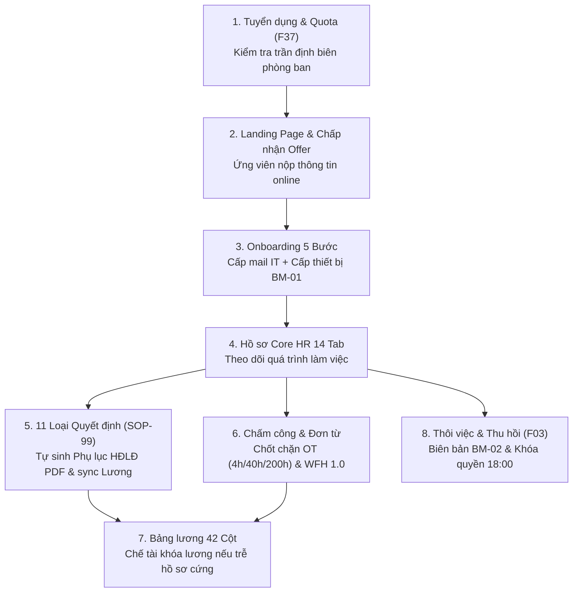

# KẾ HOẠCH NÂNG CẤP HỆ THỐNG HRM CHUẨN DOANH NGHIỆP (MASTER BLUEPRINT)
## Hợp Nhất Đặc Tả CSDL PostgreSQL (14 Tab Core HR, 11 Quyết Định, Bảng Lương 42 Cột) & Bộ Quy Trình SOPs CTY LLA

> **Dự án:** Hệ thống Quản trị Nguồn nhân lực Doanh nghiệp (Enterprise HRM - GHC.Lexora)  
> **Căn cứ tài liệu kỹ thuật & pháp lý:**  
> 1. Thiết kế CSDL chi tiết PostgreSQL (`01_ERD_Chi_tiet_HRM_Nhan_su_PostgreSQL.md`) – 14 Tab Core HR & Ánh xạ API.  
> 2. Bộ Đặc tả Nghiệp vụ BRD Master v44 (`GHC-HRM-BRD-01`) & Danh mục 142 Tính năng Doanh nghiệp.  
> 3. Bộ 24 Quy trình Thao tác Chuẩn (Global SOPs) & Hệ thống Biểu mẫu F-Forms – CTY TNHH LLA.  
> 4. Bộ luật Lao động Việt Nam 2019 (Điều 107 về OT) & Nghị định 13/2023/NĐ-CP (Bảo vệ dữ liệu cá nhân).  
> **Ngày cập nhật:** 24/10/2026 | **Phiên bản:** v3.0 (Full Unified Edition)

---

## MỤC LỤC TỔNG QUAN
1. [Tổng Quan & Kiến Trúc Vận Hành Khép Kín](#1-tổng-quan--kiến-trúc-vận-hành-khép-kín)
2. [Cấu Trúc Chi Tiết 14 Tab Hồ Sơ Core HR (Chuẩn ERD PostgreSQL)](#2-cấu-trúc-chi-tiết-14-tab-hồ-sơ-core-hr-chuẩn-erd-postgresql)
3. [Danh Mục 11 Loại Quyết Định Nhân Sự & Tự Động Sinh Phụ Lục HĐLĐ](#3-danh-mục-11-loại-quyết-định-nhân-sự--tự-động-sinh-phụ-lục-hđlđ)
4. [Lộ Trình Nâng Cấp 3 Giai Đoạn Chiến Lược](#4-lộ-trình-nâng-cấp-3-giai-đoạn-chiến-lược)
5. [Quy Trình Onboarding 5 Bước & Kho Tài Sản BM-01 / BM-02](#5-quy-trình-onboarding-5-bước--kho-tài-sản-bm-01--bm-02)
6. [Chấm Công WFM, Ma Trận Duyệt Đơn Từ & Bảng Lương 42 Cột](#6-chấm-công-wfm-ma-trận-duyệt-đơn-từ--bảng-lương-42-cột)
7. [Bảng Đối Chiếu Hiện Trạng Codebase & Kế Hoạch Triển Khai Ngay](#7-bảng-đối-chiếu-hiện-trạng-codebase--kế-hoạch-triển-khai-ngay)

---

## 1. TỔNG QUAN & KIẾN TRÚC VẬN HÀNH KHÉP KÍN

Mục tiêu cốt lõi của đợt nâng cấp là xóa bỏ tình trạng "rời rạc giữa các phân hệ", tạo thành **vòng đời nhân sự khép kín 100% (Employee Lifecycle)**:

---

## 2. CẤU TRÚC CHI TIẾT 14 TAB HỒ SƠ CORE HR (CHUẨN ERD POSTGRESQL)
*(Căn cứ theo file `01_ERD_Chi_tiet_HRM_Nhan_su_PostgreSQL.md` tại màn hình `EmployeeDetail.jsx`)*

| Tab | Tên Tab & Mã UI | Bảng CSDL PostgreSQL Tham Chiếu | Dữ liệu & Nghiệp vụ Quản trị Chi tiết |
| :---: | :--- | :--- | :--- |
| **Tab 1** | **Thông tin công việc** `FE-H02 / FE-H03` | `employee`, `employee_identity`, `employee_contact`, `employee_assignment` | * Mã nhân viên (tự tăng theo prefix), Họ tên, Email công vụ, SĐT. * Phòng ban, Vị trí chức danh, Điểm làm việc (`work_location`). * Quản lý trực tiếp (Reporting Manager line), Quyết định bổ nhiệm gắn liền (`decision_id`). |
| **Tab 2** | **Thông tin riêng tư** `FE-H04` | `employee_address`, `employee_bank`, `employee_insurance`, `employee_tax` | * Địa chỉ thường trú, tạm trú (quận/huyện, tỉnh/thành). * Số CCCD (che mờ bảo mật theo NĐ 13/2023), Ngày cấp, Nơi cấp. * Tài khoản ngân hàng (Số TK, Tên NH, Chi nhánh chi trả lương). * Mã số thuế TNCN, Mã số sổ BHXH, Tình trạng cư trú thuế. |
| **Tab 3** | **Người thân & Phụ thuộc** `FE-H05` | `employee_relative` | * Họ tên người thân, Mối quan hệ (Bố, Mẹ, Vợ, Con). * Cờ xác nhận người phụ thuộc giảm trừ gia cảnh (`is_dependent = true`), ngày bắt đầu/kết thúc giảm trừ thuế. |
| **Tab 4** | **Lịch sử đào tạo** `FE-H06` | `employee_training` | * Khóa đào tạo nội bộ và bên ngoài do công ty cử đi. * Chi phí đào tạo, Cam kết thời gian phục vụ sau đào tạo (SOP-105). |
| **Tab 5** | **Khen thưởng** `FE-H07` | Đọc từ `decision` (`type = REWARD`) | * Hình thức khen thưởng, Số tiền thưởng, Số quyết định khen thưởng, Cấp ký duyệt. |
| **Tab 6** | **Kỷ luật** `FE-H08` | Đọc từ `decision` (`type = DISCIPLINE`) | * Hình thức kỷ luật (Khiển trách, Kéo dài hạn nâng lương, Cách chức, Sa thải theo BLLĐ), Biên bản xử lý kỷ luật. |
| **Tab 7** | **Quá trình công tác kê khai** `FE-H09` | `employee_prior_work` | * Kinh nghiệm làm việc tại các đơn vị trước đây, Chức vụ cũ, Lý do chuyển việc. |
| **Tab 8** | **Tài sản được cấp phát** `FE-H10` | `asset_assignment` join `asset` | * Danh sách laptop, màn hình, thẻ ra vào đang giữ. * Mã tài sản, Ngày cấp, Tình trạng thiết bị, Mẫu biên bản bàn giao **BM-01**. |
| **Tab HĐ** | **Hợp đồng & Phụ lục** `FE-I01` $\rightarrow$ `FE-I03` | `contract`, `contract_appendix` | * Hợp đồng Thử việc, HĐLĐ Xác định thời hạn, HĐLĐ Không xác định thời hạn. * Trạng thái ký số, Tải file PDF Hợp đồng và các Phụ lục điều chỉnh lương đi kèm. |
| **Tab 9** | **Bằng cấp học vấn** `FE-H11` | `employee_education` | * Trình độ học vấn (Đại học, Thạc sĩ, Tiến sĩ), Nơi đào tạo, Chuyên ngành, Năm tốt nghiệp. |
| **Tab 10** | **Chứng chỉ chuyên môn** `FE-H12` | `employee_certificate` | * Chứng chỉ ngoại ngữ (IELTS/TOEIC), Chứng chỉ nghề nghiệp quốc tế (AWS, PMP, CPA), Ngày hết hạn. |
| **Tab 11** | **Lịch sử lương & Thu nhập** `FE-H13 / FE-H18` | `employee_salary`, `employee_salary_item` | * Biểu đồ diễn biến mức lương qua các thời kỳ, Chi tiết các khoản phụ cấp cố định (Trách nhiệm, Ăn trưa, Xăng xe, Điện thoại). |
| **Tab 12** | **Lịch sử Bổ nhiệm** `FE-H14` | Đọc từ `decision` (`type = PROMOTION`) | * Lịch sử thay đổi cấp bậc, chức vụ từ nhân viên $\rightarrow$ Team Lead $\rightarrow$ Quản lý. |
| **Tab 13** | **Lịch sử Điều chuyển** `FE-H15` | Đọc từ `decision` (`type = TRANSFER`) | * Quá trình luân chuyển giữa các phòng ban, dự án hoặc chuyển pháp nhân công ty con. |
| **Tab 14** | **Lịch sử Đi công tác** `FE-H16` | Đọc từ module Đơn công tác (`business_trip`) | * Địa điểm công tác, Thời gian, Mức công tác phí (500k/ngày thường, $100/ngày BOD, $50/ngày NV). |

---

## 3. DANH MỤC 11 LOẠI QUYẾT ĐỊNH NHÂN SỰ & TỰ ĐỘNG SINH PHỤ LỤC HĐLĐ
*(Căn cứ theo SOP-99 & BRD Master Mục 1.2 / Item 8 – Màn hình `Decisions.jsx`)*

Tuyệt đối không cho phép sửa trực tiếp lương và chức danh trên hồ sơ. Mọi thay đổi bắt buộc phải ban hành qua **1 trong 11 loại Quyết định chuẩn hóa**:

1. **QĐ Tiếp nhận Thử việc (Probation Intake):** Ký sau khi ứng viên đồng ý Offer.
2. **QĐ Bổ nhiệm Chính thức (Official Appointment):** Chuyển từ thử việc sang HĐLĐ chính thức sau khi đạt đánh giá F32.
3. **QĐ Điều chỉnh Lương (Salary Adjustment):** Nâng bậc lương định kỳ hoặc đột xuất.
4. **QĐ Thăng chức / Bổ nhiệm Quản lý (Promotion):** Bổ nhiệm chức vụ mới.
5. **QĐ Miễn nhiệm (Demotion):** Rút bớt quyền hạn/chức danh quản lý.
6. **QĐ Điều chuyển Nội bộ (Internal Transfer):** Chuyển phòng ban hoặc chuyển công ty thành viên.
7. **QĐ Khen thưởng (Reward):** Khen thưởng thành tích, sáng kiến.
8. **QĐ Kỷ luật Lao động (Discipline):** Xử lý vi phạm nội quy lao động theo BLLĐ.
9. **QĐ Cử đi Đào tạo / Công tác Dài hạn (Training Assignment):** Cử đi tu nghiệp kèm cam kết bồi hoàn.
10. **QĐ Chấm dứt HĐLĐ / Cho Thôi việc (Termination):** Cho thôi việc theo thỏa thuận hoặc sa thải.
11. **QĐ Nghỉ hưu Hưởng chế độ BHXH (Retirement):** Dành cho nhân sự chạm tuổi nghỉ hưu.

> **Cơ chế Tự động hóa Luồng Duyệt (Approval Trigger):**  
> Khi Ban Giám đốc bấm **"Phê Duyệt"** một quyết định:  
> 1. Hệ thống tự động sinh số hiệu: `QĐ-YYYY/XXX/LLA` (ví dụ: `QĐ-2026/015/LLA`).  
> 2. **Tự động sinh Phụ lục Hợp đồng PDF** tương ứng (kế thừa các điều khoản của HĐLĐ gốc).  
> 3. Tự động ghi đè thông tin mới (`salary`, `positionId`, `departmentId`) vào bản ghi nhân viên.  
> 4. Ghi 1 dòng nhật ký vào bảng `employmentHistory`.

---

## 4. LỘ TRÌNH NÂNG CẤP 3 GIAI ĐOẠN CHIẾN LƯỢC

### 🚀 GIAI ĐOẠN 1: NÂNG CẤP ĐIỂM NHẤN NGHIỆP VỤ LÕI (ƯU TIÊN CAO – 1 TUẦN)
*Mục tiêu: Đóng các lỗ hổng nghiệp vụ lớn nhất, đưa hệ thống vào trạng thái hoàn chỉnh trước hội đồng.*

1. **Kiểm soát Định biên Nhân sự (Headcount Quota - SOP-100 / F37):**
   * Kiểm tra điều kiện ngặt: $$\text{Nhân sự thực tế} + \text{Số lượng cần tuyển} \le \text{Quota phòng ban}$$
   * Hiển thị thanh tiến độ định biên trên form tạo Phiếu tuyển dụng F37. Chặn gửi nếu vượt trần.
2. **Hoàn thiện Trục Quyết định Nhân sự $\rightarrow$ Tự động cập nhật Hồ sơ (SOP-99):**
   * Hoàn thiện giao diện phê duyệt tại `Decisions.jsx`.
   * Kiểm tra chốt chặn: Chặn duyệt Thôi việc nếu nhân sự chưa trả hết tài sản.
3. **Chốt chặn Giới hạn Làm thêm giờ OT (SOP-92 / Điều 107 BLLĐ 2019):**
   * Chặn không cho tạo đơn nếu vượt 3 trần: **$\le 4$h/ngày**, **$\le 40$h/tháng**, **$\le 200$h/năm**.
4. **Chuẩn hóa Bộ Biểu mẫu LLA (F-Codes):**
   * Gắn nhãn F-Codes lên tiêu đề:
     * Tuyển dụng $\rightarrow$ **Phiếu Yêu Cầu Tuyển Dụng (Mẫu F37 - LLA)**
     * Nghỉ phép $\rightarrow$ **Đơn Xin Nghỉ Phép (Mẫu F11 - LLA)**
     * Đánh giá hiệu suất $\rightarrow$ **Phiếu Đánh Giá Hiệu Suất & Thử Việc (Mẫu F32 - LLA)**
     * Thôi việc $\rightarrow$ **Đơn Xin Thôi Việc & Bàn Giao (Mẫu F03 - LLA)**

---

### 🛡️ GIAI ĐOẠN 2: CHẾ TÀI HÀNH CHÍNH & AN NINH DỮ LIỆU (2 TUẦN)
*Mục tiêu: Đảm bảo tính pháp lý, tuân thủ an toàn dữ liệu và kiểm toán doanh nghiệp.*

1. **Cơ chế Khóa Chi Trả Lương do Chậm Nộp Hồ Sơ Gốc (SOP-25 / Lexora OBJ-02):**
   * Nhân sự có **7 ngày làm việc** để nộp đủ hồ sơ giấy tờ gốc (CCCD sao y, bằng cấp, giấy khám sức khỏe).
   * Quá 7 ngày $\rightarrow$ Bật cờ `isLocked = true` trên bảng lương; kế toán không thể duyệt lệnh chuyển tiền kỳ lương đầu tiên cho đến khi HR gỡ khóa.
2. **Tự động Thu Hồi Quyền & Khóa Tài Khoản đúng 18:00 (SOP-26):**
   * Khi duyệt đơn thôi việc với ngày làm việc cuối là $D_0$: Vào đúng **18:00 ngày $D_0$**, hệ thống tự động khóa tài khoản đăng nhập (`isActive = false`) và thu hồi toàn bộ token truy cập.
3. **Xuất Mẫu Biên Bản Bàn Giao & Thu Hồi Tài Sản (BM-01 & BM-02):**
   * Cấp phát tài sản tại Onboarding: Cho phép xem/in mẫu **BM-01**.
   * Khi nhân viên thôi việc: Bắt buộc hoàn tất ký xác nhận thu hồi đủ thiết bị theo mẫu **BM-02** mới cho phép sang bước quyết toán thanh lý.
4. **Bảo vệ Dữ liệu Cá nhân (Tuân thủ Nghị định 13/2023/NĐ-CP):**
   * Che mờ (mask) số thẻ CCCD trên giao diện danh sách nhân viên: `001090******`. Chỉ Admin/HR có quyền ấn "Xem chi tiết".

---

### 🏢 GIAI ĐOẠN 3: ĐA PHÁP NHÂN NGANG HÀNG (ENTERPRISE HOLDING – MỞ RỘNG DÀI HẠN)
*Mục tiêu: Mở rộng quy mô doanh nghiệp đa công ty thành viên theo chuẩn Lexora OBJ-01.*

1. **Bộ chuyển đổi Ngữ cảnh Doanh nghiệp (Company Context Switcher):**
   * Một tài khoản Back Office quản lý liền mạch 3 công ty con (`LLA Technology`, `LLA Global`, `LLA Academy`) trên thanh Topbar với thời gian chuyển đổi $< 1\text{s}$ mà không cần đăng xuất.
2. **Tự động sinh Mã nhân viên theo Tiền tố Công ty:**
   * `LLA-NV-xxx`, `LLAG-NV-xxx`, `LLAA-NV-xxx`.
3. **Quản lý Kiêm nhiệm Chéo Công ty:**
   * Cho phép nhân viên có hợp đồng chính ở công ty A, đồng thời kiêm nhiệm vị trí chuyên môn ở công ty B.

---

## 5. QUY TRÌNH ONBOARDING 5 BƯỚC & KHO TÀI SẢN BM-01 / BM-02

Quy trình đón tiếp tân binh tự động hóa 5 bước (SOP-101 / BRD Item 4):
1. **Bước 1 (Khai báo E-Form):** Ứng viên chấp nhận Offer trên Landing Page $\rightarrow$ Điền form thông tin cá nhân sơ bộ.
2. **Bước 2 (Tạo Task IT & Hành chính):** Hệ thống tự động tạo task cho IT (cấp email `@lla.vn`, cấp tài khoản phần mềm) và Hành chính (chuẩn bị vị trí ngồi, laptop).
3. **Bước 3 (Bàn giao thiết bị BM-01):** Ngày đầu đi làm, Hành chính bàn giao tài sản và in biên bản BM-01 có chữ ký hai bên.
4. **Bước 4 (Ký HĐLĐ thử việc):** Ký Hợp đồng thử việc điện tử và chuyển trạng thái nhân sự thành `ONBOARDING`.
5. **Bước 5 (Theo dõi nộp hồ sơ cứng 7 ngày):** Bắt đầu đếm ngược 7 ngày nộp hồ sơ gốc; nếu quá hạn $\rightarrow$ kích hoạt cờ khóa lương.

---

## 6. CHẤM CÔNG WFM, MA TRẬN DUYỆT ĐƠN TỪ & BẢNG LƯƠNG 42 CỘT

### 6.1 Chấm công & Quản lý làm việc từ xa (WFH)
* **Hệ số công WFH:** Hệ số tính công bằng **1.0** như làm việc tại văn phòng (khác biệt so với nhiều hệ thống cũ tính 0.8).
* **Cảnh báo Headcount WFH:** Nếu tỷ lệ đăng ký WFH trong ngày của 1 phòng ban vượt quá **30% quân số** $\rightarrow$ Hệ thống hiện cảnh báo đỏ để Quản lý cân nhắc trước khi phê duyệt.

### 6.2 Ma trận Phê duyệt Đơn từ Phân cấp (Approval Matrix)
* **Nghỉ phép $\le 2$ ngày:** Trưởng nhóm (Team Lead) + Nhân sự (HR) duyệt.
* **Nghỉ phép $> 2$ ngày:** Trưởng nhóm + HR + Ban Giám Đốc (BOD) duyệt.
* **Cơ chế Ủy quyền Phê duyệt:** Tự động chuyển tiếp quyền duyệt cho người được ủy quyền khi cấp quản lý vắng mặt.

### 6.3 Bảng lương 42 Cột & Tích hợp BHXH EFY
* **Bảng thanh toán lương chi tiết 42 trường dữ liệu:** Lương cơ bản, Ngày công chuẩn, Ngày công thực tế, Lương thời gian, Lương WFH, Lương OT (nhân hệ số 1.5 ngày thường, 2.0 cuối tuần, 3.0 ngày lễ), Phụ cấp miễn thuế (ăn trưa 730k, điện thoại, trang phục), Phụ cấp chịu thuế.
* **Các khoản trích theo lương:** Trích nộp BHXH 8%, BHYT 1.5%, BHTN 1% trên mức lương đóng bảo hiểm.
* **Thuế TNCN:** Tính tự động theo biểu thuế lũy tiến từng phần 7 bậc sau khi trừ giảm trừ gia cảnh (11 triệu bản thân + 4.4 triệu/người phụ thuộc).
* **Xuất báo cáo EFY:** Cho phép export bảng biểu khớp 100% định dạng phần mềm BHXH điện tử (EFY / VNPT-BHXH).

---

## 7. BẢNG ĐỐI CHIẾU HIỆN TRẠNG CODEBASE & KẾ HOẠCH TRIỂN KHAI NGAY

| Hạng mục Nâng cấp | Mức độ Hoàn thiện | Vị trí File trong Codebase | Kế hoạch Hành động Ngay |
| :--- | :---: | :--- | :--- |
| **1. Quota Định biên (F37)** | **90%** | `backend/.../job-posting.routes.ts` `hrm-frontend/.../Requisitions.jsx` | Gắn nhãn F37 chính thức lên tiêu đề và form. |
| **2. Quyết định Nhân sự (SOP-99)** | **85%** | `backend/.../decision.routes.ts` `hrm-frontend/.../Decisions.jsx` | Tinh chỉnh giao diện `Decisions.jsx` làm nổi bật số hiệu tự sinh `QĐ-YYYY/XXX/LLA`. |
| **3. Chốt chặn OT (BLLĐ 2019)** | **80%** | `backend/.../ot.routes.ts` `hrm-frontend/.../Adjustments.jsx` | **Bổ sung chốt chặn $\le 200$h/năm** vào API `ot.routes.ts`. |
| **4. Chuẩn hóa F-Codes LLA** | **50%** | Toàn bộ 4 trang Frontend tương ứng | Cập nhật nhãn F37, F11, F32, F03 lên tiêu đề. |
| **5. 14 Tab Core HR (ERD)** | **75%** | `hrm-frontend/.../EmployeeDetail.jsx` | Rà soát và hoàn thiện giao diện 14 tab theo chuẩn ERD PostgreSQL. |
| **6. Khóa lương trễ hồ sơ 7 ngày** | **30%** | `backend/.../payroll.routes.ts` `backend/.../onboarding.routes.ts` | Bổ sung cờ `isLocked` trên bảng lương và kiểm tra điều kiện $> 7$ ngày. |
| **7. Mẫu BM-01 & BM-02** | **40%** | `hrm-frontend/.../EquipmentProvision.jsx` | Bổ sung giao diện xuất in ấn Biên bản bàn giao tài sản. |

---

### 🎯 HÀNH ĐỘNG THỰC HIỆN NGAY BÂY GIỜ (GIAI ĐOẠN 1):
1. Bổ sung điều kiện **$\le 200$h OT/năm** vào [ot.routes.ts](file:///c:/Users/truclh/Desktop/HRM-ĐATN/backend/src/routes/attendance/ot.routes.ts).
2. Gắn nhãn **Biểu mẫu F-Codes LLA** (F37, F11, F32, F03) vào 4 màn hình chính.
3. Rà soát màn hình [Decisions.jsx](file:///c:/Users/truclh/Desktop/HRM-ĐATN/hrm-frontend/src/pages/internal/employees/Decisions.jsx) và xác minh luồng tự sinh số Quyết định và đồng bộ hồ sơ.

---
*Tài liệu này là căn cứ kỹ thuật chính thức phục vụ nghiệm thu dự án và bảo vệ ĐATN.*
