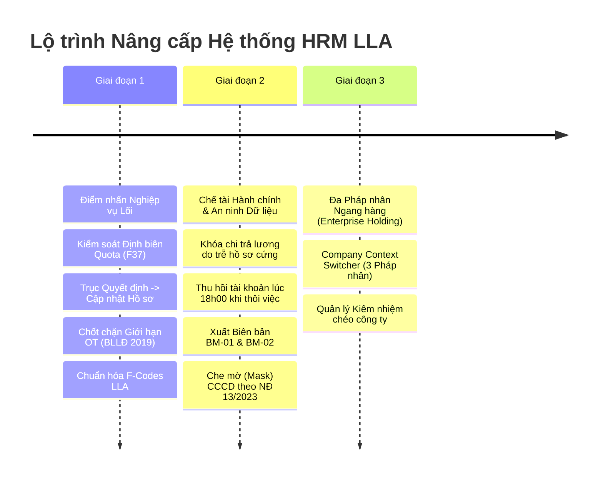

# KẾ HOẠCH NÂNG CẤP HỆ THỐNG HRM CHUẨN DOANH NGHIỆP
## Ánh Xạ Quy Trình Nhân Sự CTY LLA (Global SOP) & Đặc Tả GHC.Lexora (142 Tính Năng)

> **Dự án:** Hệ thống Quản trị Nguồn nhân lực Doanh nghiệp (Enterprise HRM)  
> **Cơ sở tham chiếu:**  
> 1. Bộ 24 Quy trình Thao tác Chuẩn (SOPs) & Biểu mẫu F-Forms – CTY TNHH LLA.  
> 2. Bộ Đặc tả Nghiệp vụ BRD Master & FRS 142 Tính năng – GHC.Lexora (BRD Code: `GHC-HRM-BRD-01`).  
> 3. Thiết kế CSDL chi tiết PostgreSQL (`01_ERD_Chi_tiet_HRM_Nhan_su_PostgreSQL.md`).  
> 4. Bộ luật Lao động Việt Nam 2019 & Nghị định 13/2023/NĐ-CP về Bảo vệ dữ liệu cá nhân.  
> **Ngày lập kế hoạch:** 24/10/2026  
> **Phiên bản:** v2.0 (Executive Master Plan)

---

## 1. TỔNG QUAN & MỤC TIÊU CHIẾN LƯỢC

### 1.1 Bối cảnh thực tế
Hệ thống HRM hiện tại đã xây dựng đầy đủ khung kỹ thuật nền tảng (Frontend React + Vite, Backend Express + TypeScript + Prisma ORM, Database PostgreSQL) bao phủ 7 phân hệ quản trị lõi. Tuy nhiên, để đáp ứng tiêu chuẩn nghiệm thu thực tế của doanh nghiệp và đạt điểm số tối đa (9.5 – 10.0) trước hội đồng đánh giá ĐATN, hệ thống cần bổ sung các **chốt chặn nghiệp vụ cốt lõi (Business Guardrails)** và **tự động hóa luồng dữ liệu xuyên suốt (End-to-End Automation)** giữa các phân hệ:

$$\text{Tuyển dụng (F37)} \longrightarrow \text{Hội nhập & Bàn giao (BM-01)} \longrightarrow \text{Biến động Quyết định (SOP-99)} \longrightarrow \text{Chấm công / OT} \longrightarrow \text{Lương & Chế tài}$$

---

## 2. LỘ TRÌNH 3 GIAI ĐOẠN NÂNG CẤP (STRATEGIC ROADMAP)

---

### 🚀 GIAI ĐOẠN 1: NÂNG CẤP ĐIỂM NHẤN NGHIỆP VỤ (ƯU TIÊN CAO)
*(Thời gian dự kiến: 1 tuần | Mục tiêu: Khắc phục triệt để các khoảng trống nghiệp vụ lớn nhất)*

| STT | Hạng mục Tính năng | Mã Quy trình LLA / Lexora | Mô tả Nghiệp vụ & Kỹ thuật Chi tiết | File Triển khai |
| :---: | :--- | :--- | :--- | :--- |
| **1.1** | **Kiểm soát Định biên Nhân sự (Headcount Quota)** | **SOP-100** `BRD-01: Item 3` | * Tận dụng cột `quota` trong bảng `Department`. * Khi tạo Yêu cầu tuyển dụng (F37), hệ thống kiểm tra: $$\text{Nhân sự hiện tại} + \text{Số lượng yêu cầu} \le \text{Quota phòng ban}$$ * Chặn gửi hoặc cảnh báo đỏ vượt trần để bảo vệ ngân sách nhân sự. | `backend/src/routes/recruitment/job-posting.routes.ts` `hrm-frontend/.../Requisitions.jsx` |
| **1.2** | **Trục "Quyết định Nhân sự" $\rightarrow$ Tự động cập nhật Hồ sơ** | **SOP-99** `BRD-01: Item 8` | * Nghiêm cấm sửa trực tiếp lương/chức vụ trên trang hồ sơ cá nhân; mọi thay đổi phải bắt nguồn từ Quyết định được phê duyệt. * Khi duyệt Quyết định (Tăng lương, Bổ nhiệm, Điều chuyển): 1. Tự sinh số hiệu văn bản: `QĐ-YYYY/XXX/LLA`. 2. Cập nhật lương vào hợp đồng hiệu lực (`contract.baseSalary`). 3. Cập nhật chức vụ, phòng ban của nhân viên. 4. Lưu lịch sử biến động vào `employmentHistory`. 5. Chặn duyệt thôi việc nếu nhân viên còn giữ tài sản. | `backend/src/routes/administrative/decision.routes.ts` `hrm-frontend/.../Decisions.jsx` |
| **1.3** | **Chốt chặn Giới hạn Làm thêm giờ OT theo Luật** | **SOP-92** `Điều 107 BLLĐ 2019` | * Kiểm soát nghiêm ngặt 3 tầng giới hạn thời gian làm thêm giờ: 1. **Tối đa 4 giờ / ngày** (Khoản 2 Điều 107). 2. **Tối đa 40 giờ / tháng** (Khoản 2 Điều 107). 3. **Tối đa 200 giờ / năm** (Khoản 2 Điều 107). * Hệ thống tự động từ chối đơn đăng ký nếu người lao động đã chạm trần quy định. | `backend/src/routes/attendance/ot.routes.ts` `hrm-frontend/.../Adjustments.jsx` |
| **1.4** | **Chuẩn hóa Giao diện theo Bộ Biểu mẫu LLA (F-Codes)** | **Hệ thống F-Forms LLA** | * Đưa mã biểu mẫu chính thức vào tiêu đề và nhãn các màn hình: * Yêu cầu tuyển dụng $\rightarrow$ **Phiếu Yêu Cầu Tuyển Dụng (Mẫu F37 - LLA)** * Đơn xin nghỉ phép $\rightarrow$ **Đơn Xin Nghỉ Phép (Mẫu F11 - LLA)** * Đánh giá hiệu suất $\rightarrow$ **Phiếu Đánh Giá Hiệu Suất & Thử Việc (Mẫu F32 - LLA)** * Đơn xin thôi việc $\rightarrow$ **Đơn Xin Thôi Việc & Bàn Giao (Mẫu F03 - LLA)** | Toàn bộ các trang Frontend tương ứng |

---

### 🛡️ GIAI ĐOẠN 2: CHẾ TÀI HÀNH CHÍNH & AN NINH DỮ LIỆU
*(Thời gian dự kiến: 2 tuần | Mục tiêu: Đảm bảo tính pháp lý, an toàn dữ liệu và tuân thủ kiểm toán)*

| STT | Hạng mục Tính năng | Mã Quy trình LLA / Lexora | Mô tả Nghiệp vụ & Kỹ thuật Chi tiết | File Triển khai |
| :---: | :--- | :--- | :--- | :--- |
| **2.1** | **Khóa Chi Trả Lương do Chậm nộp Hồ sơ gốc** | **SOP-25** `BRD-01: OBJ-02` | * Nhân sự mới tiếp nhận có thời hạn **7 ngày làm việc** để nộp hồ sơ giấy tờ gốc (CCCD công chứng, Bằng cấp, Giấy khám sức khỏe). * Nếu quá 7 ngày chưa hoàn tất $\rightarrow$ Hệ thống tự động bật cờ `isLocked = true` trên bảng lương cá nhân; Kế toán không thể duyệt lệnh thanh toán kỳ lương đầu tiên cho đến khi HR mở khóa. | `backend/src/routes/payroll-kpi/payroll.routes.ts` `backend/src/routes/hr/onboarding.routes.ts` |
| **2.2** | **Thu hồi Quyền & Khóa Tài khoản lúc 18h00 khi Thôi việc** | **SOP-26** `BRD-01: Item 15` | * Khi duyệt Đơn thôi việc (F03) với ngày làm việc cuối cùng là $D_0$: * Hệ thống lên lịch tự động: Vào đúng **18:00 ngày $D_0$**, chuyển trạng thái nhân viên sang `RESIGNED`, hủy kích hoạt tài khoản hệ thống (`isActive = false`), ngắt toàn bộ phiên làm việc. | `backend/src/routes/hr/employee.routes.ts` `backend/src/utils/scheduler.ts` |
| **2.3** | **Biên bản Bàn giao & Thu hồi Tài sản (BM-01 & BM-02)** | **SOP-20 / SOP-21** `BRD-01: OBJ-03` | * Khi cấp phát máy tính/thiết bị tại Trung tâm hội nhập: Cho phép xuất phiếu in **Biên bản Bàn giao Tài sản (BM-01)**. * Khi làm thủ tục thôi việc: Xuất **Biên bản Thu hồi Tài sản (BM-02)**; bắt buộc xác nhận thu hồi đủ 100% thiết bị trước khi kế toán quyết toán sổ lương. | `hrm-frontend/.../EquipmentProvision.jsx` `hrm-frontend/.../Terminations.jsx` |
| **2.4** | **Bảo vệ Dữ liệu Cá nhân (Che mờ CCCD)** | **Nghị định 13/2023/NĐ-CP** `BRD-01: Mục 7` | * Trên danh sách nhân viên công khai, số CCCD/CMND được che mờ tự động (ví dụ: `001090******`). * Chỉ tài khoản có vai trò `ADMIN` hoặc `HR_MANAGER` mới có nút bấm "Hiện đầy đủ" (kèm ghi log nhật ký kiểm toán). | `hrm-frontend/.../EmployeeList.jsx` `backend/src/routes/hr/employee.routes.ts` |

---

### 🏢 GIAI ĐOẠN 3: ĐA PHÁP NHÂN NGANG HÀNG (ENTERPRISE HOLDING)
*(Mở rộng kiến trúc dài hạn | Mục tiêu: Đáp ứng mô hình tập đoàn đa công ty thành viên)*

| STT | Hạng mục Tính năng | Mã Quy trình LLA / Lexora | Mô tả Nghiệp vụ & Kỹ thuật Chi tiết | File Triển khai |
| :---: | :--- | :--- | :--- | :--- |
| **3.1** | **Bộ Chuyển Đổi Ngữ Cảnh Pháp Nhân (Context Switcher)** | **Lexora OBJ-01** `PEER_MULTI_COMPANY` | * Một tài khoản Back Office (HR, Kế toán) có thể chuyển đổi ngữ cảnh làm việc giữa 3 công ty con (`LLA Technology`, `LLA Global`, `LLA Academy`) trên thanh Topbar với độ trễ $< 1\text{s}$ mà không phải đăng xuất. | `hrm-frontend/.../Navbar.jsx` `backend/src/middlewares/auth.middleware.ts` |
| **3.2** | **Tự động sinh Mã nhân viên theo Tiền tố Công ty** | **Lexora OBJ-01** `BRD-01: Item 2` | * Khi tiếp nhận nhân sự mới ở công ty nào, hệ thống tự tăng số mã định danh theo tiền tố công ty đó: `LLA-NV-xxx`, `LLAG-NV-xxx`, `LLAA-NV-xxx`. | `backend/src/routes/hr/employee.routes.ts` |
| **3.3** | **Quản lý Kiêm nhiệm Chéo Công ty (Concurrent Roles)** | **Lexora OBJ-06** `BRD-01: Item 1` | * Cho phép 1 nhân sự ký HĐLĐ chính tại Pháp nhân A nhưng kiêm nhiệm thêm chức vụ chuyên môn tại Pháp nhân B với quyền hạn và bảng chấm công tương ứng. | `backend/prisma/schema.prisma` |

---

## 3. BẢNG ĐỐI CHIẾU TIẾN ĐỘ THỰC TẾ TRONG CODEBASE

| Hạng mục Nâng cấp | Mức độ Hoàn thiện Hiện tại | Tình trạng Mã nguồn | Kế hoạch Hành động Ngay |
| :--- | :---: | :--- | :--- |
| **1. Quota Định biên (F37)** | **90%** | Đã có cột `quota` trong DB, API kiểm tra chặn tuyển vượt trần, giao diện Requisitions đã có thanh tiến độ định biên. | Gắn nhãn F37 chính thức lên tiêu đề và form. |
| **2. Quyết định Nhân sự (SOP-99)** | **85%** | API đã hỗ trợ tự sinh số QĐ, đồng bộ lương sang HĐLĐ, cập nhật chức vụ/phòng ban và ghi `employmentHistory`. | Tinh chỉnh giao diện `Decisions.jsx` làm nổi bật số hiệu tự sinh và xác nhận đồng bộ. |
| **3. Chốt chặn OT (BLLĐ 2019)** | **80%** | Đã chặn $\le 4$h/ngày và $\le 40$h/tháng tại `ot.routes.ts`. | **Bổ sung chốt chặn $\le 200$h/năm** vào API kiểm tra. |
| **4. Chuẩn hóa F-Codes LLA** | **50%** | Giao diện đã đầy đủ các chức năng nhưng tiêu đề còn hiển thị tên thông thường. | Cập nhật nhãn F37, F11, F32, F03 lên 4 màn hình chính. |
| **5. Khóa lương trễ hồ sơ** | **30%** | Đã có bảng `onboarding` và `payroll`. | Bổ sung cờ `isLocked` trên bảng lương và kiểm tra điều kiện $> 7$ ngày. |
| **6. Biên bản BM-01 / BM-02** | **40%** | Đã có chức năng cấp phát và thu hồi thiết bị. | Bổ sung template in ấn/xuất file Biên bản bàn giao chuẩn. |

---

## 4. KẾ HOẠCH HÀNH ĐỘNG NGAY HÔM NAY (NEXT ACTIONS)

Thực hiện trọn gói **Giai đoạn 1** trong hôm nay:

1. **Bổ sung điều kiện 200h OT/năm:**  
   Chỉnh sửa `backend/src/routes/attendance/ot.routes.ts` để truy vấn tổng số giờ làm thêm tích lũy từ ngày 01/01 đến hiện tại của nhân sự và chặn nếu vượt quá 200 giờ.
2. **Gắn bộ nhận diện Biểu mẫu F-Codes LLA:**  
   Cập nhật tiêu đề tại:
   * `Requisitions.jsx` (Phiếu F37)
   * `LeaveMgmt.jsx` (Đơn F11)
   * `Performance.jsx` (Phiếu F32)
   * `Terminations.jsx` (Đơn F03)
3. **Kiểm tra và xác nhận luồng Quyết định nhân sự:**  
   Xác minh thao tác phê duyệt quyết định tăng lương/bổ nhiệm trên `Decisions.jsx` hoạt động trơn tru.

---
*Tài liệu này là căn cứ kỹ thuật chính thức phục vụ nghiệm thu dự án và bảo vệ ĐATN.*
