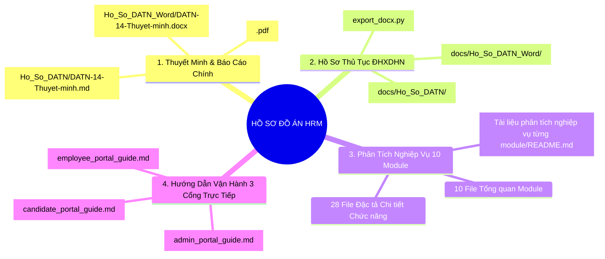

# TRUNG TÂM TRA CỨU HỒ SƠ & TÀI LIỆU ĐỒ ÁN TỐT NGHIỆP HRM

> **Đề tài**: Xây Dựng Hệ Thống Quản Trị Nguồn Nhân Lực Doanh Nghiệp (Enterprise HRM SaaS)  
> **Sinh viên thực hiện**: Lê Hữu Trúc  
> **Trường**: Đại học Xây dựng Hà Nội (ĐHXDHN)  
> **Quy chuẩn áp dụng**: Quyết định số 483/QĐ-ĐHXDHN về Tổ chức thực hiện và đánh giá ĐATN.

---

## 1. Bản Đồ Phân Loại Tài Liệu Đồ Án (Documentation Sitemap)

Toàn bộ hệ thống tài liệu đồ án được cấu trúc khoa học thành **4 phân vùng chức năng**:

---

## 2. Danh Mục Hồ Sơ & Liên Kết Truy Cập Nhanh

### Phân vùng 1: Báo Cáo Thuyết Minh Đồ Án Tốt Nghiệp (Chính thức)
- [Báo cáo Thuyết minh ĐATN Toàn văn (Markdown)](./Ho_So_DATN/DATN-14-Thuyet-minh.md) - Thuyết minh chi tiết toàn diện (870 KB).
- [Báo cáo Thuyết minh ĐATN Bản Word (.docx)](./Ho_So_DATN_Word/DATN-14-Thuyet-minh.docx) - Định dạng Word in ấn chuẩn quy chế ĐHXDHN.
- [Báo cáo Rà soát & Đánh giá Kiến trúc Hệ thống](./Bao_Cao_Ra_Soat_Va_Danh_Gia_He_Thong_HRM.md) - Tài liệu kiểm định chất lượng kỹ thuật, an toàn thông tin và tính tuân thủ BLLĐ 2019.
- [Quy định ĐATN ĐHXDHN số 483/20032026](./483_20032026%20Quy%20định%20Tổ%20chức%20thực%20hiện%20và%20đánh%20giá%20ĐATN%20của%20Trường%20ĐHXDHN.pdf) - Căn cứ pháp lý và thang điểm đánh giá của Nhà trường.

---

### Phân vùng 2: Bộ Hồ Sơ Thủ Tục ĐATN (Chuẩn Biểu Mẫu Trường ĐHXDHN)
Hồ sơ được chuẩn bị song song định dạng Markdown (đọc trực tiếp) và Microsoft Word (in ấn, ký duyệt):

| Mã Hồ sơ | Tên Biểu mẫu Quy định | Bản Markdown | Bản Word (.docx) |
|---|---|:---:|:---:|
| **DATN-01** | Nhiệm vụ Đồ án tốt nghiệp | [DATN-01-Nhiem-vu.md](./Ho_So_DATN/DATN-01-Nhiem-vu.md) | [DATN-01.docx](./Ho_So_DATN_Word/DATN-01-Nhiem-vu.docx) |
| **DATN-02** | Nhật ký Đồ án tốt nghiệp theo tuần | [DATN-02-Nhat-ky.md](./Ho_So_DATN/DATN-02-Nhat-ky.md) | [DATN-02.docx](./Ho_So_DATN_Word/DATN-02-Nhat-ky.docx) |
| **DATN-03** | Đánh giá ĐATN của GVHD - Mốc 1 | [DATN-03-Danh-gia-M1.md](./Ho_So_DATN/DATN-03-Danh-gia-M1.md) | [DATN-03.docx](./Ho_So_DATN_Word/DATN-03-Danh-gia-M1.docx) |
| **DATN-04** | Đánh giá ĐATN của GVHD - Mốc 2 | [DATN-04-Danh-gia-M2.md](./Ho_So_DATN/DATN-04-Danh-gia-M2.md) | [DATN-04.docx](./Ho_So_DATN_Word/DATN-04-Danh-gia-M2.docx) |
| **DATN-05** | Phiếu Đánh giá Phản biện ĐATN | [DATN-05-Phieu-phan-bien.md](./Ho_So_DATN/DATN-05-Phieu-phan-bien.md) | [DATN-05.docx](./Ho_So_DATN_Word/DATN-05-Phieu-phan-bien.docx) |
| **DATN-06** | Phiếu Chấm Bảo vệ ĐATN của Hội đồng | [DATN-06-Phieu-cham-bao-ve.md](./Ho_So_DATN/DATN-06-Phieu-cham-bao-ve.md) | [DATN-06.docx](./Ho_So_DATN_Word/DATN-06-Phieu-cham-bao-ve.docx) |
| **DATN-07** | Bảng Tổng hợp Điểm Mốc ĐATN | [DATN-07-Tong-hop-diem-moc.md](./Ho_So_DATN/DATN-07-Tong-hop-diem-moc.md) | [DATN-07.docx](./Ho_So_DATN_Word/DATN-07-Tong-hop-diem-moc.docx) |
| **DATN-08** | Bảng Tổng hợp Điều kiện Bảo vệ ĐATN | [DATN-08-Tong-hop-dieu-kien.md](./Ho_So_DATN/DATN-08-Tong-hop-dieu-kien.md) | [DATN-08.docx](./Ho_So_DATN_Word/DATN-08-Tong-hop-dieu-kien.docx) |
| **DATN-09** | Danh mục Hồ sơ Đồ án tốt nghiệp | [DATN-09-Danh-muc-ho-so.md](./Ho_So_DATN/DATN-09-Danh-muc-ho-so.md) | [DATN-09.docx](./Ho_So_DATN_Word/DATN-09-Danh-muc-ho-so.docx) |
| **DATN-10** | Khảo sát Ý kiến Sinh viên sau ĐATN | [DATN-10-Khao-sat-SV.md](./Ho_So_DATN/DATN-10-Khao-sat-SV.md) | [DATN-10.docx](./Ho_So_DATN_Word/DATN-10-Khao-sat-SV.docx) |
| **DATN-11** | Báo cáo Tổng kết Học phần ĐATN | [DATN-11-Bao-cao-sau-hoc-phan.md](./Ho_So_DATN/DATN-11-Bao-cao-sau-hoc-phan.md) | [DATN-11.docx](./Ho_So_DATN_Word/DATN-11-Bao-cao-sau-hoc-phan.docx) |
| **DATN-12** | Kế hoạch Cải tiến Chất lượng CQI | [DATN-12-Ke-hoach-CQI.md](./Ho_So_DATN/DATN-12-Ke-hoach-CQI.md) | [DATN-12.docx](./Ho_So_DATN_Word/DATN-12-Ke-hoach-CQI.docx) |
| **DATN-13** | Checklist Đảm bảo Chất lượng QA | [DATN-13-Checklist-QA.md](./Ho_So_DATN/DATN-13-Checklist-QA.md) | [DATN-13.docx](./Ho_So_DATN_Word/DATN-13-Checklist-QA.docx) |
| **DATN-14** | Thuyết minh ĐATN hoàn chỉnh | [DATN-14-Thuyet-minh.md](./Ho_So_DATN/DATN-14-Thuyet-minh.md) | [DATN-14.docx](./Ho_So_DATN_Word/DATN-14-Thuyet-minh.docx) |

---

### Phân vùng 3: Bộ Đặc Tả Phân Tích Nghiệp Vụ 10 Module (Chuyên sâu)
Toàn bộ 39 tệp phân tích nghiệp vụ chuẩn quốc tế nằm tại:  
👉 **[Cổng Tổng chỉ mục 10 Phân hệ Nghiệp vụ](./Tài%20liệu%20phân%20tích%20nghiệp%20vụ%20từng%20module/README.md)**

1. [Module Cơ cấu Tổ chức & Sơ đồ Cây](./Tài%20liệu%20phân%20tích%20nghiệp%20vụ%20từng%20module/Module%20Tổ%20chức/Module%20Tổ%20chức.md)
2. [Module Hệ thống Phân quyền, RBAC & Audit Log](./Tài%20liệu%20phân%20tích%20nghiệp%20vụ%20từng%20module/Module%20Hệ%20thống%20Phân%20quyền/Module%20Hệ%20thống%20Phân%20quyền.md)
3. [Module Cổng Tuyển dụng Ứng viên & Pre-Onboarding](./Tài%20liệu%20phân%20tích%20nghiệp%20vụ%20từng%20module/Module%20Cổng%20Tuyển%20dụng%20Ứng%20viên/Module%20Cổng%20Tuyển%20dụng%20Ứng%20viên.md)
4. [Module Quản trị Tuyển dụng Nội bộ & ATS Kanban](./Tài%20liệu%20phân%20tích%20nghiệp%20vụ%20từng%20module/Module%20Tuyển%20dụng/Module%20Tuyển%20dụng.md)
5. [Module Hồ sơ Nhân sự & Hợp đồng (Core HR)](./Tài%20liệu%20phân%20tích%20nghiệp%20vụ%20từng%20module/Module%20Core%20HR/Module%20Core%20HR.md)
6. [Module Quản lý Chấm công Doanh nghiệp](./Tài%20liệu%20phân%20tích%20nghiệp%20vụ%20từng%20module/Module%20Chấm%20công/Module%20Chấm%20công.md)
7. [Module Quản lý Nghỉ phép & Làm thêm giờ](./Tài%20liệu%20phân%20tích%20nghiệp%20vụ%20từng%20module/Module%20Nghỉ%20phép%20và%20OT/Module%20Nghỉ%20phép%20&%20OT.md)
8. [Module Cổng Dịch vụ Nhân viên Tự phục vụ (ESS)](./Tài%20liệu%20phân%20tích%20nghiệp%20vụ%20từng%20module/Module%20Cổng%20Nhân%20viên%20ESS/Module%20Cổng%20Nhân%20viên%20ESS.md)
9. [Module Đánh giá Hiệu suất & Xếp loại KPI](./Tài%20liệu%20phân%20tích%20nghiệp%20vụ%20từng%20module/Module%20Đánh%20giá%20KPI/Module%20Đánh%20giá%20KPI.md)
10. [Module Quản lý Tiền lương, Thuế & Bảo hiểm](./Tài%20liệu%20phân%20tích%20nghiệp%20vụ%20từng%20module/Module%20Tiền%20lương/Module%20Tiền%20lương.md)

---

### Phân vùng 4: Cẩm Nang Hướng Dẫn Vận Hành 3 Cổng Trực Tiếp
- [Hướng dẫn Cổng Quản trị Nội bộ (Admin Portal)](../Huong_Dan_Su_Dung/admin_portal_guide.md) - Hướng dẫn nghiệp vụ dành cho Quản trị viên nhân sự & Ban lãnh đạo.
- [Hướng dẫn Cổng Tự phục vụ Nhân viên (Employee ESS)](../Huong_Dan_Su_Dung/employee_portal_guide.md) - Hướng dẫn nhân viên tra cứu phiếu lương, chấm công, nộp đơn nghỉ phép & làm thêm giờ.
- [Hướng dẫn Cổng Tuyển dụng Ứng viên (Candidate Portal)](../Huong_Dan_Su_Dung/candidate_portal_guide.md) - Hướng dẫn ứng viên tìm kiếm việc làm, nộp CV và tra cứu lộ trình ứng tuyển.
