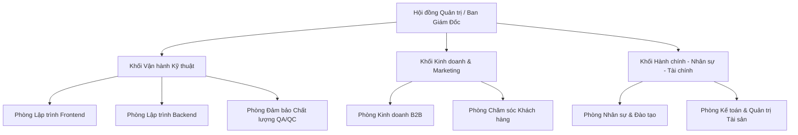

# TÀI LIỆU YÊU CẦU NGHIỆP VỤ (BRD)
## PHÂN HỆ: CƠ CẤU TỔ CHỨC & ĐỊNH BIÊN NHÂN SỰ (ORGANIZATION & HEADCOUNT MANAGEMENT)

---

### THÔNG TIN TÀI LIỆU
* **Tên tài liệu:** Business Requirements Document (BRD) – Phân hệ Cơ cấu Tổ chức, Sơ đồ Doanh nghiệp & Quản trị Định biên Nhân sự
* **Mã tài liệu:** `BRD-HRM-MOD-01`
* **Phiên bản:** 1.0 (Chuẩn hóa thực tế vận hành)
* **Ngày cập nhật:** 27/10/2026
* **Tác giả:** Ban Dự án Hệ thống HRM & Chuyên gia Phân tích Nghiệp vụ (BA)
* **Tình trạng:** Chờ Phê duyệt (Pending Approval)

---

### MỤC LỤC
1. [Bảng Giải thích Từ viết tắt & Thuật ngữ Nghiệp vụ](#1-bảng-giải-thích-từ-viết-tắt--thuật-ngữ-nghiệp-vụ)
2. [Tóm tắt Điều hành 3 Chiều (Executive Summary)](#2-tóm-tắt-điều-hành-3-chiều-executive-summary)
3. [Mục tiêu Kinh doanh & Đo lường Thành công](#3-mục-tiêu-kinh-doanh--đo-lường-thành-công)
4. [Phân tích Hiện trạng Vận hành (As-Is vs To-Be)](#4-phân-tích-hiện-trạng-vận-hành-as-is-vs-to-be)
5. [Phạm vi Triển khai & Bản đồ Tích hợp Phân hệ](#5-phạm-vi-triển-khai--bản-đồ-tích-hợp-phân-hệ)
6. [Danh mục Yêu cầu Chức năng & Quy tắc Nghiệp vụ Chi tiết](#6-danh-mục-yêu-cầu-chức-năng--quy-tắc-nghiệp-vụ-chi-tiết)
7. [Giả định, Ràng buộc Nghiệp vụ & Quản trị Rủi ro](#7-giả-định-ràng-buộc-nghiệp-vụ--quản-trị-rủi-ro)
8. [Ma trận Phân quyền RBAC & Thiết kế Giao diện Vận hành](#8-ma-trận-phân-quyền-rbac--thiết-kế-giao-diện-vận-hành)

---

### 1. BẢNG GIẢI THÍCH TỪ VIẾT TẮT & THUẬT NGỮ NGHIỆP VỤ

| Từ viết tắt / Thuật ngữ | Tên tiếng Anh đầy đủ | Giải thích Ý nghĩa Nghiệp vụ Dễ hiểu |
| :--- | :--- | :--- |
| **Department** | Organizational Department / Unit | Đơn vị tổ chức chuyên môn phụ trách một mảng nghiệp vụ (VD: Khối Lập trình, Phòng Marketing, Phòng Kế toán). |
| **Position / Title** | Job Position / Job Title | Chức danh công việc xác định rõ vai trò, cấp bậc, trách nhiệm và khung lương chuẩn của nhân sự trong tổ chức. |
| **Org Chart** | Interactive Organizational Chart | Sơ đồ hình cây trực quan thể hiện mối quan hệ quản lý phân cấp giữa Ban Giám đốc, Trưởng phòng và nhân viên. |
| **Headcount Quota** | Department Headcount Quota | Chỉ tiêu định biên nhân sự tối đa được Ban Giám đốc phê duyệt cấp ngân sách cho phòng ban trong năm tài chính. |
| **Fill Rate** | Headcount Fill Rate Percentage | Tỷ lệ lấp đầy nhân sự thực tế so với định biên: $(\text{Thực tế} / \text{Định biên}) \times 100\%$. |
| **Recursive Loop** | Circular Hierarchy Loop | Lỗi vòng lặp phả hệ tổ chức khi phòng ban cha vô tình chọn phòng ban con làm cha của chính mình. |
| **Hard Deletion Lock** | Active Personnel Deletion Lock | Chốt chặn an toàn: Tuyệt đối cấm xóa phòng ban hoặc vị trí nếu còn ít nhất 1 nhân viên đang hoạt động (`status != RESIGNED`). |

---

### 2. TÓM TẮT ĐIỀU HÀNH 3 CHIỀU (EXECUTIVE SUMMARY)

```
       ┌────────────────────────────────────────────────────────┐
       │                TÓM TẮT ĐIỀU HÀNH 3 CHIỀU               │
       └───────────────────────────┬────────────────────────────┘
                                   │
         ┌─────────────────────────┼─────────────────────────┐
         │                         │                         │
         ▼                         ▼                         ▼
┌──────────────────┐      ┌──────────────────┐      ┌──────────────────┐
│ GÓC NHÌN CHIẾN   │      │ GÓC NHÌN VẬN HÀNH│      │ GÓC NHÌN TOÀN VẸN│
│ LƯỢC BAN GIÁM ĐỐC│      │  TRƯỞNG BỘ PHẬN  │      │     DỮ LIỆU      │
├──────────────────┤      ├──────────────────┤      ├──────────────────┤
│• Kiểm soát định  │      │• Xác định cấp    │      │• Chống lỗi vòng  │
│  biên & quỹ lương│         phê duyệt tự    │         lặp cây tổ chức │
│• Sơ đồ trực quan │         động (Manager)  │• Chặn xóa phòng  │
│  thời gian thực  │      │• Nắm bắt quân số │  ban đang có     │
│• Tối ưu cơ cấu   │         và nhân sự dưới │  nhân sự active  │
└──────────────────┘      └──────────────────┘      └──────────────────┘
```

* **Góc nhìn Chiến lược Ban Giám Đốc (BOD Strategy):** Cơ cấu tổ chức là nền tảng quản trị của toàn doanh nghiệp; cho phép thiết lập và kiểm soát chặt chẽ định biên nhân sự từng phòng ban, đảm bảo việc mở rộng quy mô bám sát chiến lược kinh doanh và không vượt quá ngân sách quỹ lương được duyệt.
* **Góc nhìn Quản lý Vận hành Trưởng bộ phận:** Làm căn cứ kế thừa cho toàn bộ luồng phê duyệt tự động (Approval Workflows): Trưởng phòng ban tự động trở thành người duyệt cấp 1 đối với các đơn xin nghỉ phép, giải trình chấm công, đề xuất làm thêm giờ và đánh giá KPI của nhân viên thuộc quyền.
* **Góc nhìn Tính toàn vẹn Dữ liệu Kỹ thuật:** Đảm bảo cấu trúc dữ liệu cây tổ chức bất biến, chống triệt để lỗi đệ quy vòng lặp (`parentDepartmentId`), bảo vệ dữ liệu hồ sơ nhân sự bằng cơ chế Hard Deletion Lock.

---

### 3. MỤC TIÊU KINH DOANH & ĐO LƯỜNG THÀNH CÔNG

#### 3.1. Mục tiêu Kinh doanh Định lượng
1. **Số hóa 100% sơ đồ tổ chức doanh nghiệp:** Loại bỏ các sơ đồ vẽ tay hoặc slide PowerPoint tĩnh; sơ đồ tự động cập nhật ngay khi có nhân sự mới onboard hoặc thuyên chuyển công tác.
2. **Kiểm soát định biên (Quota) chính xác 100%:** Ngăn ngừa việc tuyển dụng vượt chỉ tiêu nếu chưa có văn bản phê duyệt bổ sung định biên của Ban Giám Đốc.
3. **Tự động hóa luồng duyệt đơn từ:** Cắt giảm 100% việc lựa chọn người duyệt thủ công; hệ thống tự động định tuyến đơn đến đúng Trưởng phòng quản lý trực tiếp.

#### 3.2. Tiêu chí Đánh giá Thành công (KPI Phân hệ)
* **Thời gian hiển thị sơ đồ tổ chức toàn công ty:** `< 1 giây` (kể cả với quy mô hàng ngàn nhân sự).
* **Số sự cố dữ liệu mồ côi (Orphan records) do xóa phòng ban:** `0`.
* **Tỷ lệ định biên được cập nhật chính xác theo quý:** `100%`.

---

### 4. PHÂN TÍCH HIỆN TRẠNG VẬN HÀNH (AS-IS VS TO-BE)

| Tiêu chí So sánh | Hiện trạng Thủ công (As-Is) | Hệ thống HRM Tự động hóa (To-Be) |
| :--- | :--- | :--- |
| **Quản trị Sơ đồ Cây** | Vẽ trên PowerPoint/Visio; mỗi khi nhân sự biến động phải chỉnh sửa thủ công và gửi lại toàn công ty. | Sơ đồ hình cây trực quan tương tác thực tế (Interactive Org Chart); tự động co giãn, xem ảnh, chức danh và quân số thời gian thực. |
| **Phân định Cấp Quản lý** | Nhớ tên người quản lý; nhân viên nộp đơn giấy dễ gửi nhầm người duyệt, gây chậm trễ quy trình. | Phòng ban gắn liền với Trưởng phòng (`managerId`); hệ thống tự động suy diễn người quản lý trực tiếp của nhân sự. |
| **Quản lý Định biên (Quota)**| Quản lý trên file Excel kế hoạch ngân sách; tuyển dụng không nắm rõ chỉ tiêu còn lại, dễ tuyển vượt hạn mức. | Hệ thống lưu trữ `quota` từng phòng; so sánh thực tế vs định biên, phân loại trạng thái: `OPEN` (Còn chỗ), `FULL` (Đủ), `OVER_QUOTA` (Vượt). |
| **Toàn vẹn khi Xóa Phòng** | Xóa phòng ban trên danh sách làm thất lạc hồ sơ nhân viên cũ hoặc gây lỗi phần mềm do khóa ngoại bị gãy. | Chốt chặn an toàn `Hard Deletion Lock`: Bắt buộc điều chuyển hết nhân viên sang phòng ban khác mới cho phép xóa phòng ban. |

---

### 5. PHẠM VI TRIỂN KHAI & BẢN ĐỒ TÍCH HỢP PHÂN HỆ

#### 5.1. Mô hình Cây Tổ chức & Dòng Chảy Kế thừa



#### 5.2. Các Thực thể Dữ liệu Trọng yếu
1. **`Department`:** Lưu trữ thông tin phòng ban (`id`, `name`, `code`, `parentId`, `managerId`, `quota`, `description`).
2. **`Position`:** Lưu trữ danh mục vị trí/chức danh (`id`, `title`, `code`, `departmentId`, `level`, `minSalary`, `maxSalary`).
3. **`Employee`:** Nhân sự gắn với `departmentId` và `positionId`.

---

### 6. DANH MỤC YÊU CẦU CHỨC NĂNG & QUY TẮC NGHIỆP VỤ CHI TIẾT

#### BR-ORG-01: Tính Duy nhất của Mã Định danh (Code Uniqueness Rule)
* **Mã quy tắc:** `BR-ORG-01`
* **Mô tả:** Mã phòng ban (`Department.code`) và Mã chức danh (`Position.code`) phải là duy nhất trên toàn hệ thống, viết hoa không dấu, không chứa khoảng trắng (VD: `DEPT_DEV`, `DEPT_MKT`, `POS_LEAD_FE`).
* **Hành vi hệ thống:** Kiểm tra trùng mã trước khi lưu; nếu trùng mã, trả về thông báo lỗi: *"Mã phòng ban/chức danh đã tồn tại trong hệ thống!"*.

#### BR-ORG-02: Chống Vòng lặp Phả hệ Đệ quy (Anti-Circular Hierarchy Rule)
* **Mã quy tắc:** `BR-ORG-02`
* **Mô tả:** Khi cập nhật phòng ban cha (`parentId`), hệ thống thực hiện thuật toán kiểm tra cây phả hệ:
  1. Phòng ban không thể tự chọn chính nó làm phòng ban cha (`parentId !== department.id`).
  2. Phòng ban cha được chọn không thể là bất kỳ phòng ban con cháu nào nằm dưới nhánh của phòng ban hiện tại.
* **Xử lý:** Chặn cập nhật và ném ngoại lệ nếu phát hiện nguy cơ tạo vòng lặp vô tận.

#### BR-ORG-03: Chốt chặn Xóa Phòng ban / Vị trí Đang có Nhân sự (Hard Deletion Lock)
* **Mã quy tắc:** `BR-ORG-03`
* **Mô tả:** Chặn tuyệt đối việc xóa mềm hoặc xóa cứng một phòng ban hoặc một chức danh nếu:
  $$\text{Số lượng nhân sự đang hoạt động} (\text{status} \ne \text{'RESIGNED'}) > 0$$
* **Thông báo lỗi nghiệp vụ:** *"Không thể xóa phòng ban [Tên phòng ban] do đang có X nhân sự trực thuộc! Vui lòng điều chuyển toàn bộ nhân sự sang phòng ban khác trước khi thực hiện."*

#### BR-ORG-04: Kiểm soát Định biên Nhân sự (Headcount Quota Enforcement)
* **Mã quy tắc:** `BR-ORG-04`
* **Công thức xác định:**
  $$\text{Tỷ lệ lấp đầy (Fill Rate)} = \left(\frac{\text{Số nhân sự thực tế}}{\text{Quota định biên}}\right) \times 100\%$$
* Khi phân hệ Tuyển dụng tạo Yêu cầu tuyển dụng mới (`JobRequisition`), hệ thống tự động kiểm tra: Nếu $\text{Thực tế} + \text{Số lượng đề xuất tuyển} > \text{Quota}$, hệ thống hiển thị cảnh báo yêu cầu phê duyệt đặc cách từ Tổng Giám Đốc.

#### BR-ORG-05: Kế thừa Phê duyệt Tự động (Manager Approval Inheritance)
* **Mã quy tắc:** `BR-ORG-05`
* **Mô tả:** Khi nhân viên nộp đơn từ (Nghỉ phép, Chấm công, Làm thêm giờ, Bàn giao công việc), hệ thống tự động truy xuất `Employee.department.managerId`. Người giữ chức vụ Trưởng phòng này tự động được gán quyền phê duyệt cấp 1 mà không cần thiết lập thủ công.

---

### 7. GIẢ ĐỊNH, RÀNG BUỘC NGHIỆP VỤ & QUẢN TRỊ RỦI RO

#### 7.1. Giả định Nghiệp vụ
* Mỗi nhân viên chỉ thuộc về một phòng ban chính thức duy nhất tại một thời điểm (không hỗ trợ nhân sự kiêm nhiệm ở 2 phòng ban khác nhau trên một mã nhân viên).
* Trưởng phòng ban bắt buộc phải là một nhân sự chính thức đang làm việc (`status === 'ACTIVE'`).

#### 7.2. Ràng buộc Kỹ thuật & Quyền hạn
* Chỉ người dùng có vai trò `SUPER_ADMIN`, `ADMIN` và `HR_MANAGER` mới có thẩm quyền tạo lập hoặc thay đổi cấu trúc phòng ban.
* Toàn bộ các thao tác thêm, sửa, xóa phòng ban và chức danh đều được ghi vết vào `AuditLog`.

#### 7.3. Ma trận Rủi ro & Phương án Kiểm soát

| STT | Rủi ro Nghiệp vụ | Mức độ | Biện pháp Kiểm soát & Chốt chặn Kỹ thuật |
| :---: | :--- | :---: | :--- |
| 1 | Vòng lặp đệ quy làm sập chức năng Org Chart | Cao | Thuật toán DFS/BFS kiểm tra cây trước khi ghi nhận `parentId` mới vào cơ sở dữ liệu. |
| 2 | Xóa nhầm phòng ban làm mất dữ liệu nhân viên | Nghiêm trọng | Cơ chế `Hard Deletion Lock` chặn 100% thao tác xóa nếu còn nhân sự liên kết. |
| 3 | Tuyển dụng vượt quá khả năng chi trả quỹ lương | Cao | Kiểm soát định biên `Headcount Quota` tích hợp trực tiếp giữa Org và Tuyển dụng ATS. |

---

### 8. MA TRẬN PHÂN QUYỀN RBAC & THIẾT KẾ GIAO DIỆN VẬN HÀNH

#### 8.1. Ma trận Phân quyền Chức năng (RBAC)

| Chức năng Phân hệ | Super Admin | HR Manager | Quản lý bộ phận | Chuyên viên HR | Nhân viên (ESS) |
| :--- | :---: | :---: | :---: | :---: | :---: |
| **Xem Sơ đồ Tổ chức (Org Chart)** | Full | Full | Full | Full | Chỉ xem (Read-only) |
| **Thêm / Sửa Phòng ban** | Full | Full | Không | Không | Không |
| **Xóa Phòng ban (Đã trống quân số)**| Full | Full | Không | Không | Không |
| **Cấu hình Định biên (Quota)** | Full | Full | Đề xuất | Không | Không |
| **Quản lý Vị trí / Chức danh** | Full | Full | Đề xuất | Xem | Không |

#### 8.2. Thiết kế Giao diện Vận hành (UI/UX Specifications)
1. **Màn hình Sơ đồ Tổ chức Trực quan (`/internal/organization/chart`):**
   * Hiển thị dạng cây phân cấp trực quan với khả năng Thu phóng (Zoom in/out) và Kéo thả (Pan).
   * Mỗi Node phòng ban thể hiện: Tên phòng, Mã phòng, Avatar & Tên Trưởng phòng, Số lượng nhân sự hiện tại / Quota định biên.
   * Thẻ nhãn trạng thái định biên: Xanh lá (`FULL`), Xanh dương (`OPEN`), Đỏ (`OVER_QUOTA`).
2. **Màn hình Quản lý Danh mục Phòng ban (`/internal/organization/departments`):**
   * Thanh tác vụ: Nút "Thêm phòng ban mới", Bộ lọc tìm kiếm nhanh theo mã hoặc tên.
   * Bảng dữ liệu Grid: Mã phòng, Tên phòng ban, Phòng ban cấp trên, Trưởng bộ phận, Số lượng nhân sự trực thuộc, Định biên (Quota), Nút hành động "Chỉnh sửa" và "Xóa" (kèm cảnh báo an toàn).
3. **Màn hình Danh mục Vị trí Chức vụ (`/internal/organization/positions`):**
   * Bảng danh sách chức danh gắn với từng phòng ban, khung lương cơ bản và cấp bậc chuyên môn.
