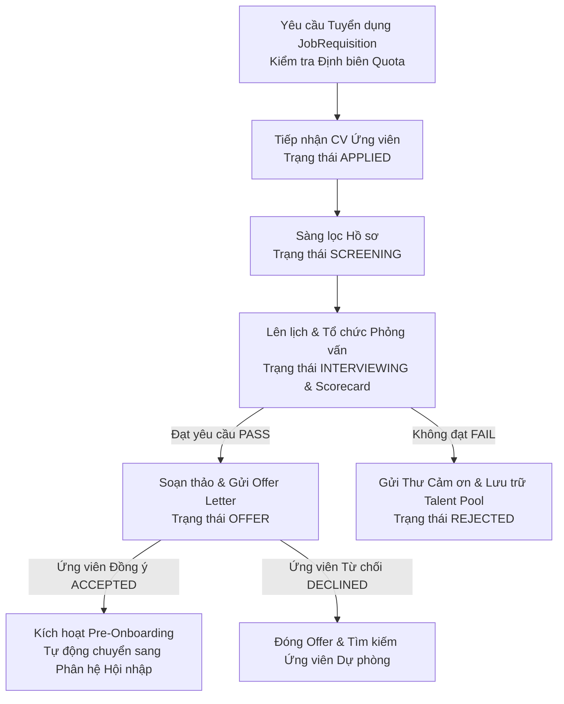

# TÀI LIỆU YÊU CẦU NGHIỆP VỤ (BRD)
## PHÂN HỆ: QUẢN LÝ TUYỂN DỤNG & PHỄU ỨNG VIÊN (RECRUITMENT ATS)

---

### THÔNG TIN TÀI LIỆU
* **Tên tài liệu:** Business Requirements Document (BRD) – Phân hệ Quản lý Tuyển dụng, Phễu Ứng viên (ATS) & Thư mời Nhận việc
* **Mã tài liệu:** `BRD-HRM-MOD-02`
* **Phiên bản:** 1.0 (Chuẩn hóa thực tế vận hành)
* **Ngày cập nhật:** 27/10/2026
* **Tác giả:** Ban Dự án Hệ thống HRM & Chuyên gia Phân tích Nghiệp vụ (BA)
* **Tình trạng:** Chờ Phê duyệt (Pending Approval)

---

### MỤC LỤC
1. [Bảng Giải thích Từ viết tắt & Thuật ngữ Nghiệp vụ](#1-bảng-giải-thích-từ-viết-tắt--thuật-ngữ-nghiệp-vụ)
2. [Tóm tắt Điều hành 3 Chiều (Executive Summary)](#2-tóm-tắt-điều-hành-3-chiều-executive-summary)
3. [Mục tiêu Kinh doanh & Đo lường Thành công](#3-mục-tiêu-kinh-doanh--đo-lường-thành-công)
4. [Phân tích Hiện trạng Vận hành (As-Is vs To-Be)](#4-phân-tích-hiện-trạng-vận-hành-as-is-vs-to-be)
5. [Phạm vi Triển khai & Bản đồ Tích hợp Phân hệ](#5-phạm-vi-triển-khai--bản-đồ-tích-hợp-phân-hệ)
6. [Danh mục Yêu cầu Chức năng & Quy tắc Nghiệp vụ Chi tiết](#6-danh-mục-yêu-cầu-chức-năng--quy-tắc-nghiệp-vụ-chi-tiết)
7. [Giả định, Ràng buộc Nghiệp vụ & Quản trị Rủi ro](#7-giả-định-ràng-buộc-nghiệp-vụ--quản-trị-rủi-ro)
8. [Ma trận Phân quyền RBAC & Thiết kế Giao diện Vận hành](#8-ma-trận-phân-quyền-rbac--thiết-kế-giao-diện-vận-hành)

---

### 1. BẢNG GIẢI THÍCH TỪ VIẾT TẮT & THUẬT NGỮ NGHIỆP VỤ

| Từ viết tắt / Thuật ngữ | Tên tiếng Anh đầy đủ | Giải thích Ý nghĩa Nghiệp vụ Dễ hiểu |
| :--- | :--- | :--- |
| **ATS** | Applicant Tracking System | Hệ thống theo dõi, quản trị và số hóa toàn bộ phễu dữ liệu ứng viên từ khi nộp CV đến khi nhận việc. |
| **Job Requisition** | Job Requisition / Vacancy Request | Phiếu đề xuất tuyển dụng nhân sự cho một vị trí cụ thể do Trưởng phòng ban khởi tạo và HR/BOD phê duyệt. |
| **Candidate Pipeline** | Kanban Candidate Pipeline | Bảng phễu Kanban trực quan thể hiện các giai đoạn: Ứng tuyển (Applied) $\rightarrow$ Sàng lọc (Screening) $\rightarrow$ Phỏng vấn (Interviewing) $\rightarrow$ Đề nghị (Offer) $\rightarrow$ Trúng tuyển (Hired). |
| **Interview Scorecard** | Interview Evaluation Scorecard | Phiếu đánh giá phỏng vấn đa tiêu chí (Chuyên môn, Thái độ, Kỹ năng mềm, Mức độ phù hợp văn hóa) kèm điểm số và khuyến nghị. |
| **Offer Letter** | Formal Job Offer Letter | Thư mời nhận việc chính thức xác nhận chức danh, mức lương cơ bản, phụ cấp, thời gian thử việc và ngày nhận việc đầu tiên. |
| **Pre-Onboarding Trigger** | Pre-Onboarding Transition Event | Sự kiện tự động kích hoạt tạo hồ sơ sơ bộ và thông báo cho IT chuẩn bị thiết bị ngay khi ứng viên Chấp nhận Offer (`ACCEPTED`). |
| **Time-to-Hire** | Time to Hire Metric | Khoảng thời gian từ khi yêu cầu tuyển dụng được phê duyệt đến khi ứng viên ký chấp nhận Thư mời nhận việc. |

---

### 2. TÓM TẮT ĐIỀU HÀNH 3 CHIỀU (EXECUTIVE SUMMARY)

```
       ┌────────────────────────────────────────────────────────┐
       │                TÓM TẮT ĐIỀU HÀNH 3 CHIỀU               │
       └───────────────────────────┬────────────────────────────┘
                                   │
         ┌─────────────────────────┼─────────────────────────┐
         │                         │                         │
         ▼                         ▼                         ▼
┌──────────────────┐      ┌──────────────────┐      ┌──────────────────┐
│ GÓC NHÌN CHIẾN   │      │ GÓC NHÌN TRƯỞNG  │      │ GÓC NHÌN TRẢI    │
│ LƯỢC NHÂN TÀI    │      │ BỘ PHẬN TUYỂN DỤNG│     │ NGHIỆM ỨNG VIÊN  │
├──────────────────┤      ├──────────────────┤      ├──────────────────┤
│• Rút ngắn 40%    │      │• Đánh giá ứng    │      │• Phản hồi chuyên │
│  chu kỳ tuyển    │         viên minh bạch  │         nghiệp qua email│
│• Kiểm soát quỹ   │      │• Xem CV trực     │• Nhận Offer Letter│
│  lương & định biên│        quan trên Kanban│   rõ ràng, minh bạch│
│• Tự động kích hoạt│     │• Không bị trôi   │• Sẵn sàng Onboard │
│  Onboarding ngay │         lịch phỏng vấn  │   từ Day 0        │
└──────────────────┘      └──────────────────┘      └──────────────────┘
```

* **Góc nhìn Chiến lược Thu hút Nhân tài (BOD & HR Management):** Phân hệ ATS số hóa toàn diện quy trình săn đón nhân tài, giúp doanh nghiệp đo lường chính xác hiệu quả từng kênh tuyển dụng (TopCV, LinkedIn, Referral), kiểm soát chi phí tuyển dụng và thời gian tuyển dụng (Time-to-Hire), đồng thời ngăn ngừa việc tuyển dụng tùy tiện vượt định biên.
* **Góc nhìn Vận hành của Trưởng bộ phận Tuyển dụng (Hiring Manager):** Cung cấp giao diện bảng Kanban kéo thả hiện đại, cho phép xem CV trực tuyến, lên lịch phỏng vấn đồng bộ với hội đồng và ghi nhận đánh giá chấm điểm trực tiếp, loại bỏ hoàn toàn các ghi chú viết tay rời rạc.
* **Góc nhìn Trải nghiệm Ứng viên (Candidate Experience):** Xây dựng hình ảnh thương hiệu nhà tuyển dụng chuyên nghiệp thông qua việc tự động gửi email thông báo trạng thái, gửi thư mời phỏng vấn và gửi Thư mời nhận việc (Offer Letter) qua hệ thống mail chuẩn hóa của doanh nghiệp.

---

### 3. MỤC TIÊU KINH DOANH & ĐO LƯỜNG THÀNH CÔNG

#### 3.1. Mục tiêu Kinh doanh Định lượng
1. **Rút ngắn thời gian tuyển dụng (Time-to-Hire):** Giảm thời gian trung bình từ 30 ngày xuống dưới 18 ngày làm việc đối với các vị trí tiêu chuẩn.
2. **Loại bỏ 100% việc nhập liệu trùng lặp:** Ứng viên trúng tuyển tự động kế thừa toàn bộ thông tin cá nhân sang hồ sơ nhân viên (`Employee`) và phân hệ Hội nhập (`Onboarding`) mà HR không phải gõ lại bằng tay.
3. **Minh bạch hóa quá trình đánh giá:** 100% ứng viên trước khi nhận Offer bắt buộc phải có biên bản đánh giá phỏng vấn và điểm số đạt chuẩn trên hệ thống.

#### 3.2. Tiêu chí Đánh giá Thành công (KPI Phân hệ)
* **Tỷ lệ chấp nhận Offer (Offer Acceptance Rate):** `>= 85%`.
* **Tỷ lệ phản hồi ứng viên trong vòng 48 giờ:** `>= 98%`.
* **Sai sót thông tin giữa Offer Letter và Hợp đồng Thử việc:** `0%`.

---

### 4. PHÂN TÍCH HIỆN TRẠNG VẬN HÀNH (AS-IS VS TO-BE)

| Tiêu chí So sánh | Hiện trạng Thủ công (As-Is) | Hệ thống HRM Tự động hóa (To-Be - ATS) |
| :--- | :--- | :--- |
| **Quản lý CV & Hồ sơ** | Tải CV về máy tính cá nhân của HR; dễ thất lạc hoặc trùng lặp giữa các recruiter; khó tìm lại hồ sơ cũ. | Kho lưu trữ CV tập trung; phân loại theo vị trí, kỹ năng, kinh nghiệm; hỗ trợ xem file PDF trực tuyến trên giao diện. |
| **Theo dõi Tiến độ Tuyển dụng**| Cập nhật trên file Excel chung; thường xuyên bị xung đột file hoặc quên cập nhật trạng thái vòng phỏng vấn. | Phễu tuyển dụng Kanban tương tác; kéo thả thẻ ứng viên giữa các cột giai đoạn; hiển thị bộ đếm số lượng tức thì. |
| **Lên lịch & Đánh giá Phỏng vấn**| Nhắn tin trao đổi thủ công; người phỏng vấn ghi chú vào sổ tay; không có thang điểm chuẩn mực để so sánh. | Tạo lịch phỏng vấn trên hệ thống, phân công hội đồng; mẫu đánh giá Scorecard chuẩn hóa tiêu chí và xếp loại Pass/Fail. |
| **Ban hành Thư mời (Offer)** | Soạn thảo thủ công trên Word, xuất PDF gửi mail riêng lẻ; dễ nhầm mức lương hoặc sai ngày nhận việc. | Mẫu Offer Letter điện tử tích hợp; tự động điền thông tin mức lương, ngày bắt đầu; lưu trữ lịch sử trạng thái Offer. |
| **Chuyển tiếp sang Nhận việc** | HR xuất thông tin sang file Excel khác để gửi IT cài máy và gửi kế toán chuẩn bị hợp đồng. | Khi Offer chuyển sang `ACCEPTED`, hệ thống tự động sinh bản ghi nhân viên sơ bộ và gửi thông báo chuẩn bị trang thiết bị cho IT. |

---

### 5. PHẠM VI TRIỂN KHAI & BẢN ĐỒ TÍCH HỢP PHÂN HỆ

#### 5.1. Dòng Chảy Phễu Tuyển dụng Toàn Diện (End-to-End ATS Flow)



#### 5.2. Các Thực thể Dữ liệu Trọng yếu
1. **`JobRequisition`:** Nhu cầu tuyển dụng (`id`, `title`, `departmentId`, `positionId`, `quantity`, `status`: DRAFT, OPEN, CLOSED, `salaryMin`, `salaryMax`, `deadline`).
2. **`Candidate`:** Hồ sơ ứng viên (`id`, `fullName`, `email`, `phone`, `cvUrl`, `status`: APPLIED, SCREENING, INTERVIEWING, OFFER, HIRED, REJECTED, `source`).
3. **`Interview`:** Lịch và kết quả phỏng vấn (`id`, `candidateId`, `round`, `interviewDate`, `interviewers`, `score`, `result`: PASS, FAIL, PENDING, `notes`).
4. **`Offer`:** Thư mời nhận việc (`id`, `candidateId`, `positionId`, `salary`, `allowances`, `startDate`, `status`: DRAFT, SENT, ACCEPTED, DECLINED).

---

### 6. DANH MỤC YÊU CẦU CHỨC NĂNG & QUY TẮC NGHIỆP VỤ CHI TIẾT

#### BR-REC-01: Kiểm soát Hạn mức Định biên khi Mở Yêu cầu Tuyển dụng
* **Mã quy tắc:** `BR-REC-01`
* **Mô tả:** Khi Trưởng bộ phận khởi tạo yêu cầu tuyển dụng (`JobRequisition`), hệ thống tự động kiểm tra số lượng tuyển đề xuất với định biên trống:
  $$\text{Chỉ tiêu còn lại} = \text{Department.quota} - \text{Số nhân sự đang Active trong phòng}$$
* Nếu $\text{Số lượng yêu cầu} > \text{Chỉ tiêu còn lại}$, hệ thống yêu cầu chọn cờ *"Tuyển dụng vượt định biên (Cần BOD duyệt ngoại lệ)"* và bắt buộc nhập tờ trình giải trình lý do.

#### BR-REC-02: Quy tắc Chuyển trạng thái Ứng viên trên Bảng Kanban
* **Mã quy tắc:** `BR-REC-02`
* **Mô tả:** Ứng viên chuyển dịch qua các cột trạng thái theo quy định logic:
  * Từ `APPLIED` $\rightarrow$ `SCREENING`: Cho phép Recruiter sàng lọc độ phù hợp của CV.
  * Từ `SCREENING` $\rightarrow$ `INTERVIEWING`: Bắt buộc phải nhập thời gian phỏng vấn và người phỏng vấn phụ trách.
  * Từ `INTERVIEWING` $\rightarrow$ `OFFER`: Chỉ được phép chuyển khi kết quả phỏng vấn gần nhất được đánh giá là `PASS`.
  * Tại bất kỳ vòng nào nếu không phù hợp, có thể chuyển sang `REJECTED` (Hệ thống cung cấp tùy chọn gửi email từ chối lịch sự tự động).

#### BR-REC-03: Thang điểm Đánh giá Phỏng vấn (Interview Scorecard Aggregation)
* **Mã quy tắc:** `BR-REC-03`
* **Thang điểm chuẩn:** Đánh giá từ 1 đến 5 sao theo 4 tiêu chuẩn cốt lõi:
  1. Kiến thức chuyên môn & Kinh nghiệm thực tế (Trọng số 40%).
  2. Kỹ năng giao tiếp & Làm việc nhóm (Trọng số 20%).
  3. Tư duy giải quyết vấn đề & Khả năng học hỏi (Trọng số 20%).
  4. Mức độ phù hợp với văn hóa công ty LLA (Trọng số 20%).
* Điểm tổng kết quy đổi $\ge 3.5 / 5.0$ mới đủ điều kiện xét duyệt sang vòng Offer.

#### BR-REC-04: Quy trình Phê duyệt & Ban hành Thư mời Offer Letter
* **Mã quy tắc:** `BR-REC-04`
* **Mô tả:** Thư mời Offer phải trải qua chu trình: `DRAFT` $\rightarrow$ `APPROVED` (bởi HR Manager / Ban Giám Đốc) $\rightarrow$ `SENT` (gửi email cho ứng viên).
* Nếu mức lương đề xuất vượt quá khung lương tối đa của vị trí (`Position.maxSalary`), hệ thống tự động chuyển tiếp hồ sơ lên Tổng Giám Đốc ký duyệt trước khi gửi cho ứng viên.

#### BR-REC-05: Tự động Kích hoạt Hội nhập khi Ứng viên Chấp thuận Offer
* **Mã quy tắc:** `BR-REC-05`
* **Hành vi tự động:** Ngay khi Offer chuyển sang trạng thái `ACCEPTED`:
  1. Tạo hồ sơ nhân sự sơ bộ với trạng thái `status = 'ONBOARDING'`.
  2. Kế thừa toàn bộ Họ tên, Email, Số điện thoại từ bản ghi `Candidate`.
  3. Gán phòng ban, vị trí và mức lương thỏa thuận từ bản ghi `Offer`.
  4. Đặt ngày vào làm chính thức (`joinDate`) bằng đúng `Offer.startDate`.
  5. Tự động sinh danh mục Checklist Hội nhập (Day 0, Day 1) để HR và IT tiếp nhận chuẩn bị.

---

### 7. GIẢ ĐỊNH, RÀNG BUỘC NGHIỆP VỤ & QUẢN TRỊ RỦI RO

#### 7.1. Giả định Nghiệp vụ
* Cấu hình dịch vụ gửi email (Gmail SMTP) luôn ở trạng thái hoạt động ổn định để gửi thư mời phỏng vấn và thư Offer kịp thời.
* Ứng viên cung cấp CV hợp lệ ở định dạng PDF hoặc Word.

#### 7.2. Ràng buộc An ninh & Bảo vệ Dữ liệu Cá nhân (PDPD)
* Dữ liệu CV và thông tin liên hệ của ứng viên được bảo mật tuyệt đối, chỉ những nhân sự trong hội đồng phỏng vấn của vị trí đó mới được cấp quyền xem.
* Toàn bộ lịch sử trao đổi, đánh giá và lý do từ chối đều được lưu vết phục vụ đối soát tuyển dụng.

#### 7.3. Ma trận Rủi ro & Phương án Kiểm soát

| STT | Rủi ro Tuyển dụng | Mức độ | Biện pháp Kiểm soát & Chốt chặn Kỹ thuật |
| :---: | :--- | :---: | :--- |
| 1 | Tuyển vượt định biên gây thâm hụt ngân sách lương | Cao | Hệ thống áp dụng `BR-REC-01` chặn phê duyệt yêu cầu tuyển dụng nếu vượt quota. |
| 2 | Chậm trễ gửi email làm mất ứng viên tiềm năng | Cao | Tự động hóa gửi email phỏng vấn và Offer qua hệ thống SMTP tích hợp sẵn. |
| 3 | Lộ mức lương đàm phán trong Offer Letter | Rất cao | Phân quyền bảo mật: Chỉ HR Manager và BOD mới có quyền xem mức lương trên Offer. |

---

### 8. MA TRẬN PHÂN QUYỀN RBAC & THIẾT KẾ GIAO DIỆN VẬN HÀNH

#### 8.1. Ma trận Phân quyền Chức năng (RBAC)

| Chức năng Phân hệ | Super Admin | HR Manager | Chuyên viên Tuyển dụng | Quản lý bộ phận | Ứng viên |
| :--- | :---: | :---: | :---: | :---: | :---: |
| **Tạo Yêu cầu Tuyển dụng** | Full | Full | Hỗ trợ | Khởi tạo | Không |
| **Phê duyệt Yêu cầu Tuyển dụng**| Full | Full | Không | Không | Không |
| **Kéo thả Phễu Kanban Ứng viên**| Full | Full | Full | Xem bộ phận mình | Không |
| **Lên lịch & Chấm Scorecard** | Full | Full | Full | Phỏng vấn viên | Không |
| **Tạo & Gửi Offer Letter** | Full | Full | Soạn nháp | Xem đề xuất | Nhận & Ký |
| **Xem Báo cáo Tuyển dụng ATS** | Full | Full | Xem | Theo bộ phận | Không |

#### 8.2. Thiết kế Giao diện Vận hành (UI/UX Specifications)
1. **Màn hình Bảng Phễu Tuyển dụng Kanban (`/internal/recruitment/candidates`):**
   * Thanh điều khiển: Bộ lọc theo Vị trí tuyển dụng, Nguồn ứng viên, Khoảng ngày nộp CV và Nút "Thêm ứng viên mới".
   * 5 Cột Kanban trực quan: "Ứng tuyển mới (Applied)", "Sàng lọc (Screening)", "Phỏng vấn (Interviewing)", "Thư mời (Offer)", "Đã tuyển (Hired)".
   * Thẻ ứng viên: Họ tên, Email, Số điện thoại, Điểm đánh giá phỏng vấn, Nhãn kỹ năng chuyên môn, Nút xem nhanh CV (PDF Modal Preview).
2. **Màn hình Quản lý Yêu cầu Tuyển dụng (`/internal/recruitment/requisitions`):**
   * Bảng danh sách chỉ tiêu tuyển dụng: Vị trí, Phòng ban, Số lượng cần tuyển, Đã tuyển, Hạn chót nộp hồ sơ, Trạng thái (Open/Closed), Tỷ lệ tiến độ hoàn thành.
3. **Màn hình Lên lịch & Đánh giá Phỏng vấn (`/internal/recruitment/interviews`):**
   * Lịch biểu phỏng vấn trực quan theo ngày/tuần.
   * Modal chấm điểm Scorecard: 4 tiêu chuẩn chấm sao (1-5 sao), Ô nhập nhận xét chuyên môn và Radio chọn kết quả: `PASS` hoặc `FAIL`.
4. **Màn hình Quản lý Thư mời Nhận việc (`/internal/recruitment/offers`):**
   * Danh sách Offer đang phát hành, Trạng thái phản hồi (Chờ phản hồi / Đã đồng ý / Từ chối).
   * Mẫu thư Offer chuẩn hóa: Hiển thị đầy đủ Mức lương, Ngày vào làm, Chế độ đãi ngộ và nút "Gửi email cho ứng viên".
