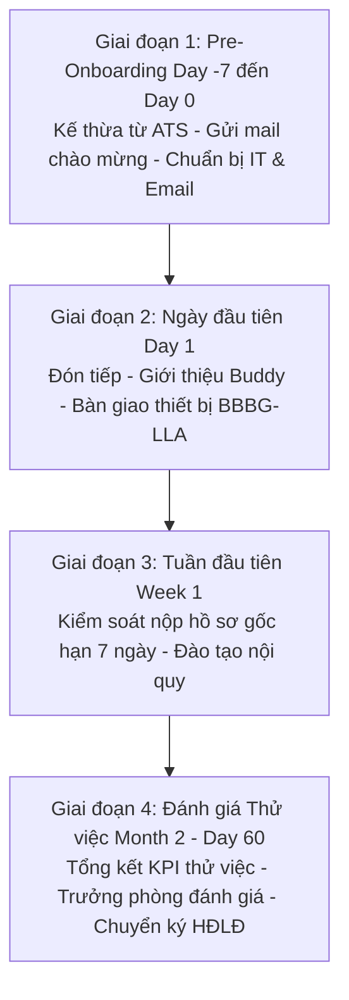

# TÀI LIỆU YÊU CẦU NGHIỆP VỤ (BRD)
## PHÂN HỆ: HỘI NHẬP NHÂN SỰ MỚI & KIỂM SOÁT HỒ SƠ (ONBOARDING LIFECYCLE)

---

### THÔNG TIN TÀI LIỆU
* **Tên tài liệu:** Business Requirements Document (BRD) – Phân hệ Quản trị Vòng đời Hội nhập (Onboarding), Người Đồng hành & Kiểm soát Hồ sơ Nhân sự
* **Mã tài liệu:** `BRD-HRM-MOD-03`
* **Phiên bản:** 1.0 (Chuẩn hóa thực tế vận hành)
* **Ngày cập nhật:** 27/10/2026
* **Tác giả:** Ban Dự án Hệ thống HRM & Chuyên gia Phân tích Nghiệp vụ (BA)
* **Tình trạng:** Chờ Phê duyệt (Pending Approval)

---

### MỤC LỤC
1. [Bảng Giải thích Từ viết tắt & Thuật ngữ Nghiệp vụ](#1-bảng-giải-thích-từ-viết-tắt--thuật-ngữ-nghiệp-vụ)
2. [Tóm tắt Điều hành 3 Chiều (Executive Summary)](#2-tóm-tắt-điều-hành-3-chiều-executive-summary)
3. [Mục tiêu Kinh doanh & Đo lường Thành công](#3-mục-tiêu-kinh-doanh--đo-lường-thành-công)
4. [Phân tích Hiện trạng Vận hành (As-Is vs To-Be)](#4-phân-tích-hiện-trạng-vận-hành-as-is-vs-to-be)
5. [Phạm vi Triển khai & Bản đồ Tích hợp Phân hệ](#5-phạm-vi-triển-khai--bản-đồ-tích-hợp-phân-hệ)
6. [Danh mục Yêu cầu Chức năng & Quy tắc Nghiệp vụ Chi tiết](#6-danh-mục-yêu-cầu-chức-năng--quy-tắc-nghiệp-vụ-chi-tiết)
7. [Giả định, Ràng buộc Nghiệp vụ & Quản trị Rủi ro](#7-giả-định-ràng-buộc-nghiệp-vụ--quản-trị-rủi-ro)
8. [Ma trận Phân quyền RBAC & Thiết kế Giao diện Vận hành](#8-ma-trận-phân-quyền-rbac--thiết-kế-giao-diện-vận-hành)

---

### 1. BẢNG GIẢI THÍCH TỪ VIẾT TẮT & THUẬT NGỮ NGHIỆP VỤ

| Từ viết tắt / Thuật ngữ | Tên tiếng Anh đầy đủ | Giải thích Ý nghĩa Nghiệp vụ Dễ hiểu |
| :--- | :--- | :--- |
| **Onboarding Lifecycle** | Employee Onboarding Lifecycle | Chuỗi quy trình chuẩn bị, tiếp đón, đào tạo nhập môn và đồng hành cùng nhân viên mới từ Day 0 đến hết 60 ngày thử việc. |
| **Pre-Onboarding** | Pre-Onboarding Phase (Day -7 to Day 0) | Giai đoạn chuẩn bị trước ngày đi làm: Gửi thư chào mừng, hướng dẫn hồ sơ pháp lý, tạo email công vụ và cấu hình máy tính. |
| **Buddy / Mentor** | Workplace Buddy / Mentor System | Nhân sự chính thức có kinh nghiệm cùng phòng ban được phân công kèm cặp, giải đáp thắc mắc và hỗ trợ người mới hòa nhập. |
| **Quy định Nộp Hồ sơ gốc** | Hard Copy Document Policy | Quy định về thu thập, kiểm tra tính hợp pháp và lưu trữ hồ sơ nhân sự gốc bản cứng (Hạn mức 7 ngày làm việc). |
| **Khóa Chi trả do Chậm Hồ sơ** | Document Delay Payment Lockout | Chế tài tự động tạm dừng chi trả lương đối với nhân sự chậm nộp hồ sơ pháp lý gốc quá 7 ngày làm việc kể từ ngày vào làm. |
| **Onboarding Kit** | Day 1 Handover Kit (BBBG-LLA) | Trọn bộ công cụ làm việc bàn giao ngày đầu: Máy tính, màn hình, phím chuột, thẻ từ, sổ tay văn hóa và tài khoản hệ thống. |
| **Probation Evaluation** | End of Probation Review | Quy trình đánh giá kết thúc thử việc sau 60 ngày dựa trên tỷ lệ hoàn thành checklist và nhận xét của Trưởng bộ phận. |

---

### 2. TÓM TẮT ĐIỀU HÀNH 3 CHIỀU (EXECUTIVE SUMMARY)

```
       ┌────────────────────────────────────────────────────────┐
       │                TÓM TẮT ĐIỀU HÀNH 3 CHIỀU               │
       └───────────────────────────┬────────────────────────────┘
                                   │
         ┌─────────────────────────┼─────────────────────────┐
         │                         │                         │
         ▼                         ▼                         ▼
┌──────────────────┐      ┌──────────────────┐      ┌──────────────────┐
│ GÓC NHÌN QUẢN TRỊ│      │ GÓC NHÌN PHÁP LÝ │      │ GÓC NHÌN TRẢI    │
│    VÀ VĂN HÓA    │      │(KIỂM SOÁT HỒ SƠ) │      │ NGHIỆM NHÂN VIÊN │
├──────────────────┤      ├──────────────────┤      ├──────────────────┤
│• Tỷ lệ giữ chân  │      │• Thu đủ 100% hồ  │      │• Ấn tượng ngày   │
│  tháng đầu 95%+  │         sơ gốc trong    │         đầu chuyên nghiệp│
│• Mô hình Buddy   │         7 ngày làm việc │• Máy tính & email│
│  kèm cặp 1-1     │      │• Khóa chi trả    │   sẵn sàng trước │
│• Giảm áp lực cho │         lương nếu nợ    │   10:00 sáng Day 1│
│  quản lý bộ phận │         hồ sơ quá hạn   │• Lộ trình rõ ràng│
└──────────────────┘      └──────────────────┘      └──────────────────┘
```

* **Góc nhìn Quản trị & Văn hóa Doanh nghiệp:** Biến trải nghiệm gia nhập công ty thành điểm chạm văn hóa đáng nhớ; thiết lập quy trình kèm cặp 1-1 (Buddy/Mentor), theo dõi sát sao tiến độ hoàn thành các mốc thử việc giúp nhân viên mới nhanh chóng làm quen công việc và giảm thiểu tỷ lệ rời bỏ công ty trong 2 tháng đầu.
* **Góc nhìn Pháp lý & Tuân thủ Hồ sơ (Document Compliance):** Thiết lập kỷ luật thép trong việc hoàn thiện hồ sơ lao động: Bắt buộc thu thập đủ bản công chứng CCCD, bằng cấp, giấy khám sức khỏe và sơ yếu lý lịch trong vòng **07 ngày làm việc**. Tự động hóa chế tài khóa chi trả lương nếu vi phạm hạn định.
* **Góc nhìn Trải nghiệm Nhân viên Mới (New Hire Experience):** Xóa bỏ hoàn toàn cảm giác bỡ ngỡ, chờ đợi; mọi công cụ làm việc (PC, 2 màn hình, email, tài khoản nội bộ) đều được chuẩn bị sẵn sàng trước 10:00 sáng ngày đầu tiên đi làm.

---

### 3. MỤC TIÊU KINH DOANH & ĐO LƯỜNG THÀNH CÔNG

#### 3.1. Mục tiêu Kinh doanh Định lượng
1. **Sẵn sàng thiết bị 100% trước 10:00 sáng Day 1:** Bộ phận IT và Hành chính hoàn tất cấp phát combo máy tính và tài khoản ngay trong buổi sáng đầu tiên.
2. **Tuân thủ hạn định nộp hồ sơ gốc 100% (Hạn định 7 ngày):** 100% nhân viên mới nộp đủ hồ sơ gốc bản cứng trong vòng 7 ngày làm việc kể từ ngày vào làm.
3. **Nâng cao tỷ lệ vượt qua thử việc thành công:** Tăng tỷ lệ nhân sự thử việc đạt yêu cầu ký HĐLĐ chính thức lên trên 90%.
4. **Chuẩn hóa quy trình kèm cặp:** 100% nhân viên mới có Buddy/Mentor đồng hành trong suốt 60 ngày đầu tiên.

#### 3.2. Tiêu chí Đánh giá Thành công (KPI Phân hệ)
* **Tỷ lệ hoàn thành Checklist Onboarding:** `>= 95%`.
* **Tỷ lệ nhân sự bị áp dụng chế tài khóa lương do nợ hồ sơ:** `< 2%`.
* **Điểm đánh giá mức độ hài lòng về trải nghiệm Onboarding:** `>= 4.6 / 5.0`.

---

### 4. PHÂN TÍCH HIỆN TRẠNG VẬN HÀNH (AS-IS VS TO-BE)

| Tiêu chí So sánh | Hiện trạng Thủ công (As-Is) | Hệ thống HRM Tự động hóa (To-Be) |
| :--- | :--- | :--- |
| **Chuẩn bị trước Ngày đi làm** | Đợi nhân viên đến mới thông báo cho IT; IT mất nửa ngày cài đặt máy, nhân viên mới ngồi chờ đợi lãng phí thời gian. | Khu vực `Pre-Onboarding` tự động thông báo trước 3 ngày; IT cấu hình máy tính và tạo tài khoản email sẵn sàng từ trước Day 1. |
| **Phân công Người Hướng dẫn**| Trưởng phòng phân công miệng hoặc không có ai kèm cặp; nhân viên mới tự bơi, khó hòa nhập văn hóa doanh nghiệp. | Bắt buộc chỉ định `Buddy / Mentor` trên hệ thống; Mentor nhận thông báo nhiệm vụ và chịu trách nhiệm đánh giá tiến độ hàng tuần. |
| **Theo dõi Danh mục Công việc** | Đưa một tờ giấy A4 in checklist; nhân sự làm mất hoặc quên đánh dấu; HR không nắm được ai đã hoàn thành những gì. | Checklist số hóa 4 giai đoạn trực quan trên phần mềm; hỗ trợ checkbox real-time và hiển thị thanh tiến trình % hoàn thành. |
| **Thu thập Hồ sơ Pháp lý Gốc**| Nhân viên khất nợ nộp bằng cấp, CCCD công chứng hàng tháng trời; khi thanh tra lao động mới tá hỏa thiếu hồ sơ. | **Chế tài tự động**: Đếm ngược 7 ngày; cảnh báo vàng lúc 5 ngày; tự động gắn cờ đỏ khóa chi trả lương nếu quá 7 ngày. |
| **Đánh giá Hết hạn Thử việc** | Nhớ mang máng ngày hết hạn; thường bị trễ hạn thông báo kết quả thử việc theo quy định tại Điều 27 BLLĐ 2019. | Tự động cảnh báo trước 15 ngày kết thúc 60 ngày thử việc; tổng hợp điểm checklist làm căn cứ ký kết HĐLĐ chính thức. |

---

### 5. PHẠM VI TRIỂN KHAI & BẢN ĐỒ TÍCH HỢP PHÂN HỆ

#### 5.1. Trục Tiến Trình 4 Giai Đoạn Hội Nhập (Onboarding Lifecycle Roadmap)



#### 5.2. Các Thực thể Dữ liệu Trọng yếu
1. **`OnboardingTask`:** Danh mục nhiệm vụ hội nhập (`id`, `employeeId`, `taskName`, `category`: PRE_DAY0, DAY1, WEEK1, MONTH2, CONTRACT, `isCompleted`, `completedAt`).
2. **`Employee`:** Nhân sự trong giai đoạn hội nhập (`status: ONBOARDING`, `joinDate`, `mentorId`).
3. **`AssetAssignment`:** Biên bản bàn giao thiết bị làm việc đồng bộ ngay trong Day 1.
4. **`PayslipDetail`:** Tích hợp bản ghi khóa chi trả lương `PAYMENT_HOLD` nếu chậm nộp hồ sơ gốc quá 7 ngày.

---

### 6. DANH MỤC YÊU CẦU CHỨC NĂNG & QUY TẮC NGHIỆP VỤ CHI TIẾT

#### BR-ONB-01: Tự động Sinh Danh mục Nhiệm vụ Hội nhập 4 Mốc Chuẩn
* **Mã quy tắc:** `BR-ONB-01`
* **Mô tả:** Ngay khi ứng viên được chuyển sang trạng thái `ONBOARDING`, hệ thống tự động sinh bộ checklist gồm 4 giai đoạn chuẩn:
  1. **Day 0 (Pre-Onboarding):** Khởi tạo email công vụ, cài đặt cấu hình máy tính, tạo tài khoản Slack/Git, chỉ định Buddy.
  2. **Day 1 (Ngày nhận việc):** Đón tiếp, tham quan văn phòng, ký Biên bản bàn giao tài sản `BBBG-LLA`, giới thiệu phòng ban.
  3. **Week 1 (Tuần đầu tiên):** Thu đủ hồ sơ gốc công chứng (Hạn 7 ngày), đào tạo nội quy lao động và quy trình bảo mật thông tin.
  4. **Month 2 (Kết thúc thử việc):** Đánh giá hiệu suất thử việc, phỏng vấn thử việc và trình phê duyệt HĐLĐ chính thức.

#### BR-ONB-02: Bắt buộc Phân công Người Đồng hành (Buddy / Mentor Rule)
* **Mã quy tắc:** `BR-ONB-02`
* **Quy tắc:** Hệ thống không cho phép lưu hoàn tất giai đoạn Day 0 nếu trường `mentorId` còn để trống.
* **Điều kiện người làm Mentor:** Bắt buộc phải là nhân viên chính thức (`status === 'ACTIVE'`), cùng phòng ban hoặc phòng ban liên quan trực tiếp, có thâm niên công tác từ 6 tháng trở lên.

#### BR-ONB-03: Đồng bộ Bàn giao Thiết bị Day 1 (Asset Handover Sync)
* **Mã quy tắc:** `BR-ONB-03`
* **Hành vi hệ thống:** Giai đoạn Day 1 tích hợp trực tiếp sang Phân hệ Quản lý Tài sản. Nhiệm vụ *"Ký biên bản bàn giao tài sản thiết bị làm việc"* chỉ được tự động đánh dấu hoàn thành (`isCompleted = true`) khi đã phát sinh bản ghi `AssetAssignment` trạng thái `ACTIVE` của nhân viên đó.

#### BR-ONB-04: Kiểm soát Hạn định 7 Ngày Nộp Hồ sơ Gốc & Khóa Chi trả Lương
* **Mã quy tắc:** `BR-ONB-04`
* **Căn cứ nghiệp vụ:** Quy định lưu trữ hồ sơ lao động doanh nghiệp và tiêu chuẩn tuân thủ pháp lý.
* **Logic kiểm soát thời gian:**
  $$\text{Số ngày công tác} = \left\lfloor \frac{\text{Thời điểm hiện tại} - \text{Employee.joinDate}}{1000 \times 60 \times 60 \times 24} \right\rfloor$$
  * **Trường hợp 1 (Ngày 1 đến Ngày 5):** Cờ trạng thái bình thường (Xanh lá).
  * **Trường hợp 2 (Ngày 6 đến Ngày 7):** Cờ cảnh báo màu vàng: *"Sắp hết hạn nộp hồ sơ gốc bản cứng (Còn X ngày)"*.
  * **Trường hợp 3 ($\text{Số ngày} > 7$ và còn nhiệm vụ hồ sơ chưa xong):**
    * Tự động bật cờ đỏ: `isPaymentLocked = true`.
    * Lý do hiển thị: *"Chậm nộp hồ sơ gốc quá X ngày (Vượt hạn định 7 ngày)"*.
    * Gửi cảnh báo tức thì tới màn hình tính lương của Kế toán để chặn chuyển khoản lương.

#### BR-ONB-05: Đánh giá Hoàn tất Thử việc & Chuyển Hợp đồng Chính thức
* **Mã quy tắc:** `BR-ONB-05`
* **Điều kiện phê duyệt HĐLĐ chính thức:**
  1. Tỷ lệ hoàn thành toàn bộ Checklist Onboarding đạt $\ge 90\%$.
  2. Bắt buộc 100% nhiệm vụ thuộc nhóm hồ sơ pháp lý (`CONTRACT`) đã hoàn thành.
  3. Có nhận xét đánh giá đạt (`PASS`) của Trưởng bộ phận phụ trách.
  4. Hệ thống tự động chuyển trạng thái nhân viên từ `ONBOARDING` $\rightarrow$ `ACTIVE` và kích hoạt luồng ký Hợp đồng lao động xác định thời hạn tại Phân hệ Hợp đồng.

---

### 7. GIẢ ĐỊNH, RÀNG BUỘC NGHIỆP VỤ & QUẢN TRỊ RỦI RO

#### 7.1. Giả định Nghiệp vụ
* Ứng viên khi nhận việc cam kết nộp bản công chứng các giấy tờ tùy thân theo đúng thời hạn quy định trong Thư mời nhận việc.
* Bộ phận IT luôn có sẵn lượng máy tính tồn kho khả dụng (`AVAILABLE`) để cấp phát kịp thời.

#### 7.2. Ràng buộc An toàn & Quyền hạn
* Chỉ HR Manager và Kế toán mới có quyền thực hiện mở khóa chi trả lương (`toggle-payment-hold`) sau khi HR đã tận tay kiểm tra hồ sơ gốc bản cứng hợp lệ.
* Mọi thao tác tích chọn hoặc hủy chọn hoàn thành nhiệm vụ đều được ghi nhận danh tính người thực hiện.

#### 7.3. Ma trận Rủi ro & Phương án Kiểm soát

| STT | Rủi ro Hội nhập | Mức độ | Biện pháp Kiểm soát & Chốt chặn Kỹ thuật |
| :---: | :--- | :---: | :--- |
| 1 | Nhân viên không nộp hồ sơ gốc, nghỉ ngang mang theo tài sản | Rất cao | Áp dụng chế tài khóa chi trả lương kết hợp Hard Lock tài sản ở module Offboarding. |
| 2 | Nhân viên mới đến không có máy tính làm việc | Cao | Cảnh báo trước 3 ngày tại Pre-Onboarding Hub cho bộ phận IT chuẩn bị thiết bị. |
| 3 | Mentor bỏ bê không hướng dẫn nhân sự mới | Trung bình | Định kỳ 2 tuần hệ thống gửi thông báo nhắc nhở Mentor và Trưởng bộ phận kiểm tra tiến độ checklist. |

---

### 8. MA TRẬN PHÂN QUYỀN RBAC & THIẾT KẾ GIAO DIỆN VẬN HÀNH

#### 8.1. Ma trận Phân quyền Chức năng (RBAC)

| Chức năng Phân hệ | Super Admin | HR Manager | Chuyên viên HR | Buddy / Mentor | Nhân viên mới |
| :--- | :---: | :---: | :---: | :---: | :---: |
| **Quản lý Pre-Onboarding Hub** | Full | Full | Full | Xem người mình kèm | Không |
| **Chỉ định Buddy / Mentor** | Full | Full | Full | Không | Không |
| **Đánh dấu hoàn thành Checklist** | Full | Full | Full | Đánh dấu khối môn | Tự tích việc cá nhân |
| **Mở khóa chi trả lương** | Full | Full | Đề xuất | Không | Không |
| **Đánh giá Hết hạn Thử việc** | Full | Full | Tổng hợp | Đánh giá chuyên môn| Không |

#### 8.2. Thiết kế Giao diện Vận hành (UI/UX Specifications)
1. **Màn hình Tổng quan Tiến trình Hội nhập (`/internal/onboarding/overview`):**
   * Thanh Header: 4 Thẻ KPI (Tổng nhân sự đang Onboard, Đã nộp đủ hồ sơ, Đang nợ hồ sơ cảnh báo vàng, Đã bị khóa chi trả cờ đỏ).
   * Bảng danh sách nhân sự mới: Mã NV, Họ tên, Vị trí, Phòng ban, Buddy/Mentor, Ngày vào làm, Tiến độ Checklist (Thanh Progress bar %), Cờ trạng thái hồ sơ, Nút xem chi tiết.
2. **Màn hình Chi tiết Checklist Nhân sự Mới (`/internal/onboarding/tasks/:employeeId`):**
   * Thông tin nhân sự: Ảnh đại diện, Họ tên, Người hướng dẫn, Số ngày công tác.
   * Danh sách 4 Tabs theo mốc thời gian: "Day 0", "Day 1", "Week 1", "Month 2".
   * Danh sách đầu việc có Checkbox tương tác thời gian thực: Tên việc, Khối phụ trách, Trạng thái (Đã xong / Chưa xong), Ngày hoàn thành.
   * Khối cảnh báo Kiểm soát hồ sơ: Hiển thị đếm ngược số ngày nộp hồ sơ gốc, kèm nút *"Mở khóa thanh toán lương (HR xác nhận đã thu đủ)"*.
