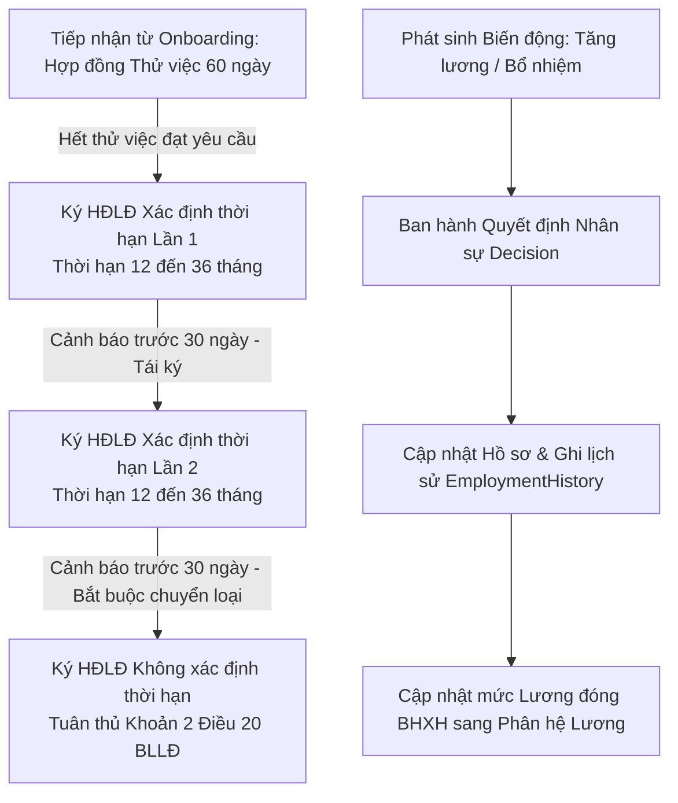

# TÀI LIỆU YÊU CẦU NGHIỆP VỤ (BRD)
## PHÂN HỆ: HỒ SƠ NHÂN SỰ 360°, QUYẾT ĐỊNH & HỢP ĐỒNG LAO ĐỘNG (CORE HR & CONTRACTS)

---

### THÔNG TIN TÀI LIỆU
* **Tên tài liệu:** Business Requirements Document (BRD) – Phân hệ Hồ sơ Nhân sự 360°, Hợp đồng Lao động (Điều 20 BLLĐ) & Quyết định Nhân sự Pháp quy
* **Mã tài liệu:** `BRD-HRM-MOD-04`
* **Phiên bản:** 1.0 (Chuẩn hóa thực tế vận hành)
* **Ngày cập nhật:** 27/10/2026
* **Tác giả:** Ban Dự án Hệ thống HRM & Chuyên gia Phân tích Nghiệp vụ (BA)
* **Tình trạng:** Chờ Phê duyệt (Pending Approval)

---

### MỤC LỤC
1. [Bảng Giải thích Từ viết tắt & Thuật ngữ Nghiệp vụ](#1-bảng-giải-thích-từ-viết-tắt--thuật-ngữ-nghiệp-vụ)
2. [Tóm tắt Điều hành 3 Chiều (Executive Summary)](#2-tóm-tắt-điều-hành-3-chiều-executive-summary)
3. [Mục tiêu Kinh doanh & Đo lường Thành công](#3-mục-tiêu-kinh-doanh--đo-lường-thành-công)
4. [Phân tích Hiện trạng Vận hành (As-Is vs To-Be)](#4-phân-tích-hiện-trạng-vận-hành-as-is-vs-to-be)
5. [Phạm vi Triển khai & Bản đồ Tích hợp Phân hệ](#5-phạm-vi-triển-khai--bản-đồ-tích-hợp-phân-hệ)
6. [Danh mục Yêu cầu Chức năng & Quy tắc Nghiệp vụ Chi tiết](#6-danh-mục-yêu-cầu-chức-năng--quy-tắc-nghiệp-vụ-chi-tiết)
7. [Giả định, Ràng buộc Nghiệp vụ & Quản trị Rủi ro](#7-giả-định-ràng-buộc-nghiệp-vụ--quản-trị-rủi-ro)
8. [Ma trận Phân quyền RBAC & Thiết kế Giao diện Vận hành](#8-ma-trận-phân-quyền-rbac--thiết-kế-giao-diện-vận-hành)

---

### 1. BẢNG GIẢI THÍCH TỪ VIẾT TẮT & THUẬT NGỮ NGHIỆP VỤ

| Từ viết tắt / Thuật ngữ | Tên tiếng Anh đầy đủ | Giải thích Ý nghĩa Nghiệp vụ Dễ hiểu |
| :--- | :--- | :--- |
| **Employee 360° Profile**| Employee 360 Degree Comprehensive Profile | Hồ sơ nhân sự toàn diện: Định danh pháp lý (CCCD), BHXH, Thuế TNCN, Thông tin công tác, Hợp đồng và Tài sản đang giữ. |
| **BLLĐ 2019** | 2019 Vietnam Labour Code (Law No. 45/2019/QH14) | Bộ luật Lao động số 45/2019/QH14 điều chỉnh quan hệ lao động, loại hợp đồng, quyền và nghĩa vụ của các bên. |
| **Article 20 Compliance**| Article 20 Labour Contract Classification Rule | Quy chuẩn Điều 20 BLLĐ 2019: Chỉ tồn tại 2 loại HĐLĐ (Xác định thời hạn tối đa 36 tháng, ký tối đa 2 lần; và Không xác định thời hạn). |
| **Contract Expiry Alert** | Automated Contract Expiry Warning Cron | Cơ chế cảnh báo sớm tự động trước 30 ngày, 15 ngày và 7 ngày trước khi HĐLĐ hết hạn để thực hiện thủ tục tái ký hoặc chấm dứt. |
| **HR Decision** | Formal Executive HR Decision | Văn bản pháp quy của Tổng Giám đốc: Tiếp nhận chính thức, Bổ nhiệm, Miễn nhiệm, Điều chuyển, Tăng lương, Khen thưởng, Kỷ luật. |
| **Dependent Relative** | Dependent Relative for PIT Relief | Thân nhân (con cái, cha mẹ già) có mã số thuế hợp lệ được khai báo để giảm trừ gia cảnh thuế TNCN (4.400.000 VNĐ/người/tháng). |
| **Employment History** | Historical Career & Transfer Log | Nhật ký ghi vết bất biến toàn bộ các biến động chức danh, phòng ban và mức lương trong suốt quá trình làm việc của nhân sự. |

---

### 2. TÓM TẮT ĐIỀU HÀNH 3 CHIỀU (EXECUTIVE SUMMARY)

```
       ┌────────────────────────────────────────────────────────┐
       │                TÓM TẮT ĐIỀU HÀNH 3 CHIỀU               │
       └───────────────────────────┬────────────────────────────┘
                                   │
         ┌─────────────────────────┼─────────────────────────┐
         │                         │                         │
         ▼                         ▼                         ▼
┌──────────────────┐      ┌──────────────────┐      ┌──────────────────┐
│ GÓC NHÌN QUẢN TRỊ│      │ GÓC NHÌN PHÁP LÝ │      │ GÓC NHÌN BẢO MẬT │
│   & NGUỒN LỰC    │      │  (ĐIỀU 20 BLLĐ)  │      │   & MINH BẠCH    │
├──────────────────┤      ├──────────────────┤      ├──────────────────┤
│• Quản lý 360°    │      │• Tuân thủ tuyệt  │      │• Bảo vệ thông tin│
│  vòng đời nhân sự│         đối Điều 20     │         PII, CCCD, Bank │
│• Cảnh báo hạn hợp│      │• HĐLĐ ký tối đa  │• Lưu vết lịch sử │
│  đồng tự động    │         2 lần xác định  │   công tác và    │
│• Quyết định pháp │      │• Không bỏ quên   │   quyết định lương│
│  quy chặt chẽ    │         hạn tái ký HĐLĐ │• Tra cứu minh bạch│
└──────────────────┘      └──────────────────┘      └──────────────────┘
```

* **Góc nhìn Quản trị & Tối ưu Nguồn lực:** Phân hệ Hồ sơ & Hợp đồng là trái tim của hệ sinh thái HRM; số hóa toàn diện bức tranh nhân sự 360 độ từ ngày đầu nhận việc đến khi thôi việc; tích hợp thông tin chức danh, phòng ban, lương thưởng và danh mục tài sản thiết bị đang nắm giữ ngay trên một màn hình quản trị duy nhất.
* **Góc nhìn Pháp lý & Tuân thủ Luật Lao động (Điều 20 BLLĐ 2019):** Chấm dứt hoàn toàn các rủi ro pháp lý về tranh chấp hợp đồng lao động: Tự động kiểm soát số lần ký HĐLĐ xác định thời hạn (tối đa 2 lần, lần thứ 3 tự động chuyển thành không xác định thời hạn); hệ thống cảnh báo sớm 30 - 15 - 7 ngày giúp HR luôn chủ động tái ký hoặc ra thông báo không tái ký đúng hạn luật định.
* **Góc nhìn Bảo vệ Dữ liệu Cá nhân & Minh bạch Nội bộ:** Quản trị an toàn thông tin định danh (CCCD, Số sổ BHXH, Mã số thuế, Tài khoản ngân hàng, Thông tin người phụ thuộc) theo Nghị định 13/2023/NĐ-CP; đồng thời ghi nhận đầy đủ các Quyết định nhân sự chính thức làm cơ sở pháp lý cho các kỳ nâng lương và điều chuyển.

---

### 3. MỤC TIÊU KINH DOANH & ĐO LƯỜNG THÀNH CÔNG

#### 3.1. Mục tiêu Kinh doanh Định lượng
1. **Tuân thủ 100% Bộ luật Lao động 2019:** Không để xảy ra bất kỳ trường hợp hợp đồng lao động bị quá hạn mà không có quyết định gia hạn hoặc thanh lý hợp pháp.
2. **Số hóa 100% hồ sơ nhân viên:** Toàn bộ thông tin thân nhân, quá trình công tác, bằng cấp và phụ lục hợp đồng được lưu trữ điện tử, giảm 90% thời gian tra cứu hồ sơ giấy.
3. **Chuẩn hóa mã định danh nhân viên:** 100% nhân sự được cấp Mã nhân viên duy nhất theo quy tắc tự động `EMP{YYYY}{SEQUENCE}` không trùng lặp và không thể sửa đổi tùy tiện.
4. **Pháp chế hóa mọi thay đổi đãi ngộ:** 100% các điều chỉnh về mức lương cơ bản hoặc thăng chức đều bắt buộc phải liên kết với một Quyết định nhân sự có hiệu lực pháp lý.

#### 3.2. Tiêu chí Đánh giá Thành công (KPI Phân hệ)
* **Tỷ lệ Hợp đồng Lao động được xử lý tái ký đúng hạn:** `100%`.
* **Số vụ việc khiếu nại hoặc xử phạt hành chính về vi phạm thời hạn hợp đồng:** `0`.
* **Thời gian trích xuất thông tin hồ sơ nhân sự phục vụ thanh tra, kiểm toán:** `< 30 giây`.

---

### 4. PHÂN TÍCH HIỆN TRẠNG VẬN HÀNH (AS-IS VS TO-BE)

| Tiêu chí So sánh | Hiện trạng Thủ công (As-Is) | Hệ thống HRM Tự động hóa (To-Be) |
| :--- | :--- | :--- |
| **Quản trị Hồ sơ Nhân sự** | Hồ sơ giấy lưu trong các bìa còng; khi cần kiểm tra bằng cấp hoặc hợp đồng phải mở kho lục tìm, dễ thất lạc. | Hồ sơ điện tử 360°; tra cứu tức thì theo mã, tên, phòng ban; xem trực tiếp hợp đồng PDF, ảnh thẻ, người phụ thuộc và tài sản đang giữ. |
| **Theo dõi Hạn Hợp đồng** | Ghi chú trên file Excel; HR hay quên kiểm tra, dẫn đến việc HĐLĐ hết hạn mà không biết, tự động chuyển thành vô hạn định ngoài ý muốn. | Hệ thống quét tự động mỗi ngày; hiển thị danh sách cảnh báo đỏ (dưới 7 ngày), vàng (dưới 15 ngày) và gửi thông báo nhắc việc cho HR trước 30 ngày. |
| **Chu kỳ Ký HĐLĐ (Điều 20)**| Ký nhiều lần HĐ xác định thời hạn 1 năm do không nhớ lịch sử; vi phạm Điều 20 BLLĐ 2019 và bị cơ quan thanh tra xử phạt. | Hệ thống đếm số lần ký: Sau khi ký 02 lần HĐ xác định thời hạn, hệ thống khóa không cho chọn loại này nữa mà bắt buộc chọn HĐ Không xác định thời hạn. |
| **Thay đổi Chức danh & Lương** | Trao đổi miệng hoặc nhắn tin chat; kế toán tự gõ lương mới; không có căn cứ văn bản lưu trữ khi có tranh chấp. | Bắt buộc khởi tạo và phê duyệt Quyết định Nhân sự (`Decision`); hệ thống tự động ghi nhật ký công tác (`EmploymentHistory`) và cập nhật bảng lương. |

---

### 5. PHẠM VI TRIỂN KHAI & BẢN ĐỒ TÍCH HỢP PHÂN HỆ

#### 5.1. Vòng Đời Quản Trị Hợp Đồng & Biến Động Nhân Sự



#### 5.2. Các Thực thể Dữ liệu Trọng yếu
1. **`Employee`:** Hồ sơ nhân sự (`id`, `code`, `fullName`, `email`, `phone`, `idNumber`, `idIssueDate`, `idIssuePlace`, `taxCode`, `socialInsuranceNo`, `status`: ONBOARDING, ACTIVE, PROBATION, RESIGNED, `joinDate`, `departmentId`, `positionId`).
2. **`Contract`:** Hợp đồng lao động (`id`, `contractNo`, `employeeId`, `contractType`: PROBATION, DEFINITE_TERM, INDEFINITE_TERM, `startDate`, `endDate`, `baseSalary`, `insuranceSalary`, `allowances`, `status`: ACTIVE, EXPIRED, TERMINATED).
3. **`Decision`:** Quyết định nhân sự (`id`, `decisionNo`, `employeeId`, `type`: APPOINTMENT, PROMOTION, SALARY_INCREASE, DISCIPLINE, TERMINATION, `effectiveDate`, `content`).
4. **`EmploymentHistory`:** Lịch sử công tác (`id`, `employeeId`, `departmentId`, `positionId`, `changeReason`, `effectiveDate`).
5. **`Relative`:** Thân nhân & Người phụ thuộc (`id`, `employeeId`, `fullName`, `relationship`, `idNumber`, `taxCode`, `isDependent`).

---

### 6. DANH MỤC YÊU CẦU CHỨC NĂNG & QUY TẮC NGHIỆP VỤ CHI TIẾT

#### BR-EMP-01: Quy tắc Tự động Sinh Mã Nhân viên Chuẩn hóa (Auto Employee Code)
* **Mã quy tắc:** `BR-EMP-01`
* **Công thức tạo mã:**
  $$\text{Employee.code} = \text{"EMP"} + \text{YYYY} + \text{SEQUENCE}(0001 \rightarrow 9999)$$
* **Ví dụ:** Nhân sự gia nhập năm 2026 sẽ có mã: `EMP20260001`, `EMP20260002`...
* **Tính toàn vẹn:** Mã nhân viên là duy nhất và bất biến (Immutable); một khi đã được cấp phát và phát sinh dữ liệu chấm công, hợp đồng hay tài sản thì cấm tuyệt đối chỉnh sửa.

#### BR-EMP-02: Quy chuẩn Ký Hợp đồng Lao động theo Điều 20 Bộ luật Lao động 2019
* **Mã quy tắc:** `BR-EMP-02`
* **Căn cứ pháp lý:** Điều 20 BLLĐ 2019 về loại hợp đồng lao động:
  1. **Hợp đồng Thử việc (PROBATION):** Thời hạn tối đa không quá **60 ngày** đối với chức danh chuyên môn kỹ thuật, cao đẳng trở lên; không quá **30 ngày** đối với công việc khác.
  2. **HĐLĐ Xác định thời hạn (DEFINITE_TERM):** Thời hạn từ **12 tháng đến 36 tháng**. Doanh nghiệp chỉ được ký tối đa **02 lần** loại hợp đồng này với cùng một người lao động.
  3. **HĐLĐ Không xác định thời hạn (INDEFINITE_TERM):** Bắt buộc phải áp dụng từ lần ký thứ 3 trở đi nếu người lao động tiếp tục làm việc tại công ty.
* **Hành vi hệ thống:** Khi tạo hợp đồng mới, hệ thống tự động đếm số lượng hợp đồng `DEFINITE_TERM` trước đó của nhân viên. Nếu đã đạt con số 2, hệ thống tự động vô hiệu hóa lựa chọn "Xác định thời hạn" và bắt buộc chọn "Không xác định thời hạn".

#### BR-EMP-03: Cơ chế Tự động Quét & Cảnh báo Hết hạn Hợp đồng (Expiry Alert Cron)
* **Mã quy tắc:** `BR-EMP-03`
* **Mô tả:** Hệ thống chạy tiến trình kiểm tra tự động hàng ngày (Scheduled Cron Job) so sánh ngày hiện tại với `Contract.endDate`:
  * **Cảnh báo trước 30 ngày:** Gắn nhãn màu vàng và gửi email thông báo nhắc việc tới HR Manager để thực hiện đánh giá tái ký.
  * **Cảnh báo trước 15 ngày:** Gửi thông báo nhắc lần 2 tới Trưởng phòng ban quản lý trực tiếp.
  * **Cảnh báo khẩn cấp trước 7 ngày:** Gắn cờ nhấp nháy đỏ trên Dashboard quản trị nếu chưa có hợp đồng mới hoặc quyết định thôi việc được khởi tạo.

#### BR-EMP-04: Ràng buộc Ban hành Quyết định Nhân sự Pháp quy
* **Mã quy tắc:** `BR-EMP-04`
* **Mô tả:** Mọi thay đổi về:
  1. Chức danh công việc (`positionId`)
  2. Phòng ban trực thuộc (`departmentId`)
  3. Mức lương cơ bản (`baseSalary`)
* Bắt buộc phải gắn liền với một Số Quyết định nhân sự (`Decision.decisionNo`) được duyệt bởi Ban Giám Đốc. Hệ thống tự động ghi một bản ghi vào bảng `EmploymentHistory` để lưu vết lịch sử công tác vĩnh viễn.

#### BR-EMP-05: Khai báo Thân nhân & Giảm trừ Gia cảnh Người phụ thuộc
* **Mã quy tắc:** `BR-EMP-05`
* **Mô tả:** Thông tin thân nhân được khai báo tại bảng `Relative`. Để được tính giảm trừ thuế TNCN:
  * Trường `isDependent` phải được gán giá trị `true`.
  * Bắt buộc phải nhập Số CCCD/Giấy khai sinh và Mã số thuế người phụ thuộc hợp lệ.
* Dữ liệu này được Phân hệ Tính lương (`Payroll`) tự động đọc để nhân với định mức 4.400.000 VNĐ/người/tháng theo quy định của Luật Thuế TNCN.

---

### 7. GIẢ ĐỊNH, RÀNG BUỘC NGHIỆP VỤ & QUẢN TRỊ RỦI RO

#### 7.1. Giả định Nghiệp vụ
* Người lao động cung cấp thông tin định danh pháp lý chính xác (Số CCCD 12 số, Mã số thuế cá nhân, Số sổ BHXH).
* Toàn bộ Hợp đồng Lao động bản giấy sau khi hai bên ký đóng dấu được HR scan và đính kèm file PDF vào hợp đồng điện tử trên hệ thống.

#### 7.2. Ràng buộc Bảo mật Dữ liệu Nhạy cảm (PII Protection)
* Toàn bộ dữ liệu về Số CMND/CCCD, Số tài khoản ngân hàng và Chi tiết mức lương là thông tin bảo mật cấp độ cao theo Nghị định 13/2023/NĐ-CP.
* Nhân viên bình thường chỉ được xem hồ sơ của chính mình qua Cổng ESS; chỉ có HR Manager, Kế toán và Ban Giám Đốc mới có quyền xem thông tin lương và hồ sơ toàn công ty.

#### 7.3. Ma trận Rủi ro & Phương án Kiểm soát

| STT | Rủi ro Hồ sơ & Pháp lý | Mức độ | Biện pháp Kiểm soát & Chốt chặn Kỹ thuật |
| :---: | :--- | :---: | :--- |
| 1 | Ký quá 2 lần HĐ xác định thời hạn vi phạm luật | Nghiêm trọng | Hệ thống tự động đếm số lần ký và khóa lựa chọn theo đúng quy tắc `BR-EMP-02`. |
| 2 | Quên hạn hợp đồng dẫn đến chuyển thành vô thời hạn | Rất cao | Quy trình cảnh báo 3 cấp độ (30 - 15 - 7 ngày) hiển thị nổi bật trên thanh tác vụ của HR. |
| 3 | Tự ý nâng lương không có quyết định phê duyệt | Nghiêm trọng | Chặn cập nhật trường `baseSalary` nếu không có bản ghi `Decision` đi kèm (`BR-EMP-04`). |

---

### 8. MA TRẬN PHÂN QUYỀN RBAC & THIẾT KẾ GIAO DIỆN VẬN HÀNH

#### 8.1. Ma trận Phân quyền Chức năng (RBAC)

| Chức năng Phân hệ | Super Admin | HR Manager | Chuyên viên HR | Quản lý bộ phận | Nhân viên (ESS) |
| :--- | :---: | :---: | :---: | :---: | :---: |
| **Xem Danh sách Nhân sự Toàn công ty**| Full | Full | Full | Theo bộ phận | Không |
| **Xem Hồ sơ Chi tiết & Mức lương** | Full | Full | Hạn chế | Xem chuyên môn | Chỉ xem bản thân |
| **Lập & Phê duyệt Hợp đồng Lao động**| Full | Full | Soạn nháp | Không | Ký điện tử |
| **Ban hành Quyết định Nhân sự** | Full | Full | Soạn nháp | Không | Không |
| **Khai báo Người phụ thuộc Thuế** | Full | Full | Nhập liệu | Không | Đề xuất |
| **Xem Tab Tài sản đang giữ** | Full | Full | Full | Xem bộ phận | Chỉ xem bản thân |

#### 8.2. Thiết kế Giao diện Vận hành (UI/UX Specifications)
1. **Màn hình Danh sách Nhân sự Toàn diện (`/internal/employees`):**
   * Thanh công cụ: Thanh tìm kiếm nhanh (Tên, Mã NV, Email), Bộ lọc theo Phòng ban, Chức vụ, Trạng thái làm việc (Onboarding, Active, Resigned) và Nút "Thêm nhân viên mới".
   * Thẻ KPI trên cùng: Tổng nhân sự, Nhân viên chính thức, Đang thử việc, Sắp hết hạn hợp đồng trong 30 ngày.
   * Bảng dữ liệu Grid: Mã NV, Họ tên kèm Avatar, Phòng ban, Vị trí, Loại hợp đồng hiện tại, Ngày vào làm, Trạng thái (Huy hiệu màu sắc), Nút xem hồ sơ 360°.
2. **Màn hình Hồ sơ Nhân sự 360° (`/internal/employees/:id`):**
   * Khối Header: Ảnh đại diện lớn, Họ tên, Mã nhân viên, Chức danh, Phòng ban, Trạng thái hoạt động và các nút hành động nhanh (Sửa hồ sơ, In hồ sơ, Ban hành quyết định).
   * Hệ thống 5 Tabs nghiệp vụ:
     * **Tab 1: Thông tin cá nhân & Định danh** (CCCD, Ngày sinh, Giới tính, Quê quán, Địa chỉ thường trú, MST, Số sổ BHXH, Tài khoản ngân hàng).
     * **Tab 2: Hợp đồng Lao động** (Danh sách hợp đồng qua các thời kỳ, Thời hạn, Mức lương cơ sở, Phụ cấp, File PDF đính kèm).
     * **Tab 3: Quyết định & Quá trình công tác** (Lịch sử bổ nhiệm, tăng lương, điều chuyển có số quyết định kèm theo).
     * **Tab 4: Người phụ thuộc & Thân nhân** (Danh sách thân nhân, Người phụ thuộc giảm trừ gia cảnh, Mối quan hệ).
     * **Tab 5: Tài sản đang nắm giữ** (Hiển thị danh mục máy tính, màn hình, thẻ từ đang giữ từ Phân hệ Tài sản mà không cần chuyển màn hình).
3. **Màn hình Quản lý Hợp đồng Lao động (`/internal/contracts`):**
   * Bảng quản trị hợp đồng toàn công ty kèm bộ lọc trạng thái (Đang hiệu lực / Sắp hết hạn / Đã hết hạn / Đã thanh lý).
   * Modal tạo hợp đồng: Nhập số HĐ, Chọn loại hợp đồng (áp dụng logic Điều 20), Ngày bắt đầu, Ngày kết thúc, Mức lương cơ sở, Mức lương đóng BHXH và Tải lên file scan PDF.
