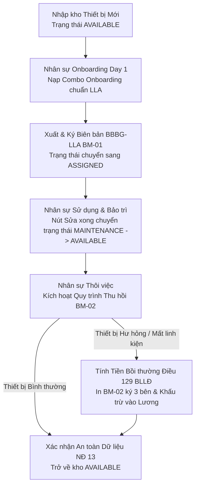

# TÀI LIỆU YÊU CẦU NGHIỆP VỤ (BRD)
## PHÂN HỆ: QUẢN LÝ KHO & BÀN GIAO TÀI SẢN THIẾT BỊ (ASSET MANAGEMENT & HANDOVER)

---

### THÔNG TIN TÀI LIỆU
* **Tên tài liệu:** Business Requirements Document (BRD) – Phân hệ Quản lý Kho Thiết bị, Bàn giao Onboarding (BM-01 BBBG-LLA) & Thu hồi Bồi thường (BM-02)
* **Mã tài liệu:** `BRD-HRM-MOD-05`
* **Phiên bản:** 1.0 (Chuẩn hóa thực tế vận hành)
* **Ngày cập nhật:** 27/10/2026
* **Tác giả:** Ban Dự án Hệ thống HRM & Chuyên gia Phân tích Nghiệp vụ (BA)
* **Tình trạng:** Chờ Phê duyệt (Pending Approval)

---

### MỤC LỤC
1. [Bảng Giải thích Từ viết tắt & Thuật ngữ Nghiệp vụ](#1-bảng-giải-thích-từ-viết-tắt--thuật-ngữ-nghiệp-vụ)
2. [Tóm tắt Điều hành 3 Chiều (Executive Summary)](#2-tóm-tắt-điều-hành-3-chiều-executive-summary)
3. [Mục tiêu Kinh doanh & Đo lường Thành công](#3-mục-tiêu-kinh-doanh--đo-lường-thành-công)
4. [Phân tích Hiện trạng Vận hành (As-Is vs To-Be)](#4-phân-tích-hiện-trạng-vận-hành-as-is-vs-to-be)
5. [Phạm vi Triển khai & Bản đồ Tích hợp Phân hệ](#5-phạm-vi-triển-khai--bản-đồ-tích-hợp-phân-hệ)
6. [Danh mục Yêu cầu Chức năng & Quy tắc Nghiệp vụ Chi tiết](#6-danh-mục-yêu-cầu-chức-năng--quy-tắc-nghiệp-vụ-chi-tiết)
7. [Giả định, Ràng buộc Nghiệp vụ & Quản trị Rủi ro](#7-giả-định-ràng-buộc-nghiệp-vụ--quản-trị-rủi-ro)
8. [Ma trận Phân quyền RBAC & Thiết kế Giao diện Vận hành](#8-ma-trận-phân-quyền-rbac--thiết-kế-giao-diện-vận-hành)

---

### 1. BẢNG GIẢI THÍCH TỪ VIẾT TẮT & THUẬT NGỮ NGHIỆP VỤ

| Từ viết tắt / Thuật ngữ | Tên tiếng Anh đầy đủ | Giải thích Ý nghĩa Nghiệp vụ Dễ hiểu |
| :--- | :--- | :--- |
| **Serialized Asset** | Serialized Hardware Asset | Mỗi thiết bị phần cứng (Laptop, PC, Màn hình, Điện thoại test) được định danh duy nhất bằng Mã tài sản (`code`) và Số Serial (`serialNumber`). |
| **Onboarding Kit** | Day 1 Handover Kit (BBBG-LLA) | Trọn bộ công cụ làm việc cấp phát cho người mới: Bộ PC chi tiết linh kiện, 02 Màn hình rời, Giá đỡ màn hình Arm, Phím chuột E-Dra, Thẻ từ và Email công vụ. |
| **BM-01 (BBBG-LLA)** | Handover Protocol Form BM-01 | Biên bản bàn giao tài sản chuẩn xác thực tế giữa Đại diện bên giao (Hành chính - Kế toán: Đỗ Thị Nguyệt) và Người lao động nhận việc. |
| **BM-02** | Asset Return & Clearance Form BM-02 | Biên bản thu hồi tài sản khi thôi việc, kiểm tra hiện trạng thiết bị, xác nhận xóa dữ liệu theo NĐ 13 và xác định chi phí bồi thường (nếu có). |
| **Material Compensation**| Material Damage Compensation (Art. 129 BLLĐ) | Trách nhiệm bồi thường thiệt hại vật chất của người lao động khi làm mất mát, hư hỏng linh kiện hoặc làm trầy xước thiết bị được giao theo Điều 129 BLLĐ 2019. |
| **Withholding Limit** | Salary Withholding Limit (Art. 102 BLLĐ) | Mức khấu trừ tiền lương để bồi thường thiệt hại tài sản không được vượt quá 30% tiền lương thực lĩnh tháng đó theo Điều 102 BLLĐ 2019. |
| **Data Sanitation** | Remote Data Wipe / Sanitation (Decree 13) | Quy chuẩn bắt buộc về việc thu hồi toàn bộ tài khoản công vụ và xóa sạch dữ liệu nội bộ trên thiết bị trước khi nhập kho. |

---

### 2. TÓM TẮT ĐIỀU HÀNH 3 CHIỀU (EXECUTIVE SUMMARY)

```
       ┌────────────────────────────────────────────────────────┐
       │                TÓM TẮT ĐIỀU HÀNH 3 CHIỀU               │
       └───────────────────────────┬────────────────────────────┘
                                   │
         ┌─────────────────────────┼─────────────────────────┐
         │                         │                         │
         ▼                         ▼                         ▼
┌──────────────────┐      ┌──────────────────┐      ┌──────────────────┐
│ GÓC NHÌN QUẢN TRỊ│      │ GÓC NHÌN PHÁP LÝ │      │ GÓC NHÌN AN NINH │
│   & TÀI CHÍNH    │      │  (ĐIỀU 129 & 102)│      │  (NGHỊ ĐỊNH 13)  │
├──────────────────┤      ├──────────────────┤      ├──────────────────┤
│• Minh bạch 100%  │      │• Cơ sở bồi thường│      │• Thu hồi 100%    │
│  kho thiết bị    │         hư hỏng rõ ràng │         tài khoản công vụ│
│• Bàn giao Combo  │      │• Khấu trừ lương  │• Xóa sạch dữ     │
│  Onboarding 1-chạm│        chuẩn Điều 102  │  liệu trước khi  │
│• Tách biệt 2 trang│     │• Biểu mẫu BM-01 &│  cấp cho người mới│
│  kho & bàn giao  │         BM-02 pháp quy  │• Bảo vệ mã nguồn │
└──────────────────┘      └──────────────────┘      └──────────────────┘
```

* **Góc nhìn Quản trị & Hiệu quả Tài chính:** Tách bạch giao diện quản trị thành 2 trang nghiệp vụ độc lập: **Kho thiết bị** (`/assets/inventory`) và **Sổ Bàn giao & Thu hồi** (`/assets/assignments`), loại bỏ toàn bộ các thẻ card thống kê rườm rà; hỗ trợ tiện ích *"Nạp Combo Onboarding chuẩn LLA"* giúp lập biên bản bàn giao trọn bộ thiết bị chỉ trong 1 giây.
* **Góc nhìn Pháp lý & Tuân thủ Luật Lao động (Điều 129 & 102 BLLĐ 2019):** Xây dựng quy trình xử lý bồi thường thiệt hại vật chất minh bạch; ghi nhận chi phí bồi hoàn thỏa thuận vào biên bản BM-02 làm căn cứ hợp pháp để Kế toán khấu trừ vào đợt thanh toán lương cuối cùng, tuân thủ nghiêm ngặt mức trần không quá 30% tiền lương thực lĩnh tháng đó.
* **Góc nhìn An ninh Thông tin & Bảo vệ Dữ liệu (Nghị định 13/2023/NĐ-CP):** Thiết lập chốt chặn an toàn dữ liệu bắt buộc: Nhân viên IT phải xác nhận đã thu hồi toàn bộ tài khoản công vụ (Google Workspace, Slack, VPN, GitHub) và xóa sạch dữ liệu (Data Sanitation) trên máy tính trước khi chuyển trạng thái thiết bị sang sẵn sàng cấp phát (`AVAILABLE`).

---

### 3. MỤC TIÊU KINH DOANH & ĐO LƯỜNG THÀNH CÔNG

#### 3.1. Mục tiêu Kinh doanh Định lượng
1. **Kiểm soát tài sản định danh 100%:** 100% máy tính, màn hình và thiết bị công nghệ được quản lý theo số Serial và mã tài sản duy nhất, không để xảy ra tình trạng thất lạc không rõ người giữ.
2. **Tối ưu hóa thời gian bàn giao Onboarding:** Rút ngắn thời gian lập Biên bản bàn giao thiết bị từ 30 phút xuống dưới 1 phút nhờ tiện ích nạp Combo Onboarding chuẩn.
3. **Thu hồi tài sản khi thôi việc đạt 100%:** Ngăn ngừa hoàn toàn việc nhân sự rời công ty nhưng vẫn giữ tài sản nhờ cơ chế Hard Lock tại phân hệ Thôi việc & Bàn giao.
4. **Chuẩn hóa in ấn chứng từ pháp lý:** Xuất file in trực tiếp Biên bản bàn giao **BM-01 (BBBG-LLA)** và Biên bản thu hồi **BM-02** chuẩn thể thức văn bản hành chính Việt Nam.

#### 3.2. Tiêu chí Đánh giá Thành công (KPI Phân hệ)
* **Tỷ lệ thất thoát trang thiết bị công nghệ:** `0%`.
* **Tỷ lệ nhân viên ký nhận bàn giao thiết bị trong ngày Day 1:** `100%`.
* **Thời gian xử lý đưa máy bảo dưỡng trở lại kho:** `< 24 giờ` sau khi bấm "Sửa xong".

---

### 4. PHÂN TÍCH HIỆN TRẠNG VẬN HÀNH (AS-IS VS TO-BE)

| Tiêu chí So sánh | Hiện trạng Thủ công (As-Is) | Hệ thống HRM Tự động hóa (To-Be - BM-01 & BM-02) |
| :--- | :--- | :--- |
| **Giao diện Quản trị** | Bảng Dashboard nhiều chart phức tạp, thẻ card gây rối mắt; khó thao tác khi bàn giao thực tế. | Tách 2 trang độc lập: Kho thiết bị & Sổ Bàn giao thu hồi; bỏ hoàn toàn các thẻ card metric không cần thiết. |
| **Lập Biên bản Bàn giao** | Gõ lại từng dòng linh kiện (CPU, RAM, Màn hình, Arm) vào file Word; dễ nhầm lẫn số lượng và tình trạng. | Nút tiện ích `✨ Nạp Combo Onboarding chuẩn LLA` tự điền sẵn toàn bộ hạng mục kèm số lượng và tình trạng chỉ với 1 click. |
| **Biểu mẫu In ấn Pháp lý**| In phiếu mượn tài sản đơn giản; không có điều khoản ràng buộc trách nhiệm bồi thường và hoàn trả. | In chuẩn 100% mẫu thực tế `BBBG-LLA`: Đầy đủ Điều 4 Tài sản phát sinh, Điều 5 Cam kết bồi thường và chữ ký Bên giao Kế toán (Đỗ Thị Nguyệt). |
| **Xử lý Hư hỏng & Bồi thường**| Thoả thuận miệng khi trả máy; không có căn cứ pháp lý để kế toán trừ lương, dễ phát sinh tranh chấp lao động. | Kích hoạt xử lý bồi thường thiệt hại (Điều 129 BLLĐ); kẹp vào BM-02 làm căn cứ hợp pháp kế toán khấu trừ lương tháng cuối (Điều 102). |
| **An toàn Dữ liệu Thiết bị cũ**| Giao máy cũ của nhân viên nghỉ việc cho người mới mà không xóa ổ cứng, làm lộ lọt mã nguồn và tài liệu nội bộ. | Bắt buộc xác nhận an toàn dữ liệu (Nghị định 13/2023/NĐ-CP): Đã xóa sạch dữ liệu và thu hồi tài khoản công vụ trước khi nhập kho. |

---

### 5. PHẠM VI TRIỂN KHAI & BẢN ĐỒ TÍCH HỢP PHÂN HỆ

#### 5.1. Quy Trình Vòng Đời Quản Trị & Bàn Giao Thiết Bị



#### 5.2. Các Thực thể Dữ liệu Trọng yếu
1. **`Asset`:** Danh mục thiết bị kho (`id`, `name`, `code`, `category`: LAPTOP, PC, MONITOR, ACCESSORY, `serialNumber`, `price`, `status`: AVAILABLE, ASSIGNED, MAINTENANCE, DISPOSED, `condition`: Mới / 2ND).
2. **`AssetAssignment`:** Phiếu bàn giao & thu hồi (`id`, `assetId`, `employeeId`, `assignedDate`, `assignedBy`, `documentNo`, `itemsJson`, `status`: ACTIVE, RETURNED, `conditionOnReturn`, `compensationAmount`, `dataSanitized`).

---

### 6. DANH MỤC YÊU CẦU CHỨC NĂNG & QUY TẮC NGHIỆP VỤ CHI TIẾT

#### BR-AST-01: Chống Cấp Trùng & Chốt chặn Xóa Thiết bị Đang Cấp phát
* **Mã quy tắc:** `BR-AST-01`
* **Quy tắc cấp phát:** Chỉ những thiết bị có trạng thái `AVAILABLE` (Sẵn sàng trong kho) mới được hiển thị trong danh sách chọn bàn giao.
* **Quy tắc bảo vệ:** Tuyệt đối cấm xóa một thiết bị nếu trạng thái của nó đang là `ASSIGNED` (Đang được giao cho nhân sự sử dụng). Muốn thanh lý hoặc xóa bỏ, bắt buộc phải thực hiện thủ tục thu hồi về kho trước.

#### BR-AST-02: Quy tắc Bàn giao Combo Onboarding BBBG-LLA
* **Mã quy tắc:** `BR-AST-02`
* **Mô tả:** Một đợt bàn giao cho phép cấp phát nhiều hạng mục cùng lúc. Hệ thống lưu trữ danh sách có cấu trúc dưới định dạng JSON (`itemsJson`), ghi nhận chi tiết:
  1. Hạng mục Bộ máy tính PC (kèm cấu hình linh kiện chi tiết).
  2. Màn hình rời (hỗ trợ nhập số lượng: `02` màn hình E-Dra, `01` Arm North Bayou F160).
  3. Bàn phím chuột lót EDRA, Thẻ từ thang máy, Khóa tủ.
  4. Tài khoản công vụ (Domain nội bộ + Email Google Workspace).
* **Tiêu đề biên bản in ấn:** *"BIÊN BẢN BÀN GIAO TÀI SẢN (Dành cho nhân viên mới)"*.
* **Số biên bản tự động:** `.../2026/BBBG-LLA`.
* **Đại diện bên giao:** Ghi nhận mặc định: **Đỗ Thị Nguyệt** (Kế toán - Bộ phận Hành chính – Kế toán).

#### BR-AST-03: Quy tắc Bồi thường Thiệt hại Vật chất theo Điều 129 & Điều 102 BLLĐ 2019
* **Mã quy tắc:** `BR-AST-03`
* **Căn cứ pháp lý:**
  * **Khoản 1 Điều 129 BLLĐ 2019:** Người lao động làm hư hỏng dụng cụ, thiết bị hoặc làm mất tài sản của người sử dụng lao động thì phải bồi thường theo quy định của pháp luật hoặc nội quy lao động.
  * **Khoản 3 Điều 102 BLLĐ 2019:** Mức khấu trừ tiền lương hằng tháng không được quá 30% tiền lương thực lĩnh tháng đó của người lao động.
* **Hành vi hệ thống:** Khi thu hồi máy nếu phát hiện hư hỏng do lỗi chủ quan của nhân sự:
  1. Nhập số tiền bồi thường thiệt hại thỏa thuận vào trường `compensationAmount`.
  2. Hệ thống in trực tiếp số tiền này vào Biên bản thu hồi **BM-02** có chữ ký xác nhận 3 bên.
  3. Tự động đẩy khoản khấu trừ này sang Phân hệ Tính lương (`PayslipDetail` loại `ASSET_DAMAGE`) để trừ vào phiếu lương tháng cuối cùng, tự động kiểm tra mức trần không vượt quá 30% lương Net.

#### BR-AST-04: Bắt buộc Xác nhận An toàn Dữ liệu theo Nghị định 13/2023/NĐ-CP
* **Mã quy tắc:** `BR-AST-04`
* **Quy chuẩn:** Trước khi một thiết bị đã thu hồi được phép chuyển trạng thái trở lại `AVAILABLE` để giao cho nhân viên khác, cán bộ IT bắt buộc phải tích chọn xác nhận 2 điều kiện:
  1. Đã thu hồi toàn bộ tài khoản công vụ (Google Workspace, Slack, VPN, GitHub) và quyền truy cập mã nguồn.
  2. Đã thực hiện xóa sạch dữ liệu cá nhân và dữ liệu nội bộ trên thiết bị (Data Sanitation / Factory Reset).

#### BR-AST-05: Tiện ích "Sửa xong" Chuyển trạng thái Bảo trì 1-Chạm
* **Mã quy tắc:** `BR-AST-05`
* **Mô tả:** Đối với các thiết bị đang ở trạng thái `MAINTENANCE` (Bảo dưỡng/Sửa chữa), giao diện cung cấp nút bấm nhanh **"Sửa xong"**: Cho phép cán bộ kỹ thuật nhập chi phí sửa chữa và ngày hoàn tất, hệ thống lập tức chuyển trạng thái máy về `AVAILABLE` trong kho mà không cần tạo nhiều phiếu phụ.

---

### 7. GIẢ ĐỊNH, RÀNG BUỘC NGHIỆP VỤ & QUẢN TRỊ RỦI RO

#### 7.1. Giả định Nghiệp vụ
* Toàn bộ thiết bị mua mới về công ty đều được dán tem Mã tài sản và quét số Serial trước khi nhập kho.
* Đại diện bên giao tài sản chịu trách nhiệm kiểm tra hiện trạng thiết bị (bật nguồn, kiểm tra màn hình không điểm chết) trước khi bàn giao cho người mới.

#### 7.2. Ràng buộc Kỹ thuật & Thẩm quyền
* Chỉ cán bộ kỹ thuật IT (`IT_SUPPORT`) và Kế toán tài sản (`ACCOUNTANT`, `HR_MANAGER`) mới có thẩm quyền thực hiện lập phiếu bàn giao và xác nhận thu hồi.
* Toàn bộ lịch sử bàn giao và thu hồi đều được lưu vết vĩnh viễn trên cơ sở dữ liệu để phục vụ kiểm toán tài sản cuối năm.

#### 7.3. Ma trận Rủi ro & Phương án Kiểm soát

| STT | Rủi ro Quản lý Tài sản | Mức độ | Biện pháp Kiểm soát & Chốt chặn Kỹ thuật |
| :---: | :--- | :---: | :--- |
| 1 | Nhân viên nghỉ việc không trả máy hoặc trả thiếu phụ kiện | Rất cao | Hard Lock tại Phân hệ Thôi việc: Chặn hoàn tất thôi việc nếu `activeAssets > 0`. |
| 2 | Rò rỉ mã nguồn dự án qua máy tính thu hồi cấp cho người mới | Nghiêm trọng | Bắt buộc xác nhận an toàn dữ liệu `dataSanitized` theo Nghị định 13 trước khi tái cấp phát. |
| 3 | Trừ lương bồi thường vượt quá 30% vi phạm Điều 102 BLLĐ | Cao | Động cơ tính lương tự động kiểm tra trần khấu trừ tối đa 30% tiền lương thực lĩnh tháng đó. |

---

### 8. MA TRẬN PHÂN QUYỀN RBAC & THIẾT KẾ GIAO DIỆN VẬN HÀNH

#### 8.1. Ma trận Phân quyền Chức năng (RBAC)

| Chức năng Phân hệ | Super Admin | Kế toán Tài sản | IT Support | Quản lý bộ phận | Nhân viên (ESS) |
| :--- | :---: | :---: | :---: | :---: | :---: |
| **Quản lý Kho Thiết bị (Inventory)** | Full | Full | Full | Xem danh mục | Không |
| **Lập Biên bản Bàn giao BBBG-LLA**| Full | Full | Full | Không | Ký nhận BM-01 |
| **Thu hồi Thiết bị & Đánh giá BM-02**| Full | Full | Full | Không | Ký hoàn trả BM-02|
| **Xác định Tiền Bồi thường Hư hỏng**| Full | Full | Khảo sát kỹ thuật| Không | Xác nhận ký biên bản|
| **Bấm nút "Sửa xong" Bảo trì** | Full | Full | Full | Không | Không |
| **Xem Danh mục Tài sản đang giữ** | Full | Full | Full | Xem bộ phận | Chỉ xem của mình |

#### 8.2. Thiết kế Giao diện Vận hành (UI/UX Specifications)
1. **Màn hình Kho Thiết bị (`/internal/assets/inventory`):**
   * Thanh tác vụ: Nút "Thêm thiết bị mới", Bộ lọc danh mục (Laptop, PC, Màn hình, Phụ kiện), Bộ lọc trạng thái (Sẵn sàng, Đang cấp phát, Bảo dưỡng, Thanh lý).
   * Bảng danh sách thiết bị: Mã tài sản, Tên thiết bị, Số Serial, Tình trạng (Mới / 2ND), Nguyên giá, Trạng thái, Thao tác nhanh (Sửa, Bấm "Sửa xong", Xóa mềm).
2. **Màn hình Sổ Lịch sử Bàn giao & Thu hồi (`/internal/assets/assignments`):**
   * Thanh điều khiển: Nút nổi bật **"✨ Lập Biên bản Bàn giao Mới"**, Ô tìm kiếm theo tên nhân viên hoặc số biên bản.
   * Modal Bàn giao Onboarding:
     * Nút tiện ích: **`✨ Nạp Combo Onboarding chuẩn LLA`** (tự điền trọn bộ thiết bị chuẩn kèm số lượng).
     * Bảng danh mục hạng mục bàn giao: Tên thiết bị, Mã/Seri, Số lượng, Tình trạng, Ghi chú.
     * Nút **"Lưu & In Biên bản BBBG-LLA (BM-01)"** (mở cửa sổ in chuẩn mẫu văn bản).
3. **Màn hình / Modal Thu hồi Tài sản BM-02:**
   * Hiển thị danh sách thiết bị nhân viên đang giữ.
   * Ô khảo sát hiện trạng: Bình thường / Hư hỏng / Thiếu phụ kiện.
   * Ô nhập chi phí bồi thường thiệt hại (nếu có lỗi người dùng).
   * 2 Checkbox an toàn thông tin bắt buộc theo Nghị định 13/2023/NĐ-CP (Đã thu hồi tài khoản & Đã xóa dữ liệu).
   * Nút **"Xác nhận Thu hồi & In Biên bản BM-02"** ký 3 bên.
