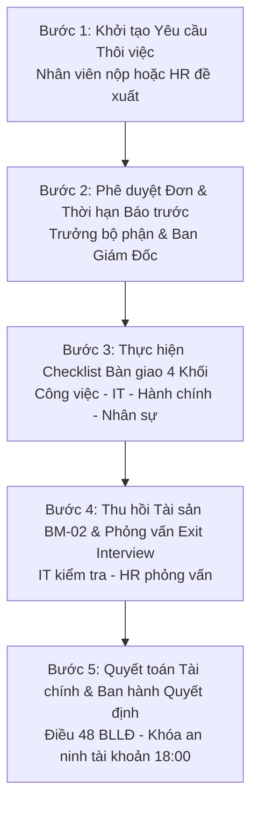

# TÀI LIỆU YÊU CẦU NGHIỆP VỤ (BRD)
## PHÂN HỆ THÔI VIỆC & BÀN GIAO QUY TRÌNH CHUẨN (OFFBOARDING)

---

### THÔNG TIN TÀI LIỆU
* **Tên tài liệu:** Business Requirements Document (BRD) – Phân hệ Quản lý Thôi việc & Bàn giao 4 Khối (Offboarding)
* **Mã tài liệu:** `BRD-HRM-MOD-06`
* **Phiên bản:** 1.0 (Chuẩn hóa thực tế vận hành)
* **Ngày cập nhật:** 27/10/2026
* **Tác giả:** Ban Dự án Hệ thống HRM & Chuyên gia Phân tích Nghiệp vụ (BA)
* **Tình trạng:** Chờ Phê duyệt (Pending Approval)

---

### MỤC LỤC
1. [Bảng Giải thích Từ viết tắt & Thuật ngữ Nghiệp vụ](#1-bảng-giải-thích-từ-viết-tắt--thuật-ngữ-nghiệp-vụ)
2. [Tóm tắt Điều hành 3 Chiều (Executive Summary)](#2-tóm-tắt-điều-hành-3-chiều-executive-summary)
3. [Mục tiêu Kinh doanh & Đo lường Thành công](#3-mục-tiêu-kinh-doanh--đo-lường-thành-công)
4. [Phân tích Hiện trạng Vận hành (As-Is vs To-Be)](#4-phân-tích-hiện-trạng-vận-hành-as-is-vs-to-be)
5. [Phạm vi Triển khai & Bản đồ Tích hợp Phân hệ](#5-phạm-vi-triển-khai--bản-đồ-tích-hợp-phân-hệ)
6. [Danh mục Yêu cầu Chức năng & Quy tắc Nghiệp vụ Chi tiết](#6-danh-mục-yêu-cầu-chức-năng--quy-tắc-nghiệp-vụ-chi-tiết)
7. [Giả định, Ràng buộc Nghiệp vụ & Quản trị Rủi ro](#7-giả-định-ràng-buộc-nghiệp-vụ--quản-trị-rủi-ro)
8. [Ma trận Phân quyền RBAC & Thiết kế Giao diện Vận hành](#8-ma-trận-phân-quyền-rbac--thiết-kế-giao-diện-vận-hành)

---

### 1. BẢNG GIẢI THÍCH TỪ VIẾT TẮT & THUẬT NGỮ NGHIỆP VỤ

| Từ viết tắt / Thuật ngữ | Tên tiếng Anh đầy đủ | Giải thích Ý nghĩa Nghiệp vụ Dễ hiểu |
| :--- | :--- | :--- |
| **Quy trình Thôi việc** | Standard Offboarding Procedure | Quy trình chuẩn về thôi việc, bàn giao công việc, thu hồi tài sản và thanh lý hợp đồng. |
| **Offboarding** | Employee Offboarding Process | Toàn bộ chuỗi nghiệp vụ khi người lao động rời khỏi tổ chức từ lúc nộp đơn đến khi quyết toán dứt điểm. |
| **Resignation Request** | Employee Resignation Request | Đơn xin thôi việc của người lao động hoặc đề xuất chấm dứt HĐLĐ từ người sử dụng lao động. |
| **Notice Period** | Mandatory Notice Period | Thời hạn báo trước theo luật định (Ít nhất 45 ngày với HĐLĐ không xác định thời hạn, 30 ngày với HĐLĐ 12-36 tháng theo Điều 35 BLLĐ 2019). |
| **Handover Checklist** | Task & Asset Handover Checklist | Danh mục kiểm soát bàn giao 4 khối: Chuyên môn, CNTT (IT), Hành chính - Văn phòng, và Nhân sự - Kế toán. |
| **BM-02** | Asset Return Form (BM-02) | Biểu mẫu nghiệp vụ biên bản thu hồi tài sản, kiểm tra hiện trạng thiết bị và xác định bồi thường (nếu có). |
| **Exit Interview** | Exit Interview Form | Phỏng vấn thôi việc nhằm lắng nghe nguyện vọng, đánh giá lý do nghỉ việc và cải tiến môi trường làm việc. |
| **Final Settlement** | Final Payroll Settlement | Bảng quyết toán tài chính cuối cùng: Lương ngày công thực tế, tiền phép tồn chưa nghỉ, các khoản khấu trừ bồi hoàn. |
| **Security Lockout** | 18:00 Security Account Revocation | Chốt chặn an ninh: Tự động vô hiệu hóa toàn bộ tài khoản truy cập hệ thống đúng 18:00 ngày làm việc cuối cùng. |
| **Termination Decision** | Employment Termination Decision | Quyết định chấm dứt hợp đồng lao động do Tổng Giám đốc / Đại diện pháp luật ký ban hành. |

---

### 2. TÓM TẮT ĐIỀU HÀNH 3 CHIỀU (EXECUTIVE SUMMARY)

```
       ┌────────────────────────────────────────────────────────┐
       │                TÓM TẮT ĐIỀU HÀNH 3 CHIỀU               │
       └───────────────────────────┬────────────────────────────┘
                                   │
         ┌─────────────────────────┼─────────────────────────┐
         │                         │                         │
         ▼                         ▼                         ▼
┌──────────────────┐      ┌──────────────────┐      ┌──────────────────┐
│ GÓC NHÌN QUẢN TRỊ│      │ GÓC NHÌN PHÁP LÝ │      │GÓC NHÌN BẢO MẬT &│
│     & CHI PHÍ    │      │  (BLLĐ & BHXH)   │      │     TÀI SẢN      │
├──────────────────┤      ├──────────────────┤      ├──────────────────┤
│• Minh bạch 100%  │      │• Tuân thủ 100%   │      │• Thu hồi 100%    │
│  bàn giao tài sản│      │  Điều 48 BLLĐ    │      │  Laptop, sạc, thẻ│
│• Quyết toán phép │      │• Chốt sổ BHXH    │• Khóa tài khoản  │
│  tồn tự động     │      │  trong 14 ngày   │  hệ thống đúng   │
│• Tối ưu chuyển   │      │• Giảm thiểu tranh│  18:00 an toàn   │
│  giao tri thức   │      │  chấp lao động   │• Bảo vệ dữ liệu  │
└──────────────────┘      └──────────────────┘      └──────────────────┘
```

* **Góc nhìn Quản trị & Hiệu quả Chi phí:** Phân hệ Thôi việc & Bàn giao số hóa toàn bộ chuỗi bàn giao phân tách thành 4 khối chuyên biệt, ngăn chặn hoàn toàn việc nhân sự rời công ty mang theo tài liệu bí mật, nợ bàn giao công việc hoặc thất thoát trang thiết bị giá trị cao.
* **Góc nhìn Pháp lý & Tuân thủ Luật Lao động:** Đảm bảo thực thi chuẩn xác Điều 35, Điều 45, Điều 48 Bộ luật Lao động 2019: Ban hành quyết định chấm dứt HĐLĐ đúng hạn, thanh toán tiền lương và tiền phép năm còn tồn trong vòng 14 ngày làm việc, hoàn tất thủ tục chốt sổ BHXH và bàn giao lại cho người lao động.
* **Góc nhìn An ninh Thông tin & Tài sản Doanh nghiệp:** Chốt chặn kiểm kê thu hồi tài sản 100% (Hard Lock: Không cho phép hoàn tất thôi việc nếu còn tài sản chưa trả) và cơ chế khóa an ninh tài khoản tự động vào lúc 18:00 ngày làm việc cuối cùng.

---

### 3. MỤC TIÊU KINH DOANH & ĐO LƯỜNG THÀNH CÔNG

#### 3.1. Mục tiêu Kinh doanh Định lượng
1. **Thu hồi tài sản 100%:** Xóa bỏ hoàn toàn tình trạng thất thoát tài sản IT (Laptop, màn hình phụ, sạc) và thẻ ra vào tòa nhà khi nhân viên nghỉ việc.
2. **Chuẩn hóa quy trình bàn giao 4 khối:** 100% nhân viên thôi việc phải hoàn thành checklist bàn giao gồm: Quản lý trực tiếp (Chuyên môn), IT Support (Thiết bị/Hạ tầng), Hành chính (Cơ sở vật chất) và HR (Pháp lý/Tài chính).
3. **Quyết toán thôi việc chính xác tuyệt đối:** Tự động tính toán số ngày phép năm còn tồn và quy đổi thành tiền thanh toán theo công thức chuẩn pháp lý: `(Mức lương cơ sở hợp đồng / 26 ngày công chuẩn) * Số ngày phép tồn`.
4. **Bảo mật hạ tầng kỹ thuật tuyệt đối:** Vô hiệu hóa tài khoản đăng nhập (Account `isActive: false`) và ngắt quyền truy cập VPN/Source code ngay trong ngày làm việc cuối cùng.

#### 3.2. Tiêu chí Đánh giá Thành công (KPI Phân hệ)
* **Tỷ lệ thất thoát tài sản sau thôi việc:** `0%`.
* **Thời gian trung bình xử lý thủ tục thôi việc:** Giảm từ 10 ngày làm việc xuống dưới 2 ngày kể từ khi hoàn tất bàn giao thực tế.
* **Tỷ lệ khiếu nại quyết toán ngày công & phép tồn:** `0%`.

---

### 4. PHÂN TÍCH HIỆN TRẠNG VẬN HÀNH (AS-IS VS TO-BE)

| Tiêu chí So sánh | Hiện trạng Thủ công (As-Is) | Hệ thống HRM Tự động hóa (To-Be) |
| :--- | :--- | :--- |
| **Kênh nộp đơn & Tiếp nhận** | Đơn giấy viết tay hoặc gửi email tự do, dễ thất lạc hoặc không rõ mốc thời gian báo trước luật định. | Khởi tạo đơn trực tuyến qua Cổng ESS, hệ thống tự động kiểm tra thời hạn báo trước theo loại HĐLĐ hiện tại. |
| **Theo dõi Bàn giao Công việc** | Trao đổi miệng giữa nhân viên và Trưởng bộ phận; khi nhân viên nghỉ mới phát hiện thiếu tài liệu bàn giao. | Checklist bàn giao 4 khối trực quan trên hệ thống; Trưởng bộ phận phải duyệt xác nhận từng đầu việc trước khi HR chuyển bước. |
| **Thu hồi Thiết bị & Tài sản** | Bộ phận IT và Hành chính ghi chép sổ tay; nhân viên quên trả sạc hoặc màn hình, khó truy thu sau khi đã rời đi. | Tích hợp trực tiếp danh sách tài sản từ Phân hệ BM-02; Hard Lock chặn hoàn tất thủ tục nếu còn tài sản trạng thái `ACTIVE`. |
| **Quyết toán Phép tồn** | Nhân sự tra cứu file Excel chấm công, dễ nhầm lẫn số ngày phép đã sử dụng và mức lương tính toán. | Tự động đọc dữ liệu từ `LeaveBalance` năm hiện tại và `Contract.baseSalary`, hiển thị ngay bảng tính quyết toán chi tiết. |
| **An ninh Tài khoản Hệ thống** | Nhân sự thông báo thủ công cho IT; thường mất 1-3 ngày sau khi nghỉ IT mới khóa email/hệ thống, rủi ro rò rỉ dữ liệu. | Tự động cập nhật `account.isActive = false` và ghi Audit Log ngay khi bấm nút Hoàn tất thôi việc (Finalize). |

---

### 5. PHẠM VI TRIỂN KHAI & BẢN ĐỒ TÍCH HỢP PHÂN HỆ

#### 5.1. Quy trình Nghiệp vụ 5 Bước (Offboarding End-to-End Flow)



#### 5.2. Danh mục 4 Khối Bàn giao Tiêu chuẩn (DEFAULT_OFFBOARDING_TASKS)
1. **Khối 1: Bàn giao Chuyên môn & Quản lý trực tiếp (`OFFBOARDING_WORK`)**
   * Bàn giao tài liệu nghiệp vụ, quy trình và các đầu việc đang phụ trách.
   * Chuyển giao mã nguồn dự án, tài khoản vận hành khách hàng và đầu mối đối tác.
   * Trưởng bộ phận ký biên bản nghiệm thu bàn giao chuyên môn.
2. **Khối 2: Khối IT Support & Hạ tầng Kỹ thuật (`OFFBOARDING_IT`)**
   * Kiểm kê và thu hồi Laptop làm việc & Bộ sạc chính hãng.
   * Thu hồi tài khoản Email, M365/Workspace và các phần mềm nội bộ.
   * Thu hồi quyền truy cập VPN, máy chủ và hạ tầng kỹ thuật.
   * Lập & ký Biên bản thu hồi tài sản theo biểu mẫu BM-02.
3. **Khối 3: Khối Hành chính - Quản trị Văn phòng (`OFFBOARDING_ADMIN`)**
   * Thu hồi thẻ từ ra vào tòa nhà, thẻ gửi xe công ty.
   * Bàn giao chìa khóa tủ cá nhân & các tài sản hành chính dùng chung.
4. **Khối 4: Khối Nhân sự & Kế toán Quyết toán (`OFFBOARDING_HR`)**
   * Soạn thảo & Ban hành Quyết định chấm dứt HĐLĐ (trình Ban Giám Đốc ký).
   * Chốt ngày công thực tế & quyết toán tiền nghỉ phép năm còn tồn.
   * Thanh lý hợp đồng lao động, hoàn tất thủ tục chốt sổ BHXH.
   * Khóa an ninh tài khoản hệ thống vào cuối ngày làm việc cuối cùng.

---

### 6. DANH MỤC YÊU CẦU CHỨC NĂNG & QUY TẮC NGHIỆP VỤ CHI TIẾT

#### BR-OFF-01: Khởi tạo Tiến trình Thôi việc (Initiate Offboarding)
* **Mã quy tắc:** `BR-OFF-01`
* **Mô tả:** HR khởi tạo tiến trình thôi việc cho nhân viên với ngày dự kiến nghỉ (`resignationDate`) và lý do thôi việc (`resignationReason`).
* **Hành vi hệ thống:**
  1. Cập nhật ngày dự kiến nghỉ trên bản ghi `Employee`.
  2. Tự động khởi tạo đầy đủ danh mục các công việc bàn giao 4 khối (`DEFAULT_OFFBOARDING_TASKS`) vào bảng `OnboardingTask` (với danh mục tiền tố `OFFBOARDING_*`).
  3. Ghi vết Audit Log: `INITIATE_OFFBOARDING` ghi nhận người khởi tạo và ngày dự kiến.

#### BR-OFF-02: Kiểm tra Chốt chặn Thu hồi Tài sản (Hard Lock Enforcement)
* **Mã quy tắc:** `BR-OFF-02`
* **Mô tả:** Chặn tuyệt đối việc bấm nút Hoàn tất thủ tục thôi việc nếu nhân viên chưa hoàn trả hết tài sản công ty.
* **Điều kiện logic:**
  ```typescript
  const activeAssets = await prisma.assetAssignment.count({
    where: { employeeId, status: 'ACTIVE' }
  });
  if (activeAssets > 0) {
    throw new Error(`Không thể hoàn tất thủ tục thôi việc! Nhân viên đang nắm giữ ${activeAssets} tài sản/thiết bị chưa hoàn trả. Vui lòng xác nhận thu hồi đủ theo biên bản BM-02 trước.`);
  }
  ```

#### BR-OFF-03: Quyết toán Tiền Nghỉ phép năm còn tồn (Leave Settlement)
* **Mã quy tắc:** `BR-OFF-03`
* **Căn cứ pháp lý:** Khoản 3 Điều 113 Bộ luật Lao động 2019: Trường hợp do thôi việc, mất việc làm mà chưa nghỉ hằng năm hoặc chưa nghỉ hết số ngày nghỉ hằng năm thì được người sử dụng lao động thanh toán tiền lương cho những ngày chưa nghỉ.
* **Công thức nghiệp vụ:**
  $$\text{Tiền phép tồn thanh toán} = \left(\frac{\text{Lương cơ sở HĐLĐ}}{\text{Số ngày công chuẩn (26)}}\right) \times \text{Số ngày phép còn tồn}$$
* Hệ thống hiển thị rõ ràng trên màn hình chi tiết thôi việc để Kế toán đưa vào kỳ lương quyết toán cuối cùng.

#### BR-OFF-04: Đóng Hợp đồng & Khóa An ninh Tài khoản (Security Revocation & Status Finalize)
* **Mã quy tắc:** `BR-OFF-04`
* **Mô tả:** Khi xác nhận Hoàn tất thôi việc (Finalize), hệ thống thực thi chuỗi giao dịch nguyên tử (Atomic Database Transaction):
  1. Đổi trạng thái nhân sự: `Employee.status = 'RESIGNED'`.
  2. Gỡ bỏ phòng ban và chức vụ hiện tại: `departmentId = null`, `positionId = null`.
  3. Cập nhật toàn bộ hợp đồng đang có hiệu lực sang kết thúc: `Contract.status = 'TERMINATED'`, `endDate = effectiveDate`.
  4. Vô hiệu hóa tài khoản an ninh: `Account.isActive = false`.
  5. Tự động ghi bản ghi lịch sử công tác: `EmploymentHistory` với lý do "Thôi việc & Hoàn tất quy trình bàn giao".
  6. Ghi nhật ký kiểm toán hệ thống `createAuditLog` loại `OFFBOARDING_FINALIZE`.

---

### 7. GIẢ ĐỊNH, RÀNG BUỘC NGHIỆP VỤ & QUẢN TRỊ RỦI RO

#### 7.1. Giả định Nghiệp vụ
* Toàn bộ tài sản được giao cho nhân viên đã được số hóa đầy đủ trên Phân hệ Tài sản BM-02 trước ngày bắt đầu quy trình bàn giao.
* Dữ liệu chấm công và quỹ phép năm đã được chốt chính xác đến ngày làm việc cuối cùng.

#### 7.2. Ràng buộc Kỹ thuật & Nghiệp vụ
* Chỉ các vai trò có quyền quản trị nhân sự (`HR_MANAGER`, `ADMIN`, `SUPER_ADMIN`) mới có thẩm quyền thực hiện thao tác Phê duyệt và Hoàn tất thôi việc.
* Sau khi hồ sơ chuyển sang trạng thái `RESIGNED`, nhân viên không thể đăng nhập vào cổng thông tin ESS; chỉ có HR mới có thể tra cứu hồ sơ lưu trữ phục vụ các yêu cầu xác nhận công tác sau này.

#### 7.3. Ma trận Rủi ro & Phương án Kiểm soát (BRD Risk Matrix)

| STT | Rủi ro Tiềm ẩn | Mức độ | Biện pháp Kiểm soát & Chốt chặn Hệ thống |
| :---: | :--- | :---: | :--- |
| 1 | Nhân viên ôm thiết bị đắt tiền nghỉ việc không trả | Rất cao | Hệ thống áp dụng cơ chế Hard Lock; không thể xuất quyết định thôi việc và chốt sổ BHXH nếu `activeAssets > 0`. |
| 2 | Rò rỉ dữ liệu qua tài khoản email/hệ thống còn mở | Cao | Tự động hóa việc vô hiệu hóa tài khoản ngay trong lệnh `finalize` lúc 18:00, không phụ thuộc vào thao tác thủ công. |
| 3 | Sai sót khi tính tiền bồi hoàn phép tồn | Trung bình | Công thức tính toán được lập trình tự động dựa trên mức lương HĐLĐ thực tế và số dư phép năm tại thời điểm nghỉ. |

---

### 8. MA TRẬN PHÂN QUYỀN RBAC & THIẾT KẾ GIAO DIỆN VẬN HÀNH

#### 8.1. Ma trận Phân quyền Chức năng (RBAC)

| Chức năng Phân hệ | Super Admin | HR Manager | HR Staff | Quản lý trực tiếp | IT Support | Nhân viên (ESS) |
| :--- | :---: | :---: | :---: | :---: | :---: | :---: |
| **Xem danh sách thôi việc & tiến độ** | Full | Full | Full | Theo bộ phận | Theo tài sản IT | Xem của mình |
| **Khởi tạo quy trình thôi việc** | Full | Full | Full | Đề xuất | Không | Gửi đơn xin |
| **Cập nhật Checklist bàn giao (Toggle)** | Full | Full | Full | Khối chuyên môn | Khối IT | Xem tiến độ |
| **Thu hồi tài sản nhanh (Quick-Return)** | Full | Full | Cho phép | Không | Cho phép | Ký biên bản |
| **Bấm Hoàn tất Thôi việc (Finalize)** | Full | Full | Không | Không | Không | Không |
| **Xem chi tiết Quyết toán Tài chính** | Full | Full | Full | Không | Không | Xem của mình |

#### 8.2. Thiết kế Giao diện Vận hành (UI/UX Specifications)
1. **Màn hình Tổng quan Thôi việc (`/internal/offboarding`):**
   * Thống kê KPI trên thanh Header: Tổng số nhân sự đang thôi việc (`inProgressCount`), Số nhân sự đã hoàn tất thôi việc (`resignedCount`), Số tài sản đang chờ thu hồi (`pendingAssetReturns`).
   * Bảng danh sách 2 Tab: "Đang xử lý bàn giao" và "Lịch sử đã thôi việc", kèm bộ lọc theo phòng ban và tìm kiếm nhân sự.
2. **Màn hình Chi tiết Bàn giao Thôi việc (`/internal/offboarding/:employeeId`):**
   * Khối thông tin nhân viên: Mã NV, Họ tên, Vị trí, Quản lý, Ngày vào, Ngày dự kiến nghỉ.
   * Khối Checklist 4 Khối: Chia nhóm tab chuyên nghiệp (`OFFBOARDING_WORK`, `OFFBOARDING_IT`, `OFFBOARDING_ADMIN`, `OFFBOARDING_HR`) kèm nút Checkbox xác nhận real-time.
   * Khối Tài sản đang giữ: Hiển thị danh sách thiết bị kèm mã tài sản, tình trạng và nút bấm "Xác nhận thu hồi nhanh" (mở modal cập nhật hiện trạng BM-02).
   * Khối Quyết toán Thôi việc: Hiển thị Mức lương hợp đồng, Số ngày phép tồn, Thành tiền quy đổi dự kiến.
   * Nút hành động chính: "Hoàn tất thủ tục thôi việc" với cơ chế hiển thị cảnh báo đỏ nếu còn tài sản chưa thu hồi.
