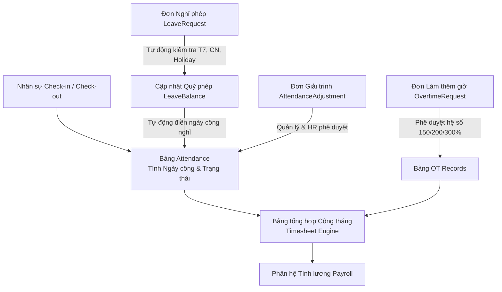

# TÀI LIỆU YÊU CẦU NGHIỆP VỤ (BRD)
## PHÂN HỆ CA KÍP, CHẤM CÔNG & NGHỈ PHÉP (TIME & ATTENDANCE MANAGEMENT)

---

### THÔNG TIN TÀI LIỆU
* **Tên tài liệu:** Business Requirements Document (BRD) – Phân hệ Ca kíp, Chấm công, Giải trình & Quản lý Nghỉ phép
* **Mã tài liệu:** `BRD-HRM-MOD-07`
* **Phiên bản:** 1.0 (Chuẩn hóa thực tế vận hành)
* **Ngày cập nhật:** 27/10/2026
* **Tác giả:** Ban Dự án Hệ thống HRM & Chuyên gia Phân tích Nghiệp vụ (BA)
* **Tình trạng:** Chờ Phê duyệt (Pending Approval)

---

### MỤC LỤC
1. [Bảng Giải thích Từ viết tắt & Thuật ngữ Nghiệp vụ](#1-bảng-giải-thích-từ-viết-tắt--thuật-ngữ-nghiệp-vụ)
2. [Tóm tắt Điều hành 3 Chiều (Executive Summary)](#2-tóm-tắt-điều-hành-3-chiều-executive-summary)
3. [Mục tiêu Kinh doanh & Đo lường Thành công](#3-mục-tiêu-kinh-doanh--đo-lường-thành-công)
4. [Phân tích Hiện trạng Vận hành (As-Is vs To-Be)](#4-phân-tích-hiện-trạng-vận-hành-as-is-vs-to-be)
5. [Phạm vi Triển khai & Bản đồ Tích hợp Phân hệ](#5-phạm-vi-triển-khai--bản-đồ-tích-hợp-phân-hệ)
6. [Danh mục Yêu cầu Chức năng & Quy tắc Nghiệp vụ Chi tiết](#6-danh-mục-yêu-cầu-chức-năng--quy-tắc-nghiệp-vụ-chi-tiết)
7. [Giả định, Ràng buộc Nghiệp vụ & Quản trị Rủi ro](#7-giả-định-ràng-buộc-nghiệp-vụ--quản-trị-rủi-ro)
8. [Ma trận Phân quyền RBAC & Thiết kế Giao diện Vận hành](#8-ma-trận-phân-quyền-rbac--thiết-kế-giao-diện-vận-hành)

---

### 1. BẢNG GIẢI THÍCH TỪ VIẾT TẮT & THUẬT NGỮ NGHIỆP VỤ

| Từ viết tắt / Thuật ngữ | Tên tiếng Anh đầy đủ | Giải thích Ý nghĩa Nghiệp vụ Dễ hiểu |
| :--- | :--- | :--- |
| **Check-in / Check-out** | Attendance Punch In / Punch Out | Hành động ghi nhận mốc thời gian bắt đầu và kết thúc làm việc của nhân sự trong ca làm việc. |
| **Grace Period** | Attendance Grace Period | Khoảng thời gian ân hạn đi muộn hợp lệ (Quy định: 15 phút từ 08:30 đến 08:45 sáng không bị tính vi phạm). |
| **Working Day** | Equivalent Working Day Credit | Giá trị quy đổi ngày công thực tế (Chuẩn: >= 7.5h = 1.0 công; từ 3.5h đến dưới 7.5h = 0.5 công; < 3.5h = 0 công). |
| **Attendance Adjustment** | Attendance Regularization / Correction | Đơn giải trình bổ sung/điều chỉnh công do quên chấm công, đi công tác hoặc sự cố mạng/thiết bị. |
| **Annual Leave** | Annual Paid Leave | Chế độ nghỉ phép năm hưởng nguyên lương theo Điều 113 BLLĐ 2019 (12 ngày/năm + cộng thêm 1 ngày cho mỗi 5 năm thâm niên). |
| **Leave Balance** | Employee Leave Entitlement & Balance | Bảng theo dõi hạn mức phép năm: Tổng số ngày được cấp, số ngày đã nghỉ và số ngày còn tồn trong năm dương lịch. |
| **Holiday Calendar** | Public Holiday Master Calendar | Lịch các ngày nghỉ Lễ, Tết chính thức theo quy định của Nhà nước (được hưởng nguyên lương và không trừ vào phép năm). |
| **Overtime (OT)** | Overtime Work Record | Thời gian làm việc ngoài giờ tiêu chuẩn, được tính hệ số nhân lương (150%, 200%, 300%) theo Điều 98 BLLĐ 2019. |
| **IDOR Prevention** | Insecure Direct Object Reference Defense | Cơ chế an ninh ngăn chặn việc nhân viên xem hoặc sửa bảng công, đơn nghỉ phép của đồng nghiệp khác. |

---

### 2. TÓM TẮT ĐIỀU HÀNH 3 CHIỀU (EXECUTIVE SUMMARY)

```
       ┌────────────────────────────────────────────────────────┐
       │                TÓM TẮT ĐIỀU HÀNH 3 CHIỀU               │
       └───────────────────────────┬────────────────────────────┘
                                   │
         ┌─────────────────────────┼─────────────────────────┐
         │                         │                         │
         ▼                         ▼                         ▼
┌──────────────────┐      ┌──────────────────┐      ┌──────────────────┐
│ GÓC NHÌN VẬN HÀNH│      │ GÓC NHÌN PHÁP LÝ │      │ GÓC NHÌN TRẢI    │
│    DOANH NGHIỆP  │      │  (BLLĐ 2019)     │      │   NGHIỆM (ESS)   │
├──────────────────┤      ├──────────────────┤      ├──────────────────┤
│• Tự động tính    │      │• Tuân thủ Điều   │      │• Chấm công 1 chạm│
│  ngày công chuẩn │         113 (Nghỉ phép) │         nhanh chóng     │
│• Giảm 90% thời   │      │• Áp dụng chuẩn   │      │• Minh bạch quỹ   │
│  gian chốt công  │         hệ số OT Đ.98   │         phép còn tồn    │
│• Phê duyệt đơn từ│      │• Kiểm soát giới  │      │• Nộp giải trình &│
│  trực tuyến 100% │         hạn trần giờ OT │         đơn phép online │
└──────────────────┘      └──────────────────┘      └──────────────────┘
```

* **Góc nhìn Quản trị Vận hành Doanh nghiệp:** Tự động hóa hoàn toàn việc ghi nhận giờ vào/ra, tính toán công chuẩn, đối soát đơn nghỉ phép và đơn giải trình, cung cấp dữ liệu tức thì cho Phân hệ Tính lương mà không cần HR nhập liệu thủ công hàng trăm file Excel cuối tháng.
* **Góc nhìn Pháp lý & Tuân thủ Lao động:** Đảm bảo chính sách làm thêm giờ tuân thủ nghiêm ngặt Điều 98 và Điều 107 Bộ luật Lao động 2019; quản lý chế độ nghỉ phép năm theo Điều 113, tự động loại trừ các ngày Thứ 7, Chủ Nhật và ngày nghỉ Lễ/Tết khi trừ ngày phép.
* **Góc nhìn Trải nghiệm Nhân viên (ESS Experience):** Trao quyền cho người lao động chủ động theo dõi thời gian làm việc cá nhân, kiểm tra số dư phép tồn, nộp đơn xin nghỉ, làm thêm giờ và giải trình chấm công mọi lúc mọi nơi trên giao diện trực quan, rõ ràng.

---

### 3. MỤC TIÊU KINH DOANH & ĐO LƯỜNG THÀNH CÔNG

#### 3.1. Mục tiêu Kinh doanh Cốt lõi
1. **Rút ngắn chu kỳ chốt bảng công:** Giảm thời gian tổng hợp và kiểm toán bảng chấm công toàn công ty từ 5 ngày làm việc xuống dưới 4 giờ đồng hồ.
2. **Tính toán ngày công tự động 100%:** Loại bỏ hoàn toàn sự can thiệp thủ công bằng tay đối với công thức quy đổi giờ làm việc thành ngày công.
3. **Quản lý quỹ phép năm chính xác không sai lệch:** Tự động tính toán số ngày nghỉ thực tế bằng cách loại trừ Thứ 7, Chủ Nhật và các ngày nghỉ Lễ, tự động cập nhật số ngày phép đã sử dụng (`usedDays`) và còn lại (`remainingDays`).
4. **Kiểm soát chi phí Làm thêm giờ (OT):** Ghi nhận chính xác số giờ OT theo từng loại ngày (Ngày thường: 150%, Cuối tuần: 200%, Nghỉ lễ: 300%) làm căn cứ chi trả lương minh bạch.

#### 3.2. Tiêu chí Đánh giá Thành công (KPI Phân hệ)
* **Tỷ lệ nhân viên chấm công đúng hạn và không có tranh chấp:** `>= 98%`.
* **Tỷ lệ đơn từ (Nghỉ phép/Giải trình/OT) được phê duyệt trong vòng 24 giờ:** `>= 95%`.
* **Sai số giữa dữ liệu chấm công và bảng thanh toán lương:** `0%`.

---

### 4. PHÂN TÍCH HIỆN TRẠNG VẬN HÀNH (AS-IS VS TO-BE)

| Tiêu chí So sánh | Hiện trạng Thủ công (As-Is) | Hệ thống HRM Tự động hóa (To-Be) |
| :--- | :--- | :--- |
| **Phương thức Ghi nhận Công** | Quẹt vân tay/thẻ từ trên máy chấm công độc lập; cuối tháng HR tải dữ liệu qua USB hoặc cáp mạng, dễ mất dữ liệu. | Tích hợp Check-in/Check-out trực tuyến trên hệ thống HRM với định danh tài khoản, lưu trữ ngay tức thì vào Database. |
| **Xử lý Đi muộn / Về sớm** | Trưởng phòng ghi sổ giấy hoặc nhân sự tự nhớ; không có quy định ân hạn chuẩn, dẫn đến tranh cãi nội bộ. | Tự động áp dụng khung ân hạn 15 phút (08:30 - 08:45); sau 08:45 tự động gán `LATE`, về trước 17:00 tự động gán `EARLY_LEAVE`. |
| **Quy trình Xin nghỉ phép** | Viết phiếu xin nghỉ giấy, trình ký Quản lý rồi nộp về HR; dễ thất lạc đơn, HR phải cộng trừ thủ công số ngày phép tồn. | Nhân viên nộp đơn online; hệ thống tự tính số ngày làm việc thực tế (bỏ T7, CN, Lễ); Quản lý duyệt 1 click; tự động trừ quỹ phép. |
| **Giải trình Quên chấm công** | Gửi email phân trần hoặc gặp trực tiếp HR; không có căn cứ minh bạch, HR khó kiểm chứng thời gian thực tế. | Nộp đơn giải trình (Attendance Adjustment) kèm lý do rõ ràng; hệ thống phân quyền Quản lý trực tiếp xác nhận trước khi HR duyệt. |
| **Tổng hợp Bảng chấm công** | HR xuất file Excel dung lượng lớn, viết hàm VLOOKUP phức tạp, nguy cơ sai sót công thức gây chi trả sai lương. | Hệ thống tự động tính ngày công theo ngày, kết xuất bảng công tổng hợp (Timesheet Summary) sẵn sàng đưa sang Phân hệ Lương. |

---

### 5. PHẠM VI TRIỂN KHAI & BẢN ĐỒ TÍCH HỢP PHÂN HỆ

#### 5.1. Bản đồ Tích hợp Phân hệ Chấm công & Nghỉ phép



#### 5.2. Các Thực thể Dữ liệu Trọng yếu
1. **`Attendance`:** Lưu vết bản ghi chấm công từng ngày của nhân viên (`date`, `checkIn`, `checkOut`, `status`: NORMAL, LATE, EARLY_LEAVE, ABSENT, ON_LEAVE, `workingDay`: Decimal).
2. **`LeaveRequest`:** Đơn xin nghỉ phép (`startDate`, `endDate`, `reason`, `status`: PENDING, APPROVED, REJECTED, `leaveType`: PAID, UNPAID, SICK, MATERNITY, COMPASSIONATE).
3. **`LeaveBalance`:** Quỹ phép năm của từng nhân sự (`year`, `totalDays`, `usedDays`, `remainingDays`).
4. **`AttendanceAdjustment`:** Đơn bổ sung/điều chỉnh công (`requestedCheckIn`, `requestedCheckOut`, `reason`, `status`).
5. **`OvertimeRequest`:** Đơn làm thêm giờ (`date`, `hours`, `rateMultiplier`, `reason`, `status`).
6. **`Holiday`:** Danh mục ngày nghỉ lễ toàn quốc (`name`, `date`, `description`).

---

### 6. DANH MỤC YÊU CẦU CHỨC NĂNG & QUY TẮC NGHIỆP VỤ CHI TIẾT

#### BR-ATT-01: Quy tắc Check-in và Thời gian Ân hạn (Grace Period Rule)
* **Mã quy tắc:** `BR-ATT-01`
* **Thời gian quy chuẩn:** Ca chuẩn bắt đầu lúc **08:30**.
* **Khung ân hạn:** Từ **08:30 đến 08:45** (15 phút).
* **Quy tắc phân loại trạng thái:**
  1. Nếu Check-in $\le$ 08:45: Gán trạng thái `status = 'NORMAL'`.
  2. Nếu Check-in $>$ 08:45: Gán trạng thái `status = 'LATE'`.
  3. Nếu nhân viên đã có đơn nghỉ phép nửa ngày sáng được duyệt: Giữ nguyên trạng thái `status = 'ON_LEAVE'`.
  4. Nếu nhân viên đã có đơn nghỉ cả ngày hôm nay: Chặn không cho Check-in với thông báo: *"Bạn đã đăng ký nghỉ phép cả ngày hôm nay!"*.

#### BR-ATT-02: Quy tắc Check-out và Tính toán Ngày công Tự động
* **Mã quy tắc:** `BR-ATT-02`
* **Thời gian quy chuẩn:** Ca làm việc kết thúc lúc **17:30**.
* **Quy tắc phát hiện Về sớm:** Nếu Check-out trước **17:00** và trạng thái trước đó là `NORMAL`: Cập nhật trạng thái thành `EARLY_LEAVE`.
* **Công thức tính ngày công quy đổi (Working Day Credit):**
  $$\text{Số giờ làm việc thực tế} = \frac{\text{Check-out} - \text{Check-in}}{3600 \times 1000}$$
  * **Trường hợp 1:** $\ge 7.5 \text{ giờ} \longrightarrow \text{workingDay} = 1.0$ (Đủ 1 công).
  * **Trường hợp 2:** Từ $3.5 \text{ giờ}$ đến dưới $7.5 \text{ giờ} \longrightarrow \text{workingDay} = 0.5$ (Nửa công).
  * **Trường hợp 3:** Dưới $3.5 \text{ giờ} \longrightarrow \text{workingDay} = 0.0$ (Không đạt công chuẩn).
  * *Lưu ý tích hợp:* Nếu ngày đó nhân viên có công nghỉ phép nửa ngày đã duyệt (0.5), thì tổng ngày công được cộng dồn nhưng không vượt quá trần $1.0$.

#### BR-ATT-03: Quy tắc Tính toán Số ngày Nghỉ phép Thực tế (Exclude Weekends & Holidays)
* **Mã quy tắc:** `BR-ATT-03`
* **Mô tả:** Khi nhân viên tạo đơn nghỉ từ `startDate` đến `endDate`, hệ thống duyệt qua từng ngày trong khoảng thời gian này và áp dụng quy tắc:
  1. Nếu ngày là **Thứ 7** (Day 6) hoặc **Chủ Nhật** (Day 0): **Bỏ qua không tính ngày nghỉ phép**.
  2. Nếu ngày trùng với ngày nghỉ lễ trong bảng `Holiday`: **Bỏ qua không tính ngày nghỉ phép**.
  3. Chỉ tính ngày làm việc thực tế (Thứ 2 đến Thứ 6 không trùng Lễ).
* **Kiểm tra hạn mức quỹ phép:** Nếu loại phép là `PAID` (Phép năm hưởng lương), hệ thống kiểm tra nếu $\text{Số ngày xin nghỉ} > \text{LeaveBalance.remainingDays}$ thì thông báo cảnh báo hoặc yêu cầu chuyển sang loại nghỉ `UNPAID` (Không lương).

#### BR-ATT-04: Quy trình Phê duyệt Đơn Giải trình Công & Đơn Phép
* **Mã quy tắc:** `BR-ATT-04`
* **Quy trình:**
  1. Nhân viên nộp đơn $\rightarrow$ Hệ thống gửi thông báo cho Quản lý trực tiếp (`managerId`).
  2. Quản lý kiểm tra và duyệt $\rightarrow$ Trạng thái chuyển sang `APPROVED`.
  3. Đối với đơn nghỉ phép: Khi được duyệt, hệ thống tự động:
     * Trừ quỹ phép năm: `usedDays = usedDays + days`, `remainingDays = remainingDays - days`.
     * Tự động sinh/cập nhật bản ghi chấm công `Attendance` cho các ngày làm việc nghỉ với trạng thái `ON_LEAVE` và `workingDay = 1.0` (hoặc 0.5 nếu nghỉ nửa ngày).
  4. Đối với đơn giải trình công: Khi được duyệt, hệ thống cập nhật lại giờ `checkIn`/`checkOut` và tính lại `workingDay` chính xác.

#### BR-ATT-05: Quy tắc Làm thêm giờ (Overtime - Điều 98 BLLĐ 2019)
* **Mã quy tắc:** `BR-ATT-05`
* **Hệ số tính lương ngoài giờ:**
  * Làm thêm vào ngày làm việc thường: Tối thiểu **150%** lương giờ thực tế.
  * Làm thêm vào ngày nghỉ hàng tuần (Thứ 7, CN): Tối thiểu **200%** lương giờ thực tế.
  * Làm thêm vào ngày nghỉ Lễ, Tết: Tối thiểu **300%** lương giờ thực tế (chưa kể tiền lương ngày nghỉ lễ hưởng nguyên lương).
* Đơn OT phải được phê duyệt trước ca làm thêm. Khi kết thúc tháng, tổng số giờ OT của từng nhân viên được đưa thẳng vào bảng tính lương.

---

### 7. GIẢ ĐỊNH, RÀNG BUỘC NGHIỆP VỤ & QUẢN TRỊ RỦI RO

#### 7.1. Giả định Nghiệp vụ
* Thiết bị máy tính của người dùng hoặc máy chủ có đồng bộ thời gian chuẩn NTP quốc tế để tránh chênh lệch giờ bấm công.
* Lịch ngày nghỉ Lễ, Tết toàn quốc được phòng Nhân sự nạp sẵn vào bảng `Holiday` từ đầu năm tài chính.

#### 7.2. Ràng buộc An ninh & Quyền riêng tư (IDOR Defense)
* Cán bộ nhân viên chỉ được xem lịch sử chấm công, đơn nghỉ phép, đơn giải trình và số dư phép của **chính tài khoản mình**.
* Cơ chế kiểm tra backend: Nếu `userRole === 'EMPLOYEE'` và `req.user.employeeId !== employeeId` $\rightarrow$ Trả về mã lỗi `403 Forbidden` ngay lập tức.
* HR và Ban Giám đốc có quyền xem toàn công ty hoặc lọc theo phòng ban để quản lý vận hành.

#### 7.3. Ma trận Rủi ro & Phương án Kiểm soát

| STT | Rủi ro Vận hành | Mức độ | Biện pháp Kiểm soát trên Hệ thống HRM |
| :---: | :--- | :---: | :--- |
| 1 | Nhân viên chấm công hộ nhau | Cao | Ghi nhận IP/thiết bị đăng nhập, kết hợp giới hạn phiên làm việc và định hướng tích hợp nhận diện khuôn mặt. |
| 2 | Trừ nhầm ngày phép vào các ngày nghỉ Lễ/Tết | Nghiêm trọng | Hệ thống tự động kiểm tra bảng `Holiday` và tự loại trừ ngày lễ khỏi số ngày phép bị khấu trừ. |
| 3 | Tồn đọng đơn từ không được duyệt kịp kỳ lương | Trung bình | Bảng công hiển thị cờ cảnh báo (Flag) những đơn đang ở trạng thái `PENDING` trước ngày chốt bảng công (Cut-off date 25 hàng tháng). |

---

### 8. MA TRẬN PHÂN QUYỀN RBAC & THIẾT KẾ GIAO DIỆN VẬN HÀNH

#### 8.1. Ma trận Phân quyền Chức năng (RBAC)

| Chức năng Phân hệ | Super Admin | HR Manager | HR Staff | Quản lý bộ phận | Nhân viên (ESS) |
| :--- | :---: | :---: | :---: | :---: | :---: |
| **Check-in / Check-out** | Không | Không | Không | Cá nhân | Cá nhân |
| **Xem bảng chấm công toàn công ty** | Full | Full | Full | Theo bộ phận | Không (chỉ xem bản thân) |
| **Tạo đơn Nghỉ phép / Giải trình / OT** | Cho phép | Cho phép | Cho phép | Cá nhân | Cá nhân |
| **Phê duyệt đơn Nghỉ phép / Giải trình / OT**| Full | Full | Full | Thuộc cấp dưới | Không |
| **Cấu hình Quỹ phép năm & Ngày lễ** | Full | Full | Xem | Không | Không |
| **Chốt bảng công tháng (Timesheet Lock)** | Full | Full | Không | Không | Không |

#### 8.2. Thiết kế Giao diện Vận hành (UI/UX Specifications)
1. **Tiện ích Chấm công ESS (Quick Punch Widget):**
   * Hiển thị đồng hồ thời gian thực (Giờ:Phút:Giây) sắc nét.
   * Nút bấm lớn "Check-in" (xanh lá) và "Check-out" (xanh dương) tự động đổi trạng thái khi đã bấm.
   * Nhãn thông báo trạng thái tức thì: "Đúng giờ (Normal)", "Đi muộn (Late: 08:50)" hoặc "Về sớm (Early Leave: 16:45)".
2. **Màn hình Bảng Chấm công Tổng hợp (`/internal/attendance`):**
   * Bộ lọc: Tháng/Năm (YYYY-MM), Phòng ban, Họ tên/Mã nhân viên.
   * Thẻ KPI tóm tắt: Tổng số lượt chấm công, Tỷ lệ đi làm đúng giờ, Số lượt đi muộn trong tháng.
   * Bảng dữ liệu Grid: Hiển thị chi tiết từng ngày trong tháng của nhân viên kèm mã màu (Xanh: Đủ công 1.0, Vàng: Nửa công 0.5, Đỏ: Vắng mặt ABSENT, Tím: Nghỉ phép ON_LEAVE).
3. **Màn hình Quản lý Nghỉ phép (`/internal/leave`):**
   * Thẻ hiển thị Quỹ phép cá nhân: Tổng phép năm (12 ngày), Đã sử dụng, Còn lại.
   * Form nộp đơn: Chọn loại phép (Phép năm, Không lương, Ốm đau...), Chọn ngày bắt đầu - kết thúc, Hệ thống tự động preview số ngày tính phép.
   * Danh sách đơn đang chờ duyệt kèm hành động: "Phê duyệt" hoặc "Từ chối" (yêu cầu nhập lý do).
