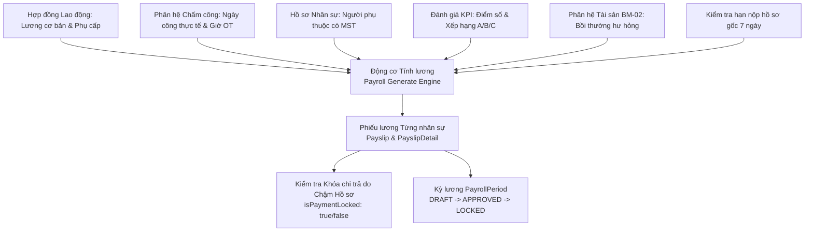

# TÀI LIỆU YÊU CẦU NGHIỆP VỤ (BRD)
## PHÂN HỆ ĐÁNH GIÁ HIỆU SUẤT KPI & TIỀN LƯƠNG (PERFORMANCE & PAYROLL ENGINE)

---

### THÔNG TIN TÀI LIỆU
* **Tên tài liệu:** Business Requirements Document (BRD) – Phân hệ Đánh giá Hiệu suất KPI & Động cơ Tính lương (Enterprise Payroll Engine)
* **Mã tài liệu:** `BRD-HRM-MOD-08`
* **Phiên bản:** 1.0 (Chuẩn hóa thực tế vận hành)
* **Ngày cập nhật:** 27/10/2026
* **Tác giả:** Ban Dự án Hệ thống HRM & Chuyên gia Phân tích Nghiệp vụ (BA)
* **Tình trạng:** Chờ Phê duyệt (Pending Approval)

---

### MỤC LỤC
1. [Bảng Giải thích Từ viết tắt & Thuật ngữ Nghiệp vụ](#1-bảng-giải-thích-từ-viết-tắt--thuật-ngữ-nghiệp-vụ)
2. [Tóm tắt Điều hành 3 Chiều (Executive Summary)](#2-tóm-tắt-điều-hành-3-chiều-executive-summary)
3. [Mục tiêu Kinh doanh & Đo lường Thành công](#3-mục-tiêu-kinh-doanh--đo-lường-thành-công)
4. [Phân tích Hiện trạng Vận hành (As-Is vs To-Be)](#4-phân-tích-hiện-trạng-vận-hành-as-is-vs-to-be)
5. [Phạm vi Triển khai & Bản đồ Tích hợp Phân hệ](#5-phạm-vi-triển-khai--bản-đồ-tích-hợp-phân-hệ)
6. [Danh mục Yêu cầu Chức năng & Quy tắc Nghiệp vụ Chi tiết](#6-danh-mục-yêu-cầu-chức-năng--quy-tắc-nghiệp-vụ-chi-tiết)
7. [Giả định, Ràng buộc Nghiệp vụ & Quản trị Rủi ro](#7-giả-định-ràng-buộc-nghiệp-vụ--quản-trị-rủi-ro)
8. [Ma trận Phân quyền RBAC & Thiết kế Giao diện Vận hành](#8-ma-trận-phân-quyền-rbac--thiết-kế-giao-diện-vận-hành)

---

### 1. BẢNG GIẢI THÍCH TỪ VIẾT TẮT & THUẬT NGỮ NGHIỆP VỤ

| Từ viết tắt / Thuật ngữ | Tên tiếng Anh đầy đủ | Giải thích Ý nghĩa Nghiệp vụ Dễ hiểu |
| :--- | :--- | :--- |
| **KPI** | Key Performance Indicator | Chỉ số đánh giá hiệu quả công việc then chốt giao cho nhân viên theo từng kỳ đánh giá. |
| **Performance Review** | Employee Performance Review | Quy trình đánh giá hiệu suất 2 chiều: Nhân viên tự đánh giá (Self-score) và Quản lý chấm điểm (Manager-score). |
| **Payroll Period** | Monthly Payroll Period | Chu kỳ tính lương hàng tháng (ví dụ: `10-2026`), có trạng thái kiểm soát: `DRAFT` $\rightarrow$ `APPROVED` $\rightarrow$ `LOCKED`. |
| **Gross Salary** | Gross Salary | Tổng thu nhập trước thuế và bảo hiểm (gồm Lương cơ bản + Phụ cấp + Thưởng KPI + Lương làm thêm giờ OT). |
| **Net Salary** | Take-home Net Salary | Thu nhập thực nhận của người lao động sau khi đã trừ các khoản BHXH bắt buộc, Thuế TNCN và các khoản khấu trừ. |
| **PIT** | Personal Income Tax (Thuế TNCN) | Thuế Thu nhập cá nhân tính theo Biểu thuế lũy tiến từng phần 7 bậc của Luật Thuế TNCN Việt Nam. |
| **Personal Deduction** | Personal Relief Deduction | Mức giảm trừ gia cảnh cho bản thân người nộp thuế (Quy chuẩn: 11.000.000 VNĐ / tháng). |
| **Dependent Deduction** | Dependent Relief Deduction | Mức giảm trừ cho mỗi người phụ thuộc có đăng ký mã số thuế hợp lệ (Quy chuẩn: 4.400.000 VNĐ / người / tháng). |
| **Insurance Ceiling** | Mandatory Social Insurance Cap | Mức trần lương tính đóng BHXH, BHYT bắt buộc: 20 lần mức lương cơ sở (Quy định: 2.340.000 VNĐ x 20 = 46.800.000 VNĐ). |
| **Khóa Chi trả do Chậm Hồ sơ** | Document Delay Payment Lockout | Chế tài tạm khóa chi trả lương đối với nhân sự chậm nộp hồ sơ gốc cứng quá hạn định 7 ngày kể từ ngày vào làm. |
| **Strict Lockout Rule** | Payroll Period Immutability Lock | Quy tắc bất biến: Khi Giám đốc đã ký duyệt và Khóa sổ (`LOCKED`), cấm tuyệt đối xóa hoặc tính toán lại bảng lương. |

---

### 2. TÓM TẮT ĐIỀU HÀNH 3 CHIỀU (EXECUTIVE SUMMARY)

```
       ┌────────────────────────────────────────────────────────┐
       │                TÓM TẮT ĐIỀU HÀNH 3 CHIỀU               │
       └───────────────────────────┬────────────────────────────┘
                                   │
         ┌─────────────────────────┼─────────────────────────┐
         │                         │                         │
         ▼                         ▼                         ▼
┌──────────────────┐      ┌──────────────────┐      ┌──────────────────┐
│ GÓC NHÌN TÀI CHÍNH│     │ GÓC NHÌN PHÁP LÝ │      │GÓC NHÌN BẢO MẬT &│
│     & QUẢN TRỊ   │      │ (BHXH & THUẾ VN) │      │   QUYỀN LỢI NLĐ  │
├──────────────────┤      ├──────────────────┤      ├──────────────────┤
│• Động cơ tính    │      │• Chuẩn biểu thuế │      │• Bảo mật thu nhập│
│  lương tự động   │         TNCN 7 bậc      │         cá nhân 100%    │
│• Gắn kết KPI với │      │• Áp dụng trần    │• Tra cứu phiếu   │
│  thu nhập thực tế│         BHXH 46.8 triệu │         lương trực tuyến│
│• Kiểm soát quỹ   │      │• Khấu trừ bảo    │• Rõ ràng từng    │
│  lương tức thì   │         hiểm 10.5% NLĐ  │         khoản mục lương │
└──────────────────┘      └──────────────────┘      └──────────────────┘
```

* **Góc nhìn Tài chính & Quản trị Doanh nghiệp:** Tự động hóa toàn bộ công thức tính toán phức tạp nhất trong doanh nghiệp; kết nối dữ liệu chấm công thực tế, hệ số làm thêm giờ OT, thành tích đánh giá KPI và các khoản khấu trừ bồi thường tài sản BM-02 để tạo bảng lương chỉ trong một click chuột.
* **Góc nhìn Pháp lý, Thuế & Bảo hiểm Xã hội:** Tuân thủ chuẩn xác 100% các luật hiện hành của Việt Nam: Biểu thuế lũy tiến từng phần 7 bậc Luật Thuế TNCN, mức trần đóng BHXH/BHYT bắt buộc 20 lần lương cơ sở, tỷ lệ trích nộp người lao động 10.5% (BHXH 8%, BHYT 1.5%, BHTN 1%).
* **Góc nhìn Quyền riêng tư & Trải nghiệm Nhân viên:** Chống rò rỉ thu nhập cá nhân (Bảo mật PII - PII Data Protection) với cơ chế phòng thủ IDOR chặt chẽ, cho phép nhân viên nhận và tra cứu phiếu lương điện tử chi tiết đến từng đồng.

---

### 3. MỤC TIÊU KINH DOANH & ĐO LƯỜNG THÀNH CÔNG

#### 3.1. Mục tiêu Kinh doanh Định lượng
1. **Rút ngắn thời gian tính lương:** Giảm thời gian từ khi chốt công đến khi chi trả lương từ 7 ngày làm việc xuống dưới 24 giờ.
2. **Loại bỏ sai sót con người:** Độ chính xác tính lương đạt 100%, không xảy ra tình trạng nhầm lẫn bậc thuế, trần bảo hiểm hay số ngày công chuẩn.
3. **Thúc đẩy động lực làm việc thông qua KPI:** Phản ánh trực tiếp kết quả đánh giá KPI vào thưởng hiệu suất trong phiếu lương hàng tháng.
4. **Siết chặt kỷ luật tuân thủ hồ sơ:** Tự động phát hiện và tạm dừng lệnh chuyển tiền lương đối với nhân sự nợ hồ sơ gốc bản cứng quá 7 ngày.

#### 3.2. Tiêu chí Đánh giá Thành công (KPI Phân hệ)
* **Tỷ lệ khiếu nại sai lương hàng tháng:** `< 0.1%`.
* **Mức độ minh bạch phiếu lương được nhân viên đánh giá:** `>= 95%` hài lòng.
* **Tính bất biến của kỳ lương sau khóa sổ:** Đạt `100%` (Không có bất kỳ dữ liệu nào bị thay đổi sau khi Giám đốc phê duyệt).

---

### 4. PHÂN TÍCH HIỆN TRẠNG VẬN HÀNH (AS-IS VS TO-BE)

| Tiêu chí So sánh | Hiện trạng Thủ công (As-Is) | Hệ thống HRM Tự động hóa (To-Be) |
| :--- | :--- | :--- |
| **Đánh giá Hiệu suất KPI** | Làm file Excel gửi qua lại; quản lý chậm trễ chấm điểm; không có phân loại đường cong chuẩn (A/B/C). | Chu kỳ đánh giá số hóa; quy trình 2 bước tự chấm và quản lý duyệt; tự động phân loại hạng A ($\ge 90$), B ($\ge 70$), C ($< 70$). |
| **Tổng hợp Dữ liệu Đầu vào** | Kế toán đi thu thập file chấm công từ HR, file OT từ các phòng, file phạt từ hành chính; mất nhiều ngày đối chiếu. | Động cơ tự động kéo dữ liệu chấm công, ngày công thực tế, giờ OT và khoản bồi thường tài sản BM-02 sang bảng lương. |
| **Tính Thuế TNCN & Bảo hiểm** | Viết công thức lồng ghép trong Excel, dễ sai khi người lao động chạm mức trần 46.8 triệu hoặc thay đổi người phụ thuộc. | Lập trình sẵn Biểu thuế lũy tiến 7 bậc và tự động tra cứu số người phụ thuộc hợp lệ trong hồ sơ để áp mức giảm trừ chính xác. |
| **Gửi Phiếu Lương (Payslip)** | In phiếu giấy gấp dán hoặc gửi file PDF đính kèm mật khẩu thủ công; rủi ro gửi nhầm phiếu lương giữa các nhân viên. | Cổng thông tin ESS cá nhân; nhân viên đăng nhập tài khoản riêng để xem phiếu lương bảo mật tức thì. |
| **Chế tài Thu hồi Hồ sơ & Bồi hoàn**| Kế toán quên trừ tiền bồi thường thiết bị hư hỏng hoặc vẫn chi lương cho người nợ hồ sơ gốc. | Chế tài tự động khóa chi trả lương nếu nợ hồ sơ quá 7 ngày; tích hợp trừ thẳng tiền bồi hoàn BM-02 vào Net lương. |

---

### 5. PHẠM VI TRIỂN KHAI & BẢN ĐỒ TÍCH HỢP PHÂN HỆ

#### 5.1. Luồng Dữ liệu Động cơ Tính lương (Enterprise Payroll Engine Flow)



#### 5.2. Các Thực thể Dữ liệu Trọng yếu
1. **`PayrollPeriod`:** Kỳ lương (`monthYear`, `standardWorkingDays`, `status`: DRAFT, APPROVED, LOCKED).
2. **`Payslip`:** Phiếu lương nhân sự (`employeeId`, `baseSalary`, `actualWorkingDays`, `grossSalary`, `insuranceDeduction`, `taxDeduction`, `netSalary`, `status`).
3. **`PayslipDetail`:** Chi tiết các khoản mục cấu thành lương (`type`: BASE, ALLOWANCE, OT, KPI_BONUS, DEDUCTION, ASSET_DAMAGE, PAYMENT_HOLD, PAYMENT_UNLOCKED, `amount`, `description`).
4. **`PerformanceReview`:** Phiếu đánh giá hiệu suất nhân sự (`employeeId`, `score`, `comments`, `reviewCycleId`).
5. **`ReviewCycle`:** Chu kỳ đánh giá hiệu suất định kỳ (`name`, `startDate`, `endDate`).

---

### 6. DANH MỤC YÊU CẦU CHỨC NĂNG & QUY TẮC NGHIỆP VỤ CHI TIẾT

#### BR-PAY-01: Quy tắc Tính Đóng Bảo hiểm Xã hội & Mức Trần Bảo hiểm
* **Mã quy tắc:** `BR-PAY-01`
* **Căn cứ pháp lý:** Luật Bảo hiểm Xã hội hiện hành và Nghị định số 73/2024/NĐ-CP quy định mức lương cơ sở 2.340.000 VNĐ.
* **Mức trần bảo hiểm:** $20 \times 2.340.000 = 46.800.000 \text{ VNĐ}$.
* **Lương đóng bảo hiểm căn cứ:**
  $$\text{Lương đóng BH} = \min(\text{Lương cơ sở Hợp đồng}, 46.800.000)$$
* **Tỷ lệ trích đóng phần Người lao động (10.5%):**
  * BHXH: $8.0\%$
  * BHYT: $1.5\%$
  * BHTN: $1.0\%$
  $$\text{Tổng trừ bảo hiểm} = \text{Lương đóng BH} \times 10.5\%$$

#### BR-PAY-02: Biểu thuế Lũy tiến Từng phần 7 Bậc (Thuế TNCN Việt Nam)
* **Mã quy tắc:** `BR-PAY-02`
* **Xác định thu nhập tính thuế:**
  $$\text{Thu nhập chịu thuế} = \text{Gross} - \text{Các khoản phụ cấp miễn thuế}$$
  $$\text{Giảm trừ gia cảnh} = 11.000.000 + (\text{Số người phụ thuộc hợp lệ} \times 4.400.000)$$
  $$\text{Thu nhập tính thuế (TNTT)} = \text{Thu nhập chịu thuế} - \text{Tổng trừ bảo hiểm (10.5\%)} - \text{Giảm trừ gia cảnh}$$
* **Biểu thuế 7 bậc lũy tiến:**
  * Bậc 1: $\text{TNTT} \le 5.000.000 \longrightarrow \text{Thuế} = \text{TNTT} \times 5\%$
  * Bậc 2: $5.000.000 < \text{TNTT} \le 10.000.000 \longrightarrow \text{Thuế} = \text{TNTT} \times 10\% - 250.000$
  * Bậc 3: $10.000.000 < \text{TNTT} \le 18.000.000 \longrightarrow \text{Thuế} = \text{TNTT} \times 15\% - 750.000$
  * Bậc 4: $18.000.000 < \text{TNTT} \le 32.000.000 \longrightarrow \text{Thuế} = \text{TNTT} \times 20\% - 1.650.000$
  * Bậc 5: $32.000.000 < \text{TNTT} \le 52.000.000 \longrightarrow \text{Thuế} = \text{TNTT} \times 25\% - 3.250.000$
  * Bậc 6: $52.000.000 < \text{TNTT} \le 80.000.000 \longrightarrow \text{Thuế} = \text{TNTT} \times 30\% - 5.850.000$
  * Bậc 7: $\text{TNTT} > 80.000.000 \longrightarrow \text{Thuế} = \text{TNTT} \times 35\% - 9.850.000$

#### BR-PAY-03: Khóa Chi trả Lương do Chậm Nộp Hồ sơ Gốc
* **Mã quy tắc:** `BR-PAY-03`
* **Mục đích:** Đảm bảo 100% người lao động nộp đủ hồ sơ pháp lý hợp lệ (bản công chứng CCCD, bằng cấp, giấy khám sức khỏe, sơ yếu lý lịch) trong vòng 7 ngày làm việc kể từ ngày vào làm (`joinDate`).
* **Hành vi tự động của hệ thống:**
  ```typescript
  const diffDays = Math.floor((Date.now() - joinDate.getTime()) / (1000 * 60 * 60 * 24));
  if (diffDays > 7 && (hasIncompleteDocTasks || isStillOnboarding)) {
    isPaymentLocked = true;
    paymentLockReason = `Chậm nộp hồ sơ gốc quá ${diffDays} ngày (Vượt hạn định 7 ngày)`;
  }
  ```
* Khi cờ `isPaymentLocked = true`, hệ thống đánh dấu cờ cảnh báo đỏ trên bảng chi lương của Kế toán. Kế toán không thể xuất lệnh chi tiền qua ngân hàng cho nhân sự này.
* Khi nhân sự hoàn tất nộp hồ sơ gốc bản cứng, HR thực hiện thao tác mở khóa (`toggle-payment-hold: lock = false`), hệ thống ghi vết `PAYMENT_UNLOCKED` và cho phép giải phóng thanh toán.

#### BR-PAY-04: Bất biến Bảng Lương sau Khóa sổ (Strict Lockout Rule)
* **Mã quy tắc:** `BR-PAY-04`
* **Quy tắc:** Khi kỳ lương chuyển sang trạng thái `LOCKED`:
  * Chặn hoàn toàn việc gọi API `POST /api/payroll/generate` cho kỳ đó.
  * Chặn hoàn toàn việc chỉnh sửa chi tiết các dòng lương `PayslipDetail`.
  * Chặn xóa kỳ lương `DELETE /api/payroll/periods/:id`.
  * Dữ liệu được bảo toàn vĩnh viễn phục vụ kiểm toán thuế và quyết toán tài chính hàng năm.

---

### 7. GIẢ ĐỊNH, RÀNG BUỘC NGHIỆP VỤ & QUẢN TRỊ RỦI RO

#### 7.1. Giả định Nghiệp vụ
* Toàn bộ người phụ thuộc được tính giảm trừ thuế TNCN phải có căn cước công dân hoặc giấy khai sinh và mã số thuế người phụ thuộc hợp lệ đã được khai báo trên hệ thống.
* Tham số ngày công chuẩn trong tháng (22 hoặc 26 ngày) được cấu hình thống nhất tại mục Cài đặt tham số hệ thống (`SystemSetting`).

#### 7.2. Ràng buộc Kỹ thuật & Quyền riêng tư (PII Defense)
* Dữ liệu lương là thông tin bảo mật tối mật cấp độ doanh nghiệp:
  * Tuyệt đối không cho phép nhân viên xem lương của người khác (Chặn IDOR trên mọi Endpoint).
  * Chỉ `SUPER_ADMIN`, `ADMIN`, `HR_MANAGER` và `ACCOUNTANT` mới có quyền xem bảng tổng hợp toàn công ty.

#### 7.3. Ma trận Rủi ro & Phương án Kiểm soát

| STT | Rủi ro Nghiệp vụ | Mức độ | Biện pháp Kiểm soát & Chốt chặn Hệ thống |
| :---: | :--- | :---: | :--- |
| 1 | Tính sai bậc thuế TNCN gây phạt thuế doanh nghiệp | Nghiêm trọng | Thuật toán hàm `calculatePIT` đã được kiểm thử với 100% các ca biên và bám sát Biểu thuế 7 bậc luật định. |
| 2 | Rò rỉ bảng lương gây mất đoàn kết nội bộ | Nghiêm trọng | Phân quyền RBAC nghiêm ngặt và kiểm tra `req.user.employeeId === payslip.employeeId` ở mọi truy vấn xem chi tiết. |
| 3 | Chạy lại bảng lương vô ý làm ghi đè số liệu đã thanh toán | Rất cao | Quy tắc `Strict Lockout Rule`: Khi kỳ lương đã `LOCKED` thì chặn 100% mọi thao tác tính lại hoặc sửa xóa. |

---

### 8. MA TRẬN PHÂN QUYỀN RBAC & THIẾT KẾ GIAO DIỆN VẬN HÀNH

#### 8.1. Ma trận Phân quyền Chức năng (RBAC)

| Chức năng Phân hệ | Super Admin | HR Manager | Kế toán (Accountant) | Quản lý bộ phận | Nhân viên (ESS) |
| :--- | :---: | :---: | :---: | :---: | :---: |
| **Tạo kỳ lương mới** | Full | Full | Full | Không | Không |
| **Chạy động cơ tính lương (Generate)** | Full | Full | Full | Không | Không |
| **Xem bảng lương toàn công ty** | Full | Full | Full | Không | Không |
| **Khóa / Mở khóa chi trả lương** | Full | Full | Full | Không | Không |
| **Khóa sổ kỳ lương (Lockout)** | Full | Full | Không | Không | Không |
| **Xem phiếu lương cá nhân** | Full | Full | Full | Cá nhân | Cá nhân |
| **Đánh giá KPI & Điểm số** | Full | Full | Không | Cấp dưới trực tiếp | Tự đánh giá |

#### 8.2. Thiết kế Giao diện Vận hành (UI/UX Specifications)
1. **Màn hình Quản lý Kỳ lương & Bảng lương (`/internal/payroll`):**
   * Thanh điều khiển trên cùng: Nút "Tạo kỳ lương mới", Nút "Chạy tính toán bảng lương (Generate)", Dropdown chọn Tháng/Năm và Nút "Khóa sổ kỳ lương".
   * Thẻ tóm tắt Quỹ lương tháng: Tổng quỹ lương cơ bản, Tổng lương Gross, Tổng tiền đóng BHXH, Tổng thuế TNCN nộp ngân sách, Tổng lương Net chi trả thực tế.
   * Bảng danh sách phiếu lương: Mã NV, Họ tên, Phòng ban, Công chuẩn, Công thực, Lương cơ bản, Lương Gross, Bảo hiểm, Thuế TNCN, Lương Net, Cờ trạng thái chi trả (Tạm khóa / Sẵn sàng chi), Nút thao tác "Xem phiếu" và "Khóa/Mở khóa".
2. **Màn hình Phiếu Lương Chi tiết (Payslip Modal / View):**
   * Thiết kế theo định dạng chuẩn phiếu lương doanh nghiệp: Logo công ty, Tiêu đề phiếu lương tháng, Thông tin người lao động.
   * Bảng 2 cột đối xứng: Cột trái (Các khoản thu nhập: Lương chính, Phụ cấp, OT, Thưởng KPI), Cột phải (Các khoản khấu trừ: BHXH 8%, BHYT 1.5%, BHTN 1%, Thuế TNCN, Khấu trừ bồi thường tài sản).
   * Dòng tổng kết nổi bật: **Lương thực nhận (NET SALARY)** với font chữ lớn và mã màu tạo cảm giác rõ ràng, tin cậy.
3. **Màn hình Đánh giá Hiệu suất KPI (`/internal/performance`):**
   * Danh sách chu kỳ đánh giá đang diễn ra kèm tiến độ hoàn thành.
   * Bảng phân loại đường cong hiệu suất A/B/C trực quan.
