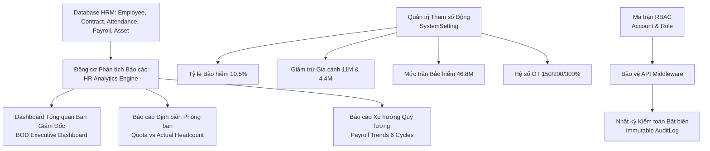

# TÀI LIỆU YÊU CẦU NGHIỆP VỤ (BRD)
## PHÂN HỆ BÁO CÁO PHÂN TÍCH NHÂN SỰ & QUẢN TRỊ HỆ THỐNG (HR ANALYTICS, RBAC & SYSTEM SETTINGS)

---

### THÔNG TIN TÀI LIỆU
* **Tên tài liệu:** Business Requirements Document (BRD) – Phân hệ Báo cáo Phân tích Nhân sự & Quản trị Hệ thống Toàn diện
* **Mã tài liệu:** `BRD-HRM-MOD-09`
* **Phiên bản:** 1.0 (Chuẩn hóa thực tế vận hành)
* **Ngày cập nhật:** 27/10/2026
* **Tác giả:** Ban Dự án Hệ thống HRM & Chuyên gia Phân tích Nghiệp vụ (BA)
* **Tình trạng:** Chờ Phê duyệt (Pending Approval)

---

### MỤC LỤC
1. [Bảng Giải thích Từ viết tắt & Thuật ngữ Nghiệp vụ](#1-bảng-giải-thích-từ-viết-tắt--thuật-ngữ-nghiệp-vụ)
2. [Tóm tắt Điều hành 3 Chiều (Executive Summary)](#2-tóm-tắt-điều-hành-3-chiều-executive-summary)
3. [Mục tiêu Kinh doanh & Đo lường Thành công](#3-mục-tiêu-kinh-doanh--đo-lường-thành-công)
4. [Phân tích Hiện trạng Vận hành (As-Is vs To-Be)](#4-phân-tích-hiện-trạng-vận-hành-as-is-vs-to-be)
5. [Phạm vi Triển khai & Bản đồ Tích hợp Phân hệ](#5-phạm-vi-triển-khai--bản-đồ-tích-hợp-phân-hệ)
6. [Danh mục Yêu cầu Chức năng & Quy tắc Nghiệp vụ Chi tiết](#6-danh-mục-yêu-cầu-chức-năng--quy-tắc-nghiệp-vụ-chi-tiết)
7. [Giả định, Ràng buộc Nghiệp vụ & Quản trị Rủi ro](#7-giả-định-ràng-buộc-nghiệp-vụ--quản-trị-rủi-ro)
8. [Ma trận Phân quyền RBAC & Thiết kế Giao diện Vận hành](#8-ma-trận-phân-quyền-rbac--thiết-kế-giao-diện-vận-hành)

---

### 1. BẢNG GIẢI THÍCH TỪ VIẾT TẮT & THUẬT NGỮ NGHIỆP VỤ

| Từ viết tắt / Thuật ngữ | Tên tiếng Anh đầy đủ | Giải thích Ý nghĩa Nghiệp vụ Dễ hiểu |
| :--- | :--- | :--- |
| **HR Analytics** | Human Resources Analytics & BI | Báo cáo thông minh, phân tích dữ liệu nhân sự đa chiều phục vụ ra quyết định chiến lược cho Ban Giám Đốc. |
| **RBAC** | Role-Based Access Control | Mô hình kiểm soát truy cập dựa trên vai trò phân quyền chi tiết, đảm bảo nguyên tắc đặc quyền tối thiểu (Least Privilege). |
| **Audit Log** | System Audit Log & Trail | Nhật ký kiểm toán bất biến, ghi nhận chi tiết danh tính người thao tác, thời gian, hành động và dữ liệu thay đổi. |
| **System Settings** | Dynamic System Configuration Parameters | Bảng tham số động cấp hệ thống: Tỷ lệ bảo hiểm, mức giảm trừ gia cảnh, ngày công chuẩn, trần lương BHXH... |
| **Department Quota** | Headcount Quota & Capacity Planning | Định biên nhân sự tối đa được Ban Giám Đốc phê duyệt cho từng phòng ban trong năm tài chính. |
| **Fill Rate** | Headcount Fill Rate Percentage | Tỷ lệ lấp đầy định biên nhân sự của phòng ban: $(\text{Thực tế} / \text{Định biên}) \times 100\%$. |
| **Over Quota** | Over Headcount Quota Warning | Cảnh báo vượt định biên nhân sự khi số lượng nhân sự thực tế vượt quá chỉ tiêu phê duyệt. |
| **PII & PDPD** | Personal Identifiable Information & Decree 13/2023/ND-CP | Bảo vệ thông tin nhận dạng cá nhân của người lao động theo Nghị định 13/2023/NĐ-CP về bảo vệ dữ liệu cá nhân. |

---

### 2. TÓM TẮT ĐIỀU HÀNH 3 CHIỀU (EXECUTIVE SUMMARY)

```
       ┌────────────────────────────────────────────────────────┐
       │                TÓM TẮT ĐIỀU HÀNH 3 CHIỀU               │
       └───────────────────────────┬────────────────────────────┘
                                   │
         ┌─────────────────────────┼─────────────────────────┐
         │                         │                         │
         ▼                         ▼                         ▼
┌──────────────────┐      ┌──────────────────┐      ┌──────────────────┐
│ GÓC NHÌN CHIẾN   │      │ GÓC NHÌN BẢO MẬT │      │ GÓC NHÌN LINH HOẠT│
│ LƯỢC BAN GIÁM ĐỐC│      │ (RBAC & NĐ 13)   │      │ & VẬN HÀNH CNTT  │
├──────────────────┤      ├──────────────────┤      ├──────────────────┤
│• Dashboard nhân  │      │• Phân quyền 8 vai│      │• Thay đổi tham số│
│  sự real-time    │         trò chuẩn mực   │         lương/thuế không│
│• Kiểm soát định  │      │• Chặn rò rỉ PII  │         cần sửa code    │
│  biên & quỹ lương│         và lỗ hổng IDOR │• Audit Log bất  │
│• Dự báo xu hướng │      │• Tuân thủ 100%   │  biến ghi nhận   │
│  biến động nhân sự│        Nghị định 13    │  mọi hành động   │
└──────────────────┘      └──────────────────┘      └──────────────────┘
```

* **Góc nhìn Chiến lược Ban Giám Đốc (BOD Insights):** Cung cấp bức tranh toàn cảnh về sức khỏe nguồn nhân lực của toàn công ty theo thời gian thực: Biến động quy mô nhân sự, tỷ lệ lấp đầy định biên từng phòng ban, cơ cấu loại hợp đồng, cơ cấu giới tính và xu hướng biến động quỹ lương 6 kỳ gần nhất.
* **Góc nhìn An ninh Thông tin & Tuân thủ Pháp chế:** Thiết lập lá chắn bảo mật dữ liệu nhân sự với ma trận phân quyền 8 vai trò (RBAC), phòng thủ chặt chẽ các lỗ hổng rò rỉ dữ liệu (IDOR) và lưu vết bất biến mọi hành vi can thiệp dữ liệu qua Nhật ký kiểm toán (Audit Trail) tuân thủ Nghị định 13/2023/NĐ-CP.
* **Góc nhìn Quản trị Vận hành & Khả năng Thích ứng Kỹ thuật:** Cho phép người làm chính sách nhân sự tự do điều chỉnh các tham số nghiệp vụ (Biểu phí bảo hiểm, mức giảm trừ thuế TNCN, ngày công chuẩn, hệ số OT) qua giao diện Cài đặt hệ thống mà không cần phụ thuộc vào lập trình viên can thiệp mã nguồn backend.

---

### 3. MỤC TIÊU KINH DOANH & ĐO LƯỜNG THÀNH CÔNG

#### 3.1. Mục tiêu Kinh doanh Định lượng
1. **Dữ liệu báo cáo tức thì (Zero Latency):** Giảm thời gian kết xuất báo cáo nhân sự định kỳ hàng tháng/quý cho Ban Giám Đốc từ 3 ngày xuống còn 0 giây (Real-time Dashboard).
2. **Kiểm soát định biên nhân sự chặt chẽ:** Tự động cảnh báo ngay khi một phòng ban có nguy cơ hoặc đã vượt định biên (`OVER_QUOTA`), ngăn chặn tuyển dụng tràn lan gây lãng phí ngân sách.
3. **Quản trị tham số tập trung và linh hoạt:** Cập nhật các thay đổi của Luật Lao động và Luật Thuế mới chỉ trong 5 phút thao tác trên giao diện cấu hình.
4. **Bảo mật dữ liệu tuyệt đối:** Đạt chứng nhận tuân thủ bảo vệ dữ liệu cá nhân Nghị định 13/2023/NĐ-CP, ngăn chặn 100% các hành vi xem trộm hoặc trích xuất dữ liệu trái phép.

#### 3.2. Tiêu chí Đánh giá Thành công (KPI Phân hệ)
* **Thời gian phản hồi truy vấn báo cáo phân tích:** `< 1.5 giây`.
* **Mức độ sẵn sàng của tham số chính sách mới khi Luật ban hành:** `100%` cấu hình được ngay lập tức.
* **Số sự cố rò rỉ dữ liệu hoặc vượt quyền (Privilege Escalation):** `0` sự cố.

---

### 4. PHÂN TÍCH HIỆN TRẠNG VẬN HÀNH (AS-IS VS TO-BE)

| Tiêu chí So sánh | Hiện trạng Thủ công (As-Is) | Hệ thống HRM Tự động hóa (To-Be) |
| :--- | :--- | :--- |
| **Báo cáo Nhân sự & Định biên** | Làm báo cáo thủ công trên PowerPoint/Excel; số liệu rời rạc, không cập nhật kịp thời, BOD thiếu căn cứ ra quyết định tuyển dụng. | Dashboard phân tích trực quan dạng biểu đồ (Charts); tự động tính tỷ lệ lấp đầy định biên, phân loại trạng thái `OPEN`, `FULL`, `OVER_QUOTA`. |
| **Cập nhật Tham số Pháp lý** | Khi Nhà nước thay đổi mức lương cơ sở hoặc thuế TNCN, phải nhờ IT sửa code hoặc sửa công thức hàng trăm file Excel, rủi ro lỗi cao. | Giao diện Quản lý tham số động (`SystemSetting`); HR chỉ cần nhập con số mới (ví dụ trần bảo hiểm 46.8 triệu), toàn hệ thống tự động áp dụng. |
| **Phân quyền Người dùng** | Dùng chung tài khoản hoặc phân quyền sơ sài theo nhóm; nhân viên có thể tò mò xem được lương của sếp hoặc hồ sơ nhạy cảm. | Ma trận RBAC 8 vai trò chuyên biệt; kiểm tra quyền chặt chẽ từ API Middleware đến giao diện người dùng; chặn IDOR tuyệt đối. |
| **Theo dõi Truy vết Hành vi** | Không lưu vết; khi xảy ra mất dữ liệu hoặc sửa thông tin hợp đồng trái phép, không thể biết ai là người thực hiện. | Hệ thống Audit Log bất biến (`createAuditLog`); lưu chi tiết người dùng, địa chỉ IP, thời gian và dữ liệu trước/sau chỉnh sửa. |

---

### 5. PHẠM VI TRIỂN KHAI & BẢN ĐỒ TÍCH HỢP PHÂN HỆ

#### 5.1. Kiến trúc Báo cáo & Quản trị Hệ thống



#### 5.2. Danh mục Tham số Nghiệp vụ Mặc định (`DEFAULT_SETTINGS`)
1. **`INSURANCE_RATE`:** $10.5\%$ (BHXH 8%, BHYT 1.5%, BHTN 1% trừ vào lương NLĐ).
2. **`PERSONAL_DEDUCTION`:** $11.000.000 \text{ VNĐ / tháng}$ (Mức giảm trừ bản thân tính thuế TNCN).
3. **`DEPENDENT_DEDUCTION`:** $4.400.000 \text{ VNĐ / người / tháng}$ (Mức giảm trừ mỗi người phụ thuộc hợp lệ).
4. **`MAX_INSURANCE_SALARY`:** $46.800.000 \text{ VNĐ}$ (Mức trần lương tính đóng BHXH bắt buộc - 20 lần mức cơ sở 2.340.000 VNĐ).
5. **`STANDARD_WORKING_DAYS`:** $22 \text{ ngày}$ (Số ngày công định mức trong tháng làm căn cứ chia đơn giá ngày lương).
6. **`PAYROLL_CUTOFF_DAY`:** Ngày $25$ hàng tháng (Chu kỳ chấm công chốt từ 26 tháng trước đến 25 tháng này).
7. **`OT_RATE_NORMAL`:** $150\%$ (Hệ số làm thêm giờ ngày làm việc thường theo Điều 98 BLLĐ).
8. **`OT_RATE_WEEKEND`:** $200\%$ (Hệ số làm thêm giờ ngày nghỉ hàng tuần Thứ 7, Chủ Nhật).
9. **`OT_RATE_HOLIDAY`:** $300\%$ (Hệ số làm thêm giờ ngày nghỉ Lễ, Tết hưởng lương).

---

### 6. DANH MỤC YÊU CẦU CHỨC NĂNG & QUY TẮC NGHIỆP VỤ CHI TIẾT

#### BR-SYS-01: Quản trị Tham số Hệ thống Động (Dynamic System Settings)
* **Mã quy tắc:** `BR-SYS-01`
* **Mô tả:** Các công thức và giá trị hằng số trong hệ thống không được hard-code cố định trong code mà phải được đọc từ bảng `SystemSetting` thông qua hàm helper `getSettingValue(key, defaultValue)`.
* **Quyền hạn:** Chỉ có `SUPER_ADMIN` và `ADMIN` mới được phép chỉnh sửa giá trị tham số.
* **Cơ chế kiểm soát an toàn:** Mọi thao tác cập nhật tham số đều phải được ghi vết vào `AuditLog` với chi tiết giá trị cũ và giá trị mới nhằm phục vụ đối soát.

#### BR-SYS-02: Ma trận Phân quyền 8 Vai trò Chuẩn mực (RBAC Specifications)
* **Mã quy tắc:** `BR-SYS-02`
* **Mô tả:** Hệ thống quy chuẩn hóa 8 vai trò tài khoản với phạm vi chức năng rõ ràng:
  1. **`SUPER_ADMIN`:** Toàn quyền tối thượng hệ thống kỹ thuật.
  2. **`ADMIN`:** Quản trị viên hệ thống, quản lý tài khoản và phân quyền.
  3. **`HR_MANAGER`:** Trưởng phòng Nhân sự, quản lý toàn diện hồ sơ, tuyển dụng, lương thưởng và phê duyệt cấp cao.
  4. **`HR_STAFF`:** Chuyên viên Nhân sự, tác nghiệp chấm công, hồ sơ, tuyển dụng và quản lý tài sản.
  5. **`DEPARTMENT_HEAD`:** Trưởng bộ phận, phê duyệt đơn nghỉ phép, đơn giải trình và đánh giá KPI cấp dưới.
  6. **`MANAGER`:** Quản lý trực tiếp trong các dự án / nhóm làm việc.
  7. **`ACCOUNTANT`:** Kế toán tiền lương, quản lý bảng lương, thanh toán và khấu trừ tài chính.
  8. **`IT_SUPPORT`:** Quản trị thiết bị CNTT, bàn giao thiết bị BM-01 và thu hồi BM-02.
  9. **`EMPLOYEE`:** Nhân viên thông thường, chỉ truy cập Cổng ESS cá nhân (xem công, nộp đơn, xem phiếu lương của chính mình).

#### BR-SYS-03: Kiểm soát Định biên Phòng ban & Tỷ lệ Lấp đầy (Headcount Quota Engine)
* **Mã quy tắc:** `BR-SYS-03`
* **Công thức nghiệp vụ:**
  $$\text{Tỷ lệ lấp đầy (Fill Rate)} = \left(\frac{\text{Số nhân sự thực tế đang làm việc}}{\text{Chỉ tiêu định biên (Quota)}}\right) \times 100\%$$
* **Quy tắc phân loại trạng thái định biên:**
  * Nếu $\text{Thực tế} > \text{Định biên} \longrightarrow$ Trạng thái `OVER_QUOTA` (Cảnh báo vượt định biên màu đỏ).
  * Nếu $\text{Thực tế} = \text{Định biên} \longrightarrow$ Trạng thái `FULL` (Đã đủ định biên màu xanh lá).
  * Nếu $\text{Thực tế} < \text{Định biên} \longrightarrow$ Trạng thái `OPEN` (Còn vị trí tuyển dụng màu xanh dương).

#### BR-SYS-04: Nhật ký Kiểm toán Bất biến (Immutable Audit Trail)
* **Mã quy tắc:** `BR-SYS-04`
* **Mô tả:** Bảng `AuditLog` ghi nhận mọi hành vi làm thay đổi trạng thái của hệ thống bao gồm:
  * Tạo, sửa, xóa hồ sơ nhân viên (`Employee`).
  * Ban hành quyết định nhân sự và ký kết hợp đồng lao động (`Contract`, `Decision`).
  * Khởi tạo, phê duyệt và hoàn tất thủ tục thôi việc (`Offboarding`).
  * Chạy tính bảng lương, khóa sổ kỳ lương và khóa/mở khóa chi trả lương (`PayrollPeriod`, `Payslip`).
  * Bàn giao, thu hồi và xử lý bồi thường tài sản (`AssetAssignment`).
* **Tính bất biến:** Không cung cấp bất kỳ API hoặc giao diện nào cho phép chỉnh sửa hoặc xóa dữ liệu trong bảng `AuditLog`. Chỉ cấp quyền xem (Read-only) cho `SUPER_ADMIN` và `ADMIN`.

---

### 7. GIẢ ĐỊNH, RÀNG BUỘC NGHIỆP VỤ & QUẢN TRỊ RỦI RO

#### 7.1. Giả định Nghiệp vụ
* Toàn bộ nhân viên khi tham gia vào hệ thống đều được cấp tài khoản định danh duy nhất liên kết với mã nhân viên (`Employee.code`).
* Các báo cáo tài chính và quỹ lương được tổng hợp từ các kỳ lương đã chạy thành công trong cơ sở dữ liệu.

#### 7.2. Ràng buộc An ninh & Pháp lý (Decree 13/2023/ND-CP)
* Toàn bộ dữ liệu cá nhân nhạy cảm (Số CCCD, Số tài khoản ngân hàng, Mã số thuế, Chi tiết tiền lương) được kiểm soát truy cập nghiêm ngặt.
* Dữ liệu nhật ký kiểm toán phải được lưu trữ tối thiểu 3 năm phục vụ công tác thanh tra và kiểm toán độc lập.

#### 7.3. Ma trận Rủi ro & Phương án Kiểm soát

| STT | Rủi ro An ninh / Vận hành | Mức độ | Biện pháp Kiểm soát & Chốt chặn Kỹ thuật |
| :---: | :--- | :---: | :--- |
| 1 | Cán bộ kỹ thuật sửa bảng lương trực tiếp | Nghiêm trọng | Bảng `AuditLog` ghi nhận vết thay đổi kèm tài khoản; kiểm toán định kỳ đối soát với phiếu lương đã lưu. |
| 2 | Cấu hình sai tham số thuế làm sai lệch bảng lương | Rất cao | Chỉ `SUPER_ADMIN` mới có quyền lưu tham số; có cơ chế hiển thị cảnh báo xác nhận trước khi lưu giá trị mới. |
| 3 | Vượt định biên nhân sự làm bùng nổ quỹ lương | Cao | Dashboard hiển thị cảnh báo đỏ `OVER_QUOTA` và tự động tích hợp chặn tạo thêm yêu cầu tuyển dụng mới. |

---

### 8. MA TRẬN PHÂN QUYỀN RBAC & THIẾT KẾ GIAO DIỆN VẬN HÀNH

#### 8.1. Ma trận Phân quyền Chức năng (RBAC)

| Chức năng Phân hệ | Super Admin | Admin | HR Manager | Quản lý bộ phận | Kế toán | IT Support | Nhân viên |
| :--- | :---: | :---: | :---: | :---: | :---: | :---: | :---: |
| **Xem Dashboard Báo cáo Toàn diện** | Full | Full | Full | Theo bộ phận | Báo cáo lương | Không | Không |
| **Quản trị Tham số Động (Settings)** | Full | Full | Xem | Không | Xem | Không | Không |
| **Quản lý Tài khoản & Phân quyền RBAC**| Full | Full | Không | Không | Không | Không | Không |
| **Tra cứu Nhật ký Kiểm toán (AuditLog)**| Full | Full | Xem | Không | Không | Không | Không |
| **Xuất Báo cáo Thống kê (Export Excel)**| Full | Full | Full | Bộ phận | Báo cáo lương | Không | Không |

#### 8.2. Thiết kế Giao diện Vận hành (UI/UX Specifications)
1. **Màn hình Dashboard Báo cáo Phân tích (`/internal/reports`):**
   * Thanh Header: Bộ chọn khoảng thời gian, nút "Xuất báo cáo PDF/Excel", hiển thị thời gian cập nhật dữ liệu gần nhất.
   * Hàng 1 - Thống kê Quy mô Nhân sự: 4 Card KPI (Tổng số CBNV, Đang thử việc, Nhân viên chính thức, Đã thôi việc).
   * Hàng 2 - Định biên Phòng ban & Cơ cấu Giới tính:
     * Biểu đồ cột: So sánh Nhân sự thực tế vs Chỉ tiêu định biên của từng phòng ban, gắn thẻ nhãn màu (`OPEN`, `FULL`, `OVER_QUOTA`).
     * Biểu đồ tròn: Cơ cấu giới tính (Nam / Nữ / Khác) và cơ cấu độ tuổi.
   * Hàng 3 - Xu hướng Quỹ lương: Biểu đồ đường thể hiện diễn biến Lương cơ bản, Lương Gross và Lương Net qua 6 kỳ lương gần nhất.
2. **Màn hình Cấu hình Tham số Hệ thống (`/internal/system/settings`):**
   * Phân nhóm danh mục dạng Accordion / Tabs: "Tham số Lương & Bảo hiểm", "Tham số Thuế TNCN", "Tham số Chấm công & Làm thêm giờ".
   * Bảng tham số: Tên tham số, Khóa (`key`), Giá trị hiện tại, Đơn vị tính (`%`, `VNĐ`, `Ngày`), Mô tả căn cứ pháp lý, Nút "Chỉnh sửa" mở modal cập nhật an toàn.
3. **Màn hình Phân quyền & Quản lý Tài khoản (`/internal/system/rbac`):**
   * Danh sách tài khoản người dùng kèm vai trò (`Role`) và trạng thái hoạt động (`isActive`).
   * Bảng ma trận phân quyền trực quan cho phép gán quyền chi tiết theo từng phân hệ.
4. **Màn hình Nhật ký Kiểm toán Hệ thống (`/internal/system/audit-logs`):**
   * Bảng tra cứu thời gian thực: Thời gian (Timestamp), Tài khoản thực hiện (Account/Email), Hành động (Action), Bảng dữ liệu tác động (Table/Record), Chi tiết nội dung thay đổi.
   * Bộ lọc nâng cao theo: Khoảng ngày, Loại hành động (`CREATE`, `UPDATE`, `DELETE`, `OFFBOARDING_FINALIZE`, `LOCK_PAYROLL`), Mã nhân viên.
