# TÀI LIỆU THIẾT KẾ CƠ SỞ DỮ LIỆU TỔNG THỂ (MASTER ERD)
## HỆ THỐNG QUẢN TRỊ NGUỒN NHÂN LỰC DOANH NGHIỆP (ENTERPRISE HRM)

---

### THÔNG TIN TÀI LIỆU
* **Tên tài liệu:** Master Entity Relationship Diagram (ERD) & Database Architecture Specification
* **Mã tài liệu:** `ERD-HRM-SYS-00`
* **Phiên bản:** 1.0 (Chuẩn hóa Schema PostgreSQL & Prisma ORM)
* **Ngày cập nhật:** 27/10/2026
* **Hệ quản trị CSDL:** PostgreSQL 15+ (Relational Database)
* **Công cụ mô hình hóa / ORM:** Prisma ORM 5+
* **Tình trạng:** Bản hoàn thiện chính thức

---

### MỤC LỤC
1. [Tổng quan Kiến trúc CSDL & Nguyên tắc Thiết kế](#1-tổng-quan-kiến-trúc-csdl--nguyên-tắc-thiết-kế)
2. [Sơ đồ Mối quan hệ Thực thể Tổng thể (Master Mermaid ERD)](#2-sơ-đồ-mối-quan-hệ-thực-thể-tổng-thể-master-mermaid-erd)
3. [Phân cụm Miền Dữ liệu (Domain Data Clusters)](#3-phân-cụm-miền-dữ-liệu-domain-data-clusters)
4. [Quy chuẩn Đặt tên, Khóa chính & Kiểu Dữ liệu](#4-quy-chuẩn-đặt-tên-khóa-chính--kiểu-dữ-liệu)
5. [Chiến lược Chỉ mục (Indexing) & Tối ưu Hiệu năng Truy vấn](#5-chiến-lược-chỉ-mục-indexing--tối-ưu-hiệu-năng-truy-vấn)
6. [Bảo mật Dữ liệu & Tuân thủ Nghị định 13/2023/NĐ-CP (PDPD)](#6-bảo-mật-dữ-liệu--tuân-thủ-nghị-định-132023nđ-cp-pdpd)
7. [Danh mục Tài liệu ERD Thành phần](#7-danh-mục-tài-liệu-erd-thành-phần)

---

### 1. TỔNG QUAN KIẾN TRÚC CSDL & NGUYÊN TẮC THIẾT KẾ

Hệ cơ sở dữ liệu của Hệ thống Quản trị Nguồn nhân lực Doanh nghiệp (Enterprise HRM) được xây dựng trên nền tảng **PostgreSQL**, quản lý tập trung và nhất quán thông qua **Prisma ORM**. Mô hình dữ liệu được thiết kế theo nguyên lý **Lấy Nhân viên làm Trọng tâm (Employee-Centric Relational Model)**, trong đó thực thể `Employee` đóng vai trò là điểm hội tụ (Hub) của toàn bộ các giao dịch nghiệp vụ trong vòng đời nhân sự.

#### 5 Nguyên tắc Thiết kế Cốt lõi:
1. **Tính Toàn vẹn Khóa Ngoại Tuyệt đối (Strict Referential Integrity):** Toàn bộ các quan hệ giữa các bảng được ràng buộc bằng Khóa ngoại (Foreign Key) chặt chẽ, ngăn ngừa triệt để dữ liệu mồ côi (Orphan Records).
2. **Khóa Chính Định danh Toàn cầu (UUIDv4 Primary Keys):** Sử dụng chuỗi định danh ngẫu nhiên chuẩn UUIDv4 cho 100% các bảng giao dịch để đảm bảo tính an toàn, chống tấn công dự đoán ID (Enumeration Attack) và sẵn sàng mở rộng phân tán.
3. **Bảo mật Dữ liệu Riêng tư (Data Privacy & PII Segregation):** Các trường dữ liệu nhạy cảm của người lao động (CCCD, Số sổ BHXH, Mã số thuế, Tài khoản ngân hàng, Tiền lương) được phân quyền truy cập nghiêm ngặt và lưu vết kiểm toán bất biến (`AuditLog`).
4. **Kiểm soát Toàn vẹn Lịch sử (Audit Trail & Soft-delete):** Đối với các tài sản, hợp đồng, quyết định và nhân sự đã phát sinh nghiệp vụ, hệ thống không cho phép xóa vật lý (Hard Delete) mà áp dụng cơ chế đánh dấu cờ (`isDeleted`, `status = RESIGNED / TERMINATED`) kết hợp lưu vết lịch sử (`EmploymentHistory`, `AuditLog`).
5. **Tham số hóa Động Cấp Hệ thống (Dynamic Parameterization):** Các tỷ lệ trích nộp bảo hiểm, biểu thuế TNCN, định mức giảm trừ gia cảnh, ngày công chuẩn và hệ số làm thêm giờ không được hard-code mà lưu tại bảng `SystemSetting`, giúp hệ thống thích ứng tức thì với các thay đổi pháp luật.

---

### 2. SƠ ĐỒ MỐI QUAN HỆ THỰC THỂ TỔNG THỂ (MASTER MERMAID ERD)

```mermaid
erDiagram
    %% CLUSTER: CORE ORG & EMPLOYEE
    Department ||--o{ Department : "parent / children"
    Department ||--o{ Position : "has positions"
    Department ||--o{ Employee : "belongs to"
    Position ||--o{ Employee : "assigned to"
    Employee ||--o{ Employee : "direct manager / subordinates"
    Employee ||--o| Account : "authenticated via"
    
    %% CLUSTER: RECRUITMENT ATS
    Department ||--o{ JobPosting : "recruiting for"
    Position ||--o{ JobPosting : "vacancies"
    JobPosting ||--o{ Candidate : "receives"
    Candidate ||--o{ InterviewRound : "interviewed"
    InterviewRound ||--o{ CandidateFeedback : "scored by"
    Candidate ||--o| JobOffer : "offered"
    Candidate ||--o| PreOnboardingProfile : "submits pre-data"
    
    %% CLUSTER: ONBOARDING & HR DECISIONS
    Employee ||--o{ OnboardingTask : "must complete"
    Employee ||--o{ Decision : "subject of"
    Department ||--o{ Decision : "transferred to"
    Position ||--o{ Decision : "promoted to"
    Employee ||--o{ EmploymentHistory : "career history"
    Employee ||--o{ Relative : "dependents / family"
    Employee ||--o{ Degree : "education"
    Employee ||--o{ Certificate : "credentials"
    Employee ||--o{ ProfileChangeRequest : "submits requests"
    
    %% CLUSTER: CONTRACTS
    Employee ||--o{ Contract : "signs"
    Contract ||--o{ ContractAppendix : "amended by"
    
    %% CLUSTER: ASSETS
    Asset ||--o{ AssetAssignment : "assigned via"
    Employee ||--o{ AssetAssignment : "responsible for"
    
    %% CLUSTER: TIME & ATTENDANCE
    Employee ||--o{ Attendance : "punches in/out"
    Employee ||--o{ AttendanceAdjustment : "regularizes"
    Employee ||--o{ LeaveBalance : "entitled to"
    Employee ||--o{ LeaveRequest : "requests"
    Employee ||--o{ OTRequest : "submits overtime"
    
    %% CLUSTER: KPI & PAYROLL
    ReviewCycle ||--o{ PerformanceReview : "cycle reviews"
    Employee ||--o{ PerformanceReview : "evaluated"
    Employee ||--o{ KPI : "assigned goals"
    PayrollPeriod ||--o{ Payslip : "contains"
    Employee ||--o{ Payslip : "receives"
    Payslip ||--o{ PayslipDetail : "itemized in"
    
    %% CLUSTER: SECURITY & SYSTEM
    Role ||--o{ Account : "assigned to"
    Role ||--o{ RolePermission : "grants"
    Permission ||--o{ RolePermission : "defines"
```

---

### 3. PHÂN CỤM MIỀN DỮ LIỆU (DOMAIN DATA CLUSTERS)

Hệ thống cơ sở dữ liệu HRM gồm **34 Thực thể (Models)** và **10 Kiểu liệt kê (Enums)**, được phân rã thành 7 phân cụm miền nghiệp vụ chuyên biệt:

| Phân cụm Miền Dữ liệu | Danh sách Bảng CSDL (Models) | Vai trò & Mục đích Nghiệp vụ |
| :--- | :--- | :--- |
| **1. Cơ cấu Tổ chức & Nhân sự** | `Department`, `Position`, `Employee`, `ProfileChangeRequest`, `EmploymentHistory` | Quản lý cây phòng ban, chức danh định biên, hồ sơ nhân sự 360 độ và lịch sử công tác. |
| **2. Tuyển dụng Nhân tài (ATS)** | `JobPosting`, `Candidate`, `CandidateUser`, `CandidateVerificationOtp`, `InterviewRound`, `CandidateFeedback`, `JobOffer`, `PreOnboardingProfile` | Số hóa phễu tuyển dụng Kanban, lịch phỏng vấn, bảng điểm Scorecard, Thư mời nhận việc và cổng ứng viên. |
| **3. Hợp đồng, Quyết định & Hồ sơ** | `Contract`, `ContractAppendix`, `Decision`, `Relative`, `Degree`, `Certificate`, `OnboardingTask` | HĐLĐ chuẩn Điều 20 BLLĐ, phụ lục hợp đồng, văn bản quyết định pháp quy, người phụ thuộc thuế và bằng cấp. |
| **4. Quản lý Tài sản & Bàn giao** | `Asset`, `AssetAssignment` | Kho thiết bị định danh Serial, Biên bản bàn giao Onboarding BBBG-LLA (BM-01), Biên bản thu hồi bồi thường (BM-02). |
| **5. Ca kíp, Chấm công & Nghỉ phép** | `Shift`, `Holiday`, `Attendance`, `AttendanceAdjustment`, `LeaveBalance`, `LeaveRequest`, `LeaveTypeConfig`, `LeavePolicy`, `OTRequest` | Quản lý ca làm việc, quẹt thẻ Check-in/out, đơn giải trình công, quỹ phép năm, đơn xin nghỉ và làm thêm giờ OT. |
| **6. Đánh giá KPI & Tiền lương** | `ReviewCycle`, `KPI`, `PerformanceReview`, `KPITemplate`, `PayrollPeriod`, `Payslip`, `PayslipDetail`, `Allowance`, `TaxBracket` | Chu kỳ đánh giá hiệu suất, kỳ lương tháng, phiếu lương chi tiết, thuế TNCN lũy tiến 7 bậc và bảo hiểm bắt buộc. |
| **7. Phân quyền & Quản trị Hệ thống** | `Account`, `Role`, `Permission`, `RolePermission`, `AuditLog`, `SystemSetting` | Ma trận bảo mật RBAC, tài khoản đăng nhập, nhật ký kiểm toán bất biến và tham số nghiệp vụ động. |

---

### 4. QUY CHUẨN ĐẶT TÊN, KHÓA CHÍNH & KIỂU DỮ LIỆU

#### 4.1. Quy chuẩn Đặt tên (Naming Conventions)
* **Tên Bảng (Models):** Viết theo chuẩn PascalCase (VD: `Employee`, `JobPosting`, `AssetAssignment`).
* **Tên Cột (Attributes):** Viết theo chuẩn camelCase (VD: `fullName`, `startDate`, `baseSalary`, `insuranceSalary`).
* **Khóa chính (Primary Key):** Luôn đặt tên là `id`, kiểu `String`, sinh tự động `@default(uuid())`.
* **Khóa ngoại (Foreign Key):** Đặt tên theo cú pháp `{tên_thực_thể_liên_kết}Id` (VD: `departmentId`, `positionId`, `employeeId`, `payrollPeriodId`).
* **Trường Thời gian (Timestamps):** Chuẩn hóa `createdAt` (mặc định `@default(now())`) và `updatedAt` (`@updatedAt`).

#### 4.2. Quy chuẩn Kiểu Dữ liệu Tiêu chuẩn trong PostgreSQL
* **Tiền tệ & Điểm số (Currency & Financial Amounts):** Sử dụng kiểu `Decimal` (`@db.Decimal` trong Postgres) cho toàn bộ các trường liên quan đến tiền tệ (`baseSalary`, `grossSalary`, `netSalary`, `price`, `compensationAmount`) và điểm số (`score`, `workingDay`, `usedDays`) để tránh sai số dấu phẩy động (Floating-point rounding errors).
* **Ngày tháng không có giờ (Date only):** Sử dụng `@db.Date` cho các trường ngày công, ngày sinh, ngày nghỉ lễ (`Attendance.date`, `Holiday.date`, `OTRequest.date`).
* **Văn bản dài (Unbounded Text):** Sử dụng `@db.Text` cho các trường mô tả công việc, nội dung quyết định, ghi chú biên bản (`JobPosting.description`, `Decision.reason`, `AssetAssignment.itemsJson`).

---

### 5. CHIẾN LƯỢC CHỈ MỤC (INDEXING) & TỐI ƯU HIỆU NĂNG

Để đảm bảo thời gian phản hồi API luôn dưới 500ms đối với quy mô hàng ngàn nhân viên và hàng trăm ngàn bản ghi chấm công:

1. **Chỉ mục Toàn vẹn Duy nhất (Unique Constraints):**
   * `Employee.code`, `Employee.cccd`, `Employee.email`: Chống trùng lặp định danh nhân sự.
   * `Department.code`, `Position.code`: Chống trùng mã phòng ban và chức danh.
   * `Asset.code`: Định danh thiết bị phần cứng.
   * `PayrollPeriod.monthYear`: Đảm bảo mỗi tháng chỉ tồn tại một kỳ lương duy nhất.
   * `Candidate(email, jobPostingId)`: Ngăn ứng viên nộp trùng 1 tin tuyển dụng.
2. **Chỉ mục Tìm kiếm & Lọc (Search & Filtering Indexes):**
   * `Attendance(employeeId, date)`: Tối ưu hóa truy vấn bảng công cá nhân theo tháng.
   * `Candidate(status)`, `Candidate(jobPostingId)`: Tối ưu hóa hiển thị bảng Kanban tuyển dụng.
   * `Contract(employeeId, status)`: Tối ưu hóa tra cứu hợp đồng có hiệu lực.
   * `AssetAssignment(employeeId, status)`: Tối ưu hóa kiểm tra chốt chặn tài sản khi thôi việc.
   * `AuditLog(tableName, recordId, createdAt)`: Tối ưu hóa truy vết kiểm toán.

---

### 6. BẢO MẬT DỮ LIỆU & TUÂN THỦ NGHỊ ĐỊNH 13/2023/NĐ-CP (PDPD)

Cơ sở dữ liệu HRM lưu trữ các trường dữ liệu cá nhân nhạy cảm (PII) được pháp luật Việt Nam bảo vệ nghiêm ngặt:
* **Đồng thuận Xử lý Dữ liệu:** Trường `Employee.dataConsent` và `dataConsentDate` ghi nhận minh chứng người lao động đồng ý cho doanh nghiệp xử lý dữ liệu cá nhân khi ký kết HĐLĐ.
* **Chống Rò rỉ qua IDOR:** Toàn bộ các truy vấn liên quan đến `Payslip`, `Attendance`, `LeaveRequest` đều bắt buộc phải đối chiếu `req.user.employeeId === record.employeeId` ở tầng ứng dụng trước khi thực thi truy vấn cơ sở dữ liệu.
* **Xóa Dữ liệu An ninh Thiết bị:** Cờ `AssetAssignment.securityWiped = true` xác nhận ổ cứng thiết bị cũ đã được xóa sạch dữ liệu nội bộ trước khi cấp cho nhân viên mới.

---

### 7. DANH MỤC TÀI LIỆU ERD THÀNH PHẦN

Chi tiết thiết kế mô hình dữ liệu, từ điển bảng, quan hệ khóa ngoại và ràng buộc nghiệp vụ được trình bày cụ thể tại 7 tài liệu ERD chuyên sâu:

1. [01_ERD_Co_Cau_To_Chuc_Va_Nhan_Su.md](./01_ERD_Co_Cau_To_Chuc_Va_Nhan_Su.md) – *Phân cụm Cơ cấu Tổ chức, Phòng ban, Vị trí & Hồ sơ Nhân sự 360°*
2. [02_ERD_Tuyen_Dung_ATS.md](./02_ERD_Tuyen_Dung_ATS.md) – *Phân cụm Tuyển dụng ATS, Ứng viên, Phỏng vấn & Thư mời Offer*
3. [03_ERD_Hop_Dong_Quyet_Dinh_Va_Ho_So.md](./03_ERD_Hop_Dong_Quyet_Dinh_Va_Ho_So.md) – *Phân cụm Hợp đồng Lao động (Điều 20), Quyết định Nhân sự & Thân nhân*
4. [04_ERD_Quan_Ly_Tai_San_Thiet_Bi.md](./04_ERD_Quan_Ly_Tai_San_Thiet_Bi.md) – *Phân cụm Quản lý Kho Thiết bị, Bàn giao BBBG-LLA & Thu hồi BM-02*
5. [05_ERD_Cham_Cong_Nghi_Phep_OT.md](./05_ERD_Cham_Cong_Nghi_Phep_OT.md) – *Phân cụm Ca kíp, Chấm công, Giải trình, Quỹ phép năm & Làm thêm giờ OT*
6. [06_ERD_KPI_Va_Tien_Luong.md](./06_ERD_KPI_Va_Tien_Luong.md) – *Phân cụm Đánh giá Hiệu suất KPI & Động cơ Tính lương (Thuế 7 bậc, BHXH)*
7. [07_ERD_Phan_Quyen_Va_He_Thong.md](./07_ERD_Phan_Quyen_Va_He_Thong.md) – *Phân cụm Tài khoản, Phân quyền RBAC, Nhật ký AuditLog & Tham số Động*
