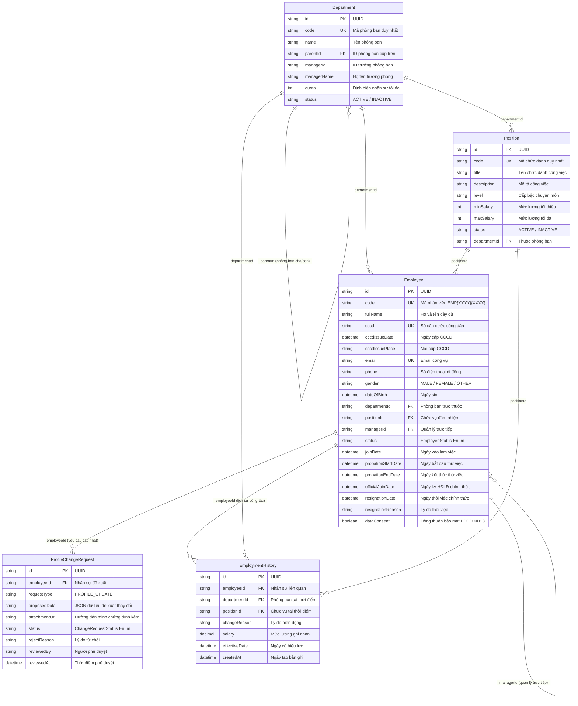

# TÀI LIỆU THIẾT KẾ CƠ SỞ DỮ LIỆU (ERD)
## PHÂN CỤM: CƠ CẤU TỔ CHỨC & HỒ SƠ NHÂN SỰ 360° (ORG & EMPLOYEE)

---

### THÔNG TIN TÀI LIỆU
* **Tên tài liệu:** Entity Relationship Diagram (ERD) – Phân cụm Cơ cấu Tổ chức, Chức danh & Hồ sơ Nhân sự
* **Mã tài liệu:** `ERD-HRM-MOD-01`
* **Phiên bản:** 1.0 (Chuẩn hóa Schema PostgreSQL & Prisma ORM)
* **Ngày cập nhật:** 27/10/2026
* **Các thực thể chính:** `Department`, `Position`, `Employee`, `ProfileChangeRequest`, `EmploymentHistory`
* **Tình trạng:** Bản hoàn thiện chính thức

---

### MỤC LỤC
1. [Sơ đồ Quan hệ Thực thể Phân cụm (Domain Mermaid ERD)](#1-sơ-đồ-quan-hệ-thực-thể-phân-cụm-domain-mermaid-erd)
2. [Từ điển Dữ liệu Chi tiết (Data Dictionary)](#2-từ-điển-dữ-liệu-chi-tiết-data-dictionary)
3. [Đặc tả Các Kiểu Liệt kê (Enumerations)](#3-đặc-tả-các-kiểu-liệt-kê-enumerations)
4. [Ràng buộc Khóa ngoại & Chiến lược Thác dữ liệu (Foreign Keys & Cascades)](#4-ràng-buộc-khóa-ngoại--chiến-lược-thác-dữ-liệu-foreign-keys--cascades)
5. [Quy tắc Toàn vẹn Dữ liệu & Nghiệp vụ Trọng yếu](#5-quy-tắc-toàn-vẹn-dữ-liệu--nghiệp-vụ-trọng-yếu)

---

### 1. SƠ ĐỒ QUAN HỆ THỰC THỂ PHÂN CỤM (DOMAIN MERMAID ERD)



---

### 2. TỪ ĐIỂN DỮ LIỆU CHI TIẾT (DATA DICTIONARY)

#### 2.1 Bảng `Department` (Phòng ban / Đơn vị tổ chức)
| Tên Cột | Kiểu Dữ liệu | Nullable | Mặc định | Khóa | Ý nghĩa Nghiệp vụ & Ràng buộc |
| :--- | :--- | :---: | :---: | :---: | :--- |
| `id` | `String` (UUID) | Không | `uuid()` | PK | Định danh duy nhất toàn cầu của phòng ban. |
| `code` | `String` | Không | - | UK | Mã phòng ban duy nhất, viết hoa không dấu (VD: `DEPT_DEV`, `DEPT_MKT`). |
| `name` | `String` | Không | - | - | Tên đầy đủ của phòng ban (VD: Phòng Lập trình Phần mềm). |
| `parentId` | `String` | Có | `null` | FK | Khóa ngoại trỏ về `Department.id` (cây phả hệ cha - con). |
| `managerId` | `String` | Có | `null` | - | Mã nhân sự của Trưởng bộ phận phụ trách duyệt đơn cấp 1. |
| `managerName` | `String` | Có | `null` | - | Họ tên của Trưởng phòng (phục vụ hiển thị nhanh không cần join). |
| `quota` | `Int` | Không | `15` | - | Hạn mức định biên nhân sự tối đa được cấp ngân sách. |
| `status` | `String` | Không | `"ACTIVE"` | - | Trạng thái phòng ban: `ACTIVE` (Hoạt động) hoặc `INACTIVE` (Ngừng). |

#### 2.2 Bảng `Position` (Vị trí / Chức danh công việc)
| Tên Cột | Kiểu Dữ liệu | Nullable | Mặc định | Khóa | Ý nghĩa Nghiệp vụ & Ràng buộc |
| :--- | :--- | :---: | :---: | :---: | :--- |
| `id` | `String` (UUID) | Không | `uuid()` | PK | Định danh duy nhất toàn cầu của chức danh. |
| `code` | `String` | Có | - | UK | Mã chức danh duy nhất (VD: `POS_LEAD_FE`, `POS_MID_BE`). |
| `title` | `String` | Không | - | - | Tên chức danh công việc (VD: Senior Frontend Engineer). |
| `description` | `String` | Có | `null` | - | Bảng mô tả công việc (JD) tiêu chuẩn. |
| `level` | `String` | Không | `"Staff"` | - | Cấp bậc: Intern, Fresher, Junior, Middle, Senior, Lead, Manager. |
| `minSalary` | `Int` | Không | `0` | - | Mức lương tối thiểu của dải lương chuẩn (VNĐ). |
| `maxSalary` | `Int` | Không | `0` | - | Mức lương tối đa của dải lương chuẩn (VNĐ). |
| `status` | `String` | Không | `"ACTIVE"` | - | Trạng thái chức danh. |
| `departmentId` | `String` | Có | `null` | FK | Khóa ngoại liên kết phòng ban trực thuộc `Department.id`. |

#### 2.3 Bảng `Employee` (Hồ sơ Nhân sự 360°)
| Tên Cột | Kiểu Dữ liệu | Nullable | Mặc định | Khóa | Ý nghĩa Nghiệp vụ & Ràng buộc |
| :--- | :--- | :---: | :---: | :---: | :--- |
| `id` | `String` (UUID) | Không | `uuid()` | PK | Định danh duy nhất toàn cầu của nhân sự. |
| `code` | `String` | Không | - | UK | Mã nhân viên chuẩn hóa bất biến `EMP{YYYY}{XXXX}`. |
| `fullName` | `String` | Không | - | - | Họ và tên đầy đủ theo giấy tờ tùy thân. |
| `cccd` | `String` | Có | `null` | UK | Số Căn cước công dân (12 chữ số) duy nhất. |
| `cccdIssueDate`| `DateTime` | Có | `null` | - | Ngày cấp CCCD. |
| `cccdIssuePlace`| `String` | Có | `null` | - | Nơi cấp CCCD (Cục CSQLHC về TTXH). |
| `cccdExpiryDate`| `DateTime` | Có | `null` | - | Ngày hết hạn CCCD theo luật cư trú. |
| `email` | `String` | Có | `null` | UK | Email công vụ định danh (VD: `nhanvien@lla.net.vn`). |
| `personalEmail`| `String` | Có | `null` | - | Email cá nhân phục vụ liên hệ khẩn cấp. |
| `phone` | `String` | Có | `null` | - | Số điện thoại di động chính. |
| `gender` | `String` | Có | `null` | - | Giới tính: `MALE`, `FEMALE`, `OTHER`. |
| `dateOfBirth` | `DateTime` | Có | `null` | - | Ngày tháng năm sinh. |
| `address` | `String` | Có | `null` | - | Địa chỉ cư trú hiện tại. |
| `taxCode` | `String` | Có | `null` | - | Mã số thuế thu nhập cá nhân. |
| `socialInsurance`| `String` | Có | `null` | - | Số sổ bảo hiểm xã hội bắt buộc. |
| `bankName` | `String` | Có | `null` | - | Tên ngân hàng nhận chi trả lương. |
| `bankAccount` | `String` | Có | `null` | - | Số tài khoản ngân hàng chi trả lương. |
| `status` | `EmployeeStatus` | Không | `ACTIVE` | - | Trạng thái vòng đời nhân sự (Enum). |
| `departmentId` | `String` | Có | `null` | FK | Khóa ngoại phòng ban `Department.id`. |
| `positionId` | `String` | Có | `null` | FK | Khóa ngoại chức danh `Position.id`. |
| `managerId` | `String` | Có | `null` | FK | Khóa ngoại trỏ tới Quản lý trực tiếp `Employee.id`. |
| `joinDate` | `DateTime` | Không | - | - | Ngày chính thức gia nhập công ty. |
| `resignationDate`| `DateTime` | Có | `null` | - | Ngày thôi việc chính thức theo quy định. |
| `dataConsent` | `Boolean` | Không | `true` | - | Cờ xác nhận đồng thuận bảo vệ dữ liệu PDPD Nghị định 13. |

#### 2.4 Bảng `ProfileChangeRequest` (Yêu cầu Cập nhật Thông tin Cá nhân)
| Tên Cột | Kiểu Dữ liệu | Nullable | Mặc định | Khóa | Ý nghĩa Nghiệp vụ & Ràng buộc |
| :--- | :--- | :---: | :---: | :---: | :--- |
| `id` | `String` (UUID) | Không | `uuid()` | PK | Định danh duy nhất của yêu cầu. |
| `employeeId` | `String` | Không | - | FK | Khóa ngoại nhân viên gửi yêu cầu `Employee.id`. |
| `requestType` | `String` | Không | `"PROFILE_UPDATE"` | - | Phân loại yêu cầu thay đổi. |
| `proposedData`| `String` (Text) | Không | - | - | Dữ liệu JSON chứa các trường thông tin mới muốn cập nhật. |
| `attachmentUrl`| `String` | Có | `null` | - | Link minh chứng scan (ảnh CCCD mới, sổ hộ khẩu...). |
| `status` | `ChangeRequestStatus` | Không | `PENDING`| - | Trạng thái phê duyệt: `PENDING`, `APPROVED`, `REJECTED`. |
| `rejectReason` | `String` | Có | `null` | - | Lý do từ chối phê duyệt từ phòng Nhân sự. |
| `reviewedBy` | `String` | Có | `null` | - | Mã cán bộ HR đã xử lý hồ sơ. |
| `reviewedAt` | `DateTime` | Có | `null` | - | Thời điểm hoàn tất phê duyệt. |

#### 2.5 Bảng `EmploymentHistory` (Nhật ký Lịch sử Công tác)
| Tên Cột | Kiểu Dữ liệu | Nullable | Mặc định | Khóa | Ý nghĩa Nghiệp vụ & Ràng buộc |
| :--- | :--- | :---: | :---: | :---: | :--- |
| `id` | `String` (UUID) | Không | `uuid()` | PK | Định danh duy nhất của bản ghi lịch sử. |
| `employeeId` | `String` | Không | - | FK | Khóa ngoại nhân viên `Employee.id`. |
| `departmentId`| `String` | Có | `null` | FK | Khóa ngoại phòng ban tại mốc biến động. |
| `positionId` | `String` | Có | `null` | FK | Khóa ngoại chức danh tại mốc biến động. |
| `changeReason`| `String` | Không | - | - | Lý do: `NEW_HIRE`, `PROMOTION`, `TRANSFER`, `TERMINATION`. |
| `salary` | `Decimal` | Có | `null` | - | Mức lương ghi nhận tại thời điểm biến động. |
| `effectiveDate`| `DateTime` | Không | `now()` | - | Ngày quyết định bắt đầu có hiệu lực thực tế. |

---

### 3. ĐẶC TẢ CÁC KIỂU LIỆT KÊ (ENUMERATIONS)

```prisma
enum EmployeeStatus {
  ONBOARDING       // Đang trong quy trình hội nhập, chuẩn bị tiếp nhận
  INTERNSHIP       // Nhân sự thực tập sinh
  PROBATION        // Đang trong thời gian thử việc (tối đa 60 ngày)
  ACTIVE           // Nhân viên chính thức đang làm việc
  MATERNITY_LEAVE  // Đang nghỉ thai sản theo chế độ BHXH
  UNPAID_LEAVE     // Đang nghỉ không lương tạm thời
  SUSPENDED        // Đang tạm đình chỉ công tác
  RESIGNED         // Đã thôi việc, hoàn tất thủ tục bàn giao
}

enum ChangeRequestStatus {
  PENDING   // Đang chờ HR đối soát hồ sơ gốc
  APPROVED  // Đã chấp thuận, dữ liệu tự động cập nhật vào Employee
  REJECTED  // Bị từ chối do thiếu minh chứng hợp pháp
}
```

---

### 4. RÀNG BUỘC KHÓA NGOẠI & CHIẾN LƯỢC THÁC DỮ LIỆU (FOREIGN KEYS & CASCADES)

1. **`Department(parentId) -> Department(id)`:** Quan hệ phả hệ đệ quy; sử dụng `onDelete: Restrict` nhằm ngăn chặn xóa phòng ban cha khi còn phòng ban con trực thuộc.
2. **`Employee(departmentId) -> Department(id)`:** `onDelete: SetNull` khi điều chuyển; tuy nhiên ở tầng API áp dụng `Hard Deletion Lock` chặn xóa phòng ban nếu còn nhân sự đang hoạt động.
3. **`Employee(managerId) -> Employee(id)`:** Tự liên kết phân cấp quản lý trực tiếp; khi cấp trên thôi việc, hệ thống cập nhật `managerId = null` để bổ nhiệm quản lý mới.
4. **`ProfileChangeRequest(employeeId) -> Employee(id)`:** Áp dụng `onDelete: Cascade` – nếu hồ sơ nhân sự bị xóa hoàn toàn khỏi hệ thống, toàn bộ yêu cầu thay đổi liên quan sẽ tự động bị dọn dẹp.
5. **`EmploymentHistory(employeeId) -> Employee(id)`:** Lưu vết bất biến (Immutable Audit Records) phục vụ thanh tra lao động.

---

### 5. QUY TẮC TOÀN VẸN DỮ LIỆU & NGHIỆP VỤ TRỌNG YẾU

* **Thuật toán Chống Vòng Lặp Phả hệ (Anti-Circular Hierarchy):** Trước khi cập nhật trường `Department.parentId`, hệ thống chạy đệ quy kiểm tra cây: Đảm bảo phòng ban cha mới không nằm trong tập hợp các con cháu của chính phòng ban đó.
* **Quy chuẩn Mã Nhân sự:** Cột `Employee.code` là duy nhất toàn hệ thống (`@unique`), được sinh theo cú pháp `EMP{YYYY}{XXXX}` và đóng băng không cho phép sửa đổi (Read-only) sau khi lưu.
* **Cơ chế Duyệt Thay đổi Thông tin Cá nhân:** Nhân viên không được tự ý sửa trực tiếp thông tin CCCD, Số tài khoản ngân hàng trên cổng ESS mà phải gửi qua bảng `ProfileChangeRequest` kèm ảnh chụp minh chứng. Chỉ khi HR phê duyệt (`APPROVED`), dữ liệu mới được ánh xạ vào bảng `Employee`.
