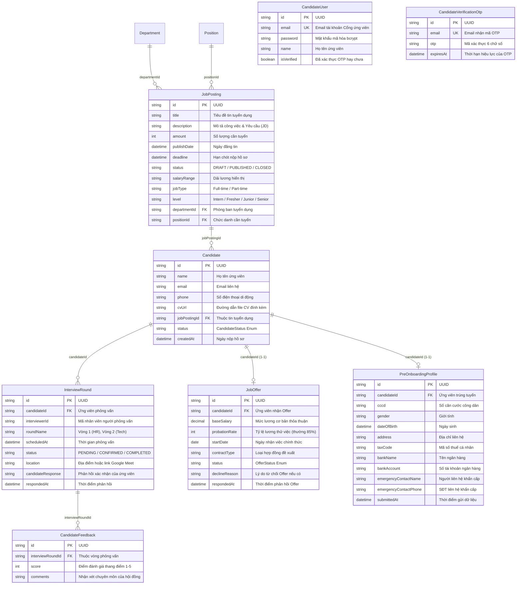

# TÀI LIỆU THIẾT KẾ CƠ SỞ DỮ LIỆU (ERD)
## PHÂN CỤM: TUYỂN DỤNG NHÂN TÀI & PHỄU ỨNG VIÊN (RECRUITMENT ATS)

---

### THÔNG TIN TÀI LIỆU
* **Tên tài liệu:** Entity Relationship Diagram (ERD) – Phân cụm Tuyển dụng ATS, Ứng viên, Phỏng vấn & Thư mời Offer
* **Mã tài liệu:** `ERD-HRM-MOD-02`
* **Phiên bản:** 1.0 (Chuẩn hóa Schema PostgreSQL & Prisma ORM)
* **Ngày cập nhật:** 27/10/2026
* **Các thực thể chính:** `JobPosting`, `Candidate`, `CandidateUser`, `CandidateVerificationOtp`, `InterviewRound`, `CandidateFeedback`, `JobOffer`, `PreOnboardingProfile`
* **Tình trạng:** Bản hoàn thiện chính thức

---

### MỤC LỤC
1. [Sơ đồ Quan hệ Thực thể Phân cụm (Domain Mermaid ERD)](#1-sơ-đồ-quan-hệ-thực-thể-phân-cụm-domain-mermaid-erd)
2. [Từ điển Dữ liệu Chi tiết (Data Dictionary)](#2-từ-điển-dữ-liệu-chi-tiết-data-dictionary)
3. [Đặc tả Các Kiểu Liệt kê (Enumerations)](#3-đặc-tả-các-kiểu-liệt-kê-enumerations)
4. [Ràng buộc Khóa ngoại & Chiến lược Thác dữ liệu (Foreign Keys & Cascades)](#4-ràng-buộc-khóa-ngoại--chiến-lược-thác-dữ-liệu-foreign-keys--cascades)
5. [Quy tắc Toàn vẹn Dữ liệu & Tối ưu Hiệu năng](#5-quy-tắc-toàn-vẹn-dữ-liệu--tối-ưu-hiệu-năng)

---

### 1. SƠ ĐỒ QUAN HỆ THỰC THỂ PHÂN CỤM (DOMAIN MERMAID ERD)



---

### 2. TỪ ĐIỂN DỮ LIỆU CHI TIẾT (DATA DICTIONARY)

#### 2.1 Bảng `JobPosting` (Tin / Nhu cầu Tuyển dụng)
| Tên Cột | Kiểu Dữ liệu | Nullable | Mặc định | Khóa | Ý nghĩa Nghiệp vụ & Ràng buộc |
| :--- | :--- | :---: | :---: | :---: | :--- |
| `id` | `String` (UUID) | Không | `uuid()` | PK | Định danh duy nhất toàn cầu của tin tuyển dụng. |
| `title` | `String` | Không | - | - | Tiêu đề tin tuyển dụng (VD: Senior Node.js Developer). |
| `description` | `String` (Text) | Không | - | - | Nội dung mô tả công việc, trách nhiệm và quyền lợi. |
| `amount` | `Int` | Không | `1` | - | Số lượng nhân sự cần tuyển dụng cho chỉ tiêu này. |
| `publishDate` | `DateTime` | Có | `null` | - | Ngày bắt đầu mở đăng tin tuyển dụng ra bên ngoài. |
| `deadline` | `DateTime` | Có | `null` | - | Hạn chót nhận hồ sơ ứng tuyển. |
| `status` | `String` | Không | `"DRAFT"` | - | Trạng thái: `DRAFT` (Nháp), `PUBLISHED` (Đang đăng), `CLOSED` (Đóng). |
| `salaryRange` | `String` | Có | `null` | - | Khung lương hiển thị (VD: "15 - 25 triệu", "Thỏa thuận"). |
| `jobType` | `String` | Không | `"Full-time"` | - | Hình thức làm việc: `Full-time`, `Part-time`, `Internship`. |
| `level` | `String` | Có | `null` | - | Cấp bậc tuyển dụng: Intern, Fresher, Junior, Senior, Manager. |
| `departmentId`| `String` | Có | `null` | FK | Khóa ngoại phòng ban tuyển dụng `Department.id`. |
| `positionId` | `String` | Có | `null` | FK | Khóa ngoại chức danh tuyển dụng `Position.id`. |

#### 2.2 Bảng `Candidate` (Hồ sơ Ứng viên)
| Tên Cột | Kiểu Dữ liệu | Nullable | Mặc định | Khóa | Ý nghĩa Nghiệp vụ & Ràng buộc |
| :--- | :--- | :---: | :---: | :---: | :--- |
| `id` | `String` (UUID) | Không | `uuid()` | PK | Định danh duy nhất toàn cầu của ứng viên. |
| `name` | `String` | Không | - | - | Họ và tên đầy đủ của ứng viên. |
| `email` | `String` | Không | - | - | Email liên hệ chính của ứng viên. |
| `phone` | `String` | Có | `null` | - | Số điện thoại di động liên hệ. |
| `cvUrl` | `String` | Có | `null` | - | Đường dẫn tải xuống file CV bản gốc (PDF/Docx). |
| `jobPostingId`| `String` | Không | - | FK | Khóa ngoại tin tuyển dụng ứng tuyển `JobPosting.id`. |
| `status` | `CandidateStatus`| Không | `APPLIED` | - | Trạng thái chặng phễu tuyển dụng Kanban (Enum). |
| `createdAt` | `DateTime` | Không | `now()` | - | Thời điểm nộp hồ sơ ứng tuyển vào hệ thống. |

#### 2.3 Bảng `InterviewRound` (Lịch & Vòng Phỏng vấn)
| Tên Cột | Kiểu Dữ liệu | Nullable | Mặc định | Khóa | Ý nghĩa Nghiệp vụ & Ràng buộc |
| :--- | :--- | :---: | :---: | :---: | :--- |
| `id` | `String` (UUID) | Không | `uuid()` | PK | Định danh duy nhất của ca phỏng vấn. |
| `candidateId` | `String` | Không | - | FK | Khóa ngoại liên kết ứng viên `Candidate.id`. |
| `interviewerId`| `String` | Không | - | - | Mã nhân viên của người phỏng vấn phụ trách. |
| `roundName` | `String` | Không | - | - | Tên vòng: Vòng 1 Sàng lọc, Vòng 2 Kỹ thuật, Vòng 3 Văn hóa. |
| `scheduledAt` | `DateTime` | Không | - | - | Thời gian diễn ra buổi phỏng vấn. |
| `status` | `String` | Không | `"PENDING"` | - | `PENDING_CONFIRMATION`, `CONFIRMED`, `COMPLETED`, `CANCELLED`. |
| `location` | `String` | Có | `null` | - | Địa chỉ phòng họp hoặc đường link Google Meet / Zoom. |
| `candidateResponse`| `String` | Có | `null` | - | Ghi chú phản hồi của ứng viên (Đồng ý tham gia / Xin đổi giờ). |
| `respondedAt` | `DateTime` | Có | `null` | - | Thời điểm ứng viên gửi phản hồi. |

#### 2.4 Bảng `CandidateFeedback` (Điểm số & Đánh giá Phỏng vấn)
| Tên Cột | Kiểu Dữ liệu | Nullable | Mặc định | Khóa | Ý nghĩa Nghiệp vụ & Ràng buộc |
| :--- | :--- | :---: | :---: | :---: | :--- |
| `id` | `String` (UUID) | Không | `uuid()` | PK | Định danh duy nhất của phiếu đánh giá. |
| `interviewRoundId`| `String` | Không | - | FK | Khóa ngoại ca phỏng vấn `InterviewRound.id`. |
| `score` | `Int` | Không | - | - | Điểm số đánh giá trung bình theo thang 1 đến 5. |
| `comments` | `String` (Text) | Có | `null` | - | Nhận xét chi tiết về kiến thức, kỹ năng và thái độ ứng viên. |

#### 2.5 Bảng `JobOffer` (Thư mời Nhận việc)
| Tên Cột | Kiểu Dữ liệu | Nullable | Mặc định | Khóa | Ý nghĩa Nghiệp vụ & Ràng buộc |
| :--- | :--- | :---: | :---: | :---: | :--- |
| `id` | `String` (UUID) | Không | `uuid()` | PK | Định danh duy nhất của thư mời nhận việc. |
| `candidateId` | `String` | Không | - | FK/UK | Khóa ngoại 1-1 liên kết ứng viên `Candidate.id`. |
| `baseSalary` | `Decimal` | Không | - | - | Mức lương cơ bản thỏa thuận khi làm việc chính thức. |
| `probationRate`| `Int` | Không | `85` | - | Tỷ lệ hưởng lương trong thời gian thử việc (% - chuẩn 85%). |
| `startDate` | `DateTime` (@Date) | Không | - | - | Ngày bắt đầu làm việc chính thức (Day 1). |
| `contractType`| `String` | Có | `"PROBATION"` | - | Loại hợp đồng dự kiến giao kết (Thử việc 60 ngày). |
| `status` | `OfferStatus` | Không | `PENDING` | - | Trạng thái: `PENDING` (Chờ phản hồi), `ACCEPTED`, `REJECTED`. |
| `declineReason`| `String` | Có | `null` | - | Lý do từ chối nếu ứng viên không nhận việc. |
| `respondedAt` | `DateTime` | Có | `null` | - | Thời điểm ứng viên bấm nút Đồng ý hoặc Từ chối Offer. |

#### 2.6 Bảng `PreOnboardingProfile` (Hồ sơ Sơ bộ Trước ngày Nhận việc)
| Tên Cột | Kiểu Dữ liệu | Nullable | Mặc định | Khóa | Ý nghĩa Nghiệp vụ & Ràng buộc |
| :--- | :--- | :---: | :---: | :---: | :--- |
| `id` | `String` (UUID) | Không | `uuid()` | PK | Định danh hồ sơ sơ bộ. |
| `candidateId` | `String` | Không | - | FK/UK | Khóa ngoại 1-1 `Candidate.id` (`onDelete: Cascade`). |
| `cccd` | `String` | Có | `null` | - | Số Căn cước công dân ứng viên tự khai báo trực tuyến. |
| `gender` | `String` | Có | `null` | - | Giới tính ứng viên. |
| `dateOfBirth` | `DateTime` | Có | `null` | - | Ngày sinh. |
| `taxCode` | `String` | Có | `null` | - | Mã số thuế cá nhân của ứng viên. |
| `bankName` | `String` | Có | `null` | - | Tên ngân hàng nhận lương. |
| `bankAccount` | `String` | Có | `null` | - | Số tài khoản ngân hàng. |
| `submittedAt` | `DateTime` | Không | `now()` | - | Thời điểm ứng viên hoàn tất nộp thông tin sơ bộ. |

---

### 3. ĐẶC TẢ CÁC KIỂU LIỆT KÊ (ENUMERATIONS)

```prisma
enum CandidateStatus {
  SOURCED       // Tìm nguồn chủ động (Headhunting / Referral)
  APPLIED       // Đã nộp hồ sơ ứng tuyển vào hệ thống
  SCREENING     // Đang trong giai đoạn lọc CV sơ bộ
  INTERVIEWING  // Đang tham gia các vòng phỏng vấn
  OFFERING      // Đã vượt qua phỏng vấn, đang trong giai đoạn phát hành Offer
  HIRED         // Đã chấp nhận Offer, chuyển sang nhân viên chính thức
  REJECTED      // Không đạt tiêu chuẩn hoặc ứng viên chủ động rút lui
}

enum OfferStatus {
  PENDING   // Đang chờ ứng viên phản hồi thư mời
  ACCEPTED  // Ứng viên đã ký chấp thuận nhận việc
  REJECTED  // Ứng viên đã từ chối nhận việc
}
```

---

### 4. RÀNG BUỘC KHÓA NGOẠI & CHIẾN LƯỢC THÁC DỮ LIỆU (FOREIGN KEYS & CASCADES)

1. **`Candidate(jobPostingId) -> JobPosting(id)`:** Quan hệ ràng buộc chặt; không cho phép xóa tin tuyển dụng nếu đang có ứng viên nộp hồ sơ ứng tuyển.
2. **`CandidateFeedback(interviewRoundId) -> InterviewRound(id)`:** Áp dụng `onDelete: Cascade` – nếu hủy một ca phỏng vấn, toàn bộ phản hồi chấm điểm của hội đồng phỏng vấn vòng đó sẽ bị xóa.
3. **`JobOffer(candidateId) -> Candidate(id)`:** Quan hệ một - một (`@unique`), mỗi ứng viên chỉ có duy nhất một thư mời Offer có hiệu lực tại một thời điểm.
4. **`PreOnboardingProfile(candidateId) -> Candidate(id)`:** Áp dụng `onDelete: Cascade` – tự động làm sạch hồ sơ tiếp nhận nếu hồ sơ ứng viên bị xóa bỏ khỏi hệ thống.

---

### 5. QUY TẮC TOÀN VẸN DỮ LIỆU & TỐI ƯU HIỆU NĂNG

* **Chống Ứng tuyển Trùng lặp (Unique Candidate Index):** Ràng buộc chỉ mục duy nhất kết hợp `@@unique([email, jobPostingId])` ngăn chặn việc một ứng viên nộp CV liên tục nhiều lần vào cùng một tin tuyển dụng trong thời gian ngắn.
* **Tối ưu Bảng Kanban Tuyển dụng:** Đánh chỉ mục `@@index([status])` và `@@index([jobPostingId])` giúp câu lệnh truy vấn lọc theo từng cột giai đoạn và vị trí công việc đạt tốc độ thực thi dưới 50ms.
* **Cơ chế Kích hoạt Tiếp nhận Tự động:** Khi trường `JobOffer.status` cập nhật thành `ACCEPTED`, hệ thống tự động gọi hàm nội bộ để di chuyển thông tin từ `Candidate` và `PreOnboardingProfile` sang bảng `Employee` với trạng thái `status = ONBOARDING`.
