# TÀI LIỆU THIẾT KẾ CƠ SỞ DỮ LIỆU (ERD)
## PHÂN CỤM: HỢP ĐỒNG LAO ĐỘNG, QUYẾT ĐỊNH & THÂN NHÂN (CONTRACTS & LEGAL)

---

### THÔNG TIN TÀI LIỆU
* **Tên tài liệu:** Entity Relationship Diagram (ERD) – Phân cụm Hợp đồng Lao động (Điều 20 BLLĐ), Phụ lục, Quyết định Nhân sự & Thân nhân
* **Mã tài liệu:** `ERD-HRM-MOD-03`
* **Phiên bản:** 1.0 (Chuẩn hóa Schema PostgreSQL & Prisma ORM)
* **Ngày cập nhật:** 27/10/2026
* **Các thực thể chính:** `Contract`, `ContractAppendix`, `Decision`, `Relative`, `Degree`, `Certificate`, `OnboardingTask`
* **Tình trạng:** Bản hoàn thiện chính thức

---

### MỤC LỤC
1. [Sơ đồ Quan hệ Thực thể Phân cụm (Domain Mermaid ERD)](#1-sơ-đồ-quan-hệ-thực-thể-phân-cụm-domain-mermaid-erd)
2. [Từ điển Dữ liệu Chi tiết (Data Dictionary)](#2-từ-điển-dữ-liệu-chi-tiết-data-dictionary)
3. [Đặc tả Các Kiểu Liệt kê (Enumerations)](#3-đặc-tả-các-kiểu-liệt-kê-enumerations)
4. [Ràng buộc Khóa ngoại & Chiến lược Thác dữ liệu (Foreign Keys & Cascades)](#4-ràng-buộc-khóa-ngoại--chiến-lược-thác-dữ-liệu-foreign-keys--cascades)
5. [Quy tắc Toàn vẹn Dữ liệu & Nghiệp vụ Pháp lý](#5-quy-tắc-toàn-vẹn-dữ-liệu--nghiệp-vụ-pháp-lý)

---

### 1. SƠ ĐỒ QUAN HỆ THỰC THỂ PHÂN CỤM (DOMAIN MERMAID ERD)

```mermaid
erDiagram
    Employee ||--o{ Contract : "signs (1-N)"
    Contract ||--o{ ContractAppendix : "amended by (1-N)"
    Employee ||--o{ Decision : "subject of"
    Department ||--o{ Decision : "newDepartmentId"
    Position ||--o{ Decision : "newPositionId"
    Employee ||--o{ Relative : "family & dependents"
    Employee ||--o{ Degree : "education"
    Employee ||--o{ Certificate : "credentials"
    Employee ||--o{ OnboardingTask : "checklist tasks"

    Contract {
        string id PK "UUID"
        string contractNumber "Số HĐLĐ văn bản"
        string employeeId FK "Nhân sự giao kết"
        string contractType "ContractType Enum"
        decimal baseSalary "Lương cơ bản thỏa thuận"
        decimal allowance "Phụ cấp cố định"
        decimal insuranceSalary "Mức lương đóng BHXH"
        string paymentMethod "Hình thức trả lương"
        datetime startDate "Ngày bắt đầu hiệu lực"
        datetime endDate "Ngày hết hạn HĐLĐ"
        string signBy "Người đại diện công ty ký"
        datetime signDate "Ngày ký hợp đồng"
        string status "ContractStatus Enum"
        string fileUrl "File PDF HĐLĐ scan đính kèm"
    }

    ContractAppendix {
        string id PK "UUID"
        string appendixNumber "Số phụ lục hợp đồng"
        string contractId FK "Thuộc hợp đồng gốc"
        string decisionId "Liên kết số quyết định"
        string title "Tiêu đề phụ lục"
        string changeType "SALARY_ADJUSTMENT / POSITION"
        decimal oldSalary "Mức lương cũ"
        decimal newSalary "Mức lương mới điều chỉnh"
        datetime effectiveDate "Ngày bắt đầu áp dụng"
        string content "Nội dung điều khoản sửa đổi"
        string fileUrl "File PDF phụ lục scan"
    }

    Decision {
        string id PK "UUID"
        string decisionNumber UK "Số quyết định pháp quy"
        string title "Trích yếu quyết định"
        string type "DecisionType Enum"
        string employeeId FK "Nhân sự chịu tác động"
        decimal oldSalary "Mức lương trước biến động"
        decimal newSalary "Mức lương sau biến động"
        string newDepartmentId FK "Phòng ban mới bổ nhiệm"
        string newPositionId FK "Chức vụ mới bổ nhiệm"
        string reason "Lý do và căn cứ ban hành"
        datetime effectiveDate "Ngày quyết định có hiệu lực"
        string status "DecisionStatus Enum"
        string signBy "Người ký ban hành (Tổng Giám đốc)"
        decimal rewardAmount "Số tiền khen thưởng (nếu có)"
        string disciplineForm "Hình thức kỷ luật (nếu có)"
    }

    Relative {
        string id PK "UUID"
        string employeeId FK "Nhân sự liên quan"
        string fullName "Họ tên thân nhân"
        string relation "Mối quan hệ (Bố, Mẹ, Vợ, Con)"
        datetime dateOfBirth "Ngày sinh thân nhân"
        string taxCode "Mã số thuế người phụ thuộc"
        boolean isDependent "Đăng ký giảm trừ gia cảnh"
        string cccd "Số CCCD hoặc Giấy khai sinh"
        datetime taxDeductionStart "Bắt đầu giảm trừ"
        datetime taxDeductionEnd "Kết thúc giảm trừ"
    }

    Degree {
        string id PK "UUID"
        string employeeId FK "Nhân sự sở hữu"
        string degreeName "Cử nhân / Kỹ sư / Thạc sĩ"
        string major "Chuyên ngành đào tạo"
        string institution "Trường Đại học cấp bằng"
        int gradYear "Năm tốt nghiệp"
        string classification "Xếp loại tốt nghiệp"
        string fileUrl "Bản scan bằng tốt nghiệp"
    }

    Certificate {
        string id PK "UUID"
        string employeeId FK "Nhân sự sở hữu"
        string name "Tên chứng chỉ chuyên môn"
        string issuedBy "Tổ chức cấp chứng chỉ"
        datetime issueDate "Ngày cấp chứng chỉ"
        datetime expiryDate "Ngày hết hạn nếu có"
    }

    OnboardingTask {
        string id PK "UUID"
        string employeeId FK "Nhân sự thực hiện"
        string taskName "Tên nhiệm vụ hội nhập"
        string category "EQUIPMENT / ACCOUNT / CONTRACT / TRAINING"
        boolean isCompleted "Trạng thái hoàn thành"
    }
```



---

### 2. TỪ ĐIỂN DỮ LIỆU CHI TIẾT (DATA DICTIONARY)

#### 2.1 Bảng `Contract` (Hợp đồng Lao động)
| Tên Cột | Kiểu Dữ liệu | Nullable | Mặc định | Khóa | Ý nghĩa Nghiệp vụ & Ràng buộc |
| :--- | :--- | :---: | :---: | :---: | :--- |
| `id` | `String` (UUID) | Không | `uuid()` | PK | Định danh duy nhất toàn cầu của hợp đồng. |
| `contractNumber`| `String` | Có | `null` | - | Số văn bản hợp đồng chính thức (VD: `HĐLĐ-2026/001`). |
| `employeeId` | `String` | Không | - | FK | Khóa ngoại người lao động `Employee.id`. |
| `contractType` | `ContractType` | Không | - | - | Loại hợp đồng theo Điều 20 BLLĐ 2019 (Enum). |
| `baseSalary` | `Decimal` | Không | - | - | Mức lương cơ bản thỏa thuận làm căn cứ chia ngày công. |
| `allowance` | `Decimal` | Có | `0` | - | Phụ cấp hàng tháng cố định (Ăn trưa, xăng xe). |
| `insuranceSalary`| `Decimal` | Có | `null` | - | Mức lương làm căn cứ trích đóng BHXH bắt buộc. |
| `paymentMethod` | `String` | Có | `"BANK_TRANSFER"` | - | Phương thức chi trả lương (Chuyển khoản / Tiền mặt). |
| `startDate` | `DateTime` | Không | - | - | Ngày bắt đầu có hiệu lực của hợp đồng. |
| `endDate` | `DateTime` | Có | `null` | - | Ngày kết thúc (`null` nếu là Không xác định thời hạn). |
| `signBy` | `String` | Có | `null` | - | Họ tên người đại diện theo pháp luật của công ty ký. |
| `signDate` | `DateTime` | Có | `null` | - | Ngày ký kết hợp đồng. |
| `status` | `ContractStatus`| Không | `ACTIVE` | - | Trạng thái hiệu lực: `ACTIVE`, `EXPIRED`, `TERMINATED`. |
| `fileUrl` | `String` (Text) | Có | `null` | - | Đường dẫn file PDF bản scan hợp đồng có đủ chữ ký con dấu. |

#### 2.2 Bảng `ContractAppendix` (Phụ lục Hợp đồng Lao động)
| Tên Cột | Kiểu Dữ liệu | Nullable | Mặc định | Khóa | Ý nghĩa Nghiệp vụ & Ràng buộc |
| :--- | :--- | :---: | :---: | :---: | :--- |
| `id` | `String` (UUID) | Không | `uuid()` | PK | Định danh duy nhất của phụ lục. |
| `appendixNumber`| `String` | Không | - | - | Số phụ lục văn bản (VD: `PLHĐ-01/2026/001`). |
| `contractId` | `String` | Không | - | FK | Khóa ngoại hợp đồng gốc `Contract.id` (`onDelete: Cascade`). |
| `decisionId` | `String` | Có | `null` | - | Mã số quyết định nhân sự làm căn cứ lập phụ lục. |
| `title` | `String` | Không | - | - | Tiêu đề trích yếu phụ lục hợp đồng. |
| `changeType` | `String` | Không | `"SALARY_ADJUSTMENT"`| - | Phân loại: Điều chỉnh lương, Thay đổi chức vụ, Điều khoản khác. |
| `oldSalary` | `Decimal` | Có | `null` | - | Mức lương trước khi điều chỉnh. |
| `newSalary` | `Decimal` | Có | `null` | - | Mức lương mới áp dụng kể từ ngày hiệu lực. |
| `effectiveDate` | `DateTime` | Không | `now()` | - | Ngày bắt đầu áp dụng các nội dung điều chỉnh. |
| `content` | `String` (Text) | Có | `null` | - | Diễn giải chi tiết nội dung các điều khoản được sửa đổi. |

#### 2.3 Bảng `Decision` (Quyết định Nhân sự Pháp quy)
| Tên Cột | Kiểu Dữ liệu | Nullable | Mặc định | Khóa | Ý nghĩa Nghiệp vụ & Ràng buộc |
| :--- | :--- | :---: | :---: | :---: | :--- |
| `id` | `String` (UUID) | Không | `uuid()` | PK | Định danh duy nhất của quyết định. |
| `decisionNumber`| `String` | Không | - | UK | Số quyết định duy nhất (VD: `QĐ-LLA/2026/10`). |
| `title` | `String` | Không | - | - | Trích yếu quyết định (VD: Về việc Bổ nhiệm Trưởng phòng Dev). |
| `type` | `DecisionType` | Không | - | - | Loại quyết định pháp quy (Enum). |
| `employeeId` | `String` | Không | - | FK | Khóa ngoại nhân sự liên quan `Employee.id`. |
| `oldSalary` | `Decimal` | Có | `null` | - | Mức lương cũ trước khi ra quyết định. |
| `newSalary` | `Decimal` | Có | `null` | - | Mức lương mới được Ban Giám đốc phê duyệt. |
| `newDepartmentId`| `String`| Có | `null` | FK | Phòng ban mới bổ nhiệm `Department.id`. |
| `newPositionId`| `String` | Có | `null` | FK | Chức vụ mới bổ nhiệm `Position.id`. |
| `reason` | `String` (Text) | Có | `null` | - | Căn cứ và lý do ban hành quyết định. |
| `effectiveDate` | `DateTime` | Không | `now()` | - | Ngày quyết định chính thức phát sinh hiệu lực. |
| `status` | `DecisionStatus`| Không | `PENDING`| - | Trạng thái: `DRAFT`, `PENDING`, `APPROVED`, `REJECTED`, `CANCELLED`. |
| `signBy` | `String` | Có | `null` | - | Người ký ban hành (Tổng Giám đốc đại diện pháp luật). |
| `rewardAmount` | `Decimal` | Có | `null` | - | Số tiền thưởng nếu là quyết định Khen thưởng. |
| `disciplineForm`| `String` | Có | `null` | - | Hình thức kỷ luật: Khiển trách, Kéo dài thời hạn nâng lương, Sa thải. |

#### 2.4 Bảng `Relative` (Thân nhân & Người phụ thuộc Giảm trừ Thuế)
| Tên Cột | Kiểu Dữ liệu | Nullable | Mặc định | Khóa | Ý nghĩa Nghiệp vụ & Ràng buộc |
| :--- | :--- | :---: | :---: | :---: | :--- |
| `id` | `String` (UUID) | Không | `uuid()` | PK | Định danh thân nhân. |
| `employeeId` | `String` | Không | - | FK | Khóa ngoại nhân viên `Employee.id` (`onDelete: Cascade`). |
| `fullName` | `String` | Không | - | - | Họ và tên người thân. |
| `relation` | `String` | Không | - | - | Mối quan hệ: `CON_DE`, `VO_CHONG`, `BO_ME_DE`, `BO_ME_VO`. |
| `dateOfBirth` | `DateTime` | Có | `null` | - | Ngày tháng năm sinh thân nhân. |
| `taxCode` | `String` | Có | `null` | - | Mã số thuế của người phụ thuộc (Bắt buộc nếu giảm trừ). |
| `isDependent` | `Boolean` | Không | `false` | - | Cờ đánh dấu: Có tính giảm trừ gia cảnh 4.4M hay không. |
| `cccd` | `String` | Có | `null` | - | Số định danh CCCD hoặc số Giấy khai sinh người thân. |
| `taxDeductionStart`| `DateTime`| Có | `null` | - | Tháng bắt đầu tính giảm trừ gia cảnh thuế TNCN. |
| `taxDeductionEnd`| `DateTime` | Có | `null` | - | Tháng kết thúc tính giảm trừ gia cảnh. |

---

### 3. ĐẶC TẢ CÁC KIỂU LIỆT KÊ (ENUMERATIONS)

```prisma
enum ContractType {
  INTERNSHIP     // Hợp đồng thực tập sinh
  PROBATION      // Hợp đồng thử việc (Tối đa 60 ngày theo luật)
  OFFICIAL_1Y    // HĐLĐ Xác định thời hạn (Ký tối đa 2 lần theo Điều 20)
  INDEFINITE     // HĐLĐ Không xác định thời hạn
}

enum ContractStatus {
  ACTIVE      // Đang có hiệu lực thi hành
  EXPIRED     // Đã hết thời hạn nhưng chưa ký tái ký
  TERMINATED  // Đã thanh lý / chấm dứt HĐLĐ (thôi việc)
}

enum DecisionType {
  SALARY_ADJUSTMENT  // Quyết định điều chỉnh lương
  PROMOTION          // Quyết định bổ nhiệm thăng chức
  TRANSFER           // Quyết định điều chuyển công tác
  TERMINATION        // Quyết định chấm dứt hợp đồng lao động
  REWARD             // Quyết định khen thưởng thành tích
  DISCIPLINE         // Quyết định xử lý kỷ luật lao động
}

enum DecisionStatus {
  DRAFT      // Bản thảo của phòng Nhân sự
  PENDING    // Đang trình Ban Giám đốc xem xét ký duyệt
  APPROVED   // Đã ký ban hành chính thức có hiệu lực
  REJECTED   // Bị Tổng Giám đốc từ chối ký
  CANCELLED  // Quyết định bị thu hồi / hủy bỏ hiệu lực
}
```

---

### 4. RÀNG BUỘC KHÓA NGOẠI & CHIẾN LƯỢC THÁC DỮ LIỆU (FOREIGN KEYS & CASCADES)

1. **`ContractAppendix(contractId) -> Contract(id)`:** Áp dụng `onDelete: Cascade` – Phụ lục hợp đồng là bộ phận không thể tách rời của Hợp đồng lao động gốc; nếu HĐLĐ bị xóa, các phụ lục đi kèm sẽ tự động bị xóa theo.
2. **`Relative(employeeId) -> Employee(id)`:** Áp dụng `onDelete: Cascade` – Khi hồ sơ nhân viên bị xóa khỏi hệ thống, dữ liệu người thân và người phụ thuộc giảm trừ thuế sẽ tự động được dọn dẹp.
3. **`Degree` & `Certificate` `-> Employee(id)`:** Áp dụng `onDelete: Cascade` – Hồ sơ văn bằng chứng chỉ gắn chặt với nhân sự sở hữu.
4. **`Decision(employeeId) -> Employee(id)`:** Áp dụng `onDelete: Restrict` – Tuyệt đối cấm xóa nhân viên nếu đã phát sinh văn bản Quyết định pháp quy để bảo vệ tính pháp lý của tổ chức.

---

### 5. QUY TẮC TOÀN VẸN DỮ LIỆU & NGHIỆP VỤ PHÁP LÝ

* **Thực thi Điều 20 Bộ luật Lao động 2019:**
  * Hệ thống kiểm tra lịch sử hợp đồng của nhân viên: Nếu đã tồn tại **02 hợp đồng** loại `OFFICIAL_1Y`, hệ thống tự động khóa không cho phép tạo thêm HĐLĐ xác định thời hạn nữa, bắt buộc phải chọn loại `INDEFINITE` (Không xác định thời hạn).
* **Bảo mật Thuế TNCN & Giảm trừ Gia cảnh:**
  * Phân hệ Lương (`Payroll`) chỉ quét và tính mức giảm trừ 4.400.000 VNĐ/người/tháng đối với các bản ghi trong bảng `Relative` thỏa mãn đồng thời 2 điều kiện: `isDependent === true` và trường `taxCode` không được để trống.
* **Quy trình Liên kết Phụ lục & Quyết định:** Khi một Quyết định tăng lương (`SALARY_ADJUSTMENT`) được duyệt sang trạng thái `APPROVED`, hệ thống tự động sinh một bản ghi Phụ lục hợp đồng (`ContractAppendix`) liên kết với hợp đồng đang có hiệu lực gần nhất của nhân sự đó.
