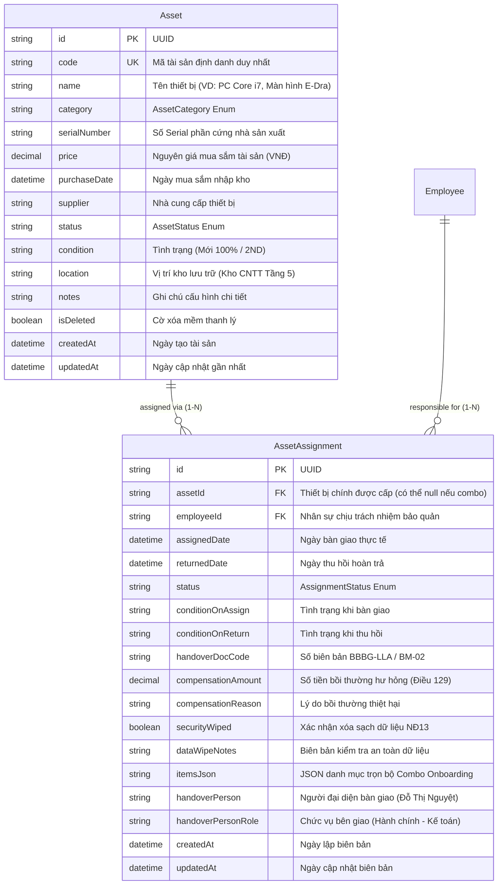

# TÀI LIỆU THIẾT KẾ CƠ SỞ DỮ LIỆU (ERD)
## PHÂN CỤM: QUẢN LÝ KHO TÀI SẢN & BÀN GIAO THIẾT BỊ (ASSET & HANDOVER)

---

### THÔNG TIN TÀI LIỆU
* **Tên tài liệu:** Entity Relationship Diagram (ERD) – Phân cụm Kho Thiết bị, Bàn giao Onboarding (BM-01 BBBG-LLA) & Thu hồi Bồi thường (BM-02)
* **Mã tài liệu:** `ERD-HRM-MOD-04`
* **Phiên bản:** 1.0 (Chuẩn hóa Schema PostgreSQL & Prisma ORM)
* **Ngày cập nhật:** 27/10/2026
* **Các thực thể chính:** `Asset`, `AssetAssignment`
* **Tình trạng:** Bản hoàn thiện chính thức

---

### MỤC LỤC
1. [Sơ đồ Quan hệ Thực thể Phân cụm (Domain Mermaid ERD)](#1-sơ-đồ-quan-hệ-thực-thể-phân-cụm-domain-mermaid-erd)
2. [Từ điển Dữ liệu Chi tiết (Data Dictionary)](#2-từ-điển-dữ-liệu-chi-tiết-data-dictionary)
3. [Đặc tả Các Kiểu Liệt kê (Enumerations)](#3-đặc-tả-các-kiểu-liệt-kê-enumerations)
4. [Ràng buộc Khóa ngoại & Chiến lược Thác dữ liệu (Foreign Keys & Cascades)](#4-ràng-buộc-khóa-ngoại--chiến-lược-thác-dữ-liệu-foreign-keys--cascades)
5. [Quy tắc Toàn vẹn Dữ liệu & Xử lý Pháp lý](#5-quy-tắc-toàn-vẹn-dữ-liệu--xử-lý-pháp-lý)

---

### 1. SƠ ĐỒ QUAN HỆ THỰC THỂ PHÂN CỤM (DOMAIN MERMAID ERD)



---

### 2. TỪ ĐIỂN DỮ LIỆU CHI TIẾT (DATA DICTIONARY)

#### 2.1 Bảng `Asset` (Kho Thiết bị Phần cứng)
| Tên Cột | Kiểu Dữ liệu | Nullable | Mặc định | Khóa | Ý nghĩa Nghiệp vụ & Ràng buộc |
| :--- | :--- | :---: | :---: | :---: | :--- |
| `id` | `String` (UUID) | Không | `uuid()` | PK | Định danh duy nhất toàn cầu của thiết bị. |
| `code` | `String` | Không | - | UK | Mã định danh tài sản duy nhất (VD: `AST-PC-001`, `AST-MON-023`). |
| `name` | `String` | Không | - | - | Tên thiết bị (VD: Bộ PC Core i7-12700K 32GB RAM). |
| `category` | `AssetCategory` | Không | `LAPTOP` | - | Danh mục chủng loại thiết bị (Enum). |
| `serialNumber` | `String` | Có | `null` | - | Số Serial phần cứng định danh do hãng sản xuất cung cấp. |
| `price` | `Decimal` | Không | `0` | - | Nguyên giá mua sắm của thiết bị làm căn cứ tính khấu hao/bồi thường. |
| `purchaseDate` | `DateTime` | Có | `null` | - | Ngày mua sắm thiết bị nhập vào kho công ty. |
| `supplier` | `String` | Có | `null` | - | Đơn vị cung cấp thiết bị (Hanoicomputer, An Phát...). |
| `status` | `AssetStatus` | Không | `AVAILABLE`| - | Trạng thái kho: `AVAILABLE`, `ASSIGNED`, `MAINTENANCE`, `DISPOSED`, `LOST`. |
| `condition` | `String` | Có | `"Mới 100%"`| - | Hiện trạng vật lý của máy (Mới, 2ND trầy xước nhẹ...). |
| `location` | `String` | Có | `"Kho CNTT - Tầng 5"`| - | Vị trí cất giữ vật lý khi máy đang ở trong kho. |
| `notes` | `String` (Text) | Có | `null` | - | Ghi chú chi tiết thông số kỹ thuật (SSD, VGA, nguồn...). |
| `isDeleted` | `Boolean` | Không | `false` | - | Cờ xóa mềm (Soft-delete): Không xóa vật lý khi thanh lý thiết bị. |

#### 2.2 Bảng `AssetAssignment` (Sổ Lịch sử Bàn giao, Thu hồi & Bồi thường)
| Tên Cột | Kiểu Dữ liệu | Nullable | Mặc định | Khóa | Ý nghĩa Nghiệp vụ & Ràng buộc |
| :--- | :--- | :---: | :---: | :---: | :--- |
| `id` | `String` (UUID) | Không | `uuid()` | PK | Định danh duy nhất của giao dịch bàn giao / thu hồi. |
| `assetId` | `String` | Có | `null` | FK | Khóa ngoại thiết bị đơn lẻ `Asset.id` (`onDelete: Cascade`). |
| `employeeId` | `String` | Không | - | FK | Khóa ngoại người nhận bàn giao `Employee.id` (`onDelete: Cascade`). |
| `assignedDate` | `DateTime` | Không | `now()` | - | Ngày bắt đầu giao máy cho nhân viên sử dụng. |
| `returnedDate` | `DateTime` | Có | `null` | - | Ngày nhân viên hoàn trả máy khi thôi việc. |
| `status` | `AssignmentStatus`| Không| `ACTIVE` | - | Trạng thái phiếu: `ACTIVE` (Đang giữ), `RETURNED` (Đã trả), `DAMAGED`, `LOST`. |
| `conditionOnAssign`| `String` | Có | `"Hoạt động tốt"` | - | Tình trạng thiết bị lúc bàn giao có chữ ký 2 bên. |
| `conditionOnReturn`| `String` | Có | `null` | - | Tình trạng thiết bị khi thu hồi kiểm tra theo biên bản BM-02. |
| `handoverDocCode` | `String` | Có | `null` | - | Số biên bản pháp lý tự sinh: `.../2026/BBBG-LLA`. |
| `compensationAmount`| `Decimal`| Có | `0` | - | Số tiền bồi thường hư hỏng theo Điều 129 BLLĐ 2019. |
| `compensationReason`| `String` (Text)| Có| `null` | - | Diễn giải chi tiết thiệt hại (VD: Màn hình vỡ sọc kẻ do va đập). |
| `securityWiped` | `Boolean` | Không | `true` | - | Xác nhận xóa sạch dữ liệu và thu hồi email/Slack (Nghị định 13). |
| `dataWipeNotes` | `String` (Text)| Có | `null` | - | Biên bản ghi nhận kỹ thuật viên IT đã Format / Wipe dữ liệu. |
| `itemsJson` | `String` (Text)| Có | `null` | - | JSON danh mục trọn bộ Combo Onboarding (PC + 2 Màn hình + Arm + Phím chuột). |
| `handoverPerson` | `String` | Có | `"Đỗ Thị Nguyệt"`| - | Đại diện bên giao tài sản cố định chuẩn hóa thực tế. |
| `handoverPersonRole`| `String` | Có | `"Hành chính - Kế toán"`| - | Chức vụ người đại diện bên giao tài sản. |

---

### 3. ĐẶC TẢ CÁC KIỂU LIỆT KÊ (ENUMERATIONS)

```prisma
enum AssetCategory {
  LAPTOP            // Máy tính xách tay
  DESKTOP           // Bộ máy tính để bàn (PC)
  MONITOR           // Màn hình máy tính rời
  PHONE             // Điện thoại thông minh phục vụ kiểm thử
  ACCESS_CARD       // Thẻ từ thang máy, thẻ gửi xe
  OFFICE_EQUIPMENT  // Máy in, máy quét, chìa khóa tủ
  VEHICLE           // Xe công vụ
  OTHER             // Thiết bị văn phòng khác
}

enum AssetStatus {
  AVAILABLE    // Sẵn sàng trong kho để bàn giao cho nhân sự mới
  ASSIGNED     // Đang được bàn giao cho nhân sự sử dụng
  MAINTENANCE  // Đang bảo dưỡng, sửa chữa (có nút "Sửa xong")
  DISPOSED     // Đã thanh lý, hết giá trị sử dụng
  LOST         // Bị mất mát trong quá trình vận hành
}

enum AssignmentStatus {
  ACTIVE    // Nhân viên đang trực tiếp nắm giữ và chịu trách nhiệm
  RETURNED  // Đã hoàn trả đủ về kho, hoàn tất biên bản BM-02
  DAMAGED   // Đã hoàn trả nhưng phát hiện hư hỏng, phát sinh bồi thường
  LOST      // Làm mất thiết bị, đang xử lý bồi hoàn tài chính
}
```

---

### 4. RÀNG BUỘC KHÓA NGOẠI & CHIẾN LƯỢC THÁC DỮ LIỆU (FOREIGN KEYS & CASCADES)

1. **`AssetAssignment(assetId) -> Asset(id)`:** Áp dụng `onDelete: Cascade` đối với các bản ghi nháp; tuy nhiên ở tầng API áp dụng `Hard Deletion Lock` chặn xóa thiết bị nếu trạng thái của thiết bị đang là `ASSIGNED`.
2. **`AssetAssignment(employeeId) -> Employee(id)`:** Ràng buộc chặt chẽ với hồ sơ nhân sự; làm căn cứ hiển thị Tab `Asset` trên màn hình Hồ sơ 360 độ của nhân viên.
3. **Chốt chặn Cứng với Phân hệ Thôi việc & Bàn giao:** API Thôi việc kiểm tra truy vấn:
   ```sql
   SELECT COUNT(*) FROM "AssetAssignment" WHERE "employeeId" = :empId AND "status" = 'ACTIVE';
   ```
   Nếu kết quả $> 0$, cơ sở dữ liệu và API tuyệt đối chặn không cho phép cập nhật `Employee.status = 'RESIGNED'`.

---

### 5. QUY TẮC TOÀN VẸN DỮ LIỆU & XỬ LÝ PHÁP LÝ

* **Cấu trúc Dữ liệu Combo Onboarding (`itemsJson`):** Khi người dùng bấm nút tiện ích `✨ Nạp Combo Onboarding chuẩn LLA`, hệ thống lưu trữ mảng đối tượng có cấu trúc dạng JSON:
  ```json
  [
    { "item": "Bộ máy tính PC", "specs": "Core i7-12700K / 32GB RAM / SSD 512GB", "quantity": 1, "condition": "Mới" },
    { "item": "Màn hình rời E-Dra", "specs": "24 inch IPS 75Hz", "quantity": 2, "condition": "Mới" },
    { "item": "Giá đỡ màn hình Arm", "specs": "North Bayou F160 đôi", "quantity": 1, "condition": "Mới" },
    { "item": "Bộ chuột bàn phím & lót chuột", "specs": "E-Dra Gaming", "quantity": 1, "condition": "Mới" },
    { "item": "Tài khoản hệ thống & Email", "specs": "Domain nội bộ + Google Workspace", "quantity": 1, "condition": "Hoạt động" }
  ]
  ```
* **Tích hợp Bồi thường Thiệt hại vào Bảng Lương:** Nếu trường `compensationAmount > 0`, hệ thống tự động sinh bản ghi chi tiết phiếu lương `PayslipDetail` thuộc loại `DEDUCTION` với diễn giải *"Khấu trừ bồi thường tài sản hư hỏng theo Biên bản BM-02"*.
* **Xác nhận An toàn Thông tin Nghị định 13/2023/NĐ-CP:** Thiết bị thu hồi không thể chuyển trạng thái từ `ASSIGNED` về `AVAILABLE` nếu trường `securityWiped === false`.
