# TÀI LIỆU THIẾT KẾ CƠ SỞ DỮ LIỆU (ERD)
## PHÂN CỤM: CA KÍP, CHẤM CÔNG, NGHỈ PHÉP & LÀM THÊM GIỜ (TIME & ATTENDANCE)

---

### THÔNG TIN TÀI LIỆU
* **Tên tài liệu:** Entity Relationship Diagram (ERD) – Phân cụm Ca kíp, Chấm công, Giải trình, Quỹ phép năm & Làm thêm giờ OT
* **Mã tài liệu:** `ERD-HRM-MOD-05`
* **Phiên bản:** 1.0 (Chuẩn hóa Schema PostgreSQL & Prisma ORM)
* **Ngày cập nhật:** 27/10/2026
* **Các thực thể chính:** `Shift`, `Holiday`, `Attendance`, `AttendanceAdjustment`, `LeaveBalance`, `LeaveRequest`, `LeaveTypeConfig`, `LeavePolicy`, `OTRequest`
* **Tình trạng:** Bản hoàn thiện chính thức

---

### MỤC LỤC
1. [Sơ đồ Quan hệ Thực thể Phân cụm (Domain Mermaid ERD)](#1-sơ-đồ-quan-hệ-thực-thể-phân-cụm-domain-mermaid-erd)
2. [Từ điển Dữ liệu Chi tiết (Data Dictionary)](#2-từ-điển-dữ-liệu-chi-tiết-data-dictionary)
3. [Đặc tả Các Kiểu Liệt kê (Enumerations)](#3-đặc-tả-các-kiểu-liệt-kê-enumerations)
4. [Ràng buộc Khóa ngoại & Chiến lược Thác dữ liệu (Foreign Keys & Cascades)](#4-ràng-buộc-khóa-ngoại--chiến-lược-thác-dữ-liệu-foreign-keys--cascades)
5. [Quy tắc Toàn vẹn Dữ liệu & Công thức Quy đổi Ngày công](#5-quy-tắc-toàn-vẹn-dữ-liệu--công-thức-quy-đổi-ngày-công)

---

### 1. SƠ ĐỒ QUAN HỆ THỰC THỂ PHÂN CỤM (DOMAIN MERMAID ERD)

```mermaid
erDiagram
    Employee ||--o{ Attendance : "records (1-N)"
    Employee ||--o{ AttendanceAdjustment : "requests (1-N)"
    Employee ||--o{ LeaveBalance : "has annual balances (1-N)"
    Employee ||--o{ LeaveRequest : "submits (1-N)"
    Employee ||--o{ OTRequest : "submits overtime (1-N)"

    Shift {
        string id PK "UUID"
        string name "Tên ca làm việc (Ca hành chính)"
        string startTime "Giờ bắt đầu 08:30"
        string endTime "Giờ kết thúc 17:30"
        string breakTime "Nghỉ trưa 12:00 - 13:30"
        decimal workHours "Số giờ công chuẩn 8.0h"
        boolean isActive "Ca đang áp dụng"
    }

    Holiday {
        string id PK "UUID"
        date date "Ngày nghỉ lễ toàn quốc"
        string name "Tên ngày lễ (Tết, 30/4, 1/5, Quốc khánh)"
    }

    Attendance {
        string id PK "UUID"
        string employeeId FK "Nhân sự chấm công"
        date date "Ngày ghi nhận công việc"
        datetime checkIn "Mốc thời gian Check-in thực tế"
        datetime checkOut "Mốc thời gian Check-out thực tế"
        decimal workingDay "Công quy đổi (1.0, 0.5, 0.0)"
        string status "AttendanceStatus Enum"
    }

    AttendanceAdjustment {
        string id PK "UUID"
        string employeeId FK "Nhân sự giải trình"
        date date "Ngày cần điều chỉnh công"
        string type "Thiếu Check-in / Thiếu Check-out"
        string oldTime "Giờ cũ trên hệ thống"
        string newTime "Giờ thực tế đề xuất công nhận"
        string reason "Lý do quên chấm / đi công tác"
        string status "RequestStatus Enum"
        datetime createdAt "Ngày gửi đơn giải trình"
    }

    LeaveBalance {
        string id PK "UUID"
        string employeeId FK "Nhân sự sở hữu quỹ"
        int year "Năm tài chính áp dụng"
        decimal totalDays "Tổng số phép năm được cấp (12 + thâm niên)"
        decimal usedDays "Số ngày phép đã sử dụng trong năm"
    }

    LeaveRequest {
        string id PK "UUID"
        string employeeId FK "Nhân sự xin nghỉ"
        string leaveType "PAID (Hưởng lương) / UNPAID (Không lương)"
        string session "ALL_DAY / MORNING / AFTERNOON"
        datetime startDate "Ngày bắt đầu nghỉ"
        datetime endDate "Ngày kết thúc nghỉ"
        string status "RequestStatus Enum"
        string reason "Lý do xin nghỉ phép"
        string approverId "Mã người phê duyệt (Quản lý trực tiếp)"
        datetime createdAt "Ngày nộp đơn"
    }

    OTRequest {
        string id PK "UUID"
        string employeeId FK "Nhân sự làm thêm"
        date date "Ngày thực hiện làm thêm giờ"
        decimal requestHours "Số giờ OT đề xuất"
        decimal actualHours "Số giờ OT thực tế được duyệt"
        string status "RequestStatus Enum"
        string reason "Lý do làm thêm (Dự án gấp, On-call)"
    }

    LeaveTypeConfig {
        string id PK "UUID"
        string name "Tên loại phép"
        string code UK "Mã loại phép"
        int defaultDays "Số ngày mặc định trong năm"
        boolean paid "Được hưởng nguyên lương"
        boolean carryForward "Cho phép chuyển sang năm sau"
        string status "Hoạt động / Tạm dừng"
    }
```



---

### 2. TỪ ĐIỂN DỮ LIỆU CHI TIẾT (DATA DICTIONARY)

#### 2.1 Bảng `Attendance` (Nhật ký Chấm công Hằng ngày)
| Tên Cột | Kiểu Dữ liệu | Nullable | Mặc định | Khóa | Ý nghĩa Nghiệp vụ & Ràng buộc |
| :--- | :--- | :---: | :---: | :---: | :--- |
| `id` | `String` (UUID) | Không | `uuid()` | PK | Định danh duy nhất của lượt chấm công. |
| `employeeId` | `String` | Không | - | FK | Khóa ngoại nhân sự `Employee.id`. |
| `date` | `DateTime` (@Date)| Không| - | - | Ngày phát sinh công việc (Chỉ lưu YYYY-MM-DD). |
| `checkIn` | `DateTime` | Có | `null` | - | Thời điểm bấm Check-in thực tế trong ngày. |
| `checkOut` | `DateTime` | Có | `null` | - | Thời điểm bấm Check-out thực tế trong ngày. |
| `workingDay` | `Decimal` | Không | `0` | - | Ngày công quy đổi làm căn cứ tính lương (1.0, 0.5, 0.0). |
| `status` | `AttendanceStatus`| Không| `NORMAL` | - | Trạng thái công (Enum: NORMAL, LATE, EARLY_LEAVE, ON_LEAVE...). |

#### 2.2 Bảng `AttendanceAdjustment` (Đơn Giải trình / Bổ sung Công)
| Tên Cột | Kiểu Dữ liệu | Nullable | Mặc định | Khóa | Ý nghĩa Nghiệp vụ & Ràng buộc |
| :--- | :--- | :---: | :---: | :---: | :--- |
| `id` | `String` (UUID) | Không | `uuid()` | PK | Định danh duy nhất của đơn giải trình. |
| `employeeId` | `String` | Không | - | FK | Khóa ngoại nhân sự nộp đơn `Employee.id`. |
| `date` | `DateTime` (@Date)| Không| - | - | Ngày cần điều chỉnh chấm công. |
| `type` | `String` | Không | - | - | Loại giải trình: 'Thiếu Check-in', 'Thiếu Check-out', 'Đi công tác'. |
| `oldTime` | `String` | Có | `null` | - | Giờ cũ ghi nhận trên máy (hoặc để trống nếu quên quẹt). |
| `newTime` | `String` | Không | - | - | Giờ thực tế đề xuất công nhận (VD: "08:25", "17:35"). |
| `reason` | `String` | Không | - | - | Giải trình lý do khách quan (Gặp khách hàng, lỗi mạng...). |
| `status` | `RequestStatus` | Không | `PENDING` | - | Trạng thái: `PENDING`, `APPROVED`, `REJECTED`. |
| `createdAt` | `DateTime` | Không | `now()` | - | Thời điểm nộp đơn lên hệ thống. |

#### 2.3 Bảng `LeaveBalance` (Quỹ Phép năm của Nhân sự)
| Tên Cột | Kiểu Dữ liệu | Nullable | Mặc định | Khóa | Ý nghĩa Nghiệp vụ & Ràng buộc |
| :--- | :--- | :---: | :---: | :---: | :--- |
| `id` | `String` (UUID) | Không | `uuid()` | PK | Định danh hạn mức phép. |
| `employeeId` | `String` | Không | - | FK | Khóa ngoại nhân sự sở hữu `Employee.id`. |
| `year` | `Int` | Không | - | - | Năm tài chính dương lịch (VD: 2026). |
| `totalDays` | `Decimal` | Không | `12` | - | Tổng số ngày phép được hưởng (12 ngày chuẩn + thâm niên). |
| `usedDays` | `Decimal` | Không | `0` | - | Tổng số ngày phép hưởng lương đã sử dụng trong năm. |

#### 2.4 Bảng `LeaveRequest` (Đơn Xin Nghỉ phép)
| Tên Cột | Kiểu Dữ liệu | Nullable | Mặc định | Khóa | Ý nghĩa Nghiệp vụ & Ràng buộc |
| :--- | :--- | :---: | :---: | :---: | :--- |
| `id` | `String` (UUID) | Không | `uuid()` | PK | Định danh đơn xin nghỉ phép. |
| `employeeId` | `String` | Không | - | FK | Khóa ngoại nhân sự xin nghỉ `Employee.id`. |
| `leaveType` | `LeaveType` | Không | `PAID` | - | Loại phép: `PAID` (Hưởng lương) hoặc `UNPAID` (Không lương). |
| `session` | `String` | Có | `"ALL_DAY"`| - | Buổi nghỉ: `ALL_DAY` (Cả ngày), `MORNING` (Sáng), `AFTERNOON` (Chiều). |
| `startDate` | `DateTime` | Không | - | - | Ngày bắt đầu nghỉ phép. |
| `endDate` | `DateTime` | Không | - | - | Ngày kết thúc nghỉ phép. |
| `status` | `RequestStatus` | Không | `PENDING` | - | Trạng thái phê duyệt: `PENDING`, `APPROVED`, `REJECTED`. |
| `reason` | `String` | Có | `null` | - | Lý do xin nghỉ phép (Cá nhân, ốm đau, việc gia đình). |
| `approverId` | `String` | Có | `null` | - | Mã nhân sự người duyệt (Trưởng phòng quản lý trực tiếp). |

#### 2.5 Bảng `OTRequest` (Đơn Đề xuất Làm thêm giờ)
| Tên Cột | Kiểu Dữ liệu | Nullable | Mặc định | Khóa | Ý nghĩa Nghiệp vụ & Ràng buộc |
| :--- | :--- | :---: | :---: | :---: | :--- |
| `id` | `String` (UUID) | Không | `uuid()` | PK | Định danh yêu cầu làm thêm giờ. |
| `employeeId` | `String` | Không | - | FK | Khóa ngoại nhân sự làm thêm `Employee.id`. |
| `date` | `DateTime` (@Date)| Không| - | - | Ngày làm thêm giờ (Ngày thường, Thứ 7/CN, hay Ngày lễ). |
| `requestHours` | `Decimal` | Không | - | - | Số giờ làm thêm đề xuất thực hiện. |
| `actualHours` | `Decimal` | Không | `0` | - | Số giờ làm thêm thực tế sau khi nghiệm thu công việc. |
| `status` | `RequestStatus` | Không | `PENDING` | - | Trạng thái: `PENDING`, `APPROVED`, `REJECTED`. |
| `reason` | `String` | Có | `null` | - | Lý do làm thêm giờ (Triển khai hệ thống, On-call khẩn cấp). |

#### 2.6 Bảng `Holiday` (Lịch Nghỉ lễ Toàn quốc)
| Tên Cột | Kiểu Dữ liệu | Nullable | Mặc định | Khóa | Ý nghĩa Nghiệp vụ & Ràng buộc |
| :--- | :--- | :---: | :---: | :---: | :--- |
| `id` | `String` (UUID) | Không | `uuid()` | PK | Định danh ngày nghỉ lễ. |
| `date` | `DateTime` (@Date)| Không| - | - | Mốc ngày nghỉ lễ chính thức (YYYY-MM-DD). |
| `name` | `String` | Không | - | - | Tên ngày lễ (Tết Dương lịch, Giỗ Tổ Hùng Vương, 30/4 - 1/5...). |

---

### 3. ĐẶC TẢ CÁC KIỂU LIỆT KÊ (ENUMERATIONS)

```prisma
enum AttendanceStatus {
  NORMAL       // Đi làm đúng giờ, đủ công tiêu chuẩn
  LATE         // Đi muộn (sau 08:45 sáng theo ân hạn)
  EARLY_LEAVE  // Về sớm (trước 17:00 chiều)
  ON_LEAVE     // Nghỉ phép có đơn hợp lệ đã được phê duyệt
  HOLIDAY      // Ngày nghỉ lễ, tết toàn quốc hưởng nguyên lương
  ABSENT       // Vắng mặt không lý do (nghỉ tự do)
}

enum LeaveType {
  PAID    // Nghỉ phép năm hưởng nguyên lương (trừ vào LeaveBalance)
  UNPAID  // Nghỉ việc riêng không hưởng lương
}

enum RequestStatus {
  PENDING   // Đang chờ Quản lý trực tiếp xem xét phê duyệt
  APPROVED  // Đã được phê duyệt, tự động kích hoạt trừ phép / cập nhật công
  REJECTED  // Bị từ chối phê duyệt
}
```

---

### 4. RÀNG BUỘC KHÓA NGOẠI & CHIẾN LƯỢC THÁC DỮ LIỆU (FOREIGN KEYS & CASCADES)

1. **`Attendance(employeeId) -> Employee(id)`:** Ràng buộc chặt chẽ; mỗi ngày công đều gắn với đích danh nhân sự.
2. **`LeaveRequest(employeeId) -> Employee(id)`:** Khi đơn nghỉ phép được chuyển sang `APPROVED`, trigger ứng dụng tự động:
   * Giảm trừ số dư phép: `LeaveBalance.usedDays += calculatedDays`.
   * Sinh các bản ghi `Attendance` cho các ngày làm việc nghỉ với trạng thái `status = ON_LEAVE`.
3. **`AttendanceAdjustment(employeeId) -> Employee(id)`:** Khi đơn giải trình được `APPROVED`, hệ thống cập nhật lại các trường `checkIn` / `checkOut` và tính lại `workingDay` trên bảng `Attendance`.

---

### 5. QUY TẮC TOÀN VẸN DỮ LIỆU & CÔNG THỨC QUY ĐỔI NGÀY CÔNG

* **Công thức Quy đổi Ngày công (Working Day Credit Engine):**
  $$\Delta t = \frac{\text{Check-out} - \text{Check-in}}{3600 \times 1000} \text{ (giờ)}$$
  * Nếu $\Delta t \ge 7.5 \text{ giờ} \longrightarrow \text{workingDay} = 1.0$.
  * Nếu $3.5 \text{ giờ} \le \Delta t < 7.5 \text{ giờ} \longrightarrow \text{workingDay} = 0.5$.
  * Nếu $\Delta t < 3.5 \text{ giờ} \longrightarrow \text{workingDay} = 0.0$.
* **Thuật toán Trừ Ngày Phép Thực tế:**
  Hệ thống chạy hàm `calculateWorkingDays(startDate, endDate)` duyệt qua từng ngày:
  * Loại trừ ngày Thứ 7 (`getDay() === 6`) và Chủ Nhật (`getDay() === 0`).
  * Loại trừ các ngày trùng khớp trong bảng `Holiday`.
  * Chỉ các ngày làm việc thông thường mới bị trừ vào quỹ `LeaveBalance.usedDays`.
* **Cơ chế Phân loại OT theo Luật Lao động:**
  Hệ số làm thêm giờ được ánh xạ tự động vào kỳ tính lương:
  * Ngày làm việc thường: Nhân hệ số $\times 1.5$ (150%).
  * Ngày nghỉ hàng tuần (Thứ 7, CN): Nhân hệ số $\times 2.0$ (200%).
  * Ngày nghỉ Lễ, Tết: Nhân hệ số $\times 3.0$ (300%).
