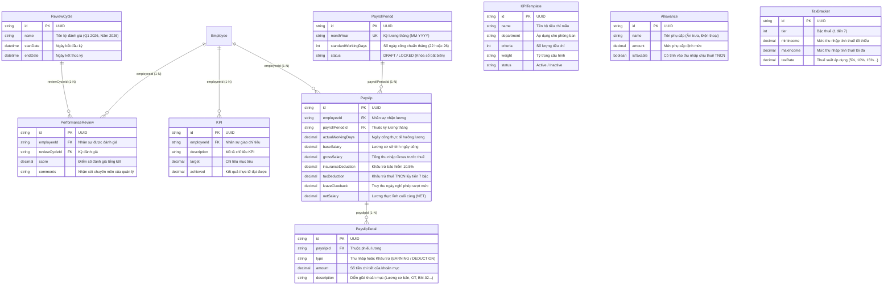

# TÀI LIỆU THIẾT KẾ CƠ SỞ DỮ LIỆU (ERD)
## PHÂN CỤM: ĐÁNH GIÁ HIỆU SUẤT (KPI) & ĐỘNG CƠ TIỀN LƯƠNG (PAYROLL ENGINE)

---

### THÔNG TIN TÀI LIỆU
* **Tên tài liệu:** Entity Relationship Diagram (ERD) – Phân cụm Đánh giá Hiệu suất KPI, Kỳ lương, Phiếu lương & Thuế TNCN
* **Mã tài liệu:** `ERD-HRM-MOD-06`
* **Phiên bản:** 1.0 (Chuẩn hóa Schema PostgreSQL & Prisma ORM)
* **Ngày cập nhật:** 27/10/2026
* **Các thực thể chính:** `ReviewCycle`, `KPI`, `PerformanceReview`, `KPITemplate`, `PayrollPeriod`, `Payslip`, `PayslipDetail`, `Allowance`, `TaxBracket`
* **Tình trạng:** Bản hoàn thiện chính thức

---

### MỤC LỤC
1. [Sơ đồ Quan hệ Thực thể Phân cụm (Domain Mermaid ERD)](#1-sơ-đồ-quan-hệ-thực-thể-phân-cụm-domain-mermaid-erd)
2. [Từ điển Dữ liệu Chi tiết (Data Dictionary)](#2-từ-điển-dữ-liệu-chi-tiết-data-dictionary)
3. [Đặc tả Các Kiểu Liệt kê (Enumerations)](#3-đặc-tả-các-kiểu-liệt-kê-enumerations)
4. [Ràng buộc Khóa ngoại & Chiến lược Thác dữ liệu (Foreign Keys & Cascades)](#4-ràng-buộc-khóa-ngoại--chiến-lược-thác-dữ-liệu-foreign-keys--cascades)
5. [Quy tắc Toàn vẹn Dữ liệu & Công thức Động cơ Lương](#5-quy-tắc-toàn-vẹn-dữ-liệu--công-thức-động-cơ-lương)

---

### 1. SƠ ĐỒ QUAN HỆ THỰC THỂ PHÂN CỤM (DOMAIN MERMAID ERD)



---

### 2. TỪ ĐIỂN DỮ LIỆU CHI TIẾT (DATA DICTIONARY)

#### 2.1 Bảng `PayrollPeriod` (Kỳ lương Tháng)
| Tên Cột | Kiểu Dữ liệu | Nullable | Mặc định | Khóa | Ý nghĩa Nghiệp vụ & Ràng buộc |
| :--- | :--- | :---: | :---: | :---: | :--- |
| `id` | `String` (UUID) | Không | `uuid()` | PK | Định danh duy nhất toàn cầu của kỳ lương. |
| `monthYear` | `String` | Không | - | UK | Khóa duy nhất xác định kỳ lương theo tháng-năm (VD: `10-2026`). |
| `standardWorkingDays`| `Int` | Không | - | - | Số ngày công tiêu chuẩn trong tháng (chuẩn 22 hoặc 26 ngày). |
| `status` | `PayrollStatus` | Không | `DRAFT` | - | Trạng thái: `DRAFT` (Bản nháp tính toán) hoặc `LOCKED` (Khóa sổ bất biến). |

#### 2.2 Bảng `Payslip` (Phiếu lương Nhân sự Hàng tháng)
| Tên Cột | Kiểu Dữ liệu | Nullable | Mặc định | Khóa | Ý nghĩa Nghiệp vụ & Ràng buộc |
| :--- | :--- | :---: | :---: | :---: | :--- |
| `id` | `String` (UUID) | Không | `uuid()` | PK | Định danh duy nhất của phiếu lương. |
| `employeeId` | `String` | Không | - | FK | Khóa ngoại người nhận lương `Employee.id`. |
| `payrollPeriodId`| `String` | Không | - | FK | Khóa ngoại kỳ lương tháng `PayrollPeriod.id`. |
| `actualWorkingDays`| `Decimal` | Không | - | - | Số ngày công thực tế ghi nhận từ phân hệ Chấm công. |
| `baseSalary` | `Decimal` | Không | - | - | Mức lương cơ sở ký kết trên hợp đồng lao động. |
| `grossSalary` | `Decimal` | Không | - | - | Tổng thu nhập trước thuế (Lương công + Phụ cấp + OT + Thưởng KPI). |
| `insuranceDeduction`| `Decimal`| Không | `0` | - | Tổng tiền đóng BHXH, BHYT, BHTN phần NLĐ (10.5%). |
| `taxDeduction` | `Decimal` | Không | `0` | - | Thuế TNCN tính theo biểu lũy tiến 7 bậc. |
| `leaveClawback` | `Decimal` | Không | `0` | - | Khấu trừ tiền nghỉ phép âm hoặc nợ ngày nghỉ. |
| `netSalary` | `Decimal` | Không | - | - | Tiền lương thực nhận chuyển khoản cho nhân sự (NET). |

#### 2.3 Bảng `PayslipDetail` (Chi tiết Các Khoản mục Thu nhập & Khấu trừ)
| Tên Cột | Kiểu Dữ liệu | Nullable | Mặc định | Khóa | Ý nghĩa Nghiệp vụ & Ràng buộc |
| :--- | :--- | :---: | :---: | :---: | :--- |
| `id` | `String` (UUID) | Không | `uuid()` | PK | Định danh duy nhất của dòng chi tiết phiếu lương. |
| `payslipId` | `String` | Không | - | FK | Khóa ngoại phiếu lương `Payslip.id`. |
| `type` | `String` | Không | - | - | Loại khoản mục: `BASE`, `ALLOWANCE`, `OT`, `KPI_BONUS`, `DEDUCTION`, `ASSET_DAMAGE`, `PAYMENT_HOLD`. |
| `amount` | `Decimal` | Không | - | - | Số tiền chi tiết của khoản mục tương ứng. |
| `description` | `String` | Không | - | - | Diễn giải chi tiết hiển thị cho nhân viên trên phiếu lương. |

#### 2.4 Bảng `PerformanceReview` (Phiếu Đánh giá Hiệu suất)
| Tên Cột | Kiểu Dữ liệu | Nullable | Mặc định | Khóa | Ý nghĩa Nghiệp vụ & Ràng buộc |
| :--- | :--- | :---: | :---: | :---: | :--- |
| `id` | `String` (UUID) | Không | `uuid()` | PK | Định danh duy nhất của phiếu đánh giá. |
| `employeeId` | `String` | Không | - | FK | Khóa ngoại nhân sự được đánh giá `Employee.id`. |
| `reviewCycleId` | `String` | Không | - | FK | Khóa ngoại kỳ đánh giá `ReviewCycle.id`. |
| `score` | `Decimal` | Không | - | - | Điểm số đánh giá hiệu suất tổng kết (Thang 100). |
| `comments` | `String` (Text) | Có | `null` | - | Nhận xét chi tiết của Quản lý trực tiếp. |

#### 2.5 Bảng `ReviewCycle` (Kỳ Đánh giá Hiệu suất Định kỳ)
| Tên Cột | Kiểu Dữ liệu | Nullable | Mặc định | Khóa | Ý nghĩa Nghiệp vụ & Ràng buộc |
| :--- | :--- | :---: | :---: | :---: | :--- |
| `id` | `String` (UUID) | Không | `uuid()` | PK | Định danh duy nhất của kỳ đánh giá. |
| `name` | `String` | Không | - | - | Tên kỳ: Đánh giá Q1/2026, Đánh giá Cuối năm 2026. |
| `startDate` | `DateTime` | Không | - | - | Ngày bắt đầu mở đợt đánh giá hiệu suất. |
| `endDate` | `DateTime` | Không | - | - | Hạn chót đóng đợt đánh giá chấm điểm. |

---

### 3. ĐẶC TẢ CÁC KIỂU LIỆT KÊ (ENUMERATIONS)

```prisma
enum PayrollStatus {
  DRAFT   // Kỳ lương đang trong quá trình tổng hợp và đối soát số liệu
  LOCKED  // Đã được Giám đốc ký duyệt và khóa sổ bất biến (Cấm sửa / cấm tính lại)
}
```

---

### 4. RÀNG BUỘC KHÓA NGOẠI & CHIẾN LƯỢC THÁC DỮ LIỆU (FOREIGN KEYS & CASCADES)

1. **`Payslip(payrollPeriodId) -> PayrollPeriod(id)`:** Ràng buộc chặt chẽ; khi xóa một kỳ lương nháp (`DRAFT`), hệ thống thực thi trong một Database Transaction xóa toàn bộ các dòng `PayslipDetail` và `Payslip` liên quan.
2. **`Payslip(employeeId) -> Employee(id)`:** Ràng buộc bảo mật PII; làm cơ sở đối chiếu IDOR:
   ```sql
   SELECT * FROM "Payslip" WHERE "id" = :id AND "employeeId" = :userEmployeeId;
   ```
3. **`PerformanceReview(reviewCycleId) -> ReviewCycle(id)`:** Bảo vệ lịch sử đánh giá hiệu suất của các chu kỳ trong quá khứ.

---

### 5. QUY TẮC TOÀN VẸN DỮ LIỆU & CÔNG THỨC ĐỘNG CƠ LƯƠNG

* **Bất biến Bảng Lương (Strict Lockout Rule):** Khi `PayrollPeriod.status === 'LOCKED'`, API chặn hoàn toàn mọi hành vi:
  * Gọi lệnh tính toán lại `POST /api/payroll/generate`.
  * Xóa kỳ lương `DELETE /api/payroll/periods/:id`.
  * Thay đổi bất kỳ trường số liệu nào trong bảng `Payslip` và `PayslipDetail`.
* **Thuật toán Tính Thuế TNCN Lũy tiến 7 Bậc (PIT Algorithm):**
  $$\text{TNTT} = \text{Gross} - \text{Bảo hiểm (10.5\%)} - 11.000.000 - (\text{Số người phụ thuộc} \times 4.400.000)$$
  * Bậc 1 ($\le 5\text{M}$): $5\%$
  * Bậc 2 ($5 - 10\text{M}$): $10\% - 250.000$
  * Bậc 3 ($10 - 18\text{M}$): $15\% - 750.000$
  * Bậc 4 ($18 - 32\text{M}$): $20\% - 1.650.000$
  * Bậc 5 ($32 - 52\text{M}$): $25\% - 3.250.000$
  * Bậc 6 ($52 - 80\text{M}$): $30\% - 5.850.000$
  * Bậc 7 ($> 80\text{M}$): $35\% - 9.850.000$
* **Khóa Chi trả do Chậm Hồ sơ (`PAYMENT_HOLD`):**
  Khi nhân viên chậm nộp hồ sơ gốc quá 7 ngày, hệ thống chèn một bản ghi vào bảng `PayslipDetail`:
  `type = 'PAYMENT_HOLD'`, `amount = 0`, `description = 'Tạm khóa chi trả do chậm nộp hồ sơ gốc > 7 ngày'`.
