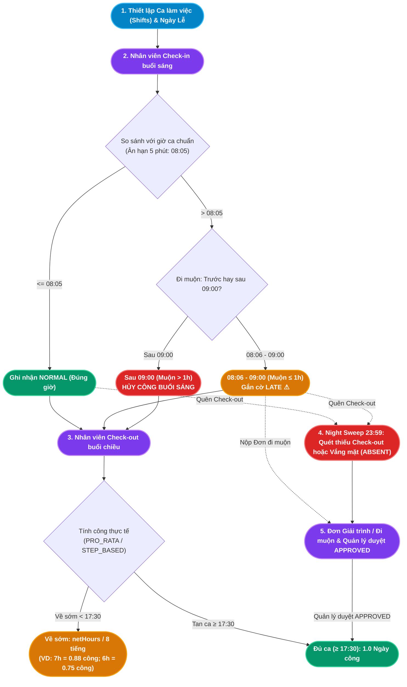

# TÀI LIỆU PHÂN TÍCH NGHIỆP VỤ - MODULE CHẤM CÔNG (TIME & ATTENDANCE)

## 1. Giới thiệu tổng quan Module
**Module Chấm công (Time & Attendance)** đóng vai trò là "chiếc đồng hồ đo lường chuẩn xác" thời gian cống hiến và kỷ luật lao động của toàn bộ cán bộ công nhân viên trong doanh nghiệp. Module này loại bỏ hoàn toàn các phương pháp chấm công thủ công bằng sổ sách hoặc file Excel dễ sai sót, thay thế bằng cơ chế ghi nhận thời gian thực (Real-time Clock-in/out) kết hợp thuật toán tự động quy đổi thời gian làm việc sang **Số ngày công chuẩn (Working Days)**.

Dữ liệu chấm công là cơ sở pháp lý và căn cứ cốt lõi duy nhất để:
- **Module Nghỉ phép & OT**: Kiểm tra nhân viên có đi làm trong ngày hay không để đối chiếu với các đơn xin nghỉ phép hoặc đơn làm thêm giờ.
- **Module Tiền lương (Payroll)**: Cung cấp tổng số ngày công chuẩn thực tế trong tháng để nhân với đơn giá ngày lương trong công thức tính lương chính thức.

### Đối tượng sử dụng (Actors):
1. **Nhân viên (Employee)**: Tự thực hiện bấm nút Check-in buổi sáng khi đến công ty, Check-out buổi chiều khi ra về, xem lịch sử công cá nhân và gửi đơn giải trình khi quên quét thẻ.
2. **Quản lý trực tiếp / Trưởng phòng (Line Manager)**: Theo dõi quân số hiện diện trong ngày của bộ phận, phê duyệt hoặc từ chối các đơn xin điều chỉnh chấm công của cấp dưới.
3. **Chuyên viên C&B / HR Admin**: Thiết lập ca làm việc chuẩn, cấu hình lịch nghỉ lễ quốc gia, đối soát bảng công tổng hợp toàn công ty và chốt công cuối tháng.
4. **Quản trị hệ thống (Admin)**: Quản lý thiết bị quét vân tay/nhận diện khuôn mặt và giám sát tiến trình Cron Job chốt công tự động hàng đêm.

---

## 2. Kiến trúc Luồng Dữ liệu Điểm danh & Tính công (Attendance Pipeline Architecture)

---

## 3. Ma trận Phân rã Chức năng Chi tiết (Functional Breakdown Matrix)

Hệ thống Chấm công (Time & Attendance) bao gồm **3 nhóm chức năng trụ cột** với tổng cộng **14 Use Case con (Sub-Use Cases)** được chuẩn hóa toàn diện:

| Nhóm chức năng (Epic) | Mã Use Case | Tên Chức năng Con (Sub-Use Case) | Actor chính | Endpoint Backend |
|---|---|---|---|---|
| **1. Ghi nhận Vào/Ra & Tính công** *(Check-in / Check-out)* | `UC-ATT-01-01` | Điểm danh Vào (Check-in) & Phân loại Đúng giờ/Muộn | Toàn bộ Nhân viên | `POST /api/attendance/check-in` |
| | `UC-ATT-01-02` | Điểm danh Ra (Check-out) & Tự động Tính ngày công | Toàn bộ Nhân viên | `POST /api/attendance/check-out` |
| | `UC-ATT-01-03` | Tra cứu Bảng Chấm công Cá nhân & Bộ phận | Toàn hệ thống | `GET /api/attendance` |
| | `UC-ATT-01-04` | Tự động Chốt công Cuối ngày (Night Cron Job 23:59) | Server Cron Job | Background Scheduled Task |
| | `UC-ATT-01-05` | Điểm danh Bổ sung / Admin Ghi nhận Thay | HR / Admin | `POST /api/attendance/manual` |
| **2. Cấu hình Ca & Ngày Lễ** *(Shifts & Holidays)* | `UC-ATT-02-01` | Thiết lập mới Ca làm việc (Create Working Shift) | Chuyên viên C&B | `POST /api/attendance/shifts` |
| | `UC-ATT-02-02` | Tra cứu & Quản lý Danh mục Ca làm việc | Chuyên viên C&B | `GET /api/attendance/shifts` |
| | `UC-ATT-02-03` | Xóa bỏ Ca làm việc không sử dụng | Chuyên viên C&B | `DELETE /api/attendance/shifts/:id` |
| | `UC-ATT-02-04` | Khai báo Lịch nghỉ Lễ quốc gia (Create Holiday) | Chuyên viên C&B | `POST /api/holidays` |
| | `UC-ATT-02-05` | Tra cứu & Quản lý Danh mục Ngày lễ (Holidays) | Chuyên viên C&B | `GET`, `DELETE /api/holidays` |
| **3. Điều chỉnh Chấm công** *(Attendance Adjustments)* | `UC-ATT-03-01` | Gửi Yêu cầu Điều chỉnh Chấm công (Submit Adjustment)| Toàn bộ Nhân viên | `POST /api/attendance/adjustments` |
| | `UC-ATT-03-02` | Phê duyệt Yêu cầu Điều chỉnh Công (Approve) | Quản lý / HR | `PUT /api/attendance/adjustments/:id/status` |
| | `UC-ATT-03-03` | Từ chối Yêu cầu Điều chỉnh Công (Reject) | Quản lý / HR | `PUT /api/attendance/adjustments/:id/status` |
| | `UC-ATT-03-04` | Tra cứu, Lọc & Tìm kiếm Yêu cầu Điều chỉnh | Quản lý / HR | `GET /api/attendance/adjustments` |

---

## 4. Danh mục Hồ sơ Phân tích Chi tiết (Detailed Specifications)

Vui lòng tham khảo tài liệu đặc tả chi tiết của từng chức năng con tại các liên kết dưới đây:

1. [Đặc tả Chức năng Ghi nhận Vào/Ra và Tính toán Ngày công](./Chuc-nang-Checkin-Checkout.md)
   - Đặc tả 5 Use Case con: Bấm nút Check-in (chặn trùng lặp, chặn nghỉ phép, ân hạn 15 phút), Bấm nút Check-out (tính công 1.0, 0.5, 0.0 theo số giờ thực tế), Tra cứu bảng công thời gian thực, Tác vụ Cron Job chốt công tự động lúc 23:59 đêm, và Điểm danh thay thủ công.
   - Sơ đồ tuần tự và 6 kịch bản kiểm thử mẫu.

2. [Đặc tả Chức năng Quản lý Ca làm việc và Ngày Lễ](./Chuc-nang-Quan-ly-Ca-lam.md)
   - Đặc tả 5 Use Case con: Tạo ca làm việc chuẩn, Quản lý danh mục ca làm, Xóa ca làm việc an toàn, Khai báo ngày nghỉ lễ quốc gia tự động tính nguyên công (Điều 112 BLLĐ 2019), Tra cứu và điều chỉnh ngày nghỉ lễ.
   - Sơ đồ tuần tự và 5 kịch bản kiểm thử mẫu.

3. [Đặc tả Chức năng Quản lý Điều chỉnh Chấm công và Giải trình Công](./Chuc-nang-Dieu-chinh-Cham-cong.md)
   - Đặc tả 4 Use Case con: Nhân viên nộp đơn giải trình (quên check-in/out, đi công tác), Quản lý trực tiếp phê duyệt đơn khôi phục ngày công, Quản lý từ chối đơn gian lận/sai sự thật, Tra cứu tìm kiếm đơn giải trình toàn công ty.
   - Sơ đồ tuần tự và 5 kịch bản kiểm thử mẫu.

---

## 5. Điểm nhấn Kỹ thuật & Nghiệp vụ (Key Business Highlights)

1. **Thuật toán Tự động Tính Ngày công theo Khung ca, Cổng chặn Kỷ luật & Trừ giờ nghỉ trưa (Net Workday Formula)**:
   - Thay vì nhân viên tự khai hoặc lấy thời gian tuyệt đối `Check-out - Check-in` dễ bị gian lận (đến sớm, về trễ, hoặc ngủ trưa vẫn tính đủ giờ), hệ thống áp dụng thuật toán chuẩn hóa:
     1. **Cổng chặn Kỷ luật Đi muộn Buổi sáng (`MORNING_LATE_CUTOFF_TIME` - Mặc định 09:00):**
        - Nhân viên check-in $\le 09:00$ (muộn $\le 1$ tiếng): Ghi nhận vi phạm kỷ luật `LATE ⚠`. Nếu có **Đơn xin phép đi muộn / Giải trình** được Quản lý/HR phê duyệt trong hạn mức (3 lần/tháng), hệ thống khôi phục đủ **1.0 ngày công chuẩn** và xóa vi phạm sang `NORMAL`.
        - Nhân viên check-in $> 09:00$ (muộn quá 1 tiếng): **HỦY TOÀN BỘ CÔNG BUỔI SÁNG (0 công sáng)**. Thời gian làm việc chỉ bắt đầu được ghi nhận từ đầu ca chiều ($13:30$). Nếu ca chiều làm đủ ($\ge 3.5\text{h}$) thì hưởng nửa ngày công ($0.5$ công); nếu ca chiều về sớm ($< 3.5\text{h}$) thì ghi nhận $0.0$ công.
     2. **Chặn khung ca làm việc & Khấu trừ nghỉ trưa (`breakTime` 12:00 - 13:30):**
        $$\text{Start}_{\text{eff}} = \max(\text{Check-in}, \text{ShiftStart})$$
        $$\text{End}_{\text{eff}} = \min(\text{Check-out}, \text{ShiftEnd})$$
        $$\text{Overlap}_{\text{Break}} = \max\left(0, \min(\text{End}_{\text{eff}}, \text{BreakEnd}) - \max(\text{Start}_{\text{eff}}, \text{BreakStart})\right)$$
        $$\Delta t_{\text{net}} = (\text{End}_{\text{eff}} - \text{Start}_{\text{eff}}) - \text{Overlap}_{\text{Break}}$$
     3. **Quy đổi Số ngày công (Hỗ trợ 2 chế độ linh hoạt theo cấu hình `ATTENDANCE_WORK_CALCULATION_MODE`):**
        - **Chế độ `PRO_RATA` (Chuẩn thực tế doanh nghiệp):** Khi nhân viên về sớm trước giờ tan ca ($17:30$), số ngày công được tính tỷ lệ chính xác theo thời gian cống hiến:
          $$\text{workingDay} = \text{round}\left(\frac{\Delta t_{\text{net}}}{8.0}, 2\right) \times \text{dayMult}$$
          *(Ví dụ: Làm 7.0 tiếng $\rightarrow 7/8 = 0.88$ công; làm 6.0 tiếng $\rightarrow 6/8 = 0.75$ công; làm 4.0 tiếng $\rightarrow 4/8 = 0.5$ công).*
        - **Chế độ `STEP_BASED` (Bậc thang truyền thống):**
          - $\Delta t_{\text{net}} \ge 7.0 \text{ giờ} \rightarrow 1.0 \text{ ngày công}$.
          - $3.5 \text{ giờ} \le \Delta t_{\text{net}} < 7.0 \text{ giờ} \rightarrow 0.5 \text{ ngày công}$.
          - $\Delta t_{\text{net}} < 3.5 \text{ giờ} \rightarrow 0.0 \text{ ngày công}$.

2. **Chính sách Ân hạn Đi muộn (Grace Period) & Hạn mức Giải trình**:
   - Ca hành chính bắt đầu lúc `08:00`. Nhằm tạo sự linh hoạt trong điều kiện giao thông đô thị, hệ thống thiết lập mốc ân hạn (cấu hình trong Tham số hệ thống, mặc định 5 phút: `08:00 – 08:05`).
   - Nhân viên quét thẻ trong mốc ân hạn vẫn được ghi nhận trạng thái `NORMAL` (Đúng giờ). Chỉ khi quét thẻ sau mốc ân hạn mới bị đánh dấu `LATE` (Đi muộn).
   - Mỗi tháng nhân viên có hạn mức tối đa 3 lần nộp Đơn xin phép đi muộn được miễn phạt và bảo lưu công. Từ lần thứ 4 trở đi, hệ thống vẫn lưu vết cờ `LATE` để áp dụng chế tài nội quy công đoàn.

3. **Cơ chế Khóa kỳ công / Khóa sổ lương (Lock Period Protection - BR-ATT-02)**:
   - Khi kỳ lương tháng T được phê duyệt và chuyển sang trạng thái `LOCKED`, hệ thống tự động khóa sổ:
     - Chặn nhân viên nộp đơn giải trình (`AttendanceAdjustment`) cho các ngày thuộc kỳ lương đã khóa.
     - Chặn cấp Quản lý phê duyệt bù công cho các ngày trong kỳ lương đã khóa nhằm bảo đảm toàn vẹn dữ liệu kế toán và bảng lương lịch sử.

4. **Kiểm soát Làm thêm giờ độc lập & Đối soát Sinh trắc học (Biometric Cross-Check OT - Điều 98 & 107 BLLĐ 2019)**:
   - Check-out muộn sau giờ tan ca **không bao giờ tự động sinh tiền làm thêm giờ** (tránh tình trạng nhân viên ở lại văn phòng ngoài giờ tự do rồi đòi tính tiền OT).
   - Nhân viên muốn hưởng tiền OT (hệ số 150% ngày thường, 200% cuối tuần, 300% ngày lễ) bắt buộc phải có Đơn đăng ký `OTRequest` hợp lệ, nêu rõ lý do công việc.
   - **Cơ chế Đối soát Chéo Tự Động giữa Đơn OT và Máy Chấm Công (Biometric Punch Verification):**
     * Khi Quản lý / HR phê duyệt nghiệm thu giờ OT để tính lương, hệ thống tự động truy vấn bản ghi quẹt thẻ ra (`checkOut`) trong ngày của nhân viên:
       $$\text{Thời gian ở lại sau ca (stayHours)} = \max\left(0, \frac{\text{CheckOut Time} - 17:30}{60 \text{ phút}}\right)$$
       $$\text{Số giờ nghiệm thu đề xuất} = \min(\text{Số giờ xin trên đơn}, \text{stayHours})$$
     * **Trường hợp ĐẠT ĐỦ ĐIỀU KIỆN (Check-out $\ge 17:30 + \text{requestHours}$):** Đơn xin 3h và quẹt thẻ ra lúc $\ge 20:30$ $\rightarrow$ Hệ thống tự động phê duyệt đủ 3.0h.
     * **Trường hợp VỀ SỚM / THIẾU GIỜ (Check-out $< 17:30 + \text{requestHours}$):** Đơn xin 4h nhưng thực tế quẹt thẻ ra lúc 19:00 (chỉ ở lại 1.5h) $\rightarrow$ Hệ thống tự động giới hạn nghiệm thu ở mức **1.5 giờ** (chặn nguy cơ chi trả lương khống 4h).
     * **Trường hợp VỀ ĐÚNG GIỜ CA THƯỜNG (Check-out $\le 17:30$ hoặc ở lại $< 30$ phút):** Hệ thống gán nghiệm thu **0.0 giờ** và cảnh báo Quản lý từ chối đơn.
     * **Trường hợp QUÊN QUẸT THẺ RA:** Hệ thống cảnh báo đỏ yêu cầu nhân viên làm đơn Giải trình công trước khi xét duyệt OT.
     * **Ghi chú đặc cách:** Nếu Quản lý muốn duyệt số giờ lớn hơn thời gian quẹt thẻ thực tế (ví dụ máy quẹt thẻ bị lỗi, nhân viên làm việc tại địa điểm khách hàng), Quản lý bắt buộc phải nhập "Lý do đặc cách" để lưu vết Audit Log.

5. **Bảo mật Điểm danh & Chống gian lận (Security & Anti-fraud Controls)**:
   - **Server Timestamp:** Giờ check-in và check-out hoàn toàn lấy từ đồng hồ máy chủ (`new Date()`), chặn mọi hành vi can thiệp sửa giờ trên máy tính client.
   - **Chặn Check-in trực tuyến tự do:** Hệ thống chỉ chấp nhận dữ liệu quẹt thẻ thực tế từ thiết bị sinh trắc học (vân tay / nhận diện khuôn mặt) hoặc qua cơ chế đồng bộ có xác thực của HR/Admin; nhân viên ngồi ở nhà không thể bấm nút check-in tự do qua web.
   - **Giới hạn phạm vi đề tài:** Hệ thống thiết kế chuyên biệt cho mô hình ca hành chính ban ngày (Daytime Office Shifts). Cơ chế định vị GPS Geofencing và WiFi BSSID Whitelist được xếp vào mục hướng phát triển mở rộng.

6. **Cơ chế Quét chốt công Tự động (Daily Sweep) & Ghi nhận Nguyên công Ngày Lễ (Điều 112 BLLĐ 2019)**:
   - Tác vụ quét cuối ngày tự động phát hiện người có check-in nhưng thiếu check-out $\rightarrow$ tạm giữ `workingDay = 0` chờ nộp đơn giải trình; nhân viên vắng mặt không phép $\rightarrow$ gắn trạng thái `ABSENT`.
   - Các ngày lễ quốc gia (`Holiday`) được tự động ghi nhận **1.0 ngày công chuẩn** để chi trả 100% lương theo đúng Bộ luật Lao động 2019.

