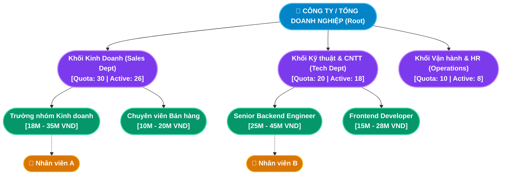

# TÀI LIỆU PHÂN TÍCH NGHIỆP VỤ - MODULE TỔ CHỨC (ORGANIZATION MANAGEMENT)

## 1. Giới thiệu tổng quan Module
**Module Tổ chức (Organization Management)** là phân hệ nền móng và là "xương sống" (Core Backbone) của toàn bộ hệ thống Enterprise HRM. Mục tiêu cốt lõi của module là số hóa toàn bộ cơ cấu mô hình doanh nghiệp thực tế từ Ban Lãnh đạo cấp cao xuống các Khối / Ban / Phòng / Đội / Nhóm, đồng thời chuẩn hóa danh mục vị trí công tác và dải lương theo từng ngạch nghề nghiệp.

Module đóng vai trò cung cấp **Dữ liệu danh mục dùng chung (Master Data)** xuyên suốt cho các phân hệ nghiệp vụ:
1. **Module Tuyển dụng (Recruitment & ATS)**: Kế thừa danh mục phòng ban và vị trí công tác đang hoạt động (`ACTIVE`) để phát hành tin tuyển dụng; kiểm soát chỉ tiêu định biên (Quota) để ngăn chặn tuyển dụng vượt ngân sách.
2. **Module Hồ sơ Nhân sự (Core HR)**: Tiếp nhận nhân viên mới (Onboarding), bổ nhiệm chức danh và điều chuyển công tác theo cấu trúc tổ chức chuẩn.
3. **Module Tiền lương (Payroll)**: Kiểm soát mức lương thỏa thuận trong hợp đồng lao động không vượt dải lương sàn - trần (`minSalary` - `maxSalary`) của từng vị trí công tác.

### Đối tượng sử dụng (Actors):
1. **Ban Lãnh đạo & Giám đốc Điều hành (Executive / BOD)**: Tra cứu toàn cảnh sơ đồ cây phân cấp tổ chức, giám sát tỷ lệ lấp đầy định biên nhân sự theo từng khối phòng ban.
2. **Giám đốc Nhân sự & Chuyên viên C&B (HR Manager / C&B Specialist)**: Khởi tạo, cập nhật cơ cấu phòng ban, thiết lập dải lương trần - sàn cho từng vị trí và quản lý trạng thái đóng băng/khóa danh mục.
3. **Toàn thể Nhân viên (Employees)**: Tra cứu sơ đồ tổ chức công ty, thông tin trưởng bộ phận và vị trí phòng ban trực thuộc.
4. **Quản trị viên hệ thống (Admin)**: Quản lý quyền hạn và bảo đảm tính toàn vẹn phả hệ cây tổ chức.

---

## 2. Kiến trúc Cơ cấu Tổ chức & Cây Phân cấp (Organization Architecture & Department Tree)

---

## 3. Ma trận Phân rã Chức năng Chi tiết (Functional Breakdown Matrix)

Module Tổ chức bao gồm **3 nhóm chức năng trụ cột** với tổng cộng **15 Use Case con (Sub-Use Cases)** được chuẩn hóa:

| Nhóm chức năng (Epic) | Mã Use Case | Tên Chức năng Con (Sub-Use Case) | Actor chính | Endpoint Backend |
|---|---|---|---|---|
| **1. Quản lý Phòng ban** *(Department Management)* | `UC-ORG-01-01` | Thêm mới phòng ban vào cây phả hệ (Create Department) | HR Manager, Admin | `POST /api/departments` |
| | `UC-ORG-01-02` | Chỉnh sửa thông tin, phòng ban cha & định biên (Edit Department) | HR Manager, Admin | `PUT /api/departments/:id` |
| | `UC-ORG-01-03` | Khóa / Mở khóa phòng ban đóng băng mềm (Toggle Status) | HR Manager, Admin | `PUT /api/departments/:id` |
| | `UC-ORG-01-04` | Tìm kiếm & Lọc phòng ban theo từ khóa, trạng thái (Filter) | HR Staff, HR Manager | `GET /api/departments` |
| | `UC-ORG-01-05` | Xóa phòng ban rỗng an toàn (Safe Hard Delete) | HR Manager, Admin | `DELETE /api/departments/:id` |
| | `UC-ORG-01-06` | Giám sát định biên & Tỷ lệ lấp đầy nhân sự (Quota Monitoring) | Ban Lãnh đạo, HR | `GET /api/reports/overview` |
| **2. Quản lý Vị trí Công tác** *(Position & Salary Band)* | `UC-ORG-02-01` | Thêm mới vị trí chức danh và cấp bậc (Create Position) | HR Manager, Admin | `POST /api/positions` |
| | `UC-ORG-02-02` | Chỉnh sửa tên chức danh, mô tả JD & cấp bậc (Edit Position) | HR Manager, Admin | `PUT /api/positions/:id` |
| | `UC-ORG-02-03` | Khóa / Mở khóa vị trí công tác đóng băng mềm (Toggle Status) | HR Manager, Admin | `PUT /api/positions/:id` |
| | `UC-ORG-02-04` | Tìm kiếm & Lọc vị trí theo phòng ban, cấp bậc (Filter Positions) | HR Staff, C&B | `GET /api/positions` |
| | `UC-ORG-02-05` | Kiểm soát dải lương trần - sàn (Salary Band Validation) | C&B, HR Manager | Middleware & Model Logic |
| | `UC-ORG-02-06` | Xóa vị trí chức danh an toàn khi chưa có nhân sự (Safe Delete) | HR Manager, Admin | `DELETE /api/positions/:id` |
| **3. Trực quan hóa Sơ đồ Cây** *(Interactive Org Chart)* | `UC-ORG-03-01` | Xem cây phân cấp tổ chức toàn doanh nghiệp (View Org Tree) | Toàn thể Nhân viên | `GET /api/departments` |
| | `UC-ORG-03-02` | Thu gọn / Mở rộng các nhánh phòng ban tương tác (Expand/Collapse) | Toàn thể Nhân viên | Frontend Interactive Node |
| | `UC-ORG-03-03` | Xem thẻ chi tiết nhân sự & trưởng bộ phận trên Node (Node Detail) | Ban Lãnh đạo, HR | Modal / Drawer Chi tiết |

---

## 4. Danh mục Hồ sơ Phân tích Chi tiết (Detailed Specifications)

Vui lòng tham khảo tài liệu đặc tả chi tiết của từng chức năng con tại các liên kết dưới đây:

1. [Đặc tả Chức năng Quản lý Danh mục Phòng ban (Department Management)](./Chuc-nang-Quan-ly-Phong-ban.md)
   - Đặc tả 6 Use Case con: Thêm mới phòng ban, Sửa thông tin & luân chuyển cha con, Khóa/Mở khóa đóng băng mềm, Tìm kiếm phân trang, Xóa an toàn chống gãy cây, Giám sát định biên quota nhân sự.
   - Sơ đồ tuần tự và 6 kịch bản kiểm thử mẫu.

2. [Đặc tả Chức năng Quản lý Vị trí Công tác & Dải lương (Position & Salary Band)](./Chuc-nang-Quan-ly-Vi-tri.md)
   - Đặc tả 6 Use Case con: Thêm chức danh mới, Điều chỉnh cấp bậc nghề nghiệp, Khóa vị trí ngừng áp dụng, Lọc kết hợp theo Phòng ban & Cấp bậc, Kiểm soát ràng buộc dải lương `minSalary <= maxSalary`, Xóa vị trí an toàn.
   - Sơ đồ tuần tự và 5 kịch bản kiểm thử mẫu.

3. [Đặc tả Chức năng Trực quan hóa Sơ đồ Tổ chức Dạng Cây (Org Chart)](./Chuc-nang-Xem-So-do-To-chuc.md)
   - Đặc tả 3 Use Case con: Xem cây phân cấp tổ chức dạng đồ thị tương tác trực quan, Thu gọn/Mở rộng các nhánh phòng ban con, Xem thông tin thẻ nhân sự và trưởng bộ phận trực tiếp trên Node.
   - Sơ đồ tuần tự và 4 kịch bản kiểm thử mẫu.

---

## 5. Điểm nhấn Kỹ thuật & Nghiệp vụ (Key Business Highlights)

1. **Nguyên tắc "Cấu trúc Cây Linh hoạt & Phòng chống Vòng lặp Vô tận (Infinite Loop Prevention)"**:
   - Doanh nghiệp thường xuyên tái cấu trúc, sáp nhập hoặc chia tách các đơn vị trực thuộc. Hệ thống cho phép điều chỉnh trường `parentId` linh hoạt.
   - Bắt buộc kiểm tra chuỗi phả hệ: Cấm tuyệt đối việc chọn phòng ban con hoặc chính nó làm phòng ban cha (`department.parentId !== id` và không nằm trong tập hậu duệ).

2. **Cơ chế Khóa Nghiệp vụ Đóng băng Mềm thay vì Xóa cứng (Soft-lock Inactive Pattern)**:
   - Dữ liệu phòng ban và chức danh mang giá trị lịch sử pháp lý gắn liền với hợp đồng lao động cũ, bảng lương các năm trước và quyết định nhân sự.
   - Khi phòng ban giải thể hoặc vị trí công tác không còn tuyển dụng, nghiệp vụ chuẩn là **Chuyển sang trạng thái `INACTIVE`** thay vì Xóa cứng (`Hard Delete`). Khi bị khóa, phòng ban/chức danh tự động bị ẩn khỏi các biểu mẫu tiếp nhận nhân sự mới nhưng toàn bộ dữ liệu lịch sử vẫn được bảo toàn nguyên vẹn.

3. **Cơ chế Phòng vệ Toàn vẹn Dữ liệu Nghiêm ngặt (Safe Hard Delete Guard)**:
   - Khi người dùng thực hiện xóa cứng, hệ thống kích hoạt cơ chế kiểm tra an toàn 2 lớp:
     1. Kiểm tra số lượng nhân sự trực thuộc (`employees.count > 0`): Nếu có nhân sự, từ chối xóa và yêu cầu điều chuyển nhân viên trước.
     2. Kiểm tra số lượng phòng ban con (`children.count > 0`): Nếu còn phòng ban con, từ chối xóa để tránh gây mồ côi (Orphaned records) và làm gãy cây cơ cấu tổ chức.

4. **Kiểm soát Ngân sách & Dải lương Vị trí (Salary Band Cap Control)**:
   - Hệ thống ràng buộc cứng mức lương sàn không được vượt quá mức lương trần (`minSalary <= maxSalary`).
   - Mức lương cơ bản khi tạo hợp đồng lao động mới sẽ được đối chiếu với dải lương của vị trí công tác để cảnh báo HR nếu đề xuất vượt khung trần quỹ lương được duyệt.
