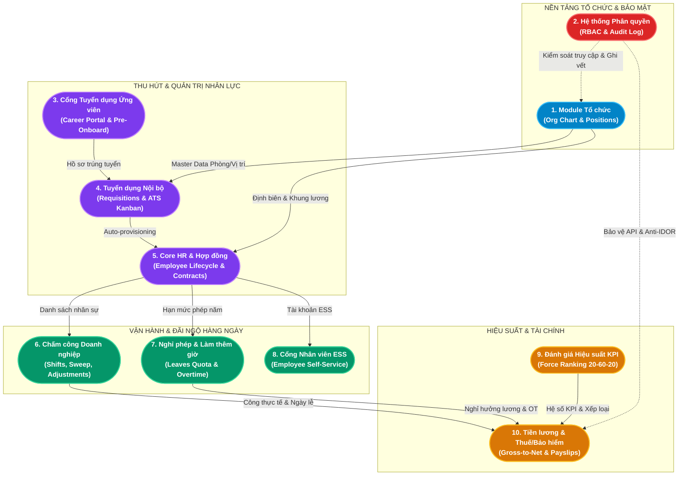

# HỆ THỐNG TÀI LIỆU PHÂN TÍCH NGHIỆP VỤ HRM TOÀN DIỆN (ENTERPRISE HRM BA SPECIFICATIONS)

> **Dự án Đồ Án Tốt Nghiệp**: Hệ Thống Quản Trị Nguồn Nhân Lực Doanh Nghiệp (Enterprise HRM SaaS)  
> **Bộ tài liệu**: Phân tích Nghiệp vụ Chi tiết 10 Phân Hệ Chức Năng (10 Core Business Modules)  
> **Tiêu chuẩn thiết kế**: ERP/HRM SaaS tương đương Base.vn, 1Office, SAP SuccessFactors, tuân thủ Bộ luật Lao động 2019 (BLLĐ 2019).

---

## 1. Bản đồ Tổng quan Cơ cấu Nghiệp vụ (Master Business Architecture)

Toàn bộ hệ thống được phân rã thành **10 phân hệ nghiệp vụ độc lập nhưng liên kết chặt chẽ** qua cơ chế dữ liệu dùng chung (Master Data), định danh bảo mật 3 cổng (Admin - Employee ESS - Candidate Portal), và các chuỗi xử lý giao dịch nguyên tử ($transaction):

---

## 2. Danh mục 10 Phân Hệ Nghiệp vụ & Tài liệu Đặc tả (Master Module Index)

Dưới đây là bảng tra cứu đầy đủ 10 phân hệ nghiệp vụ, kèm đường dẫn truy cập trực tiếp đến tài liệu tổng quan và các hồ sơ đặc tả chức năng con chi tiết:

| STT | Phân hệ (Module) | Thư mục Lưu trữ | Tài liệu Tổng quan | Số lượng Chức năng Con | Danh mục Đặc tả Chi tiết |
|:---:|---|---|---|:---:|---|
| **01** | **Cơ cấu Tổ chức & Sơ đồ Cây** *(Organization Management)* | `Module Tổ chức` | [Module Tổ chức.md](./Module%20Tổ%20chức/Module%20Tổ%20chức.md) | 15 Use Cases | - [Quản lý Danh mục Phòng ban](./Module%20Tổ%20chức/Chuc-nang-Quan-ly-Phong-ban.md) - [Quản lý Vị trí Công tác & Dải lương](./Module%20Tổ%20chức/Chuc-nang-Quan-ly-Vi-tri.md) - [Trực quan hóa Sơ đồ Cây Tổ chức](./Module%20Tổ%20chức/Chuc-nang-Xem-So-do-To-chuc.md) |
| **02** | **Bảo mật, Phân quyền & Kiểm toán** *(Security, RBAC & Audit)* | `Module Hệ thống Phân quyền` | [Module Hệ thống Phân quyền.md](./Module%20Hệ%20thống%20Phân%20quyền/Module%20Hệ%20thống%20Phân%20quyền.md) | 11 Use Cases | - [Phân quyền Động RBAC](./Module%20Hệ%20thống%20Phân%20quyền/Chuc-nang-Phan-Quyen-RBAC.md) - [Nhật ký Hệ thống & Audit Log](./Module%20Hệ%20thống%20Phân%20quyền/Chuc-nang-Audit-Log.md) |
| **03** | **Cổng Tuyển dụng Ứng viên** *(Candidate Career Portal)* | `Module Cổng Tuyển dụng Ứng viên` | [Module Cổng Tuyển dụng Ứng viên.md](./Module%20Cổng%20Tuyển%20dụng%20Ứng%20viên/Module%20Cổng%20Tuyển%20dụng%20Ứng%20viên.md) | 10 Use Cases | - [Trang chủ Tuyển dụng & Thương hiệu](./Module%20Cổng%20Tuyển%20dụng%20Ứng%20viên/Chuc-nang-Trang-chu-Tuyen-dung.md) - [Nộp Hồ sơ, Theo dõi & Pre-Onboarding](./Module%20Cổng%20Tuyển%20dụng%20Ứng%20viên/Chuc-nang-Nop-Ho-so-Va-Theo-doi.md) |
| **04** | **Quản trị Tuyển dụng Nội bộ & ATS** *(Recruitment & ATS Kanban)* | `Module Tuyển dụng` | [Module Tuyển dụng.md](./Module%20Tuyển%20dụng/Module%20Tuyển%20dụng.md) | 20 Use Cases | - [Yêu cầu Tuyển dụng & Đăng tin](./Module%20Tuyển%20dụng/Chuc-nang-Yeu-cau-Tuyen-dung.md) - [Quản lý Phễu ATS Kanban](./Module%20Tuyển%20dụng/Chuc-nang-Quan-ly-ATS.md) - [Lịch Phỏng vấn & Chấm điểm](./Module%20Tuyển%20dụng/Chuc-nang-Phong-van.md) - [Quản lý Offer & Tiếp nhận](./Module%20Tuyển%20dụng/Chuc-nang-Quan-ly-Offer.md) |
| **05** | **Hồ sơ Nhân sự & Hợp đồng (Core HR)** *(Employee Lifecycle & Contracts)* | `Module Core HR` | [Module Core HR.md](./Module%20Core%20HR/Module%20Core%20HR.md) | 18 Use Cases | - [Quản lý Hồ sơ Nhân sự 360°](./Module%20Core%20HR/Chuc-nang-Ho-so-Nhan-su.md) - [Hợp đồng Lao động & Cảnh báo](./Module%20Core%20HR/Chuc-nang-Hop-dong.md) - [Quy trình Hội nhập Onboarding](./Module%20Core%20HR/Chuc-nang-Onboarding.md) |
| **06** | **Quản lý Chấm công Doanh nghiệp** *(Time & Attendance)* | `Module Chấm công` | [Module Chấm công.md](./Module%20Chấm%20công/Module%20Chấm%20công.md) | 14 Use Cases | - [Điểm danh Vào/Ra & Tính ngày công](./Module%20Chấm%20công/Chuc-nang-Checkin-Checkout.md) - [Quản lý Ca làm việc & Ngày lễ BLLĐ](./Module%20Chấm%20công/Chuc-nang-Quan-ly-Ca-lam.md) - [Điều chỉnh Chấm công & Giải trình](./Module%20Chấm%20công/Chuc-nang-Dieu-chinh-Cham-cong.md) |
| **07** | **Quản lý Nghỉ phép & Làm thêm giờ** *(Leave & Overtime Management)* | `Module Nghỉ phép và OT` | [Module Nghỉ phép & OT.md](./Module%20Nghỉ%20phép%20và%20OT/Module%20Nghỉ%20phép%20&%20OT.md) | 12 Use Cases | - [Nghỉ phép & Quỹ phép năm BLLĐ](./Module%20Nghỉ%20phép%20và%20OT/Chuc-nang-Nghi-Phep.md) - [Đăng ký & Phê duyệt OT hệ số](./Module%20Nghỉ%20phép%20và%20OT/Chuc-nang-OT.md) |
| **08** | **Cổng Dịch vụ Nhân viên Tự phục vụ** *(Employee Self-Service - ESS)* | `Module Cổng Nhân viên ESS` | [Module Cổng Nhân viên ESS.md](./Module%20Cổng%20Nhân%20viên%20ESS/Module%20Cổng%20Nhân%20viên%20ESS.md) | 14 Use Cases | - [Dashboard & Điểm danh Online](./Module%20Cổng%20Nhân%20viên%20ESS/Chuc-nang-Dashboard-Diem-danh.md) - [Hồ sơ & Hợp đồng Cá nhân](./Module%20Cổng%20Nhân%20viên%20ESS/Chuc-nang-Ho-so-Ca-nhan.md) - [Quản lý Nghỉ phép Cá nhân](./Module%20Cổng%20Nhân%20viên%20ESS/Chuc-nang-Nghi-phep-Ca-nhan.md) - [Tra cứu Phiếu lương Bảo mật](./Module%20Cổng%20Nhân%20viên%20ESS/Chuc-nang-Tra-cuu-Phieu-luong.md) - [Mục tiêu & Đánh giá KPI Cá nhân](./Module%20Cổng%20Nhân%20viên%20ESS/Chuc-nang-Muc-tieu-KPI.md) |
| **09** | **Đánh giá Hiệu suất & Xếp loại KPI** *(Performance & Force Ranking)* | `Module Đánh giá KPI` | [Module Đánh giá KPI.md](./Module%20Đánh%20giá%20KPI/Module%20Đánh%20giá%20KPI.md) | 12 Use Cases | - [Chu kỳ Đánh giá & Gán Mục tiêu](./Module%20Đánh%20giá%20KPI/Chuc-nang-Chu-ky-Danh-gia.md) - [Chấm điểm & Phân bổ Force Ranking](./Module%20Đánh%20giá%20KPI/Chuc-nang-Cham-diem.md) |
| **10** | **Quản lý Tiền lương, Thuế & Bảo hiểm** *(Payroll, Tax & Insurance)* | `Module Tiền lương` | [Module Tiền lương.md](./Module%20Tiền%20lương/Module%20Tiền%20lương.md) | 12 Use Cases | - [Chạy Bảng lương Gross-to-Net & Khóa kỳ](./Module%20Tiền%20lương/Chuc-nang-Tinh-Luong.md) - [Phiếu lương Điện tử & Quyết toán](./Module%20Tiền%20lương/Chuc-nang-Phieu-Luong.md) |

---

## 3. Khung Quy chuẩn Tuân thủ Pháp luật & Kỹ thuật (Compliance & Standards)

Toàn bộ các tài liệu phân tích nghiệp vụ trong bộ hồ sơ này được xây dựng bám sát 4 nguyên tắc kỹ thuật cốt lõi:

1. **Tuân thủ Tuyệt đối Bộ luật Lao động 2019 (BLLĐ 2019)**:
   - **Điều 112**: Nghỉ lễ, tết nguyên lương (tự động ghi nhận 1.0 ngày công chuẩn khi trùng ngày Holiday).
   - **Điều 113 - 114**: Quỹ phép năm (12 ngày chuẩn + thâm niên 5 năm tăng 1 ngày, cơ chế khóa mềm số dư khi có đơn Pending).
   - **Điều 98**: Tính lương làm thêm giờ theo hệ số luật định (150% ngày thường, 200% ngày nghỉ tuần, 300% ngày lễ/tết).
   - **Quy định Thuế TNCN & Bảo hiểm**: Trừ 10.5% BHXH/YT/TN người lao động đóng, giảm trừ gia cảnh bản thân (11M) và người phụ thuộc (4.4M), áp dụng biểu thuế lũy tiến từng phần 7 bậc.

2. **Kiểm soát Bảo mật Phân quyền Phân tầng (Multi-tier RBAC & Anti-IDOR)**:
   - Ngăn chặn triệt để lỗ hổng Insecure Direct Object References (IDOR): Mọi truy vấn phiếu lương, đơn nghỉ phép cá nhân đều bắt buộc xác thực quyền sở hữu `req.user.employeeId === resource.employeeId`.
   - Cơ chế Soft-lock: Khóa sổ kỳ lương (`LOCKED`), đóng băng phòng ban/vị trí (`INACTIVE`) bảo vệ toàn vẹn lịch sử mà không làm mất mát dữ liệu.

3. **Tính Toàn vẹn Dữ liệu Qua Giao dịch Nguyên tử (Atomic Transactions)**:
   - Các nghiệp vụ liên bảng như Onboarding Ứng viên $\rightarrow$ Nhân viên & Hợp đồng, Duyệt đơn nghỉ phép $\rightarrow$ Trừ quỹ phép, Chốt công cuối ngày $\rightarrow$ Tổng hợp công tháng đều được bọc trong `prisma.$transaction`.

4. **Chuẩn hóa Định dạng Tài liệu 5 Mục (Standard 5-Section BA Structure)**:
   - Tất cả 10 tài liệu Module Tổng quan đều tuân thủ 5 mục chuẩn hóa: *Giới thiệu $\rightarrow$ Kiến trúc luồng $\rightarrow$ Ma trận phân rã $\rightarrow$ Danh mục đặc tả $\rightarrow$ Điểm nhấn nghiệp vụ*.
   - Tất cả 28 tài liệu chức năng con đều bao gồm: *Mục đích $\rightarrow$ Dữ liệu vào $\rightarrow$ Quy tắc nghiệp vụ $\rightarrow$ Bảng đặc tả 8 mục Use Case $\rightarrow$ Kịch bản kiểm thử (Test Cases)*.
